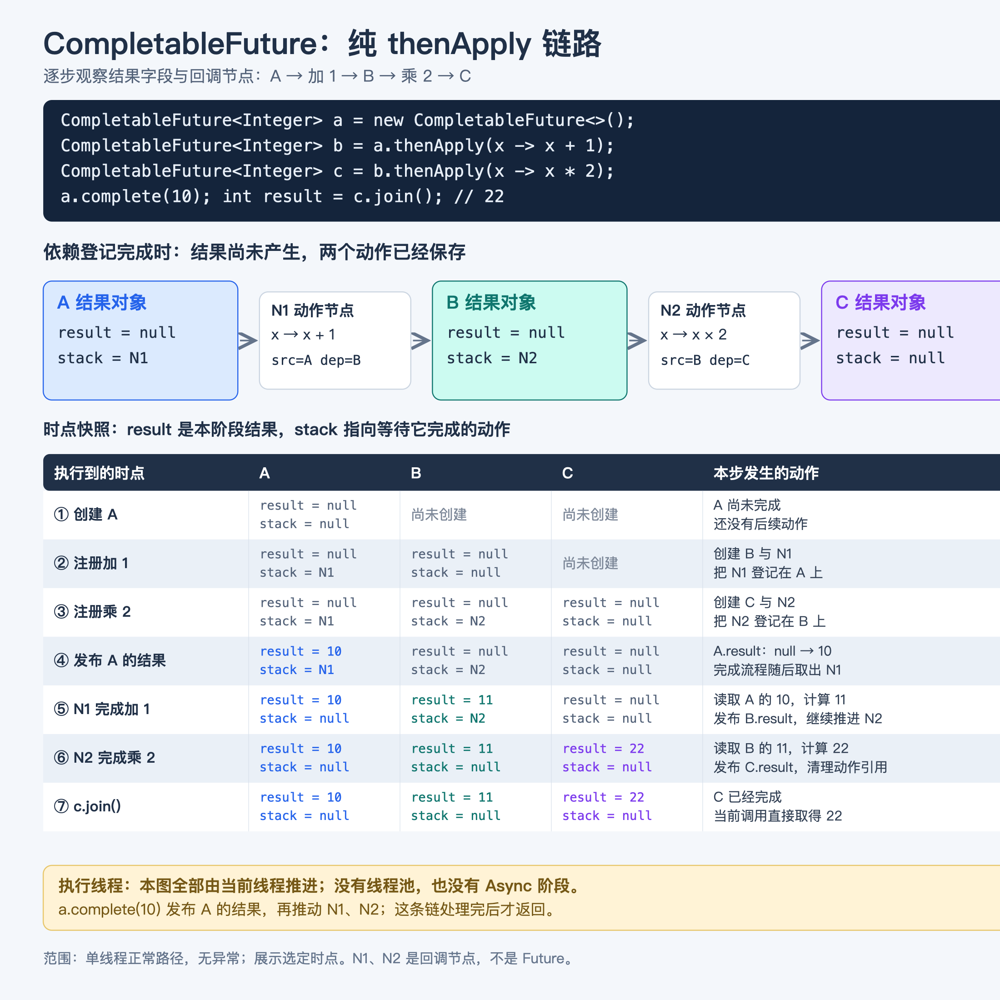
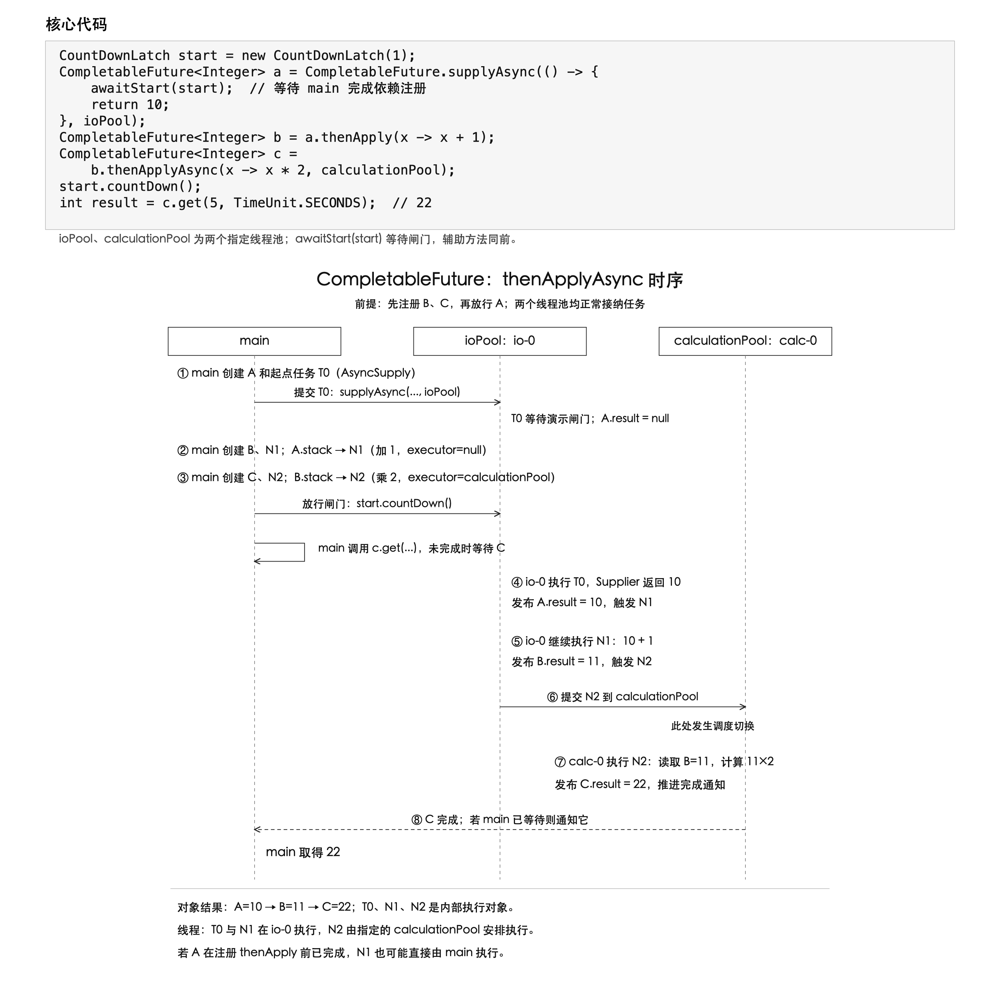

# 第 01 周 Java基础与并发

状态：待复习。实际日期范围：2026-11-03 至 2026-11-05。计划投入：20～25 小时。

导航：[[00-索引与面试/AI应用后端三个月复习/三个月复习总计划]] · [[00-索引与面试/AI应用后端三个月复习/学习进度记录]]

下一周：[[00-索引与面试/AI应用后端三个月复习/第02周-Spring与数据库原理]]。

## 阅读入口

以下为参考笔记，仅阅读与当天问题相关的章节，不要求通篇精读。项目实现以实际代码与记录核实。

- [[01-Java基础与并发/Java基础/基础]]
- [[01-Java基础与并发/Java基础/集合]]
- [[01-Java基础与并发/Java基础/泛型与类型擦除]]、[[01-Java基础与并发/Java基础/对象相等与不可变性]]：第 2 天按需补充类型约束、集合键和快照边界。
- [[01-Java基础与并发/Java基础/异常与资源管理]]：第 1、4 天按需补充失败传播、资源关闭与取消处理。
- [[01-Java基础与并发/Java基础/注解与反射]]、[[01-Java基础与并发/Java基础/时间与金额处理]]：基础补充材料，按薄弱项选读，不额外改变本周任务与完成标准。
- [[01-Java基础与并发/并发编程/Java并发编程]]

## 本周五天安排

| 学习日 | 主题 | 状态 |
| --- | --- | --- |
| 第 1 天 | 请求与线程执行模型 | 待复习 |
| 第 2 天 | 集合与共享状态 | 待复习 |
| 第 3 天 | JMM与锁 | 学习中 |
| 第 4 天 | 线程池与异步编排 | 未开始 |
| 第 5 天 | 并发串联与周复盘 | 未开始 |

## 第 1 天 请求与线程执行模型

实际日期：2026-11-03。实际时长：5 小时。状态：待复习。掌握程度：可独立解释。

### 当日任务

- [ ] 回顾上次记录，复述已学内容；第一天先了解当前基础。
- [ ] 核心学习：理解同步与异步、线程与任务、阻塞与等待，串起一次外部模型调用。
- [ ] 实践分析：画出请求线程与工作线程的执行时序，区分示意流程与项目实际实现。
- [ ] 编码或 SQL：Java 数组、Map 基础及两数之和。
- [ ] 验收与反馈：不看笔记说明异步调用把等待转移到了哪里。
- [ ] 填写学习记录，并同步统一进度入口。

### 学习记录

#### 实际完成内容

1. monitor与synchronized的关系，锁升级（轻量级锁、重量级锁）、 ACC_SYNCHRONIZED、wait和notify的关系（必须处于monitor中）
2. 基础的并发控制
3. 中断（interrupted）的使用、中断恢复的必要性
4. ReentrantReadWriteLock（读写锁）、stampedLock（带有乐观读的读写锁）

#### 我的解释或答案要点

1. 针对同一个数据被多个请求同时访问的情况有以下几种方式处理： 悲观锁（redission或者for update锁住数据）、乐观锁（简单修改，通过版本号或者特定业务下的状态值判断）、原子sql（类似于update amount = amount -1 where id = ? 并且检查影响行数）
2. wait是在业务需要某个条件的时候需要挂起，并且等待条件满足，等其他线程通知，然后解除挂起，这时候会再次触发竞争，而不是直接能获取到锁
3. 轻量级锁通过对象头、线程侧锁记录和 CAS 等机制降低加解锁开销。当轻量路径无法完成，或需要支持 wait() 等操作时，可能膨胀为完整 ObjectMonitor。膨胀后仍可自旋，也可能挂起竞争线程；空闲后可由 JVM 在安全条件下收缩，具体机制取决于版本和锁模式。
4. Java 线程中断是一种协作式取消机制：通过 interrupt() 发出请求，由任务检查中断标志或通过可中断方法抛出的 InterruptedException 响应，适用于任务取消、超时控制和服务关闭。`synchronized` 和 ReentrantLock.lock() 在等待锁时不会因中断退出，但获取锁后仍可检查中断标志；`lockInterruptibly()` 则支持在等待锁时响应中断、放弃等待。获取锁后的业务逻辑仍需自行配合取消；例如 sleep() 被中断会抛出异常，但不会直接释放锁：`synchronized` 只有在退出代码块时才自动释放锁，内部捕获后继续执行则仍持有锁，`ReentrantLock` 则应在 finally 中手动释放。处理中断异常时，通常应向上传递，或恢复中断标志并结束当前任务（恢复中断标志是为了让当前任务的上层调用感知中断）。
5. `ReentrantReadWriteLock` 基于 AQS 实现读锁共享、写锁独占。`state` 的高 16 位记录读锁累计持有次数，低 16 位记录写锁重入次数。写锁的持有进程维护在exclusiveOwnerThread中，新写线程需要等待读锁、写锁全部释放，再按排队策略竞争；已有写锁的线程可以重入。读线程可以共享访问，但其他线程持有写锁或排队策略要求等待时，不能直接进入。
写锁可以降级：先取得读锁，再释放写锁，使后续读取仍受保护，同时允许其他读者进入、阻止其他写者修改。纯读锁持有者不能保留读锁直接获取写锁，因为自己的读锁也会阻止写锁获取；即使没有其他读者，阻塞式获取仍会卡住。需要修改时，应先释放读锁、再获取写锁，并重新检查业务条件。
6. `StampedLock` 是支持写锁、普通读锁和乐观读的同步工具，通过返回的 `stamp` 表示锁模式和版本状态。写锁独占、普通读锁共享；乐观读不阻止写线程，先将数据复制到局部变量，再用 `validate(stamp)` 检查读取期间是否有写锁介入，验证失败则重新读取或回退到普通读锁。它支持有条件的读写模式转换，但不支持可重入、`Condition` 和可配置的公平策略，适合读取短小、无副作用、可以安全重读的场景。

#### 代码、图、实验或问答证据

  中断丢失的示例：

```java
void execute() {
    prepare(); // 这里只退出 prepare，不会退出 execute
    doBusiness();
}

void prepare() {
    try {
        Thread.sleep(1_000);
    } catch (InterruptedException e) {
        return; // 中断信息丢失，execute 仍然继续执行业务
    }
}
```

```text
ACC_SYNCHRONIZED步骤原理：
在方法 access_flags 中设置 ACC_SYNCHRONIZED
    ↓
声明：调用这个方法需要 monitor 同步
    ↓
JVM 确定 this 或 Class 锁对象
    ↓
根据对象当前状态、竞争情况和锁模式执行加锁
    ↓
可能走轻量路径，也可能使用膨胀后的 ObjectMonitor
```

``` java
public Inventory snapshot() {
    // ① 记住当前锁的观察版本，不阻止写线程。
    long stamp = lock.tryOptimisticRead();

    // ② 复制候选数据，此时可能读到混合状态。
    int localAvailable = available;
    int localReserved = reserved;

    // ③ 检查复制期间是否有写锁介入。
    if (!lock.validate(stamp)) {
        // ④ 候选副本不可信，取得普通读锁重新读取。
        stamp = lock.readLock();
        try {
            localAvailable = available;
            localReserved = reserved;
        } finally {
            lock.unlockRead(stamp);
        }
    }

    // ⑤ 使用已经验证或在读锁下取得的局部副本。
    return new Inventory(localAvailable, localReserved);
}
```

#### 反馈与需要修正的理解

待记录。

#### 未解决问题及核实方式

待记录。

#### 未完成任务与顺延原因

待记录。

#### 下次具体起点

1. 第八节CAS开始

#### 复测时间与结果

待记录。

## 第 2 天 集合与共享状态

实际日期：2026-11-04。实际时长：4.5 小时。状态：待复习。掌握程度：需提示。

### 当日任务

- [ ] 回顾上次记录，复述已学内容；第一天先了解当前基础。
- [ ] 核心学习：理解 ArrayList、HashMap、ConcurrentHashMap 的使用条件与线程安全边界。
- [ ] 实践分析：用小程序观察共享计数或复合操作的竞争，并解释修正方式。
- [ ] 编码或 SQL：哈希计数与去重，补空输入及重复值用例。
- [ ] 验收与反馈：解释线程安全容器为什么不自动保证整段业务逻辑安全。
- [ ] 填写学习记录，并同步统一进度入口。

### 学习记录

#### 实际完成内容

1. CAS、原子类
2. 重复下单的技术方案，技术选型
3. 调用第三方的正确处理方式
4. AQS：框架控制获取与等待的流程，子类提供状态判断和变更规则。

#### 我的解释或答案要点

1. CAS 提供“满足预期才更新”的原子操作，原子类把这类能力封装成 Java 中可直接使用的 API。CAS 本身只尝试一次，不负责自动重试。CAS 循环才负责失败后的重新计算和尝试（反复获取并赋值的意思）。
2. **CAS** 是一种“比较并更新”的原子操作：当前值等于预期值时才更新，否则返回失败，调用方可以重新读取、计算并重试；**原子类**（如 `AtomicInteger`、`AtomicReference`）封装了原子读写、CAS 和增减等能力，方便安全地操作共享状态，但多个原子操作组合起来不一定整体原子；**LongAdder** 则面向高竞争累加，通过将更新分散到多个内部变量来减少争用，适合请求量等统计，不过 `sum()` 不保证并发更新期间的原子快照，因此不适合库存扣减、名额控制等需要精确条件判断的场景。
3. 如何去判断该使用什么锁或者原子手段： 在JAVA并发编程.md文档的2.5节中，格外关注。
4. redission虽然有自动续期的看门狗机制，如果仅用reidission来控制幂等的话还是存在一定的问题：如果先释放锁再提交事务，在这期间其他请求看不到数据库结果。
5. 在订单及相关变更位于同一 MySQL 数据库、允许多应用实例的前提下，我优先采用“稳定幂等键＋数据库业务唯一约束＋同一事务＋重复请求返回已有订单”的方案：同一次下单的重试复用幂等键，唯一约束拦截并发重复写入，事务保证订单与本库资源变更一致；如果数据库IO强度有点吃紧的情况下，可以采用redission分布式锁来拦截一部分重复请求操作，该场景下的redission锁释放不影响整体逻辑，因为Mysql有唯一键约束。
6. 在数据库驱动的业务系统中，本地读写锁通常不是保证核心业务数据正确性的主要手段，因为它只能协调同一 JVM 内的线程。我会优先用数据库机制保护持久化数据；只有存在本地共享可变状态，并且需要并行读取和互斥更新时，才考虑读写锁。如果数据可以整体替换，也会优先评估不可变快照方案。
7. AQS 是构建锁和同步器的基础框架，通过 volatile 的 state 表示同步状态，结合 CAS、等待队列和 LockSupport，管理线程的竞争、排队、阻塞及唤醒。具体同步器定义 state 的含义以及获取、释放规则，AQS 复用通用的线程等待机制。它支持独占和共享模式，但重入、公平性、许可数量等语义由具体实现决定；线程被唤醒后仍需重新尝试获取，因此有 FIFO 队列也不意味着一定是公平锁。
8. AQS 通过 state 表示同步状态，由具体同步器定义获取和释放规则：线程先尝试获取，失败后通过 CAS 将节点加入同步队列，在合适位置重新尝试，仍不满足条件时通过 LockSupport.park() 挂起；其他线程改变状态并触发通知后，等待线程被 unpark() 唤醒，再次检查并竞争，成功后推进队头，因此被唤醒不代表获取成功，FIFO 队列也不代表一定公平。`ReentrantLock` 使用独占模式，`state` 表示重入次数，完全释放后通知后继；`Semaphore` 使用共享模式，获取时扣减许可、释放时增加许可，等待者根据剩余许可陆续通过；`CountDownLatch` 同样使用共享模式，`state` 表示剩余计数，减到 0 后触发传播唤醒，所有等待者检查到计数为 0 后即可通过，且不会消耗计数。
9. AQS 中，超时和中断是可能触发放弃等待的原因，取消是放弃本次获取并清理队列的过程：限时获取通过固定截止时间计算剩余预算，使用 `parkNanos` 等待，预算耗尽后取消并返回失败；可中断获取在检测到中断后取消并抛出 `InterruptedException`，普通 `lock()` 则记录中断、继续等待，成功获取后恢复中断标志。取消时会清空节点的线程引用、标记取消并修复队列链接，必要时唤醒合适后继，保证队列继续推进；取消不会释放其他线程持有的锁，被唤醒的后继仍需重新检查并竞争。

#### 代码、图、实验或问答证据

```
一个本地数据库事务：
    创建本地订单
    保存渠道请求记录和稳定的渠道请求标识
    保存“需要创建渠道支付单”的 Outbox 事件
    提交
        ↓
接口返回：本地订单号、渠道处理中
        ↓
后台扫描 / 投递任务
        ↓
消费者检查任务与订单是否仍允许执行
        ↓
事务外调用渠道，重试复用原渠道请求标识
        ↓
短事务保存支付参数及处理结果
        ↓
回调 / 主动查单确认最终支付结果

```

#### 反馈与需要修正的理解

待记录。

#### 未解决问题及核实方式

待记录。

#### 未完成任务与顺延原因

待记录。

#### 下次具体起点

线程池

#### 复测时间与结果

待记录。

## 第 3 天 JMM与锁

实际日期：2026-11-05。实际时长：5 小时。状态：学习中。掌握程度：需提示。

### 当日任务

- [ ] 回顾上次记录，复述已学内容；第一天先了解当前基础。
- [ ] 核心学习：学习可见性、原子性、happens-before、synchronized、volatile 与显式锁。
- [ ] 实践分析：分析一个并发小例子，指出需要保护的状态和临界区。
- [ ] 编码或 SQL：双指针与链表反转。
- [ ] 验收与反馈：能解释为何 volatile 不能直接解决复合更新的原子性。
- [ ] 填写学习记录，并同步统一进度入口。

### 学习记录

#### 实际完成内容

1. volatile补充、langadder
2. 线程池
3. Future 与 CompletableFuture 编排

#### 我的解释或答案要点

1. volatile 常用于单个状态标志、动态开关，以及不可变配置快照的安全发布；如果更新需要依赖旧值、维护多个可变字段的一致性，或者协调数据库与多个实例，就需要进一步使用 CAS、锁或数据库并发控制。volatile 最适合“一个线程发布状态，其他线程读取状态”的场景
2. 可见性解决“能否看到修改”，复合原子性解决“读取到提交之间，能否被其他更新插入并破坏结果”；`volatile` 提供前者，不会自动提供后者
3. LongAdder 通过将累计值分散到 base 和多个 Cell 中，减少多线程更新同一个位置时的竞争；更新仍使用 CAS，读取总数时再累加各部分。它适合高并发统计计数，但 sum() 不是并发更新期间的原子快照，不适合精确额度判断或生成递增序号。
4. 最佳使用线程池的方案应该是创建一个线程池的Bean工厂，根据业务的不同分别注入不同的线程池Bean，这个模式能让线程池方便管理，解决了重复创建，生命周期无人管理的问题，也更不产生在某些未关闭线程池的缺陷下导致的线程泄露。如果需要取消任务，采用future.cancel。
5. 对于线程池 submit() 通常返回的 FutureTask，`cancel(true)` 会竞争将任务状态改为取消，并尝试中断执行线程；尚未开始的任务取消成功后不会执行，已完成的任务不受影响。普通计算需要主动检查中断标志，可中断等待会通过 InterruptedException 等方式返回，JDBC 和 HTTP 调用则取决于驱动或客户端，通常还需配合超时及专用取消机制。因此，Future 显示已取消，不代表任务体已经退出，也不代表数据库或远端业务已经撤销。
6. 真实业务里，线程池把任务接收、排队和执行拆到了不同时间与线程上，因此需要同时处理资源和业务边界：创建过多线程池或无人关闭会遗留线程；多个业务共池可能互相拖慢，拆池后又可能争抢同一个数据库连接池或下游限额；队列过大、任务携带大对象、批处理和重试没有上限，会把过载变成内存积压和迟到调用；拒绝策略、被忽略的 Future 异常或未生效的异步代理，可能使任务丢失、失败无人知晓，或意外阻塞请求线程；提交后继续修改任务参数、错误传播租户和日志上下文，会造成竞态或请求间污染；异步任务不自动继承调用方事务，可能在数据提交前运行，也不能靠本地锁、FIFO 队列或线程中断保证跨实例顺序、业务撤销和可靠完成；任务之间同步等待还可能形成线程或连接资源的等待环。正确使用需要明确任务归属与生命周期，按负载和故障影响划分有界执行器，把总期限传到排队及下游调用中，对任务接纳、失败、取消、资源释放和停机恢复分别负责；重要后台任务还应持久化、幂等并具备恢复机制，通过排队时间、实际执行和业务终态确认系统是否健康。
7. 将 U的核心计算公式为：U需求（安全容量） ≈ λ × S / C，其中λ：每秒执行的任务数量。S：每项任务平均消耗的 CPU 时间，单位为秒C：JVM 可用 CPU 核数。将 U 展开后，CPU 密集型的核心线程数可估算为 Ncore ≈ C ×（U饱和拐点 − 安全余量 − U其他工作），阻塞 I/O 密集型则为 Ncore ≈ C ×（U饱和拐点 − 安全余量 − U其他工作）×（1 + W/S）；其中 C 是 JVM 可用 CPU 核数，S 是单项任务平均 CPU 时间，W 是执行期间的平均阻塞等待时间，不含排队。饱和拐点应通过压测结合尾延迟确定，其他开销应在目标混合负载下测量。公式估算的是 CPU 预算可支撑的执行并发，实际 core 还需结合任务量与余量选择，max 受总资源和下游容量约束，队列容量由排队期限与内存共同确定。
8. CompletableFuture 通过结果状态和完成节点组织异步依赖：前置阶段发布结果或异常后，完成流程会触发满足条件的后续动作，并把计算结果传给下一阶段；底层通过 CAS 协调结果发布与节点登记。使用时，`thenApply` 做结果转换，`thenCompose` 连接异步依赖，`thenCombine` 合并两个正常结果；非 Async 回调的执行线程取决于注册与完成时序，耗时计算或阻塞操作应明确指定合适的执行器，后续 Async 阶段不会自动继承前一步指定的线程池。同时应观察异常和拒绝、设置统一期限、避免池内阻塞等待，并按任务归属管理取消；Future 完成或取消不代表底层调用及资源清理已经结束。
9. 真实业务中使用 CompletableFuture，首先要返回或观察覆盖完整业务链的最终阶段，确保组装、校验、保存和通知的异常都能被调用方发现；降级只处理业务允许恢复的错误，不能把权限失败、程序错误统一变成空结果。每个耗时阶段应明确执行器，线程切换时显式处理上下文和事务，并行分支分别生成结果，有先后关系的动作通过依赖连接。超时应共享同一个总截止时间，把排队和底层调用纳入预算；共享 Future 则应隔离不同消费者的期限与完成权限。还要明确 allOf 不会自动提前失败或取消其他分支，`anyOf` 可能首先得到异常，入口提交拒绝也可能同步抛出。批量任务需要限制提交数量和结果积压，重试需要限制次数、预算并保证写操作幂等；监控同时关注聚合结果、分支结果和资源实际释放，因为 Future 超时或取消并不代表数据库、HTTP 请求已经停止

#### 代码、图、实验或问答证据

```
## volatile为什么不能保证复合操作的原子性
| 步骤 | 线程 A | 线程 B |
|---|---|---|
| 1 | 读取 count，得到 10 | |
| 2 | | 读取 count，也得到 10 |
| 3 | 计算结果 11 | |
| 4 | | 计算结果 11 |
| 5 | 写入 count = 11 | |
| 6 | | 写入 count = 11 |
```

```
## 一个线程池Bean工厂的常用写法
import java.util.concurrent.ThreadPoolExecutor;

import org.springframework.context.annotation.Bean;
import org.springframework.context.annotation.Configuration;
import org.springframework.scheduling.concurrent.ThreadPoolTaskExecutor;

@Configuration
public class ExecutorConfig {

    @Bean
    public ThreadPoolTaskExecutor paymentQueryExecutor() {
        return createExecutor("payment-query-", 8, 16, 50);
    }

    @Bean
    public ThreadPoolTaskExecutor exportExecutor() {
        return createExecutor("export-", 2, 2, 10);
    }

    private ThreadPoolTaskExecutor createExecutor(
            String prefix, int coreSize, int maxSize, int queueCapacity) {

        ThreadPoolTaskExecutor executor = new ThreadPoolTaskExecutor();
        executor.setThreadNamePrefix(prefix);
        executor.setCorePoolSize(coreSize);
        executor.setMaxPoolSize(maxSize);
        executor.setQueueCapacity(queueCapacity);
        executor.setRejectedExecutionHandler(
                new ThreadPoolExecutor.AbortPolicy());

        executor.setWaitForTasksToCompleteOnShutdown(true);
        executor.setAwaitTerminationSeconds(20);
        return executor;
    }
}
```

```
## future取消线程池中的任务，归还线程
import java.util.concurrent.ExecutionException;
import java.util.concurrent.Future;
import java.util.concurrent.TimeUnit;
import java.util.concurrent.TimeoutException;

public Result query(String id)
        throws InterruptedException, ExecutionException, TimeoutException {

    Future<Result> future = executor.submit(() -> queryRemote(id));

    try {
        return future.get(2, TimeUnit.SECONDS);
    } catch (TimeoutException e) {
        future.cancel(true);
        throw e;
    } catch (InterruptedException e) {
        future.cancel(true);
        throw e;
    }
}
```






#### 反馈与需要修正的理解

待记录。

#### 未解决问题及核实方式

待记录。

#### 未完成任务与顺延原因

待记录。

#### 下次具体起点

1. ThreadLocal

#### 复测时间与结果

1. **先明确业务约束和共享范围，再选择同步或原子操作。**

   我会先确定并发时必须始终成立的业务约束，例如库存不能为负、同一订单不能重复入账、多个关联字段必须保持一致，再确认这些数据由谁访问、存放在哪里，以及哪些操作需要作为整体生效。不能仅凭“可能被并发访问”就统一加锁，也不能仅凭字段数量选择工具。

   如果对象由当前请求或线程独享，通常不需要同步，但要确认它没有被共享缓存、单例字段或异步任务共同引用。如果是同一 JVM 内的共享状态，再根据操作形式选择：仅发布独立状态标志或不可变配置快照，可以使用 `volatile`；单个值的原子增减、条件状态切换，可以使用原子类或 CAS；高竞争的累加统计可以使用 `LongAdder`，但它不适合精确额度判断和唯一序号生成。需要保护完整的“检查条件 → 计算 → 修改”过程时，可以使用 `synchronized` 或 `ReentrantLock`；读操作可以并行、写操作需要独占时，再评估读写锁。原子类并不是给对象加锁，AQS 则是构建同步器的框架；这些本地机制都要求竞争者操作同一共享状态，并遵守同一个同步协议。

   如果多个应用实例共同修改数据库数据，应优先让最终约束落实在数据库中：能够直接表达的增减或状态迁移，使用带必要条件的原子 SQL，并检查影响行数；需要发现读取依据已经变化时，使用版本号等乐观校验；需要先锁定依据、再执行复杂校验和修改时，可以评估同一事务中的 `SELECT ... FOR UPDATE`。相关数据库变更通过事务共同提交或回滚，业务键不重复则通过适用范围内的唯一约束保证。事务本身不会自动消除读后计算造成的覆盖，单行版本或行锁也不会自动保护跨行、跨表的全部约束。

   如果多个实例需要协调同一业务键下的一段执行，可以评估数据库认领、按键串行处理或 Redisson 等分布式协调机制。使用 Redisson 时，所有相关入口必须获取同一业务锁，锁还应覆盖实际受保护操作的完成边界；关键资源仍需考虑状态、版本或 fencing 校验，防止租约失效后的旧执行者继续写入。若涉及数据库、缓存、消息或第三方接口，则要分别设计一致性和恢复协议：Outbox 用于衔接数据库提交与可靠事件发送，幂等用于防止重复业务效果，缓存还需要处理失效、乱序和旧值回填。它们承担不同职责，不能由一把锁或一个本地事务全部替代。

2. **在正确性成立后，评估每种机制的性能成本和活性风险。**

   我会关注同步机制把协调成本放在了哪里，而不是简单认为无锁一定快、加锁一定慢。CAS 或原子更新在热点竞争下，可能产生重试、重复计算、对象分配和缓存一致性通信开销；部分原子操作也可能使用硬件原子指令，因此不能把所有开销都归结为 Java 层自旋。某个线程可能长期更新失败，系统整体有进展也不代表每个线程都能及时完成。`LongAdder` 通过分散更新降低竞争，但增加了内存和求和成本，且并发 `sum()` 不提供整体原子快照。[LongAdder 文档](https://docs.oracle.com/en/java/javase/21/docs/api/java.base/java/util/concurrent/atomic/LongAdder.html)

   本地互斥锁会使临界区串行执行，需要关注锁等待时间、持锁时间以及锁内是否存在慢查询、网络调用等操作；多把锁还要检查获取顺序和依赖关系，避免死锁。非公平锁不保证获取顺序，可能使某个线程长期饥饿；公平策略也不保证线程调度公平或固定等待时限。读写锁需要维护共享读状态，不是读请求比例高就一定有收益，还要观察读临界区长度、写者等待和总体吞吐。[ReentrantLock 文档](https://docs.oracle.com/en/java/javase/21/docs/api/java.base/java/util/concurrent/locks/ReentrantLock.html)

   数据库乐观锁的代价主要是冲突后的重新读取、计算与提交，更新 SQL 本身仍可能等待数据库锁；数据库悲观锁则重点关注锁定范围、索引、事务持锁时长、连接占用、锁等待超时和死锁，不能只归结为数据库 I/O。Redisson 还会引入网络交互、Redis 服务依赖、续期以及租约失效后的处理成本。

   最终应结合同一资源的冲突率、每次成功的尝试次数、等待和持有时间、吞吐、P95/P99 延迟以及 CPU、内存、连接占用来验证。总 QPS 高但请求分散，未必高竞争；请求不多但集中修改同一热点，也可能严重拥堵。持续高竞争时，还应评估缩小共享范围、按业务键分区、批量处理或串行排队，而不是只增加重试次数或扩大锁范围。

3. **把失败、重试、超时和重复请求作为正常路径的一部分，明确状态如何收敛。**

   我会先区分失败发生在哪一步：是没有取得执行权、条件更新被拒绝、事务回滚，还是已经产生业务效果但响应丢失。不同情况不能统一按“失败后再来一次”处理。

   获取锁失败，表示本次没有取得执行权，不能继续执行受保护操作，也不能直接返回业务成功；应根据业务选择限时等待、返回繁忙、可靠排队，或查询同一幂等键对应的已有结果。只有实际取得且仍符合持有协议的资源才能释放，本地显式锁应在获取成功后进入对应的 `try/finally`。锁获取失败也不等于“重复请求”，可能是两个不同业务请求竞争同一资源。

   CAS 或版本更新失败时，应判断业务是否允许重新计算。允许时，需要重新读取、校验并计算，而不是拿旧结果换一个版本号继续覆盖；数据库重试还要正确结束失败尝试，并建立下一次尝试所需的事务和读取边界。自定义重试应有总次数或总时间预算，数据库和远程调用还可结合退避与抖动；库存不足、非法状态等业务失败不应盲目重试。重试计算中不能夹带可能重复发生的扣款、通知等外部副作用。

   对重复请求和重复消息，重点判断的是**是否允许重复产生业务效果**。同一请求可以再次到达，但重复扣款、重复入账通常必须由稳定幂等键、唯一约束、状态条件和结果记录共同防止；如果使用去重记录，它与业务变更也要有正确的提交关系。仅靠锁把两次处理串行化，仍然可能执行两次；即使没有消息系统，HTTP 重试和重复回调也同样需要幂等。

   对异常和超时，需要确认哪些状态已经生效。数据库回滚不会自动恢复普通 Java 对象，也不会撤销已经完成的第三方调用；调用超时可能只是调用方停止等待，不能推断对方没有执行。支付结果未知时，应使用原业务标识或幂等键查单核实，避免更换标识后再次扣款。分布式锁到期也不代表旧执行者已经停止，必须考虑迟到结果是否会覆盖新状态。

   最后还要覆盖进程退出和跨资源部分成功：已提交但尚未发送的事件能否恢复发送，重复投递能否安全处理，乱序事件是否会回退状态，未完成任务是否有明确归属，补偿操作能否重复执行。Outbox 可以提高事件交付可靠性，但仍可能重复投递，因此需要消费端幂等；它不会自动让数据库和所有外部资源整体原子提交。

## 第 4 天 线程池与异步编排

实际日期：待填写。实际时长：待填写。状态：未开始。掌握程度：未评估。

### 当日任务

- [ ] 回顾上次记录，复述已学内容；第一天先了解当前基础。
- [ ] 核心学习：理解线程池执行顺序、队列、拒绝、超时及 CompletableFuture 异常处理。
- [ ] 实践分析：做有界线程池小实验，观察任务堆积与拒绝；连接 AI 调用场景。
- [ ] 编码或 SQL：SQL 分组统计与 HAVING。
- [ ] 验收与反馈：画出任务提交到结束的流程，并解释容量限制。
- [ ] 填写学习记录，并同步统一进度入口。

### 学习记录

#### 实际完成内容

待记录。

#### 我的解释或答案要点

待记录。

#### 代码、图、实验或问答证据

待记录。

#### 反馈与需要修正的理解

待记录。

#### 未解决问题及核实方式

待记录。

#### 未完成任务与顺延原因

待记录。

#### 下次具体起点

待记录。

#### 复测时间与结果

待记录。

## 第 5 天 并发串联与周复盘

实际日期：待填写。实际时长：待填写。状态：未开始。掌握程度：未评估。

### 当日任务

- [ ] 回顾上次记录，复述已学内容；第一天先了解当前基础。
- [ ] 核心学习：回顾本周原理，分析模型服务变慢时对请求、线程和队列的影响。
- [ ] 实践分析：整理一张并发问题排查图，回测本周未理解内容。
- [ ] 编码或 SQL：限时重做一道本周错题。
- [ ] 验收与反馈：轻量复述一个完整场景，留下未解决问题和下周调整。
- [ ] 填写学习记录，并同步统一进度入口。

### 学习记录

#### 实际完成内容

待记录。

#### 我的解释或答案要点

待记录。

#### 代码、图、实验或问答证据

待记录。

#### 反馈与需要修正的理解

待记录。

#### 未解决问题及核实方式

待记录。

#### 未完成任务与顺延原因

待记录。

#### 下次具体起点

待记录。

#### 复测时间与结果

待记录。

## 周复盘

#### 实际完成学习日与总时长

待记录。

#### 能独立解释的内容及证据

待记录。

#### 仍需提示或实现未核实的内容

待记录。

#### 本周错题与复测结果

待记录。

#### 项目事实或能力边界的新发现

待记录。

#### 下周保留、减少或顺延的任务及原因

待记录。

完成判定以当日验收和实际记录为依据；任务已做完但仍需提示时，如实记录掌握程度，安排复测。
