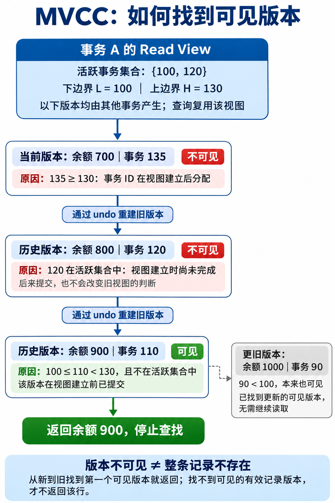
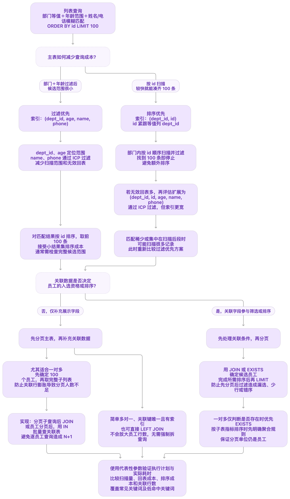
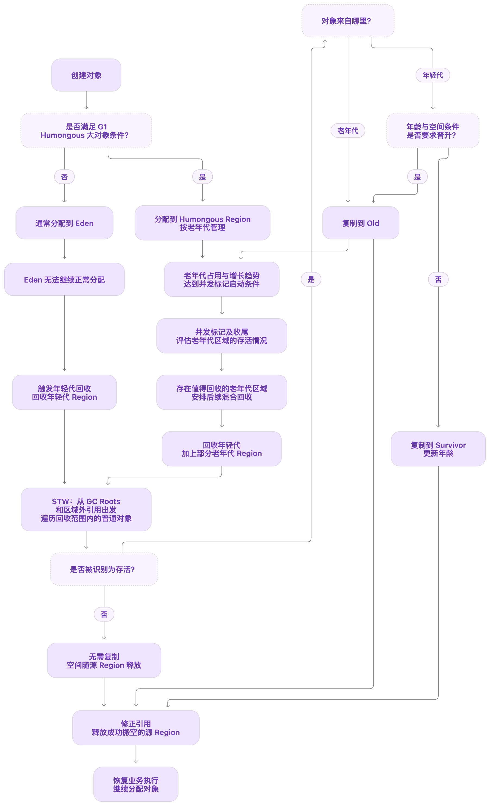

# 第 02 周 Spring与数据库原理

状态：学习中。实际日期范围：2026-11-10 至 2026-11-13。计划投入：20～25 小时。

导航：[[00-索引与面试/AI应用后端三个月复习/三个月复习总计划]] · [[00-索引与面试/AI应用后端三个月复习/学习进度记录]]

上一周：[[00-索引与面试/AI应用后端三个月复习/第01周-Java基础与并发]]。
下一周：[[00-索引与面试/AI应用后端三个月复习/第03周-缓存消息与一致性]]。

## 阅读入口

以下为参考笔记，仅阅读与当天问题相关的章节，不要求通篇精读。项目实现以实际代码与记录核实。

- [[02-Spring与微服务/Spring/Spring核心原理]]
- [[03-数据存储与缓存/数据库/MySQL]]
- [[03-数据存储与缓存/数据库/Mybatis]]
- [[01-Java基础与并发/JVM/JVM]]
- [[01-Java基础与并发/JVM/JVM项目实践与故障排查]]

## 本周五天安排

| 学习日 | 主题 | 状态 |
| --- | --- | --- |
| 第 1 天 | Spring容器与代理 | 已完成 |
| 第 2 天 | 事务边界与MyBatis | 已完成 |
| 第 3 天 | 索引与执行计划 | 已完成 |
| 第 4 天 | JVM内存与垃圾回收 | 已完成 |
| 第 5 天 | 事务与查询串联 | 未开始 |

## 第 1 天 Spring容器与代理

实际日期：2026-11-10。实际时长：6 小时。状态：已完成。掌握程度：需提示。

### 当日任务

- [ ] 回顾上次记录，复述已学内容；第一天先了解当前基础。
- [ ] 核心学习：梳理 Bean 创建、依赖注入、AOP 代理，理解对象调用经过哪些层。
- [ ] 实践分析：画普通调用与代理调用的差别。
- [ ] 编码或 SQL：二分查找及边界用例。
- [ ] 验收与反馈：能解释代理增强的生效位置。
- [ ] 填写学习记录，并同步统一进度入口。

### 学习记录

#### 实际完成内容

1. sping IOC 、 DI

#### 我的解释或答案要点

1. Spring主要管理的内容为：
	a. 对象：创建了哪些对象、各自如何创建
	b. 依赖关系：对象之间如何建立依赖关系
	c. 对象生命周期：对象何时初始化、何时销毁，哪些对象共享一个实例，哪些对象需要按作用域创建
	d. 对象的扩展处理：哪些对象需要被增强，例如增加事务拦截
2. 控制反转反转的为业务对象对依赖的创建、选择和获取的控制权。
3. BeanDefinition相比于之间创建对象，多了以下4点能力
	a. 先登记规则，之后再创建实例：登记 BeanDefinition，必要时创建 Bean
	b. 同一份定义可以用于创建多个实例
	c. 在创建对象前修改创建规则：Spring 提供了处理 Bean 定义的扩展点。例如，`BeanFactoryPostProcessor` 可以在常规 Bean 实例化之前修改定义中的属性值等元数据。
	d. 将创建规则与实例缓存分开
4. 字段注入、Setter 注入和构造器注入都会利用 DependencyDescriptor 描述具体注入点的依赖要求，再委托 BeanFactory 解析，但描述的对象、执行时机和注入动作不同：
	a. 字段注入：发生在对象实例化之后，由 AutowiredAnnotationBeanPostProcessor 将标注 @Autowired 的字段包装成 DependencyDescriptor。例如 @Autowired private InventoryService inventoryService;，描述的是这个字段的依赖要求，交给 BeanFactory 解析得到 dependency 后，通过反射执行 field.set(bean, dependency)，直接写入当前对象的字段，不调用 Setter。执行方式是“先创建对象，再解析依赖并直接写入字段”
	b. Setter 注入：也发生在对象实例化之后，由 AutowiredAnnotationBeanPostProcessor 将标注 @Autowired 的 Setter 的参数包装成 DependencyDescriptor。例如 @Autowired public void setInventoryService(InventoryService inventoryService)，描述的是第 0 个参数的依赖要求，交给 BeanFactory 解析得到 dependency 后，通过反射执行 method.invoke(bean, dependency)，调用当前对象的 Setter，由方法体完成赋值或其他处理。执行方式是“先创建对象，再解析参数并调用方法”；仅声明 Setter 不会自动触发这套注解注入流程
	c. 构造器注入：发生在对象实例化之前。例如 public OrderService(Repository<Order> orderRepository, @Qualifier("wechat") PaymentService paymentService, Optional<AuditService> auditService, @Value("${order.timeout:3000}") int timeout)，Spring 为每个需要自动装配的参数分别创建 DependencyDescriptor，由 ConstructorResolver 委托 BeanFactory 解析：根据 Repository<Order> 区分订单仓储与用户仓储，根据 @Qualifier("wechat") 筛选支付 Bean，根据 Optional<AuditService> 允许审计依赖缺失，根据 @Value 读取配置或使用默认值并转换为 int。所有参数准备齐全后，再调用构造器，效果相当于 new OrderService(orderRepositoryBean, wechatPaymentServiceBean, Optional.empty(), 3000)（假设没有审计 Bean，且超时配置缺失）。执行方式是“先解析依赖，再创建对象
5. BeanFactory 拿到 DependencyDescriptor 后，先识别依赖形式：`@Value` 走值解析与类型转换，`Optional<T>` 允许目标缺失，`ObjectProvider<T>` 提供延迟获取入口；对于普通 Bean 依赖，根据所需类型寻找候选，再结合泛型、`@Qualifier` 等条件筛选。单值注入只剩一个候选时直接使用；存在多个候选时，按 @Primary、依赖名称匹配等规则尝试确定唯一结果，仍无法确定则报歧义错误；没有候选时，根据是否必需决定报错或返回缺失结果。集合注入则通常收集符合条件的多个 Bean。选定目标后，通过 getBean(...) 获取已有实例或触发创建，再返回给注入流程。这是逻辑上的判断过程，实际实现可能通过缓存、名称快捷匹配提前得到结果，但仍需满足相应匹配条件。

#### 代码、图、实验或问答证据

```
参数解析没有代理，没有扩展的正常流程
想创建 OrderService
    │
    └── 缺 InventoryService，先去获取它
            │
            └── 缺 InventoryRepository，先去获取它
                    │
                    └── 无参构造器，可以创建
            │
            └── 参数齐了，可以创建 InventoryService
    │
    └── 参数齐了，可以创建 OrderService
```

#### 反馈与需要修正的理解

待记录。

#### 未解决问题及核实方式

待记录。

#### 未完成任务与顺延原因

待记录。

#### 待跟进问题与任务

待记录。

#### 下次具体起点

1. spring refresh方法回顾

#### 复测时间与结果

1. thenApply会把回调返回的Future当成普通结果，所以外面又包装了一层Future；thenCompose会把回调返回的异步任务接到当前流程中，最终返回的是订单查询的结果，不会嵌套Future。
2. 通过 submit() 提交任务后，任务异常会被保存在返回的 Future 中。调用 Future.get() 时，如果任务执行失败，会抛出 ExecutionException，通过 getCause() 可以取得任务抛出的原始异常
3. 针对类似fetchToken().thenApply(token -> fetchUser(token))的写法，外层正常完成只表示回调返回了内层 Future，不能保证内部已经执行成功，内部fetchUser可能还在执行、也可能执行成功、也有可能异常返回成功

## 第 2 天 事务边界与MyBatis

实际日期：2026-11-11。实际时长：7 小时。状态：已完成。掌握程度：未评估。

### 当日任务

- [ ] 回顾上次记录，复述已学内容；第一天先了解当前基础。
- [ ] 核心学习：学习事务传播、回滚条件、连接绑定和 MyBatis 参数绑定。
- [ ] 实践分析：联系 SQL 工具整理两侧独立事务的边界，实际机制待代码核实。
- [ ] 编码或 SQL：SQL JOIN 与重复计数。
- [ ] 验收与反馈：说明跨线程、内部调用等情况应如何检查事务是否生效。
- [ ] 填写学习记录，并同步统一进度入口。

### 学习记录

#### 实际完成内容

1. spring事务与mysql事务

#### 我的解释或答案要点

1. 在 JDBC 本地事务中，Spring 通过 JDBC 连接控制事务，常见做法是按需关闭自动提交，结束时调用 commit() 或 rollback()。
2. 事务传播行为声明在方法上，在调用经过事务代理时生效。对于 REQUIRED，Spring 根据当前是否存在事务，决定新建还是加入，不会进行其他逻辑的判断；判断依据是当前事务状态，而不是调用方的传播行为名称。加入已有事务后，当前方法与外层共享事务结果。
3. 当事务B出现异常的2种情况（直接用事务B捕捉和抛出异常被事务A捕获）的两种区别： 假设 A、B 都使用 `REQUIRED`、调用经过 Spring 事务代理并共享同一个底层事务，且 B 抛出的异常符合回滚规则：如果异常直接在 B 方法内部被捕获，B 正常返回，B 的事务拦截器没有观察到异常，因此不会因该异常触发回滚；在没有其他回滚标记或数据库错误的情况下，最终可以由 A 提交整个事务。相反，如果异常从 B 抛出后才被 A 捕获，它会先经过 B 的事务拦截器，拦截器根据回滚规则请求事务管理器回滚；由于 B 参与的是已有事务，默认处理会将共享事务标记为 `rollback-only`。A 捕获异常只能让业务代码继续执行，不能清除这个标记，所以 A 最终尝试提交时，整个事务仍会回滚，并通常抛出 `UnexpectedRollbackException`。**两者的本质区别是异常是否穿过 B 的事务拦截边界：`catch` 控制异常传播，事务管理器维护事务状态，捕获异常并不会恢复已经被标记为只能回滚的事务。**
4. 事务拦截器主要做三件事：
	a. 读取方法的事务配置，选择事务管理器。注意点：getTransaction() 不一定创建新事务：它根据传播行为和当前事务环境，决定新建、参与已有事务或非事务执行，并返回相应状态
	b. 请求事务管理器根据传播行为获取事务状态，然后执行业务方法。
	c. 根据方法结果和回滚规则，请求事务管理器提交或回滚。注意点：commit() 不等于必然提交数据库事务：参与外层事务时不会独立提交；已经标记 rollback-only 时，最终会回滚。rollback() 不等于立即回滚整个数据库事务：新事务通常直接回滚，参与已有事务时通常设置共享事务的回滚标记，保存点式嵌套事务则可以回滚到保存点
5. 事务失效的三大场景：
	a. 事务拦截器没有执行
	b. 拦截器执行了但没有触发回滚：异常被事务方法自己捕获、异常不符合回滚规则
	c. 某些操作没有参与这个事务：新线程中的操作、使用了不同的数据源、事务管理器或独立连接、传播行为主动改变了事务边界
6. 事务的代理：在 Spring 默认代理模式下，启用事务管理后，Spring 会识别 Bean 上的事务配置，为需要事务增强的 Bean 创建代理；外部通过代理调用匹配的方法时，代理会将调用交给包含事务拦截器的拦截器链，再执行目标方法，因此事务注解得以生效。`@Transactional` 本身只是元数据，不会改写业务方法，也不会让 JVM 自动执行事务逻辑。直接调用未经代理的目标对象时，调用路径不包含事务拦截器；同类内部通过 `this` 调用时，`this` 指向目标对象自身，调用也不会重新经过代理，因此被调用方法上的事务配置不会被应用。不过，**如果调用方已经处于事务中，内部方法的数据库操作仍可参与已有事务；不生效的是内部方法注解所声明的事务规则，而不一定是整个调用过程没有事务。**
7. Spring事务总结：Spring 事务通过统一的事务管理接口协调底层资源的事务操作，常见用法是通过 `@Transactional` 声明事务规则：在默认代理模式下，调用经过 Spring 代理时，事务拦截器读取配置，委托事务管理器根据传播行为和当前事务环境决定新建、加入或挂起事务，并在业务方法结束后结合异常回滚规则和事务状态请求提交或回滚；其中，传播行为决定方法如何参与事务，隔离级别约束并发事务之间的数据可见性，事务状态记录是否新建、是否只能回滚、是否完成等信息。默认情况下，传播到拦截器的 `RuntimeException` 和 `Error` 会触发回滚，checked exception 不会自动触发；异常在方法内部被捕获通常不会触发异常回滚，但捕获异常也不能清除已有的 `rollback-only` 标记。多个 `REQUIRED` 方法可以共享同一个底层事务，因此方法返回不等于事务提交；直接调用目标对象或同类自调用会绕过代理，使被调用方法的事务注解不生效。Spring 本地事务最终只能管理实际参与它的资源操作，不能自动覆盖新线程、独立事务或外部服务调用，数据的提交、回滚及隔离保证仍由底层数据库实现。
8. 在 Spring + JDBC + MySQL 场景中：
	a.Spring 决定何时开启或加入事务、哪些异常需要回滚，以及何时请求提交或回滚。
	b.JDBC 连接 是控制通道，事务管理器通过 Connection.commit()、`Connection.rollback()` 等方法操作数据库事务。
	c.MySQL/InnoDB 真正提交或撤销数据修改；Spring 自己不保存数据修改前的版本，也不负责恢复数据库记录。
9. Buffer Pool：在内存中缓存数据页，读写通常围绕这些页进行。undo log： 保存撤销修改、重建旧版本所需的信息。redo log：	记录页修改所需的重做信息，用于崩溃恢复
10. Spring 根据业务结果决定请求提交还是回滚；在此之前，InnoDB 已经执行 SQL、管理锁并生成日志。收到提交请求后，它确认并持久化必要的事务信息；收到回滚请求后，它通过 undo 撤销修改。
11. InnoDB 执行数据修改时，会生成用于撤销修改和重建旧版本的 undo，以及用于恢复页修改的 redo；提交时，数据库确认事务状态，并按刷盘配置持久化必要的日志，无须立即将所有修改过的数据页写入磁盘，而仍被 MVCC 使用的 undo 会继续保留；回滚时，数据库根据 undo 撤销修改，撤销过程中的页修改也会产生 redo，以保证回滚过程可恢复；发生崩溃后，InnoDB 先利用 redo 恢复必要的页修改及相关信息，再根据事务状态保留已提交事务的结果，并利用 undo 撤销需要回滚的未完成事务。因此，**redo 落盘不代表事务已提交：redo 保证修改能够恢复，事务状态决定修改是否保留，undo 支持撤销修改，而 undo 页本身的修改也受到 redo 保护。**
12. InnoDB 的 MVCC（记录上的事务信息：记录上的事务信息，undo 版本链：undo 版本链，Read View：判断某个版本对本次快照读是否可见） 流程是：写操作在修改记录时，记录修改事务 ID，并生成 undo，使旧版本能够被重建；快照读按照隔离级别建立或复用 Read View，从记录的当前版本开始判断可见性：自己的修改可见，其他事务的版本则根据视图中的事务 ID 边界和活跃事务集合判断；版本可见就返回，不可见就通过 undo 重建上一版本，继续判断，直到找到可见版本，或者没有可见版本而不返回该记录。RC 每次一致性读建立新视图，RR 通常复用第一次一致性读建立的视图，因此对旧视图不可见的事务版本，不会仅因该事务后来提交就变得可见。
13. 在普通 JDBC 本地事务中，**事务属于数据库连接对应的会话，连接是执行 SQL 和控制提交、回滚的通道，事务则是连接上的一段统一提交或撤销的操作范围**。一条连接可以先后执行多个事务，提交或回滚不会使连接自动关闭；多条 SQL 要参与同一个事务，需要通过同一条连接执行，并处于同一个尚未结束的事务范围内，所以同一连接上的自动提交语句仍可能分别属于不同事务。不同连接即使访问同一个数据库，也不会自动共享本地事务。Spring 通过绑定并复用事务连接，让不同 Service、Mapper 的相关操作参与同一个数据库事务，结束后统一提交或回滚，再清理资源并将连接归还连接池。
14. Spring 通过 ThreadLocal 为每个线程维护独立的资源 Map，再用 DataSource 和 SqlSessionFactory 分别定位连接、会话资源。带事务时，连接和会话被绑定并保留，不同 Mapper 在同一事务范围内复用它们，直到事务完成后统一清理、解绑和归还连接；不带事务时，Mapper 仍经过相同的线程资源查找机制，但查不到可复用的绑定资源，于是为本次调用创建会话、按需获取连接，用完即释放。保证事务内连接一致的关键，不只是使用 ThreadLocal，还包括相同资源键、事务感知的获取方式，以及不提前释放连接。

#### 代码、图、实验或问答证据

```
## 声明式事务
@Transactional(rollbackFor = Exception.class)
public void placeOrder(Order order) {
    orderMapper.insert(order);

    int affected = stockMapper.deduct(
            order.getProductId(), order.getQuantity());

    if (affected == 0) {
        throw new IllegalStateException("库存不足");
    }
}

##编程式事务
transactionTemplate.executeWithoutResult(status -> {
    orderMapper.insert(order);

    int affected = stockMapper.deduct(
            order.getProductId(), order.getQuantity());

    if (affected == 0) {
        throw new IllegalStateException("库存不足");
    }
});

```


| 传播行为 | 当前有事务 | 当前无事务 |
|---|---|---|
| `REQUIRED`，默认 | 加入当前事务 | 新建事务 |
| `REQUIRES_NEW` | 挂起当前事务，开启独立事务 | 新建事务 |
| `NESTED` | 在支持的实现中建立保存点 | 新建事务 |
| `SUPPORTS` | 加入当前事务 | 非事务执行 |
| `NOT_SUPPORTED` | 挂起当前事务，非事务执行 | 非事务执行 |
| `MANDATORY` | 加入当前事务 | 抛异常 |
| `NEVER` | 抛异常 | 非事务执行 |

```
事务属性 = 读取方法配置
事务状态 = 事务管理器.getTransaction(事务属性)

尝试：
    结果 = 执行业务方法
捕获异常：
    如果异常符合回滚规则：
        事务管理器.rollback(事务状态)
    否则：
        事务管理器.commit(事务状态)
    继续抛出异常

正常返回时：
    事务管理器.commit(事务状态)
    返回结果
```

```
一条 UPDATE 执行时，数据库已经做了什么(这时候没有发生提交，仅是执行了数据修改)
定位记录，取得所需的锁
    ↓
将需要的数据页加载到 Buffer Pool（如果尚未缓存）
    ↓
记录撤销所需的 undo 信息
    ↓
修改内存中的数据页：1000 → 900
    ↓
为相关页修改生成 redo
```

```
commit核心：确认提交，并满足日志持久化要求
完成事务提交所需的日志与状态处理
    ↓
满足配置要求的日志持久化条件
    ↓
完成提交，释放事务持有的相关锁
    ↓
向调用方返回成功

脏数据页由刷盘机制另行写入数据文件
```

| 隔离级别 | 能防止的问题 |
|---|---|
| 读未提交（RU） | 不保证防止脏读、不可重复读、幻读 |
| 读已提交（RC） | 脏读 |
| 可重复读（RR） | 脏读、不可重复读 |
| 可串行化（Serializable） | 脏读、不可重复读、幻读 |



| 目标 | 核心机制 |
|---|---|
| RC、RR 的普通查询不读脏数据 | Read View 排除未提交版本，通过 undo 获取可见旧版本 |
| RR 的普通查询保持可重复 | 同一事务复用 Read View |
| RR 的快照查询不看到后来新增的记录 | 新记录不符合原视图的可见性条件 |
| 锁定范围读防止幻影插入 | 间隙锁、临键锁保护相关索引范围 |
| Serializable 提供更强隔离 | 将普通读取也纳入更严格的锁协调机制 |

| 操作或查询条件 | 主要加锁方式 | 核心原因 |
|---|---|---|
| 普通 `SELECT` | 通常使用 MVCC，不加记录锁、间隙锁 | 通过可见历史版本完成读取 |
| `SELECT ... FOR SHARE` | 对需要保护的记录申请 S 锁 | 允许共享读取，阻止冲突修改 |
| `SELECT ... FOR UPDATE`、`UPDATE`、`DELETE` | 对需要保护的记录申请 X 锁 | 为修改或删除提供排他保护 |
| 完整唯一键等值查询，记录存在 | 记录锁 | 唯一目标已确定，无须保护周围间隙 |
| 唯一键等值查询，记录不存在 | 对应间隙锁 | 没有记录可锁，需要阻止目标位置出现新记录 |
| 非唯一等值查询或范围查询 | 临键锁、间隙锁、记录锁的组合 | 既保护已有记录，也防止插入新的匹配记录 |
| 没有合适索引，需要大范围扫描 | 可能形成大范围锁定 | 锁范围与实际索引扫描有关，不仅取决于最终返回或修改的行数 |

| 概念 | 含义 |
|---|---|
| 数据库连接 | 应用与数据库之间发送 SQL、接收结果和控制事务的通道 |
| 数据库会话 | 数据库为该连接维护的上下文，包括自动提交设置、隔离配置、当前事务等 |
| 数据库事务 | 会话中一段需要统一提交或回滚的数据库操作 |

```
Spring 连接绑定与 Mapper 连接获取机制

一、ThreadLocal 中保存什么

TransactionSynchronizationManager
    └─ ThreadLocal<Map<Object, Object>>
         └─ 当前线程的资源 Map
              ├─ DataSource
              │    → ConnectionHolder → JDBC Connection
              └─ SqlSessionFactory
                   → SqlSessionHolder → 实际 SqlSession

第一层：ThreadLocal 根据当前线程定位资源 Map。
第二层：Map 根据 DataSource 或 SqlSessionFactory 定位具体资源。

线程 A：Map A → DataSource DS → 连接 C1
线程 B：Map B → DataSource DS → 连接 C2

相同数据源在不同线程中可以对应不同连接。


二、带事务的完整流程

前提：MyBatis-Spring、单数据源、同一线程、新建本地事务，
      未使用延迟连接代理。

外部通过 Spring 代理调用 @Transactional 方法
    ↓
事务拦截器请求事务管理器获取事务
    ↓
检查当前线程是否已有事务连接
    → ThreadLocal.get() 获取当前线程的资源 Map
    → 按 DataSource 查找 ConnectionHolder
    → 本例没有已有事务，需要创建新事务
    ↓
准备事务连接
    → DataSource.getConnection() 获取 C1
    → 按需设置隔离级别、关闭自动提交
    → 使用 ConnectionHolder 包装 C1
    ↓
【关键：将连接绑定到当前线程】
    → 获取当前线程的资源 Map
    → Map 不存在则创建，并通过 ThreadLocal.set(map) 保存
    → 写入 DataSource → ConnectionHolder(C1)
    ↓
开启事务同步等上下文，进入业务方法体
    ↓
Mapper A 执行查询
    ↓
SqlSessionTemplate 获取实际 SqlSession
    → 从当前线程资源 Map 按 SqlSessionFactory 查找
    → 首次没有对应会话，创建 S1
    → 注册事务同步回调
    → 写入 SqlSessionFactory → SqlSessionHolder(S1)
    ↓
S1 底层首次需要连接
    → SpringManagedTransaction
    → DataSourceUtils.getConnection(DataSource)
    ↓
【关键：优先查找线程绑定的连接】
    → ThreadLocal.get() 获取当前线程资源 Map
    → map.get(DataSource) 找到 ConnectionHolder
    → 取得 C1，并由底层事务适配对象保存、复用
    ↓
通过 C1 执行查询
    ↓
Mapper A 调用结束
    → 释放本次调用对 SqlSession 的使用引用
    → 不真正关闭事务会话、不归还 C1
    ↓
业务继续调用 Mapper B
    → 相同 SqlSessionFactory、兼容执行器配置下复用 S1
    → S1 底层已持有 C1，直接复用
    → 执行查询并返回
    ↓
业务方法体正常返回或抛出异常
    ↓
事务拦截器根据回滚规则和事务状态
    → 请求提交或回滚 C1 上的事务
    ↓
执行事务完成回调及资源清理
    → 关闭实际 SqlSession，并解绑对应会话资源
    → 解绑 DataSource → ConnectionHolder(C1)
    → 恢复连接的必要状态
    → 释放 C1，连接池场景下归还连接池
    → 资源 Map 为空时移除对应 ThreadLocal 值
    → 清理其他事务线程上下文
    ↓
代理调用结束，向外部返回结果或抛出异常

说明：
1. 会话清理通过事务同步回调分阶段执行，上面合并展示。
2. 业务方法体退出不等于代理调用结束，外层仍需完成事务处理。
3. 如果加入已有事务，最终提交和清理由外层事务负责。


三、不带事务的完整流程

前提：没有外层 Spring 事务，也没有事务同步上下文，
      使用普通 Mapper 查询。

进入普通业务方法
    → 没有事务管理器提前获取、绑定连接
    ↓
Mapper A 执行查询
    ↓
SqlSessionTemplate 获取实际 SqlSession
    → ThreadLocal.get() 查找当前线程资源
    → 没有该 SqlSessionFactory 对应的会话
    → 创建本次调用使用的 S1
    → 没有事务同步上下文，不将 S1 绑定到线程资源 Map
    ↓
S1 底层首次需要连接
    → SpringManagedTransaction
    → DataSourceUtils.getConnection(DataSource)
    ↓
【同样先查询 ThreadLocal 中的资源】
    → 没有该 DataSource 对应的 ConnectionHolder
    → 调用 DataSource.getConnection() 获取 C1
    → 没有事务同步上下文，不将 C1 绑定到线程资源 Map
    → S1 的底层事务适配对象持有 C1，供本次会话使用
    ↓
通过 C1 执行查询
    ↓
正常完成：
    → 执行必要的会话提交处理
    → 如果连接已自动提交，不重复执行 JDBC commit

异常退出：
    → 传播异常，关闭会话时进行必要的回滚与清理
    ↓
关闭本次 SqlSession S1
    ↓
释放 C1
    → 确认不是线程绑定的事务连接
    → 执行 close()
    → 连接池场景下归还连接池
    ↓
Mapper A 返回结果或抛出异常
    ↓
如果业务继续调用 Mapper B
    → 再创建本次调用使用的 SqlSession
    → 再查 ThreadLocal，仍没有绑定的事务连接
    → 再从 DataSource 获取连接
    → 查询完成后关闭会话、释放连接
    ↓
业务方法返回或抛出异常
    → 没有覆盖整个业务方法的统一提交、回滚
    → 各次普通查询使用的连接已在各自调用结束时释放


四、总结

带事务和不带事务都会经过线程资源查找机制。

带事务：
    绑定连接 → 多个 Mapper 复用 → 事务结束统一处理 → 解绑释放。

不带事务：
    查不到绑定连接 → 按需获取 → 本次 Mapper 调用结束后释放。

ThreadLocal 负责隔离不同线程的资源；
DataSource 键负责定位当前线程对应的数据源连接；
事务感知的获取方式负责找到并复用连接；
统一的生命周期管理保证连接不会在事务结束前被提前归还。

getConnection() 不一定新建物理连接，连接池通常借出已有连接。
不同调用即使碰巧借到同一条物理连接，也不代表属于同一个事务。
没有 Spring 事务，也不代表 InnoDB 操作没有数据库事务。
```

```
@Transactional
    → 声明整个下单操作的事务边界

Spring 代理与事务拦截器
    → 在业务方法外层应用事务规则

ThreadLocal 资源绑定
    → 让多个 Mapper 找到同一份事务连接

MyBatis-Spring
    → 将 Mapper 操作接入 Spring 的资源管理机制

MySQL 锁
    → 协调库存等记录的并发修改

MVCC / Read View
    → 决定其他事务查询时能看到哪个版本

undo / redo
    → 支持回滚、历史版本读取和崩溃恢复

条件更新与业务约束
    → 保证库存不被错误扣减

提交、解绑与连接释放
    → 完成本次业务事务并结束资源占用
```

#### 反馈与需要修正的理解

待记录。

#### 未解决问题及核实方式

待记录。

#### 未完成任务与顺延原因

待记录。

#### 待跟进问题与任务

待记录。

#### 下次具体起点

1. Mybatis

#### 复测时间与结果

待记录。

## 第 3 天 索引与执行计划

实际日期：2026-11-12。实际时长：5 小时。状态：已完成。掌握程度：需提示。

### 当日任务

- [ ] 回顾上次记录，复述已学内容；第一天先了解当前基础。
- [ ] 核心学习：学习 B+树、联合索引、回表、排序和执行计划。
- [ ] 实践分析：在本地测试数据上比较一个查询的索引方案，保留 SQL 与计划。
- [ ] 编码或 SQL：SQL 每组取前三与最新记录。
- [ ] 验收与反馈：能依据执行计划解释方案，而非只背最左前缀。
- [ ] 填写学习记录，并同步统一进度入口。

### 学习记录

#### 实际完成内容

1. B+树、联合索引、回表、排序和执行计划

#### 我的解释或答案要点

1. 以 MySQL InnoDB 为例，索引通常使用 B+ 树组织，依靠多路分支降低树高，并通过有序的叶子记录支持查找和范围扫描；**主键索引、非主键索引**按是否基于主键区分，**聚簇索引、非聚簇索引**按叶子记录是否包含行数据区分：有显式主键时，主键索引就是聚簇索引，其叶子记录包含完整行数据，一张表只能有一个聚簇索引；没有显式主键时，InnoDB 会选择所有列均为 `NOT NULL` 的第一个唯一索引作为聚簇索引，否则使用隐藏行 ID 建立聚簇索引。因此，在常见的显式主键表中，非主键索引就是**二级索引，也属于非聚簇索引**，其叶子记录存放索引列和主键值：满足覆盖索引时，可以直接从索引取得所需数据；不满足时，需要根据主键再次查找聚簇索引，即**回表**，大量回表可能增加随机页访问成本；主键过宽还会使各二级索引占用更多空间。**唯一索引**约束键值唯一性，**联合索引**按多个字段从左到右依次排序，它们与是否聚簇是不同维度；联合索引的列顺序会影响过滤和排序能力，查询条件或排序要求不符合其顺序时，可能需要扫描更多记录或额外排序。此外，索引会占用存储空间并增加增删改的维护成本，无序插入可能引发页分裂，因此索引并非越多越好，是否有效应结合查询和执行计划判断。
2. 在 MySQL InnoDB 中，**页是组织、缓存和读写数据的基本单位，默认大小为 16KB**，一个页通常存放多条记录；普通 B+ 树索引页包含文件头、页头、最小和最大伪记录、用户记录、空闲空间、页目录及文件尾，分别用于记录页标识和状态、界定记录边界、保存实际记录、支持空间分配和页内查找，以及校验完整性。**B+ 树的每个节点对应一个索引页**：非叶子页保存导航键值和子页号，聚簇索引叶子页保存行数据及事务等管理信息，二级索引叶子页保存索引列和主键值，较长字段可能通过引用存放在溢出页中。查询时，InnoDB 沿树逐页导航，再通过页目录和页内记录链接定位目标记录；访问页时优先读取 Buffer Pool，未命中才从磁盘加载，若二级索引无法提供所需列，则根据主键访问聚簇索引完成回表，因此**访问页或回表都不等于必然发生磁盘读取**。更新时，InnoDB 修改 Buffer Pool 中的记录，产生相关 Undo、Redo 信息，并将修改页标记为脏页，后续由刷脏机制写回磁盘；事务提交与数据页刷盘是不同过程，插入或记录增长导致页空间不足时，还可能发生页分裂并调整 B+ 树结构。
3. 索引未生效或者部分生效的原因，按照原理可以分为四大类
	a. 索引按原值排序，但查询比较的是变换后的值。函数、算术运算、显式类型转换、部分隐式类型转换。WHERE dept_id = 10 and age + 1 = 31; 这一类可能会导致索引下推。
	b. 前面的列没有固定，后面的列就没有全局有序性。缺少最左列、跳过中间列，以及范围条件之后的列不能继续充分缩小范围。
	c. 条件无法提供有效边界，或有一个分支无法通过索引定位。B+ 树需要根据键值边界，排除不可能匹配的页；如果条件不能提供这种边界，就需要扫描后逐条判断。比如说WHERE phone LIKE '%8000'，SELECT * FROM employee WHERE dept_id = 10 OR salary > 20000（dept_id = 10 可以通过联合索引定位，但 salary 没有索引，而且高薪员工可能出现在任何部门），需要注意的是WHERE dept_id = 10 OR dept_id = 20;这一类不会使索引失效
	d. 能使用索引，但优化器估计全表扫描更便宜
4. **索引条件下推（ICP）的核心，是将只依赖当前索引列、且支持下推的过滤条件，从 MySQL Server 层交给存储引擎，在回表之前判断，从而减少无效回表。** 优化器在生成执行计划时决定是否采用 ICP，实际过滤发生在 InnoDB 扫描二级索引记录之后、回表之前。例如联合索引为 `(dept_id, age, name)`，查询条件为 `dept_id = 10 AND age + 1 = 31`：没有 ICP 时，InnoDB 通过 `dept_id = 10` 定位范围，对候选记录逐条回表获取完整行，再交给 Server 层判断年龄；有 ICP 时，InnoDB 扫描同一范围，直接读取索引中的 `age` 计算判断，只有符合条件的记录才回表并返回 Server 层。**因此，ICP 在这里不缩小二级索引的扫描范围，而是减少回表次数和向 Server 层传递的完整行数量**；执行计划中的 `Using index condition` 表示使用了这项优化，它与覆盖索引所对应的 `Using index` 不同。
5. 日常业务中，阅读 `EXPLAIN` 可以按“**查哪张表 → 怎么查 → 用哪个索引定位 → 扫描多少 → 是否还有额外工作**”这个顺序：先看 `table` 确认访问的表，普通单表查询和不含子查询的关联查询，`select_type` 通常都是 `SIMPLE`，涉及 `UNION` 时再分别分析各查询块；接着看 `type`，常见的有主键等值查询 `const`、非唯一索引等值查询 `ref`、范围查询 `range`、全索引扫描 `index` 和全表扫描 `ALL`，关联查询按另一张表的主键匹配时还常见 `eq_ref`；然后看 `key` 确认实际使用的索引，结合 `key_len` 判断参与定位的索引部分，`ref` 则说明拿常量还是其他表的列来查；再看 `rows` 和 `filtered`，了解预计扫描行数和过滤后保留比例，注意它们都是估算值；最后看 `Extra`：`Using index` 表示覆盖索引，`Using index condition` 表示回表前进行索引条件下推，`Using where` 表示还需要条件过滤，`Using filesort` 表示额外排序，统计分组时还可能出现 `Using temporary`，表示使用内部临时表。**回表没有专门标记，要结合所选二级索引是否包含查询所需列判断；是否值得优化，则要结合扫描量和实际耗时，不能只凭出现回表、排序或全表扫描就认定有问题。**
6. 对于这类“等值过滤＋范围过滤＋模糊搜索＋排序分页”的列表，先根据数据分布选择主表访问路径：部门、年龄能大幅缩小候选范围时，选择过滤优先，使用 (dept_id, age, name, phone)，前两列定位、后两列通过 ICP 减少回表，再对匹配结果按 id 排序取前 100 条；按 id 扫描能够较快找到 100 条匹配记录时，选择排序优先，将 id 放到 dept_id 后面，使用 (dept_id, id)，必要时扩展为 (dept_id, id, age, name, phone) 支持回表前过滤，避免额外排序并提前停止，但匹配稀少时可能扫描很多记录。随后决定关联时机：关联数据只用于展示，尤其是一对多时，先分页主表再关联，保证一页对应 100 个员工，并限制关联范围；关联字段参与筛选或排序时，先完成关联条件处理再分页，保证选出的员工及顺序正确，一对多的存在性筛选优先考虑 EXISTS，避免展开结果影响分页。简单多对一展示也可以直接 LEFT JOIN，无需机械拆成两次查询。最终通过实际执行计划、扫描量和耗时验证选择，而不是仅以是否出现 Using filesort 判断优劣。
7. **排序和深分页慢，核心是返回少量结果之前做了大量工作**：索引无法提供 `ORDER BY` 所需顺序时，数据库通常要扫描、过滤候选数据，再通过额外排序选出前 N 条；即使索引顺序匹配，如果过滤条件命中率低，也可能扫描大量记录才能凑齐一页。`LIMIT offset, size` 深分页还需要找到并丢弃前 `offset` 条匹配结果，偏移量越大，通常无效工作越多。**游标分页**通过上一页最后的排序键继续查询，例如 `id > last_id ORDER BY id LIMIT 20`，配合合适索引直接定位后续范围，避免重复扫描并丢弃前面的结果，适合“下一页”、加载更多和批量遍历，但不直接支持任意页码跳转，也不能解决过滤条件命中率低的问题；**延迟关联**先通过覆盖索引完成过滤和分页，只取得当前页的主键，再关联主表获取完整行，减少被丢弃记录的回表成本，适合必须保留偏移量分页、且大量回表导致性能下降的场景，但它没有消除深分页本身的扫描和丢弃成本。

8. 分析慢 SQL 时，先结合表结构、索引和数据分布，用普通 `EXPLAIN` 查看 `type、key、rows、Extra`，判断访问方式、预计扫描量以及是否存在覆盖索引、ICP 和额外排序，再用 `EXPLAIN ANALYZE` 从底层访问节点向上观察实际输出行数、过滤后的行数和耗时：**扫描大量记录却只返回少量结果，说明筛选或访问路径值得优化；使用二级索引且需要索引外字段时存在回表，应检查过滤发生在回表前还是之后；出现 `Sort` 时，要结合输入行数和耗时判断成本，不能仅凭 `Using filesort` 认定排序是瓶颈。** 注意节点的 `rows` 是输出行数，ICP 后的输出量不等于底层扫描量，父节点耗时也包含子节点工作，不能直接相加。随后针对主要成本比较优化方案，例如调整索引顺序缩小扫描范围、补充过滤列以减少无效回表，或利用排序索引提前停止；验证时先确认结果一致，再用代表性参数重复测量实际耗时和处理行数，并检查不加索引提示时优化器是否真正选择了目标路径，**不能只凭“用了索引”“没有排序”或一次测试更快，就认定优化有效。**

9. 大表补索引可能卡顿，主要有两类原因：**构建索引需要扫描、排序和写入大量数据，与业务争抢 CPU、I/O 和磁盘空间；变更还需要元数据锁，遇到长事务时可能等待，并阻塞后续业务请求。** 原生 Online DDL 适合数据库版本和变更类型支持在线操作、且资源影响可控的场景，流程较简单，但 `ALGORITHM=INPLACE` 不代表不扫描数据，`LOCK=NONE` 只表示主要执行阶段允许并发读写，锁等待超时也不能限制整个构建过程，因此仍需检查长事务、预留空间、低峰执行并监控业务延迟。**影子表迁移**适合原生变更影响难以接受、需要分批复制和可控限速或暂停的场景，通过创建带目标索引的新表、复制历史数据、同步增量、校验追平后切换来完成变更；代价是额外存储和同步负载，还必须正确处理并发增删改、外键、触发器、自增值及切换时的元数据锁，切换后的回退也需要处理新增数据，不能直接改回旧表。持续写入的业务应优先采用成熟工具或平台能力，不能把“全量复制后改名”当作可靠的在线迁移方案。

10. **InnoDB 的记录锁作用于索引记录，UPDATE、DELETE 的锁定范围与实际访问路径有关，而不只取决于最终修改或删除了多少行。** 有合适索引时，可以直接定位目标记录或较小范围；没有合适索引时，可能扫描整个聚簇索引，并在访问过程中锁住大量不匹配的记录，扩大写入冲突范围，这通常是大量记录锁、间隙锁的效果，并非行锁自动升级为表锁。在 **RR（可重复读）** 下，范围访问通常使用临键锁，保护记录及相关间隙，非匹配记录的锁也可能持有到事务结束，因此全表扫描的 UPDATE、DELETE 可能阻塞不相关记录的更新及新记录插入；在 **RC（读已提交）** 下，非匹配记录的锁通常在条件判断后释放，普通搜索通常不使用间隙锁，但外键和重复键检查等存在例外，因此锁竞争往往较小。**RC 不能代替索引优化**：大范围扫描仍有成本，也可能遇到锁等待；实际应通过合适索引缩小访问范围，并缩短事务，减少锁的持有时间。

11. **列表分页在索引顺序匹配、过滤命中率合适时，找到一页数据就能停止，而精确 `COUNT` 通常需要检查全部候选记录，因此即使只返回一个数字，也可能比列表慢。** 优化 COUNT 时，应优先利用索引缩小过滤范围、去掉无关排序和展示关联，并保证统计口径正确；当过滤所需字段都能放在成本合理的索引中时，可用**覆盖索引**减少回表，但不能消除候选记录的扫描，`COUNT(*)` 改成 `COUNT(1)` 也不是有效优化方向。`GROUP BY`、`SUM`、`AVG` 则需要关注聚合前处理了多少数据，在“先过滤缩小范围”和“利用索引顺序分组”之间取舍，并评估是否覆盖聚合所需字段。若只需判断下一页，可以多取一条而不查总数；若相同统计反复查询且允许短暂延迟，可用**缓存**，缓存键必须包含筛选及权限范围；若统计维度固定、访问频繁、每次扫描成本高，可用**汇总表**预先维护结果，但需承担更新、校验和一致性成本。最终通过 `EXPLAIN ANALYZE` 检查聚合节点下方的实际处理量和耗时，不能把“输出一行统计结果”理解为“只处理了一行数据”。

#### 代码、图、实验或问答证据

```
mybatis核心链路
Java 方法参数
    ↓ 按名称或属性组织
可供取值的参数对象
    ↓ 处理 SQL 模板
带 ? 的 SQL + 有序参数映射
    ↓ 取值、转换类型
PreparedStatement.setXxx(位置, 值)
    ↓
使用已取得的连接执行 SQL
```

```
① Java 代码调用 Mapper 方法
   stockMapper.deduct("P1", 2)
    │
    │ 做什么：
    │ 调用 Mapper 接口对应的代理对象。
    │
    │ 解决什么问题：
    │ Mapper 接口没有手写实现类，也能执行对应 SQL。
    │
    │ 结果：
    │ 代理拿到被调用的方法，以及实际参数 ["P1", 2]。
    ↓
② MapperProxy / MapperMethod：确定要执行哪条映射语句
    │
    │ 做什么：
    │ 根据 Mapper 接口与方法定位 statementId。
    │ 典型形式：
    │ com.example.StockMapper.deduct
    │
    │ 用它找到已注册的 MappedStatement，
    │ 其中包含 SQL 来源、命令类型、结果映射等配置。
    │
    │ 解决什么问题：
    │ 把 Java 方法与 XML 中对应的 SQL 定义关联起来。
    │
    │ 结果：
    │ 确定本次要执行 deduct 对应的 UPDATE。
    ↓
③ ParamNameResolver：组织 Java 参数
    │
    │ 方法声明：
    │ deduct(@Param("itemId") String itemId,
    │        @Param("quantity") int quantity)
    │
    │ 做什么：
    │ 根据参数位置、@Param 等信息建立名称与值的对应关系。
    │
    │ 本例生成类似：
    │ {
    │     itemId:   "P1",
    │     quantity: 2,
    │     param1:   "P1",
    │     param2:   2
    │ }
    │
    │ 解决什么问题：
    │ SQL 中引用 quantity、itemId 时，知道从哪里取值。
    │
    │ 结果：
    │ 得到统一传给后续执行流程的 parameterObject。
    │ 单个普通 Bean 等场景不一定包装成 Map。
    ↓
④ SqlSessionTemplate：取得本次使用的实际 SqlSession
    │
    │ 做什么：
    │ 在 Spring 集成环境中，查找事务关联的 SqlSession；
    │ 没有可复用会话时，按配置创建。
    │
    │ 解决什么问题：
    │ 将 Mapper 调用接入 Spring 的事务与会话生命周期管理。
    │
    │ 结果：
    │ 将 statementId 和 parameterObject
    │ 交给实际 SqlSession 执行。
    ↓
⑤ SqlSession → Executor：进入 SQL 执行流程
    │
    │ 做什么：
    │ SqlSession 根据命令类型委托 Executor。
    │ 本例进入更新流程；查询则进入查询流程。
    │
    │ 解决什么问题：
    │ 统一协调语句执行、连接使用和相关缓存处理。
    │
    │ 结果：
    │ 开始准备本次实际访问数据库所需的 SQL、连接和语句对象。
    │ 本图不展开查询缓存命中后直接返回的分支。
    ↓
⑥ SqlSource：确定本次 SQL，并建立有序参数映射
    │
    │ 原始模板：
    │ UPDATE inventory
    │ SET qty = qty - #{quantity}
    │ WHERE itemid = #{itemId}
    │   AND qty >= #{quantity}
    │
    │ 做什么：
    │ 如果有 if、foreach 等动态内容，按本次参数求值、展开。
    │ 将 #{...} 解析为 ?，同时保留对应的参数映射规则。
    │ 静态 SQL 已完成的解析结果可以复用。
    │
    │ 解决什么问题：
    │ 确定本次执行的 SQL 形态，
    │ 并保证每个 ? 都有对应的取值规则。
    │
    │ 结果：
    │ SQL：
    │ UPDATE inventory
    │ SET qty = qty - ?
    │ WHERE itemid = ?
    │   AND qty >= ?
    │
    │ 有序 ParameterMapping：
    │ 第 1 项 → quantity
    │ 第 2 项 → itemId
    │ 第 3 项 → quantity
    ↓
⑦ BoundSql：封装本次执行的信息
    │
    │ 做什么：
    │ 将以下内容组织在一起：
    │   • 带 ? 的 SQL
    │   • 有序 ParameterMapping 列表
    │   • parameterObject
    │   • 动态 SQL 产生的附加参数
    │
    │ 解决什么问题：
    │ 后续组件无需重新解释 XML，
    │ 就能知道“执行什么 SQL、每个位置怎么取值”。
    │
    │ 结果：
    │ 得到本次执行的 SQL 与参数绑定说明。
    │ 此时并没有把参数值拼进 SQL 字符串。
    ↓
⑧ Executor 获取连接，StatementHandler 准备 JDBC 语句
    │
    │ 做什么：
    │ 底层首次需要连接时，由 SpringManagedTransaction
    │ 通过 DataSourceUtils 获取连接：
    │   • 当前线程已绑定该数据源的连接 → 复用
    │   • 没有绑定连接 → 向 DataSource 获取
    │
    │ StatementHandler 随后通过连接创建或按执行器策略复用语句：
    │ connection.prepareStatement(boundSql.getSql())
    │
    │ 解决什么问题：
    │ 确定 SQL 使用哪条连接，并准备 JDBC 执行对象。
    │
    │ 结果：
    │ 得到已经关联连接 C1 的 PreparedStatement，
    │ 其中包含 3 个尚待绑定的参数位置。
    ↓
⑨ ParameterHandler：按参数映射顺序取值
    │
    │ 做什么：
    │ 依次遍历 ParameterMapping：
    │   第 1 项 quantity → 2
    │   第 2 项 itemId   → "P1"
    │   第 3 项 quantity → 2
    │
    │ 取值时考虑附加参数、简单类型参数、
    │ Map 键以及 Java Bean 属性路径等情况。
    │
    │ 解决什么问题：
    │ 将“参数名称或属性路径”转换为本次实际值。
    │
    │ 结果：
    │ 建立 JDBC 位置与值的对应关系：
    │   1 → 2
    │   2 → "P1"
    │   3 → 2
    │
    │ 注意：
    │ 顺序来自 SQL 占位符顺序，
    │ 不是 Java 形参顺序，也不是 Map 遍历顺序。
    ↓
⑩ TypeHandler：按类型绑定到 PreparedStatement
    │
    │ 做什么：
    │ ParameterHandler 对每个值调用对应的 TypeHandler，
    │ 后者根据类型选择 JDBC setter，必要时进行转换。
    │
    │ 本例最终相当于：
    │ statement.setInt(1, 2)
    │ statement.setString(2, "P1")
    │ statement.setInt(3, 2)
    │
    │ 解决什么问题：
    │ 将 Java 值正确表示为 JDBC 参数，
    │ 包括整数、字符串、null、日期、自定义类型等。
    │
    │ 结果：
    │ PreparedStatement 的参数已绑定完整。
    │ 实际实现中，⑨取一个值后就会执行⑩绑定该值。
    ↓
⑪ PreparedStatement 执行 SQL
    │
    │ 做什么：
    │ StatementHandler 调用 statement.execute() 等执行接口，
    │ JDBC 驱动通过关联的连接 C1 与数据库交互。
    │
    │ 解决什么问题：
    │ 将准备好的 SQL 和参数交给数据库执行。
    │
    │ 结果：
    │ MySQL 执行库存更新，并返回执行结果。
    │ 本例后续可取得影响行数，供业务判断是否扣减成功。
    ↓
SQL 执行完成
    │
    └─ 如果 C1 参与 Spring 事务：
       本次执行完成不代表事务提交，
       提交或回滚仍由外层事务边界决定。
```



```
收集常见查询组合
        ↓
识别高频、重要、当前慢的查询
        ↓
优先选择能兼顾几类查询的少量索引
        ↓
对“某些条件缺失”的情况分别测执行计划
        ↓
确有慢查询缺口，再增加针对性索引
```

| 注意点 | 业务中怎么做 |
|---|---|
| **主键尽量短、稳定** | InnoDB 二级索引都包含主键，主键越宽，各索引通常越大；避免频繁修改主键 |
| **唯一性由数据库兜底** | 工号、业务流水号等需要唯一时建立唯一约束，不能只靠代码“先查再插” |
| **警惕重复、冗余索引** | 已有 `(dept_id, age)` 时，再建 `(dept_id)` 应有实际理由；但不能只看前缀就直接删除，还要考虑大小、排序用途和约束 |
| **参数类型与字段类型匹配** | 电话是字符串，传参就使用字符串；字段和关联列的类型、字符集及排序规则尽量一致 |
| **按真实查询组合建索引** | 同时考虑过滤、排序、分页和关联，不是哪个字段出现在 `WHERE` 就给哪个字段建索引 |
| **考虑数据分布变化** | 测试小部门、大部门，热门关键词、低命中关键词；一组参数跑得快，不代表所有参数都快 |
| **索引需要持续维护** | 数据规模和业务查询变化后，重新检查执行计划；关注统计信息是否失真，而不是一慢就加索引 |
| **删除索引也要验证** | 除查询外，还可能承担唯一约束、外键支持等作用；变更前确认用途，观察完整业务周期 |
| **衡量整体收益** | 查询快了多少，新增多少存储，写入是否变慢，大表变更是否可控，都属于索引成本 |

#### 反馈与需要修正的理解

待记录。

#### 未解决问题及核实方式

待记录。

#### 未完成任务与顺延原因

待记录。

#### 待跟进问题与任务

待记录。

#### 下次具体起点

待记录。

#### 复测时间与结果

待记录。

## 第 4 天 JVM内存与垃圾回收

实际日期：2026-11-13。实际时长：待填写。状态：已完成。掌握程度：未评估。

### 当日任务

- [ ] 回顾上次记录，复述已学内容；第一天先了解当前基础。
- [ ] 核心学习：梳理 JVM 运行时内存区域、对象分配与可达性分析，理解 GC Roots、垃圾回收与 STW 的关系。
- [ ] 实践分析：画出对象从创建、被引用到可回收的过程，分析集合长期持有对象时的引用链。
- [ ] 编码或实验：在本地对比“有界保留与累计保留”对象的示例，记录 JDK 版本、堆配置与 GC 日志，观察内存变化。
- [ ] 验收与反馈：能区分堆、虚拟机栈与元空间，解释对象为何未被回收，并说明排查 OOM 时需要收集哪些证据。
- [ ] 填写学习记录，并同步统一进度入口。

### 学习记录

#### 实际完成内容

1. JVM区域
2. 垃圾回收算法和G1垃圾回收期

#### 我的解释或答案要点

1. **类初始化与对象初始化、对象回收与类卸载、编译时依赖与运行时实际加载的类，分别属于不同层次：**类初始化是为某个运行时类型执行静态字段初始化和 static 代码块，成功后不会因为创建新对象而重复执行；对象初始化则针对每个新实例，执行实例字段初始化、实例初始化块和构造方法，让这个对象具备初始状态。对象回收处理的是不再可达的实例，例如一个请求产生的 Order 对象；类卸载处理的是运行时类型及其元数据，普通类即使已经没有实例，只要其定义类加载器仍然不能被回收，就不能卸载。编译时依赖是编译器用于检查类型、字段和方法是否合法的类版本，运行时实际加载的类则由部署内容和类加载规则决定；二者不一致时，就可能出现“编译通过，但运行时报 NoSuchMethodError”等问题。
2. **类加载器并不独自负责上述所有过程，它主要负责查找字节码、定义类型并建立类型身份，JVM 和 GC 在此基础上管理初始化与回收：**加载器将 Order 的字节码带入 JVM 后，JVM 在规定的主动使用时机触发类初始化，执行 new Order() 时再分配实例并执行对象初始化；GC 根据可达性回收对象，并在普通类的定义加载器可以被回收、运行时支持相关卸载行为时回收类元数据，加载器因此成为一组类型的生命周期边界。编译阶段记录的类、字段和方法符号引用，在运行时按照相应的类加载和解析规则关联到实际类型；加载器不会自动保证运行时版本与编译时一致，这需要依赖管理和部署过程保证。
3. 在现代 HotSpot JVM 中，`static` 静态变量的实际值存放在 Java 堆中，具体由声明它的类所对应的 `Class` 对象承载；变量的名称、类型、修饰符等描述信息则保存在元空间的类元数据中。如果静态变量是引用类型，`Class` 对象中保存的是引用，被引用的对象也位于堆中。这种设计将“描述类的结构”与“保存类的运行时状态”分开，并让静态引用参与堆对象的统一扫描和垃圾回收管理。其设计思路可以理解为：**元空间管理类型描述，堆管理对象与状态，而 `static` 表示一份数据由同一个运行时类型共享，并不意味着这份数据必须存放在元空间。** 这是 HotSpot 的实现选择，而非 JVM 规范强制规定的唯一布局。 ^study-link-ff75507dc73142ea8505a876dab8b6fc

   [[#^study-block-ed3a9c84976d4415ae098ca6eeeeeb7a|查看实践证据：Java 堆                              元空间]]

4. 堆与 GC 优化的目标，是在保证存活对象不被错误回收的前提下，让有限内存能够持续支撑业务运行，并在**响应延迟、吞吐量和资源占用**之间取得符合业务需求的平衡：既要控制堆容量和对象保留量，让回收跟得上分配，避免内存耗尽，也要减少 GC 的 CPU 开销及 STW 的时长和频率。在线服务通常更关注尾延迟，批处理任务可能更关注吞吐量，因此优化不等于单纯增大堆或追求最短停顿，而应依据业务目标和实际测量，调整对象使用方式、内存配置与回收策略。

5. Java 堆既要持续分配对象，又要及时回收无用空间，因此面临多种取舍：**标记—清除**会留下内存碎片，可通过空闲块管理及必要的整理缓解；**复制算法**需要额外的目标空间，存活对象越多，复制成本越高，因此适合存活率较低的区域，并需预留足够的搬移空间；**标记—整理**能够减少碎片，但移动对象、修正引用会带来执行开销和可能的停顿，需要通过控制单次处理范围、并行或并发技术降低影响。**分代回收**缩小了扫描范围，却引入跨代引用问题，需要借助写屏障、卡表或记忆集记录相关引用，避免漏掉存活对象，也避免每次扫描整个老年代；**并发回收**允许业务继续执行，却使对象引用关系不断变化，需要通过屏障及相应标记、搬移协议保证正确性，同时预留内存和 CPU 余量，应对回收期间的持续分配。这些机制都无法消除全部成本，合理的解决方式是在业务层控制对象分配量和保留量，再结合实际负载选择收集器、配置容量，在正确性、停顿、吞吐量和资源占用之间取得平衡。

6. 以 G1 为例，普通对象通常先分配到年轻代的 Eden，大对象满足 Humongous 条件时走特殊路径，直接按老年代管理；当 Eden 无法继续正常分配时触发年轻代回收，而老年代占用及增长趋势达到启动条件时，G1 会提前开展并发标记，为后续混合回收选择老年代区域。回收时，G1 从 GC Roots 和回收区域外指向区域内的引用出发，查找本次回收范围内的存活对象：不可达对象无需保留，普通存活对象则被复制到其他区域，年轻代对象根据年龄和空间情况进入 Survivor 或晋升到 Old，参与混合回收的老年代对象仍搬入 Old；随后修正引用，释放成功搬空的源 Region。可达性决定对象是否需要保留，回收范围与对象所在区域决定本次是否搬移，年龄和空间策略决定搬到哪里。 ^study-link-7cf60b7773164bbf870f5351d918a5e5

   [[#^study-block-5969465221674ce7be5141c80cfb338c|查看实践证据：!（实践图片）(附件/实践笔记/图片-5B452753-F103-477E-B8C4-EECF68BE6CB1.png)]]

7. G1的SATB（起始快照）用于解决并发标记期间业务线程修改引用关系，导致 GC 遍历可能漏掉存活对象的问题：某个对象的引用可能从尚未扫描的位置转移到已经扫描的位置，使 GC 错过访问路径，因此 SATB 通过写前屏障，在引用被覆盖前按需记录旧引用，供 GC 后续处理并补充标记，从而保留标记开始时的存活关系，避免错误回收。它不需要复制整个堆，但会带来屏障执行、引用记录和补标记的开销；同时，某些对象即使在标记过程中已经变得不可达，也可能因被保守标记而暂时保留，形成浮动垃圾，留待后续回收。

8. G1 的记忆集（Remembered Set，RSet）用于定位**回收区域之外、可能保存着指向回收区域内对象引用的内存位置**，使局部回收能够找到外部引用，而不必遍历整个堆。其实现通常依赖写屏障、卡表和后续处理：业务更新引用时，写后屏障按需将对应的 Card 标记为脏，再由后台线程及回收阶段的必要处理扫描这些位置，维护跨 Region 引用记录；回收时，GC 根据记忆集扫描相关位置，找到实际引用，进而保留存活对象并在搬移后修正引用。记忆集通常采用较粗粒度的位置记录，因此需要额外扫描，但能降低记录成本；它以平时的维护开销和内存占用，换取回收时更小的扫描范围，解决的是局部回收的外部引用问题，与 SATB 保障并发标记正确性的职责不同。

#### 代码、图、实验或问答证据

```
线程 A 的执行状态                         线程共享的数据

程序计数器 pc                            方法区
┌──────────────────────┐                ┌──────────────────────────┐
│ 当前字节码执行位置     │                │ Order、OrderService 的类信息 │
└──────────────────────┘                │ 方法字节码、运行时常量池等  │
                                        └──────────────────────────┘
Java 虚拟机栈
┌──────────────────────┐                堆
│ createOrder 的栈帧    │                ┌──────────────────────────┐
│                      │                │ 一个 Order 对象           │
│ price  = 100         │                │                          │
│ amount = 200         │                │ amount = 200             │
│ order ───────────────┼───────────────→│                          │
│ 操作数栈等调用状态     │                └──────────────────────────┘
├──────────────────────┤
│ 调用方的栈帧         │
└──────────────────────┘

此时，Order 构造方法已结束，其栈帧已经退出。
```

```
规范层：方法区
“需要保存类结构、方法代码、运行时常量池等信息”
                         │
                         │ 由具体 JVM 选择实现方式
                         ▼
实现层：现代 HotSpot
┌──────────────────────────────────────┐
│ 元空间：保存类元数据                  │
│                                      │
│ Order 的类型结构                     │
│ amount、count 的字段描述              │
│ 构造方法的信息与字节码等              │
└──────────────────────────────────────┘
                 ↕ 关联
┌──────────────────────────────────────┐
│ Java 堆：保存 Java 对象               │
│                                      │
│ Order.class 对应的 Class 对象        │
│ new Order(200) 创建的订单对象         │
└──────────────────────────────────────┘
```

```
Java 堆                              元空间

Order.class 对应的 Class 对象 ──关联──→ Order 的类元数据
    │                                 字段描述、方法信息等
    └─ 承载 Order 的静态字段

Order 实例
    └─ 保存自己的 amount
```

^study-block-ed3a9c84976d4415ae098ca6eeeeeb7a


[[#^study-link-ff75507dc73142ea8505a876dab8b6fc|返回理解要点：3. 在现代 HotSpot JVM 中，static 静态变量的实际值存放在 Java 堆中，具体由声明它的类所对应的 Cl]]



^study-block-5969465221674ce7be5141c80cfb338c


[[#^study-link-7cf60b7773164bbf870f5351d918a5e5|返回理解要点：6. 以 G1 为例，普通对象通常先分配到年轻代的 Eden，大对象满足 Humongous 条件时走特殊路径，直接按老年代管]]

#### 反馈与需要修正的理解

待记录。

#### 未解决问题及核实方式

待记录。

#### 未完成任务与顺延原因

待记录。

#### 待跟进问题与任务

待记录。

#### 下次具体起点

待记录。

#### 复测时间与结果

待记录。

## 第 5 天 事务与查询串联

实际日期：待填写。实际时长：待填写。状态：未开始。掌握程度：未评估。

### 当日任务

- [ ] 回顾上次记录，复述已学内容；第一天先了解当前基础。
- [ ] 核心学习：回顾一次请求经过代理、事务、Mapper、数据库的过程。
- [ ] 实践分析：整理慢 SQL 或事务异常的最小分析案例。
- [ ] 编码或 SQL：重做一道 SQL 题及一道本周错题。
- [ ] 验收与反馈：能区分执行计划问题、锁等待和应用等待。
- [ ] 填写学习记录，并同步统一进度入口。

### 学习记录

#### 实际完成内容

待记录。

#### 我的解释或答案要点

待记录。

#### 代码、图、实验或问答证据

待记录。

#### 反馈与需要修正的理解

待记录。

#### 未解决问题及核实方式

待记录。

#### 未完成任务与顺延原因

待记录。

#### 下次具体起点

待记录。

#### 复测时间与结果

待记录。

## 周复盘

#### 实际完成学习日与总时长

待记录。

#### 能独立解释的内容及证据

待记录。

#### 仍需提示或实现未核实的内容

待记录。

#### 本周错题与复测结果

待记录。

#### 项目事实或能力边界的新发现

待记录。

#### 下周保留、减少或顺延的任务及原因

待记录。

完成判定以当日验收和实际记录为依据；任务已做完但仍需提示时，如实记录掌握程度，安排复测。
