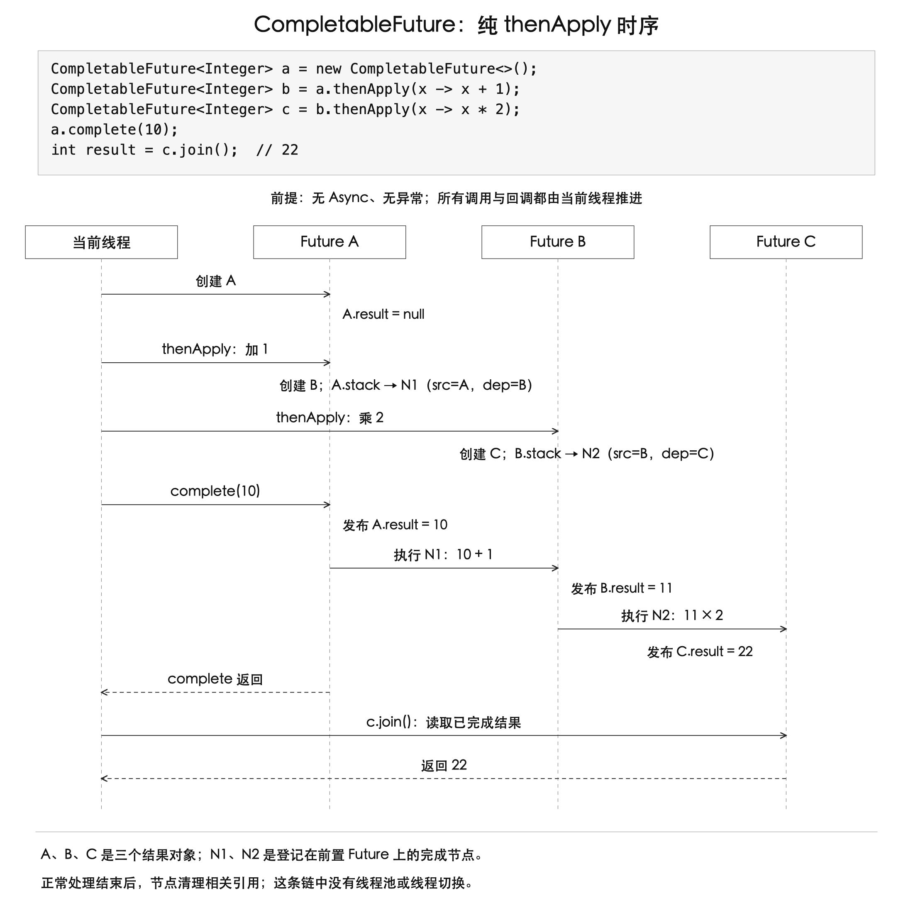
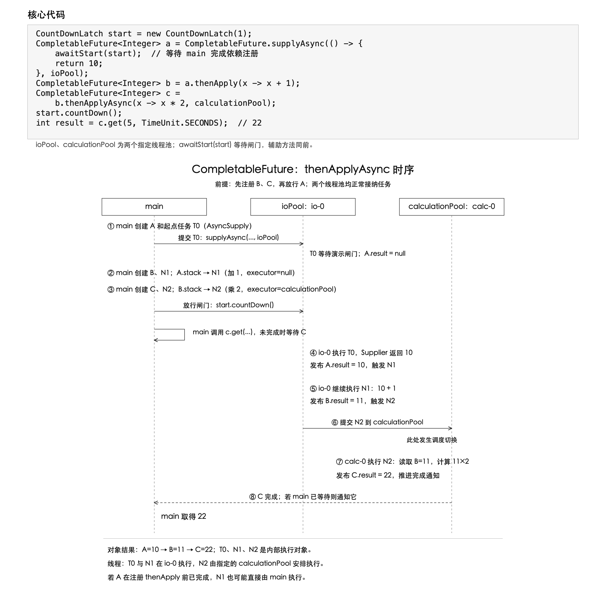
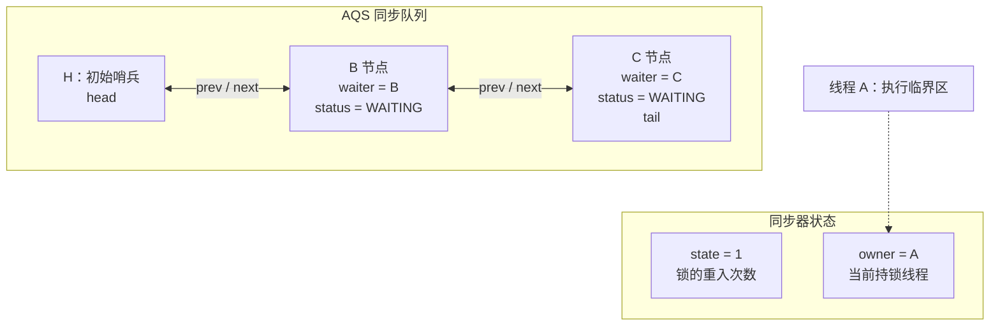
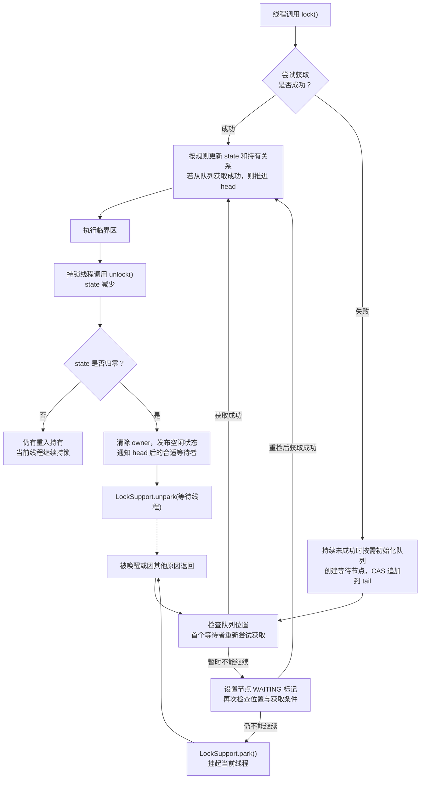
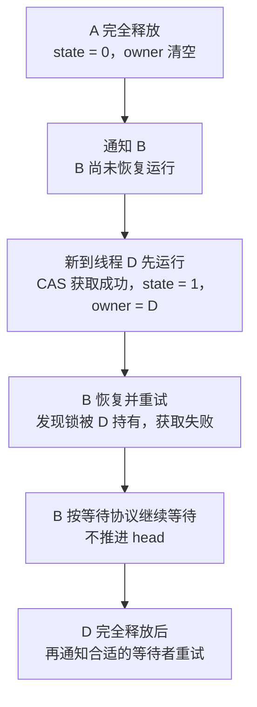

# Java并发编程

> 本文合并原《并发基础》《并发深入了解》，统一维护并发模型、同步机制、任务生命周期与工程验证。以 JDK 17/21 为主要基线；虚拟线程以 JDK 21 为起点，单列后续版本差异。语言规范、JDK API 契约、HotSpot/OpenJDK 实现、项目设计假设分开说明。
>
> 项目案例来自知识库中的医生助手、患者画像、支付聚合查询与批处理方案，用于推演机制和故障边界，不代表对应生产代码已实现或已发生事故。[[01-Java基础与并发/并发编程/互联网医疗项目中的并发与线程池深度面试题|互联网医疗项目中的并发与线程池深度面试题]] 保持独立，用于检验理解和方案权衡。

## 目录

1. [从一次患者分析请求建立并发模型](#1-从一次患者分析请求建立并发模型)
2. [共享状态与业务不变量](#2-共享状态与业务不变量)
3. [JMM 与 happens-before 推导](#3-jmm-与-happens-before-推导)
4. [安全发布、final 与不可变快照](#4-安全发布final-与不可变快照)
5. [synchronized 与显式锁](#5-synchronized-与显式锁)
6. [条件等待、通知与 LockSupport](#6-条件等待通知与-locksupport)
7. [读写锁、StampedLock 与缓存刷新](#7-读写锁stampedlock-与缓存刷新)
8. [CAS、ABA 与原子类](#8-casaba-与原子类)
9. [AQS 的状态与等待协议](#9-aqs-的状态与等待协议)
10. [线程状态、中断与协作式取消](#10-线程状态中断与协作式取消)
11. [线程池的接纳、排队与退出](#11-线程池的接纳排队与退出)
12. [容量、背压与资源隔离](#12-容量背压与资源隔离)
13. [协作工具与定时任务](#13-协作工具与定时任务)
14. [Future 与 CompletableFuture 编排](#14-future-与-completablefuture-编排)
15. [ThreadLocal 与上下文传播](#15-threadlocal-与上下文传播)
16. [ForkJoin 与虚拟线程](#16-forkjoin-与虚拟线程)
17. [项目案例：患者详情与医生助手聚合](#17-项目案例患者详情与医生助手聚合)
18. [项目案例：画像更新、任务抢占与批处理](#18-项目案例画像更新任务抢占与批处理)
19. [诊断、测试与可复现实验](#19-诊断测试与可复现实验)
20. [阅读边界、源码入口与验证记录](#20-阅读边界源码入口与验证记录)
21. [面试重点与常见追问](#21-面试重点与常见追问)
22. [AQS 同步队列完整流程图](#22-aqs-同步队列完整流程图)

## 阅读路径

首次系统学习按第 1～10 章建立正确性模型，再读线程池与异步编排。排查项目时，从第 17～19 章的失败时序返回相应机制。每个主题先回答“保护什么、由谁负责、何时完成”，再讨论实现和性能。

并发容器的内部结构统一见 [[01-Java基础与并发/Java基础/集合|集合]]；任务保留对象造成的 GC 压力见 [[01-Java基础与并发/JVM/JVM|JVM]]；数据库隔离、锁与持久化状态推进分别见 [[03-数据存储与缓存/数据库/MySQL|MySQL]]、[[03-数据存储与缓存/数据库/Mybatis|MyBatis]]。

## 1. 从一次患者分析请求建立并发模型

医生助手收到请求后，可能查询患者基本信息、读取画像、检索历史报告、调用模型，再形成待确认任务。并发设计不是先选线程池，而是先确定依赖和资源边界：

```text
认证与数据权限校验
       ↓
读取患者基础信息 ──→ 基于患者标识读取画像
       └─────────→ 获取授权范围内的历史报告
                         ↓
                   汇总输入并调用模型
                         ↓
                 保存结果/创建待确认任务
```

可以并行的是没有数据依赖、权限前提已满足的步骤。即使调用在技术上可以同时发起，也不代表可以在权限校验之前读取敏感数据。

| 概念 | 回答的问题 | 项目中的例子 |
| --- | --- | --- |
| 并发 | 多项工作如何交错推进 | 多个患者请求共享服务 |
| 并行 | 是否同时使用多个计算资源 | 两个 CPU 核同时解析不同报告 |
| 异步 | 发起方是否立即等待结果 | 返回任务 ID，稍后查询结果 |
| 阻塞 | 当前执行线程是否等待某条件 | 等 JDBC 连接或远程响应 |

异步 API 内部仍可能阻塞工作线程；同步代码也可以运行在虚拟线程上。线程是执行载体，任务是业务工作，Future 是结果句柄，三者生命周期不相同。

把任务画成状态机，通常比画“开了几个线程”更有用：

```text
创建 → 准入 → 排队 → 运行 → 成功/失败
          ↘ 拒绝       ↘ 取消请求 → 实际结束 → 资源清理
调用方另有：等待中 → 超时返回/断连
```

**调用方结束、Future 完成、执行体结束、外部副作用落地**是四个不同事件。后文所有超时、取消和可靠性问题都围绕这些边界展开。

## 2. 共享状态与业务不变量

### 2.1 先写不变量，再选同步工具

假设患者分析任务拥有 `status`、`owner`、`version` 三个字段。业务要求“只有一个工作者可认领当前版本的任务”。分别把三个字段改成原子变量，只能保证各自操作原子，不能保证三者作为整体一致。

应先明确：

- 哪些字段必须一起变化？
- 哪个瞬间算操作生效，即线性化点？
- 同步范围是一个对象、单 JVM，还是多个实例共享的数据库行？
- 失败、中断、重试后，是否允许重复执行或部分成功？

一种单 JVM 方案是用同一把锁保护整组字段；另一种是构造不可变状态对象，用一次 CAS 替换整个引用。跨实例的认领需要数据库条件更新、唯一约束或其他持久化协调，Java 锁不会跨进程生效。

### 2.2 原子性、可见性、有序性分别解决什么

`count++` 是读、计算、写的组合。两个线程都读到 10，各自写回 11，就丢了一次更新；即使 `count` 是 `volatile`，组合操作仍没有互斥。

可见性问题是读线程缺少合法同步关系时，不能保证观察到写线程的更新。有序性问题是程序对外可观察的顺序受到哪些约束；不能仅凭源码行号证明跨线程顺序。

“线程安全集合”也不自动解决业务竞争：

```java
// 反例：两个单独安全的操作，没有形成一次原子认领。
if (!tasks.containsKey(taskId)) {
    tasks.put(taskId, newTask);
}
```

如果只需要同一个 key 的条件插入，可以用 `putIfAbsent`；如果还要同时扣减余额或更新另一个 key，就需要更完整的事务边界。

### 2.3 尽量缩小共享范围

优先考虑线程封闭、不可变数据、按患者或任务分区、消息传递，再考虑共享可变状态。局部引用指向的对象仍可能共享，浅拷贝集合也不会深拷贝其中的可变元素。

线程安全不是类名上的标签，而是调用协议。例如 `ArrayList` 在线程封闭时可安全使用；`ConcurrentHashMap` 中的普通可变 `Patient` 不会因为装进并发 Map 就自动安全。

### 2.4 从业务场景选择并发控制机制

“可能被同时访问”不等于“统一使用乐观锁”。先明确对象是否共享、更新是否依赖旧值，以及并发可能破坏什么业务约束：如果读取后别人修改了数据，当前校验和计算是否仍然成立？冲突后允许拒绝、重新计算，还是必须让用户重新确认？

| 业务场景 | 通常优先考虑 | 原因与适用边界 |
| --- | --- | --- |
| 只查询商品信息 | 普通查询 | 没有更新覆盖问题；是否要求最新数据、多次查询是否需要一致快照，另行定义 |
| 扣减库存、增加计数 | 原子 SQL + 必要条件 | 在数据库当前值上计算，避免读出后回写旧结果；仍需处理重复请求和数值边界 |
| 订单从“待支付”改为“已支付” | 带预期状态的条件更新 | 使用 `WHERE status = 'UNPAID'` 并检查影响行数；零行后区分重复处理和其他状态冲突 |
| 编辑资料，要求发现别人已经修改过 | 版本号乐观锁 | 拒绝旧页面覆盖新数据；冲突后展示差异或重新确认，不能默认自动覆盖 |
| 读取后进行复杂计算，再更新多个字段 | 乐观锁或悲观锁 | 保护计算所依赖的数据；前者在更新时校验版本，后者在读取依据时取得锁 |
| 重复创建订单、重复处理回调 | 幂等键 + 唯一约束 | 识别同一业务动作，键的作用域与唯一约束必须一致；相关数据库变更放在同一事务内，外部副作用另需幂等协议 |

预期状态条件也是一种乐观并发控制；这里单列版本号乐观锁，是为了区分“检查状态是否仍允许迁移”与“检查记录是否已被修改”。这些机制可以组合：事务负责相关数据库操作的提交与回滚，条件更新负责并发判定，唯一约束负责拒绝重复业务键。

#### 连续 set 应保护哪个范围

如果对象由当前请求独享，连续 `set` 通常不需要 Java 锁；“局部变量”本身不能证明对象独享，还要排除共享缓存、单例字段或异步任务持有同一引用。多个请求各自查询同一数据库行，通常得到不同 Java 对象，分别锁住各自实体不能协调数据库竞争。

如果多个线程共享同一对象，应让完整的“检查条件 → 修改关联字段”以及要求一致快照的读取遵循同一把锁，或使用不可变快照整体替换。分别给各个 setter 加锁，不能阻止线程在两个 setter 之间读到中间状态；封装成 `markPaid(...)` 能集中业务规则，但不会自动获得线程安全。

普通 POJO 的 `set` 修改内存，数据库事务回滚不会自动撤销这些赋值。涉及持久化时，应明确实际 SQL 的执行时点，以及最终提交是否受状态条件、版本条件或锁定读保护。

#### 为什么有事务仍会丢失更新

下面是教学反例，不是推荐实现。假设 Spring 事务通过代理正常生效，每个请求各有一个事务；数据库为 MySQL 8.4 InnoDB，隔离级别为 `READ COMMITTED` 或 `REPEATABLE READ`，使用普通查询、绝对值更新，没有版本条件或自动冲突检测。

Service 方法片段如下，省略实体、Mapper 定义及注入；`Product` 是本次调用独享的普通对象：

```java
import org.springframework.transaction.annotation.Transactional;

@Transactional
public void deductStock(long productId, int quantity) {
    if (quantity <= 0) {
        throw new IllegalArgumentException("扣减数量必须为正数");
    }
    Product product = productMapper.findById(productId);
    if (product == null || product.getStock() < quantity) {
        throw new IllegalStateException("商品不存在或库存不足");
    }
    product.setStock(product.getStock() - quantity);
    int affected = productMapper.updateStock(productId, product.getStock());
    if (affected != 1) {
        throw new IllegalStateException("库存更新失败");
    }
}
```

`findById` 执行普通 `SELECT`，`updateStock` 执行以下绝对值赋值；`:new_stock` 等是绑定参数的说明性记法：

```sql
UPDATE product
SET stock = :new_stock
WHERE id = :product_id;
```

假设 `id = 1` 的初始库存为 10，A 购买 2 件，B 购买 3 件。两个事务可能发生以下交错：

| 步骤 | 请求 A 的事务 | 请求 B 的事务 |
| --- | --- | --- |
| 1 | 开启事务 | 开启事务 |
| 2 | 普通查询读到 `stock = 10` | |
| 3 | | 普通查询也读到 `stock = 10` |
| 4 | 校验通过，Java 计算并 `setStock(8)` | |
| 5 | | 校验通过，Java 计算并 `setStock(7)` |
| 6 | `UPDATE product SET stock = 8 WHERE id = 1`，取得行锁，影响 1 行，尚未提交 | |
| 7 | | 尝试 `UPDATE product SET stock = 7 WHERE id = 1`，等待 A 的行锁 |
| 8 | 提交，库存 8 对其他新事务可见，释放行锁 | |
| 9 | | 取得行锁，执行之前算好的 `SET stock = 7`，影响 1 行 |
| 10 | | 提交，最终库存为 7；正确结果应为 5 |

两个事务都完整提交，两个更新的影响行数也都是 1，但 A 的扣减被 B 基于旧数据计算的结果覆盖。普通快照读不会锁住之后的计算依据；`UPDATE` 的行锁使写入互斥，却不会让等待者重新执行 Java 中的查询、校验和计算。`REPEATABLE READ` 也不能据此保证这种读后绝对值回写不丢更新。依据：[InnoDB 一致性读](https://dev.mysql.com/doc/refman/8.4/en/innodb-consistent-read.html)、[不同 SQL 设置的锁](https://dev.mysql.com/doc/refman/8.4/en/innodb-locks-set.html)。

`@Transactional` 的默认隔离设置为 `ISOLATION_DEFAULT`，不自动将两个业务方法串行执行；具体行为取决于实际事务隔离级别、SQL 和并发协议。依据：[Spring @Transactional 配置](https://docs.spring.io/spring-framework/reference/data-access/transaction/declarative/annotations.html)。

对简单库存扣减，可以把计算与非负条件合并进一条 SQL，参数仍要求 `quantity > 0`：

```sql
UPDATE product
SET stock = stock - :quantity
WHERE id = :product_id
  AND stock >= :quantity;
```

若 A、B 都成功提交，B 取得行锁后基于当前库存 8 扣减 3，最终为 5。影响行数为 0 表示记录不存在或库存不足，不能继续按扣减成功创建订单；相关订单写入应参与同一个数据库事务。原子扣减本身不识别重复请求，仍需业务幂等。

如果必须先读再进行复杂计算，可使用版本号检测读取依据是否过期，冲突处理见第 18.1 节；也可在同一事务中先用 `SELECT ... FOR UPDATE` 读取依据，校验、计算、更新后提交，锁持续到提交或回滚。事后仅在更新阶段取得行锁，不能自动保护此前的普通查询与计算；多行、多表约束还需覆盖全部相关数据。依据：[InnoDB 锁定读](https://dev.mysql.com/doc/refman/8.4/en/innodb-locking-reads.html)。数据库锁、隔离与事务集成的展开分别见 [[03-数据存储与缓存/数据库/MySQL|MySQL]]、[[03-数据存储与缓存/数据库/Mybatis|MyBatis]]。

### 2.5 并发控制选型：从业务约束到工具组合

第 2.4 节给出场景与方案，本节说明如何推导选择。判断顺序是：**业务约束 → 共享范围 → 能否原子表达 → 冲突与失败处理 → 性能验证**。先明确并发时绝不能发生什么，再确定哪些执行者可能破坏约束，最后比较工具。

这些工具处在不同层次：CAS 是原子条件更新操作，原子类封装共享状态的原子访问，AQS 是构建同步器的框架，`ReentrantReadWriteLock` 是具体同步器；数据库锁与 Redisson 则在不同资源上协调竞争。AQS 本身不是一种可以直接替代数据库锁的业务方案，也不是所有 Java 锁都由 AQS 实现。

#### 第一步：共享范围必须覆盖所有竞争者

| 数据与共享范围 | 优先考虑的方向 | 需要排除的误判 |
| --- | --- | --- |
| 当前请求独享的对象 | 通常不需要同步 | 局部引用仍可能指向共享缓存、单例或异步任务中的对象 |
| 同一 JVM 中共享的内存状态 | 原子类、synchronized、ReentrantLock、读写锁等 | 多个实例各有一把本地锁，不能互相协调；同一 JVM 中不同锁对象也不能互斥 |
| 多个实例共同修改数据库数据 | 条件更新、版本校验、数据库锁、唯一约束与事务 | 不必因为部署多个实例就默认增加分布式锁 |
| 多个实例需要协调一段业务执行 | 数据库认领、按业务键串行处理，或 Redisson 等分布式协调 | 取得执行权不等于持久化成功，也不等于旧执行者以后不能写入 |
| 数据库、缓存、消息与外部接口共同参与 | 分别设计提交、幂等、可靠事件与恢复协议 | 普通锁或一个本地事务不能让这些资源整体原子提交 |

数据最终存于数据库时，应尽量让最终约束由数据库条件、唯一约束或经过验证的锁定协议落实。外层执行协调可以减少重复工作，但必须继续考虑绕过该入口、进程重启与迟到执行者；具体故障窗口见第 18.1～18.2 节。

#### 第二步：区分原子更新、互斥、事务和幂等

“保证原子性”需要展开为可检查的目标：

| 要保证的事情 | 所需能力 | 不能自动推出的保证 |
| --- | --- | --- |
| 一个值的增加不能丢失 | 原子增减 | 分开的 get、计算、set 不会自动组成原子增量 |
| 只有旧状态仍满足条件才允许修改 | 原子条件更新、版本或预期状态校验 | 只比较当前值未必能发现 ABA，也未必覆盖全部计算依据 |
| 多步骤之间不能插入破坏约束的竞争操作 | 同一协议保护的临界区，或提交时验证完整依赖 | 锁住部分写入路径不能保护绕过协议的访问 |
| 多项数据库变更一起提交或回滚 | 同一数据库事务 | 有事务不等于读后计算不会丢更新，也不回滚普通 Java 字段 |
| 同一业务动作重复到达不重复生效 | 幂等键、唯一约束、状态和结果记录 | 把重复请求串行执行，仍可能重复产生副作用 |
| 多字段读取属于同一版本 | 锁保护读取、不可变快照或符合协议的乐观读 | 多个字段各自线程安全，不等于组合快照一致 |

因此，一个流程可以同时使用多种机制：事务控制提交范围，条件更新判定是否有权推进状态，唯一约束拒绝重复业务键，外部接口再使用幂等标识。互斥不会自动撤销已经完成的外部调用；成功更新也不代表事务已经提交。事务丢更新反例见第 2.4 节，持久化结果未知与恢复见 [[03-数据存储与缓存/数据库/MySQL|MySQL]] 第 7.7、11 章。

#### 第三步：JVM 内存按操作形式选择

| 机制 | 优先评估的操作形式 | 成立前提与失效边界 |
| --- | --- | --- |
| AtomicInteger、AtomicLong、AtomicBoolean 等 | 原子增减、状态切换、短小的条件更新 | 操作同一共享实例；多个原子方法组合起来仍可能有竞态，CAS 候选计算应可重复且无外部副作用 |
| AtomicReference + 不可变快照 | 关联字段作为一个状态整体切换 | 读者保存同一个快照引用；不修改已发布对象，多写者在 CAS 失败后重算；计入复制与分配成本 |
| synchronized | 结构清晰的检查、计算和多步修改 | 所有相关访问遵循同一 monitor 协议；异常退出释放相应持有，不自动恢复已改字段 |
| ReentrantLock | 需要互斥，并要求超时、可中断获取、多个 Condition 或公平策略 | 获取成功后才进入释放区域；公平策略不保证严格业务完成顺序 |
| ReentrantReadWriteLock | 读操作可以共同执行，写操作要求独占 | 读临界区不能修改共享状态；协调读计数有成本，写等待与读锁持有时间也要评估 |
| StampedLock | 短小、无副作用、易复制和验证的读取 | 乐观读不阻止写者；失败后回退读锁重读，不可重入，不能在验证前执行不安全遍历或外部动作 |
| LongAdder | 高竞争的累加统计 | sum 不保证并发更新期间的原子快照，不承担精确条件准入；需要限制并发数量时优先评估 Semaphore 等现成工具 |

不能按“一个字段用原子类，多个字段用锁”机械划分：一个字段也可能参与复杂流程；多个字段可以封装为不可变状态，用一次引用 CAS 切换。关键是业务要求能否落在一次原子状态迁移上，以及失败后是否能够安全重做。机制与示例分别见第 4.3、5～9、12.3 节。

依据：[ReentrantLock API](https://docs.oracle.com/en/java/javase/21/docs/api/java.base/java/util/concurrent/locks/ReentrantLock.html)、[ReentrantReadWriteLock API](https://docs.oracle.com/en/java/javase/21/docs/api/java.base/java/util/concurrent/locks/ReentrantReadWriteLock.html)、[StampedLock API](https://docs.oracle.com/en/java/javase/21/docs/api/java.base/java/util/concurrent/locks/StampedLock.html)、[LongAdder API](https://docs.oracle.com/en/java/javase/21/docs/api/java.base/java/util/concurrent/atomic/LongAdder.html)。

#### 第四步：数据库先判断能否直接表达为条件 SQL

如果判断和修改可以直接在一条 SQL 内完成，优先评估把必要条件放入 WHERE、在数据库当前值上计算，并检查影响行数。相关多条数据库变更仍需同一事务，重复业务动作仍需幂等。第 2.4 节已有完整失败时序和 SQL，不在此重复。

如果必须先读取、再进行应用计算，比较乐观校验和先锁定数据的方案：

| 判断维度 | 数据库乐观锁 | 数据库悲观锁 |
| --- | --- | --- |
| 保护方式 | 更新时验证读取依据是否仍有效 | 在读取依据时先锁定相关数据，再校验、计算和修改 |
| 冲突的直接代价 | 更新被拒绝，必要时重读重算；UPDATE 本身也可能等锁 | 等待、超时或死锁；锁内过程串行化 |
| 通常值得评估的条件 | 冲突较少，或业务允许拒绝、重新确认、低成本重算 | 希望减少重复计算，且能够控制锁定范围与持锁时长 |
| 必须设计 | 全部相关写路径的版本协议、零行分类、是否允许重试及预算 | 事务边界、索引与锁定范围、多资源加锁顺序、等待与失败处理 |
| 共同边界 | 单行版本不自动保护跨行约束 | 锁住一行也不自动覆盖其他记录、范围及未来插入 |

“原子 SQL”和“乐观锁”不是互斥分类：带版本或预期状态条件的 UPDATE 本身也是原子条件更新。冲突多也不是必须使用悲观锁的充分条件，还要比较重算成本、持锁时长和替代方案。乐观锁处理复杂计算同样可行，前提是能够验证全部相关依据，并决定过期结果如何处理。

以 MySQL 8.4 InnoDB 为例，使用 SELECT ... FOR UPDATE 时，应在同一事务内完成锁定读、校验和修改；锁到提交或回滚才释放，实际范围受索引、谓词与隔离级别影响。多行、多表约束需要共同协调点或覆盖完整依赖的锁定、校验与隔离设计，不能只看某条 UPDATE 是否成功。依据：[InnoDB 锁定读](https://dev.mysql.com/doc/refman/8.4/en/innodb-locking-reads.html)。跨行约束与锁范围见 [[03-数据存储与缓存/数据库/MySQL|MySQL]] 第 9.3、10 章；乐观冲突处理见第 18.1 节。

#### 第五步：分布式执行协调要补齐失效与提交边界

当多个进程需要对同一业务资源的执行进行协调时，再评估 Redisson 等方案，而不是仅凭“多实例部署”决定加分布式锁。数据库条件更新或持久化认领足够时，可以直接在相应资源中完成协调。

选择普通 RLock 至少要回答：业务 key 与粒度是什么，全部竞争入口是否获取同一 key；获取失败是等待、拒绝还是稍后重试；锁覆盖到哪个真正完成的时点；租约到期后旧持有者恢复能否继续写入。

需要分别验证两个窗口：

- **提交窗口**：事务方法内 finally 解锁可能早于代理完成数据库提交。锁要覆盖所保护事务的提交或回滚；合理顺序是先加锁，再执行经正确事务边界包裹的读取和更新，事务结束后解锁，还需核对更外层事务。方法返回、事务提交与外部副作用完成不是同一时点。
- **租约窗口**：旧执行者暂停，租约到期后新执行者取得锁并完成操作，旧执行者恢复仍可能写资源。续期与持有者校验不能消除所有陈旧写入风险；严格约束需由受保护资源原子校验有效版本、fencing token 或其他业务条件，并拒绝过期操作。

普通 Redisson 锁属于协作式锁，只约束遵守相同加锁协议的路径；不能强制所有数据库写入经过该锁，也不提供 Redis、数据库和 RPC 的统一原子提交。依据：[Redisson 锁的可靠性与 fencing](https://redisson.pro/docs/data-and-services/locks-and-synchronizers/)。事务顺序和陈旧执行者问题继续见第 21.2 节追问 6、第 18.2 节；事务与可靠事件的落地边界见 [[03-数据存储与缓存/数据库/Mybatis|MyBatis]] 第 15 章。

#### 第六步：先证明正确性，再比较在哪里支付协调成本

| 方案 | 主要成本 | 应观察的信号 |
| --- | --- | --- |
| CAS 或乐观更新 | 竞争失败、重新计算与再次提交 | 同一资源冲突率、每次成功的尝试次数、重算时间、分配与 CPU 开销 |
| 本地互斥锁 | 临界区串行执行、竞争与等待 | 等待和持有时间分布、锁内 I/O、吞吐与尾延迟 |
| 读写锁或乐观读 | 读写状态协调、写者等待、验证失败回退 | 读写各自等待时间、乐观验证失败与回退比例 |
| 数据库悲观锁 | 事务持锁、连接占用与锁等待 | 扫描和锁定范围、事务时长、等待超时、死锁、连接占用 |
| 分布式锁 | 网络交互、远程协调与租约维护 | 加锁等待、持有时长、续期失败、超时以及资源端拒绝陈旧操作的记录 |

总 QPS 高但请求分散到不同资源，不一定高冲突；总 QPS 不高但集中修改同一热点，也可能成为瓶颈。没有“读超过某个固定比例就用读写锁”“并发高就用 CAS”这样的通用阈值。还要评估按 key 分区、缩小共享范围或串行处理是否更简单。

失败路径必须进入选型结论：条件更新零行如何分类，CAS 或版本冲突是否允许重算，等待超时和死锁后如何结束事务，结果未知时如何核实幂等结果，锁过期后怎样拒绝陈旧写入。验证方法见第 19 章；本节只整理判断方法，不新增项目集成或性能实测结论。

应用到具体场景时，依次回答六个问题：

1. 必须始终成立的业务约束是什么？
2. 共享数据在哪里，谁可能修改它，哪些路径必须遵守同一协议？
3. 能否通过一次原子操作或条件 SQL 完成？
4. 如果必须读后计算，冲突时允许拒绝或重算吗？
5. 失败、超时、重试、进程退出与锁失效后，状态如何恢复或收敛？
6. 正确性成立后，主要成本在哪里，用哪些指标和失败时序验证？

面试时可将以上推导收敛为[第 21.9 节的表述](#219-并发控制选型的面试表述)。

## 3. JMM 与 happens-before 推导

### 3.1 不用“刷到主内存”替代证明

JMM 规定多线程程序允许观察什么，不规定每一次访问必须沿某条 CPU 缓存或物理内存路径执行。编译器、处理器可以优化，但最终行为必须满足规范约束。

两个线程访问同一变量，至少一个是写且缺乏 happens-before 排序，属于数据竞争。正确同步的程序可以获得规范所描述的顺序一致性保证；这不等于程序没有业务上的竞态条件。依据：[JLS 第 17 章](https://docs.oracle.com/javase/specs/jls/se21/html/jls-17.html)。

### 3.2 一次发布的证明链

```java
class Publication {
    private int result;
    private volatile boolean ready;

    void publish() {
        result = 42;
        ready = true;
    }

    int readIfReady() {
        return ready ? result : -1;
    }
}
```

在单次发布、没有后续修改 `result` 的前提下：

```text
写 result=42
  → 同线程程序顺序 → volatile 写 ready=true
  → 同一变量的同步关系 → 读到该发布的 ready=true
  → 同线程程序顺序 → 读取 result
```

通过传递性，读到 `ready=true` 后应观察到 `result=42`。没有 `volatile` 或其他同步协议时，这条跨线程边断开。

如果把这个对象循环复用，不断修改 `result`、把 `ready` 重置，单次发布证明不能直接搬过去：读线程可能混合不同轮次的状态。可用带版本的不可变快照、队列或锁来表达一轮数据的完整边界。

### 3.3 常用同步边及前提

| 建立关系的动作 | 可依赖的效果 | 常见遗漏 |
| --- | --- | --- |
| 同线程程序顺序与传递性 | 连接前后操作的可见性关系 | 不要求机器指令机械按源码顺序执行 |
| 解锁后再获取同一把锁 | 前一临界区的写对后一持锁者可见 | 两把不同的锁不建立这个关系；读者先拿锁不保证看到未来写入 |
| `volatile` 写与后续读 | 发布此前写入 | 不把多字段读改写变成事务 |
| `Thread.start()` | 启动前的操作对被启动线程可见 | 调用 `run()` 只是普通方法调用 |
| 检测线程终止，如成功等待 `join()` | 观察已结束线程的工作 | 带超时 join 返回后需确认线程确已结束 |
| 中断与检测到中断 | 形成相应同步关系 | 不保证任务自动停止或回滚 |
| 提交任务与任务执行、`Future.get()` 取得结果 | 支持安全交付输入与接收结果 | 提交后继续修改输入仍可能竞争 |
| 队列交付、Latch、Semaphore 等协议 | API 规定的内存一致性效果 | 仅看到计数变化不代表业务成功 |

并发工具的内存效果以 [java.util.concurrent 包说明](https://docs.oracle.com/en/java/javase/21/docs/api/java.base/java/util/concurrent/package-summary.html)为准。不要把 `sleep()` 当作发布协议：睡够久不等于建立可见性。

### 3.4 volatile 适合什么

适合独立状态标志、单写者发布配置引用等；不适合单独承担“检查后扣减”“读取多个字段形成一致快照”。`volatile List<T>` 约束引用访问，不会让 `list.add()` 获得并发安全。

屏障指令随 CPU/JIT 实现变化，不能在每段 Java 代码旁固定画几条 StoreLoad 就当作可移植证明。低层优化可进一步使用 VarHandle 的访问模式，但必须重新证明内存顺序，不能把 acquire/release、opaque、plain 混作同一种语义。

## 4. 安全发布、final 与不可变快照

### 4.1 final 不等于对象图不可变

`final` 引用不能重新赋值，引用指向的集合仍可修改。final 字段具有特殊初始化安全语义，前提包括对象被正确构造，不能在构造过程中泄漏 `this`；它不是整个可变对象的通用发布与同步方案。

向其他线程发布对象可通过锁、volatile 引用、类初始化或有相应内存契约的并发容器完成。构造完成后对普通字段的后续修改，仍需同步。

### 4.2 DCL 为什么需要 volatile

双重检查单例在外层检查时没有取得锁。如果单例引用是普通字段，外层读取绕过了锁提供的发布关系。加 `volatile` 的意义是让对象初始化写入通过引用发布传递给读者，而不是依赖“new 永远拆成三个固定机器指令”的故事。

如果只需要延迟创建单例，静态内部类持有者等利用类初始化的方式通常更简单；若使用 DCL，内外检查、同一把锁、volatile 字段和构造不逃逸都需成立。

### 4.3 项目示例：一次读取同一版本的规则

患者画像计算可能同时使用阈值和规则集合。如果它们被独立更新，读者可能拿到“新阈值 + 旧规则”。将所有字段封装到不可变快照，再一次替换引用，可以使读取方拿到一致版本。

下面是完整的 JDK 17+ 教学类，保存为 `ProfileSnapshots.java`。`Map` 的值是不可变的 `String`，因此本例的复制边界足够；若值换成可变对象，`Map.copyOf` 仍只是浅层复制。

```java
import java.util.HashMap;
import java.util.Map;
import java.util.Objects;
import java.util.concurrent.atomic.AtomicReference;

public final class ProfileSnapshots {
    public record Snapshot(long version, Map<String, String> tags) {
        public Snapshot {
            tags = Map.copyOf(tags);
        }
    }

    private final AtomicReference<Snapshot> current =
            new AtomicReference<>(new Snapshot(0, Map.of()));

    public Snapshot read() {
        return current.get();
    }

    public Snapshot putTag(String key, String value) {
        Objects.requireNonNull(key);
        Objects.requireNonNull(value);
        for (;;) {
            Snapshot before = current.get();
            Map<String, String> nextTags = new HashMap<>(before.tags());
            nextTags.put(key, value);
            Snapshot after = new Snapshot(
                    Math.addExact(before.version(), 1), nextTags);
            if (current.compareAndSet(before, after)) {
                return after;
            }
        }
    }
}
```

读者先保存 `Snapshot snapshot = store.read()`，之后都从同一个局部引用取字段；反复调用 `read()` 可能读取不同版本。CAS 失败后从新状态重算，可避免两个写者分别增加标签时互相覆盖。

本例的成本是每次更新复制 Map，适合小型、读多写少的教学模型，不是完整缓存：没有容量、过期、租户隔离和数据库持久化，也不允许把它当作跨实例的画像一致性方案。第 18 章说明持久化版本的边界。

## 5. synchronized 与显式锁

### 5.1 锁保护的是协议，不是自动保护某个对象

`synchronized (lock)` 让使用同一 monitor 的线程互斥。实例同步方法锁 `this`，静态同步方法锁相应 `Class` 对象；如果两个 Service 实例各自使用不同锁，就不会互斥。

所有访问受保护状态的路径都需遵循同一协议，包括“只是读取”的路径。锁对象应稳定且封装良好，避免使用外部可访问的字符串常量或每次新建的锁。

同步代码块编译为 monitor 相关指令，异常路径也要释放 monitor；同步方法以 `ACC_SYNCHRONIZED` 表达。HotSpot 可能使用快速锁路径、监视器膨胀、JIT 锁消除等实现优化，语言契约始终是互斥与相应可见性。

### 5.2 显式锁提供额外的等待控制

| 能力 | synchronized | ReentrantLock |
| --- | --- | --- |
| 重入 | 支持，同线程重复进入 | 支持，持有计数匹配解锁次数 |
| 获取时可中断 | 进入 monitor 不支持 | `lockInterruptibly()` |
| 尝试或超时获取 | 无对应直接语法 | `tryLock()`、带时间的 `tryLock` |
| 公平策略 | 不承诺 | 可配置，但不等于调度器公平 |
| 条件等待 | `wait/notify/notifyAll` | 可建立多个 Condition |
| 释放 | 语言结构保障 | 调用方在 `finally` 中负责 |

显式锁的正确形态是**获取成功后才进入负责释放的 try/finally**。如果 `lockInterruptibly()` 抛异常，不能在外层无条件 `unlock()`。

```java
lock.lockInterruptibly();
try {
    updateState();
} finally {
    lock.unlock();
}
```

公平 `ReentrantLock` 的无参 `tryLock()` 仍允许插队；带超时的尝试有不同规则。不要用公平锁参数推导严格的业务完成顺序。依据：[ReentrantLock API](https://docs.oracle.com/en/java/javase/21/docs/api/java.base/java/util/concurrent/locks/ReentrantLock.html)。

### 5.3 锁越大越简单，也可能把慢调用串行化

如果把 HTTP/RPC、数据库查询或 JSON 序列化放在全局锁里，某个慢调用会延长所有后继任务的等待。先度量**等待锁时间与持锁时间**，再选择缩小临界区、按 key 分区或不可变快照。

不能简单把计算移出锁就结束：锁外读出的输入在锁内提交前可能已过期，必须二次检查版本或条件。按 key 建锁表也需要容量与删除协议；错误删除仍被等待者引用的锁，可能让同一 key 同时出现两把锁。

### 5.4 历史锁实现放在正确的位置

偏向锁是旧 HotSpot 的优化，JDK 15 默认禁用，后续版本已移除。旧资料中的“偏向 → 轻量级 → 重量级”不是所有 JDK 都必须遵循的状态机。锁释放、监视器回收/退膨胀、偏向撤销是不同操作。

JIT 可在满足条件时消除线程封闭对象的锁，也可能合并部分连续加锁；不是只要代码长得像示例就必然优化。对象头布局和锁实现应固定版本看源码，性能结论以竞争数据与基准验证。

## 6. 条件等待、通知与 LockSupport

### 6.1 等待的是状态谓词，不是一声通知

生产者消费者的核心不变量是 `0 <= size <= capacity`。消费者关心“队列非空”，生产者关心“队列未满”。通知只表示条件可能变了，不携带永久有效的许可。

```java
lock.lockInterruptibly();
try {
    while (queue.isEmpty() && !closed) {
        notEmpty.await();
    }
    // 仍持锁，重新判断 closed 与队列状态后再取数据。
} finally {
    lock.unlock();
}
```

这里必须循环检查：可能发生虚假唤醒，也可能在本线程重新得到锁之前，另一个消费者已经取走元素。`signal()` 不会把锁立即交给等待线程；通知者仍持锁，等待者还要竞争并重新获取锁。

### 6.2 await 如何释放与重新获取锁

对于 `ReentrantLock` 的 Condition，等待时保存重入状态、释放关联锁，收到通知/中断/超时后重新获取锁，再按 API 契约返回或抛异常。条件队列和同步队列的职责不同，第 9 章继续展开。

`Object.wait()` 要求持有该对象 monitor，并只释放这个 monitor；如果调用线程同时持有其他锁，其他锁不会自动释放。`Thread.sleep()` 不释放已持有的锁。

多个不同条件共享一个等待集合时，随意 `notify()` 可能唤醒不能推进的线程；选择 `notifyAll()` 或分开的 Condition，应以完整的状态转换与退出协议为依据。停止系统时还需让等待空队列的消费者和等待满队列的生产者都能退出。

### 6.3 超时等待不要每轮重置预算

若循环中每次都 `await(1, SECONDS)`，虚假唤醒或竞争可能把总等待时间延长为多秒。可以维护单调时钟截止时间，或用 `awaitNanos` 返回的剩余预算继续等待；重试不应偷偷刷新调用方的总期限。

### 6.4 park/unpark 的一个许可

LockSupport 为线程维护最多一个许可：提前 `unpark` 可使之后一次 `park` 直接返回，但多次 `unpark` 不累积成多个许可。`park` 也可能因中断、超时或无明确原因返回，仍要循环检查由 volatile/原子变量等保护的条件。

它不要求持有 monitor，也不自动释放业务锁，不能单独承担共享数据的发布协议。原始 park/unpark 是构建同步器的底层材料，业务层通常优先使用已有同步工具。依据：[LockSupport API](https://docs.oracle.com/en/java/javase/21/docs/api/java.base/java/util/concurrent/locks/LockSupport.html)。

## 7. 读写锁、StampedLock 与缓存刷新

### 7.1 读多不等于读写锁一定快

`ReentrantReadWriteLock` 允许多个读者共存，写者独占。收益来自读临界区可并行执行，但获取/释放读锁仍有协调成本；极短读取可能不如不可变快照，频繁写入可能消除收益。

只有写锁支持 Condition，读锁不支持。不能把“读”理解为方法名以 get 开头：更新访问计数、懒初始化、修改缓存淘汰链表都属于写状态。

### 7.2 降级允许，读锁直接升级不允许

写者可以先获取读锁，再释放写锁，保持从修改到后续读取的连续保护。反过来，持有读锁再阻塞获取写锁，会被自己的读持有阻挡。

需要更新时，应释放读锁、获取写锁、重新检查条件；释放和重新获取之间可能有其他写者介入。锁返回的可变对象在离开锁后不继续受保护；如果后续还会修改它，需复制或继续遵守同步协议。

### 7.3 不把写等待简单归因于“读优先”

非公平读写锁不承诺获取顺序，但不能说“只要没有写者持锁，新读者永远直接进入”。OpenJDK 21 的非公平实现具有观察队首等待写者的启发式阻塞策略。它仍不提供严格公平保证。

写延迟高时应检查长读临界区、回源 I/O、重入路径、调度与连续竞争。公平模式可能改善等待分布，也可能降低吞吐；额外手写“写优先开关”会引入新的状态和唤醒协议，不能仅凭一张线程快照决定加入。

依据：[读写锁契约](https://docs.oracle.com/en/java/javase/21/docs/api/java.base/java/util/concurrent/locks/ReentrantReadWriteLock.html)、[OpenJDK 21 readerShouldBlock 源码](https://github.com/openjdk/jdk/blob/jdk-21%2B35/src/java.base/share/classes/java/util/concurrent/locks/ReentrantReadWriteLock.java)。

### 7.4 StampedLock 的验证边界

乐观读先获取 stamp，把必要字段读到局部变量，再 validate；验证失败则取得读锁并重读。它不可重入，不提供 Condition，转换锁模式的尝试可以失败。

```text
取得 stamp → 复制 x、y 到局部变量 → 验证
                                    ├ 成功：使用局部副本
                                    └ 失败：加读锁 → 重读 → 解锁
```

验证成功不冻结未来状态，也不能把任意不安全操作变安全。乐观阶段遍历正被修改的 HashMap、解引用结构暂时不一致的对象图、产生外部副作用，都可能在验证前出错。应限制为可容忍中间不一致的短读取，并让所有写者使用同一把写锁。

“乐观读接受旧值”不是完整描述：它可以提供满足协议的一致观察，但业务是否要求最新版本还要另外定义。依据：[StampedLock API](https://docs.oracle.com/en/java/javase/21/docs/api/java.base/java/util/concurrent/locks/StampedLock.html)。

### 7.5 本地缓存回源的隐藏竞争

在一把全局写锁内查询数据库，能避免同一时刻重复加载，却会串行化所有 key。把查询移出锁后，又可能出现：

```text
A 读取旧版本并开始回源
B 更新数据库并使缓存失效
A 回源完成，把旧数据重新写回缓存
```

因此要区分“合并同 key 的加载”与“防止旧值回填”：前者可用每 key 的在途 Future，后者需要版本判断、失效代次或业务一致性协议。任务注册表要有容量和失败清理；移除应匹配具体在途项，避免旧任务删除新任务的登记。完整缓存失效设计属于缓存专题，这里关注线程与状态边界。

## 8. CAS、ABA 与原子类

### 8.1 CAS 的线性化点与重试

CAS 在一个原子步骤中比较当前值和期望值，匹配则写入新值并报告成功。常见重试循环先读状态、计算候选值、CAS，失败后重新计算。成功的 CAS 是本次状态更新的线性化点。

`AtomicReference` 比较引用身份，不调用业务 `equals()`。把多个字段封装成不可变对象并 CAS 一个引用，可以原子切换整组状态；“CAS 只能保护一个业务字段”并不准确。

CAS 循环的计算必须可重复，不能在其中扣款、发消息或进行不可重复的审计写入。`updateAndGet` 等更新函数在竞争时可能被重复调用。依据：[AtomicReference API](https://docs.oracle.com/en/java/javase/21/docs/api/java.base/java/util/concurrent/atomic/AtomicReference.html)。

### 8.2 无锁不代表无等待，也不保证更快

锁无关算法可以让系统整体持续推进，但某个线程可能持续失败；wait-free 则要求每个操作在有界步骤内完成，概念更强。普通 CAS 重试循环不能自动称为 wait-free。

竞争越高，缓存行争用与重试成本可能越高；计算候选对象还会制造额外分配。先用简单正确的同步方案，再按证据判断是否值得改成复杂无锁协议。

### 8.3 ABA 关心状态是否经历过变化

线程 A 读取引用 X 后暂停，线程 B 把 X 换成 Y 又换回同一个 X，A 的 CAS 仍可能成功。如果算法只关心当前值，这可能没有问题；如果依赖“期间无人改变”，则缺少版本信息。

不可变对象也可能重新被放回同一引用，所以“String 不可变就没有 ABA”不成立。Java GC 避免了仍有强引用对象被当作自由内存回收的那类问题，但不会阻止业务把同一节点重新入栈。

`AtomicStampedReference` 同时检查引用与版本；要用 `get(stampHolder)` 一起读取配对状态，并要求相关更新都推进版本。标记位只有两种状态，版本也可能回绕，不能不加前提地认为任何标记都彻底消除历史歧义。

LongAdder 解决热点分散，不是 ABA 修复工具。

### 8.4 统计计数与控制计数

> `LongAdder` 通过将累计值分散到 `base` 和多个 `Cell` 中，减少多线程更新同一个位置时的竞争；更新仍使用 CAS，读取总数时再累加各部分。它以额外内存和求和成本换取高竞争下的更新吞吐量，适合请求次数等统计；但 `sum()` 不是并发更新期间的原子快照，不适合精确额度判断或生成递增序号。

#### 为什么单点原子计数会成为热点

`AtomicInteger`、`AtomicLong` 将更新集中在同一个值上。底层采用 CAS 循环时，失败会引起重读和重试；采用硬件原子加法时，也仍需协调对同一缓存行的修改。高竞争可能增加 CPU 和缓存一致性通信开销，但“高并发一定导致 CPU 飙高”不成立，应结合吞吐、尾延迟和剖析证据判断。

#### LongAdder 的更新与汇总过程

以下实现细节以 OpenJDK `jdk-21+35` 为基线，调用链为 `increment → add → 必要时进入 Striped64.longAccumulate`：

1. **无数组时先更新 base。** `cells` 尚未初始化时，尝试 CAS 累加 `base`，成功即可返回，避免无竞争时就分配数组。
2. **发生竞争后分散更新。** 根据线程的 probe（探测值）选择 `Cell`；数组尚未建立或槽为空时，按需初始化、创建 Cell。多个线程可能映射到同一个槽，并非一线程独占一个 Cell。
3. **冲突后调整位置或扩容。** Cell 的 CAS 失败后进入重试协调，调整 probe 尝试其他位置；持续碰撞且满足条件时将数组加倍，扩容受实现中的 CPU 数量阈值约束，不会随请求数无限增长。数组建立后通常直接走 Cell 路径，不是每次都先争抢 base；初始化竞争等路径仍可能回退更新 base。
4. **读取时汇总。** `sum()` 读取 base，并遍历非空 Cell 累加它们的值，不会为了求和暂停全部更新线程。

```text
单点计数：A、B、C、D → 同一个 value

分散计数：A、B → Cell[0]    C、D → Cell[1]
          总数 = base + Cell[0].value + Cell[1].value + …
```

LongAdder 仍可能 CAS 失败和重试，并不保证每个线程在固定时间内完成。`cellsBusy` 是通过 CAS 获取的短暂自旋锁，用于数组初始化、创建槽和扩容，不是包住每次累加的全局锁；Cell 使用 `@Contended` 填充，减少不同槽共享缓存行造成的伪共享。伪共享是不同变量位于同一缓存行而导致写入互相干扰，不要因此给所有业务字段手工填充。

源码入口：[LongAdder.add / sum](https://github.com/openjdk/jdk/blob/jdk-21%2B35/src/java.base/share/classes/java/util/concurrent/atomic/LongAdder.java)、[Striped64.longAccumulate / Cell / cellsBusy](https://github.com/openjdk/jdk/blob/jdk-21%2B35/src/java.base/share/classes/java/util/concurrent/atomic/Striped64.java)。

#### AtomicLong 与 LongAdder 的选型

| 对比项 | AtomicLong | LongAdder |
| --- | --- | --- |
| 更新结构 | 单个共享值 | base 和按需建立的多个 Cell |
| 高竞争更新 | 集中协调同一位置 | 分散竞争，通常能提高更新吞吐量 |
| 读取成本 | 读取单个值 | 遍历并累加各槽 |
| 读取语义 | get 是单次原子读取，后续值仍可能改变 | sum 不保证并发更新期间的原子快照 |
| 更新后返回值 | incrementAndGet 返回本次原子自增的结果 | increment 返回 void；随后 sum 不是本次自增专属的结果 |
| 典型用途 | 本地递增序号、精确 CAS 条件更新 | 请求量、异常数等高竞争累加统计 |

`sum()` 的限制不表示正常累加会随意丢失：所有更新完成，并通过 join、Future.get 等确认后，在无其他并发更新、重置且未溢出的前提下，求和应得到准确累计值。并发求和则不是同一瞬间的整体快照；“先 sum，再 increment”也没有原子条件更新能力。

请求统计适合评估 LongAdder；“还有一个模型调用名额才能放行”不应该写成 `if (adder.sum() < limit) adder.increment()`，多个线程可能同时通过检查而超额放行。这类容量限制优先使用第 12.3 节的 Semaphore；精确的读后条件更新可评估 AtomicLong CAS。原子序号还要考虑重启、多实例和溢出。

`reset()` 应在没有并发更新时使用；`sumThenReset()` 也不是全局原子的统计窗口切换，不能据此保证严格按某一时刻划分全部增量。需要精确窗口时，应另外设计更新归属与切换协调。以上读取与重置契约见 [LongAdder API](https://docs.oracle.com/en/java/javase/21/docs/api/java.base/java/util/concurrent/atomic/LongAdder.html)。

#### 支付统计场景与验证边界

教学场景：当前 JVM 的共享统计组件持有一个 `final LongAdder paymentRequestCount`，每次支付请求进入约定入口时调用 `increment()`，监控线程周期调用 `sum()`。它统计的是该实例入口被执行的次数；重试或重复请求也会被计入，不能直接等同于成功支付订单数，更不能代替账本、业务幂等和数据库金额约束。多实例分别维护自己的计数，需要监控系统汇总；进程重启后内存计数也不会自动恢复。

最小正确性实验可让 8 个工作线程各累加 10000 次，等待全部任务成功完成后断言总数为 80000，并限制等待时间；这只能验证该运行中的累计结果，不能证明并发 sum 具有原子快照语义，也不能证明高竞争路径必然发生。性能应按第 19.3 节使用 JMH，对照 AtomicLong，分别测低、高竞争及不同读频率下的吞吐、尾延迟和 CPU 成本；不要每次 increment 后立即 sum，再把结果当作纯更新吞吐。LongAdder 的目标是提高统计更新吞吐，不承诺 CPU 使用率一定下降。本轮仅核对源码和文档，未运行上述实验或性能测试。

## 9. AQS 的状态与等待协议

### 9.1 先区分谁负责状态，谁负责排队

AQS（AbstractQueuedSynchronizer）解决的是同步器之间重复的线程协调问题：仅用 CAS 可以竞争修改状态，但获取失败后还需要处理排队、阻塞、通知、中断、超时和取消。持续 CAS 重试可能浪费 CPU，每种锁各自实现完整等待协议又容易出错，因此 AQS 将这些公共机制集中实现。

它采用模板方法思想：**具体同步器定义“什么条件下允许继续执行”，AQS 组织“条件不满足时如何等待，以及条件变化后如何重试”**。AQS 不是业务锁，也不负责数据库事务或跨 JVM 协调。以下字段和调用链以 OpenJDK `jdk-21+35` 为实现基线；状态含义与获取规则由子类定义。

| 同步器 | state 的典型含义 | 模式 |
| --- | --- | --- |
| ReentrantLock | 锁的重入次数，0 表示空闲 | 独占 |
| Semaphore | 可用许可数 | 共享 |
| CountDownLatch | 尚未完成的倒计数 | 共享，归零后等待者可通过 |

`state` 是 AQS 的 `volatile int` 字段，子类通过 `getState()`、`setState()`、`compareAndSetState()` 访问。volatile 提供相应的可见性与顺序，CAS 原子地完成条件更新；不能因为字段 volatile，就把任意读改写组合视为原子操作。

| 扩展方法 | 子类需要回答的问题 |
| --- | --- |
| `tryAcquire(arg)` | 独占获取是否成功 |
| `tryRelease(arg)` | 独占状态是否已完全释放，是否需要通知等待者 |
| `tryAcquireShared(arg)` | 共享获取是否成功；负数失败，非负成功，正数还表示后续获取可能成功 |
| `tryReleaseShared(arg)` | 本次释放是否需要推动等待者重新尝试 |
| `isHeldExclusively()` | 当前线程是否独占持有，用于支持相应的 Condition 等协议 |

这些方法应短小、线程安全，通常不在其中阻塞；公共获取入口再负责必要的等待。互斥锁还要校验所有者：ReentrantLock 的 owner 保存在父类 `AbstractOwnableSynchronizer` 的 `exclusiveOwnerThread` 中，并未编码进 state。只检查 state 非零就允许 unlock，会错误地放行非持有线程；Semaphore、CountDownLatch 则没有这种独占所有权要求。依据：[AQS API 契约](https://docs.oracle.com/en/java/javase/21/docs/api/java.base/java/util/concurrent/locks/AbstractQueuedSynchronizer.html)。

### 9.2 等待队列不是拿锁顺序的承诺

配套图解见文末[第 22 章：AQS 同步队列完整流程图](#22-aqs-同步队列完整流程图)，包含节点与 state 结构图、入队至重新竞争的流程图，以及 A、B、C 三线程时序和非公平插队分支。

#### 队列结构与 head 的含义

AQS 同步队列是用于阻塞同步器的 CLH 变体，节点包含前驱、后继、等待线程及节点状态。`head`、`tail` 管理队列；节点的 `status` 管理等待与取消，与同步器的 `state` 是两类状态。

假设 A 直接获取锁成功，B、C 按此顺序入队，暂不发生取消，稳定结构如下：

```text
同步状态：state = 1，owner = A
同步队列：head → [H] ⇄ [B 节点] ⇄ [C 节点] ← tail
                 ↑
              初始哨兵
```

**持锁者不一定入队，head 也不是 owner。** A 走快速路径成功就无需等待节点；head 起初是哨兵，之后可由获取成功的等待节点接替。队列只在需要时初始化，不是每次 lock 都必须排队。

#### ReentrantLock：获取失败、入队与挂起

以下是默认非公平 ReentrantLock 的正常教学时序；用于解释 JDK 21 的机制，不是可运行的自定义锁，也不枚举内存不足等特殊路径：

1. **A 快速获取。** `lock()` 委托内部 Sync，先走 `initialTryLock()`；CAS 将 state 从 0 改为 1，设置 owner 为 A，成功返回。A 重入时识别 owner 并增加持有次数，不入队；可重入性由 ReentrantLock 的规则实现，不是 AQS 自动赋予。
2. **B 尝试失败。** 进入 AQS 的 `acquire(1)`，其中仍会尝试获取。竞争可能已经结束，因此失败一次不代表一定排队，更不代表一定阻塞。
3. **登记队列节点。** 持续未成功时，初始化队列、创建独占节点，设置等待线程和 prev；CAS 将 tail 从原尾节点改为本节点，成功后补上前驱的 next。多个线程同时追加时，CAS 失败者根据新队尾重试；链接更新分步骤完成，图示表示稳定结构，不是每一瞬间都完整双向连接。
4. **检查位置并重试。** 正常已入队路径中，紧邻 head 的首个等待节点尝试获取；后续节点等待前驱推进，并协助处理取消等情况。获取仍失败时，先设置自身节点的 `WAITING` 标记，再回到循环重新检查，之后才可能 `park`。实现也包含有限重试，不是无限自旋，也不是入队后立即挂起。
5. **挂起并等待机会。** B 调用 `LockSupport.park(this)`，不再持续占用 CPU 重试。park 返回后重新进入获取循环；返回可能来自通知、中断或虚假唤醒，不能据此直接进入临界区。

调用链可按 `ReentrantLock.lock → Sync.lock → initialTryLock / AQS.acquire → tryAcquire / 入队与等待` 阅读。重入和释放规则见 [ReentrantLock 固定版本源码](https://raw.githubusercontent.com/openjdk/jdk/jdk-21%2B35/src/java.base/share/classes/java/util/concurrent/locks/ReentrantLock.java)；队列机制见 [AQS 固定版本源码](https://raw.githubusercontent.com/openjdk/jdk/jdk-21%2B35/src/java.base/share/classes/java/util/concurrent/locks/AbstractQueuedSynchronizer.java)。

#### 完全释放、通知与队头推进

若 A 重入两次，第一次 unlock 只把 state 从 2 减为 1，仍持锁；第二次减为 0，清除 owner。`tryRelease(1)` 返回 true 后，AQS 的 `release(1)` 才触发后继通知。

在上述无取消时序中，`signalNext(head)` 对 B 清除相应等待标记并调用 `unpark`。B 得到运行机会后重新尝试；只有获取成功，才设置 owner、推进 head 并返回 lock：

```text
A 完全释放：state 1 → 0，owner 清空，通知 B
                        ↓
B 重新尝试：CAS 0 → 1 成功，owner = B
                        ↓
原队列：head → [H] ⇄ [B] ⇄ [C] ← tail
新队列：head → [原 B 节点，waiter 已清空] ⇄ [C] ← tail
```

B 的节点成为新 head，断开原前驱并清空线程引用；不是由 A 在解锁时提前将 B 从队列取出并授予锁。独占获取成功也不会因此立即放行 C，通常要等 B 完全释放；共享获取的传播另见第 9.3 节。

#### 为什么不会因为先释放、后挂起而遗漏通知

需要共同理解三个环节：节点登记等待状态、再次检查获取条件，以及 LockSupport 的单许可。B 在登记 `WAITING` 后会重检；释放方清除标记并通知。如果 unpark 早于实际 park，保留的许可可使随后一次 park 直接返回；若状态已可用，重试也可能直接成功。

因此正确性依赖完整协议，不能简化为“失败后直接 park，解锁后随便 unpark 一个线程”。LockSupport 的许可最多一个、不累加，也不代表锁的所有权；它不自动释放业务锁。依据：[LockSupport API](https://docs.oracle.com/en/java/javase/21/docs/api/java.base/java/util/concurrent/locks/LockSupport.html)。

#### 公平性、中断与取消的边界

唤醒不等于授予锁。非公平模式下，A 释放后 B 尚未运行，新线程 D 可能通过快速路径先取得锁，B 再次失败并等待。这与已排队的 C 任意越过 B 不是同一件事；公平策略通过获取路径中的排队检查限制插队，仍不保证线程调度或业务完成顺序，无参 `tryLock()` 也不遵守公平设置。

普通 `lock()` 不因中断放弃获取，等待期间记录的中断会在成功获取后恢复；`lockInterruptibly()` 可因中断退出，带超时的 `tryLock` 还可因预算耗尽失败。取消节点会标记并被清理、绕过，必要时协助通知新的合适后继，不能始终假定 head.next 就是有效等待者。上述公平性与取消过程共同解释了：**入队不等于挂起，被唤醒不等于获取成功，FIFO 队列不等于严格公平。**

### 9.3 共享模式如何复用队列并传播

共享模式沿用相同的入队、挂起、取消和重试框架，改为调用 `tryAcquireShared`，等待节点使用共享模式。`tryAcquireShared` 返回负数表示失败，非负表示成功；共享不意味着无条件放行，也不意味着线程必定同时运行。

释放入口 `releaseShared` 先调用子类的 `tryReleaseShared`，返回 true 才触发后继通知。JDK 21 中，排队的共享节点获取成功、接替 head 后，还会通过 `signalNextIfShared` 推动后继共享节点重试，形成传播；每个后继仍需检查自己的获取条件。

API 对共享获取返回值的约定中，0 表示本次成功但后续获取不能成功，正数表示后续仍可能成功；不要据此推导 JDK 21 在返回 0 时一定不通知后继：该版获取循环按非负判成功，队头推进后仍可能通知后继共享节点，由后继重检实际状态。独占与共享是获取规则和推进方式的区别，不是 AQS 为两种模式各维护一条同步队列。依据：[AQS 获取与释放契约](https://docs.oracle.com/en/java/javase/21/docs/api/java.base/java/util/concurrent/locks/AbstractQueuedSynchronizer.html)、[JDK 21 acquire / signalNextIfShared / releaseShared](https://raw.githubusercontent.com/openjdk/jdk/jdk-21%2B35/src/java.base/share/classes/java/util/concurrent/locks/AbstractQueuedSynchronizer.java)。

### 9.4 Semaphore：根据剩余许可决定谁可以通过

教学假设为 `Semaphore(2)`，每次获取、释放一个许可，无取消、无插队，归还与成功获取正确配对。state 初始为 2；非公平共享获取规则可抽象为以下伪代码，省略参数校验、溢出等边界，不是完整源码：

```text
循环：读取 available，计算 remaining = available - 本次申请数
  remaining < 0：返回负数，获取失败，交由 AQS 决定等待
  否则 CAS(available, remaining)
    成功：返回 remaining，本次获取成功
    失败：重新读取并计算，不是立刻入队
```

| 步骤 | 许可状态 | 线程与队列的变化 |
| --- | --- | --- |
| A acquire 成功 | 2 → 1 | A 不排队，执行工作 |
| B acquire 成功 | 1 → 0 | B 可与 A 一起工作 |
| C、D 依次 acquire 失败 | 保持 0 | 进入共享等待队列，按协议重试或挂起 |
| A release 成功 | 0 → 1 | CAS 增加许可，推动等待者重试 |
| C 获取成功 | 1 → 0 | C 推进 head，并可能通知 D；D 重试发现许可不足，继续等待 |
| B release 成功 | 0 → 1 | D 再次获得机会，成功后消耗这一个许可 |

这说明共享模式可以让多个线程持有不同许可，但不会一次把所有等待者全部放行。公平 Semaphore 的获取规则还检查排队前驱；无超时的 tryAcquire 可以绕过公平设置。

Semaphore 没有 owner 校验，其他线程也可以 release，且不会按初始许可数自动限制归还上限。业务必须保证未获取不归还、不重复归还；申请多个许可时，还可能出现队首需求较大而后继较小请求等待的情况。原理依据：[Semaphore 固定版本源码](https://raw.githubusercontent.com/openjdk/jdk/jdk-21%2B35/src/java.base/share/classes/java/util/concurrent/Semaphore.java)；正确的业务包装与实际执行期限见第 12.3 节。

### 9.5 CountDownLatch：条件归零后所有等待者都可通过

教学假设为 `CountDownLatch(3)`，X、Y 调用 await 时计数仍为 3，没有中断或超时。state 表示剩余计数，而不是许可或持锁次数：

```text
await → acquireSharedInterruptibly → tryAcquireShared
  state > 0：获取失败，进入共享等待流程
  state = 0：获取成功，不改变 state

countDown → releaseShared → tryReleaseShared
  state 已是 0：不再减少，也不触发本次通知
  否则 CAS 将计数减 1；只有成功减到 0 才返回 true，触发通知
```

| 步骤 | 计数状态 | X、Y 的行为 |
| --- | --- | --- |
| X、Y 调用 await | 3 | 依次进入共享等待队列 |
| 第一次 countDown | 3 → 2 | 不因本次减计数触发放行 |
| 第二次 countDown | 2 → 1 | 仍需等待计数归零 |
| 第三次 countDown | 1 → 0 | 触发后继通知，假设先唤醒 X |
| X 重检获取成功 | 保持 0 | 推进 head，推动后继 Y 重试，X 的 await 返回 |
| Y 重检获取成功 | 保持 0 | Y 的 await 也返回；后来的 await 直接通过 |

与 Semaphore 不同，await 成功不消耗计数，因此归零后可以陆续放行全部等待者，且不需要等待者再 release。计数初始为 0 时本来就可直接通过；Latch 一次性使用，没有重置计数的 API。countDown 表示事件次数达到约定，不自动证明每项业务成功，任务失败与结果收集需另外处理，见第 13.1 节。依据：[CountDownLatch 固定版本源码](https://raw.githubusercontent.com/openjdk/jdk/jdk-21%2B35/src/java.base/share/classes/java/util/concurrent/CountDownLatch.java)。

### 9.6 三种同步器的对比与适用边界

| 对比项 | ReentrantLock | Semaphore | CountDownLatch |
| --- | --- | --- | --- |
| state 含义 | 重入次数 | 可用许可数 | 剩余计数 |
| 获取入口与模式 | lock，独占 | acquire，共享 | await，共享 |
| 获取条件 | 空闲且满足策略，或当前线程重入 | 许可足够且满足策略 | 计数为 0 |
| 获取成功是否修改 state | 首次占有或增加重入次数 | 减少申请的许可数 | 不修改计数 |
| 释放入口与状态变化 | unlock，减少重入次数 | release，增加许可 | countDown，减少计数至 0 |
| 何时触发释放侧通知 | 完全释放 | 成功增加许可 | 成功从正数减到 0 |
| 等待者获取成功后的推进 | 接替 head；不因此放行后继独占等待者 | 接替 head，并推动后继共享节点重试 | 接替 head，传播推动其他等待者通过 |
| 所有权 | 校验当前线程是 owner | 不绑定持有线程，归还需遵守业务协议 | 不绑定持有线程，无对应许可归还 |
| 典型用途 | 本地共享状态的互斥修改 | 控制同时执行的调用数量 | 等待固定次数事件完成 |

AQS 复用的是等待与推进机制，而非统一业务语义。它不分析业务字段、不回滚异常前的修改，也不协调其他 JVM；共享模式也不自动保护线程之间对同一个可变对象的修改。互斥状态、资源数量和事件条件要分别建模，再选相应同步器。

### 9.7 Condition 有另一条队列

```text
线程持有独占锁
  → 条件不满足：进入条件队列并释放锁
  → signal：等待节点具备转入同步竞争的条件
  → 在同步队列竞争锁
  → 重新获取锁后返回 await，重新判断业务条件
```

条件等待必须完全释放相应独占状态，并在返回时恢复所需状态；自定义同步器若没有正确实现 owner、重入与释放协议，就不能简单挂上 ConditionObject 宣称功能完整。

普通 lock/acquire 获取失败进入的是同步队列，不是条件队列。一个 ReentrantLock 可以有多个 Condition，各自管理条件等待者，但转回获取锁时仍竞争同一个 Sync 的同步队列；signal 不立即释放通知者持有的锁。用 while 重检业务谓词的原因见第 6 章。

### 9.8 源码学习与验证边界

旧 AQS 源码常出现 `waitStatus`、`SIGNAL`、`acquireQueued`；OpenJDK 21 已采用不同节点类、状态标记和获取循环。理解共同协议即可，不把旧版删节代码标成“当前源码”。

建议先读 ReentrantLock 的 `initialTryLock / tryAcquire / tryRelease`，再在 [OpenJDK 21 AQS](https://github.com/openjdk/jdk/blob/jdk-21%2B35/src/java.base/share/classes/java/util/concurrent/locks/AbstractQueuedSynchronizer.java)中追踪 `acquire / signalNext / release / cleanQueue / cancelAcquire`；随后对照 Semaphore、CountDownLatch 的共享扩展方法，最后读 `ConditionObject`。先确认状态的业务含义，再看公共队列如何推进，比直接背节点状态值更容易理解。

本章时序与伪代码用于源码推演，未提供新的完整自定义锁。若安排独立实验，应使用可控阶段信号和有上限的等待：

- ReentrantLock：确认 B 已入队后，让持锁的 A 只释放一层，验证 B 仍不能获取；完全释放后验证 B 最终获取。不能只 sleep 后就声称 B 已挂起，也不能要求非公平插队每次必现。
- Semaphore：先占满两个许可，确认额外获取者等待；归还一个后只允许增加一个成功获取者，在下一次释放前不让已放行任务提前归还，以验证没有超额放行。
- CountDownLatch：计数为 1 时确认等待者未通过；最后一次 countDown 后验证所有等待者最终返回，并验证后续 await 也通过。若要验证 JDK 21 的内部节点字段或传播时点，还需对应版本的调试与观察，API 结果不足以证明每一步内部状态。

这些是建议验收步骤，本轮未执行新的并发实验或性能测试；本轮实际完成的是固定版本源码与文档静态核对，记录见第 20.3 节。面试精简表述见[第 21.10 节](#2110-aqs-设计与同步队列的面试表述)。

如果练习自定义锁，至少测试非持有线程解锁、重复解锁、互斥、中断等待、超时取消与条件等待。业务中优先使用已验证的 JDK 同步器；删节源码一旦漏掉成功标记或取消清理，就可能破坏整条队列。

## 10. 线程状态、中断与协作式取消

### 10.1 状态描述等待位置，不直接描述健康程度

| Thread.State | 含义 | 诊断注意事项 |
| --- | --- | --- |
| NEW | 未启动 | 一个 Thread 不能重复 start |
| RUNNABLE | JVM 中可运行 | 可能正在计算，也可能等待 CPU 或处于某些 native I/O 路径 |
| BLOCKED | 等待进入 monitor | 不包括所有显式锁等待 |
| WAITING | 无期限等待 | 常见于 park、join、条件等待或空闲线程池 |
| TIMED_WAITING | 有时间边界的等待 | sleep、超时等待等 |
| TERMINATED | 执行结束 | 正常返回或未捕获异常导致退出 |

`ReentrantLock` 等待常表现为 parking；很多 WAITING 线程也可能只是正常空闲。应结合栈、锁持有者、等待时间和业务进展判断。

### 10.2 interrupt 是协议的一部分

`interrupt()` 发出协作式中断请求，不会自动回滚数据库、释放业务锁或终止任意 native 调用。`isInterrupted()` 查询状态不清除；静态 `Thread.interrupted()` 查询当前线程并清除状态。

`sleep`、`wait`、可中断锁获取等操作可以抛出 `InterruptedException`，此时中断状态通常已被清除。调用层可向上传播，或者在确定结束当前任务时恢复标志并返回；若当前层就是中断策略的所有者，也应明确记录如何消费该信号。

```java
try {
    while (!Thread.currentThread().isInterrupted()) {
        process(queue.take());
    }
} catch (InterruptedException e) {
    Thread.currentThread().interrupt();
} finally {
    closeOwnedResources();
}
```

恢复标志后继续无条件无限循环，可能导致每次阻塞立即抛异常，形成空转。catch 之后如何退出，比单独写一行恢复标志更重要。

### 10.3 取消与清理要有实际完成信号

> 对线程池 `submit()` 通常返回的 `FutureTask`，`cancel(true)` 会竞争将任务状态改为取消，并尝试中断执行线程；尚未开始的任务取消成功后不会执行，已完成的任务不受影响。普通计算需要主动检查中断标志，可中断等待会通过 `InterruptedException` 等方式返回，JDBC 和 HTTP 调用则取决于驱动或客户端，通常还需配合超时及专用取消机制。因此，Future 显示已取消，不代表任务体已经退出，也不代表数据库或远端业务已经撤销。

#### FutureTask 怎样把取消传给执行线程

以下按 OpenJDK `jdk-21+35` 的 `FutureTask.cancel / run / finishCompletion` 解释，不能推广成所有 Future 实现的内部流程：

```text
cancel(true)
  → CAS：NEW → INTERRUPTING；竞争失败则返回 false
  → 读取 runner；非空时调用 runner.interrupt()
  → 发布 INTERRUPTED 状态
  → finishCompletion：唤醒结果等待者、调用 done() 并清理引用
  → 返回 true；不等待任务体执行 finally 或退出
```

这里的 `NEW` 是 FutureTask 的内部状态，不是 `Thread.State.NEW`；**任务体运行期间，FutureTask 也可能仍处于 NEW**，实际执行线程另由 runner 记录。只有正常或异常结果进入完成流程时，才会竞争发布相应完成状态。因此不能把取消理解成“只允许取消尚未开始的任务”。

| 取消时机或参数 | FutureTask 的行为 | 业务边界 |
| --- | --- | --- |
| 尚未开始，取消成功 | 后续 run 不调用任务体 | 启动与取消并发时，需按实际竞争结果判断，不能仅凭排队监控认定尚未启动 |
| 正在运行，`cancel(true)` 成功 | 尝试中断 runner，结果进入取消状态 | 不检查中断或不支持中断的操作可能继续执行 |
| 正在运行，`cancel(false)` 成功 | 进入 CANCELLED，不主动中断 runner | 本实现允许正在运行时取消结果；任务体可能继续完成 |
| 已完成或其他完成路径已赢得竞争 | cancel 返回 false | 不撤销已完成的工作，不能据此要求业务回滚 |

取消成功后，`isCancelled()` 和 `isDone()` 可以已经为 true，`get()` 会抛出 `CancellationException`，但执行线程仍可能卡在 JDBC/HTTP 调用中。即使用户代码已经产生副作用，只要正常结果尚未赢得发布竞争，取消仍可能成功；返回 true 不是“业务尚未发生”的证据。依据：[Future 取消契约](https://docs.oracle.com/en/java/javase/21/docs/api/java.base/java/util/concurrent/Future.html)、[FutureTask 固定版本源码](https://github.com/openjdk/jdk/blob/jdk-21%2B35/src/java.base/share/classes/java/util/concurrent/FutureTask.java)。

FutureTask 的取消也不保证立即从普通 ThreadPoolExecutor 队列中移除该项；取消状态、队列占用和实际执行是不同观察对象。需要治理大量取消项时，再评估执行器的清理机制，不能通过无限扩大队列掩盖积压。

#### 资源归还应跟随实际执行结束

对在途资源的严格计数，应在执行体的 `finally` 中释放，或由客户端明确报告操作结束。若仅在 Future 的完成回调中释放许可，取消导致 Future 提前完成时，底层调用可能还在使用资源，从而超出并发上限。

需要确认实际清理完成时，可在资源关闭之后发送独立的执行结束信号。只等待已取消 Future 的 get，不能等待任务体退出；FutureTask 的 done 回调同样可能早于任务体结束。若任务在启动前就取消，任务体的 finally 根本不会执行，提交前获得的许可、任务登记和业务状态需由未启动路径另行清理，并用统一协议防止重复释放。执行器整体关闭与剩余任务归属见第 11.5 节。

### 10.4 不同操作如何响应中断

`interrupt()` 的效果由线程当前执行的操作决定，不是给任意代码注入一个异常：

| 执行位置 | 收到中断后的行为 | 任务应怎样处理 |
| --- | --- | --- |
| 普通计算、业务循环 | 通常只是设置中断标志 | 在有限工作量的边界主动检查，抛异常或返回 |
| sleep、wait、join、BlockingQueue.take 等可中断等待 | 按契约抛 InterruptedException；相应操作通常清除标志 | 向上传播，或在任务边界恢复标志后退出；Object.wait 仍需重新获取 monitor 才能返回异常 |
| LockSupport.park | 返回，保留中断标志，不直接抛 InterruptedException | 返回后检查状态；已有同步器会按自己的协议处理 |
| 等待进入 synchronized，或 ReentrantLock.lock | 不因中断放弃获取；普通 lock 可记录中断并在获取后恢复 | 有可中断等待需求时评估 lockInterruptibly；获取成功后才进入 unlock 的 finally |
| JDBC 查询或结果读取 | 没有统一的“中断即取消 SQL”保证 | 查询超时、驱动网络超时，必要时关联 Statement.cancel |
| HTTP 调用 | 依客户端、调用方式和版本而定 | 查取消契约，配置超时；支持时取消本次请求句柄 |

依据：[Thread 中断契约](https://docs.oracle.com/en/java/javase/21/docs/api/java.base/java/lang/Thread.html)、[LockSupport 契约](https://docs.oracle.com/en/java/javase/21/docs/api/java.base/java/util/concurrent/locks/LockSupport.html)。显式锁与条件等待的释放、恢复过程继续见第 5、6、9 章。

下面是教学计算方法片段，和后面的 I/O 片段复用同一个 `checkInterrupted`。真实任务应在每批或其他有限工作量的边界检查；一次内部计算很长时，还要继续拆分检查点。

```java
static void checkInterrupted() throws InterruptedException {
    if (Thread.currentThread().isInterrupted()) {
        throw new InterruptedException("任务收到中断请求");
    }
}

static long sum(long[] values) throws InterruptedException {
    checkInterrupted();
    long total = 0;
    for (long value : values) {
        checkInterrupted();
        total += value;
    }
    checkInterrupted();
    return total;
}
```

能抛出 InterruptedException 的方法通常直接传播，由上层决定退出。在不能抛受检异常的 Runnable 边界，可恢复标志并结束当前任务；以下 executor 是由外部管理的共享池，values 是提交后不再修改的输入：

```java
executor.execute(() -> {
    try {
        sum(values);
    } catch (InterruptedException e) {
        Thread.currentThread().interrupt();
        return;
    }
});
```

恢复中断标志只是在保留信号，return 或异常传播才结束当前控制流。不要 catch 后继续处理剩余数据或无条件重试；已恢复标志时，后续可中断等待还可能立即再次失败。isInterrupted 不清除标志；Thread.interrupted 会清除，不能随手调用后丢掉信号。任务退出后，线程池工作线程通常仍可继续处理其他任务，不需要业务销毁工作线程或关闭共享池。

### 10.5 JDBC 与 HTTP 调用要有各自的取消边界

#### HTTP：中断能力与超时共同约束等待

下面是 JDK 21 默认 HttpClient 的方法片段。httpClient 为长期复用、由组件管理的客户端；连接超时可在构造时通过 `HttpClient.newBuilder().connectTimeout(...)` 配置。queryHttp 复用第 10.4 节的 checkInterrupted，不捕获并吞掉 InterruptedException。

```java
import java.io.IOException;
import java.net.URI;
import java.net.http.HttpRequest;
import java.net.http.HttpResponse;
import java.time.Duration;

HttpResponse<String> queryHttp(URI uri)
        throws IOException, InterruptedException {
    checkInterrupted();
    HttpRequest request = HttpRequest.newBuilder(uri)
            .timeout(Duration.ofMillis(800))
            .GET()
            .build();

    HttpResponse<String> response = httpClient.send(
            request, HttpResponse.BodyHandlers.ofString());

    checkInterrupted();
    return response;
}
```

JDK 21 默认实现的同步 send 在中断时尝试取消 HTTP 交换并抛 InterruptedException，但不保证取消精确生效时刻；请求可能已经发往服务端，资源释放也可能异步完成。其他客户端不能直接套用这一保证。连接超时约束建连，request.timeout 约束请求等待；这些示例值不是生产推荐值，聚合请求还需按剩余总预算设置。依据：[HttpClient.send](https://docs.oracle.com/en/java/javase/21/docs/api/java.net.http/java/net/http/HttpClient.html)、[HttpRequest.Builder.timeout](https://docs.oracle.com/en/java/javase/21/docs/api/java.net.http/java/net/http/HttpRequest.Builder.html)。

#### JDBC：检查点不能打断已经卡住的 SQL

以下是独立 JDBC 只读查询的方法片段，假设 orders.id 唯一，未查到时返回 null；复用第 10.4 节的检查方法。dataSource 为已注入的数据源，连接获取超时由连接池配置。此处不参与已有 Spring 事务；真实事务内应使用相应框架的连接管理，不能照搬独立 getConnection。

```java
import java.sql.Connection;
import java.sql.PreparedStatement;
import java.sql.ResultSet;
import java.sql.SQLException;

String queryOrderStatus(long orderId)
        throws SQLException, InterruptedException {
    checkInterrupted();
    try (Connection connection = dataSource.getConnection()) {
        checkInterrupted();
        try (PreparedStatement statement = connection.prepareStatement(
                "SELECT status FROM orders WHERE id = ?")) {
            statement.setLong(1, orderId);
            statement.setQueryTimeout(2);
            checkInterrupted();

            try (ResultSet rs = statement.executeQuery()) {
                checkInterrupted();
                String status = rs.next() ? rs.getString("status") : null;
                checkInterrupted();
                return status;
            }
        }
    }
}
```

如果线程卡在 executeQuery 或 rs.next 内部，后面的检查点还不能执行。setQueryTimeout 以秒配置语句执行等待；需要主动取消时，Statement.cancel 允许另一线程取消正在执行的语句，但要求数据库与驱动支持。取消操作须关联本次任务实际持有的 Statement，并处理创建、启动、关闭与取消之间的竞争，不能只保存一个可能已关闭或复用的句柄。上述片段只演示检查、超时与资源清理，未实现主动 Statement.cancel。依据：[Statement 查询超时与取消契约](https://docs.oracle.com/en/java/javase/21/docs/api/java.sql/java/sql/Statement.html)。

网络不回复还需驱动网络超时或受支持的 Connection.setNetworkTimeout 兜底；网络超时可能关闭连接，不能当作普通查询超时。各层预算要分别覆盖获取连接、执行语句、结果读取与总体期限，并针对实际驱动验证。依据：[Connection 网络超时契约](https://docs.oracle.com/en/java/javase/21/docs/api/java.sql/java/sql/Connection.html)。

#### 退出任务不等于撤销业务

调用前检查避免已经收到中断后继续发起工作，调用后检查避免返回后继续推进无用流程，但检查与副作用之间仍存在窗口：

```text
工作线程检查：尚未中断
调用方 cancel(true)：Future 进入取消状态
工作线程尚未到下一个检查点：提交事务或发送外部请求
```

若业务要求取消与完成互斥，应让数据库条件更新或状态机原子裁决最终状态，必要时校验执行尝试标识，防止旧任务提交迟到结果。中断不自动回滚已提交事务，也不撤销远端扣款；尚未提交事务需按实际事务规则回滚，结果未知的外部操作需按幂等键核实与恢复。对应持久化竞争见第 18 章。

最小机制验证应区分两种断言：已启动任务收到中断并按协议退出，以及 Future 已取消但执行体暂不响应时仍未清理。可用 Latch 控制任务启动与释放，在任务 finally 的资源清理之后发送独立结束信号，等待必须有上限。该信号只覆盖已启动任务；启动前取消须验证任务体未执行及提交侧资源归还。真实 JDBC/HTTP 的取消、超时和远端副作用另需指定版本的集成验证，不能由纯内存实验推导。

## 11. 线程池的接纳、排队与退出

真实业务里，线程池把任务接收、排队和执行拆到了不同时间与线程上，因此需要同时处理资源和业务边界：创建过多线程池或无人关闭会遗留线程；多个业务共池可能互相拖慢，拆池后又可能争抢同一个数据库连接池或下游限额；队列过大、任务携带大对象、批处理和重试没有上限，会把过载变成内存积压和迟到调用；拒绝策略、被忽略的 Future 异常或未生效的异步代理，可能使任务丢失、失败无人知晓，或意外阻塞请求线程；提交后继续修改任务参数、错误传播租户和日志上下文，会造成竞态或请求间污染；异步任务不自动继承调用方事务，可能在数据提交前运行，也不能靠本地锁、FIFO 队列或线程中断保证跨实例顺序、业务撤销和可靠完成；任务之间同步等待还可能形成线程或连接资源的等待环。正确使用需要明确任务归属与生命周期，按负载和故障影响划分有界执行器，把总期限传到排队及下游调用中，对任务接纳、失败、取消、资源释放和停机恢复分别负责；重要后台任务还应持久化、幂等并具备恢复机制，通过排队时间、实际执行和业务终态确认系统是否健康。下面先解释执行器机制，再给出容器配置与业务调用方式。

### 11.1 ThreadPoolExecutor 的接纳路径

在运行状态正常、线程可创建等前提下：

```text
execute(task)
  → 工作线程数少于 core：尝试创建工作线程直接执行
  → 否则尝试入队
       → 入队成功：复查运行状态，并确保有工作线程处理
       → 入队失败：尝试增加工作线程直到 max
  → 无法接纳或已经关闭：拒绝策略
```

复查很重要：入队期间线程池可能关闭，或工作线程已经退出。精简流程图不能代替并发状态机。`corePoolSize` 是线程数量策略，不是固定给某几条线程打上永久“核心”标签；核心线程默认按需创建，也可预启动或允许空闲超时。

对于无界 LinkedBlockingQueue，正常情况下任务可持续入队，增大 maximumPoolSize 很难触发扩容；关闭时仍可能拒绝。对于 SynchronousQueue，没有存储任务的缓冲容量，需要即时交接或增线程。

依据：[ThreadPoolExecutor API](https://docs.oracle.com/en/java/javase/21/docs/api/java.base/java/util/concurrent/ThreadPoolExecutor.html)、[OpenJDK 21 execute 源码](https://github.com/openjdk/jdk/blob/jdk-21%2B35/src/java.base/share/classes/java/util/concurrent/ThreadPoolExecutor.java)。

### 11.2 选择队列就是选择过载时等待在哪里

| 队列 | 常见实现取舍 | 对线程池的影响 |
| --- | --- | --- |
| ArrayBlockingQueue | 固定数组，单锁及两个条件队列，无逐项链表节点分配 | 必须指定容量，可在满时暴露过载 |
| 有界 LinkedBlockingQueue | 链表节点，入队/出队锁分离，计数与通知协调 | 有容量上限，需计入节点和载荷内存 |
| 默认 LinkedBlockingQueue | 默认容量很大，工程上近似无界 | 可能把过载变成堆积和尾延迟 |
| SynchronousQueue | 直接交接，不保存积压 | 无接收者时促使增线程或拒绝 |
| PriorityBlockingQueue | 按优先级取任务，通常无容量上限 | 队首不等于最早提交；需另设容量协议 |

数组实现不必然只能单锁，双锁也不必然更快；JDK 的具体实现是协调复杂度、分配和竞争成本的取舍。队列 FIFO 也不意味着任务全局按提交顺序开始或结束：新建的非核心线程可能直接运行新任务，而旧任务仍在队列里。

有界队列限制的是元素数，单个任务仍可能持有整个病历或大报告。还要约束载荷大小、排队时长和重试数量。

### 11.3 拒绝策略不是可靠性承诺

| 策略 | 实际行为 | 需要由业务补齐的语义 |
| --- | --- | --- |
| AbortPolicy | 抛出 RejectedExecutionException | 调用者知道未被接纳；并不自动保存任务 |
| CallerRunsPolicy | 未关闭时由提交线程执行；关闭后丢弃 | 可能阻塞 HTTP/事件循环线程，不能承诺绝不丢失 |
| DiscardPolicy | 静默丢弃 | 需要可接受的丢失语义与指标；submit 的 Future 可能一直未完成 |
| DiscardOldestPolicy | 通常移除队首并重新尝试提交 | 被移除项未必是业务上最旧/最不重要项，其 Future 也需处理 |

自定义 handler 只记录日志然后返回，调用者可能误以为接纳成功。对返回 Future 的 API，应明确拒绝时是抛异常、取消句柄还是异常完成；不能遗留永远 pending 的结果。

不要直接在拒绝处理器中对同一队列 `put()`：提交者可能就是该池内工作线程，阻塞等待容量会形成新的死锁。核心持久任务应通过数据库/MQ 的可靠交付协议保存，不能把线程池当消息存储。

### 11.4 execute 与 submit 的异常去向

直接 execute 一个抛出未捕获异常的 Runnable，可能导致该工作线程异常退出，由线程未捕获异常处理器观察；线程池可按策略补充工作线程。

submit 通常把任务包装成 FutureTask，异常被记录在 Future 中，`get()` 再以 ExecutionException 抛出；忽略 Future 就可能忽略任务失败。`afterExecute` 的 Throwable 参数也不能保证直接看到被 FutureTask 捕获的异常，需要识别完成句柄并按正确协议检查结果。

监控应同时有任务失败数、拒绝数、排队耗时和执行耗时，而不只是线程数。

### 11.5 关闭不等于完成

`shutdown()` 启动有序关闭，拒绝新提交，但**方法本身不等待任务全部结束**。`awaitTermination` 才负责限时等待。`shutdownNow()` 尝试中断执行中任务，并返回尚未执行的队列任务，不能保证所有工作马上停止。

返回的未执行任务要记录或重新交付；其中的 Future 不应假设自动取消。生产停机顺序应包含停止接流、停止提交、限时排空、取消/回收、保存未完成工作的归属，再关闭数据库与客户端资源。

JDK 21 的 ExecutorService 可用于 try-with-resources，其 close 会等待结束；不能把这一用法不加说明地复制到 JDK 17，也不能把“自动关闭”误读成“超时后立即退出”。

### 11.6 实例、静态与方法局部线程池：谁创建，谁管理

线程池放在哪里，主要决定创建数量、共享范围和关闭责任，不自动决定是否线程安全或是否泄漏。先区分“字段引用已有线程池”与“字段初始化时创建新线程池”：两个 Service 各有 executor 字段，如果注入同一个对象，仍只使用一份池。

| 持有或创建方式 | 实际共享范围 | 合理用途与生命周期责任 |
| --- | --- | --- |
| 实例字段中 new 线程池 | 每个所属对象一份；对象反复创建就会反复建池 | 组件确需独立资源时使用，组件负责关闭；Bean 的普通字段不自动成为受容器管理的 Bean |
| static final 字段中 new 线程池 | 同一类加载器加载的该类共享 | 需应用级管理者负责关闭；final 只约束引用，不释放资源；其他 JVM 仍各有一份 |
| 方法内 new 线程池 | 每次执行创建语句就有一份 | 适合一次性、数量受控且有明确结束点的工作，由该作用域关闭；高频请求通常复用外部执行器 |
| 注入单例线程池 Bean | 同一容器中引用同一 Bean 的对象共享 | 容器管理池生命周期，调用方管理自己的任务结果与取消 |

方法返回不会关闭局部线程池，局部变量不可见也不能使存活工作线程自动退出。普通固定线程池的核心线程默认不会空闲超时：即使任务已经结束，每请求创建一个池而不关闭，也会不断遗留等待工作的线程。反过来，共享池维持稳定数量的空闲线程属于正常复用，不应仅凭 WAITING 状态认定泄漏。创建线程池也不意味着立即创建全部配置线程，默认通常按需启动；机制见第 11.1 节。

若必须使用一次性局部池，JDK 21 可在明确等待整批结束的作用域内使用 try-with-resources，JDK 17 则显式关闭；两者都要处理任务卡住时如何退出，具体协议见第 11.5 节。allowCoreThreadTimeOut 可调整空闲回收，但不能代替所有权与关闭设计。

### 11.7 Spring 单例 Bean：按任务边界配置，再按名称注入

以下为教学配置，不代表项目生产参数；参数统一对应[第 12.5 节的单机预算示例](#125-单机-8-vcpu-示例从预算到三个线程池)，Java 代码以 JDK 17/21、Spring Framework 6.1.6 验证。示例仅显式调用执行器，不依赖 @Async。保存为 `BusinessExecutorConfig.java`，复用第 15.2 节完整的 ContextTasks 类：

```java
import java.util.concurrent.ThreadPoolExecutor;

import org.springframework.context.annotation.Bean;
import org.springframework.context.annotation.Configuration;
import org.springframework.scheduling.concurrent.ThreadPoolTaskExecutor;

@Configuration(proxyBeanMethods = false)
public class BusinessExecutorConfig {
    @Bean
    public ThreadPoolTaskExecutor onlineQueryExecutor() {
        return create("online-query-", 20, 24, 16);
    }

    @Bean
    public ThreadPoolTaskExecutor profileCalculationExecutor() {
        return create("profile-calculation-", 4, 4, 8);
    }

    @Bean
    public ThreadPoolTaskExecutor reportExportExecutor() {
        return create("report-export-", 2, 2, 10);
    }

    private ThreadPoolTaskExecutor create(
            String prefix, int core, int max, int capacity) {
        ThreadPoolTaskExecutor executor = new ThreadPoolTaskExecutor();
        executor.setThreadNamePrefix(prefix);
        executor.setCorePoolSize(core);
        executor.setMaxPoolSize(max);
        executor.setQueueCapacity(capacity);
        executor.setRejectedExecutionHandler(
                new ThreadPoolExecutor.AbortPolicy());
        executor.setTaskDecorator(ContextTasks::capture);
        executor.setWaitForTasksToCompleteOnShutdown(true);
        executor.setAwaitTerminationSeconds(20);
        return executor;
    }
}
```

同一容器中的 PatientDetailService 与其他在线查询 Service，通过构造方法的 `@Qualifier("onlineQueryExecutor")` 引用同一个 Bean，共享工作线程、等待队列及容量限制。ReportSubmission 则引用 reportExportExecutor；完整注入和调用代码分别见第 17.5、18.5 节。Spring 单例是每容器、每 Bean 定义的共享范围，不是跨实例全局唯一；同类型多个 Bean 也不会自动合并。依据：[Bean 作用域](https://docs.spring.io/spring-framework/reference/core/beans/factory-scopes.html)、[ThreadPoolTaskExecutor 6.1.6 契约](https://docs.spring.io/spring-framework/docs/6.1.6/javadoc-api/org/springframework/scheduling/concurrent/ThreadPoolTaskExecutor.html)。

这三个 @Bean 由 Spring 初始化、销毁，不手动重复调用 initialize，也不在 Service 方法里 shutdown。profileCalculationExecutor 供独立的 CPU 密集画像计算使用，通过同名 Qualifier 注入；它不改变 PatientDetailService 的只读画像查询。普通 Service 的字段里自行 new 的执行器，则需要另行注册销毁责任。TaskDecorator 只传播 ContextTasks 明确定义的小型上下文，不传播数据库连接或事务；恢复规则见第 15 章。通过 submit 包装的任务，异常观察仍由 Future 等机制负责，不能指望装饰器捕获全部业务异常。

此配置在 Bean 销毁时采用有序关闭，允许已接收任务继续完成，最多阻塞等待 20 秒。**等待超时后不会自动升级为 shutdownNow，也不保证所有任务已经退出**；随后容器继续关闭，剩余任务可能失去数据库等依赖。应先停止请求和定时派发，结合部署允许的总停机时间与依赖顺序设计退出；多个池分别等待也可能累计耗时。进程崩溃或强制终止无法保证回调执行。需要“等待后取消”的策略时，应由统一生命周期管理者实现第 11.5 节流程。上述细节固定按 [Spring 6.1.6 关闭配置](https://docs.spring.io/spring-framework/docs/6.1.6/javadoc-api/org/springframework/scheduling/concurrent/ExecutorConfigurationSupport.html)解释，其他版本需重新核对。

### 11.8 任务输入、事务和异步代理的边界

提交任务前的安全发布不覆盖提交后继续修改输入。`executor.execute(() -> notifyOrder(order))` 后又 setStatus，任务可能读到另一个状态；共享引用也不因为属于局部变量就变为独享。需要提交时数据就创建不可变快照，需要执行时当前状态就传业务 ID 并定义重新查询规则。record 含可变集合时仍需复制并约束元素。不要捕获整个 HTTP 请求、大病历或本可分页读取的数据集；排队期间这些引用都会被保留。第 17.5 节用不可变 Request 展示任务参数，内存与发布机制见第 2.3、4 章。

常见 Spring 线程绑定事务不会跟随任务传播。在事务方法里插入订单后立即提交任务，后台可能先执行并查不到订单，也可能在原事务回滚后仍发送通知。依赖已提交事实的非关键动作，可用提交后事件触发；这只约束时序，不保证进程崩溃后不丢。必须恢复的工作需持久化任务或 Outbox，并处理重复投递。异步线程需要事务时，应通过有效代理或 TransactionTemplate 在该线程建立边界，不能复制原线程的连接；调用线程持着事务同步等待子任务，还可能让子任务因等锁或等连接无法推进。依据：[Spring 6.1.6 事务线程边界](https://docs.spring.io/spring-framework/docs/6.1.6/javadoc-api/org/springframework/transaction/annotation/Transactional.html)、[提交后事务事件](https://docs.spring.io/spring-framework/reference/data-access/transaction/event.html)。

若采用 `@Async("reportExportExecutor")`，还需启用异步支持，并确认调用经过代理；默认代理模式下，同对象内部直接调用该方法不触发异步。void 异步方法的失败要由 AsyncUncaughtExceptionHandler 等途径观察，返回 Future 的方法则按结果句柄处理。显式 submit 与 @Async 通常选择一个清晰的异步入口，避免方法已经进入后台，又把真正工作投到另一队列后立即返回，导致监控只记录到外层任务完成。依据：[@Async 执行器选择](https://docs.spring.io/spring-framework/docs/6.1.6/javadoc-api/org/springframework/scheduling/annotation/Async.html)、[Spring 异步代理与异常处理](https://docs.spring.io/spring-framework/reference/integration/scheduling.html)。

## 12. 容量、背压与资源隔离

### 12.1 线程数只是资源预算的一项

本节针对平台线程执行同步任务的模型。单机一个应用实例仍会同时处理多个请求，Spring 单例 Service 不意味着串行执行。先按 JVM 的实际可用 CPU、目标任务量与延迟确定预算，再确定 core、max 和队列；虚拟线程的执行载体与资源准入另见第 16 章。

#### CPU 密集与阻塞 I/O 密集的区别

| 任务特征 | 业务例子 | 主要约束 |
| --- | --- | --- |
| CPU 密集，运行期间持续计算 | 画像规则重算、压缩、复杂解析 | 可用 CPU 与其他计算工作的竞争；线程继续增加不自动增加算力 |
| 阻塞 I/O 密集，运行期间大量等待 | 支付渠道 HTTP 查询、HIS 或数据库查询 | 执行线程、连接、下游并发与响应速度共同约束；等待期间可让其他任务推进 |
| 计算与等待混合 | 报表分页查询后计算和输出 | 分别测量各阶段；必要时分阶段准入，不能仅凭“导出”名称决定线程数 |

公式中统一使用以下符号，时间均以秒计算，利用率以 0～1 表示：

| 符号 | 含义与测量边界 |
| --- | --- |
| C | JVM 实际可用 CPU 数量；可从 Runtime.availableProcessors 获取起点，并核对容器配额、虚拟化与监控口径 |
| λ | 该池每秒实际承担的任务数，不是未经拆分的接口 QPS；计入允许的重试与分支调用 |
| S | 单项任务平均消耗的 CPU 时间；内部另开并行线程时，要合计对应计算消耗 |
| W | 任务执行期间的平均阻塞等待时间，不包含线程池排队；模型中 CPU 调度竞争可忽略，不能把严重锁竞争或 CPU 饱和等待简单当作可填补的 I/O 空档 |
| T | 模型中的平均执行耗时，T ≈ S + W，不包含入队到开始执行的等待 |
| U需求 | 为承担目标任务量所需的平均 CPU 比例，U需求 ≈ λS / C |
| U预算 | 规划可分配给该类任务的 CPU 比例；用于估算执行并发，不是 Java 配置项，也不强制限制 CPU |

对稳定系统，Little 定律给出 `L = λ × 平均停留时间`，但必须统一统计边界：使用排队加执行耗时时，L 是排队加执行的在途数量；使用本节 T 时，`L执行 ≈ λT` 才表示平均正在执行的任务数量。若每秒 40 个任务、执行耗时 0.5 秒，平均执行中约 20 项；若慢下游使执行耗时变为 5 秒，则约需 200 个执行中任务才能维持相同吞吐。资源不足时吞吐下降或队列增长，不能把后一数字直接当成必须创建的线程数；持续过载时也没有稳定队列可套用。

#### U 从需求、测量和响应目标中确定

先估算需求，再确定整机可接受的运行目标，最后扣除其他工作预算：

```text
U需求 ≈ λ × S / C
U整机目标 ≈ 压测观察到的 CPU 饱和拐点 − 安全余量
U预算 = U整机目标 − U其他工作
```

U其他工作包括本池以外的普通请求、GC、其他线程池及系统开销，要在目标混合负载下测量并规划，不能用空闲基线代替。多个池的预算合计与共同开销应落在整机目标内，不能每个池都独立分配同一份剩余 CPU。若差值不为正，或 U需求已经达到、超过 U预算，需要优化、限流、重新分配或扩容；不能把线程数强行设为 1 就宣称满足容量。

例如以下全部是教学假设，不是本服务器实测：接口 P99 要求低于 500ms，逐步施加混合负载时，在 CPU 60%、75%、85% 分别观察到 P99 为 280ms、350ms、900ms；排除下游或锁等原因并确认 CPU 相关饱和后，先取 85% 为拐点，减去 10 个百分点，得到 U整机目标=75%。这不是通用的“CPU 必须低于 75%”规则；目标应随延迟要求、突发程度和实际饱和证据调整。尾延迟与饱和的观测原则参考 [Google SRE 监控说明](https://sre.google/sre-book/monitoring-distributed-systems/)。

测量 S 可在支持并启用 CPU 计时的平台线程上采样 ThreadMXBean；任务的墙钟耗时不能直接当 CPU 时间。预热后覆盖代表性输入，区分任务计算与额外线程、GC等开销；`执行总耗时 − 本线程 CPU 时间` 还可能包含调度或锁等待，需结合剖析确认。监控的 100% 可能表示一核占满，也可能表示整机占满，应统一换算到本节的整机比例。依据：[ThreadMXBean CPU 计时](https://docs.oracle.com/en/java/javase/21/docs/api/java.management/java/lang/management/ThreadMXBean.html)、[Runtime 可用处理器数](https://docs.oracle.com/en/java/javase/21/docs/api/java.base/java/lang/Runtime.html#availableProcessors())。

#### 把 U 展开到核心线程数的估算公式

每个持续工作的线程，模型中只有 `S / (S + W)` 的时间消耗 CPU，因此 `N × S / (S + W) ≈ C × U预算`。代入上面的 U预算，得到核心线程数的预算估算：

```text
CPU 密集型，W 接近 0：
Ncore_CPU ≈ C ×（U整机目标 − U其他工作）

阻塞 I/O 密集型：
Ncore_IO ≈ C ×（U整机目标 − U其他工作）×（1 + W / S）

进一步展开整机目标：
Ncore_IO ≈ C ×（U饱和拐点 − 安全余量 − U其他工作）×（1 + W / S）
```

这些式子估算的是**给定 CPU 预算下，线程持续工作时可支撑的执行并发**，不是所有业务都必须把 core 配到这个数，更不是严格 CPU 限额。CPU 密集型常见的 C 或 C+1 是接近独占计算资源时的经验起点；混合服务要按实际预算调整。I/O 公式要求 S>0；测得 CPU 时间为 0 或量化误差过大时，应重新采样，不能除以 0 或把结果解释成无限线程。S 很小、输入分布变化或 W 增大时，公式可能给出很大线程数，仍需检查连接、下游、内存和延迟；不能无限增线程。

实际 core 还要看常态流量。可先用 `Ncore候选 ≈ ceil(k × λT)` 估算，其中 k>1 是针对突发和耗时差异选择的余量系数，并非通用常量；再与 CPU 预算模型、下游容量共同校验。如果满足目标流量所需的候选值超过资源预算，配置上限只会带来排队或拒绝，应先解决容量缺口。CPU 公式产生小数时，取整也会改变预算，需复查；本节数字示例恰好落在整数上。

QPS 与并发不是同一单位。每请求发 4 次调用，200 QPS 对应最多约 800 次调用/秒的到达率；并发还取决于各调用耗时，不能直接说“就是 800 并发”。

### 12.2 队列容量需要时间预算

队列提供的是有限缓冲，不增加稳态处理能力。core 负责准备常态执行能力，max 限定允许扩展到的资源边界，queueCapacity 决定突发期间允许多少任务等待。第 11.1 节的接纳顺序意味着队列未满时通常不扩到 max；大队列会推迟扩线程，并保留更多过期任务。

| 参数 | 初始选择方法 | 必须核对的边界 |
| --- | --- | --- |
| corePoolSize | 用第 12.1 节 CPU 预算公式与 λT 加余量共同选择 | 不把低流量业务强行扩到满 CPU；多个池共享总预算 |
| maximumPoolSize | 在 core 之上给有限突发容量，受 CPU、内存与可用下游并发约束 | CPU 密集池通常可先令 max=core；同步每任务独占一个连接时，不应无视分配给该池的连接数；多阶段任务需单独准入而非机械相等 |
| queueCapacity | 结合排队时间预算、可持续处理速率和单项保留内存选择 | 有界队列满后明确拒绝；持续过载、慢下游和大对象都不能靠扩大队列消除 |

队列容量可用下面的量纲关系形成候选值。μ 是队列积压时实测的可持续完成速率，不能直接用尚未触发扩容的 max 高估；只有模型成立时才近似为 `执行线程数 / T`：

```text
允许排队时间 Tq ≤ 请求总期限 D − 执行预留 − 其他处理预留
Q时间候选 ≈ floor(μ × Tq)
Q内存候选 ≈ floor(队列允许占用的内存 / 每项任务实际保留内存)
Q初选不超过时间与内存候选中更小的一项，再用突发与尾延迟验证
```

`Q / μ` 只是积压排空的平均模型，不提供每项任务的最大等待保证；任务耗时不均、调度、扩线程和下游容量变化都会影响队尾等待。不能简单把平均耗时替换成一个 P99 就声称得到严格的端到端上界。若算出没有排队预算，可考虑直接交接与明确拒绝；Spring queueCapacity≤0 使用 SynchronousQueue，此时仍应显式限制 max。队列行为依据：[ThreadPoolExecutor](https://docs.oracle.com/en/java/javase/21/docs/api/java.base/java/util/concurrent/ThreadPoolExecutor.html)、[Spring 6.1.6 队列容量契约](https://docs.spring.io/spring-framework/docs/6.1.6/javadoc-api/org/springframework/scheduling/concurrent/ThreadPoolTaskExecutor.html)。

任务取得执行机会时应再次检查截止时间。已经在队列里过期的任务继续调用下游，会在请求超时之后制造额外负载。重试需有总次数、退避、抖动与统一期限，避免“超时 → 重试 → 更拥堵”的反馈环。

重试还要明确责任层：网关、业务 Service 和客户端各自重试三次，可能乘法放大实际调用。只重试可恢复且业务允许重做的失败，原任务结果未知时先按幂等键核实；退避不要占着数据库事务或全局锁，已过期任务不进入下一次尝试。持续下游故障应限流、熔断或降级，不能只增加线程与重试次数。队列、执行和重试共同消耗第 14.4 节的总预算。

### 12.3 Semaphore 控制并发，令牌桶控制速率

Semaphore 的许可不是绑定所有者的锁，其他线程可以 release；它不会自动阻止过量归还。下面是完整的教学包装，保存为 `PermitGate.java`：获取成功后才进入释放区域，计数覆盖实际调用的执行时间。

```java
import java.util.Objects;
import java.util.concurrent.Callable;
import java.util.concurrent.RejectedExecutionException;
import java.util.concurrent.Semaphore;
import java.util.concurrent.TimeUnit;

public final class PermitGate {
    private final Semaphore permits;

    public PermitGate(int limit) {
        if (limit <= 0) {
            throw new IllegalArgumentException("并发上限必须为正数");
        }
        permits = new Semaphore(limit);
    }

    public <T> T call(Callable<T> action, long wait, TimeUnit unit)
            throws Exception {
        Objects.requireNonNull(action);
        Objects.requireNonNull(unit);
        if (wait < 0) {
            throw new IllegalArgumentException("等待时间不能为负数");
        }
        if (!permits.tryAcquire(wait, unit)) {
            throw new RejectedExecutionException("下游并发配额已满");
        }
        try {
            return action.call();
        } finally {
            permits.release();
        }
    }

    public int availablePermits() {
        return permits.availablePermits();
    }
}
```

获取许可时中断，代码尚未进入 try/finally，因此不会凭空增加许可；执行体异常退出则正常归还。这个类只限制**正在调用 action 的数量**，不限制外部线程池队列，也没有给 action 设置网络超时。`wait` 是等许可的预算，不能冒充总调用期限。依据：[Semaphore API](https://docs.oracle.com/en/java/javase/21/docs/api/java.base/java/util/concurrent/Semaphore.html)。

如果需要限制“排队 + 执行”总数，应在提交前准入，并设计提交拒绝、入队后取消、运行结束和停机丢回队列任务的许可归还协议。不要把释放放到一个可能早于执行体结束的取消回调中。

### 12.4 隔离要隔离到真正稀缺的资源

划分线程池先看响应目标、任务耗时、CPU/I/O 特征、下游依赖与故障影响，再看需要多少个池；Service 类的数量不决定池的数量。

| 教学场景 | 初始资源划分 | 何时进一步调整 |
| --- | --- | --- |
| 患者详情中的画像、报告只读查询 | onlineQueryExecutor，供多个在线查询 Service 共享 | 某下游长期慢响应拖累其他分支时，按下游拆池或设置独立并发配额 |
| 支付状态、退款状态只读查询 | 可共享响应目标和依赖容量接近的查询池 | 渠道限额、重要性或故障影响不同，则划分独立预算；不要因都叫“查询”就无条件合池 |
| 报告导出、历史流水导出 | reportExportExecutor，限制后台并发与积压 | 大租户独占容量时增加租户配额或公平派发；不同存储瓶颈可再隔离 |
| 模型生成或 CPU 密集解析 | 按模型配额或 CPU 预算单独准入，必要时独立执行器 | 避免长调用、计算任务耗尽在线短查询的执行机会 |

第 11.7 节的三个 Bean 是起点，不承诺所有在线业务最终共用一个池。按故障影响拆分可以控制相互拖累，但为每个 Service 都建池也会增加线程总数、配置和监控成本。参数应根据实际流量与慢调用分布验证。

医生助手模型调用、HIS 查询和批处理应根据故障域与容量分配资源。仅分线程池，但仍共用一个被占满的 HTTP 连接池，不能达到完整隔离；实例增加后每实例 20 个许可，十个实例会产生最多 200 个本地允许调用，集群配额需要额外协调。

例如配置最多 24 个在线任务、4 个计算任务和 2 个导出任务，不代表数据库应提供恰好 30 个连接：纯计算任务可不访问数据库，有的任务已转去 HTTP，普通请求与其他后台任务也会用连接。应分别测量连接占用、等待和 SQL 耗时，为在线请求保留容量，必要时设置连接侧隔离或准入；HTTP 连接与下游并发/QPS 也分别核算。线程数、连接数与限流速率不是同一种指标。限额还需结合实例数量和扩缩容计算，不能只验证单实例。

背压是把过载信号传回上游，让上游减速、拒绝或降级；简单把队列扩大十倍，只是延后显现过载。公平、吞吐、尾延迟和可接受拒绝率要一起评估。

### 12.5 单机 8 vCPU 示例：从预算到三个线程池

本节把第 11.7 节的 Java 配置与具体业务假设对应起来，不另建一组同用途 Bean。假设一台 8 vCPU、16GB 内存服务器仅部署一个业务 JVM，JVM 可用 C=8；教学上将堆设为 8GB，剩余内存还要覆盖线程栈、Metaspace、直接内存和操作系统，并不自动都是队列空间。数据库与外部 HTTP 服务位于其他机器。以下耗时、流量和压测曲线均是假设，未在当前主机执行容量压测。

#### 同一张 CPU 预算表，避免各池重复分配

按第 12.1 节的假设曲线选择整机目标 75%，对应 `8 × 0.75 = 6` 核计算能力。先为普通请求、GC、操作系统、受限导出等共同开销规划 1.4 核，再给同步查询池规划 0.6 核，计算池可用剩余 4 核：

| 资源用途 | 规划 CPU 能力 | 占整机比例 | 含义 |
| --- | --- | --- | --- |
| 普通请求、GC、系统及受限后台导出 | 1.4 核 | 17.5% | 目标混合负载下的测量与余量假设，包括导出，不再给它重复分配 CPU |
| 在线阻塞查询池 | 0.6 核 | 7.5% | 下文每任务 CPU 5ms、总执行 200ms 时，可支撑约 24 个持续工作的线程 |
| 画像计算池 | 4 核 | 50% | 同时执行最多 4 项近似纯 CPU 计算 |
| 目标内合计 | 6 核 | 75% | 其余 25% 留作整机余量，不表示操作系统强制隔离 |

如果同时给查询池和计算池各分配 U=50%，再叠加普通请求和 GC，就会重复使用同一份算力。表中 CPU 预算只在给定耗时比例下成立；下游变快、计算步骤变多或其他流量增加时，都要重新测量。线程池参数不能替代 cgroup 等硬性 CPU 控制。

#### CPU 密集：画像指标重算

假设每秒 40 项重算，每项平均 CPU 时间 S=0.05 秒，阻塞等待可忽略。这是完整业务算法的耗时假设，不是第 10.4 节简单求和代码的实测值：

```text
U需求 = 40 × 0.05 / 8 = 25%，即平均需要 2 核
U其他工作 = 17.5% + 7.5% = 25%
Ncore_CPU ≈ 8 ×（75% − 25%）= 4
```

选择 `profileCalculationExecutor: core=4, max=4, queue=8`，与第 11.7 节的 Bean 一致。常态平均约 2 项同时计算，保留执行余量；4 个线程持续繁忙时，理想完成速率约 `4 / 0.05 = 80 项/秒`。若每秒长期到达 100 项，仅该业务就需约 5 核，已经超过它的 4 核预算；扩大队列不能解决这个差额。

4 项执行、8 项排队时，在每项耗时接近 50ms 的模型下，队尾等待量级约为 `8 / 80 = 100ms`。需要更长等待的后台任务应放在持久化任务记录中按容量派发，而不是把全部工作堆到内存。计算服务通过 `@Qualifier("profileCalculationExecutor")` 注入并提交算法任务；使用第 10.4 节检查点响应取消，输入保持不可变，算法内部若再次并行计算需把额外线程计入预算。

#### 阻塞 I/O 密集：在线查询画像、报告或支付状态

假设该池合计每秒 80 个独立只读查询任务，每项 CPU 时间 S=0.005 秒、I/O 等待 W=0.195 秒，T=0.2 秒；为这些任务分配独立的 HTTP 连接/下游并发预算 24，每任务同步持有一个调用。把数据查询适配器接到第 17.5 节 PatientDetailService 时，80 指两个分支合计的任务率，例如每秒 40 次接口调用各提交两个分支，而不是每秒 80 次双分支调用。

```text
U需求 = 80 × 0.005 / 8 = 5%，即平均需要 0.4 核
U其他工作 = 17.5% + 50% = 67.5%
Ncore_IO,预算估算 ≈ 8 ×（75% − 67.5%）×（1 + 0.195 / 0.005）
                 = 24

平均执行中任务数 λT = 80 × 0.2 = 16
以教学余量系数 k=1.25 形成常态候选：ceil(16 × 1.25) = 20
```

预算模型可支撑约 24 个持续工作的线程，常态负载加余量需要约 20，因此选择 `onlineQueryExecutor: core=20, max=24, queue=16`。core 不必直接取满预算的 24；max 则同时受这份 CPU 模型和下游并发预算约束。20 个线程在平均执行耗时 200ms 的模型下约能完成 100 项/秒，高于目标 80 项/秒；24 个线程的理想速率约 120 项/秒，实际吞吐仍需实测。

若接口总预算为 600ms，可先为下游及其他处理预留 400ms，排队候选预算为 200ms；按核心阶段约 100 项/秒计算，Q时间候选约 20，选择 16 项先验证，积压等待量级约 160ms。这个 400ms 是预留假设，不是把平均 200ms 当成最大耗时；完整截止检查与向客户端传递剩余预算仍按第 14.4、17.3～17.5 节处理。

所有任务均未完成时，接纳顺序是：前 20 项建立执行线程，第 21～36 项排队，第 37～40 项因队列满而增加线程到 24，第 41 项被拒绝。不要误以为第 21 项就会触发扩线程。此顺序在受控阻塞的测试条件下可验证；真实任务可能中途完成并释放位置。

若下游平均耗时升至 1 秒，同样的 80 项/秒就需要约 80 项执行中并发，已经超过 24 的下游预算；此时应治理下游、限流或降级，不因 CPU 空闲就把 max 改为 100。反之下游变快，W/S 减小，同样线程数可能消耗更多 CPU，也要复查共享预算。

#### 后台导出与队列内存

`reportExportExecutor: core=2, max=2, queue=10` 限制同时执行的分页导出，CPU 已计入共同开销；这不是由 CPU 公式单独算出的普适值，而是教学上的数据库/存储资源限制。任务先按第 18.5 节持久化，超过内存派发容量时保留 PENDING 并有限重试。假设连接池共有 20 个连接，还要给普通请求留容量；两个导出工作线程不意味着可以在内部各开多个并行查询而不增加配额。

队列内存按实际保留对象估算：若每项约持有 200KB，1000 项约为 200MB，尚不含额外队列节点和运行中任务；只传 jobId 或小型不可变参数通常更可控。即使内存足够，在线查询也应先满足排队期限，而不是因服务器有 16GB 内存就扩大队列。输入、结果和输出端的批次边界继续见第 18.3 节。

### 12.6 用压测校准参数，而不把公式当成容量结论

先在接近部署环境的 CPU 配额、代表性数据和混合负载下测量 λ、S、T、连接占用及排队时间，再验证常态、短突发、慢下游和持续过载。第 12.5 节参数是按假设形成的初始候选，尚未证明满足真实服务器的吞吐或 P99。

| 观察到的现象 | 需要判断与调整的方向 |
| --- | --- |
| CPU 持续饱和，计算任务积压 | 优化单项计算、调整预算、限流或扩容；增加线程不创造 CPU |
| CPU 较低，I/O 线程满，连接和下游还有余量 | 逐步提高执行并发，比较吞吐、CPU 和尾延迟，不能只看线程数 |
| CPU 较低，线程都在等连接 | 检查连接分配、占用时间和下游容量；不要先增加更多等待线程 |
| core 忙、队列长，但线程一直未接近 max | 核对先排队再扩容的接纳顺序；在预算内调整 core、队列与 max 的组合 |
| 平均耗时正常，P99 或排队时间恶化 | 检查慢分支、数据量差异、锁竞争和相互影响；保留端到端期限 |
| 加线程后吞吐不变、延迟更高 | 回退并定位其他瓶颈，重新测量 S/W 与资源争用 |

纯机制测试可以证明队列满后扩容、达到上限后拒绝和关闭清理，不能证明配置的性能；真实运行还要分别记录提交、开始、完成及下游结束，避免把 Future 已完成当成资源已释放。测试和诊断方法复用第 19 章，不额外制造无界线程、无限积压或生产故障来验证公式。

## 13. 协作工具与定时任务

### 13.1 按等待条件选择工具

| 工具 | 等待什么 | 易错边界 |
| --- | --- | --- |
| Thread.join | 指定线程终止 | 只调用 join 不会替你启动线程；超时返回不代表已结束 |
| CountDownLatch | 固定次数的事件完成 | 一次性；计数归零不代表每项业务成功 |
| CyclicBarrier | 固定参与者到达同一轮屏障 | 某方中断/超时会破坏本轮，其他参与者需处理 BrokenBarrierException |
| Phaser | 可动态注册的分阶段参与者 | 注册、到达与注销必须匹配，失败退出要有协议 |
| Semaphore | 有可用许可 | 控制数量，不维护连接对象的借还合法性 |
| Condition | 锁保护的状态谓词成立 | while 重检，唤醒后仍需抢锁 |
| Exchanger | 与另一个参与者交换数据 | 对方退出时必须能超时或取消 |

Latch 通常在任务 finally 中 countDown，表示该任务不再参与等待，但错误要另行收集。提交前就把计数设为 N，若中途提交被拒绝却未修正完成协议，等待者可能永远等不到零。

屏障参与者数量大于实际可运行线程数时，前面任务占满线程并在屏障等待，后面任务排队无法到达，也可能发生线程饥饿。并发工具的组合必须看全局资源图。

### 13.2 定时器的节拍与任务重叠

`scheduleAtFixedRate` 按相对初始时刻的周期安排，延误后可能连续追赶；`scheduleWithFixedDelay` 从上一轮结束后再等待 delay。对同一次周期注册，连续执行不会相互重叠，但不保证准点开始。

同一个 Runnable 被注册两次，或者定时回调只是向另一个执行器提交真正工作，这种不重叠保证就不覆盖全部业务执行体。扫描补偿任务时要明确：跳过重叠、串行排队还是允许分片并发。

周期任务若一次执行抛出未处理异常，后续周期执行会被抑制；应保存 ScheduledFuture、监测异常完成，并明确可恢复异常如何处理。不能 catch 所有 Throwable 后假装任务持续健康。

取消的长延时任务默认可能保留在队列直到延迟到期；可评估 `setRemoveOnCancelPolicy(true)`。ScheduledThreadPoolExecutor 使用延迟队列，调大 maximumPoolSize 不提供普通有界池那样的扩容效果。依据：[ScheduledThreadPoolExecutor API](https://docs.oracle.com/en/java/javase/21/docs/api/java.base/java/util/concurrent/ScheduledThreadPoolExecutor.html)。

### 13.3 多实例调度不是本地锁能解决的

多个应用实例各有定时器，会分别扫描相同任务。可采用数据库认领、分片调度或带租约的任务所有权，并使用幂等键控制重复副作用。即使调度器保证单次触发，也仍可能因进程崩溃或网络超时需要重试，业务层不能省略幂等。

## 14. Future 与 CompletableFuture 编排

> CompletableFuture 同时提供未来结果和阶段编排能力：以可见的结果状态保存正常值或异常，以完成节点连接前后依赖，通过 CAS 协调结果发布和节点登记，前置阶段完成后推动满足条件的后续动作。线程池负责调度执行，Future 对象负责结果与依赖；thenApply 适合短小转换，thenCompose 表达依赖另一个异步结果的流程，thenCombine 合并两个正常结果。非 Async 回调的执行线程取决于完成与注册时序，耗时计算或阻塞操作应使用明确且合适的执行器；后续 Async 阶段不会自动继承前一步指定的线程池。业务还需观察异常与拒绝、统一截止时间、避免池内阻塞依赖，并按任务归属管理取消和清理；Future 完成或取消不代表底层 I/O、资源释放和外部副作用已经结束。

真实业务中，应返回或观察覆盖全部必要步骤的最终阶段，避免漏掉校验、落库或通知的失败；仅对允许降级的异常恢复默认值，区分无数据、无权限、超时和程序错误。共享 Future 要隔离各调用方的期限与完成权限，明确 allOf 不会提前失败或自动取消，anyOf 也不保证取得首个成功结果；既要处理入口同步拒绝，也要观察后续调度失败，并跟踪已启动分支。线程切换时显式安排执行器、上下文和事务边界，并行分支分别产出结果，有顺序的动作通过依赖连接；对批量查询限制扇出、排队和结果积压，对重试限制次数、总预算并保证写操作幂等。监控应同时记录聚合结果、分支结果和底层资源实际结束，不能把 Future 超时或取消当成数据库、HTTP、文件操作已经停止。下面沿这些边界补充代码，线程池生命周期、取消实现和持久化恢复分别复用第 11、10、18 章。

### 14.1 先画依赖图，再选择操作符

| 操作 | 表达的依赖 | 注意事项 |
| --- | --- | --- |
| thenApply | 用已有值计算新值 | 回调返回 Future 时会形成嵌套 |
| thenCompose | 前一步结果决定后续异步任务 | 扁平化依赖，不代表自动并行 |
| thenCombine | 两个正常结果齐备后合并 | 两个分支需已独立发起才能重叠执行 |
| allOf | 全部指定 Future 完成 | 不直接收集结果；不是 fail-fast 或自动取消工具 |
| anyOf | 某个指定 Future 先完成 | 异常也算完成，不是“第一个成功结果” |
| exceptionally | 异常恢复为结果 | 过宽兜底可能掩盖权限错误和程序错误 |
| handle | 正常或异常都映射为新结果 | 由回调明确区分分支 |
| whenComplete | 观察结果并附加动作 | 回调自己抛异常可能影响返回阶段，不能当无害日志钩子 |

依赖组合不会自动回滚外部副作用，也不会让分支共享数据库事务。操作符契约见 [CompletionStage](https://docs.oracle.com/en/java/javase/21/docs/api/java.base/java/util/concurrent/CompletionStage.html)。

#### 返回覆盖完整业务链的阶段

例如患者详情的两个查询已独立发起，后续还需要组装、校验并记录结果。下面是完整教学类 `PatientStages.java`，复用第 17.3 节的 `PatientAggregation.View`，没有再次实现查询器；调用前必须完成授权，profile 是必需信息，reports 只有其自身查询超时才允许显示“暂不可用”。

```java
import java.util.concurrent.CompletableFuture;
import java.util.concurrent.CompletionException;
import java.util.concurrent.TimeoutException;
import java.util.function.BiConsumer;

public final class PatientStages {
    public static CompletableFuture<PatientAggregation.View> finish(
            CompletableFuture<String> profile,
            CompletableFuture<String> reports,
            BiConsumer<PatientAggregation.View, Throwable> observer) {
        CompletableFuture<String> optionalReports = reports.exceptionally(error -> {
            Throwable cause = error;
            while (cause instanceof CompletionException && cause.getCause() != null) {
                cause = cause.getCause();
            }
            if (cause instanceof TimeoutException) {
                return "报告暂不可用";
            }
            // 权限、取消和程序错误继续失败，不能统一伪装成“没有报告”。
            throw new CompletionException(cause);
        });

        CompletableFuture<PatientAggregation.View> assembled =
                profile.thenCombine(optionalReports, PatientAggregation.View::new);
        CompletableFuture<PatientAggregation.View> checked = assembled.thenApply(view -> {
            if (view.profile() == null || view.profile().isBlank()) {
                throw new IllegalStateException("患者必需信息缺失");
            }
            return view;
        });
        return checked.whenComplete(observer);
    }
}
```

每一步都产生派生阶段：`assembled` 成功不代表 `checked` 校验成功；若写成 `assembled.thenApply(...); return assembled;`，调用方就看不到校验失败。`whenComplete` 返回的也是新阶段，本例连它一起返回；原结果正常而 observer 抛异常时，最终链会失败，原结果已经失败时则优先传播原异常。实际日志和指标 observer 应短小、可靠，不能在里面同步写远端日志或长时间等待；若观测失败不应影响业务，应在观测组件内按明确策略处理，不能随手丢弃它返回的阶段来隐藏问题。

这里的默认文案是教学上的展示策略。实际接口宜用结构化的 `AVAILABLE / UNAVAILABLE / EMPTY` 等状态区分“报告为空”和“报告暂不可用”，并单独统计降级；整个请求的总截止时间仍由第 14.4、17.3 节管理，不能用默认值把总预算重新延长。两个查询分别产出 String，再构造 View，避免分支同时修改同一个可变 DTO。

有先后关系的写动作也要体现在链中。例如方法片段 `return saveAsync(request).thenCompose(saved -> notifyAsync(saved));` 表达“保存成功后才通知”，其中返回阶段必须覆盖实际保存完成、通知完成，而非仅代表已提交。若分别注册 `source.thenRun(save)` 和 `source.thenRun(notify)`，两个同级回调之间没有所需的先后保证。可靠落库后通知还涉及事务提交与持久化恢复，不能仅靠内存链保证，参见第 18.5 节。

`allOf(a, b)` 在 a 失败、b 未结束时通常仍需等待 b；`thenCombine` 也不能当作通用的提前失败协调器。`anyOf(a, b)` 可以被 a 的异常抢先完成；需要“首个成功、全部失败才报错”的业务，应另外记录成功与剩余失败数，并决定失败汇总、其余任务归属和清理方式。

### 14.2 回调在哪个线程执行

非 Async 回调可能由完成前一阶段的线程执行，也可能在注册时前一阶段已完成而由注册线程执行；不要假设它总在原请求线程或指定业务池中。Async 方法传入显式 Executor 才有清晰的调度边界，但执行器本身也可能同步执行任务。

未指定执行器的 CompletableFuture 异步方法通常使用 commonPool；并行度不足时还有每任务新建线程的后备行为，子类也可改变默认执行器。不要把它描述成无条件固定线程池。

尤其不要在超时或完成回调里直接做长时间 I/O。计时触发线程、下游回调线程、业务池线程可能承担完全不同的职责。依据：[CompletableFuture API](https://docs.oracle.com/en/java/javase/21/docs/api/java.base/java/util/concurrent/CompletableFuture.html)。

带闸门的线程归属示例与两张原理时序图见[第 14.6 节](#146-原理时序图结果对象完成节点与线程切换)。

显式指定线程池也不等于自动传播请求上下文。例如请求线程注册 `source.thenApplyAsync(convert, executor)`，之后由 HTTP 客户端线程完成 source，此时向 executor 提交后续任务的可能是 HTTP 客户端线程。第 11.7 节的 TaskDecorator 在实际提交时捕获上下文，捕获到的不一定是注册回调时的请求上下文。需要跨整条链传播时，应在请求入口取得经过授权校验的不可变上下文，通过参数显式传递，或使用能在注册时捕获、执行时安装、finally 恢复的阶段包装器；具体恢复规则沿用第 15.2 节，不直接依赖工作线程遗留的 ThreadLocal。

Spring 的线程绑定事务也不会因 CompletableFuture 链自动跨线程传播。需要事务的任务应在工作线程中调用合适的事务代理入口，并在事务提交后才发布下一步依赖的事实；不能把请求线程正在使用的 Connection 或可变持久化上下文交给多个分支共同操作。

### 14.3 超时、取消与共享 Future

| 操作 | 结果等待方的变化 | 对执行体的影响 |
| --- | --- | --- |
| `get(timeout, unit)` 超时 | 本次等待抛 TimeoutException | Future 本身不因此完成或取消 |
| `orTimeout` | 到期使该 CompletableFuture 异常完成 | 不自动停止 supplier 或关闭 HTTP 请求 |
| `completeOnTimeout` | 到期用默认值完成该 CompletableFuture | 底层工作可能仍在执行 |
| 普通 FutureTask 的 `cancel(true)` | 进入取消状态 | 尝试中断，需任务配合 |
| CompletableFuture 的 `cancel(true)` | 以取消异常完成 | 其 mayInterruptIfRunning 参数不控制执行线程 |

`orTimeout` 和 `completeOnTimeout` 修改并返回接收者本身。如果某 Future 被多个调用方共享，一个调用方设置很短的期限可能使其他调用方也失败。可为每个消费者使用 `copy()` 后的独立视图；这只是隔离结果期限，不解决底层取消。

例如两个页面共享一次患者基础资料查询，但分别只愿等待 100 ms 和 500 ms。下面的完整教学类 `FutureViews.java` 为调用者创建独立结果视图，参数是第 14.4 节计算出的剩余纳秒预算：

```java
import java.util.concurrent.CompletableFuture;
import java.util.concurrent.CompletionStage;
import java.util.concurrent.TimeUnit;
import java.util.concurrent.TimeoutException;

public final class FutureViews {
    public static <T> CompletionStage<T> forCaller(
            CompletableFuture<T> shared, long remainingNanos) {
        if (remainingNanos <= 0) {
            return CompletableFuture.<T>failedFuture(
                    new TimeoutException("调用方预算已耗尽"))
                    .minimalCompletionStage();
        }
        return shared.copy()
                .orTimeout(remainingNanos, TimeUnit.NANOSECONDS)
                .minimalCompletionStage();
    }
}
```

100 ms 的视图超时不会使 shared 或另一个视图超时。`minimalCompletionStage()` 限制外部直接完成结果的能力；只把原始 shared 的声明类型改成 CompletionStage 不够，拿到原对象的调用者仍可能转回 CompletableFuture。调用最小阶段的 `toCompletableFuture()` 可以取得可操作的副本，改变该副本也不应改写 shared。`copy()` 复制的是完成关系，不会深拷贝患者对象，所以共享结果本身仍应不可变。依据：[copy 与 minimalCompletionStage](https://docs.oracle.com/en/java/javase/21/docs/api/java.base/java/util/concurrent/CompletableFuture.html#copy())。

视图过期不会停止共享查询；共享任务应由缓存或请求合并组件拥有。只有组件确认没有仍需要结果的消费者，并且客户端支持实际取消时，才按自己的协议结束底层请求，单个页面不能擅自关闭共用线程池或取消其他页面的工作。

`get()` 是可中断等待，异常结果通过 ExecutionException 传递；`join()` 不声明 InterruptedException，异常通常通过 CompletionException 传递。取消还有 CancellationException，不能仅捕获一种包装异常就当处理完整。依据：[Future API](https://docs.oracle.com/en/java/javase/21/docs/api/java.base/java/util/concurrent/Future.html)。

FutureTask 的状态迁移、不同操作的中断响应以及 JDBC/HTTP 代码见[第 10.3～10.5 节](#103-取消与清理要有实际完成信号)。本表的 CompletableFuture 行描述其通用取消语义；客户端返回的专用实现可能扩展取消能力，仍需查看对应客户端契约。

### 14.4 总截止时间要覆盖排队

假设接口预算 600 ms。如果数据库用了 200 ms，后面三个分支不能重新各享有完整 600 ms。应记录单调时钟起点，把剩余预算传递到许可等待、执行队列、HTTP 客户端和结果等待。

多个 Future 逐个 `get(600ms)` 也可能让总时长累加。每次等待都基于剩余预算；若预算已耗尽，立即停止发起新工作。

超时响应不能推导远端失败。支付状态查询超时应表达 UNKNOWN，并进行状态核实；不能因为不知道是否扣款成功，就允许无幂等键重复扣款。

### 14.5 submit 与 get 在同一小池中会互相等住

父任务占满固定线程池，分别向同一个池提交子任务，再同步 get 子任务；子任务排队，父任务不释放线程，形成资源等待环。这未必被 JVM 的 Java 锁死锁检测器报告。

优先消除不必要的池内阻塞依赖、通过阶段组合推进，或采用能证明资源上限的执行模型。扩大线程池只是改变触发阈值，不是通用修复。

### 14.6 原理时序图：结果对象、完成节点与线程切换

以下固定按 OpenJDK `jdk-21+35` 的普通 CompletableFuture 正常路径解释。每个结果对象具有 result 和 stack：result 为 null 表示未完成，普通值表示正常结果，正常 null 和异常用特殊包装表示；stack 登记依赖本阶段的完成节点。节点保存前置对象 src、待完成对象 dep、函数 fn，以及可选 executor。通过 postComplete、tryFire 等完成流程推进依赖，执行成功后清理相关引用；不需要每个阶段都占用一个线程等待。源码入口：[result / stack、UniApply、AsyncSupply 与 postComplete](https://github.com/openjdk/jdk/blob/jdk-21%2B35/src/java.base/share/classes/java/util/concurrent/CompletableFuture.java)。

#### 纯 thenApply：同一线程推进两次转换

图中的 Java 语句是方法片段，需导入 CompletableFuture；假设只有当前线程操作，无异常、无其他完成者：

```java
CompletableFuture<Integer> a = new CompletableFuture<>();
CompletableFuture<Integer> b = a.thenApply(x -> x + 1);
CompletableFuture<Integer> c = b.thenApply(x -> x * 2);
a.complete(10);
int result = c.join(); // 22
```



A、B、C 是三个独立的结果对象。注册第一个 thenApply 时创建 B 和节点 N1，并将 N1 登记到 A.stack；注册第二个时创建 C 和节点 N2，登记到 B.stack。两个节点分别表示“读 A、加 1、完成 B”和“读 B、乘 2、完成 C”，此时三个结果都未完成。

当前线程调用 a.complete(10)，先发布 A.result=10，再取出并触发 N1，发布 B.result=11，继续触发 N2，发布 C.result=22。在本例无额外并发的路径中，complete 返回时这条链已处理完，后面的 join 直接读到 22；join 不是开始执行链路的开关。A 的结果先于后续阶段发布，其他并发观察者仅看到 A.isDone，不能据此推导 B、C 也已结束。

#### supplyAsync 接 thenApply、thenApplyAsync：明确执行器与注册时序

下图采用两个指定线程池，闸门保证先注册 B、C 再让 A 产生结果。下面是完整的 JDK 21 教学类 `CompletableFutureFlowDemo.java`，图中的 awaitStart 即此辅助方法；起点返回常量，用于观察机制，不模拟真实 I/O 耗时。方法使用限时等待，局部执行器只属于本次演示；业务里的共享 Bean 仍由容器管理，不应在每个请求中创建或关闭。

```java
import java.util.concurrent.CompletableFuture;
import java.util.concurrent.CompletionException;
import java.util.concurrent.CountDownLatch;
import java.util.concurrent.ExecutorService;
import java.util.concurrent.Executors;
import java.util.concurrent.TimeUnit;

public class CompletableFutureFlowDemo {
    public static void main(String[] args) throws Exception {
        CountDownLatch start = new CountDownLatch(1);

        try (ExecutorService ioPool = Executors.newSingleThreadExecutor(
                    Thread.ofPlatform().name("io-", 0).factory());
             ExecutorService calculationPool = Executors.newSingleThreadExecutor(
                    Thread.ofPlatform().name("calc-", 0).factory())) {

            CompletableFuture<Integer> a = CompletableFuture.supplyAsync(() -> {
                awaitStart(start);
                log("A：执行起点，返回 10");
                return 10;
            }, ioPool);

            CompletableFuture<Integer> b = a.thenApply(value -> {
                log("B：收到 " + value + "，返回 " + (value + 1));
                return value + 1;
            });

            CompletableFuture<Integer> c = b.thenApplyAsync(value -> {
                log("C：收到 " + value + "，返回 " + value * 2);
                return value * 2;
            }, calculationPool);

            log("依赖注册完成");
            start.countDown();
            int result = c.get(5, TimeUnit.SECONDS);
            log("最终结果：" + result);
        }
    }

    private static void awaitStart(CountDownLatch start) {
        try {
            if (!start.await(5, TimeUnit.SECONDS)) {
                throw new IllegalStateException("等待起点放行超时");
            }
        } catch (InterruptedException e) {
            Thread.currentThread().interrupt();
            throw new CompletionException(e);
        }
    }

    private static void log(String message) {
        System.out.println("[" + Thread.currentThread().getName() + "] " + message);
    }
}
```



只跟踪核心执行对象时，这条链比前一条多一个起点任务 T0（AsyncSupply）。下表的节点字段表示刚创建、尚未触发时的关联：

| 对象 | 初始关联 | 本例正常路径的作用与线程 |
| --- | --- | --- |
| A、B、C | 各自 result 尚未完成 | 分别保存 10、11、22，本身不绑定固定工作线程 |
| T0 | dep=A，fn=起点 Supplier | main 创建并提交给 ioPool，由 io-0 调用 Supplier、发布 A 的结果 |
| N1 | src=A，dep=B，fn=加 1，executor=null | 注册在 A.stack；io-0 完成 A 后继续执行，发布 B 的结果 |
| N2 | src=B，dep=C，fn=乘 2，executor=calculationPool | 注册在 B.stack；B 完成后提交到指定执行器，由 calc-0 执行并完成 C |

T0 进入 run 后将关联复制到局部变量并提前清理字段，仍能完成 A；N2 调度时通过 claim 协调执行权并清理 executor 字段，再交给执行器。字段被清理不表示任务已经退出，也不表示立即 GC。main 调用 get 时，如果 C 尚未完成，会按等待协议登记可选的等待节点；该节点负责通知等待线程，不执行乘 2。上述表格只列业务计算相关节点。

按示例输出应依次观察到 main 注册完成、io-0 执行 A、io-0 执行 B、calc-0 执行 C、main 取得 22。这里依靠闸门确定先注册后完成，不依赖 sleep 或打印制造时序。若去掉闸门，A 在注册 thenApply 前就完成，该回调可以直接由 main 在注册路径执行；后续 thenApplyAsync 仍通过明确指定的 calculationPool 安排。独立的 get 超时只结束该次等待，不自动中断计算，边界继续见第 14.3 节。

两张图分别展示对象之间的完成顺序和线程之间的调度交接，不表示 Future 自己拥有一条线程；Async 是否另开线程还受具体 Executor 实现影响。异常传播、操作符选型、默认执行器及业务期限分别按第 14.1～14.5 节使用，不从正常时序图推导失败时也按相同顺序执行。

### 14.7 业务入口拒绝与批量查询的有界扇出

`CompletableFuture.supplyAsync(query, executor)` 先向执行器提交起点任务。若此时抛 RejectedExecutionException，方法根本没有返回 Future，因此接在后面的 `exceptionally` 不会得到这次失败。可以在提交处捕获这个特定异常，转成 failedFuture，统一交给调用方观察；不能用宽泛 catch 把错误参数或程序缺陷都当成池满。对后续 `thenApplyAsync`，OpenJDK 21 的调度拒绝会使其派生阶段异常完成，仍然要返回或观察那个派生阶段。实现依据：[asyncSupplyStage、uniApplyNow 与 UniApply](https://github.com/openjdk/jdk/blob/jdk-21%2B35/src/java.base/share/classes/java/util/concurrent/CompletableFuture.java)。

再考虑批量读取患者资料：一次处理十万条 ID，即使只用固定大小线程池，先创建十万个 Future 再 allOf，仍会制造大量队列任务、回调和结果引用。allOf 只组合完成状态，不限制提交数量。应从数据库分页开始，每次最多读取一个窗口，当前页完成并输出后再读下一页，避免全量 ID 或结果积压。

下面是完整教学类 `PatientBatchQuery.java`。PageSource 内部维护分页游标并保证每次最多返回 limit 条授权范围内的 ID，空页表示结束；PatientQuery 只读，PageSink 及时写出一页结果。三个接口都接收剩余纳秒预算，由实际适配器转换成数据库或 HTTP 客户端支持的超时，不能仅把这个参数记录下来。窗口大小例如设为 100，具体数值仍受第 12 章总资源预算约束。

```java
import java.util.ArrayList;
import java.util.List;
import java.util.concurrent.CompletableFuture;
import java.util.concurrent.CompletionException;
import java.util.concurrent.Executor;
import java.util.concurrent.RejectedExecutionException;
import java.util.concurrent.TimeUnit;
import java.util.concurrent.TimeoutException;
import java.util.function.Supplier;

public final class PatientBatchQuery {
    @FunctionalInterface
    public interface PageSource {
        List<Long> nextPage(int limit, long remainingNanos) throws Exception;
    }

    @FunctionalInterface
    public interface PatientQuery {
        String fetch(long patientId, long remainingNanos) throws Exception;
    }

    @FunctionalInterface
    public interface PageSink {
        void writePage(List<String> values, long remainingNanos) throws Exception;
    }

    public static <T> CompletableFuture<T> submitSafely(
            Executor executor, Supplier<T> action) {
        try {
            return CompletableFuture.supplyAsync(action, executor);
        } catch (RejectedExecutionException rejected) {
            return CompletableFuture.failedFuture(rejected);
        }
    }

    public static void runPages(PageSource source, PatientQuery query, PageSink sink,
                                Executor executor, int window, long budgetMillis)
            throws Exception {
        if (window <= 0 || budgetMillis <= 0 || budgetMillis > 60_000) {
            throw new IllegalArgumentException("窗口须为正，教学预算为 1～60000 毫秒");
        }
        long deadline = System.nanoTime()
                + TimeUnit.MILLISECONDS.toNanos(budgetMillis);
        for (;;) {
            List<Long> ids = List.copyOf(source.nextPage(window, remaining(deadline)));
            remaining(deadline);
            if (ids.size() > window) {
                throw new IllegalStateException("分页接口违反窗口上限");
            }
            if (ids.isEmpty()) {
                return;
            }
            List<CompletableFuture<String>> tasks = new ArrayList<>(ids.size());
            try {
                for (long id : ids) {
                    remaining(deadline);
                    tasks.add(submitSafely(executor, () -> {
                        try {
                            // 在工作线程出队后重新计算，排队已消耗的时间不再分配。
                            return query.fetch(id, remaining(deadline));
                        } catch (InterruptedException interrupted) {
                            Thread.currentThread().interrupt();
                            throw new CompletionException(interrupted);
                        } catch (Exception error) {
                            throw new CompletionException(error);
                        }
                    }));
                }
                CompletableFuture.allOf(tasks.toArray(CompletableFuture<?>[]::new))
                        .get(remaining(deadline), TimeUnit.NANOSECONDS);
                // 到这里本页全部正常完成，join 只收集结果，不再次阻塞等待。
                List<String> page = tasks.stream().map(CompletableFuture::join).toList();
                sink.writePage(page, remaining(deadline));
            } finally {
                for (CompletableFuture<String> task : tasks) {
                    if (!task.isDone()) {
                        task.cancel(true);
                    }
                }
            }
        }
    }

    private static long remaining(long deadline) throws TimeoutException {
        long left = deadline - System.nanoTime();
        if (left <= 0) {
            throw new TimeoutException("批量查询总预算已耗尽");
        }
        return left;
    }
}
```

例如业务入口调用 `PatientBatchQuery.runPages(source, queries::fetch, sink, batchReadExecutor, 100, 5_000)`：source、queries 和 sink 是满足上述契约的适配器，batchReadExecutor 表示专用的批量读取池，按第 11.7 节方式声明为单例 Bean，参数纳入第 12 章的全服务预算，避免大批量任务挤占在线查询池；方法退出时不关闭共享执行器。协调者会等待本页，因此必须位于允许等待的请求线程或独立协调线程，不能占着同一个 batchReadExecutor 的工作线程等待它自己的子任务；导出协调任务即使在 reportExportExecutor 中运行，也不能直接用该池执行自己等待的查询分支。这里要求执行器非阻塞接纳、拒绝时抛异常；静默 Discard 会留下未完成 Future，CallerRuns 可能让提交本身执行慢查询，均不能由 submitSafely 修复。

正常路径是“读最多 100 个 ID → 发起至多 100 个分支 → 等全部正常完成 → 输出一页 → 读下一页”。某分支失败时 allOf 仍可能等其余分支，最迟由剩余结果等待预算收口；本页失败或超时后方法向外抛异常，不再读下一页，也不输出不完整的当前页。已输出的前几页不会因此回滚，sink 若有外部副作用，重跑时应使用任务 ID、分页检查点或幂等输出，持久化恢复见第 18.5 节。

finally 里的 cancel 只结束尚未完成的 CompletableFuture 结果，并不保证中断已经运行的查询。已启动的只读分支允许在客户端有限超时内结束；若业务要求主动终止，应由适配器保留 HTTP/JDBC 调用句柄并实现第 10 章的取消与实际结束信号。对协调线程的 InterruptedException，本方法向外传播，由上层任务边界决定退出；不能在上层吞掉后继续提交下一页。

该窗口限制的是一次调用的在途任务及本页保留的结果；多个请求同时运行，仍需有界队列、全局或下游并发许可。许可应在底层资源真正释放后归还，不能在聚合 Future 超时时提前归还。分页读取和输出同样必须响应各自剩余预算；如果驱动或 sink 不支持限时，这段代码不能强制保证方法准点返回。分页一致性、游标稳定性和大结果写出沿用第 18.3 节，不在这里重新实现。

重试也不是追加一个 exceptionally 就算完成：先区分可重试的短暂故障与权限、参数、程序错误，再在原总截止时间内限制次数并退避；写操作重试需要业务幂等键，超时后的远端结果可能未知。退避不应通过占着业务池线程 sleep 实现。监控则同时观察提交与拒绝、排队时间、各分支错误与降级、聚合延迟，以及超时后实际仍在运行的调用；这些指标的所有权和释放时点与第 17.4 节保持一致。

## 15. ThreadLocal 与上下文传播

### 15.1 线程局部不等于请求局部

ThreadLocal 的值按线程存储。线程池复用工作线程时，前一个请求留下的 TraceId、租户或安全信息可能被下一个请求读到。即使没有内存泄漏，也可能已经形成数据隔离错误。

其 Map 中 key 为弱引用、value 为强引用；key 消失后，遗留项清理取决于后续操作等机制，不保证立即全部清除。也不能声称“重复放入十次大对象必然保留十份”，因为中途可能触发清理。

`InheritableThreadLocal` 在线程创建时传递，不是每次提交线程池任务时传递；复用线程池不能依赖它获得本次请求上下文。

### 15.2 在提交时捕获，在执行时安装，在退出时恢复

下面是完整的 `ContextTasks.java`，仅处理本例自有的小型上下文；`null` 约定为无上下文。恢复旧值可以兼容嵌套执行和 CallerRuns，不把外层合法上下文误删。

```java
import java.util.Objects;

public final class ContextTasks {
    public record Context(String traceId, String tenantId) {
        public Context {
            Objects.requireNonNull(traceId);
            Objects.requireNonNull(tenantId);
        }
    }

    private static final ThreadLocal<Context> LOCAL = new ThreadLocal<>();

    public static Context current() {
        return LOCAL.get();
    }

    public static void install(Context context) {
        if (context == null) {
            LOCAL.remove();
        } else {
            LOCAL.set(context);
        }
    }

    public static Runnable capture(Runnable action) {
        Objects.requireNonNull(action);
        Context captured = current();
        return () -> {
            Context previous = current();
            try {
                install(captured);
                action.run();
            } finally {
                install(previous);
            }
        };
    }
}
```

必须在提交线程中调用 `ContextTasks.capture(task)`，不是等进入工作线程再捕获。它复制的是不可变记录引用；如果上下文装可变 Map，就要定义复制与修改规则。

此包装不负责 Spring Security、MDC、事务连接等框架上下文，生产应使用相应框架支持并逐类界定传播范围。租户 ID 的传播不能代替授权校验。数据库事务通常绑定调用线程，不应该把连接或事务资源复制给并行任务。

### 15.3 异常与嵌套路径同样重要

测试应覆盖：单线程池连续处理租户 A、B；任务抛异常；同线程嵌套包装；没有上下文的请求；拒绝导致任务未运行。只能清理自己拥有的 ThreadLocal，不能通过反射清空线程上所有框架状态。

恢复旧值是作用域协议，不是修复已有脏数据的万能方法。请求入口仍需安装本次合法上下文，出口清理；后台工作线程的初始状态也要受控。大病历、缓存和连接不宜放入上下文，避免延长保留时间。

## 16. ForkJoin 与虚拟线程

### 16.1 工作窃取解决可分解计算的负载不均

ForkJoin 将工作拆成较小子任务，工作线程优先处理自己的任务，空闲线程从其他队列窃取工作。默认模式常用局部栈式处理提高递归局部性，外部提交和异步模式有不同路径，不能把简化双端队列模型当成完整源码。

常见递归形态是 fork 一半、本线程计算另一半，再 join 汇总；阈值过小会让调度与对象分配成本超过计算收益。join 等待期间可能帮助执行任务或进行阻塞补偿，不是“永远忙等且绝不 park”。

可管理的阻塞能通过 ManagedBlocker 等机制通知池，但不能保证任意 JDBC/HTTP 调用都会自动补偿。commonPool 是共享资源，长期不可控的 I/O 会影响其他使用者。依据：[ForkJoinPool API](https://docs.oracle.com/en/java/javase/21/docs/api/java.base/java/util/concurrent/ForkJoinPool.html)。

### 16.2 虚拟线程减少等待占用平台线程的成本

虚拟线程在 JDK 21 正式提供。运行时把它挂载到 carrier 平台线程，遇到支持的阻塞点可卸载，稍后再继续执行。它不让 CPU 计算或远端响应自动变快，也不自动控制任务数量。

下面是完整的 JDK 21+ 形态，保存为 `VirtualThreadProbe.java`：

```java
import java.util.concurrent.Executors;
import java.util.concurrent.Future;

public class VirtualThreadProbe {
    public static void main(String[] args) throws Exception {
        try (var executor = Executors.newVirtualThreadPerTaskExecutor()) {
            Future<Boolean> task = executor.submit(
                    () -> Thread.currentThread().isVirtual());
            if (!task.get()) {
                throw new AssertionError("任务应在虚拟线程运行");
            }
            System.out.println("虚拟线程实验通过");
        }
    }
}
```

工厂方法属于 Executors，不是 ThreadFactory。通常按任务创建虚拟线程，用独立的资源准入限制并发，不通过复用虚拟线程池来模仿昂贵平台线程的优化。等待许可的虚拟线程仍持有任务和上下文，入口也应有总在途限制。依据：[JDK 21 虚拟线程指南](https://docs.oracle.com/en/java/javase/21/core/virtual-threads.html)。

### 16.3 pinning 必须按版本判断

JDK 21 中，某些 synchronized/native 路径中的阻塞可能使虚拟线程无法卸载。JDK 24 的同步实现改进消除了 synchronized 导致的主要 pinning 情况；不能把“虚拟线程里禁止 synchronized”写成跨版本规则。native/外部函数等边界仍需结合版本和实际库分析，参考 [JDK 25 虚拟线程指南](https://docs.oracle.com/en/java/javase/25/core/virtual-threads.html)。

升级后的验证应包括实际 HTTP/JDBC 客户端、长临界区、CPU 负载、线程转储与 JFR 事件。传统只列平台线程的转储视角不足以展示所有虚拟线程；使用目标 JDK 支持的 `Thread.dump_to_file` 等命令，并先查 help。

### 16.4 结构化并发关注父子任务寿命

无论使用 Future、CompletableFuture 还是虚拟线程，都应有父级作用域负责子任务的创建、失败处理、截止时间和最终回收。这是设计原则，不要求选用某个尚处预览阶段的 API。

StructuredTaskScope 的 API 与预览状态跨 JDK 版本有变化，本文不把某一版预览代码作为通用基线。项目若采用，需要固定版本、预览选项和取消契约；不能因为有作用域就省略下游超时与幂等。

## 17. 项目案例：患者详情与医生助手聚合

### 17.1 从现有方案找出容量问题

[[07-项目复盘与方案/智能体重管理/医生助手Agent/医生助手Agent开发方案-代码实现|医生助手代码实现方案]] 中的配置示例使用 core=8、max=16、queue=1000 和 CallerRunsPolicy。这是文档中的设计材料，不是已核实的生产参数。

按常见线程池接纳策略，达到 8 个工作线程后会先排队，队列满才尝试向 16 扩展。如果模型任务平均占用线程 2 秒，8 个执行槽的理想处理速率也只有约 4 次/秒；一千个积压项对应的量级可能是数分钟，而不是几百毫秒。真实容量还取决于任务分布、扩线程、连接和下游限制。

原请求已经超时，队列仍可能继续执行。CallerRuns 则可能让后来的请求线程亲自做模型调用，把“异步提交”变成不可预测的长阻塞。

### 17.2 分支结果必须表达业务含义

患者详情可以把画像、报告、支付状态设计成带状态的数据：

| 分支 | 成功结果 | 可接受的失败表达 | 不可接受的转换 |
| --- | --- | --- | --- |
| 基础身份与数据权限 | 已授权患者主体 | 整体失败，不继续获取数据 | 权限失败被统一降级为空患者 |
| 辅助画像 | 当前版本画像 | 暂不可用并注明时效 | 把空画像解释成“无风险” |
| 报告列表 | 已授权的报告集合 | 暂不可用/部分可用 | 超时等同“患者没有报告” |
| 支付状态 | 已支付/未支付等已确认状态 | UNKNOWN，等待核实 | UNKNOWN 等同扣款失败，可立即再扣 |

组合阶段只汇总事实，不在读取失败时发起不可逆写入。不可用、空数据、权限不足与业务失败应使用不同结果类型。

### 17.3 一个带统一预算的教学编排器

保存为 `PatientAggregation.java`。它假定患者身份与授权已在入口校验；输入是两个独立、只读的查询函数。执行器由调用方统一管理，并要求拒绝时抛异常，避免静默丢弃造成永久 pending。

```java
import java.util.Objects;
import java.util.concurrent.CompletableFuture;
import java.util.concurrent.Executor;
import java.util.concurrent.RejectedExecutionException;
import java.util.concurrent.TimeUnit;
import java.util.concurrent.TimeoutException;
import java.util.function.Supplier;

public final class PatientAggregation {
    public record View(String profile, String reports) {}

    private final Executor ioExecutor;

    public PatientAggregation(Executor ioExecutor) {
        this.ioExecutor = Objects.requireNonNull(ioExecutor);
    }

    public CompletableFuture<View> query(Supplier<String> profile,
                                         Supplier<String> reports,
                                         long budgetMillis) {
        Objects.requireNonNull(profile);
        Objects.requireNonNull(reports);
        if (budgetMillis <= 0 || budgetMillis > 60_000) {
            throw new IllegalArgumentException("教学示例预算范围为 1～60000 毫秒");
        }
        long deadline = System.nanoTime()
                + TimeUnit.MILLISECONDS.toNanos(budgetMillis);
        CompletableFuture<String> p = start(profile, deadline);
        CompletableFuture<String> r = start(reports, deadline);
        CompletableFuture<View> combined = p.thenCombine(r, View::new);
        long remaining = deadline - System.nanoTime();
        if (remaining <= 0) {
            return CompletableFuture.failedFuture(
                    new TimeoutException("聚合总预算已耗尽"));
        }
        return combined.orTimeout(remaining, TimeUnit.NANOSECONDS);
    }

    private CompletableFuture<String> start(Supplier<String> query,
                                             long deadline) {
        CompletableFuture<String> result = new CompletableFuture<>();
        try {
            ioExecutor.execute(() -> {
                if (deadline - System.nanoTime() <= 0) {
                    result.completeExceptionally(
                            new TimeoutException("任务出队时已过期"));
                    return;
                }
                try {
                    result.complete(query.get());
                } catch (Throwable error) {
                    result.completeExceptionally(error);
                    if (error instanceof Error fatal) {
                        throw fatal;
                    }
                }
            });
        } catch (RejectedExecutionException rejected) {
            result.completeExceptionally(rejected);
        }
        return result;
    }
}
```

这段代码提供统一的结果预算、排队后检查和拒绝信号，不是完整生产客户端。Supplier 不能接收剩余预算，真实接入时应改成能配置客户端总超时/读取超时的接口；查询已开始后，聚合超时不会停止底层 I/O。执行器还应以非阻塞方式提交任务；若传入直接执行器或触发 CallerRuns，`execute` 本身就可能占住调用线程，结果超时机制不能保证 `query` 方法按时返回。代码也不实现“任一分支失败立即取消其他分支”，需要这种语义时应另设协调与清理协议。

若一个分支已提交而另一个被拒绝，前者仍可能运行；由于本例只读，可以接受其有限额外成本，但必须依靠有界执行器和客户端超时。写业务不能把同样策略直接照搬。

### 17.4 取消、配额和结果完成分别记账

对一个 HIS 调用，可以同时记录：

```text
请求截止时间 → 决定调用方何时停止等待
Future 状态 → 决定结果管道是否完成
HTTP 请求句柄 → 尝试取消实际传输
执行体结束 → 归还执行配额
业务幂等键/状态 → 决定远端副作用是否需确认或补偿
```

监控应分别统计超时响应数、超时后仍在执行数、真实下游并发、取消成功/失败与最终释放。只看到 Future 全部 done，不能证明没有残留任务。

### 17.5 将聚合器接入单例线程池：输入快照与结果责任

下面是可编译的教学 Service，保存为 `PatientDetailService.java`，与第 17.3 节 PatientAggregation、第 11.7 节配置配合使用。入口已经完成认证与患者数据权限校验；Queries 是项目查询适配器的接口，不代表已经实现真实 HIS/HTTP 客户端。接口失败应抛出对应运行时异常，不把权限失败或查询失败伪装为空数据。

```java
import java.util.Objects;
import java.util.concurrent.CompletableFuture;

import org.springframework.beans.factory.annotation.Qualifier;
import org.springframework.scheduling.concurrent.ThreadPoolTaskExecutor;
import org.springframework.stereotype.Service;

@Service
public class PatientDetailService {
    public record Request(String tenantId, long patientId) {
        public Request {
            Objects.requireNonNull(tenantId);
            if (patientId <= 0) {
                throw new IllegalArgumentException("患者标识必须为正数");
            }
        }
    }

    public interface Queries {
        String profile(Request request);
        String reports(Request request);
    }

    private final PatientAggregation aggregation;
    private final Queries queries;

    public PatientDetailService(
            @Qualifier("onlineQueryExecutor")
            ThreadPoolTaskExecutor executor, Queries queries) {
        this.aggregation = new PatientAggregation(executor);
        this.queries = Objects.requireNonNull(queries);
    }

    public CompletableFuture<PatientAggregation.View> query(Request request) {
        Objects.requireNonNull(request);
        return aggregation.query(
                () -> queries.profile(request),
                () -> queries.reports(request),
                600);
    }
}
```

Service 没有 new 线程池，也不关闭它。其他 Service 注入相同名称的 Bean 就共享资源；业务入口只捕获由 String、long 组成的不可变 Request，提交后不继续修改输入。tenantId 参数仍需来自已校验的身份与授权结果，不能信任客户端随意提交的租户值；任务中携带参数不等于自动获得访问权。

返回的 CompletableFuture 交给 Web 异步响应或其他调用方消费，不能调用 query 后丢掉结果句柄。任务被拒绝或分支执行失败时，已有聚合器会把异常写入结果；调用方应分别处理繁忙、超时、权限不足与业务失败，不统一返回“患者无数据”。600ms 是教学结果预算；两个分支共用一份期限，出队过期检查与底层超时限制仍按第 17.3 节解释，实际客户端适配器必须配置有限超时，完整期限传播需传入剩余预算。

本例沿用 CompletableFuture 结果编排，**取消返回结果不会自动取消底层两个分支**。需要请求级取消时，应额外保存各分支任务或客户端句柄，由拥有本次请求的协调者发起取消；不要通过关闭 onlineQueryExecutor 取消一个请求。在线一次性查询通常随调用方放弃结果而结束剩余工作；共享缓存加载、其他调用者仍在等待的共享任务，则不能被单个消费者直接取消。具体 FutureTask 与 I/O 响应复用第 10.3～10.5、14.3 节，不在此复制一份取消实现。

Spring 配置的 TaskDecorator 复用第 15.2 节上下文作用域，追踪信息在任务退出时恢复。患者参数与上下文保持小型且不可变；不要把 Servlet 请求、事务连接或大报告全文作为隐式上下文传入。

## 18. 项目案例：画像更新、任务抢占与批处理

### 18.1 本地快照只解决本地读写竞争

第 4 章的 CAS 快照可让同 JVM 多个读者看到一致标签版本，但 [[07-项目复盘与方案/智能体重管理/AI对话系统/用户画像存储设计方案|画像存储设计方案]] 涉及 Redis 与 MySQL，多实例之间还需要持久化版本协议。

例如条件更新的设计形态：

```sql
UPDATE patient_profile
SET profile_json = :new_json,
    version = version + 1
WHERE patient_id = :patient_id
  AND version = :expected_version;
```

受影响行数为 0 时，不是无条件覆盖，而是重新读取并判断如何合并或向上报告冲突。零行也可能是记录已不存在或不满足其他过滤条件，不能一概解释为版本冲突。全量 JSON 覆盖可能丢掉其他来源新增字段；合并规则属于业务，不由 CAS 或数据库版本字段自动决定。

#### 同一版本的请求会如何冲突

以下是 MySQL 8.4 InnoDB 下的教学时序。假设 `patient_id` 唯一，100 个请求都已读到同一患者的 `version = 3`，都提交上述带旧版本条件的更新；首个更新成功并提交，期间没有删除重建、版本重置或其他绕过版本协议的更新：

```text
100 个请求读取 version=3，各自在内存中计算候选画像
  → 一个请求取得行锁，WHERE version=3 匹配
  → 更新画像并将 version 改为 4，提交并释放行锁
  → 其余请求的 UPDATE 若在等待，则等待结束后判断条件
  → 当前 version=4，WHERE version=3 不匹配，影响行数为 0
```

在这些前提下，本轮只有一个请求更新成功。其余 99 个请求仍可能执行到数据库，但不会用版本 3 的结果覆盖版本 4；它们的调度顺序没有保证。如果首个事务回滚，版本 3 仍可能被后续请求成功更新；如果某些请求在首次提交后才查询，它们可能读到版本 4，不属于同一批旧版本请求。

业务上的“乐观锁”不等于数据库执行时没有锁：InnoDB 的 `UPDATE` 仍使用行锁，可能等待；等待结束不会自动重新计算候选画像。版本条件负责拒绝旧依据的写入，具体锁范围与等待机制见 [[03-数据存储与缓存/数据库/MySQL|MySQL]] 第 10、13 章。

#### 失败返回值、事务与重试各自负责什么

执行更新后必须检查影响行数。手写 SQL 返回 0 通常不抛异常；仅添加 `@Transactional` 既不会自动把它变成失败，也不会自动重试。若未检查，后续代码可能在画像未更新时仍写入“更新成功”记录。

下面是调用协议伪代码，不是完整 Java 或框架自动提供的流程：

```text
在事务外控制尝试次数与总期限
  → 开启本次尝试的新事务
  → 重新读取画像和版本，校验业务前提并重新计算
  → 执行带旧版本条件的 UPDATE，检查影响行数
      ├ 1 行：执行相关数据库写入，提交成功后返回成功
      └ 0 行：中止后续成功路径，按事务规则回滚
                → 不可合并的业务冲突：向上报告，必要时由用户确认
                → 确认可安全重试：在事务结束后退避，再开始新尝试
```

允许重试时，至少需要明确以下边界：

- **重算依据**：不能只重发旧 JSON 或把期望版本改成新版本后覆盖。必须基于新画像重新校验、合并和计算；患者新增标签、人工确认字段等合并规则由业务定义。用户基于旧内容作出的编辑，通常应展示差异并重新确认。
- **事务边界**：失败尝试结束后再开始新事务，避免在已经标记回滚的事务中继续执行；在 InnoDB `REPEATABLE READ` 下，同一事务反复普通查询还可能继续读到旧快照。用 Spring 代理划分重试与事务边界时，应确保每次调用确实经过事务代理，不能依赖同类内部调用新建事务。数据库回滚也不会自动还原实体中已修改的字段或插件回写的版本，下一次尝试应重新装载数据。
- **失败语义**：检查零行后显式中止成功路径；若通过异常触发回滚，应让异常传播到事务边界并匹配回滚规则，不能捕获后继续提交。默认配置下 Spring 对 `RuntimeException` 和 `Error` 回滚，受检异常需配置相应规则或明确采用全局回滚策略。依据：[Spring 事务代理与回滚规则](https://docs.spring.io/spring-framework/reference/data-access/transaction/declarative/annotations.html)。
- **重试预算**：只重试明确可恢复且允许重算的冲突，限制总尝试次数和总耗时，并设置退避与抖动；等待应放在事务外。100 个请求反复争抢同一新版本可能继续冲突，不能无限即时重试。简单计数优先考虑第 2.4 节的原子 SQL，复杂热点更新可评估缩短事务、按业务键串行处理或悲观锁，再以冲突率、等待与尾延迟验证。
- **副作用与覆盖范围**：外部通知、扣款、消息发送不能因重算而重复发生，需要幂等键或可靠事件协议；成功更新一行也不等于整个事务已提交。所有相关写路径必须遵守版本检查与递增协议。单行版本号不自动保护跨行约束，例如两名医生分别修改自己的值班记录时，各自版本检查成功仍可能导致无人值班，需要覆盖共同约束的协调方案。

验证时可在两个数据库会话中先读同一版本，让 A 更新但暂不提交，再发起 B 的旧版本更新：预期 B 等待；A 提交后 B 返回 0，最终保留 A 的画像且版本只递增一次。允许重试的合并场景，应另开事务重读后计算，并验证最终字段符合合并规则；拒绝或重试耗尽时，不应留下本次尝试的成功记录或重复外部副作用。可执行的双会话基础实验见 [[03-数据存储与缓存/数据库/MySQL|MySQL]] 第 19.3 节；本次补充未执行真实数据库或 Spring 集成实验。

数据库提交后更新缓存也不是天然原子。旧加载请求回填、消息乱序和失败重试都要由版本比较、失效策略或可靠事件协议解决。不能把一次本地 CAS 成功当作数据库已经提交。

### 18.2 待确认任务的并发认领

医生确认按钮可能重复点击，多个实例也可能同时收到确认事件。局部 AtomicBoolean 只能限制一个对象中的状态，不能防止其他实例认领。

可以在持久层表达“只有 PENDING 的指定版本可以转入 RUNNING”，并记录 owner、租约与 attempt/version。之后执行完成时，也必须带自己的认领令牌更新结果，防止租约过期后旧工作者覆盖新工作者状态。

```text
A 认领版本 7 → 执行缓慢
租约过期 → B 认领版本 8
A 晚到提交 → 必须因令牌不匹配被拒绝
```

版本能防止旧结果写回，不会撤销 A 已对外发送的通知。外部副作用仍需幂等键、去重或支持 fencing 的资源端协议。事务与 Outbox 的落地边界继续参考 MyBatis 和消息方案，不在并发主文重复实现一套。

### 18.3 批处理从扫描到消费都要有界

对历史报告导出或画像重算，不能先查询全部数据再分批提交。应从数据库分页开始限制，每次只保留有限批次；工作队列、结果队列和输出端都需背压。

按提交顺序逐个 get 容易出现队首阻塞：第一个任务很慢，后续已完成结果迟迟不能消费。允许乱序时可评估 CompletionService；要求顺序时可使用有界重排缓冲，但不能为了等一项而无限积累其他结果。

分页游标还要保证排序和一致性语义；主键递增扫描不自动解决扫描期间数据更新问题。批处理线程与在线查询线程分开，只隔离了调度，还需核对共享数据库连接与下游 QPS。

### 18.4 项目回归矩阵

| 注入条件 | 观察对象 | 验收标准 |
| --- | --- | --- |
| 模型/HIS 调用持续慢响应 | 排队、执行配额、超时后运行数 | 队列与在途有界，结束后资源回落 |
| 提交时线程池关闭或饱和 | 拒绝异常、任务登记、Future | 调用者收到明确终态，不遗留永久 pending |
| 任务中途异常或中断 | 许可、上下文、连接 | 只有成功获得的资源被释放，无重复归还 |
| 两个租户复用同一工作线程 | TraceId、租户与安全上下文 | 没有串租户或错误继承 |
| 同患者两个画像更新 | 版本和最终字段集合 | 不静默丢更新，冲突策略符合业务 |
| 租约失效后旧任务迟到 | 完成更新与外部副作用 | 旧令牌不能覆盖新状态，外部调用幂等 |
| 进程停机时还有排队任务 | 已接纳/未开始/已执行数量 | 未完成工作有明确归属和恢复路径 |
| 创建导出任务的事务提交失败 | 提交异常、线程池任务数 | 不派发；未知提交结果按原请求键核实 |
| 导出队列饱和或提交前进程退出 | 已提交的 PENDING 记录 | 保留可恢复任务，扫描与重试有界，不谎报导出成功 |
| 同任务被重复派发、取消与完成并发 | 认领影响行数、执行令牌、产物引用 | 仅当前合法尝试可完成，取消终态与完成按条件更新裁决 |

这些场景需要项目环境验证。独立 Java 实验只能验证 JDK 机制和教学组件，不证明数据库、HTTP 或业务事务已经正确集成。

### 18.5 后台导出：持久化提交、有限派发与失败恢复

报告导出与第 17.5 节在线查询的生命周期不同：接口返回 jobId 后任务仍需继续，用户离开页面不自动取消导出。下面是教学边界，不是已实现的项目功能；只实现“先获得已提交的任务记录，再尝试派发”的调用协议，存储、任务认领、导出和恢复器按后续契约实现。保存为 `ReportSubmission.java`，使用第 11.7 节的 reportExportExecutor：

```java
import java.util.Objects;
import java.util.logging.Level;
import java.util.logging.Logger;

import org.springframework.beans.factory.annotation.Qualifier;
import org.springframework.core.task.TaskRejectedException;
import org.springframework.scheduling.concurrent.ThreadPoolTaskExecutor;
import org.springframework.stereotype.Service;

@Service
public class ReportSubmission {
    public record Request(String tenantId, String requestId, long patientId) {
        public Request {
            Objects.requireNonNull(tenantId);
            Objects.requireNonNull(requestId);
            if (patientId <= 0) {
                throw new IllegalArgumentException("患者标识必须为正数");
            }
        }
    }

    public interface JobStore {
        // 返回前必须已提交；相同租户和请求键须校验参数并返回同一任务。
        long createCommitted(Request request);
    }

    public interface Worker {
        // 必须先原子认领；预期失败持久化，异常逃逸也须能被租约恢复。
        void execute(long jobId);
    }

    private static final Logger LOG =
            Logger.getLogger(ReportSubmission.class.getName());

    private final ThreadPoolTaskExecutor executor;
    private final JobStore store;
    private final Worker worker;

    public ReportSubmission(
            @Qualifier("reportExportExecutor")
            ThreadPoolTaskExecutor executor, JobStore store, Worker worker) {
        this.executor = executor;
        this.store = store;
        this.worker = worker;
    }

    public long submit(Request request) {
        long jobId = store.createCommitted(Objects.requireNonNull(request));
        tryDispatch(jobId);
        return jobId;
    }

    public boolean tryDispatch(long jobId) {
        try {
            executor.execute(() -> worker.execute(jobId));
            return true;
        } catch (TaskRejectedException e) {
            LOG.log(Level.WARNING,
                    "导出暂未派发，保留待处理任务，jobId=" + jobId, e);
            return false;
        }
    }
}
```

这里捕获的是本例 Spring 执行器在 AbortPolicy 下抛出的 TaskRejectedException，且只处理明确未接纳的情况。tryDispatch 返回 true 只表示接纳，不代表导出完成；submit 返回 jobId 表示任务记录已经存在，接口应表达“已创建、待处理”，不能表达“报表已生成”。拒绝后保留 PENDING，恢复器按有限批次、退避策略再次调用 tryDispatch。若产品承诺排队容量不足时必须立即拒绝创建，应在持久化准入层另行实现容量与返回契约，不能一边返回“已创建”，一边把任务删除或标为执行成功。

#### 提交点必须由真实事务边界保证

JobStore 不能仅凭方法命名保证提交。下列是其存储适配器的方法片段，省略适配器类、Mapper 定义及注入；它适用于独立的“创建导出任务”入口，并要求调用经过已启用事务管理的 Spring 代理：

```java
import org.springframework.transaction.annotation.Propagation;
import org.springframework.transaction.annotation.Transactional;

@Override
@Transactional(propagation = Propagation.REQUIRES_NEW)
public long createCommitted(ReportSubmission.Request request) {
    return jobMapper.insertPendingOrFindExisting(request);
}
```

代理在返回给 ReportSubmission 前提交这个新事务；提交失败则抛异常，不进入派发。Mapper 必须以 `UNIQUE(tenant_id, request_id)` 等约束处理并发重复创建，并核对相同请求键的参数，冲突时拒绝复用；先查询再插入而没有唯一约束不够。REQUIRES_NEW 是本教学独立提交入口的明确选择，若任务必须与订单等业务变更一起原子提交，应把任务或 Outbox 写入那个业务事务，提交后由派发器读取，而不是用新事务提前创建一条可能与外层回滚矛盾的任务。数据库结果未知的重试也要沿用同一 requestId 核实，不能换键重复创建。

#### 认领和完成都校验执行归属

最少需要任务 ID、租户、请求幂等键、不可变参数、status、attempt_token、lease_until、cancel_requested 和产物引用 artifact_key。Worker 从数据库重新读取可信租户与参数，执行必要的数据权限策略，不能依赖扫描线程或早已结束的 HTTP 请求上下文。与第 18.2 节共用认领原则；下面是说明性命名参数 SQL，假设 id 为主键、租约使用数据库时间且令牌每次认领唯一：

```sql
UPDATE export_job
SET status = 'RUNNING',
    attempt_token = :new_token,
    lease_until = :lease_until
WHERE id = :job_id
  AND cancel_requested = FALSE
  AND (status = 'PENDING'
       OR (status = 'RUNNING' AND lease_until < CURRENT_TIMESTAMP));
```

检查影响行数，只有 1 行才取得本次执行权；0 行则不导出。需要长时间执行时续租也校验 attempt_token，并检查续租是否成功。多个扫描器或重复提交即使派发了同一 jobId，仍由数据库裁决；扫描规模、派发频率和重复积压需按第 18.3 节限制，不能只依赖认领避免队列过载。

Worker 按有限批次读取并输出，临时产物带 jobId 和 attempt_token。完成时原子发布数据库中的产物引用：

```sql
UPDATE export_job
SET status = 'SUCCESS', artifact_key = :artifact_key
WHERE id = :job_id
  AND status = 'RUNNING'
  AND attempt_token = :my_token
  AND cancel_requested = FALSE;
```

只有更新 1 行且事务提交成功后，才能把对应产物当作任务最终结果。零行表明状态、令牌或取消条件已变化，不能报告成功；清理自己那次尝试的临时产物，不删除其他尝试的结果。这里取消与完成由同一任务记录的条件更新裁决；只设置取消请求的接口不能提前保证执行体已退出。完成后丢弃网络连接导致提交结果未知时，先核实任务和产物引用，不能盲目删除可能已经发布的文件。租约用于恢复失联执行者，旧执行者停止不了时仍须用令牌拦截迟到完成。

| 失败窗口 | 保留的证据与恢复动作 |
| --- | --- |
| 任务事务未提交成功 | 不派发；结果未知时按原请求键查询 |
| 已提交 PENDING，进程在提交线程池前崩溃 | 恢复器重新扫描并派发 |
| 线程池拒绝，或队列中的任务随进程退出消失 | 记录仍为 PENDING，有限退避后再派发 |
| 已认领 RUNNING，工作线程失败或进程崩溃 | 已知失败按策略记录；失联任务租约过期后重新认领，限制总尝试次数 |
| 产物已写出，最终状态尚未提交 | 重试按幂等与尝试标识处理，定期清理不再被引用的临时产物 |
| 用户请求取消，或旧执行者晚到 | 工作批次检查取消，最终状态校验取消条件与令牌；旧结果不得覆盖新尝试 |

取消单项导出可保存持久化取消标志，并在所属实例额外尝试取消 Future/客户端句柄；中断、finally 与未启动任务的清理规则见第 10 章。取消标志已写入但仍为 PENDING 的任务，也需要取消处理路径将其转入 CANCELLED，不能让扫描器永久跳过后不更新终态。任务中断还应区分用户取消与部署停机，后者可能需要后续恢复。

上述 SQL 与接口构成设计契约，不冒充完整 Worker、Mapper 或跨系统事务实现。真实接入还需验证唯一键冲突分类、租约与时钟、数据库事务、文件/对象存储幂等、授权变化和恢复扫描；本地线程池不能单独承诺这些行为。外部不可逆副作用仍按幂等协议处理。

## 19. 诊断、测试与可复现实验

### 19.1 先区分安全性、活性和性能

- **安全性**：不能发生什么，例如重复扣减、丢更新、读到混合版本。
- **活性**：应该结束的操作是否能推进，例如取消后退出、队列最终清空。
- **性能**：在正确性成立后，吞吐、尾延迟、CPU 与内存是否满足目标。

死锁是循环等待无法推进；饥饿是某项工作长期得不到资源；活锁是持续重试或礼让却没有有效进展。它们可能表现为相似的超时，但需要不同证据。

### 19.2 用线程栈和业务时间线互相验证

先记录 JDK、执行器配置、队列类型、输入速率、下游延迟与最近变更。对已确认的单个 PID，可先检查目标 JVM 支持的命令：

```bash
jcmd <PID> help Thread.print
jcmd <PID> Thread.print -l
jcmd <PID> help JFR.start
```

线程转储并非零成本。按合适间隔抓少量快照，看相同等待栈是否持续存在，不把一张瞬时快照当根因。JFR 能辅助分析 monitor 竞争、park、CPU 与执行采样；堆保留分析见 JVM 文档。

| 证据组合 | 优先调查 | 不应直接得出的结论 |
| --- | --- | --- |
| CPU 低、active 高、HTTP 栈聚集 | 下游慢、连接等待、超时缺失 | 线程不足，直接扩十倍 |
| 队列持续上涨、堆低水位上升 | 到达率超过处理能力、任务持有大上下文 | 一定是 JVM 参数错误 |
| 长时间等待 Future，子任务在同池队列 | 线程饥饿或依赖环 | JVM 没报死锁所以正常 |
| 写锁等待长 | 读锁持有时间、回源、调度与竞争 | 默认读写锁必然无限放行新读者 |
| 周期任务不再出现 | ScheduledFuture 异常、关闭状态 | 调度器随机失效 |
| Future 已取消但下游仍忙 | 取消未传递、执行体不响应 | cancel 返回 true 就已释放资源 |

指标至少拆成提交、接纳、开始、成功、失败、拒绝、取消请求与实际退出；排队和执行耗时分开，不能用 activeCount 代表真实下游调用数。阻塞队列 take 上的等待也可能只是空闲工作线程。

业务日志用 jobId/requestId、traceId、执行尝试标识关联提交、开始、结束与恢复；线程名区分资源用途。在线查询重点看排队/执行尾延迟、拒绝率和超时后仍运行数量，后台任务还要看 PENDING 年龄、失联 RUNNING、重试耗尽和最终业务状态。日志与指标避免输出患者明文等敏感载荷；请求 ID 等高基数字段适合检索日志，不宜直接作为无限增长的指标标签。

### 19.3 并发测试不能只靠 sleep 和打印

用 Latch、Barrier 或受控执行器安排关键交错，给等待设置失败上限。`sleep(100)` 只能制造延迟，不能证明另一个线程已进入特定状态；打印还可能引入同步，改变所观察行为。

JMH 用于性能测量，注意预热、fork、状态共享范围、结果消费和分配量；例如比较 LongAdder 写吞吐时，每次 increment 后都 sum 会混入读成本。jcstress 用于探索并发执行结果，允许结果应先由规范推导；没有观察到错误不等于证明所有硬件和执行都安全。参考：[JMH](https://github.com/openjdk/jmh)、[jcstress](https://github.com/openjdk/jcstress)。

### 19.4 独立实验：关键失败边界

将第 4、12、15、17 章的四个完整类，以及下面的 `ConcurrencyLab.java` 放入同一临时目录。实验不依赖数据库，不用无限循环或主动制造 OOM，也不会向实际项目发送请求。

```java
import java.util.ArrayList;
import java.util.List;
import java.util.concurrent.ArrayBlockingQueue;
import java.util.concurrent.CompletableFuture;
import java.util.concurrent.CountDownLatch;
import java.util.concurrent.ExecutionException;
import java.util.concurrent.Executor;
import java.util.concurrent.ExecutorService;
import java.util.concurrent.Future;
import java.util.concurrent.RejectedExecutionException;
import java.util.concurrent.ThreadPoolExecutor;
import java.util.concurrent.TimeUnit;
import java.util.concurrent.TimeoutException;
import java.util.concurrent.atomic.AtomicInteger;

public class ConcurrencyLab {
    private static ThreadPoolExecutor pool(int size, int capacity) {
        return new ThreadPoolExecutor(size, size, 0, TimeUnit.MILLISECONDS,
                new ArrayBlockingQueue<>(capacity),
                new ThreadPoolExecutor.AbortPolicy());
    }

    private static void check(boolean ok, String message) {
        if (!ok) {
            throw new AssertionError(message);
        }
    }

    private static void await(CountDownLatch latch) throws InterruptedException {
        check(latch.await(5, TimeUnit.SECONDS), "等待阶段超时");
    }

    private static <T> T get(Future<T> future) throws Exception {
        return future.get(5, TimeUnit.SECONDS);
    }

    private static void close(ExecutorService executor) throws InterruptedException {
        executor.shutdownNow();
        check(executor.awaitTermination(5, TimeUnit.SECONDS), "工作线程未退出");
    }

    private static void failedWith(Future<?> future,
                                   Class<? extends Throwable> type) throws Exception {
        try {
            get(future);
            throw new AssertionError("应当异常完成");
        } catch (ExecutionException failure) {
            Throwable cause = failure.getCause();
            while (cause.getCause() != null && !type.isInstance(cause)) {
                cause = cause.getCause();
            }
            check(type.isInstance(cause), "异常类型不匹配：" + cause);
        }
    }

    // 强制两个线程读完旧值后才写入，稳定展示复合操作丢更新。
    private static void lostUpdateAndCas() throws Exception {
        ExecutorService executor = pool(2, 8);
        CountDownLatch bothRead = new CountDownLatch(2);
        CountDownLatch write = new CountDownLatch(1);
        AtomicInteger value = new AtomicInteger();
        try {
            List<Future<?>> tasks = new ArrayList<>();
            for (int i = 0; i < 2; i++) {
                tasks.add(executor.submit(() -> {
                    int old = value.get();
                    bothRead.countDown();
                    await(write);
                    value.set(old + 1);
                    return null;
                }));
            }
            await(bothRead);
            write.countDown();
            for (Future<?> task : tasks) {
                get(task);
            }
            check(value.get() == 1, "分开的 get/set 应展示一次丢更新");
            value.set(0);
            Future<?> a = executor.submit(() -> value.incrementAndGet());
            Future<?> b = executor.submit(() -> value.incrementAndGet());
            get(a);
            get(b);
            check(value.get() == 2, "原子增量不应丢失");
        } finally {
            write.countDown();
            close(executor);
        }
    }

    private static void snapshotUpdates() throws Exception {
        ProfileSnapshots store = new ProfileSnapshots();
        ExecutorService executor = pool(2, 8);
        CountDownLatch start = new CountDownLatch(1);
        try {
            List<Future<?>> tasks = new ArrayList<>();
            for (int i = 0; i < 2; i++) {
                String key = "来源" + i;
                tasks.add(executor.submit(() -> {
                    await(start);
                    for (int n = 0; n < 100; n++) {
                        store.putTag(key, Integer.toString(n));
                    }
                    return null;
                }));
            }
            start.countDown();
            for (Future<?> task : tasks) {
                get(task);
            }
            ProfileSnapshots.Snapshot snapshot = store.read();
            check(snapshot.version() == 200, "每次成功更新都应推进版本");
            check(snapshot.tags().size() == 2, "两个来源的字段都应保留");
            check(snapshot.tags().values().stream().allMatch("99"::equals),
                    "每个来源的最终值应保留");
            try {
                snapshot.tags().put("非法", "修改");
                throw new AssertionError("快照不能被读者修改");
            } catch (UnsupportedOperationException expected) {
                // 预期行为。
            }
        } finally {
            start.countDown();
            close(executor);
        }
    }

    private static void permitLifecycle() throws Exception {
        PermitGate gate = new PermitGate(1);
        Thread.currentThread().interrupt();
        try {
            gate.call(() -> "不应执行", 1, TimeUnit.SECONDS);
            throw new AssertionError("获取许可应响应中断");
        } catch (InterruptedException expected) {
            check(gate.availablePermits() == 1, "未获取许可不得 release");
        } finally {
            Thread.interrupted(); // 仅清理本实验主动设置的中断状态。
        }
        try {
            gate.call(() -> { throw new IllegalStateException("模拟调用失败"); },
                    1, TimeUnit.SECONDS);
            throw new AssertionError("执行异常应传播");
        } catch (IllegalStateException expected) {
            check(gate.availablePermits() == 1, "异常退出应归还许可");
        }
        ExecutorService executor = pool(1, 1);
        CountDownLatch entered = new CountDownLatch(1);
        CountDownLatch release = new CountDownLatch(1);
        try {
            Future<?> owner = executor.submit(() -> gate.call(() -> {
                entered.countDown();
                await(release);
                return null;
            }, 1, TimeUnit.SECONDS));
            await(entered);
            try {
                gate.call(() -> "不应放行", 0, TimeUnit.NANOSECONDS);
                throw new AssertionError("容量已满应拒绝");
            } catch (RejectedExecutionException expected) {
                check(gate.availablePermits() == 0, "拒绝不能凭空增加许可");
            }
            release.countDown();
            get(owner);
            check(gate.availablePermits() == 1, "执行结束后配额恢复");
        } finally {
            release.countDown();
            close(executor);
        }
    }

    private static void boundedRejection() throws Exception {
        ThreadPoolExecutor executor = pool(1, 1);
        CountDownLatch started = new CountDownLatch(1);
        CountDownLatch release = new CountDownLatch(1);
        try {
            Future<?> running = executor.submit(() -> {
                started.countDown();
                await(release);
                return null;
            });
            await(started);
            Future<Integer> queued = executor.submit(() -> 2);
            try {
                executor.submit(() -> 3);
                throw new AssertionError("一个运行加一个排队后应拒绝");
            } catch (RejectedExecutionException expected) {
                check(executor.getQueue().size() == 1, "队列应保持上限");
            }
            release.countDown();
            get(running);
            check(get(queued) == 2, "已接纳任务应执行");
        } finally {
            release.countDown();
            close(executor);
        }
    }

    private static void futureTimeoutIsNotExit() throws Exception {
        ExecutorService executor = pool(1, 1);
        CountDownLatch entered = new CountDownLatch(1);
        CountDownLatch release = new CountDownLatch(1);
        CountDownLatch exited = new CountDownLatch(1);
        try {
            CompletableFuture<String> work = CompletableFuture.supplyAsync(() -> {
                entered.countDown();
                try {
                    await(release);
                    return "晚到结果";
                } catch (InterruptedException interrupted) {
                    Thread.currentThread().interrupt();
                    throw new IllegalStateException(interrupted);
                } finally {
                    exited.countDown();
                }
            }, executor);
            await(entered);
            check(work.orTimeout(20, TimeUnit.MILLISECONDS) == work,
                    "orTimeout 应返回并修改接收者自身");
            failedWith(work, TimeoutException.class);
            check(exited.getCount() == 1, "结果超时后执行体仍应在等待");
            release.countDown();
            await(exited);
            failedWith(work, TimeoutException.class);

            CompletableFuture<String> shared = new CompletableFuture<>();
            CompletableFuture<String> view = shared.copy().orTimeout(
                    20, TimeUnit.MILLISECONDS);
            failedWith(view, TimeoutException.class);
            check(!shared.isDone(), "消费者超时不应完成共享源");
            shared.complete("源结果");
            check("源结果".equals(get(shared)), "源应能继续正常完成");
        } finally {
            release.countDown();
            close(executor);
        }
    }

    private static void contextRestoration() throws Exception {
        ExecutorService executor = pool(1, 4);
        ContextTasks.Context a = new ContextTasks.Context("trace-A", "租户A");
        ContextTasks.Context b = new ContextTasks.Context("trace-B", "租户B");
        try {
            ContextTasks.install(a);
            Runnable captured = ContextTasks.capture(() -> {
                check(a.equals(ContextTasks.current()), "应安装提交时的上下文");
                throw new IllegalStateException("模拟业务异常");
            });
            ContextTasks.install(b);
            try {
                captured.run();
            } catch (IllegalStateException expected) {
                // 模拟嵌套调用或 CallerRuns。
            }
            check(b.equals(ContextTasks.current()), "同线程执行后应恢复外层上下文");
            failedWith(executor.submit(captured), IllegalStateException.class);
            check(get(executor.submit(ContextTasks::current)) == null,
                    "复用工作线程不得遗留租户上下文");
        } finally {
            ContextTasks.install(null);
            close(executor);
        }
    }

    private static void aggregationBoundaries() throws Exception {
        ExecutorService executor = pool(2, 4);
        try {
            PatientAggregation aggregation = new PatientAggregation(executor);
            PatientAggregation.View view = get(aggregation.query(
                    () -> "画像", () -> "报告", 5000));
            check(view.equals(new PatientAggregation.View("画像", "报告")),
                    "两个正常分支应正确合并");
        } finally {
            close(executor);
        }
        Executor rejecting = task -> {
            throw new RejectedExecutionException("模拟饱和");
        };
        failedWith(new PatientAggregation(rejecting).query(
                () -> "画像", () -> "报告", 5000), RejectedExecutionException.class);

        List<Runnable> pending = new ArrayList<>();
        AtomicInteger calls = new AtomicInteger();
        PatientAggregation delayed = new PatientAggregation(pending::add);
        CompletableFuture<PatientAggregation.View> result = delayed.query(
                () -> "画像" + calls.incrementAndGet(),
                () -> "报告" + calls.incrementAndGet(), 20);
        failedWith(result, TimeoutException.class);
        pending.forEach(Runnable::run); // 确认总预算耗尽后才模拟出队。
        check(calls.get() == 0, "出队已过期的任务不得继续调用下游");
    }

    public static void main(String[] args) throws Exception {
        lostUpdateAndCas();
        snapshotUpdates();
        permitLifecycle();
        boundedRejection();
        futureTimeoutIsNotExit();
        contextRestoration();
        aggregationBoundaries();
        System.out.println("7 组并发边界实验通过");
    }
}
```

运行命令：

```bash
javac --release 17 ProfileSnapshots.java PermitGate.java ContextTasks.java PatientAggregation.java ConcurrencyLab.java
java ConcurrencyLab

# 单独使用 JDK 21 或更高版本验证虚拟线程 API。
javac --release 21 VirtualThreadProbe.java
java VirtualThreadProbe
```

实验中 20 ms 用来触发超时机制，不断言操作必须在精确的 20 ms 完成；Latch 控制执行体何时退出，5 秒是防止测试挂死的失败上限。失败时需先检查环境负载与栈，不将机器调度抖动解释成内存模型结论。

### 19.5 实验能证明到哪里

| 实验 | 可重复的断言 | 不能据此证明 |
| --- | --- | --- |
| 丢更新与原子增量 | 分开的 get/set 可丢更新，原子增量保留结果 | 所有无同步代码每次都出现相同错误 |
| 快照更新 | 版本推进、两个来源字段保留、返回 Map 不可修改 | 大规模快照复制的性能适合项目 |
| 许可生命周期 | 中断/拒绝不增加许可，异常后正确归还 | HTTP 取消或分布式配额已正确实现 |
| 有界拒绝 | 固定容量耗尽后显式拒绝 | 该容量就是生产最优值 |
| Future 超时 | 结果超时和执行体结束分离，copy 隔离消费者期限 | 所有第三方 Future 取消语义相同 |
| 上下文恢复 | 嵌套/异常后恢复旧值，工作线程无遗留 | 框架事务或全部 MDC 已被传播 |
| 聚合边界 | 成功、拒绝、排队过期路径有明确结果 | 真实 JDBC/HTTP 调用会被自动取消 |

## 20. 阅读边界、源码入口与验证记录

### 20.1 知识库分工

- 本文：并发正确性、同步机制、任务生命周期、项目推演与独立实验。
- [[01-Java基础与并发/并发编程/互联网医疗项目中的并发与线程池深度面试题|项目面试题]]：场景提问、回答组织和方案权衡，继续独立维护。
- [[01-Java基础与并发/Java基础/集合|集合]]：ConcurrentHashMap、CopyOnWriteArrayList 等容器内部结构与使用边界。
- [[01-Java基础与并发/JVM/JVM|JVM]]：对象保留、线程与堆内存成本、JIT、GC 和进程诊断。
- [[03-数据存储与缓存/数据库/Mybatis|MyBatis]]、[[03-数据存储与缓存/数据库/MySQL|MySQL]]：事务、数据库锁、版本更新和结果读取。

### 20.2 阅读源码的顺序

固定到项目实际 JDK 的源码标签，再按一条调用链追踪，避免混合不同版本节点字段。

1. JMM：先用 [JLS 17](https://docs.oracle.com/javase/specs/jls/se21/html/jls-17.html)证明同步关系，再观察实现。
2. 锁：从 ReentrantLock 的获取策略进入 [AQS](https://github.com/openjdk/jdk/blob/jdk-21%2B35/src/java.base/share/classes/java/util/concurrent/locks/AbstractQueuedSynchronizer.java)，关注状态与等待协议。
3. 线程池：从 [ThreadPoolExecutor.execute](https://github.com/openjdk/jdk/blob/jdk-21%2B35/src/java.base/share/classes/java/util/concurrent/ThreadPoolExecutor.java)追踪接纳、addWorker、runWorker、getTask 与关闭状态转换。
4. 结果：从 [CompletableFuture 契约](https://docs.oracle.com/en/java/javase/21/docs/api/java.base/java/util/concurrent/CompletableFuture.html)确认回调线程、异常和取消，再读实现细节。
5. 性能与正确性验证：分别使用 JMH、jcstress 和项目故障注入，不用一个吞吐数字替代全部结论。

### 20.3 本次验证记录

- 2026-11-05 CompletableFuture 业务边界补充：将最终阶段归属、选择性降级、观测异常、上下文捕获时点和共享结果隔离融入第 14.1～14.3 节，新增第 14.7 节的入口拒绝与有界分页查询，复用既有聚合器、线程池管理、取消和恢复说明。按 JDK 21 API 与 OpenJDK `jdk-21+35` 源码核对；从最终正文提取新增 3 个教学类及既有 PatientAggregation，在 JDK 17.0.11、21.0.3 编译通过，两个版本均通过 6 组定向实验：最终阶段与降级/观测异常、共享期限与完成权限隔离、入口/派生拒绝及 allOf/anyOf、窗口上限与失败停止翻页、聚合超时早于底层清理、排队消耗总预算。使用有界等待和闸门控制时序，完成后关闭实验执行器；检查代码围栏、标题、图片引用与快照差异。未连接真实数据库、HTTP 或 Spring 上下文传播组件，分页一致性、适配器超时、资源实际取消、幂等输出与容量仍需集成验证，示例窗口和预算不代表生产定参。
- 2026-11-05 CompletableFuture 原理图补充：在第 14 章增加一段原理与使用技巧总结，第 14.2 节回链到新增第 14.6 节，将纯 thenApply 简洁时序图和顶部带代码的 supplyAsync→thenApply→thenApplyAsync 图保存到知识库 image 目录并使用相对链接嵌入；补齐图中辅助方法、节点关联与线程切换的独立示例。按 OpenJDK `jdk-21+35` 源码核对，在 JDK 21.0.3 编译并验证纯链登记及同线程完成传播、指定 io-0/calc-0 的执行顺序，以及完成后注册 thenApply 由 main 执行的路径；图片完成视觉检查，校验 PNG 完整性、引用可达、代码围栏与快照差异。仅验证 JDK 机制，未新增真实 I/O 或性能实验。
- 2026-11-05 线程池定参补充：在第 12.1～12.2 节展开 CPU/I/O 任务、U需求与 U预算、代入 U 后的核心线程数公式、max 与队列的约束，新增第 12.5～12.6 节单机 8 vCPU/16GB 业务推导和校准方法；同步第 11.7 节查询池为 20/24/16，新增计算池 4/4/8，保留导出池 2/2/10，避免重复配置和各池重复分配 CPU。使用 Decimal 核对共享 CPU 预算、需求利用率、执行并发、吞吐与队列估算；提取最终正文的 Java 类，在 JDK 17.0.11、21.0.3 + Spring 6.1.6 编译并验证三个 Bean 的参数、先排队后扩容、饱和拒绝与容器关闭，受影响的 Bean 共享、上下文、聚合拒绝和导出派发回归通过。检查结构、回链与快照差异；未执行真实容量压测，服务器配置、流量、耗时、CPU 拐点和 P99 数字均为教学假设，不据此证明生产性能。
- 2026-11-05 线程池业务使用补充：在第 11 章融入问题总述、线程池所有权、两个命名 Spring Bean 及异步业务边界；扩充第 12 章隔离与总资源预算，第 17.5 节复用既有聚合器，第 18.5 节补充持久化导出的提交、派发、认领与恢复，并扩充回归矩阵和监控说明。保存原文快照后比较差异，原有取消、编排、上下文及批处理实现保持各自归属。新增 3 个完整教学类、既有 2 个依赖类与事务方法临时包装在 JDK 17.0.11、21.0.3 + Spring Framework 6.1.6 编译通过；真实 Spring 容器定向验证 Bean 共享、池隔离、上下文恢复、聚合拒绝传播、关闭完成；内存任务桩验证拒绝后保留任务、恢复与重复派发去重；事务管理器桩验证代理提交先于派发和提交失败不派发。未连接数据库、HTTP 或对象存储，SQL、唯一约束、租约、产物发布、权限与生产容量仍是待集成验证的设计契约。
- 2026-11-05 Future.cancel 定向补充：扩充第 10.3 节，新增第 10.4～10.5 节，并从第 14.3 节回链；补齐 FutureTask 的取消状态、cancel(false) 边界、各类中断响应、HTTP/JDBC 方法片段、资源释放与业务撤销的区别。按 OpenJDK `jdk-21+35` 源码与 JDK 21 API 核对；新增方法片段在临时包装类中分别用 JDK 17.0.11、21.0.3 编译通过。使用有界等待与 Latch 在两个版本分别验证 5 组机制：排队取消不执行、可中断等待退出、取消状态早于实际资源释放、运行中 cancel(false) 不主动中断、计算检查点响应中断。检查 Markdown 结构、新增回链及原文快照差异；未连接真实数据库或 HTTP 服务，未验证具体驱动、远端副作用与性能。
- 2026-11-05 LongAdder 定向补充：扩充第 8.4 节，保留一段精简表述，补齐 base 与 Cell 的更新、冲突分散、扩容、伪共享、sum 与重置边界、AtomicLong 对比及支付统计案例。按 OpenJDK `jdk-21+35` 源码和 JDK 21 API 核对，检查 Markdown 结构与快照差异；仅做文档静态检查，累计实验和性能测试均未运行。
- 2026-11-04 AQS 专题补充：扩充第 9 章的设计分工、同步队列结构、ReentrantLock 获取与释放完整时序、共享传播、Semaphore 与 CountDownLatch 对比，并在第 21.10 节保留精简面试表述。实现细节按 OpenJDK `jdk-21+35` 源码及 JDK 21 API 核对；检查标题、代码围栏、表格、锚点、链接与原文快照差异。本轮仅做文档静态核对，未执行新的并发实验、集成或性能测试；新增验收步骤明确标为未运行。
- 2026-11-04 选型方法补充：新增第 2.5 节的共享范围、业务保证、工具选择、冲突与失败边界、成本和验证方法，并在第 21.9 节整理面试表述；核对官方依据、既有案例与相关笔记的一致性，检查新增表格、章节锚点、Wiki 链接及快照差异。本轮只做文档静态核对，未运行数据库、Redis、Spring 集成或性能实验，原有实测结果仍按各自日期和环境解释。
- 2026-11-03 面试重点补充：新增第 21 章，按准备优先级整理 32 个常见追问与回答要点，核对新增版本结论、官方依据、正文回链与 Markdown 结构。本轮仅修改文档，未新增或执行数据库、Redis、Spring 集成、JOL 或性能实验；既有实验结果仍按以下日期与范围解释。
- 2026-11-02 定向补充：核对第 2.4 节选型、事务丢失更新时序，以及第 18.1 节版本冲突与重试边界的官方依据；检查新增章节、代码围栏、本地链接及与既有正文的差异。本次未运行数据库双会话或 Spring 集成实验，以下 JDK 实验结果属于此前验证。
- 验证日期：2026-10-27。四个教学类与 `ConcurrencyLab` 分别在 JDK 17.0.11（`--release 17`）和 JDK 21.0.3（`--release 21`）编译、运行，7 组边界实验均通过；`VirtualThreadProbe` 在 JDK 21.0.3 编译、运行通过。
- 文档结构：检查目录、代码围栏、本地链接及迁移后的章节引用。
- 未覆盖：真实数据库与 HTTP 客户端集成、框架上下文传播、容器配额与生产压测、JMH 和 jcstress 专项运行。相关章节提供设计与验收条件，不声称已完成项目验证。

## 21. 面试重点与常见追问

本章针对业务并发、事务、monitor、读写锁与 StampedLock 这条学习主线整理。优先级表示建议的准备顺序，不代表所有公司的题目频率；正文机制与实验仍按前面章节维护。语言与 API 以 JDK 17/21 为主，JDK 8、历史偏向锁及 HotSpot 实现另注明版本。

### 21.1 按优先级安排准备顺序

| 优先级 | 主题 | 应达到的程度 | 正文入口 |
| --- | --- | --- | --- |
| P0：必须熟练 | 业务不变量、事务丢更新、SQL 选型、幂等与重试 | 能画出两个请求的错误时序，说明方案在哪一步阻止错误及失败后怎么处理 | [业务选型](#24-从业务场景选择并发控制机制)、[版本与重试](#181-本地快照只解决本地读写竞争)、[任务认领](#182-待确认任务的并发认领) |
| P0：必须熟练 | volatile、happens-before、synchronized 与字节码 | 能证明可见性，区分单次操作与复合操作，准确指出锁对象和释放边界 | [JMM](#3-jmm-与-happens-before-推导)、[安全发布](#4-安全发布final-与不可变快照)、[锁](#5-synchronized-与显式锁) |
| P0：必须熟练 | wait/notify、条件等待与重新竞争 | 能讲清释放、通知、重新获取、重检条件的顺序 | [条件等待](#6-条件等待通知与-locksupport) |
| P1：进阶追问 | AQS、ReentrantReadWriteLock、升降级与公平性 | 能区分状态、所有者和队列，并分析重入、等待与吞吐之间的取舍 | [读写锁](#71-读多不等于读写锁一定快)、[AQS](#9-aqs-的状态与等待协议) |
| P1：进阶追问 | StampedLock 乐观读与选型 | 能解释 stamp、validate、失败回退，以及不能安全乐观读取的场景 | [乐观读边界](#74-stampedlock-的验证边界) |
| P2：JVM 加分 | 轻量级锁、膨胀、偏向撤销、JOL 与观测 | 固定版本解释实现；能区分规范、源码推断与实验观察 | [版本边界](#54-历史锁实现放在正确的位置)、[诊断与测试](#19-诊断测试与可复现实验)、[源码入口](#202-阅读源码的顺序) |

### 21.2 P0：业务并发、事务、幂等与重试

**追问 1：几个字段必须一起变化，是不是给 setter 加锁就够了？**

回答要点：先确认对象是否共享，再确定完整不变量。请求独享的实体通常不需要 Java 锁；多个请求查询同一行得到不同实体，分别锁实体不能互斥。共享对象应以同一协议覆盖“检查 → 修改整组字段”和需要一致快照的读取；各 setter 分别加锁仍可能暴露中间状态。跨实例的数据库约束应落实到 SQL、事务和持久化协调。反例与选择过程见第 2.4 节。

**追问 2：加了 `@Transactional`，为什么还有并发覆盖？提高到 RR 就够了吗？**

回答要点：事务边界不等于整个业务方法串行执行。以 MySQL InnoDB RC/RR 普通查询、无版本检查的绝对值更新为前提：库存 10，A、B 都读到 10，分别计算 8 和 7；A 提交 8，B 随后写入 7，正确结果应为 5。UPDATE 的行锁只让写操作互斥，等待结束不会重跑 Java 查询与计算；RR 的快照也不自动检测这种覆盖。应能复述第 2.4 节的完整交错表，而不只说“事务不保证线程安全”。

**追问 3：扣库存的原子 SQL、乐观锁与 `FOR UPDATE`，两个请求分别怎么走？**

下表沿用库存 10、A 扣 2、B 扣 3，假设记录存在、请求有效，且成功路径最终提交。SQL 形态是教学简写。

| 方案 | A 的处理 | B 的处理 | 需要检查的结果 |
| --- | --- | --- | --- |
| 直接在数据库当前值上扣减 | `SET stock=stock-2 WHERE id=? AND stock>=2`，提交后为 8 | 冲突时等待行锁，之后基于 8 扣 3，提交后为 5 | 影响行数；零行不能继续成功流程 |
| 版本号乐观锁 | 读到版本 3，计算 8；以版本 3 更新并递增，提交 | 若也读到版本 3，旧条件更新返回 0；允许重试时新事务重读 8、重算 5 | 版本条件、影响行数、重试与最终提交 |
| `SELECT ... FOR UPDATE` | 同一事务内先锁定读 10，计算并更新 8，提交释放锁 | 在锁定读阶段等待；A 提交后读到 8，再计算并更新 5 | 读、校验、写必须在同一事务；仍处理超时与死锁 |

追问边界：乐观锁同样能扣库存，不限于简单修改；带版本的 UPDATE 本身也是原子 SQL，分类不是互斥的。这里“原子 SQL”特指直接在数据库当前值上增减的方案。乐观锁的 UPDATE 仍可能拿行锁并等待；`FOR UPDATE` 的范围取决于索引、谓词和隔离级别，也不会阻止所有普通快照读。依据：[InnoDB 锁定读](https://dev.mysql.com/doc/refman/8.4/en/innodb-locking-reads.html)；版本冲突细节见第 18.1 节。

**追问 4：100 个请求都读到版本 3，一个成功后，剩下 99 个会怎样？是不是高 QPS 就不该用乐观锁？**

回答要点：在首个更新提交、版本不重置且所有写者遵守协议的前提下，其余旧版本 UPDATE 仍会执行，可能先等锁，再因版本不匹配返回 0；不会自动跳过、抛异常或重新计算。首个事务回滚时，后续请求仍可能以版本 3 成功。性能取决于同一记录的冲突率、读到写的时间窗口、候选计算成本和重试策略；高 QPS 分散到不同 key 未必高冲突。要观察冲突率、每次成功的尝试次数、数据库等待和尾延迟，不能只看总请求量。

**追问 5：乐观锁冲突后直接循环重试可以吗？**

回答要点：先判断业务是否允许自动重算。允许时由事务外控制总次数、总期限、退避与抖动；每次新事务重新读取、校验、计算、提交，失败尝试先结束。不能只替换 version 后重发旧结果；RR 旧事务内的普通查询也可能仍看到旧快照。人工编辑可能需要用户确认，扣款和通知等副作用还需幂等。影响行数 0 不等于自动回滚，应中止成功路径；单行版本也不自动保护跨行约束。完整协议与 Spring 代理边界见第 18.1 节。

**追问 6：Redisson 和 `SELECT ... FOR UPDATE` 都是悲观锁，能直接互换吗？锁的范围都很大吗？**

回答要点：二者都能协调多个应用实例，但约束的位置不同。数据库锁约束冲突的数据库操作；Redisson `RLock` 只协调获取同一 key 的路径，绕过它的 SQL 仍能写入。粒度由业务 key、数据库索引和查询条件决定，不天然是“一大块”。普通 RLock 不提供跨 Redis、数据库和 RPC 的统一事务。

必须继续说明两个失败窗口：一是事务方法中的 `finally` 解锁可能早于 Spring 代理提交，合理顺序应为“加 Redis 锁 → 新数据库事务读取并更新 → 提交或回滚完成 → 解 Redis 锁”，还要核对更外层事务；二是旧持有者暂停、租约到期、新持有者完成后，旧持有者恢复仍可能写资源。watchdog 续期不能消除所有暂停与故障窗口，关键资源还需校验版本或 fencing token，单纯防止误解锁不等于防止陈旧写入。依据：[Redisson 锁与 fencing](https://redisson.pro/docs/data-and-services/locks-and-synchronizers/)、[Spring 物理事务与传播边界](https://docs.spring.io/spring-framework/reference/data-access/transaction/declarative/tx-propagation.html)。

**追问 7：既然已经加锁，为什么还要幂等？**

回答要点：锁解决竞争，幂等识别重复业务动作。同一订单的两次扣减即使串行，也可能执行两次；两个不同订单即使都不是重复请求，也会竞争同一商品库存。因此需要同时定义业务幂等键和库存更新条件；数据库内可用唯一约束配合同一事务，重复时返回既有结果或明确处理中状态。先查“没有处理”再插入，若缺少原子约束仍有竞态；锁也不会自动回滚已发送的外部请求。

**追问 8：什么时候修改 MySQL 隔离级别？改了配置为什么没生效？**

回答要点：围绕需要的读取语义和已经证实的竞争调整。RC 的普通一致性读按语句取新快照，RR 通常复用事务首次一致性读建立的快照；锁定读另看当前记录。多次查询需要稳定视图、每次查询需要新已提交结果、范围锁竞争或跨行约束，是不同问题，不能只按“隔离越高越安全”选择。

修改要说清作用域：`SET TRANSACTION ...` 只影响同连接下一个事务且应在事务前执行；`SET SESSION TRANSACTION ...` 影响当前连接后续事务；`SET GLOBAL TRANSACTION ...` 影响后续新连接，既有连接池不随之改变。Spring 的隔离声明通常只在新建事务时采用，默认 REQUIRED 加入既有事务会沿用外层设置。完整 SQL、快照与隔离异常继续查 [[03-数据存储与缓存/数据库/MySQL|MySQL]]。依据：[MySQL SET TRANSACTION](https://dev.mysql.com/doc/refman/8.4/en/set-transaction.html)、[Spring 事务传播](https://docs.spring.io/spring-framework/reference/data-access/transaction/declarative/tx-propagation.html)。

### 21.3 P0：volatile、synchronized 与字节码

**追问 9：volatile 到底保证什么？为什么 `count++` 仍不安全？**

回答要点：用 happens-before 解释发布，而不是只说“刷新主内存”。一次发布中，普通字段写入 → volatile 写 → 读到此次发布的 volatile 值 → 读取普通字段，可通过传递性证明可见性。volatile 单次读写具有相应原子性，包括 long/double，但 `count++` 仍是读、算、写；多字段检查修改也不因各字段 volatile 而成为整体原子操作。它约束可观察顺序，不是禁止所有重排。证明例子见第 3.2 节。依据：[JLS 17.4～17.7](https://docs.oracle.com/javase/specs/jls/se21/html/jls-17.html)。

**追问 10：`volatile` 引用、不可变快照和原子引用有什么区别？**

回答要点：volatile 引用安全发布此前初始化的状态，但不会让引用对象后续的内部修改自动安全。把关联字段做成不可变快照并整体替换，可让读者用一个局部引用读取同一版本；多个写者若基于旧快照各自计算，单纯 volatile 赋值仍会覆盖，需锁或 AtomicReference CAS，并在失败后重算。若只做同线程独享的 set，则不应凭字段数量引入同步。案例见第 4.3 节。

**追问 11：synchronized 锁的是谁？monitor 和 AQS 是一回事吗？**

回答要点：实例同步方法锁 `this`，静态同步方法锁声明类的 Class 对象，同步块锁表达式得到的对象；不同方法只要锁对象相同就会互斥。monitor 是对象同步语义，HotSpot 用快速路径或 ObjectMonitor 等实现；AQS 是 JDK 同步框架，ReentrantLock 等在其上构建，不是 synchronized 的实现。解锁到后续获取同一 monitor 建立 happens-before；所有访问受保护状态的路径都须遵循协议。

**追问 12：`ACC_SYNCHRONIZED` 和 `monitorenter/monitorexit` 在哪里？异常时会怎样？**

回答要点：同步方法在 method_info 的 access_flags 中带 `ACC_SYNCHRONIZED`，JVM 在调用与退出时处理 monitor；方法体不必出现对应指令。同步块以 `monitorenter`、正常路径及异常路径的 `monitorexit` 表达，异常表保证相应退出路径释放。`javap -v -c -p` 可核对两者；字节码出现两个退出指令不代表一次执行释放两次。退出本次同步范围减少相应持有层数，异常释放锁不回滚普通字段；内部捕获异常且仍未退出同步范围时不会因此释放。依据：[JVMS 同步编译示例](https://docs.oracle.com/javase/specs/jvms/se21/html/jvms-3.html#jvms-3.14)。

**追问 13：synchronized 和 ReentrantLock 怎么选？**

回答要点：普通结构化互斥可先用 synchronized；需要可中断获取、超时尝试、多个 Condition 或可配置公平策略时评估 ReentrantLock。前者由语言结构释放，后者须在成功获取后进入 try/finally。公平性不等于业务严格按请求顺序完成，也不能仅凭“底层 CAS”判定性能。能力表与异常边界见第 5.2 节。

### 21.4 P0：条件等待与通知

**追问 14：`wait()` 到 `notify()` 再到继续执行，顺序是什么？**

回答要点：持有同一对象 monitor → 条件不满足 → wait 释放该 monitor 的持有并等待 → 通知/超时/中断等使其恢复竞争 → 重新获取 monitor 并恢复重入层数 → 返回或按契约抛异常。wait 只释放本对象的 monitor，不释放其他锁；notify 不释放通知者的锁，也不把锁直接授予等待者。依据：[Object 等待与通知契约](https://docs.oracle.com/en/java/javase/21/docs/api/java.base/java/lang/Object.html)。

**追问 15：为什么必须用 while，不能用 if？notify 先于 wait 会怎样？**

回答要点：通知表示条件可能改变；虚假唤醒、其他消费者先取走数据等都会使条件再次不成立，因此重新持锁后必须循环检查状态谓词。notify 不积累永久许可，不能把“通知过一次”当作业务状态。条件检查、等待登记及状态修改应遵循同一 monitor 协议；LockSupport 的一个许可语义不同，也仍需要状态循环。机制见第 6 章。

**追问 16：等待锁、等待条件和 sleep，线程状态有什么区别？**

回答要点：等待进入 synchronized monitor 通常是 BLOCKED；Object.wait 是 WAITING/TIMED_WAITING，通知后重新竞争 monitor 可能为 BLOCKED；sleep 是 TIMED_WAITING 且不释放锁。AQS 的 park 等待通常显示 WAITING/TIMED_WAITING，不能把所有锁等待都归为 BLOCKED。结合栈、持有者和持续时间诊断，不能看到 WAITING 就认定死锁。状态表见第 10.1 节。

### 21.5 P1：AQS 与 ReentrantReadWriteLock

**追问 17：AQS 的 state、owner 和队列各负责什么？FIFO 队列等于公平锁吗？**

回答要点：子类定义 state 的含义与获取/释放条件；需要独占所有权的同步器用 owner 记录持有者；队列与 park/unpark 协议负责竞争失败后的等待、取消、唤醒。获取是否成功由子类规则判断，不一定修改状态，例如 CountDownLatch 只检查是否归零；唤醒仅给出重试机会。非公平快路径可能插队，取消也改变队列；公平性由获取策略决定，不能从 FIFO 队列推出严格执行顺序。AQS 的共享模式也不保证实际同时运行。主线见第 9 章，三种同步器对比见第 9.6 节，精简表述见[第 21.10 节](#2110-aqs-设计与同步队列的面试表述)。

**追问 18：读写锁怎么区分读和写？JDK 8 和 21 的 16 位划分一样吗？**

回答要点：调用方选择 readLock 或 writeLock，不由锁分析方法内容。二者共用一个 Sync/AQS state；JDK 8、21 的实现均用高 16 位记录读锁总持有次数、低 16 位记录写锁重入次数，各半计数上限 65535，溢出抛 Error。读计数包含重入，不等于读线程数；读锁内修改共享状态仍然错误。这是该同步器的编码，不是 AQS 通用规定。依据：[OpenJDK 8 实现](https://raw.githubusercontent.com/openjdk/jdk8u/master/jdk/src/share/classes/java/util/concurrent/locks/ReentrantReadWriteLock.java)、[OpenJDK 21 实现](https://raw.githubusercontent.com/openjdk/jdk21u/master/src/java.base/share/classes/java/util/concurrent/locks/ReentrantReadWriteLock.java)。

**追问 19：写锁持有线程存在哪里？只看低 16 位够吗？**

回答要点：Sync 继承 AQS，AQS 再继承 AbstractOwnableSynchronizer，独占所有者保存在后者的 `exclusiveOwnerThread`。首次获取成功后设置当前线程，重入校验 owner，写计数归零清空；state 只表达计数，不编码线程身份。读者另通过 firstReader 优化和线程局部持有计数记录各自重入，用于正确释放。依据：[所有者字段定义](https://raw.githubusercontent.com/openjdk/jdk21u/master/src/java.base/share/classes/java/util/concurrent/locks/AbstractOwnableSynchronizer.java)、[读写锁获取与释放实现](https://raw.githubusercontent.com/openjdk/jdk21u/master/src/java.base/share/classes/java/util/concurrent/locks/ReentrantReadWriteLock.java)。

**追问 20：为什么写能降级为读，而读不能直接升级？只有自己一个读者呢？**

回答要点：写持有者可先取得读锁，再释放写锁，使修改到后续读取的保护连续，从独占变为共享；并非改变了被保护的字段范围。纯读持有者直接阻塞获取写锁，即使是唯一读者，也会被自己未释放的读持有阻挡；该实现不提供这种原子升级。释放读锁后再取写锁可以推进，但窗口中状态可能改变，必须重检。普通首次获取写锁要求读写均空闲，已有写持有者的重入是例外；读获取也受其他写者和排队策略限制。契约依据：[ReentrantReadWriteLock](https://docs.oracle.com/en/java/javase/21/docs/api/java.base/java/util/concurrent/locks/ReentrantReadWriteLock.html)。

**追问 21：公平还是非公平？读多就应该上读写锁吗？**

回答要点：非公平是默认选择，但应以业务等待目标验证；写更新要求及时生效时，对照公平模式测试读写等待 P95/P99、持锁时间和吞吐。公平模式近似按到达顺序获取，不提供等待时限；读写锁的无参 tryLock 不遵守公平设置。非公平读者也有队首写者启发式阻塞策略，不能说永远读优先。短读取可能抵不过读计数协调成本；先查长临界区和锁内 I/O，再比较普通互斥锁、读写锁与快照。策略见第 7.1～7.3 节；只有写锁支持 Condition。

### 21.6 P1：StampedLock 乐观读与选型

**追问 22：乐观读是不是先加读锁？stamp 保存了哪些数据？**

回答要点：乐观读不占普通读锁，不阻止写者。stamp 是锁状态相关的 long 凭据；乐观 stamp 用于校验写入代次，不保存线程身份或业务字段，也不会自动复制对象。应先取得 stamp，再将必要字段复制到局部变量，随后 validate；成功使用局部副本，失败则取得普通读锁重读并解锁。当前已持写锁时 tryOptimisticRead 返回 0。三种模式及边界见第 7.4 节。依据：[StampedLock API](https://docs.oracle.com/en/java/javase/21/docs/api/java.base/java/util/concurrent/locks/StampedLock.html)。

**追问 23：validate 怎么发现写锁介入？写完又恢复原值能发现吗？**

回答要点：以 OpenJDK 21 为例，state 包含版本、写标记和读计数；乐观 stamp 排除普通读计数变化。写锁取得时设置写标记，释放时推进版本；validate 在读取屏障后比较相关状态，因此写者仍在持锁、或已取得并释放写锁时，旧 stamp 都会失效，不依赖业务字段值是否改变。屏障用于约束候选数据读取与最终校验的顺序。版本是有限表示，不应把 stamp 当成永久有效、绝不回绕的业务版本。依据：[OpenJDK 21 tryOptimisticRead / validate / 写锁释放实现](https://raw.githubusercontent.com/openjdk/jdk21u/master/src/java.base/share/classes/java/util/concurrent/locks/StampedLock.java)。

**追问 24：验证失败后重新读，会不会让写锁修改失效？成功后数据就一直有效吗？**

回答要点：丢弃的是读者的候选局部副本，不是撤销写者修改。例如 available/reserved 从 10/0 改为 8/2，读者可能暂时复制到 10/2，校验失败后加读锁重读一致结果。验证成功只覆盖此前观察窗口，不冻结未来；之后应使用已验证的局部值，重新读共享字段需新的协议。所有写者必须使用同一写锁；未验证阶段不能发通知、扣款或随意遍历正在变化的对象图，因为失败可能早于 validate。边界见第 7.4 节。

**追问 25：为什么不支持可重入？那它能把读锁升级为写锁吗？**

回答要点：StampedLock 以 stamp 和状态协调，没有可重入锁那套线程 owner 与每线程重入管理，这是设计取舍，不是“乐观读必然不能重入”。持写锁再调用取写锁或普通读锁的方法可能自阻塞；读后再读即使取得多个共享持有，也不能当作可重入契约。tryConvertToWriteLock 可在持有有效读 stamp 且没有其他读持有等条件下转换，失败返回 0 且原读持有仍在，不能边持有边盲目阻塞取写锁；成功后更新本地 stamp。合法 stamp 可以按协议跨线程交接释放。依据：[StampedLock 转换与所有权契约](https://docs.oracle.com/en/java/javase/21/docs/api/java.base/java/util/concurrent/locks/StampedLock.html)。

**追问 26：什么时候选择 StampedLock，而不是 ReentrantReadWriteLock？**

回答要点：需要重入、写锁 Condition、公平策略或复杂调用链时，优先评估读写锁；读取短小、无副作用、易复制，且写入干扰较少时，再评估 StampedLock。后者没有公平开关，读多本身也不证明有收益。测试应包含 stamp 为 0 与 validate 失败的比例、读锁回退率、读吞吐和尾延迟、写等待尾延迟以及 CPU 重做成本；写频繁、读取窗口长可能使收益消失。两者是单 JVM 协调工具，均不替代数据库或跨实例协议。

### 21.7 P2：monitor、锁膨胀、偏向锁与 JOL

**追问 27：轻量级锁、重量级锁与 monitor 是什么关系？**

回答要点：先区分 Java 的 monitor 同步语义与 HotSpot 的 ObjectMonitor 实现结构。快速锁路径在无竞争或低竞争时减少开销，必要时关联 ObjectMonitor 管理持有、重入、竞争与条件等待；不是每个对象从出生起都分配完整 ObjectMonitor。以 JDK 21 传统栈锁路径为例，会用锁记录和对象头 CAS；其他版本或锁模式不应照搬同一对象头图。CAS 降低获取开销，并不消除业务竞争；膨胀也不意味着每次获取都进入操作系统阻塞。依据：[OpenJDK 21 enter 与 inflate 实现](https://raw.githubusercontent.com/openjdk/jdk21u/master/src/hotspot/share/runtime/synchronizer.cpp)。

**追问 28：什么情况会膨胀？膨胀后是不是永远不能恢复？**

回答要点：竞争慢路径可能膨胀，Object.wait 也可在无其他竞争者时触发，不能只背“自旋固定次数后升级”。膨胀要保留原有持有关系，不是让新线程夺走锁；wait set 与进入竞争集合职责不同。现代 HotSpot 可以在 monitor 空闲且满足安全条件时异步退膨胀，解锁并不立即退膨胀，“一旦膨胀永不恢复”不成立。依据：[OpenJDK 21 wait / inflate / deflate_idle_monitors](https://raw.githubusercontent.com/openjdk/jdk21u/master/src/hotspot/share/runtime/synchronizer.cpp)。

**追问 29：偏向锁优化了什么，为什么后来放弃？**

回答要点：偏向锁针对同一线程多次独立进入同一对象同步区，复用偏向信息以减少重复原子操作；不是线程一直持锁，也不等于可重入本身。撤销成本、现代应用中收益变化以及对 HotSpot 其他部分的维护侵入，使其成本收益变差。JDK 15 默认禁用并弃用相关选项，JDK 18 将相关选项废止并忽略，JDK 21 不使用该机制。依据：[JEP 374](https://openjdk.org/jeps/374)、[JDK 18 发布说明](https://www.oracle.com/java/technologies/javase/18-relnote-issues.html)。

**追问 30：偏向撤销为什么贵？撤销后一定直接膨胀吗？**

回答要点：以显式启用偏向锁的 JDK 17 为历史例子，撤销可能需要与原偏向线程协调、遍历栈中锁记录、恢复普通锁与重入表示；不只是清除线程标识。原线程已不持锁时可转为普通未锁状态，再走轻量获取；仍持锁时可恢复栈锁表示，后继竞争是否需要膨胀取决于继续获取时的状态。单对象撤销可用目标线程 handshake，不能说每次都全局 STW；批量撤销等另有 safepoint 路径。依据：[OpenJDK 17 偏向撤销实现](https://raw.githubusercontent.com/openjdk/jdk17u/master/src/hotspot/share/runtime/biasedLocking.cpp)。

**追问 31：没有 synchronized 就不存在 monitor 相关操作吗？怎么证明锁发生过膨胀？**

回答要点：普通共享变量访问不会自动触发 monitor 锁升级；但类自身没写 synchronized，其他调用方仍可能执行 synchronized(obj)，库或 JNI 也可能使用该 monitor。ReentrantLock 的竞争不走同一对象的 monitor 膨胀流程。观察对象必须是实际锁对象。JOL 能查看对象头时刻快照，事件过程应结合目标 JDK 的 monitorinflation 日志或 JFR；一张快照、线程被唤醒或 holdsLock 为 true，均不足以区分全部锁状态与历史过程。

**追问 32：学 JOL 必须 clone 项目吗？跑 samples 能得出什么结论？**

回答要点：学习对象布局通常添加 jol-core 写最小实验即可；jol-samples 是官方示例集合，clone 适合批量运行、修改示例或研究工具源码。实验先固定 JDK、VM 参数和锁模式，安排可靠的线程交错；identityHashCode、默认 toString 等可能干扰对象头状态，不能用打印与 sleep 证明完整升级过程。javap 证明字节码形态，JOL 观察布局，日志/JFR 记录事件，JMH 评估性能，分别说明证据能证明什么。依据：[JOL 官方用法](https://raw.githubusercontent.com/openjdk/jol/master/README.md)；测试方法见第 19 章。

### 21.8 用一条完整链路组织回答

建议顺序：**业务不变量 → 共享范围 → 错误交错 → 同步或原子生效点 → 失败与重试 → 性能和验证**。先给结论和成立前提，再画最短失败时序，最后解释方案的边界；源码字段用于支撑机制，不代替业务推导。

例如“怎样避免库存并发覆盖”：先定义库存非负、成功订单对应扣减及同订单不重复扣减；明确多实例共用数据库；画出 10 被分别写成 8、7 的失败时序；选择带非负条件的原子扣减并检查影响行数，相关订单写入同一事务，业务键唯一约束处理重复；提交失败才按规则结束或重试，超时且结果未知时先核实幂等结果。最后分别安排并发购买、库存不足、重复请求和提交失败的验证，观察最终库存、订单与去重记录是否满足约束。此处是教学方案，不声称已完成真实数据库集成验证。

### 21.9 并发控制选型的面试表述

适用于“原子类、synchronized、读写锁、数据库乐观锁/悲观锁、Redisson 怎么选”的综合提问。下面是一种回答组织方式，具体选择仍需补充业务约束和失败时序；完整推导见[第 2.5 节](#25-并发控制选型从业务约束到工具组合)。

> 我会先明确业务约束和共享范围，再看操作能否原子表达。请求独享的数据通常不需要同步；同一 JVM 内的简单状态迁移可以用原子类，关联字段也可以通过不可变快照整体 CAS。需要保护一段检查和修改过程时考虑 synchronized；需要超时、中断、多个条件队列等能力时考虑 ReentrantLock。读操作确实能并行且收益足够时再选读写锁，短小、可安全复制并验证的读取才进一步评估 StampedLock；LongAdder 用于累加统计，不承担精确条件控制。
>
> 如果最终约束在数据库，我会先判断能否用带必要条件的 SQL 完成判断和修改，并检查影响行数；必须读后计算时，比较乐观锁冲突后的重算成本，与悲观锁的等待和持锁成本。相关数据库变更放在同一事务，跨行约束还要覆盖共同依赖。多个实例需要协调执行时可以评估分布式锁，同时明确锁的粒度、参与路径、租约失效和资源端校验，不能只因为多实例就默认加 Redisson。
>
> 最后我会把互斥、事务和幂等分别落实：锁防止竞争操作破坏约束，事务决定相关数据库变更的提交范围，幂等处理同一业务动作的重复执行；外部调用还要有结果核实与恢复协议。方案正确后，再结合冲突率、重试次数、锁等待和持有时间、吞吐及尾延迟比较成本，而不是单凭字段数量、读写比例或总 QPS 选工具。

容易继续追问的边界：原子方法组合不自动原子；乐观锁 UPDATE 仍可能等数据库锁；高冲突不必然选择悲观锁；分布式锁不能自动提供跨资源事务；超时不代表底层操作未成功。分别结合第 2.4、7～9、14.3～14.4、18.1 节展开，并用第 19 章的方法说明如何验证。

### 21.10 AQS 设计与同步队列的面试表述

适用于先概括框架，再对比独占与共享同步器的回答；完整过程见[第 9 章](#9-aqs-的状态与等待协议)。

> AQS 通过 `state` 表示同步状态，由具体同步器定义获取和释放规则：线程先尝试获取，失败后通过 CAS 将节点加入同步队列，在合适位置重新尝试，仍不满足条件时通过 `LockSupport.park()` 挂起；其他线程改变状态并触发通知后，等待线程被 `unpark()` 唤醒，再次检查并竞争，成功后推进队头，因此被唤醒不代表获取成功，FIFO 队列也不代表一定公平。`ReentrantLock` 使用独占模式，`state` 表示重入次数，完全释放后通知后继；`Semaphore` 使用共享模式，获取时扣减许可、释放时增加许可，等待者根据剩余许可陆续通过；`CountDownLatch` 同样使用共享模式，`state` 表示剩余计数，减到 0 后触发传播唤醒，所有等待者检查到计数为 0 后即可通过，且不会消耗计数。

追问时分别展开：head 与 owner 不同，入队不必然挂起；登记等待状态后重检与单许可共同处理通知竞态；共享传播只推动后继尝试，不直接授予资源。以上为正常竞争流程的精简表述，实际线程也可能在入队前成功，或按中断、超时契约退出；对应细节见第 9.2～9.6 节。

## 22. AQS 同步队列完整流程图

本章将[第 9.2 节的等待协议](#92-等待队列不是拿锁顺序的承诺)图形化。以 OpenJDK `jdk-21+35`、默认非公平 `ReentrantLock` 为基线，让 A、B、C 竞争同一把锁；正常路径暂不考虑中断、取消、Condition 和内存不足等特殊情况。图中展示选定时点的稳定结构，不表示所有字段作为一个原子快照同时变化，也不承诺每次运行都按此顺序调度。

### 22.1 结构图：state、owner 与等待节点

A 已直接获取锁，B、C 按顺序入队并挂起时，可表示为：



`state` 是同步器的同步状态，节点 `status` 则协调等待、通知和取消。owner 记录持锁者；head 是队列推进的起点，不等于 owner。A 直接获取成功时可以不在队列里；队列本身也按需初始化。图中的双向箭头表示前驱、后继关系，不表示相互授予锁。

### 22.2 流程图：入队、挂起、唤醒与重新竞争



这是机制流程图，不是逐行源码：分配节点、入队前后都可能再次尝试成功，实际循环也包含有限重试。登记 WAITING 后重检，是为了协调准备挂起与并发释放；若 unpark 早于实际 park，单许可可使随后一次 park 直接返回。释放侧通知会清除相应等待标记，线程返回后仍需重新检查条件，不能将 unpark 当成锁的转交。

### 22.3 三线程模拟：A → B → C

H 表示初始哨兵；H_B、H_C 表示对应线程获取成功后接替 head 的节点，此时节点的线程引用已清除。以下每次 lock、unlock 均针对同一把锁；“A 重入一次”表示 A 总共获取两次，需要解锁两次。

| 步骤 | 发生的动作 | state / owner | 同步队列 | 线程进展 |
| --- | --- | --- | --- | --- |
| ① | 初始状态 | 0 / 无 | 尚未初始化 | 无持锁者 |
| ② | A CAS 获取成功 | 1 / A | 尚未初始化 | A 执行业务 |
| ③ | B 获取失败并入队 | 1 / A | head → H ⇄ B ← tail | B 重检失败后挂起 |
| ④ | C 获取失败并入队 | 1 / A | head → H ⇄ B ⇄ C ← tail | C 挂起 |
| ⑤ | A 重入一次 | 2 / A | H ⇄ B ⇄ C | B、C 继续等待 |
| ⑥ | A 第一次 unlock | 1 / A | H ⇄ B ⇄ C | 尚未完全释放 |
| ⑦ | A 第二次 unlock，通知 B | 0 / 无 | H ⇄ B ⇄ C | B 获得恢复运行的机会 |
| ⑧ | B 重新竞争成功 | 1 / B | head → H_B ⇄ C ← tail | B 执行业务，C 等待 |
| ⑨ | B unlock，通知 C | 0 / 无 | H_B ⇄ C | C 获得重试机会 |
| ⑩ | C 重新竞争成功 | 1 / C | head → H_C ← tail | 没有剩余等待者 |
| ⑪ | C unlock | 0 / 无 | head → H_C ← tail | 锁空闲，头节点可以保留 |

第⑦步只释放并通知，不提前把 B 的节点设为 head；第⑧步 B 自己获取成功后，才推进队头并断开旧前驱。即使 B 的节点成为新 head，也不因此让后继独占等待者 C 进入临界区，通常仍需等待 B 完全释放。

### 22.4 非公平分支：被唤醒后仍可能失败



这个分支表示非公平快路径允许新到线程抢先尝试，不表示已排队的 C 可以任意越过 B，也不表示插队每次必然发生。公平 ReentrantLock 通过获取路径中的排队检查限制插队，但不保证调度或业务完成顺序，无参 tryLock 也不遵守公平设置。

图解的三个判断始终一致：**入队不等于已经挂起，被唤醒不等于获取成功，FIFO 队列不等于严格公平。** 共享模式的差异继续见[第 9.3 节](#93-共享模式如何复用队列并传播)；面试精简表述见[第 21.10 节](#2110-aqs-设计与同步队列的面试表述)。

依据：[OpenJDK 21 AQS 源码](https://raw.githubusercontent.com/openjdk/jdk/jdk-21%2B35/src/java.base/share/classes/java/util/concurrent/locks/AbstractQueuedSynchronizer.java)、[ReentrantLock 源码](https://raw.githubusercontent.com/openjdk/jdk/jdk-21%2B35/src/java.base/share/classes/java/util/concurrent/locks/ReentrantLock.java)。本章为教学时序与静态图解，未据此声称已运行新的并发实验。
