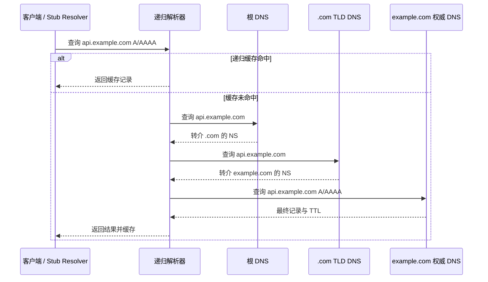
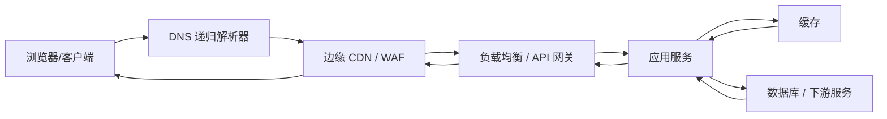
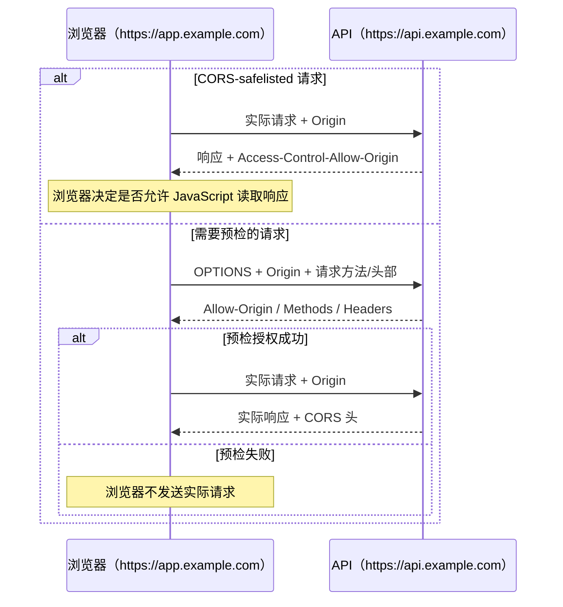

# 计算机网络 - 后端开发核心知识

## 目录

- [一、网络基础设施](#一网络基础设施)
  - [DNS：解析、缓存与排查](#dns解析缓存与排查)
  - [端到端请求链路](#端到端请求链路)
- [二、HTTP/HTTPS 协议](#二httphttps-协议)
  - [HTTP 基础、版本演进与 TLS](#http-基础版本演进与-tls)
  - [连接、超时与证书](#连接超时与证书)
  - [常见 HTTP 问题排查](#常见-http-问题排查)
- [三、TCP/IP 协议](#三tcpip-协议)
  - [连接建立、关闭与可靠传输](#连接建立关闭与可靠传输)
  - [流量控制、拥塞控制与状态排查](#流量控制拥塞控制与状态排查)
- [四、网络优化](#四网络优化)
  - [优化目标与手段](#优化目标与手段)
  - [网关、文件与流式传输](#网关文件与流式传输)
- [五、网络安全](#五网络安全)
  - [Web 攻击与防护](#web-攻击与防护)
  - [CORS：跨源资源共享](#cors跨源资源共享)
  - [认证、授权与限流](#认证授权与限流)

## 一、网络基础设施

### DNS：解析、缓存与排查

#### 角色与解析链路

DNS 是分布式、分层的名称系统：权威 DNS 保存某个 zone 的最终记录；递归解析器替客户端查询并缓存结果；操作系统或应用中的 stub resolver 通常只向配置的递归解析器发起查询。

一次缓存未命中的 `api.example.com` 查询通常经历：递归解析器询问根服务器获得 `.com` 的委派信息 → 询问 TLD 服务器获得 `example.com` 的权威服务器 → 向权威服务器获取目标记录。根、TLD 服务器通常返回**转介（referral）**，而非直接返回最终地址；递归解析器负责沿链路继续查询。



| 常见记录 | 用途 | 注意点 |
| --- | --- | --- |
| A / AAAA | 域名到 IPv4 / IPv6 地址 | 双栈环境需分别检查；客户端可能优先选择不同地址族 |
| CNAME | 别名到规范名称 | 不能与同一名称的其他数据记录共存；解析时还需继续查询目标名称 |
| NS | 指定 zone 的权威服务器 | 委派与 glue 记录配置错误会造成子域不可达 |
| MX / TXT | 邮件路由、域名验证、策略信息 | 常见于邮件和第三方服务验证，不等同于 Web 流量地址 |
| SOA | zone 元数据 | 其中字段也参与负缓存时间的计算 |

#### 缓存、TTL 与协议边界

- 正向结果和不存在结果（例如 NXDOMAIN）都可缓存；负缓存时间由响应的 SOA 信息和相关 TTL 规则决定。
- TTL 是权威数据发布者给缓存的可复用上限，而不是“到点后全球同时刷新”。权威记录更新通常立即生效，但已有缓存可继续使用旧值至 TTL 到期。
- 变更地址、CDN 或邮件配置前，应提前降低 TTL 并等待旧 TTL 基本过期；完成变更并验证稳定后再恢复合适的 TTL。过低 TTL 会增加权威查询压力，也不能消除各层缓存和客户端连接复用的影响。
- DNS 传统上常用 UDP/53；响应过大、截断或某些操作会使用 TCP/53。DoT/DoH 保护客户端到递归解析器的传输隐私，但不替代 DNSSEC 对 DNS 数据来源与完整性的验证。

#### 排查思路

先区分“本机/应用缓存问题、递归解析器问题、权威记录问题、网络问题”。使用 `dig domain A` 观察默认解析结果，使用 `dig +trace domain` 查看委派链路，使用 `dig @权威服务器 domain` 验证权威答案。还要检查 `A` 与 `AAAA`、CNAME 目标、TTL、返回码（NXDOMAIN / SERVFAIL）和 DNS 服务端日志。

> 不要把 DNS 缓存清理当成常规发布步骤。生产变更应依靠合理 TTL、灰度和回滚预案；“解析不一致”时必须记录查询的解析器、时间、记录类型与响应内容。

### 端到端请求链路

一次浏览器访问 API 的关键路径通常为：DNS 解析目标域名 → 建立 TCP + TLS 或 QUIC + TLS 连接 → 浏览器发送 HTTP 请求 → CDN/WAF/负载均衡/网关转发 → 服务处理并访问缓存、数据库或下游依赖 → 响应沿相反方向返回。任一环节的排队、超时或错误都会体现在端到端延迟和成功率上。



排查慢请求时，按这条链路拆分耗时：DNS、连接/TLS、网关排队、应用处理、缓存/数据库、下游调用与响应传输。将请求 ID 或 trace ID 从入口透传到全部下游，才能把这些片段关联为同一次请求。

## 二、HTTP/HTTPS 协议

### HTTP 基础、版本演进与 TLS

#### HTTP 方法

| 方法 | 语义 | 是否幂等 | 缓存提示 |
| --- | --- | --- | --- |
| GET | 获取资源表示 | 是 | 通常可缓存 |
| POST | 向目标资源提交处理请求，常用于创建资源 | 通常否 | 仅在响应显式允许时可缓存 |
| PUT | 用请求表示整体替换目标资源 | 是 | 通常不作为缓存重点 |
| PATCH | 对资源应用部分修改 | 取决于补丁语义 | 通常不作为缓存重点 |
| DELETE | 请求删除目标资源 | 是 | 响应通常不缓存 |

幂等描述的是多次**相同请求的预期资源状态**是否等价，并不意味着响应码、日志或审计记录完全相同。对会产生副作用的 POST，重试前应使用幂等键或业务去重。

#### 常用状态码

| 类别 | 常用状态码 | 含义与处理重点 |
| --- | --- | --- |
| 2xx | 200、201、202、204 | 成功；201 通常携带新资源地址，202 表示已接受但未完成 |
| 3xx | 301、302、303、307、308、304 | 关注重定向时方法是否保持；304 用于条件请求的缓存复用 |
| 4xx | 400、401、403、404、409、422、429 | 区分认证失败（401）与权限不足（403）；429 应配合 `Retry-After` |
| 5xx | 500、502、503、504 | 分别关注应用异常、上游无效响应、服务不可用和网关等待上游超时 |

#### 核心头部字段

- `Content-Type`：消息体格式，例如 `application/json`、`multipart/form-data`。
- `Accept`、`Accept-Encoding`：客户端可接受的媒体类型和内容编码；压缩响应应同时正确处理 `Vary: Accept-Encoding`。
- `Authorization`：认证凭据；避免记录到日志或通过 URL 传递。
- `Cookie`、`Set-Cookie`：会话状态；敏感 Cookie 通常需 `Secure`、`HttpOnly`、合适的 `SameSite`。
- `Cache-Control`：`max-age` 控制新鲜度，`no-cache` 表示使用前须验证，`no-store` 表示不得存储。
- `ETag`、`If-None-Match`：强/弱验证器与条件请求；更新资源可使用 `If-Match` 避免覆盖并发修改。

#### HTTP 版本演进

| 版本 | 关键改进 | 主要边界 |
| --- | --- | --- |
| HTTP/1.0 | 简单文本协议 | 默认非持久连接；曾有非标准 `Keep-Alive` 扩展 |
| HTTP/1.1 | 默认持久连接、`Host`、分块传输 | 同一连接的响应需按请求顺序返回；管道化实践中很少使用 |
| HTTP/2 | 二进制分帧、流、多路复用、HPACK | 应用层流可交错，但一个 TCP 报文丢失仍可能阻塞该连接上的其他流 |
| HTTP/3 | 基于 QUIC 的多路复用与连接迁移 | 丢包通常只影响对应流；仍可能阻塞同一流，且部署与排障模型不同 |

HTTP/2 的帧是最小传输单位，多个帧组成消息，一个请求—响应对对应一个流。HPACK 通过静态表、动态表和索引减少重复头部；收益取决于实际头部与请求模式，不应承诺固定压缩比例。

QUIC 运行在 UDP 之上，但并不等于“不可靠 UDP”：QUIC 自己提供可靠传输、拥塞控制和加密。首次 HTTP/3 连接通常需要 1-RTT；恢复连接可使用 0-RTT 早期数据，但该数据可能被重放，只应承载可安全重放的请求。

#### HTTPS 与 TLS

HTTPS 是 HTTP 运行在 TLS 之上，目标是：

- **机密性**：应用数据通过对称加密保护。
- **身份认证**：客户端通过证书链和域名校验确认服务端身份。
- **完整性**：使用认证加密（AEAD）或 MAC 检测篡改。

TLS 1.3 的典型握手：

1. 客户端发送 `ClientHello`，声明支持版本、密码套件和临时密钥交换参数（`key_share`）。
2. 服务端选择参数并返回 `ServerHello`、证书、`CertificateVerify` 和 `Finished`；客户端验证有效期、证书链、域名及适用的吊销状态。
3. 双方基于临时（EC）DHE 派生握手密钥和应用数据密钥；客户端发送 `Finished` 后开始受保护的应用通信。

TLS 1.2 的旧式 RSA 密钥交换会由客户端生成 Pre-Master Secret 并用证书公钥加密；TLS 1.3 已移除该方式。TLS 1.2 的 ECDHE 也可提供前向保密，因此不能把“TLS 1.2”等同于“没有前向保密”。生产环境应优先 TLS 1.3，最低兼容 TLS 1.2，禁用 TLS 1.0/1.1。

#### 证书链与证书类型

- 链路通常为：服务器证书 → 中间 CA → 受客户端信任的根 CA。
- 域名应以 SAN 为准；通配符 `*.example.com` 不匹配根域 `example.com`，也不匹配多层子域。
- DV 验证域名控制权；OV、EV 增加组织验证。EV 不会在现代浏览器中稳定显示“绿色地址栏”。
- 吊销检查受客户端、网络和 OCSP 状态影响；不能假定所有客户端都会实时完成吊销查询。

### 连接、超时与证书

#### 连接与连接池

- 短连接简单但握手和端口消耗高；高频调用优先使用 HTTP 持久连接与连接池。
- HTTP/1.1 客户端池通常按目标主机（route）分配上限；HTTP/2/3 还应考虑单连接并发流上限与服务端限制。
- 连接池容量可从 Little 定律估算：`并发需求 ≈ 到达速率 × 平均耗时`。该值只是起点，还需结合 P95/P99 延迟、连接复用率、下游限流和压测结果。
- 设置连接最大生命周期时，应略小于负载均衡或服务端的空闲回收时间，避免复用已被对端关闭的连接；同时启用空闲连接检测或失败重试策略。

#### 超时与重试

| 类型 | 含义 | 配置原则 |
| --- | --- | --- |
| 获取连接超时 | 等待连接池可用连接 | 单独设置，避免池耗尽时无限排队 |
| 连接超时 | 建立 TCP/QUIC 连接 | 依据网络拓扑设定，通常应明显小于整体预算 |
| 读/响应超时 | 等待响应首字节或后续数据 | 按接口 SLA、流式特性和最大合理处理时间设定 |
| 写超时 | 发送请求体 | 大文件上传和慢网络更重要 |
| 总超时 | 一次调用可占用的总时间 | 应覆盖重试、排队和业务 deadline |

超时必须沿调用链传递，并预留给上游降级与响应的时间。重试只适用于网络瞬断、明确可恢复的错误，且请求必须幂等或具备幂等键；使用指数退避和随机抖动，限制重试次数与总预算。网关重试带请求体时可能缓存请求体并消耗内存。

#### HTTPS 部署清单

- 使用完整证书链，自动续期后监控证书剩余有效期。
- 启用 TLS 1.2/1.3，采用由当前运行时和 OpenSSL/JDK 支持的现代密码套件；密码套件名称与配置方式受 Nginx、JDK、OpenSSL 版本影响。
- HSTS 仅在 HTTPS 响应中生效。`includeSubDomains` 会影响全部子域，`preload` 还需满足预加载列表的提交要求；确认全部子域都支持 HTTPS 后再启用。
- 在反向代理处正确设置并校验 `X-Forwarded-Proto`，否则“强制 HTTPS”的应用配置可能在 TLS 卸载后错误重定向。
- CSP 应从业务资源清单出发。`'unsafe-inline'` 会削弱脚本防护，优先使用 nonce 或 hash；不要把过时浏览器的 `X-XSS-Protection` 当作主要防线。

### 常见 HTTP 问题排查

#### 502 Bad Gateway

通常表示网关未获得有效上游响应。依次检查：服务发现/地址、DNS、网络策略、上游进程与健康检查、网关错误日志。不要只凭 502 判断为“服务没启动”，也可能是 TLS、协议或响应格式不匹配。

#### 504 Gateway Timeout

表示网关在等待上游时超时。先区分是连接阶段还是响应阶段：检查下游线程池/连接池排队、慢查询、锁竞争、GC、依赖超时，以及上下游 timeout 是否存在倒置。

#### 429 Too Many Requests

确认限流维度（用户、IP、租户、接口或全局）、窗口/令牌参数与实际流量。客户端应尊重 `Retry-After` 或退避；服务端应记录限流原因，并避免以可伪造的请求头作为可信身份。

#### 证书错误

检查有效期、SAN 域名、服务端是否发送完整中间证书链、客户端信任库、SNI 与吊销状态。可使用：

```bash
openssl s_client -connect example.com:443 -servername example.com -showcerts
openssl x509 -in server.crt -noout -dates -ext subjectAltName
openssl verify -CAfile root-or-intermediate-ca.pem server.crt
```

## 三、TCP/IP 协议

### 连接建立、关闭与可靠传输

#### TCP 三次握手

1. 客户端发送 `SYN(seq=x)`，进入 `SYN_SENT`。
2. 服务端回复 `SYN(seq=y, ack=x+1)`，进入 `SYN_RCVD`。
3. 客户端回复 `ACK(ack=y+1)`；双方进入 `ESTABLISHED`。

三次握手让双方确认对端收发能力并同步初始序列号，降低旧报文被误认为新连接数据的风险。它不是“绝对防止旧包”，而是 TCP 为序列空间和连接状态建立的基本同步过程。

#### TCP 四次挥手与 TIME_WAIT

1. 主动关闭方发送 `FIN`，进入 `FIN_WAIT_1`。
2. 被动关闭方确认 `ACK`，进入 `CLOSE_WAIT`；主动方进入 `FIN_WAIT_2`。
3. 被动关闭方在应用处理完剩余数据后发送 `FIN`，进入 `LAST_ACK`。
4. 主动关闭方发送最终 `ACK` 并进入 `TIME_WAIT`；被动方收到后关闭。

FIN 与 ACK 通常分开发送，因为被动关闭方收到 FIN 后仍可发送尚未完成的数据。`TIME_WAIT` 让主动关闭方有机会重传最终 ACK，并等待旧报文在网络中消失；持续时间由操作系统实现决定，不能简单记为固定 60 秒。大量 `CLOSE_WAIT` 更常提示应用没有及时关闭已收到 FIN 的连接。

#### TCP 与 UDP

| 特性 | TCP | UDP |
| --- | --- | --- |
| 连接与交付 | 面向连接、可靠字节流、有序交付 | 无连接、尽力而为的数据报 |
| 控制机制 | 流量控制、拥塞控制、重传 | 协议本身不提供，由应用按需实现 |
| 消息边界 | 无；应用需自行定义 | 保留数据报边界 |
| 常见场景 | HTTP/1.1、数据库、文件传输 | DNS、实时音视频、游戏、QUIC 承载 |

UDP 不等于“更快”，它减少协议开销但把可靠性、有序性、拥塞控制等责任交给应用或上层协议。

#### TCP 可靠传输

- **序列号与确认号**：TCP 按字节编号；ACK 通常表示“下一个期望字节序号”。
- **校验和**：检测传输损坏；损坏段被丢弃后可由重传恢复。
- **超时重传**：RTO 基于平滑 RTT 与 RTT 方差动态计算，超时后通常指数退避。
- **快速重传与 SACK**：多个重复 ACK 可触发快速重传；SACK 让接收方告知已收到的不连续区间，减少无谓重传。

### 流量控制、拥塞控制与状态排查

#### 流量控制

接收方通过接收窗口 `rwnd` 告知可用缓冲区。发送窗口受 `min(rwnd, cwnd)` 限制；`cwnd` 是拥塞窗口。接收窗口为零时，发送方停止常规发送并通过零窗口探测确认窗口是否恢复。窗口缩放在握手协商后可突破 TCP 头部 16 位窗口字段的 64 KiB 限制。

#### 拥塞控制

- **慢启动**：在未丢包且未受接收窗口限制时，`cwnd` 随 ACK 增长，整体效果约为每 RTT 翻倍。
- **拥塞避免**：达到 `ssthresh` 后转为近似线性增长。
- **丢包恢复**：传统 Reno/NewReno 会通过超时或重复 ACK 降低发送速率；现代系统可能使用 CUBIC、BBR 等算法，具体细节不能一概而论。

拥塞控制保护网络，流量控制保护接收方；两者共同决定实际发送窗口。

#### 状态与抓包排查

```bash
# 查看连接状态（优先 ss；netstat 在部分系统中已不再默认安装）
ss -tan
ss -tan state time-wait
ss -tan state close-wait

# 抓取指定端口；生产环境注意权限、磁盘空间与敏感数据
tcpdump -i eth0 port 8080 -w capture.pcap
tcpdump -i eth0 'tcp[tcpflags] & (tcp-syn|tcp-ack|tcp-fin|tcp-rst) != 0'
```

排查时关联四类信号：握手是否完整、重传与重复 ACK、接收窗口是否为零、RST 的发送方与时间点。仅凭单个指标不能断定网络故障，例如重传也可能由服务端拥塞、抓包点不完整或中间设备丢包造成。

#### TIME_WAIT 与内核参数

治理顺序应是：确认主动关闭方 → 降低短连接比例并复用连接 → 检查源端口/IP 容量 → 最后才评估内核参数。

- `SO_REUSEADDR` 主要影响监听端口重启后的 bind 行为，不能作为解决客户端大量 TIME_WAIT 的通用手段。
- Linux 的 `tcp_tw_reuse` 允许在内核安全条件下复用本地 TIME_WAIT 端口；可用性与默认值依赖内核版本。
- `tcp_fin_timeout` 控制孤儿 `FIN_WAIT_2` 套接字超时，不用于缩短 TIME_WAIT。
- 不要使用已移除的 `tcp_tw_recycle`。调整任何内核参数前，都要针对目标内核版本和 NAT/负载均衡拓扑压测验证。

监听队列相关参数还受应用 `listen(backlog)`、内核 `somaxconn`、半连接队列与 SYN Cookie 策略共同影响；提高数值前先观察溢出、SYN 重传和应用 accept 速率。

## 四、网络优化

### 优化目标与手段

#### 指标与权衡

| 指标 | 含义 | 常用观察方式 | 常见优化方向 |
| --- | --- | --- | --- |
| 延迟 | 单请求耗时 | P50、P95、P99、TTFB | 减少往返、就近部署、缓存、消除排队 |
| 吞吐量 | 单位时间处理量 | QPS、带宽、CPU/连接利用率 | 复用、批处理、压缩、异步化 |
| 并发 | 同时在途的请求或连接 | 活跃请求、连接数、队列长度 | 连接池、限流、背压、资源隔离 |
| 可用性 | 可成功完成请求的比例 | 错误率、超时率、SLO | 超时、熔断、降级、容量冗余 |

优化应以端到端用户路径和尾延迟为准。批量处理可以提高吞吐量，却可能增加等待时间；提高并发上限也可能把排队从一个组件转移到下游。

#### 连接、协议与数据传输

- 高复用 Web 调用优先 HTTP 持久连接；资源并发多时考虑 HTTP/2；需要降低移动网络切换影响时评估 HTTP/3。
- 文本资源可协商 Gzip/Brotli；图片、视频等已压缩内容通常不应再次压缩。压缩节约带宽，但增加 CPU 与首字节延迟。
- `dns-prefetch` 只提前解析域名；`preconnect` 还会建立连接与 TLS。仅对高概率、跨域且关键的来源使用，避免无效连接占用资源。
- 大文件采用分片、校验、断点续传与对象存储直传；服务端不应将用户提供的任意路径作为读写目标。
- Range 请求需正确处理无 Range（200）、单范围（206）、不满足范围（416）、边界、`If-Range` 和文件变化。优先使用框架对 `Resource` 的标准支持，而不是手写解析。

#### CDN 与缓存

- CDN 将可缓存内容放到边缘节点，降低用户到源站的距离与源站带宽压力；缓存未命中或过期时才回源。
- 静态资源建议内容哈希化 URL 并使用较长 `max-age, immutable`；版本变更通过新 URL 发布，而不是依赖强制刷新旧 URL。
- 对可能变化的资源使用 `ETag` / `Last-Modified` 与条件请求；`ETag` 比仅用修改时间更能表达内容版本。
- API 缓存必须定义主体、租户、权限和 `Vary` 维度，避免跨用户泄露。写后失效、写穿和异步更新分别在一致性、延迟与复杂度上取舍。

### 网关、文件与流式传输

#### 网关与负载均衡

- 网关应设置到下游的连接、响应、总 deadline，以及连接池获取超时；其超时应小于调用方等待网关的超时。
- 负载均衡算法（轮询、最少连接、哈希）须与请求耗时分布、会话亲和与实例容量匹配；健康检查应区分“进程存活”和“可接流量”。
- 转发时保留需要的 `Host`、追踪 ID 与转发头；只信任由受控代理写入的 `X-Forwarded-*`，并在入口清除外部同名头。
- 重试、熔断与限流应协同：重试放大流量，熔断限制故障扩散，限流保护容量。不要把所有 5xx 无差别重试。

#### 上传与下载

- 分片完成条件应基于服务端记录的全部分片状态和校验和，而不是“最后编号的分片先到”。合并操作应具备互斥、幂等与失败清理。
- 上传标识、文件名、文件大小、MIME 类型和目标路径均应由服务端校验；下载使用资源 ID 映射到受限根目录或对象存储键，不接收任意本地路径。
- 流式下载避免把完整文件读入内存；设置正确的 `Content-Disposition`、内容类型和长度，并防止响应头注入。

#### SSE、WebSocket 与流式响应

- SSE 是服务端到浏览器的单向事件流，浏览器自动重连并携带 `Last-Event-ID`；适合通知、日志和 LLM 输出。
- WebSocket 提供双向长连接，适合高频交互；两者都需要鉴权、连接数上限、心跳、空闲回收和背压策略。
- SSE 服务应使用受控执行器，处理客户端断开；定期发送注释或心跳以发现断连。日志与 prompt 可能含敏感信息，避免原样输出或记录。
- 对 LLM 流式接口，分别限制首 token 时间、总生成时间、最大输出量和并发会话数。

## 五、网络安全

### Web 攻击与防护

#### 常见攻击

| 攻击 | 核心风险 | 主要防护 |
| --- | --- | --- |
| SQL/NoSQL/命令注入 | 输入改变解释器语义 | 参数化查询、结构化 API、白名单、最小权限 |
| XSS | 攻击脚本在受害者浏览器执行 | 上下文相关输出编码、可信模板、CSP、避免不安全 DOM API |
| CSRF | 借用浏览器自动携带的凭据发起状态变更 | CSRF Token、合适的 SameSite、校验 Origin/Referer |
| SSRF | 服务端被诱导访问内网或云元数据 | URL 解析后按 scheme/域名/IP 白名单校验，限制出网 |
| DDoS | 流量或资源耗尽 | CDN/WAF、限流、连接与请求大小限制、容量与降级 |
| 越权 | 访问不属于当前主体的资源 | 服务端逐请求鉴权、对象级权限检查、最小权限 |

防护需要分层。输入校验不能代替参数化查询；HttpOnly Cookie 能降低 Token 被脚本直接读取的风险，却不能阻止 XSS 以用户身份发起请求。

#### SQL 注入与动态查询

参数化查询应覆盖所有值参数。表名、列名、排序方向等 SQL 结构不能通过占位符绑定，必须映射到固定白名单。ORM、MyBatis 的 `#{}` 或 JPA 参数绑定能处理值；字符串拼接与 MyBatis `${}` 不具备相同安全性。

#### XSS 与 CSRF

- 模板默认转义应保留；只有经过严格、场景化清洗的富文本才可使用“不转义”输出。
- CSP 从报告模式开始逐步收紧，优先 nonce/hash；不要为方便而长期放开 `script-src 'unsafe-inline'`。
- 以 Cookie 作为认证凭据的浏览器应用应启用 CSRF 防护。无 Cookie 的 Bearer Token API 通常不受传统 CSRF 直接影响，但仍需防 XSS 和 CORS 误配。
- `Origin`/`Referer` 是补充校验，必须解析后精确比较 scheme、host、port，不能用字符串前缀匹配。

### CORS：跨源资源共享

浏览器以 **scheme、host、port** 共同定义 origin；任一不同即为跨源。CORS 是浏览器执行的读取权限协商机制：它允许服务端声明哪些网页 origin 可以读取响应。它不是认证或授权机制，也不会阻止 `curl`、后端服务等非浏览器客户端直接调用 API。

#### 简单请求与预检请求

- 满足 Fetch 标准中 CORS-safelisted 方法、头部和内容类型条件的请求不会先发预检；浏览器会直接发送实际请求，再依据响应中的 CORS 头决定是否允许前端 JavaScript 读取响应。
- 不满足上述条件时，浏览器先发送 `OPTIONS` 预检请求，包含 `Origin`、`Access-Control-Request-Method`，必要时还包含 `Access-Control-Request-Headers`。服务端须用允许源、允许方法和允许头部的响应明确授权，浏览器才会发送实际请求。
- `Access-Control-Max-Age` 可缓存预检结果，但实际缓存上限受浏览器限制。预检接口也必须经过网关、鉴权和路由的正确处理；重定向、缺失响应头或被拦截都会导致失败。



#### 凭据与安全配置

- 不携带凭据的公开资源可以使用 `Access-Control-Allow-Origin: *`。
- 浏览器携带 Cookie、HTTP 认证信息或前端显式使用 `credentials: 'include'` 时，服务端必须返回精确的 `Access-Control-Allow-Origin: <请求 Origin>` 和 `Access-Control-Allow-Credentials: true`；此时不能使用 `*`。
- 若按请求动态回显允许的 Origin，必须先以精确白名单匹配，并添加 `Vary: Origin`，避免共享缓存将一个源的授权响应错误复用给另一个源。
- 不要依据 `Origin` 字符串前缀、后缀或可控正则宽松匹配；解析后精确比较 scheme、host、port，并仅开放实际需要的方法和请求头。

#### CORS 与 CSRF 的关系

CORS 主要限制跨源页面**读取**响应，不能替代 CSRF 防护。某些跨站请求即使因 CORS 无法被脚本读取，仍可能已经到达服务端并产生副作用；使用 Cookie 会话的状态变更接口仍应采用 CSRF Token、SameSite 和 Origin 校验等防护。

### 认证、授权与限流

#### 认证与授权

- **认证（Authentication）**回答“你是谁”，例如密码、MFA、客户端证书。
- **授权（Authorization）**回答“你能做什么”，例如 RBAC、ACL、属性或资源级策略。
- 应在服务端对每个敏感操作执行授权；前端隐藏按钮只是体验优化，不是安全控制。

#### JWT

JWT 由 `Header.Payload.Signature` 组成。JWS 的 Payload 只是 Base64URL 编码，不是加密，不能存放密码、身份证号等敏感数据。服务端验证时必须固定允许的算法、校验签名与 `exp`、`nbf`、`iss`、`aud` 等适用声明，不能由 Token 自己决定算法。

建议使用短时 Access Token 与可轮换、可撤销的 Refresh Token；登出、密码修改和权限变更应有明确的失效策略。若将 Token 放入 HttpOnly Cookie，还需 CSRF 防护；若放入可被 JavaScript 读取的位置，则 XSS 风险显著上升。HMAC 密钥必须是足够长度的随机密钥并妥善轮换，不能仅把普通字符串做 Base64 编码。

#### 限流与防刷

| 算法 | 特点 | 注意点 |
| --- | --- | --- |
| 令牌桶 | 平均速率受控，允许有限突发 | 适合 API 入口；明确桶容量与补充速率 |
| 漏桶 | 以近似固定速率输出 | 队列满时的丢弃/等待策略必须明确 |
| 固定窗口 | 实现简单 | 窗口边界可能出现两倍突发 |
| 滑动窗口 | 统计更平滑 | 存储和计算成本更高 |

分布式限流可用 Redis 原子脚本或成熟组件。滑动窗口的每次请求必须使用唯一成员（例如 `时间戳:随机值`），不能只用毫秒时间戳，否则同毫秒请求会覆盖。脚本应短小，避免长时间阻塞 Redis。

限流维度应按业务组合：全局、租户、用户、凭据、IP、接口和资源。IP 只能作为辅助维度；只有在请求来自已配置为可信的反向代理时，才能解析其转发头。拒绝时返回 429，必要时包含 `Retry-After`，并记录可观测的限流原因。

## 总结

学习网络知识时，优先建立四条主线：

1. HTTP 如何表达资源、缓存和错误；TLS 如何提供认证、机密性与完整性。
2. TCP 如何建连、可靠传输、流量控制和拥塞控制；如何用状态与抓包定位问题。
3. 如何以端到端延迟、吞吐、并发和可用性为指标进行优化，而不是孤立调参数。
4. 如何把安全控制落实到输入、身份、权限、会话、网络出口与流量治理的每一层。

生产配置没有通用固定值。超时、连接池、内核参数、TLS 套件和限流阈值都必须结合依赖版本、网络拓扑、容量模型和压测结果确定。
