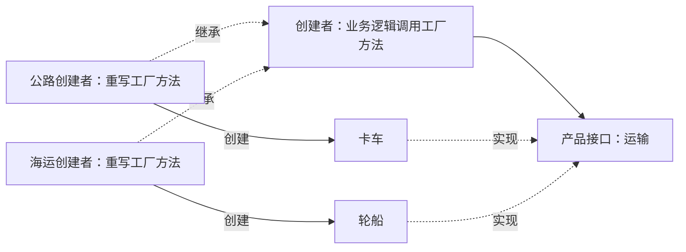

# 意图

1. 其在父类中提供一个创建对象的方法，允许子类决定实例化对象的类型

# 问题描述

1. 原先的业务简单，所有代码逻辑都聚集在一个类（卡车）中，后续因为业务扩展，需要扩展相同属性不同业务的类（轮船），此时就需要在轮船类中进行大量业务代码编写。

# 解决方案

1. 采用工厂模式将两个或多个类绑定至相同的父类中，同时实现或继承一个父类的方法（卡车类和轮船类同时继承于交通工具类，父类具有运输driver方法），这么做仔细一想没有任何意义，只是改变了程序中调用构造函数的位置（由原来编写在业务代码中的new方法改为调用工厂创建对象），但是在这么做的情况下，你可以在子类中重写工厂方法，从而改变其创建产品的类型。

# 工厂模式架构

以下为根据正文重绘的示意图，非原截图。




# 示例代码

以下为独立 Java 17 教学示例，直接在本页维护，不依赖外部示例仓库。父类的业务方法调用可重写的工厂方法；子类分别创建卡车和轮船，业务流程不直接依赖具体产品类。

保存为 `FactoryMethodDemo.java`，运行 `javac --release 17 FactoryMethodDemo.java` 和 `java -ea FactoryMethodDemo`；`-ea` 用于启用示例断言。

```java
public class FactoryMethodDemo {
    interface Transport {
        String deliver();
    }
    static class Truck implements Transport {
        public String deliver() { return "公路运输"; }
    }
    static class Ship implements Transport {
        public String deliver() { return "海路运输"; }
    }

    abstract static class Logistics {
        protected abstract Transport createTransport();

        final String planDelivery() {
            Transport transport = createTransport();
            return "运输计划：" + transport.deliver();
        }
    }
    static class RoadLogistics extends Logistics {
        protected Transport createTransport() { return new Truck(); }
    }
    static class SeaLogistics extends Logistics {
        protected Transport createTransport() { return new Ship(); }
    }

    public static void main(String[] args) {
        Logistics road = new RoadLogistics();
        Logistics sea = new SeaLogistics();
        assert road.planDelivery().equals("运输计划：公路运输");
        assert sea.planDelivery().equals("运输计划：海路运输");
        System.out.println("工厂方法多态创建验证通过");
    }
}
```

# 什么情况下使用工厂模式
1. 创建逻辑有可能变化，封装成工厂类之后，创建逻辑的变更对调用者透明。
2. 创建代码抽离到独立的工厂类之后可以复用。
3. 封装复杂的创建逻辑，调用者无需了解如何创建对象。
4. 将创建代码抽离出来，让原本的函数或类职责更单一，代码更简洁。

# 依赖注入框架（DI，Dependency Injection Container）和工厂模式的关系：
1. DI 容器底层最基本的设计思路就是基于工厂模式的。DI 容器相当于一个大的工厂类，负责在程序启动的时候，根据配置（要创建哪些类对象，每个类对象的创建需要依赖哪些其他类对象）事先创建好对象。当应用程序需要使用某个类对象的时候，直接从容器中获取即可。除此之外，DI 容器负责的事情要比单纯的工厂模式要多。比如，它还包括配置的解析、对象生命周期的管理。接下来，我们就详细讲讲，一个简单的 DI 容器应该包含哪些核心功能。
2. DI容器的配置解析：
  我们将需要由 DI 容器来创建的类对象和创建类对象的必要信息（使用哪个构造函数以及对应的构造函数参数都是什么等等），放到配置文件中。容器读取配置文件，根据配置文件提供的信息来创建对象。

  ```java
  public class RateLimiter {
    private RedisCounter redisCounter;
    public RateLimiter(RedisCounter redisCounter) {
      this.redisCounter = redisCounter;
    }
    public void test() {
      System.out.println("Hello World!");
    }
    //...
  }
```

```java
  public class RedisCounter {
    private String ipAddress;
    private int port;
    public RedisCounter(String ipAddress, int port) {
      this.ipAddress = ipAddress;
      this.port = port;
    }
    //...
  }
```

  配置文件beans.xml：
  对象创建beanFatory：  在 DI 容器中，如果我们给每个类都对应创建一个工厂类，那项目中类的个数会成倍增加，这会增加代码的维护成本。要解决这个问题并不难。我们只需要将所有类对象的创建都放到一个工厂类中完成就可以了，比如 BeansFactory。


# 普通工程和抽象工厂的区别
普通工厂模式（Simple Factory）和抽象工厂模式（Abstract Factory）都是用于创建对象的设计模式，但它们之间有一些关键区别。这些区别主要体现在设计目的、实现方式以及适用场景等方面。以下是它们的主要区别：
### 1. 定义
- **普通工厂模式**：
  - 普通工厂模式不是一个正式的设计模式，而是一种简单的创建对象的方式。通过一个工厂类根据输入参数决定创建哪种具体产品。
- **抽象工厂模式**：
  - 抽象工厂模式是一种创建型设计模式，提供一个接口用于创建相关或相互依赖的对象，而无需指定它们具体的类。它可以创建不同系列的对象。
### 2. 结构
- **普通工厂模式**：
  - 只有一个工厂类，通常使用静态方法来创建对象。客户端通过工厂类的静态方法请求对象。
- **抽象工厂模式**：
  - 包含多个工厂接口和具体工厂类，每个具体工厂负责创建一系列相关或相互依赖的对象。通常有一个抽象工厂接口定义创建产品的方法。
### 3. 产品类型
- **普通工厂模式**：
  - 通常只创建一种类型的产品，或者创建的产品属于同一产品族，但不强制要求。
- **抽象工厂模式**：
  - 创建一系列相关的产品，通常是多个产品族中的产品。例如，可以同时创建形状和颜色的对象。
### 4. 适用场景

- **普通工厂模式**：
  - 适用于产品种类少且变化不频繁的场景，或者需要在运行时决定创建哪种产品的简单情况。

- **抽象工厂模式**：
  - 适用于需要创建多个系列产品的场景，特别是在产品的变化和扩展较多时。可以方便地添加新的产品族而不影响现有代码。

### 5. 扩展性

- **普通工厂模式**：
  - 扩展性较差，如果需要添加新产品，需要修改工厂类的代码，违反了开闭原则。

- **抽象工厂模式**：
  - 扩展性较好，可以通过添加新的具体工厂类来支持新产品族，而无需修改现有代码。

### 6. 复杂性

- **普通工厂模式**：
  - 实现较简单，适合初学者和小型项目。

- **抽象工厂模式**：
  - 实现较复杂，需要定义多个接口和类，适合大型项目和复杂系统。
### 总结
- **普通工厂模式**适用于简单的对象创建场景，而**抽象工厂模式**则更适合复杂的产品系列创建。选择使用哪种模式，应根据具体需求和项目复杂性来决定。
