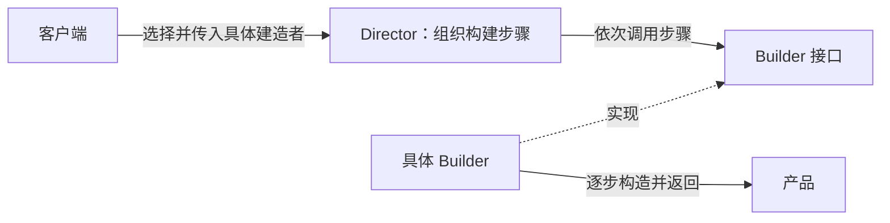

# 意图

1. 一步一步创建一个复杂的对象，它允许用户只通过指定复杂对象的类型和内容就可以构建它们，用户不需要知道内部的具体构建细节。

# 建造者模式架构

以下为根据正文重绘的示意图，非原截图。




# 原理解析

1. Builder：创建产品的创建者接口，用于对产品创建的封装，不同产品创建类实现该接口，方法内部为对产品属性的set/get方法。
2. Director: 创建产品的领导类角色，其中封装了创建不同产品的“构造函数”（调用set方法进行产品构造），用于想创建A产品时就下发创建A产品的请求。
3. 调用流程：
    1. 创建一位领导者，用于决策创建哪个产品。
    2. 决定创建哪个产品（选择对应的builder）及产品对应的系列。
    3. 由领导类（Director）下发创建该产品的指令，根据系列进行builder的创建类的属性复制。

# 示例代码

1. [github](https://github.com/ljbclannad/Demo_Project/tree/master/src/main/java/com/example/designpatterns/builderpattern)

# LomBok提供的@Builder注解

1. 建造者模式其实是为了应付创建不同产品的多种构造方法的集成，让主业务代码无需关注建造该产品需要的对象属性（初始化构造赋值都由领导调用相应的创建者接口实现），主业务代码只需了解需要创建哪一类产品即可。

2. 可使用lombok的@Builder完成类似于建造者模式的产品构造。

3. `User user = User.builder().password("admin").username("admin").build();
   Map<String, String> map = MapBuilder.<String, String>create()
               .put("a", "1")
               .put(false, "b", "2")
               .put(true, "c", () -> getValue(3))
               .put(false, "d", () -> getValue(4))
               .build();

# 建造者模式使用的场景
1. 我们把类的必填属性放到构造函数中，强制创建对象的时候就设置。如果必填的属性有很多，把这些必填属性都放到构造函数中设置，那构造函数就又会出现参数列表很长的问题。如果我们把必填属性通过 set() 方法设置，那校验这些必填属性是否已经填写的逻辑就无处安放了。
2. 如果类的属性之间有一定的依赖关系或者约束条件，我们继续使用构造函数配合 set() 方法的设计思路，那这些依赖关系或约束条件的校验逻辑就无处安放了。
3. 如果我们希望创建不可变对象，也就是说，对象在创建好之后，就不能再修改内部的属性值，要实现这个功能，我们就不能在类中暴露 set() 方法。构造函数配合 set() 方法来设置属性值的方式就不适用了。通过调用Builder方法set内容，然后Build方法返回新对象，那么之前的对象则为不可变对象。
   ```java
   public static class ImmutableClassBuilder{
           //required fields
           private int id;
           private String name;


           //optional fields
           private HashMap properties;
           private String company;


           public ImmutableClassBuilder(int id, String name) {
               this.id = id;
               this.name = name;
           }


           public ImmutableClassBuilder setProperties(HashMap hm){
               this.properties = (HashMap) hm.clone();
               return this;
           }


           public ImmutableClassBuilder setCompany(String comp){
               this.company = comp;
               return this;
           }
           public ImmutableClass build(){
               return new ImmutableClass(this);
           }
       }
   ```

# 建造者模式和工厂模式的区别：
1. 工厂模式是用来创建不同但是相关类型的对象（继承同一父类或者接口的一组子类），由给定的参数来决定创建哪种类型的对象。建造者模式是用来创建一种类型的复杂对象，可以通过设置不同的可选参数，“定制化”地创建不同的对象。
3. 建造者模式将主要的校验放在build方法中，在设置完各个属性后调用Build方法进行校验。
