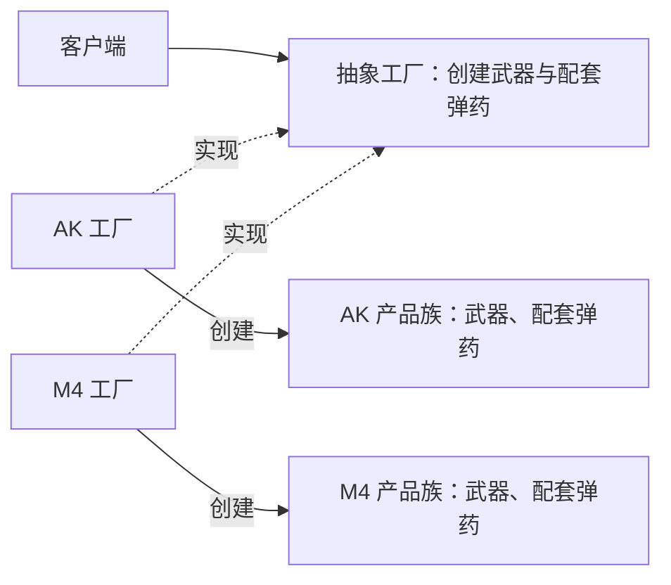

# 问题

1. 当前存在两种枪械（AK，M4）及枪械对应的子弹(7.62mm，5.56mm)。
2. 当前任务要求是创建枪械对象的同时给枪械装弹，为了避免给枪械上错子弹导致无法使用的情况，需要根据创建的枪械对象指定对象的子弹对象，但是频繁的更改以上逻辑会增加代码的复杂性。

# 解决方案

## 抽象工厂模式结构

以下为根据正文重绘的示意图，非原截图。

## 实际情况举例

1. 新建接口：给枪械及子弹分别创建接口，创建类AK，M4继承枪械接口，M4Bullet，AKBullet继承子弹接口。
2. 新建创建枪械静态工厂（该工厂为接口，拥有创建枪械及装弹方法），新建创建AK枪械工厂及创建M4枪械工厂（都继承枪械静态工厂），在AK枪械工厂中重写创建枪械（返回AK类）及装弹方法（返回AKBullet），M4枪械工厂同理
3. 新建具体工厂：用于根据业务调用静态工厂创建不同枪械工厂，实现枪械的类别统一。
4. 如果需要新增枪械只需新建枪械工厂及返回对应的枪械类及子弹类即可，外部不需要了解工厂内部的逻辑操作即可完成创建。

# 适用应用场景

如果代码需要与多个不同系列的相关产品交互 但是由于无法提前获取相关信息， 或者出于对未来扩展性的考虑， 你不希望代码基于产品的具体类进行构建， 在这种情况下，你可以使用抽象工厂。

# 示例代码

1. [github地址](https://github.com/ljbclannad/Demo_Project/tree/master/src/main/java/com/example/designpatterns/abstractfactorypattern)
