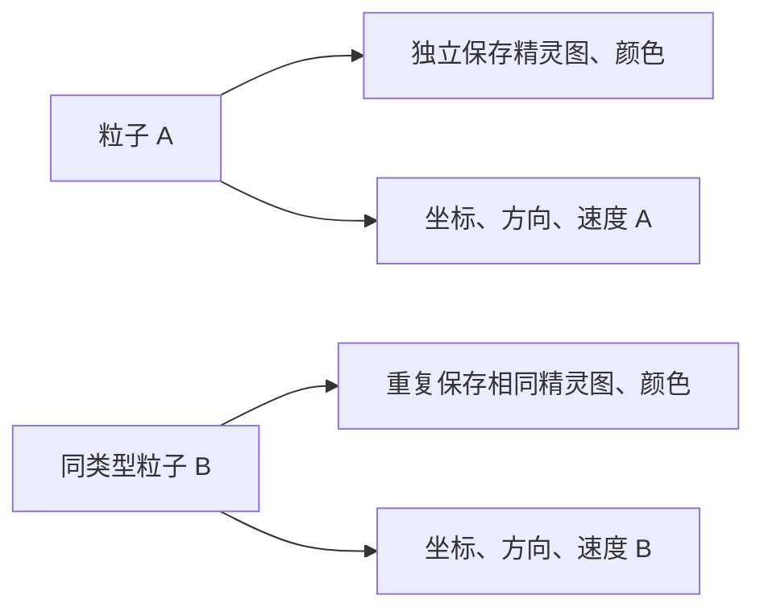
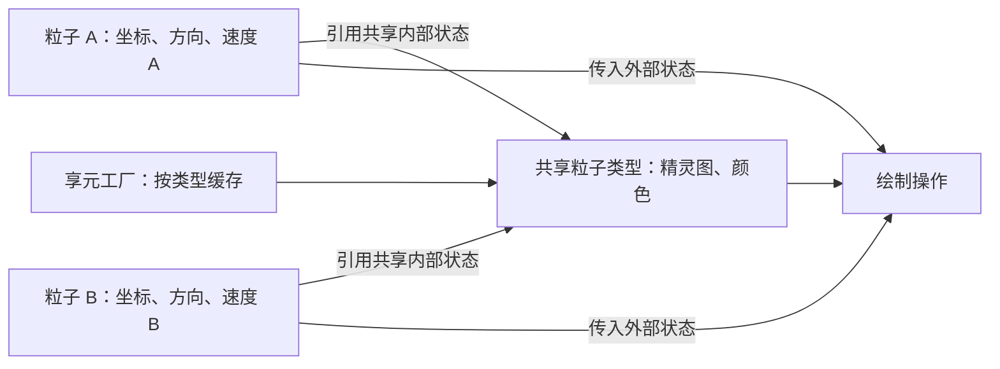

# 意图

享元模式是一种结构性设计模式，它摒弃了在每个对象中保存所有数据的方式，通过共享多个对象所共有的相同状态，让你能在有限的内存容量中载入更多对象。

# 案例分析

## 问题产生

1. 设计一个子弹游戏，每个粒子都由包含完整数据的独立对象来表示，当玩家在游戏中鏖战进入高潮后的某一时刻，游戏将无法在剩余内存中载入新建粒子（内存不足）。程序发生了崩溃。

以下为根据正文重绘的示意图，非原截图。




## 解决方案

1. 每一个粒子中的color和sprite这两个成员变量所存储的数据几乎完全相同，每个例子的另一些状态（坐标，移动矢量和速度）则是不同的
2. 对象的常量数据通常被称为内在状态，其位于对象中，其他对象只能读取但是不能修改其数值（案例中的color及sprite），而对象的其他状态常常能被其他对象“从外部”改变，因此被称为外在状态。
3. 享元模式建议不在对象中存储外在状态，而是将其传递给依赖于它的一个特殊方法，程序只在对象中保存内在状态。这样你的对象所需内存会大大减小。
4. 外在状态存储：
5. 为了能更方便地访问各种享元，你可以创建一个工厂方法来管理已有向原对象的缓存池。工厂方法从客户端处接受目标享元对象的内在状态作为参数，如果它能在缓存池中找到所需单元，则将其返回给客户端，如果没有找到，就会新建一个享元。

# 享元模式结构

以下为根据正文重绘的示意图，非原截图。




# 示例代码

以下为独立 Java 17 教学示例，直接在本页维护，不依赖外部示例仓库。同类型粒子共享不可变的内部状态，坐标等外部状态保存在各粒子中。缓存仅用于单线程教学，未实现并发访问和淘汰策略。

保存为 `FlyweightDemo.java`，运行 `javac --release 17 FlyweightDemo.java` 和 `java -ea FlyweightDemo`；`-ea` 用于启用示例断言。

```java
import java.util.HashMap;
import java.util.Map;

public class FlyweightDemo {
    record ParticleType(String color, String sprite) {
        String draw(int x, int y) {
            return color + ":" + sprite + "@" + x + "," + y;
        }
    }

    static class TypeFactory {
        private final Map<ParticleType, ParticleType> cache = new HashMap<>();

        ParticleType get(String color, String sprite) {
            ParticleType key = new ParticleType(color, sprite);
            return cache.computeIfAbsent(key, value -> value);
        }
    }

    record Particle(int x, int y, ParticleType type) {
        String draw() {
            return type.draw(x, y);
        }
    }

    public static void main(String[] args) {
        TypeFactory factory = new TypeFactory();
        Particle a = new Particle(1, 2, factory.get("红色", "圆点"));
        Particle b = new Particle(8, 9, factory.get("红色", "圆点"));
        assert a.type() == b.type(); // 相同内部状态复用同一对象
        assert !a.draw().equals(b.draw()); // 外部状态仍独立
        assert a.type() != factory.get("蓝色", "圆点");
        assert factory.cache.size() == 2;
        System.out.println("享元共享与外部状态验证通过");
    }
}
```

# 优点
- **节省内存**：通过共享对象，减少了内存的使用，特别是在需要大量相似对象的情况下。
- **提高性能**：创建和管理大量对象时，享元模式可以显著提高性能。
- **支持细粒度的共享**：享元模式允许对象的共享和复用，减少了对象的创建和销毁。
# 缺点
- **复杂性**：实现享元模式会增加代码的复杂性，特别是在管理内部状态和外部状态时。
- **状态管理**：需要仔细管理共享对象的状态，确保外部状态不影响内部状态。