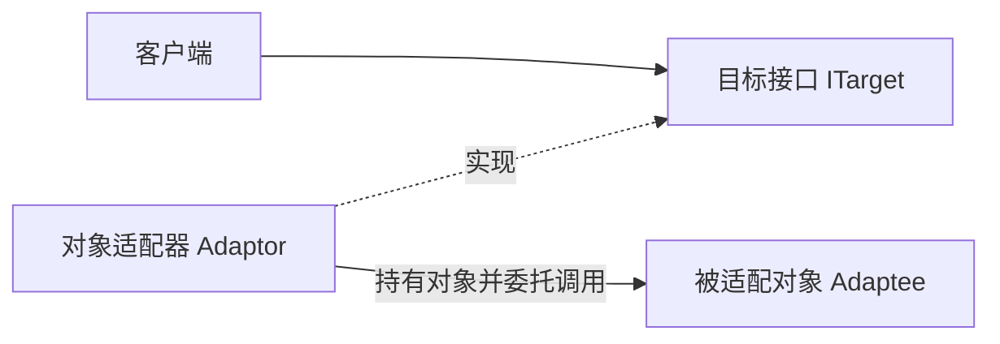
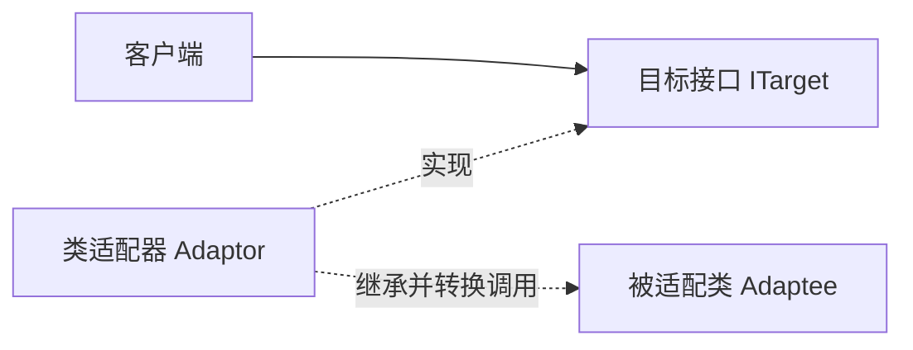

# 意图

1. 适配器模式是一种结构型模式，它能使接口不兼容的对象能够相互合作
# 解决方案

1. 适配器模式通过封装对象将复杂的转换过程隐藏于幕后，被封装的对象甚至察觉不到适配器的存在
2. 适配器不仅可以转换不同格式的数据，还有助于采用不同接口的对象之间的合作。运作方式如下：
    - 适配器实现与其中一个现有对象兼容的接口
    - 现有对象可以使用该接口安全地调用适配器方法
    - 适配器方法被调用以后以另一个对象兼容的格式和顺序将请求传递给该对象

# 适配器模式结构

## 对象适配器

以下为根据正文重绘的示意图，非原截图。




## 类适配器

以下为根据正文重绘的示意图，非原截图。




# 适合应用场景

1. 当你希望使用某个类，但是其接口与其他代码不兼容时，可以使用适配器类。
    1. 适配器模式允许你创建一个中间层类，其可作为代码和遗留类，第三方类或提供怪异接口的类之间的转换器。
2. 如果需要复用这样一些类：他们处于同一继承，并且他们又有了额外的一些共同的方法，但是这些共同的方法不是所有在这一继承体系中的子类所具有的共性。
    1. 你可以扩展每个子类， 将缺少的功能添加到新的子类中。 但是， 你必须在所有新子类中重复添加这些代码， 这样会使得代码有[坏味道](https://refactoringguru.cn/smells/duplicate-code)。
    2. 将缺失功能添加到一个适配器类中是一种优雅得多的解决方案。 然后你可以将缺少功能的对象封装在适配器中， 从而动态地获取所需功能。 如要这一点正常运作， 目标类必须要有通用接口， 适配器的成员变量应当遵循该通用接口。 这种方式同[装饰](https://refactoringguru.cn/design-patterns/decorator)模式非常相似。

# 代码示例

以下为独立 Java 17 教学示例，直接在本页维护，不依赖外部示例仓库。用同一个目标接口调用两种适配器：类适配器继承旧类，对象适配器持有旧对象；调用方得到相同结果。

保存为 `AdapterDemo.java`，运行 `javac --release 17 AdapterDemo.java` 和 `java -ea AdapterDemo`；`-ea` 用于启用示例断言。

```java
public class AdapterDemo {
    interface Target {
        String request();
    }

    static class LegacyService {
        public String legacyRequest() {
            return "旧接口结果";
        }
    }

    static class ClassAdapter extends LegacyService implements Target {
        public String request() {
            return legacyRequest();
        }
    }

    static class ObjectAdapter implements Target {
        private final LegacyService legacy;

        ObjectAdapter(LegacyService legacy) {
            this.legacy = legacy;
        }

        public String request() {
            return legacy.legacyRequest();
        }
    }

    public static void main(String[] args) {
        Target byInheritance = new ClassAdapter();
        Target byComposition = new ObjectAdapter(new LegacyService());
        assert byInheritance.request().equals("旧接口结果");
        assert byComposition.request().equals(byInheritance.request());
        System.out.println("两种适配器验证通过");
    }
}
```

1. 适配器模式有两种实现方式：类适配器和对象适配器。其中，类适配器使用继承关系来实现，对象适配器使用组合关系来实现。具体的代码实现如下所示。其中，ITarget 表示要转化成的接口定义。Adaptee 是一组不兼容 ITarget 接口定义的接口，Adaptor 将 Adaptee 转化成一组符合 ITarget 接口定义的接口。

```java
// 类适配器: 基于继承
public interface ITarget {
  void f1();
  void f2();
  void fc();
}


public class Adaptee {
  public void fa() { //... }
  public void fb() { //... }
  public void fc() { //... }
}


public class Adaptor extends Adaptee implements ITarget {
  public void f1() {
    super.fa();
  }


  public void f2() {
    //...重新实现f2()...
  }


  // 这里fc()不需要实现，直接继承自Adaptee，这是跟对象适配器最大的不同点
}


// 对象适配器：基于组合
public interface ITarget {
  void f1();
  void f2();
  void fc();
}


public class Adaptee {
  public void fa() { //... }
  public void fb() { //... }
  public void fc() { //... }
}


public class Adaptor implements ITarget {
  private Adaptee adaptee;


  public Adaptor(Adaptee adaptee) {
    this.adaptee = adaptee;
  }


  public void f1() {
    adaptee.fa(); //委托给Adaptee
  }


  public void f2() {
    //...重新实现f2()...
  }


  public void fc() {
    adaptee.fc();
  }
}
```

2. 针对这两种实现方式，在实际的开发中，到底该如何选择使用哪一种呢？判断的标准主要有两个，一个是 Adaptee 接口的个数，另一个是 Adaptee 和 ITarget 的契合程度。

1. 如果 Adaptee 接口并不多，那两种实现方式都可以。

2. 如果 Adaptee 接口很多，而且 Adaptee 和 ITarget 接口定义大部分都相同，那我们推荐使用类适配器，因为 Adaptor 复用父类 Adaptee 的接口，比起对象适配器的实现方式，Adaptor 的代码量要少一些。

3. 如果 Adaptee 接口很多，而且 Adaptee 和 ITarget 接口定义大部分都不相同，那我们推荐使用对象适配器，因为组合结构相对于继承更加灵活。

3. 封装有缺陷的接口设计：

   假设我们依赖的外部系统在接口设计方面有缺陷（比如包含大量静态方法），引入之后会影响到我们自身代码的可测试性。为了隔离设计上的缺陷，我们希望对外部系统提供的接口进行二次封装，抽象出更好的接口设计，这个时候就可以使用适配器模式了。

```java


public class CD { //这个类来自外部sdk，我们无权修改它的代码
  //...
  public static void staticFunction1() { //... }


  public void uglyNamingFunction2() { //... }


  public void tooManyParamsFunction3(int paramA, int paramB, ...) { //... }


   public void lowPerformanceFunction4() { //... }
}


// 使用适配器模式进行重构
public interface ITarget {
  void function1();
  void function2();
  void fucntion3(ParamsWrapperDefinition paramsWrapper);
  void function4();
  //...
}
// 注意：适配器类的命名不一定非得末尾带Adaptor
public class CDAdaptor extends CD implements ITarget {
  //...
  public void function1() {
     super.staticFunction1();
  }


  public void function2() {
    super.uglyNamingFucntion2();
  }


  public void function3(ParamsWrapperDefinition paramsWrapper) {
     super.tooManyParamsFunction3(paramsWrapper.getParamA(), ...);
  }


  public void function4() {
    //...reimplement it...
  }
}
```

4. 统一多个类的接口设计

   某个功能的实现依赖多个外部系统（或者说类）。通过适配器模式，将它们的接口适配为统一的接口定义，然后我们就可以使用多态的特性来复用代码逻辑。具体我还是举个例子来解释一下。

   假设我们的系统要对用户输入的文本内容做敏感词过滤，为了提高过滤的召回率，我们引入了多款第三方敏感词过滤系统，依次对用户输入的内容进行过滤，过滤掉尽可能多的敏感词。但是，每个系统提供的过滤接口都是不同的。这就意味着我们没法复用一套逻辑来调用各个系统。这个时候，我们就可以使用适配器模式，将所有系统的接口适配为统一的接口定义，这样我们可以复用调用敏感词过滤的代码。

```java
public class ASensitiveWordsFilter { // A敏感词过滤系统提供的接口
  //text是原始文本，函数输出用***替换敏感词之后的文本
  public String filterSexyWords(String text) {
    // ...
  }


  public String filterPoliticalWords(String text) {
    // ...
  } 
}


public class BSensitiveWordsFilter  { // B敏感词过滤系统提供的接口
  public String filter(String text) {
    //...
  }
}


public class CSensitiveWordsFilter { // C敏感词过滤系统提供的接口
  public String filter(String text, String mask) {
    //...
  }
}


// 未使用适配器模式之前的代码：代码的可测试性、扩展性不好
public class RiskManagement {
  private ASensitiveWordsFilter aFilter = new ASensitiveWordsFilter();
  private BSensitiveWordsFilter bFilter = new BSensitiveWordsFilter();
  private CSensitiveWordsFilter cFilter = new CSensitiveWordsFilter();


  public String filterSensitiveWords(String text) {
    String maskedText = aFilter.filterSexyWords(text);
    maskedText = aFilter.filterPoliticalWords(maskedText);
    maskedText = bFilter.filter(maskedText);
    maskedText = cFilter.filter(maskedText, "***");
    return maskedText;
  }
}


// 使用适配器模式进行改造
public interface ISensitiveWordsFilter { // 统一接口定义
  String filter(String text);
}


public class ASensitiveWordsFilterAdaptor implements ISensitiveWordsFilter {
  private ASensitiveWordsFilter aFilter;
  public String filter(String text) {
    String maskedText = aFilter.filterSexyWords(text);
    maskedText = aFilter.filterPoliticalWords(maskedText);
    return maskedText;
  }
}
//...省略BSensitiveWordsFilterAdaptor、CSensitiveWordsFilterAdaptor...


// 扩展性更好，更加符合开闭原则，如果添加一个新的敏感词过滤系统，
// 这个类完全不需要改动；而且基于接口而非实现编程，代码的可测试性更好。
public class RiskManagement { 
  private List filters = new ArrayList<>();


  public void addSensitiveWordsFilter(ISensitiveWordsFilter filter) {
    filters.add(filter);
  }


  public String filterSensitiveWords(String text) {
    String maskedText = text;
    for (ISensitiveWordsFilter filter : filters) {
      maskedText = filter.filter(maskedText);
    }
    return maskedText;
  }
}替换依赖的外部系统   当我们把项目中依赖的一个外部系统替换为另一个外部系统的时候，利用适配器模式，可以减少对代码的改动。具体的代码示例如下所示：

// 外部系统A
public interface IA {
  //...
  void fa();
}
public class A implements IA {
  //...
  public void fa() { //... }
}
// 在我们的项目中，外部系统A的使用示例
public class Demo {
  private IA a;
  public Demo(IA a) {
    this.a = a;
  }
  //...
}
Demo d = new Demo(new A());


// 将外部系统A替换成外部系统B
public class BAdaptor implemnts IA {
  private B b;
  public BAdaptor(B b) {
    this.b= b;
  }
  public void fa() {
    //...
    b.fb();
  }
}
// 借助BAdaptor，Demo的代码中，调用IA接口的地方都无需改动，
// 只需要将BAdaptor如下注入到Demo即可。
Demo d = new Demo(new BAdaptor(new B()));代理、桥接、装饰器、适配器 4 种设计模式的区别   代理、桥接、装饰器、适配器，这 4 种模式是比较常用的结构型设计模式。它们的代码结构非常相似。笼统来说，它们都可以称为 Wrapper 模式，也就是通过 Wrapper 类二次封装原始类。尽管代码结构相似，但这 4 种设计模式的用意完全不同，也就是说要解决的问题、应用场景不同，这也是它们的主要区别。这里我就简单说一下它们之间的区别。代理模式：代理模式在不改变原始类接口的条件下，为原始类定义一个代理类，主要目的是控制访问，而非加强功能，这是它跟装饰器模式最大的不同。桥接模式：桥接模式的目的是将接口部分和实现部分分离，从而让它们可以较为容易、也相对独立地加以改变。装饰器模式：装饰者模式在不改变原始类接口的情况下，对原始类功能进行增强，并且支持多个装饰器的嵌套使用。适配器模式：适配器模式是一种事后的补救策略。适配器提供跟原始类不同的接口，而代理模式、装饰器模式提供的都是跟原始类相同的接口。
```