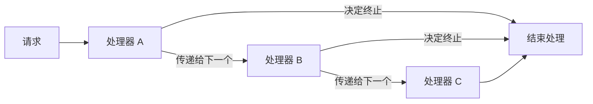

# 意图

1. 责任链模式是一种行为设计模式，允许你将请求沿着处理者链进行发送，收到请求后，每个处理者均可对请求处理，或将其传递给链上的下个处理者。

# 问题

1. 订单系统的校验逻辑，在多次迭代更新中可能会多次修改检验逻辑或者增删校验逻辑。
2. 检查代码本来就已经混乱不堪，每次新增功能都会使其更加臃肿。修改某个检查步骤有时会影响其他的检查步骤。最糟糕的是，当你希望复用这些检查步骤来保护其他系统组件时，你只能复制部分代码，因为这些组件只需部分而非全部的检查步骤。增加维护成本。

# 解决方案

1. 责任链模式会将特定行为转换为被称作处理者的处理对象。在上述示例中，每个检查步骤都可被抽取为仅有单个方法的类，并执行检查操作，请求及数据则会被作为参数传递给该方法。
2. 模式建议你将这些处理者连成一条链，链上的每个处理者都有一个成员变量来保存对于下一个处理者的引用。除了处理请求外，处理者还负责沿着链传递请求，请求会在链上移动，直至所有处理者都有机会对其进行处理。
3. 处理者可以决定不再沿着链传递请求，可高效的取消所有后续处理步骤。

# 责任链模式结构

以下为根据正文重绘的示意图，非原截图。




# 适合应用场景

1. 当程序需要使用不同方式处理不同种类请求，而且请求类型和顺序预先未知时，可以使用责任链模式。
2. 当必须按顺序执行多个处理者时，可以使用该模式。
3. 如果所需处理者及其顺序必须在运行时进行改变，可以使用责任链模式。


# 示例代码

以下为独立 Java 17 教学示例，直接在本页维护，不依赖外部示例仓库。订单校验链：任何一步失败都立即返回，后续处理器不再执行。链在使用前组装，本例不演示运行中的并发修改。

保存为 `ChainDemo.java`，运行 `javac --release 17 ChainDemo.java` 和 `java -ea ChainDemo`；`-ea` 用于启用示例断言。

```java
import java.util.ArrayList;
import java.util.List;

public class ChainDemo {
    record Order(boolean loggedIn, int quantity) {}

    abstract static class Handler {
        private Handler next;

        Handler link(Handler next) {
            this.next = next;
            return next;
        }

        final boolean handle(Order order, List<String> visited) {
            return check(order, visited) && (next == null || next.handle(order, visited));
        }

        abstract boolean check(Order order, List<String> visited);
    }

    static class LoginCheck extends Handler {
        boolean check(Order order, List<String> visited) {
            visited.add("登录校验");
            return order.loggedIn();
        }
    }

    static class QuantityCheck extends Handler {
        boolean check(Order order, List<String> visited) {
            visited.add("数量校验");
            return order.quantity() > 0;
        }
    }

    public static void main(String[] args) {
        Handler chain = new LoginCheck();
        chain.link(new QuantityCheck());
        List<String> visited = new ArrayList<>();
        assert !chain.handle(new Order(false, 1), visited);
        assert visited.equals(List.of("登录校验")); // 失败后不会继续
        visited.clear();
        assert !chain.handle(new Order(true, 0), visited);
        assert visited.size() == 2;
        visited.clear();
        assert chain.handle(new Order(true, 2), visited);
        assert visited.equals(List.of("登录校验", "数量校验"));
        System.out.println("责任链验证通过");
    }
}
```
