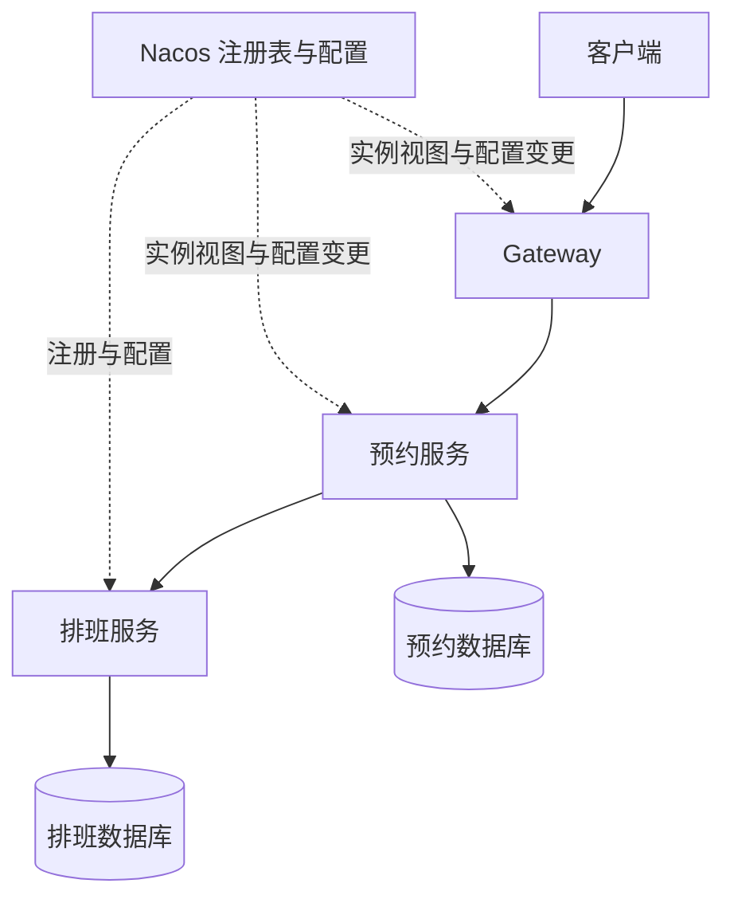

# Spring Cloud：从服务调用链到故障隔离与项目实践

> 本文以 Java 17、Spring Boot 3.2 / Spring Cloud 2023.0 对应的 **Cloud 4.1 系列机制**为学习边界，Nacos 接入讨论 Spring Cloud Alibaba 2023.x；这不是当前生产版本推荐。具体补丁版本必须按 [SCA 版本矩阵](https://sca.aliyun.com/docs/2023/overview/version-explain/)配套，再核查维护状态与安全修复。核查日期：2026-10-28。
>
> 文中的配置是局部示例，不能拼在同一个应用中直接启动。Gateway 采用 Server WebFlux；Server Web MVC 与新版配置前缀应另查对应版本。医院业务是设计案例，不代表已验证的生产事实。

Spring Cloud 把服务发现、客户端调用、负载均衡、配置和治理连接到 Spring 应用中。它并不消除网络：一次本地方法调用式的 Feign 请求，仍可能在连接建立、服务执行、返回响应的任意阶段失败。

理解微服务的关键，是沿着一条请求回答四件事：**目标地址从哪里来、执行时间花在哪里、失败后还能确定什么、用什么证据恢复业务。**

## 1. 从进程内调用走向远程调用

### 1.1 拆分服务增加了哪些不确定性

单体里的方法异常通常还在同一个进程和调用栈里。服务拆开后，调用方可能超时，服务端却已经提交数据库事务；调用方重试，服务端可能再次收到同一业务动作。网络异常不能直接映射成“业务执行失败”。

注册中心解决地址变化，负载均衡决定选谁，断路器减少继续打向故障依赖的调用，配置中心分发策略。它们都不自动保证支付只扣一次、号源不超卖或跨库事务原子提交。

因此，拆分前先判断业务边界、独立发布需求和容量差异。仅为使用一套组件而把同一事务拆成多次远程调用，会把原有锁与事务问题转化为网络、幂等和恢复问题。

### 1.2 控制面和数据面分开看



实线是业务数据面，虚线是控制面。正常情况下，预约服务从本地发现视图选择排班实例，然后直接发送 HTTP 请求；Nacos 不代理这次业务调用。

这解释了两个看似矛盾的现象：Nacos 短时不可用，已有调用可能继续；Nacos 控制台完全正常，下游数据库卡住仍会使请求超时。前者不能证明控制面不重要，后者也不能靠重启注册中心修好。

### 1.3 组件按责任组合

| 责任 | 常见实现 | 不能替代的业务责任 |
| --- | --- | --- |
| 地址发现 | Nacos、Eureka、平台服务发现 | 就绪判定、真实可达性 |
| 实例选择 | Spring Cloud LoadBalancer | 容量规划、业务隔离 |
| HTTP 调用 | OpenFeign、RestClient、WebClient、HTTP Service Clients | 契约、总预算、幂等 |
| 入口路由 | Spring Cloud Gateway | 服务内部授权和数据域校验 |
| 故障治理 | Sentinel、Resilience4j 等 | 正确的失败结果与补偿 |
| 配置管理 | Nacos Config、Spring Cloud Config | 发布校验、实例生效确认 |
| 消息适配 | Spring Cloud Stream | 本地事务与事件的一致性 |
| 指标和追踪 | Micrometer Observation / Tracing | 业务结果和对账证据 |

Nacos 并不要求必须使用 Sentinel；采用 Resilience4j 也不要求放弃 Nacos。选型取决于需要保护的资源、动态规则方式、运行模型和团队维护能力。

## 2. 一次服务调用经过哪些层

以 `appointment-service` 查询 `schedule-service` 为例：

1. 业务代码调用客户端接口，参数被编码为 HTTP 路径、请求头和请求体。
2. 客户端根据服务名进入实例选择链，读取 DiscoveryClient 提供的实例集合。
3. 实例供应链按已配置的区域、版本、健康等条件筛选候选实例。
4. LoadBalancer 从候选集合选择实例，将服务名地址转换为实际主机和端口。
5. HTTP 客户端获取连接，完成连接、发送、等待响应、读取和解码。
6. 调用结果进入业务逻辑，同时产生指标、追踪和错误分类。

发现、选择和传输是不同层。`No instances available` 应查发现与筛选；`Connection refused` 应查实际地址与端口；等待响应超时，应继续查看远端执行、网络和本地连接资源。

### 2.1 DiscoveryClient 是抽象，不等于每次访问 Server

Nacos 适配器把其客户端发现视图转换为 Spring 的 `ServiceInstance`。上层每次请求可以调用发现接口，但不意味着每次都远程查询 Nacos；SDK 内部通常已有缓存和订阅。

服务名相同也不保证发现坐标相同。调用方的 namespace、group、区域过滤和注册方不一致，得到空列表是合理结果。排障必须记录完整坐标以及筛选前、筛选后的实例数量。

### 2.2 LoadBalancer 是客户端决策

`ServiceInstanceListSupplier` 负责供给列表，`ReactorLoadBalancer` 负责选择；阻塞客户端和响应式客户端通过各自适配器接入。默认 `RoundRobinLoadBalancer` 轮询的是当前候选集合，扩展实现可以改变选择逻辑。[Cloud Commons 4.1 说明](https://docs.spring.io/spring-cloud-commons/reference/4.1/spring-cloud-commons/loadbalancer.html)

默认轮询不读取 CPU、数据库排队或业务耗时。两个实例各分到一半请求，不代表压力相等；一个实例可能正经历长 GC，另一实例可能处理的是更轻的查询。

Nacos 的 `weight` 和 `clusterName` 是实例属性。只有所选适配器或策略消费这些属性，权重和同区域优先才会生效。检查运行中的实现，不能仅凭控制台字段推断路由行为。

### 2.3 两层缓存会增加摘流窗口

若 Nacos SDK 已缓存实例，LoadBalancer 又缓存相同列表，SDK 更新后上层仍可能持有旧集合。应检查实际 Supplier 链是否存在重复缓存；确认发现层已有合适缓存后，再考虑关闭额外缓存。[缓存配置边界](https://docs.spring.io/spring-cloud-commons/reference/4.1/spring-cloud-commons/loadbalancer.html#loadbalancer-cache-configuration)

```yaml
# 仅在确认 DiscoveryClient 已缓存，且当前链确实启用额外缓存后使用。
spring:
  cloud:
    loadbalancer:
      cache:
        enabled: false
```

摘流窗口可拆成故障检测、服务端传播、客户端视图更新、上层缓存更新和已发出请求排空。没有一个单独的 TTL 能保证立即不再访问旧实例。

### 2.4 自定义策略要限制作用域

LoadBalancer 按 service ID 建立子上下文。给某个服务配置随机或定制策略时，专用配置类若被主应用组件扫描，也可能影响其他客户端。

涉及灰度时，应先过滤“允许调用的版本集合”，再在集合内选实例；不能先随机选一个，再希望 metadata 自动修正结果。候选为空时也要明确：允许回稳定版本、跨区域，还是直接拒绝。支付写入等请求不能为了可用性悄悄越过业务边界。

## 3. HTTP 客户端：声明式接口背后的代价

### 3.1 OpenFeign 的最小调用契约

调用方需要由兼容 BOM 管理的 OpenFeign、LoadBalancer 和 Nacos Discovery starter，并启用 `@EnableFeignClients` 扫描。以下接口只展示请求契约，不包含业务入口和服务端实现。

```java
import org.springframework.cloud.openfeign.FeignClient;
import org.springframework.web.bind.annotation.GetMapping;
import org.springframework.web.bind.annotation.PathVariable;

@FeignClient(name = "schedule-service")
public interface ScheduleClient {
    @GetMapping("/schedules/{id}")
    String findSchedule(@PathVariable("id") String id);
}
```

这里没有配置 `url`，服务名才有机会进入负载均衡。若在注解或客户端配置中提供固定 URL，调用将按该 URL 执行；引入注册中心不会自动覆盖它。OpenFeign 的 LoadBalancer 支持是可选依赖，不能把一个 starter 当作全部链路已接通。[OpenFeign 4.1 调用与 URL 规则](https://docs.spring.io/spring-cloud-openfeign/reference/4.1/spring-cloud-openfeign.html)

接口最好返回有版本约束的 DTO。共享整个服务端模块会让数据库实体、内部异常和依赖一起进入调用方，使两个服务被迫同步升级。

### 3.2 连接超时和读取超时不等于总超时

```yaml
# 预约服务中的调用端配置；数值只用于说明，不是性能推荐值。
spring:
  cloud:
    openfeign:
      client:
        config:
          schedule-service:
            connectTimeout: 200
            readTimeout: 500
```

连接建立、连接池借用、DNS、TLS、响应等待、重试退避和业务排队都可能耗时。具体 timeout 覆盖哪一段由 HTTP 客户端实现决定；只设置上述两个值，不代表整个接口一定在 700ms 内结束。

HTTP 连接池还应同时观察总连接、每目标连接、等待队列和获取超时。增加 Web 线程数却不增加可用下游容量，往往只是让更多线程等待同一池资源。

### 3.3 重试在哪一层发生

Spring Cloud OpenFeign 4.1 默认提供 `Retryer.NEVER_RETRY`，这与原生 Feign 的默认行为不同。但 HTTP 客户端、LoadBalancer、Gateway 或业务代码仍可能存在其他重试。[重试与组件配置](https://docs.spring.io/spring-cloud-openfeign/reference/4.1/spring-cloud-openfeign.html)

如果网关最多尝试 3 次、业务服务最多尝试 3 次，下游最坏可收到 9 次请求。参数里的“重试 2 次”通常意味着首次加两次，总计 3 次，核算时不要漏掉首次。

明确一个主要重试责任层，限定错误类型、总次数、退避和剩余预算。读取超时后的写操作，结果应视为未知：先用业务请求 ID 查询状态，再决定重放；`POST` 改成 `GET` 也不能把有副作用的操作变成安全重试。

### 3.4 阻塞与响应式不能混用线程假设

普通 OpenFeign 是阻塞调用。WebClient 提供响应式链，但对它调用 `block()` 仍会阻塞当前线程。Server WebFlux 网关的 EventLoop 上执行阻塞 Feign、JDBC 或同步文件访问，会让共享该线程的连接一起等待。

需要阻塞依赖时，应采用适合的服务运行模型，或把工作交给有并发上限和队列上限的专用执行资源；切换线程池不等于消除了容量限制。

OpenFeign 已处于 feature-complete 状态，官方建议评估 Spring HTTP Service Clients；已有系统不必为此立刻重写。HTTP 接口代理仍依赖底层 RestClient 或 WebClient，负载均衡、超时和追踪也要继续配置。[官方项目说明](https://github.com/spring-cloud/spring-cloud-openfeign)

## 4. Gateway：在入口治理，也要保留服务边界

### 4.1 路由到实例的过程

Server WebFlux 中，Predicate 匹配路由，Filter 链处理请求，`lb://` 经负载均衡解析到实际实例，再由 HTTP 客户端转发。下面使用 4.1 系列配置前缀：

```yaml
spring:
  cloud:
    gateway:
      routes:
        - id: appointment-api
          uri: lb://appointment-service
          predicates:
            - Path=/api/appointments/**
          filters:
            - StripPrefix=1
```

例如 `/api/appointments/42` 会转为 `/appointments/42`。Path 匹配本身不负责删除前缀。路由存在只说明规则可以被加载，还要确认实例发现、路径变换、HTTP 方法和服务端契约一致。[Gateway 4.1 文档](https://docs.spring.io/spring-cloud-gateway/reference/4.1/spring-cloud-gateway.html)

过滤器顺序决定前置和回程动作的嵌套关系；不要把数值排序简单理解为所有阶段都同序执行。完整链路、请求体和线程模型见 [[04-消息与分布式/分布式/网关/SpringGateway|Spring Cloud Gateway]]。

### 4.2 动态路由需要适配，不是配置中心的默认承诺

把一段路由 YAML 存进 Nacos，只完成了存储。要动态生效，还需要订阅、解析、路由仓库或配置绑定更新，以及相应的路由刷新流程。不同集成版本对热更新支持不同，应以实例中的实际路由表验证。

路由变更应先校验 ID 冲突、目标服务、路径覆盖、权限过滤器和回滚版本。新增宽泛的 `/api/**` 规则可能遮蔽原路由；JSON/YAML 语法正确不代表路由语义正确。

### 4.3 网关通过不代表业务授权通过

网关可以验证令牌、限制入口流量、注入受信任身份；预约服务仍须验证患者是否有权访问该预约、是否属于当前租户、状态是否允许变更。

外部提供的用户 ID、租户头和灰度头不能原样作为可信身份。入口要清理或覆盖这些头，下游要校验可信来源。内部调用、消息消费和运维脚本可能绕过公网网关，服务层的授权不可省略。

## 5. 把时间预算、并发与故障治理放在一起

### 5.1 总预算先于单个超时参数

假设预约查询的入口预算为 1500ms，网关与序列化预留 150ms，预约服务自身处理预留 250ms，则串行下游等待、重试和退避合计只剩 1100ms。数字是预算示例，需要用实际延迟分布修订。

```text
串行链路预算 ≥ 本地执行 + 各下游尝试耗时 + 退避 + 返回余量
并行链路预算 ≥ 本地执行 + 最慢必要分支耗时 + 汇聚与返回余量
最坏下游尝试次数 = 沿链各重试层的总尝试次数之积
```

单次超时应受剩余预算约束；截止时间已耗尽时，不再开启新尝试。跨机器传递绝对 deadline 需考虑时钟误差；传递剩余预算也需扣除本地耗时。框架不会自动让所有业务依赖共享一个正确预算。

### 5.2 四种保护解决不同问题

| 手段 | 直接控制的对象 | 常见误解 |
| --- | --- | --- |
| 超时 | 等待某段操作的时间 | 调用方超时不等于远端已取消或回滚 |
| 限流 | 一段时间内的准入量 | 单实例限流不自动变成全局配额 |
| 隔离 | 并发、线程、连接等资源占用 | 换线程池但无限排队仍会耗尽资源 |
| 熔断 | 对持续异常依赖的后续尝试 | 熔断不会撤销已经提交的业务 |

在系统稳定的近似条件下，并发占用可用 `L ≈ λ × W` 理解：到达率不变，平均等待从 100ms 增至 1s，占用可能放大十倍。故障时若不断加超时与重试，通常会进一步放大资源压力。

Sentinel 的统计、规则和实现细节见 [[04-消息与分布式/分布式/限流/Sentinel|Sentinel]]。本文只确定它在调用链中的保护位置，不重复维护一套组件教程。

### 5.3 降级必须保持业务语义

医生简介可以使用带更新时间的缓存；排班展示可以明确提示暂不可用；号源占用、支付确认和处方提交不能在异常时返回伪造成功。

可区分“已失败”“处理中”“结果未知”“使用旧数据”。这些状态影响前端提示、是否允许重试以及后台恢复。若统一返回空列表和 HTTP 200，监控会把故障当成功，用户却可能误以为没有号源。

隔离粒度也要与依赖一致：短信服务故障不应耗尽预约核心线程；支付渠道 A 异常不应让渠道 B 共用的无界队列一起堵塞。

## 6. 配置、消息和观测如何接入这条链

### 6.1 远端配置是一条发布链

Nacos Config 与 Spring Cloud Config 是不同方案。Config Server 可以从 Git 等后端读取配置，客户端通过 Config Data 导入；Git 提交本身不会让所有 Bean 立即改变，仍需要刷新触发与对象刷新支持。Spring Cloud Bus 只是可选的刷新事件传播方式。[Config 客户端机制](https://docs.spring.io/spring-cloud-config/reference/4.1/client.html)

采用 Nacos 时同样要区分服务端版本、客户端读取版本和业务实际使用版本，不能混用两套加载模型后再凭文件名猜优先级。完整机制见 [[04-消息与分布式/分布式/服务注册与发现/Nacos|Nacos]]。

### 6.2 Stream 连接消息模型，不承担跨系统事务

函数式 Stream 用 `Supplier`、`Function`、`Consumer` 描述处理逻辑，用 binding 连接 destination；binder 再映射到 Kafka、RabbitMQ 等中间件。消费组、确认、重投和顺序仍受 binder 与代理实现约束。[Stream 函数式模型](https://docs.spring.io/spring-cloud-stream/reference/4.1/spring-cloud-stream/producing-and-consuming-messages.html)

数据库提交后直接调用发送函数，进程可能在两者之间退出；引入 Stream 不会消除该窗口。预约创建与事件记录可以使用同事务 Outbox，通知消费者以事件 ID 幂等，发送确认与消费确认分开观测。消息机制见 [[04-消息与分布式/RabbitMQ/RabbitMQ|RabbitMQ]]。

### 6.3 追踪要贯穿线程与协议

Boot 3 应用通常通过 Micrometer Observation / Tracing 接入追踪后端。使用框架提供的客户端 builder 和相应集成，比随处 `new` 客户端更容易保留自动插桩；异步线程、消息消费和自定义客户端仍需验证上下文传播。[Boot 追踪说明](https://docs.spring.io/spring-boot/docs/3.2.12/reference/html/actuator.html#actuator.micrometer-tracing)

排障至少关联：入口请求 ID、trace ID、业务请求 ID、目标实例、实际尝试次数和配置发布号。trace ID 服务于链路关联，业务幂等键服务于去重，不能相互替代。

指标记录服务、操作、错误类别等有界维度；患者 ID、订单 ID 和完整 URL 放在受控日志或追踪里，避免指标标签基数失控。采样未记录的请求仍可能失败，所以业务计数与错误率不能只从抽样 trace 推导。

## 7. 项目实践：预约挂号链路

### 7.1 将关键结果与附属动作分开

入口经过网关认证和准入后，预约服务校验患者权限，向排班服务申请号源占用，再建立预约状态。号源和预约分属不同数据库时，应明确预占凭证、到期释放、状态查询与补偿责任；不能把两个 Feign 方法放在同一个 `@Transactional` 中就称为分布式事务。

通知、统计与搜索更新可以异步执行。预约服务提交业务状态和 Outbox 后返回具有真实含义的结果；消费者失败由重试与对账恢复，不让短信慢拖住号源事务。

### 7.2 从一次超时恢复业务事实

假设排班服务已成功预占，但响应丢失：

1. 预约服务记录“预占结果未知”，保留相同业务请求 ID。
2. 调用查询接口确认该 ID 对应的预占结果，或在服务端幂等契约允许时用同一 ID 重试。
3. 已存在的预占返回同一凭证，不能生成第二份占用。
4. 后续预约创建失败，按约定释放或由预占过期机制回收；后台对账处理长期未收敛状态。

调用日志里的超时只是通信证据，预占记录和业务凭证才是业务事实。限流、熔断和重试策略必须服从这一恢复协议。

### 7.3 灰度必须贯穿调用链

入口可以为稳定的一组用户确定灰度标识，但预约服务调用排班服务时也必须传播受信任的标识，并由候选筛选策略消费。只在 Gateway 分流，内部服务依然随机调用所有版本，就不能宣称完成全链路灰度。

旧版与新版还需兼容 DTO、数据库结构和事件格式。滚动发布时先采用可兼容的扩展，再迁移消费者，最后移除旧字段；动态配置无法修复不兼容的数据协议。

### 7.4 下线从摘流到资源排空

先让发布系统进入排空阶段，更新注册与入口就绪状态，再观测消费者停止选择该实例；同时给存量请求、事务和后台任务留出完成或恢复时间，最后关闭网络与资源。

不能把“控制台已无实例”当作全部客户端已同步。已选择实例的请求、连接中的流量和旧缓存仍可能到达；应用要有明确的排空状态、截止时间和拒绝策略。具体演练见 [[04-消息与分布式/分布式/服务注册与发现/nacos场景题|Nacos 项目实践与故障恢复]]。

## 8. 以故障注入验证组合行为

以下是隔离测试环境的验收场景，并非本轮已完成的联调记录。先记录所选 BOM、实际 HTTP 客户端、Supplier 链和 Server/SDK 版本，再执行：

| 注入条件 | 需要观测的证据 | 验收重点 |
| --- | --- | --- |
| 下游提交后延迟响应 | 同一业务 ID 的调用次数与落库记录 | 重试不重复占用，未知状态可恢复 |
| 一个实例退出 | 各消费者最后选中时间、存量请求数 | 摘流窗口可解释，排空有上限 |
| Nacos 暂时断连 | 旧实例命中率、重连、配置版本 | 已有流量与新启动的表现分别验证 |
| 某个依赖持续慢 | 连接等待、线程队列、拒绝数 | 核心资源不被附属依赖耗尽 |
| 修改客户端固定 URL | 实际目标地址和注册中心访问 | 能识别绕过服务发现的调用 |
| 灰度实例不可用 | 入口及内部调用目标版本 | 空候选行为符合预先约定 |
| 发布无效动态参数 | 收到版本、应用版本、拒绝原因 | 错误配置不覆盖已验证运行策略 |

实验时不要以“请求最终返回”为唯一标准。还要验证业务结果、重复次数、等待资源和恢复路径；这些共同决定系统是否在故障中保持正确行为。

## 9. 旧项目迁移时保留哪些认识

Ribbon、Hystrix、Sleuth、Stream 注解式绑定属于旧项目常见组成。迁移不只是替换依赖名：要重新核对超时默认值、重试层级、隔离粒度、追踪传播和消息确认语义。

Eureka 并不因 Ribbon 的替换而失去注册发现职责；Nacos 也不自动替代所有配置、路由和治理代码。先按责任画出实际调用链，再逐段替换并验证，才能避免“依赖升级成功，故障行为却改变”的问题。
