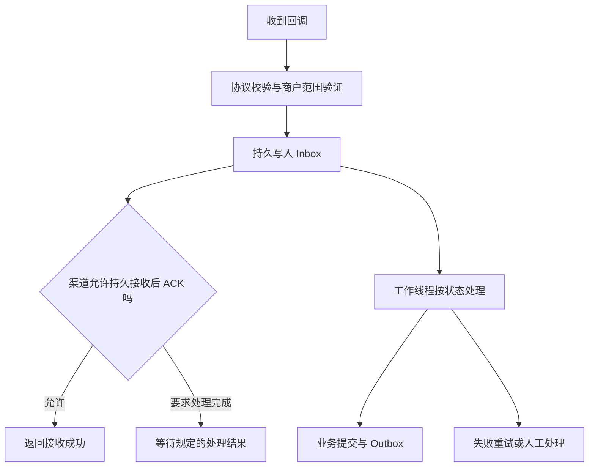

# Redis 项目实践：从患者画像缓存到支付回调、库存预扣与故障恢复

> 本文承接 [[Redis]] 的机制分析，以 Redis 7.2、MySQL InnoDB 和 Java/Spring 服务为教学背景。患者画像、支付、挂号与库存表均是用于解释设计的模型，不代表已有生产实现。示例中的容量、TTL、重试次数应通过业务协议和压测确定，不能直接当成上线参数。
>
> 数据库事务、条件更新与 Outbox 的原理见 [[../数据库/MySQL|MySQL]]；应用层事务、连接和 Mapper 边界见 [[../数据库/Mybatis|MyBatis]]。本文不重复命令手册，而是解释 Redis 应放在哪一步，以及每一步失败后怎样继续。

一个项目方案是否完整，可以用进程崩溃来检验：在任意两步之间停止服务，重新启动后，系统能否知道哪些事已经完成、哪些事还需要重试？如果答案只存在于一个会过期的 Redis key 里，往往说明持久业务协议还没有设计完。

## 1. 先定义业务不变量，再安排组件

### 1.1 三个案例，三种不同的正确性目标

| 场景 | 必须成立的事实 | 可以容忍的暂时差异 | Redis 的职责 |
| --- | --- | --- | --- |
| 患者画像 | 更新不能无声覆盖，租户隔离正确 | 备注展示短时陈旧 | 减少读取、合并重建、保存版本化快照 |
| 支付回调 | 同一有效支付事实不能重复入账，已接收事件可恢复 | 页面、通知、票据状态按协议稍后收敛 | 热点去重、短期互斥、状态查询加速 |
| 库存预扣 | 同一请求不能重复扣减，出售量符合持久库存约束 | 预留索引短时滞后 | 削峰、预筛选、可恢复预留索引 |

“可以最终一致”必须有期限、检测和修复机制。例如通知延迟可以容忍，并不等于消息可以永久丢失；画像备注可以短时旧，也不等于授权信息可以继续使用过期权限。

### 1.2 为每种数据指定唯一的权威来源

本文让 MySQL 的业务表、Inbox、Outbox 和消费记录承担持久真相。Redis 中的详情、去重提示、锁和时间索引均可重建，丢失时依靠数据库约束保持正确性。

这并非规定所有项目都必须如此，而是先固定一种可解释的故障模型。若要让 Redis 承担唯一账本，就必须另外证明持久化、故障切换、备份和业务恢复满足要求，不能沿用“缓存丢了查库”的预案。

## 2. 患者画像：先把数据库更新做对

### 2.1 缓存无法修复错误的更新条件

假设一条画像由 `(hospital_id, patient_id)` 唯一标识，包含 `version`。客户端提交更新时带上读取到的版本：

```sql
UPDATE patient_profile
SET remark = :remark,
    version = version + 1,
    updated_at = CURRENT_TIMESTAMP
WHERE hospital_id = :hospitalId
  AND patient_id = :patientId
  AND version = :expectedVersion;
```

影响一行表示本次条件更新成功；零行需要区分记录不存在、租户不匹配和版本冲突。不能不检查结果就继续写入“更新成功”的缓存。

hospitalId 应来自已验证的请求上下文，不能仅信任客户端传参。Redis key 带医院编号只是命名，不能替代数据库 WHERE 中的范围约束。

### 2.2 业务更新与失效事件在同一事务内提交

```text
开始数据库事务
  条件更新 patient_profile，并检查结果
  插入 Outbox：事件 ID、实体 ID、新版本、事件类型
提交
提交后尝试快速删除画像缓存
Outbox relay 负责最终重试失效或刷新
```

快速删除降低日常陈旧窗口，Outbox 补上“数据库提交后应用进程立即崩溃”的缺口。两者职责不同，不能用 afterCommit 替代持久事件。

Outbox 的 eventId 必须在重发时保持不变；重试发布不能每次制造一个新事件 ID。实体版本与事件 ID 也不同：版本用于比较状态新旧，eventId 用于识别同一次事件。

### 2.3 Spring 事务边界的伪代码

下面只表达职责，不假设已有具体类或客户端 API：

```java
@Transactional
public ProfileResult updateProfile(UpdateProfileCommand command) {
    int changed = profileMapper.updateWithVersion(command);
    if (changed != 1) {
        throw new ProfileConflictException();
    }
    ProfileSnapshot snapshot = profileMapper.selectCurrent(command.identity());
    outboxMapper.insert(ProfileChangedEvent.from(snapshot));
    return ProfileResult.from(snapshot);
}
```

该方法必须经过真实事务代理，两个 Mapper 参与同一数据库事务；异常处理不能吞掉错误后返回成功。方法内部直接调用同类带事务方法、异步跨线程执行、错误路由到不同数据源，都可能使这段伪代码失去假设。

调用方在方法正常返回后可以尝试失效缓存，失败记录指标并交给 Outbox 重试。不要在数据库持锁事务里等待无界 Redis 重试，把缓存故障转化为长事务。

## 3. 画像读取：重建速度与一致性分开处理

### 3.1 一次未命中的完整路径

```text
鉴权并确定租户与患者
  → 读取版本化缓存
  → 命中且满足请求最低版本：返回
  → 未命中：获取受限的重建资格
  → 查询合适的数据库来源
  → 有条件地回填缓存
  → 返回查询结果
```

重建资格可以先用进程内 single-flight，跨实例热点再考虑 Redis 锁。锁失败的请求不能无限循环；应按业务选择短等待、允许的旧值或明确降级。

数据库失败与“查不到”必须区分。网络超时缓存成空值，会把暂时故障扩大成持续的错误结果。患者画像的负缓存还要包含租户范围，避免不同医院相同患者编号互相污染。

### 3.2 并发回填的三条时间线

| 时间线 | 结果 | 需要的措施 |
| --- | --- | --- |
| 缓存 v12 存在，迟到请求尝试写 v11 | 直接覆盖会退化 | 版本条件写入 |
| v12 缓存已删，迟到请求写 v11 | key 内版本已不存在 | 独立水位、重建协议或有限陈旧兜底 |
| 回源从延迟副本读出 v11 | 重建完成仍是旧数据 | 读源选择、最低版本检查 |

主文的 `cache_version` Lua 解决第一类问题，并刻意展示第二类问题仍然存在。选择完整协议时，要把比较依据的生命周期纳入设计。

对于允许短时陈旧的备注展示，可以组合短 TTL、Outbox 持续修复、版本条件写和热点重建限制，并定义可接受的最大陈旧窗口。需要严格读取已提交版本时，可直接查主库或要求读到不低于请求携带的最低版本；不能只把 TTL 调到一秒就声称强一致。

### 3.3 写后读与多级缓存

更新接口可以返回数据库已提交的新版本与快照，让前端不必立即进行一次可能落到旧缓存的查询。后续请求携带最低版本，服务端发现缓存过旧就走权威读取，这比“更新后随便刷新一下页面”更明确。

如果增加本地缓存，失效传播通常不是可靠日志：进程断线期间可能丢掉 Pub/Sub 消息。需要本地 TTL、版本检查、连接恢复时清理或重建，不能把 Redis 删除成功当成本地副本也全部失效。

## 4. 支付回调：先确定怎样算“已经接收”

### 4.1 回调不是一次可信、顺序、唯一的函数调用

支付渠道可能重复投递、超时重试、延迟到达，也可能在创建支付单的本地流程完成前回调。多个事件之间可能乱序，某些渠道回调只是通知，需要主动查询进一步确认。

先阅读渠道协议，区分通知 ID、渠道交易号、商户订单号、支付尝试 ID。一次业务订单可能有多次支付尝试，不能把所有通知只按 orderId 去重，也不能默认 notifyId 在所有商户下全局唯一。

一种持久幂等作用域可以是：

```text
(channel, merchant_id, notify_id)
```

还要保存规范化内容摘要及关键支付事实。相同作用域的通知若金额、币种、商户或交易号不一致，应进入冲突处理，不能直接当作合法重复。

### 4.2 验签、解析与业务校验不能互相替代

保留渠道要求的原始字节与请求头，按其协议完成验签、解密和解析。有些协议签名覆盖原始密文，有些覆盖特定参数；不能统一规定“一定先解密再验签”，也不能先重排 JSON 再用新字节验证旧签名。

技术校验后还需检查商户归属、订单绑定、金额、币种和允许的事件类型。验签成功说明消息符合渠道签名规则，不说明这笔钱可以支付当前患者的订单。

原文、证书和敏感字段的保存要受访问与保留策略约束。普通日志只输出可关联的摘要和错误分类，避免把整个回调报文复制到所有日志系统。

### 4.3 用持久 Inbox 区分“接收到”与“处理完”

一个可恢复的接收流程是：



ACK 的含义必须遵循渠道协议。如果成功响应代表“已可靠接收”，Inbox 提交后即可返回；如果协议要求业务完成，则必须满足它定义的完成条件。不能只因 Redis 中发现 PROCESSING 就向渠道声称业务处理成功。

数据库提交结果不确定时，应利用稳定幂等键重新查询。连接超时不等于事务必然回滚，也不等于提交必然成功。

## 5. 早到回调、重复事件与支付状态机

### 5.1 早到回调先收容，再关联

当找不到本地支付单时，不能只把通知放进一个带 TTL 的 Redis key 后 ACK。Redis key 一旦过期或丢失，这笔已向渠道确认接收的事件就无法恢复。

先保存 Inbox，并标记为 `WAITING_ORDER`；工作线程根据稳定外部标识重试关联。创建支付单完成可以触发一次关联尝试，同时保留定时扫描兜底，避免唤醒事件本身丢失。

重试超过合理期限后，不是静默删除，而是进入异常队列并核对渠道：可能是本地建单失败、标识绑定错误，也可能是真实异常交易。支付事实不能因没有本地单据就自动被判定不存在。

### 5.2 状态机应表达合法迁移

示意状态可以是 `CREATED → PAYING → PAID`，支付失败、关闭和退款需要按业务协议另外建模。不能给状态排整数大小后简单取最大值：退款不是“支付状态倒退”，一次失败通知也不必然否定另一次已确认支付。

```sql
UPDATE payment_order
SET status = 'PAID',
    channel_trade_no = :tradeNo,
    paid_amount = :amount,
    version = version + 1
WHERE id = :paymentId
  AND hospital_id = :hospitalId
  AND merchant_id = :merchantId
  AND status IN ('CREATED', 'PAYING');
```

这只是迁移示例，使用前必须验证金额、币种、交易身份等条件，并设计交易号的适当唯一约束。实际渠道允许的状态转换要单独确认，不能照抄状态集合。

影响零行之后应查询并比较：是同一支付事实已完成，还是订单已关闭、金额不一致、交易号冲突或无权限。只有核实为同一已提交结果，才能按幂等成功处理；把所有零行都视为成功会吞掉异常。

### 5.3 一次事务内保存完成事实与待办事件

```text
开始事务
  锁定或条件推进目标支付单
  核验业务事实与唯一约束
  更新必要的本地业务记录
  标记 Inbox 已处理
  写入稳定 eventId 的 Outbox
提交
```

支付单与本地挂号状态是否必须同事务，取决于业务不变量、数据归属与事务资源；不能规定“永远只有支付单强一致，挂号必须最终一致”。跨服务医保、票据、短信等副作用通常需要后续协议，但各自的可见期限、失败补偿和人工入口必须明确。

外部 HTTP 调用无法由本地数据库事务自动回滚。不要在持锁事务中同步调用一串慢服务，再期待回滚能取消已发送的票据或短信。

## 6. Redis 幂等提示与锁放在哪里

### 6.1 先给每个 key 明确语义

| key 示例 | 表示的含义 | 丢失后的正确路径 |
| --- | --- | --- |
| `pay:cache:v2:7:42` | 支付单查询快照 | 查权威数据库并重建 |
| `pay:lock:{7:42}` | 某次处理尝试暂时持有租约 | 数据库状态条件和唯一约束继续兜底 |
| `pay:done:channelA:merchant7:notice9` | 已完成处理的短期提示 | 查询持久幂等记录 |
| `pay:pending:bucket3` | 候选处理时间索引 | 从 Inbox 未完成记录重建 |

DONE 提示只有在业务提交后才可写入。使用它快速返回还要保证它与通知作用域、内容摘要绑定，并能承受陈旧或恢复后的提示失效。对关键结果可直接查询 Inbox，避免把提示当成唯一事实。

### 6.2 为什么 PROCESSING 不能直接当成功

```text
请求 A：写入 PROCESSING
请求 A：数据库提交前崩溃
请求 B：看到 PROCESSING，返回成功
渠道：停止重试
结果：业务从未提交
```

解决方式不是把 PROCESSING 的 TTL 从一分钟改成一天，而是让持久 Inbox 记录事件，并有租约、重试和扫描恢复。Redis PROCESSING 可以抑制短时重复并发，但不能替代完成状态。

### 6.3 锁只减少冲突，数据库负责结果约束

锁粒度按支付尝试或支付单确定，不要用医院级大锁串行化所有订单。线程获得锁后再做短事务，释放锁通常安排在事务结果确定之后；若提前释放，后一个请求可能在前一个事务尚未提交时进入。

即便使用 Redisson watchdog，也必须假设租约可能失效。A 暂停后恢复，B 已经取得锁并完成处理时，A 的数据库条件更新应失败或识别同一结果，而不是再次入账。

释放时比较 token，避免删除其他持有者的锁；业务侧检查状态与唯一约束，避免旧持有者继续写。这两件事解决不同问题，缺一不能用另一件代替。

### 6.4 TTL 是缓存策略，不能定义业务证据的寿命

缓存 TTL 根据陈旧容忍度与回源成本设置；锁 TTL 根据处理时间和续期策略设置；Redis DONE 提示 TTL 根据重复流量分布设置。持久幂等记录的保留则要覆盖渠道重投、人工重放、对账、补偿及合规要求。

关键幂等记录如果需要清理，应先确定旧事件重放时将通过何种业务唯一键再次识别。不能因为 Redis TTL 到期，就允许历史交易重新生效。

## 7. Outbox 与消费端：把“至少一次”变成可重复执行

### 7.1 发布成功与业务完成不是同一个确认

Outbox relay 读取未发布事件，发送到 MQ 后记录进度。若发送成功但标记失败，事件会重复发送；因此消费者必须容忍重复，不能试图只靠 relay 消灭全部重复。

生产者 confirm 的含义取决于消息系统与配置。即便代理已接收，也不一定说明路由到期望队列，更不代表消费者已经完成业务。要按所用 MQ 核实路由失败、持久化、确认与重试协议。

### 7.2 消费幂等记录必须与本地业务同事务

```text
开始数据库事务
  插入 consumed_event(consumer_name, event_id, payload_digest)
  执行本地业务条件更新或写入唯一业务凭证
提交
ACK 消息
```

唯一键应覆盖消费者身份与稳定事件 ID。另一个消费者对同一事件执行不同职责，不应被前一个消费者的去重记录挡住。

插入冲突要确认是预期唯一键冲突，并校验内容摘要及已有提交结果。数据库不可达、字段超长、死锁和其他约束错误不能一概当作“重复成功”。

事务提交后 ACK 失败会重投，消费者查询到已完成记录后可再次 ACK。事务未提交就 ACK，则崩溃后可能没有任何地方知道业务尚未执行。

### 7.3 顺序要按事件语义处理

完整快照事件可以在保证版本正确时丢弃旧版本，直接采用更新快照。增量事件如“增加库存 3”不能随意丢弃中间事件；需要连续序号、缺口检测、重放或回查重建。

实体 version 不一定是当前消费者可见事件流的连续序号。一个画像实体 v10 到 v12，中间 v11 可能只修改了不发布给该消费者的字段；不能因此认定消息必丢。只有协议明确每次变化都产生连续序号时，才要求严格 `last + 1`。

支付、退款和开票也不宜共用一个简单的状态大小排序。应分别定义状态维度，再通过业务规则关联。

### 7.4 重试与死信要保存失败事实

失败事件记录原因分类、次数、下次执行时间与最后错误摘要。瞬时故障指数退避并加入抖动；非法参数、金额冲突等确定性错误进入异常处理，不应不断撞同一条失败路径。

转入重试队列或死信队列时，必须先确认新位置可靠接收，再确认旧消息，或使用消息系统提供的原子机制。顺序反过来，中途崩溃会丢事件。

人工重放应保留原 eventId 或明确的原业务幂等标识，记录操作者、原因与范围。换新 ID 绕过去重，可能把“恢复失败事件”变成“再做一次副作用”。

## 8. 重试风暴、热点与大对象：保护整条回调链路

### 8.1 限流保护处理能力，不能改变支付事实

按渠道、商户、IP 与业务标识组合限流；只有 IP 限流可能误伤共用出口的支付渠道。接口入口、Inbox 写入与工作线程分别有容量上限，数据库连接池和线程池应有隔离。

当处理能力不足时，可以在协议允许的前提下先持久收容，再异步处理；如果连持久接收都未成功，就不能靠返回成功让渠道停止重试。具体失败响应与重试节奏应遵循渠道协议。

Redis 限流器不可用时，需要选择本地应急限流、受控排队或拒绝，不能默认全量绕过。允许绕过锁而保持正确性，也不代表数据库有能力承接所有重复请求。

### 8.2 热点去重的分桶不能破坏身份

支付详情的读热点可以短缓存或合并请求；同一回调的幂等键必须稳定定位。随机给重复通知分配多个去重 key，会把一次事件变成多条独立通道，直接破坏去重。

高频统计可以分桶后聚合，因为其结果允许设计为可汇总；锁、去重和库存共享约束则必须先重新定义协议，不能套用相同技巧。

### 8.3 不把整个支付历史塞进一个 Hash

每次回调原文、验签材料、重试轨迹、支付明细可能不断增长。把它们全部追加到同一个 Redis Hash，会让 HGETALL、迁移、复制与删除成本随历史累积。

原始业务证据应放在受控的持久存储，Redis 只保留热点摘要和有限状态。历史记录按时间或业务键分页读取，规定条数与字节上限；清理时分批进行并观测后台释放与复制压力。

### 8.4 恢复后的洪峰也要限流

缓存恢复后，很多请求可能同时重建；MQ 恢复后，积压事件可能同时推动数据库与 Redis 写入。使用渐进放量、分级预热和工作线程并发上限，防止恢复动作再次压垮依赖。

容量评估不能只看平均 QPS，还应考虑渠道集中补发、消费者停机后追赶、库存活动开始、缓存批量失效这类重叠峰值。

## 9. 库存预扣：把一个原子减法变成可恢复协议

### 9.1 先定义预留，而不是直接减一个数字

一次预留至少包含稳定 requestId、skuId、数量、状态、截止时间和对应订单。重试必须复用 requestId；超时后另造新 ID 会产生第二次预留。

示意状态是：

```text
RESERVED → CONFIRMED
RESERVED → RELEASED
```

确认与释放竞争时只能有一条成功路径，终态不能再被另一条路径重复修改。多个状态都要有持久记录，不能仅通过“库存总数看起来对了”推断每个请求已经恢复。

### 9.2 Redis 原子预扣能保证到哪里

同槽 Lua 可以一次完成：检查请求是否已有记录、检查可用量、扣减、写入预留状态。它能避免 Redis 内两个请求同时看到同一份余额，也能在 token 与参数绑定时识别重复请求。

但 Redis 预扣成功后数据库写入失败，预扣就成了孤立状态；数据库提交成功后 Redis 确认丢失，也会形成另一种不一致。脚本无法把这两个系统变成一个原子事务。

不要执行 DECR 后发现负数再 INCR：两步之间存在可观察状态，补偿还可能失败。也不要把错误请求的数量忽略掉，只按 requestId 返回第一次结果；相同 requestId 配不同 sku/数量应视为参数冲突。

### 9.3 本文采用的权威库存路径

对于库存规模允许的业务，可以让 Redis 仅做预筛选和削峰，最终由数据库事务检查并写入持久预留：

```sql
UPDATE inventory
SET available = available - :quantity,
    reserved = reserved + :quantity,
    version = version + 1
WHERE sku_id = :skuId
  AND available >= :quantity;
```

同一事务插入带唯一 requestId 的 reservation，并检查更新结果；quantity 必须提前验证为正数且在合法范围。若插入发现已存在，不能把事务内重复扣减提交出去，应回滚本次事务，再读取原预留并核对参数。

Redis 的预筛选可能因为陈旧而误拒绝或误放行：误放行最终由数据库条件更新拦住，误拒绝则要按产品要求决定是否提供受限回查。性能优化不能无声改变“有货就应可买”的承诺。

若实际项目必须让 Redis 承担高吞吐预留真相，需要另行设计持久流水、灾后重建与库存对账，不能把本文的数据库兜底删除后还沿用同样保证。

### 9.4 确认、取消与释放要做成条件迁移

确认事务只允许 RESERVED → CONFIRMED，关联唯一订单，并将 reserved 转入已售或对应账本；释放事务只允许 RESERVED → RELEASED，将数量返回 available。只有成功迁移的那一次才能修改库存。

```text
第一次取消：状态迁移成功 → 返还数量
重复取消：已是 RELEASED → 返回原结果，不再次返还
取消与确认并发：数据库条件与锁决定一个有效迁移
```

业务是否允许截止后确认、支付已成功但预留已释放如何处理，必须有明确规则：重新尝试库存、退款或异常人工处理。不能用“最后来的事件覆盖前面状态”解决资源不足。

## 10. 延迟任务：到期只是候选，执行要再检查

### 10.1 数据库保存截止时间，Redis 加速发现

预留表保存 expiresAt 与状态，Redis ZSet 用截止时间作 score。工作线程读取到期候选后，回到数据库做条件迁移；重复触发由状态约束消除。

Redis 候选丢失时，数据库扫描仍可发现未释放的过期预留；候选重复或过时也不会重复返还库存。这种设计把可靠性放在可查询事实中，把 Redis 用作加速层。

### 10.2 如果用 processing 租约，要补齐接管逻辑

另一种设计将到期任务原子地从 due 转入 processing，并写入租约截止。任务成功后确认，失败或租约到期后重新调度。脚本每次领取数量有上限，Cluster 下涉及的 key 要同槽。

接管不会杀死旧工作线程，旧执行者恢复后仍可能提交；所以业务迁移必须幂等。任务 payload 也必须可恢复，仅保存一个指向已过期缓存的 ID 不够。

服务器时钟跳变、客户端时钟不一致会影响到期判断，时间来源要统一并监控偏差。截止时间是允许尝试的条件，不是“这个时间点一定恰好执行完成”的承诺。

## 11. 故障恢复：先问丢了什么，再决定怎样重建

### 11.1 故障矩阵决定处理动作

| 故障点 | 持久事实 | 恢复动作 |
| --- | --- | --- |
| Inbox 提交前崩溃 | 可能未接收，提交结果也可能未知 | 按稳定通知键查询，依协议让渠道重试 |
| Inbox 提交后、处理前崩溃 | 已接收且未完成 | 扫描未完成 Inbox，租约接管 |
| 支付提交后、写 Redis 前崩溃 | DB 与 Outbox 已提交 | 重投识别原结果，Outbox 修复缓存与下游 |
| MQ 发出后、Outbox 标记前崩溃 | 事件可能已发布 | 重发同 eventId，由消费者幂等 |
| 消费提交后、ACK 前崩溃 | 业务与消费记录已提交 | 重投查询消费记录后 ACK |
| Redis 全量丢失 | 数据库业务、Inbox/Outbox 仍在 | 限流重建缓存、候选任务与提示 |
| 库存确认与超时释放并发 | 同一预留行存在竞争 | 条件迁移，只允许一个状态路径生效 |

“重试”必须说明重试哪个稳定标识、从哪里读取状态，以及重复时如何识别。否则重试本身就可能成为新的故障来源。

### 11.2 数据库回滚到旧备份时，缓存可能反而太新

假设缓存持有 v200，数据库恢复到 v180。继续使用“只接受更高版本”的缓存脚本，可能拒绝恢复后数据库的正确快照，或者直接向用户返回恢复前已经失去依据的内容。

恢复流程需要隔离流量、确定数据库恢复点，切换缓存命名空间或 generation，再逐步重建。旧锁、去重提示和任务租约也不能未经审查直接接着用。

清空 Redis 不是完整恢复方案：仍需重建待处理任务、恢复 Outbox 发布、核对渠道支付事实、处理在恢复窗口内已对外发生的副作用。外部支付成功不会随本地数据库回滚而自动撤销。

### 11.3 对账是独立恢复路径

定期比较渠道交易与本地支付事实，识别渠道成功、本地未成功，或本地完成但下游长期未完成的记录。以稳定交易身份触发幂等补偿，不能为了“补齐”而直接修改多个状态字段绕开业务协议。

对账任务应记录扫描范围、水位、异常明细与处理结果；人工处理也保留审计。这样才能区分“没有异常”与“任务根本没有跑到这段数据”。

## 12. 验证方案：主动切断正常路径

### 12.1 缓存实验

构造两个请求：A 读取 v10 后暂停，B 提交 v11 并删除缓存，然后恢复 A。观察旧值是否回填；加入版本脚本后分别测试“v11 尚存在”和“v11 已删除”，确认两种结果不同。

让回源请求使用延迟副本或长事务快照，验证缓存重建是否仍可能读旧；这是数据源问题，不应误判为 Lua 比较失败。

本节是项目集成测试设计，需有可控制的应用和数据库环境；当前文档维护仅运行主文列出的 Redis 单实例语义实验，不声称已完成这些集成测试。

### 12.2 支付实验

| 注入条件 | 应验证的结果 |
| --- | --- |
| 同一合法通知并发发送多次 | 一个有效支付迁移，一个对应业务凭证；允许多次接收尝试 |
| 同通知 ID、不同金额或摘要 | 明确冲突，不返回无条件幂等成功 |
| 回调早于支付单创建 | 持久 Inbox 保留，建单后可恢复关联 |
| Inbox 提交后杀进程 | 重启后扫描继续，事件未丢 |
| 支付提交后断开 Redis | 数据库仍正确，缓存后续可修复 |
| 锁过期后恢复旧线程 | 条件更新或唯一约束阻止重复业务效果 |
| 消费提交后断开 MQ ACK | 重投不重复修改业务 |
| 重试投递失败 | 原消息未被提前确认丢弃 |

不要只验证 HTTP 返回 200。检查数据库行数、唯一凭证、状态、Outbox、消费记录与下游副作用，才能证明目标不变量。

### 12.3 库存与恢复实验

并发提交相同 requestId，验证仅形成一个预留；使用相同 requestId 修改数量，验证被识别为冲突。并发确认与释放，检查总量、可用量、预留量和已售量的守恒关系。

删除 Redis 时间索引后，通过数据库扫描重建；在领取任务后停止工作线程，验证过期租约可被接管，且旧线程恢复不会重复返还库存。

模拟数据库恢复到旧快照时，应验证缓存 epoch 切换和外部交易对账流程，而不是只确认 Redis 命令能正常执行。

## 13. 监控要能说明“事情正在收敛”

### 13.1 组件健康与业务完成分别观察

Redis 连接正常、命中率很高，不能证明支付处理完成。至少同时观测：

- 缓存命中率、回源 QPS、重建等待与失败率、陈旧版本命中。
- Inbox 待处理数量、最老未完成时长、早到回调积压、参数冲突。
- Outbox 未发布数量与最老事件年龄、重试和死信、消费者处理延迟。
- 状态条件更新失败的原因分布，不能只统计一个笼统失败数。
- 过期预留未释放数量、对账差异、恢复扫描进度与补偿完成率。

积压数量要结合增长速度与最老年龄看。数量不大但一条支付事件卡了三天，仍可能是严重业务问题；短时积压增加但处理速度稳定超过流入，则可能正在正常追赶。

### 13.2 让日志可以串起一个事实的生命周期

记录 requestId、notifyId、paymentId、eventId、consumerName、版本与处理结果，区分接收、提交、发布、消费和确认。跨重试保持稳定业务标识，同时保留每次尝试的 attemptId，才能看到“一件事试了几次”。

不要用“Redis 锁成功”“发送 MQ 成功”作为整个业务完成的唯一日志。每个成功都必须注明成功发生在哪个边界，以及后续还有哪些持久待办。

## 14. 设计取舍应能从失败路径解释

如果移除 Redis 后，系统只是变慢但核心不变量仍由数据库约束保持，说明缓存与协调层的职责比较清楚；如果移除后可能重复入账、丢掉已 ACK 回调或永久泄漏库存，就需要重新审视持久协议。

这不意味着 Redis 不重要。它能大幅减少回源、吸收热点、合并重复工作并加速任务发现，但每项优化都要说明过期、淘汰、超时和故障切换之后的行为。主文 [[Redis]] 给出这些机制的边界，本文把边界落实为业务状态、持久事件和恢复动作。
