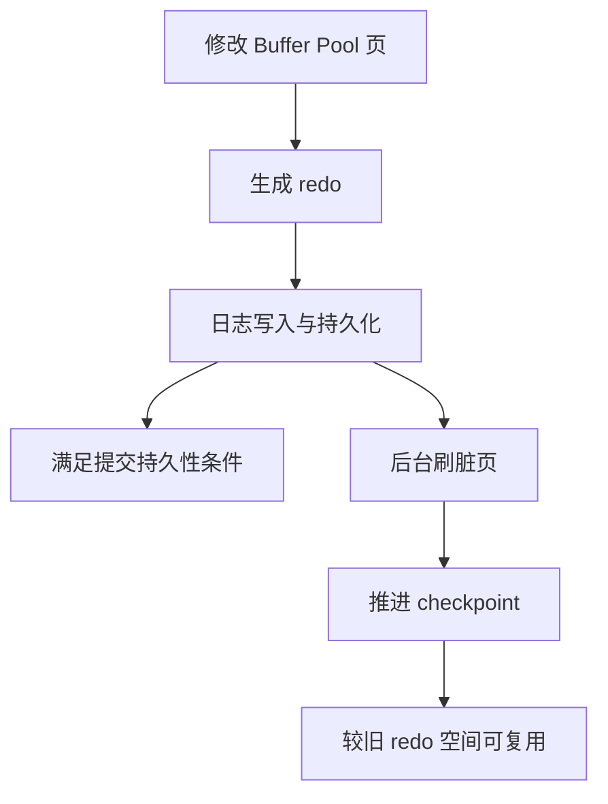

# MySQL：从查询与事务原理到项目中的并发、性能和恢复

> 本文以 **MySQL 8.4、InnoDB、单主写入**为讨论基线。涉及 8.0 的差异单独说明；MariaDB、云数据库的兼容实现、其他存储引擎不能直接套用全部结论。核查日期：2026-10-27。
>
> 项目案例沿用 [[Mybatis]] 的患者画像、医生任务和 Outbox 场景，是用于解释设计的教学模型，不代表这些表与方案已经在生产落地。文中的性能数字、事务编号和执行计划片段凡未注明实测，均为说明机制的假设。

学习 MySQL，核心是建立几条能互相解释的因果链：**SQL 怎样找到数据，读取哪个版本，修改时锁住什么，提交后靠什么恢复，以及这些机制怎样承接业务不变量。**

例如，“患者画像更新成功但页面还是旧值”至少有五种可能：应用缓存、RR 的旧快照、读到了延迟副本、并发覆盖、请求实际未提交。只背“加索引”“加事务”“换成 RC”，无法区分它们。

## 阅读路线

| 要解决的问题 | 阅读入口 |
| --- | --- |
| 从整体理解数据库 | [[#1. 先划清数据库与应用的职责]] → [[#2. 一条 SQL 怎样进入 InnoDB]] |
| SQL 为什么慢 | [[#3. 页、B+Tree 与数据布局]] → [[#4. 索引怎样缩小工作量]] → [[#5. 优化器与执行计划]] |
| 数据为什么不符合预期 | [[#6. SQL 语义与表结构中的隐藏坑点]] → [[#8. MVCC 如何决定可见性]] |
| 并发写、锁等待和死锁 | [[#9. 隔离级别与业务一致性]] → [[#10. 锁究竟锁住什么]] → [[#11. 死锁、超时和重试]] |
| 项目实现 | [[#13. 患者画像：CAS 与条件更新]]、[[#14. 医生任务：确认、Outbox 与租约]]、[[#15. 患者列表：分页、计数与导出]] |
| 线上变更与故障恢复 | [[#16. 大批量操作与在线 DDL]] → [[#17. 复制、读写分离与故障切换]] → [[#18. 备份与时间点恢复]] |
| 动手验证 | [[#19. 双会话实验：用结果验证机制]] |
| 故障排查与继续学习 | [[#20. 从现象到证据的排查路径]]、[[#21. 官方资料与关联笔记]] |

# 1. 先划清数据库与应用的职责

## 1.1 MySQL、InnoDB、JDBC 与 MyBatis 分别负责什么

| 层次 | 主要职责 | 不会自动替你保证的事情 |
| --- | --- | --- |
| MyBatis / MyBatis-Plus | 生成或选择 SQL、绑定参数、映射结果 | 跨语句业务原子性、正确的更新条件、数据库隔离 |
| JDBC / 连接池 | 连接、协议、参数传输、事务接口 | 请求幂等、租户授权、超时后的提交结果判断 |
| MySQL Server | 连接认证、语法解析、优化、执行协调、binlog | 业务状态迁移是否符合领域规则 |
| InnoDB | 索引、页、MVCC、锁、undo、redo、崩溃恢复 | 外部 HTTP/MQ 的原子提交、跨库业务约束 |
| 应用服务 | 授权、事务范围、状态机、重试、幂等与补偿 | 磁盘可靠性、复制拓扑正确性 |

`@Transactional` 是否通过代理生效，是 Spring 的问题；多个 Mapper 是否绑定同一连接，是事务集成的问题；SQL 有没有带 `version`，是并发协议的问题；数据库怎样让两个 UPDATE 排队，是 InnoDB 的问题。排障时先确认问题落在哪一层。

## 1.2 ACID 必须落到具体保证

- **原子性**：同一个数据库事务内，对事务表的修改一起提交或回滚。一个本地事务无法撤销已经发出的短信。
- **一致性**：唯一键、外键、CHECK 与事务能维护已表达出来的约束；“每天至少一位医生值班”需要额外设计，数据库不会理解自然语言规则。
- **隔离性**：隔离级别定义并发观察与执行的边界，不同读写方式仍有不同语义。
- **持久性**：提交后的恢复能力依赖日志持久化设置、存储兑现刷盘承诺，以及故障范围。单机提交不能保证整块磁盘损毁后数据仍存在。

“事务保证一致性”这句话只有在**约束表达正确、所有写入口遵守协议、事务范围完整、失败路径处理正确**时才有工程意义。

## 1.3 存储引擎不能只按读写比例选择

本文所有事务与行锁机制针对 InnoDB。MyISAM 缺少 InnoDB 这样的事务和崩溃恢复能力，不能因为“读多”就直接作为业务表替代方案。读多场景仍可能依赖一致性快照、在线写入和故障恢复。

表级锁与行级锁也不是性能排名：真正决定吞吐的是访问范围、持锁时间、热点程度、缓存和 I/O。一个长期持有的热点行锁，足以堵住整个业务入口。

# 2. 一条 SQL 怎样进入 InnoDB

## 2.1 查询的执行路径


以查询患者画像为例：

```sql
SELECT id, remark, version
FROM patient_profile
WHERE hospital_id = 7 AND patient_id = 1001;
```

Server 先确认表、列、权限与表达式类型，再比较可用访问路径。若使用 `(hospital_id, patient_id)` 唯一索引，InnoDB 定位二级索引项，取得主键，再访问聚簇记录；随后按当前读方式检查版本可见性，必要时通过 undo 重建旧版本。

这不是“先把整张表读进内存再执行 WHERE”。执行器与引擎会围绕选定计划逐步工作；过滤可能在索引、引擎或 Server 层完成。

## 2.2 逻辑执行顺序与物理执行顺序

理解 SQL 语义时可以按 `FROM/JOIN → WHERE → GROUP BY → HAVING → SELECT → ORDER BY → LIMIT` 推导。物理执行时，优化器可以在不改变语义的前提下重排内连接、下推谓词、采用半连接或提前停止扫描。

因此，SQL 中先写哪张表、先写哪个 AND 条件，不等于实际先访问它。外连接、聚合、LIMIT 等结构会限制某些重写，不能把所有子查询都简单展开成 JOIN。

## 2.3 一次请求慢，不一定是 SQL 算得慢

一次接口耗时可以分成：

```text
等待连接 + 网络往返 + 元数据/数据锁等待 + 执行与 I/O
+ 结果传输 + 驱动取数 + 对象构造 + 业务处理
```

同一条 SQL 在控制台很快、接口里很慢，要比较真实参数、会话设置、事务状态、返回行数与读写路由。框架日志打印的 SQL 耗时，也未必包含完整结果消费。

MySQL 8.0/8.4 已没有旧的 Query Cache。Buffer Pool 缓存的是页，应用缓存与 MyBatis 缓存缓存的是另一层结果；不要把它们混成一个“数据库缓存”。

## 2.4 连接是有状态的

`autocommit`、隔离级别、时区、`sql_mode`、临时表和会话变量都属于连接状态。连接池复用物理连接时，必须明确哪些状态由框架恢复，哪些需要应用自行管理。

排查前可记录当前连接环境：

```sql
SELECT VERSION(), CONNECTION_ID(), DATABASE(),
       @@session.autocommit,
       @@session.transaction_isolation,
       @@session.time_zone,
       @@session.sql_mode;
```

不要根据配置文件里一个默认值，推断所有已创建连接都使用相同设置。

# 3. 页、B+Tree 与数据布局

## 3.1 数据库为什么按页工作

InnoDB 以页为主要缓存与 I/O 管理单位，默认页大小通常为 16 KiB，实际以实例的 `innodb_page_size` 为准。页除了记录，还有页头、目录和管理信息，因此不能简单用“16 KiB / 行长度”计算准确容量。

访问一行时，通常需要访问包含它的页。热点行相邻、索引紧凑，能够提高一个页被加载后的利用率；宽行、大字段与分散回表，则会扩大工作集。

## 3.2 聚簇索引不是“额外复制一份完整表”

InnoDB 的聚簇索引叶子保存行记录。优先使用显式主键；没有主键时，会选择符合条件的非空唯一索引，否则生成内部隐藏行标识组织聚簇索引。

下面只是有序索引的结构示意，分隔键不表示另一份业务行：

```text
                        分隔键 30
                       /        \
              叶页 [10,20] <--> 叶页 [30,40,50]
                 行记录              行记录
```

等值查找沿根到叶定位；范围查询定位起点后沿叶子页继续访问。实际实现还包含页内目录查找、并发控制、页分裂与合并。

“叶子包含整行”是逻辑描述：长变长字段可能部分或全部存到页外，行内保存引用，具体受行格式与大小约束。读出大 TEXT/JSON 可能产生额外页访问。

## 3.3 二级索引为什么需要回表

例如索引 `(hospital_id, patient_id)` 的记录包含这些键以及定位行所需的主键。查询 `remark` 时，若索引没有这个字段，就要凭主键查聚簇索引。

```text
二级索引：(7, 1001, 主键9001)
                       ↓
聚簇索引：9001 → remark、version、created_at 等
```

主键越宽，许多二级索引也会越宽；单页容纳项减少，缓存占用和维护成本随之上升。这是主键设计影响整张表的原因。[官方：聚簇索引与二级索引](https://dev.mysql.com/doc/refman/8.4/en/innodb-index-types.html)

## 3.4 B+Tree 高度不等于磁盘读取次数

根页与上层页经常在 Buffer Pool 中；叶子页也可能命中缓存。三层树不意味着每次查找都有三次物理磁盘 I/O。反过来，一次范围查询即使树很浅，也可能扫过数万叶页并产生大量回表。

优化时关注扫描页数、索引项数、回表量、结果大小与缓存命中，不能仅凭树高判断性能。

## 3.5 主键设计的四个维度

| 维度 | 影响 | 选择时的问题 |
| --- | --- | --- |
| 宽度 | 聚簇树和二级索引大小 | 是否真需要长字符串作为聚簇键 |
| 稳定性 | 修改主键涉及多处索引维护 | 业务编码是否会变 |
| 插入分布 | 页局部性、分裂、热点 | 随机写成本和右端热点哪个更突出 |
| 唯一性范围 | 单库、分片、多活 | ID 由谁生成，冲突如何防止 |

自增或趋势递增 ID 通常有较好的插入局部性，但仍会分配新页，也可能存在右端页竞争；不能承诺“不会分裂”。随机 UUID 的成本既来自分布，也来自宽度。`BINARY(16)` 能降低相对字符串的存储开销，却不会消除随机分布。

业务标识可以与聚簇主键分离：内部使用紧凑 ID，外部标识建立唯一键。不可猜测的 ID 不替代授权。

**自增值不是提交序号。** 事务可以先取得小 ID，晚于另一个大 ID 的事务提交；回滚、失败和并发还会产生空洞。这个边界会直接影响增量导出，见第 15 章。

# 4. 索引怎样缩小工作量

## 4.1 把“用了索引”拆成四个问题

1. 能否利用索引键构造较小的搜索区间？
2. 能否在索引项上过滤，减少回表？
3. 能否直接从索引得到所需列？
4. 能否利用索引顺序，减少排序或提前停止？

一个字段没有参与区间定位，仍可能参与索引条件下推或覆盖读取。全索引扫描也是“用了索引”，但可能依旧扫描全表规模的数据。

## 4.2 联合索引是按元组排序

以 `(hospital_id, deleted, created_at, id)` 为例，排序先比较医院，再比较删除状态，然后比较时间，最后比较 ID。

```sql
SELECT id, created_at
FROM patient_profile
WHERE hospital_id = 7 AND deleted = 0
  AND created_at >= '2026-10-01 00:00:00'
ORDER BY created_at, id
LIMIT 20;
```

前两列等值约束把范围缩到一个连续区域，时间再限定起点，ID 让同一时间的顺序确定。这种索引同时服务租户过滤、时间范围和翻页。

如果只按 `patient_id` 查，不能依靠该索引进行普通的左前缀定位。优化器仍可能选择全索引扫描，或在满足限制时使用 skip scan；这不等于该索引适合这类查询。[官方：范围访问与 skip scan](https://dev.mysql.com/doc/refman/8.4/en/range-optimization.html)

## 4.3 “范围之后全失效”为什么不准确

对 `(a,b,c)`，查询 `a = 1 AND b > 10 AND c = 3`：`a,b` 通常用于建立主要扫描范围，`c` 仍可能从索引项中检查。是否以及怎样进一步收紧边界，受具体比较符、元组区间构造和优化器实现影响。

不能从 `key_len` 一个字段推断所有后续列都没有价值。应同时观察范围、附加条件、`Using index condition`、返回列和排序算子。

## 4.4 ICP 与覆盖索引解决不同问题

- **ICP**：扫描二级索引时，先用索引中已有字段判断一部分条件，通过后再访问完整行。
- **覆盖索引**：查询所需字段都在索引中，具备避免为了取列而回表的条件。

例如索引 `(hospital_id, created_at, status)`，查询固定医院、时间范围、特定状态，同时取大字段详情。`status` 即使未成为主要范围边界，也可能通过 ICP 减少详情读取。[官方：索引条件下推](https://dev.mysql.com/doc/refman/8.4/en/index-condition-pushdown-optimization.html)

但“覆盖”不保证底层永远不访问聚簇记录。二级索引上的 MVCC 可见性判断，在某些并发修改或删除标记情况下仍需要访问聚簇记录、检查旧版本。不要把 `Using index` 当作物理 I/O 为零的证明。

## 4.5 替换常见的索引口诀

| 常见说法 | 更准确的判断 |
| --- | --- |
| OR 一定让索引失效 | 可能使用范围合并、Index Merge，也可能全扫；取决于分支、索引与代价 |
| NULL 不进索引 | 普通 InnoDB B-tree 索引可以包含 NULL；`IS NULL` 有机会利用索引 |
| `!=`、`NOT IN` 一定全扫 | 可能形成范围，但选择性差时扫描成本仍高 |
| 函数一定不能用索引 | 普通列索引通常不能直接定位变换后的值；匹配的函数索引/生成列索引是另一条路径 |
| 字段类型不一致都不能用索引 | 必须看转换方向、比较规则和实际计划 |
| 索引列区分度低就没用 | 作为联合索引前缀、状态过滤或排序的一部分可能很有价值 |
| `Using filesort` 就是磁盘排序 | 它表示不能直接按所需索引顺序输出；排序可能在内存完成 |

例如字符串患者编码与数字比较，可能把多个不同字符串转换为同一个数值，既改变结果也破坏直接定位条件。整数列与可转换的字符串常量比较，不应直接判定索引失效。正确做法是统一列类型、绑定参数类型和业务语义。[官方：类型转换](https://dev.mysql.com/doc/refman/8.4/en/type-conversion.html)

时间条件优先用半开区间，避免精度尾界问题：

```sql
WHERE created_at >= '2026-10-01 00:00:00'
  AND created_at <  '2026-11-01 00:00:00'
```

它比 `DATE(created_at) = ...` 更容易复用原列索引，也不会遗漏带小数秒的最后一刻。

## 4.6 索引有读收益，也有写成本

一次 INSERT 可能维护聚簇索引和多个二级索引；修改索引列会改变旧键与新键的记录关系；DELETE 还涉及删除标记和后续清理。索引越多，写入、日志、缓存和 DDL 成本通常越高。

索引设计应从查询集合出发：列出过滤、排序、投影、频率、返回量和延迟目标，再评估复用。不要给每个 WHERE 列单独建索引，也不要给大文本随意加到覆盖索引里。

前缀索引只能保存字符串前缀，不能当然地覆盖完整字符串或代表完整值的唯一性语义。全文检索、空间索引也不是普通 B-tree 的替换写法。

# 5. 优化器与执行计划

## 5.1 优化器比较的是估算代价

优化器依据统计信息、选择性估计和成本模型，选择访问路径、连接顺序与算子。它不会先完整执行所有方案再挑最快的。

统计可能过时；某个医院的数据可能占全表一半；`status` 与 `hospital_id` 可能高度相关。平均分布下合理的估计，在倾斜参数上可能偏差很大。

“建立了更合适的索引”与“每种参数都会使用它”不是同一个承诺。更新统计、调整 SQL 或使用提示，都应建立在计划与实测证据上。

## 5.2 先估算，再在受控环境测量

```sql
EXPLAIN FORMAT=TREE
SELECT id, created_at
FROM patient_profile
WHERE hospital_id = 7 AND deleted = 0
ORDER BY created_at, id
LIMIT 20;
```

普通 EXPLAIN 主要解释计划，但仍需要解析和元数据访问。`EXPLAIN ANALYZE` **会真正执行支持的语句**，会产生负载，若包含锁定读或支持的 DML 还会有相应副作用。它不能当作对任意生产 SQL 都安全的“只看一眼”。

观察顺序是：结果是否正确 → 哪个算子处理数据最多 → 估算与实际差多少 → 时间花在何处 → 能否减少上游工作量。

## 5.3 怎样读实际执行信息

假设某个节点输出：

```text
(actual time=0.020..0.120 rows=5 loops=1000)
```

时间单位为毫秒；多次循环时显示平均每次循环的耗时，`rows` 也应结合循环次数理解。内层平均只返回 5 行，乘上外层 1000 次循环，累计工作量仍然可观。

节点时间包含子节点贡献，不能把所有节点时间直接相加当作 SQL 总耗时。首行时间与全部行时间还能帮助区分“启动前要做大量工作”与“持续消费成本高”。[官方：EXPLAIN ANALYZE](https://dev.mysql.com/doc/refman/8.4/en/explain.html)

## 5.4 JOIN 慢在哪里

对一对多关联，先确认结果基数。1000 个患者，每人 20 个标签，展开后是 20000 行；如果再关联多个任务，可能进一步放大。

嵌套循环的内层访问次数由外层结果驱动，内层一次很快不代表整体快。哈希连接、临时表和排序也有内存、溢出与构建成本。“JOIN 一定慢”与“拆成多次查询一定快”都缺少必要前提。

改善通常来自：更早减少候选集合、让连接键可定位、只取必要列、避免无意的多表乘积。批量拆查还必须考虑多次查询的一致性和网络往返。

## 5.5 一次优化要保留哪些证据

至少保存表结构、索引、数据量与分布、完整参数类型、执行计划、返回行数，以及具有代表性的冷热缓存和并发条件下的延迟。性能测试不能用十几行均匀样本代替千万行倾斜业务表。

`ANALYZE TABLE` 会采集或更新统计并可能改变计划，不应随意在故障高峰反复执行。直方图可以改善某些分布估计，但不会给所有多列相关性提供完美答案。

不可见索引适合观察“优化器不选择该索引”的影响，但索引仍占空间并随写入维护；它不能模拟彻底删除索引后的写入收益。[官方：不可见索引](https://dev.mysql.com/doc/refman/8.4/en/invisible-indexes.html)

# 6. SQL 语义与表结构中的隐藏坑点

## 6.1 NULL 使用三值逻辑

`remark = NULL` 不会像普通等值那样匹配 NULL，应使用 `IS NULL`。普通比较遇到 NULL 通常产生 UNKNOWN；WHERE 仅保留 TRUE。

```sql
SELECT 1 NOT IN (2, NULL);  -- 结果为 NULL，而非 TRUE
SELECT NULL <=> NULL;      -- NULL 安全等值，结果为 1
```

`NOT IN` 子查询若可能返回 NULL，会改变整个排除逻辑；表达“不存在匹配记录”时，可明确使用关联 `NOT EXISTS`，并规定连接键的可空语义。

唯一索引对 NULL 的处理也不同于普通业务直觉：可空唯一列允许多个 NULL。若幂等键必须唯一且必须存在，应同时设置 `NOT NULL`。

## 6.2 COUNT、SUM 与 LEFT JOIN

- `COUNT(*)` 数结果行；`COUNT(column)` 数该列非 NULL 的行。
- 无 GROUP BY 时，空集的 COUNT 为 0，SUM 通常为 NULL；是否用 `COALESCE` 变成 0，要由业务定义决定。
- 一对多 JOIN 后，COUNT 数的是展开行。数患者应避免先展开标签，或明确按患者去重。
- LEFT JOIN 后把右表过滤写进 WHERE，可能排除未匹配的 NULL 行；放进 ON 则仍保留左表行。

InnoDB 不能用一个全局精确行数同时回答所有事务快照的 `COUNT(*)`。无条件精确计数仍有扫描成本；优化器可能选更小的索引，但“COUNT(1) 固定比 COUNT(*) 快”没有普适依据。

## 6.3 分组不是任选一行

`ONLY_FULL_GROUP_BY` 要求非聚合表达式满足分组或可识别的函数依赖等规则。关闭它可能让某些非分组字段取值不确定；`ANY_VALUE()` 表示接受任意值，不会自动选最新一条。

若需要每个患者的最新任务，应定义排序和并列规则，例如 `ROW_NUMBER() OVER (PARTITION BY patient_id ORDER BY created_at DESC, id DESC)`，再筛选序号。先确保业务语义，再分析窗口计算的代价。

## 6.4 类型、字符集与比较规则

| 数据 | 设计重点 | 常见误用 |
| --- | --- | --- |
| 金额 | DECIMAL 的精度、标度、舍入规则；Java 使用 BigDecimal | 用 DOUBLE，或忽略乘除后的舍入 |
| 技术 ID | 容量规划与语言映射 | BIGINT UNSIGNED 超出 Java Long 正范围 |
| 业务编码、手机号 | 保留前导零、格式与精确比较规则 | 因为都是数字字符就用整数 |
| 姓名和文本 | utf8mb4、长度与排序规则 | 把字符数等同字节数 |
| 状态 | 明确值域、迁移规则和兼容策略 | 仅凭 tinyint 就认为状态合法 |
| JSON | 结构演进、路径类型、热点字段提取 | 把所有查询字段放进 JSON 后期待普通索引自动生效 |

`VARCHAR(n)` 的 n 是字符数，存储与索引限制还涉及字节数。排序规则可能忽略大小写、重音或按特定方式处理尾空格；它也参与唯一性判断。请求幂等键是否区分大小写，应显式规定，不能依赖服务器默认 collation。

严格模式有助于发现写入错误，但转换函数不是输入验证器；字符串到数字的某些查询转换可能给出警告和转换结果。应用仍应校验格式、范围和单位。

## 6.5 时间类型先确定语义

- `DATE`：日历日期，例如出生日期。
- `DATETIME(6)`：不自带时区的日期时间字段；团队可约定保存 UTC，也可表达某个地点的本地日历时间。
- `TIMESTAMP(6)`：按会话时区进行输入输出转换，范围要评估 2038 年上限。

“业务字段都用 DATETIME、审计字段都用 TIMESTAMP”不是可靠分类。支付发生时刻、跨地区事件日志属于绝对时刻；未来本地预约还涉及地区时区和夏令时规则。必要时保存地区时区标识，而不是只存一个偏移量。

DATETIME 不做数据库会话时区转换，不代表 JDBC、JVM、JSON 序列化和前端不会转换。应把输入、存储、传输、展示各层的约定写清。DATETIME 和 TIMESTAMP 都可显式配置当前时间默认值；自动更新时间不是 TIMESTAMP 独有能力。[官方：日期时间类型](https://dev.mysql.com/doc/refman/8.4/en/datetime.html)

## 6.6 范式、快照与冗余

范式用于减少由函数依赖导致的更新异常。第二范式、第三范式的严谨定义围绕候选键与依赖，不能仅记成“有没有联合主键”。

患者当前手机号属于主数据；一次消息发送时使用的手机号可能属于事件历史。订单成交单价、签署时姓名、开具时机构信息也可能是不可回写的历史事实，不应因“减少重复”而全部改成关联当前主数据。

区分三类字段：权威当前值、不可变历史快照、可重建的查询冗余。最后一类才需要特别明确同步、重建与延迟容忍策略。

## 6.7 约束应该承担最后一道防线

唯一键负责并发下的唯一性，CHECK 负责能够在单行表达的条件，外键负责定义好的引用约束。应用层“先查不存在再插入”不能替代唯一键。

外键是否级联取决于声明的动作，不是建立外键就自动删除子记录。约束检查也可能产生锁；跨库分片后，本地外键无法表达完整跨分片关系。

逻辑删除也不会释放唯一键。`(hospital_id, patient_id, deleted)` 只有两个 deleted 状态，不能支持任意次数“新增、删除、再新增”的历史。应选择恢复原身份、单独历史表，或根据业务定义设计有效记录唯一性，不能靠加一个布尔列掩盖身份模型。

# 7. 写入、提交与崩溃恢复

## 7.1 一次 UPDATE 会改变哪些东西

```sql
UPDATE patient_profile
SET remark = '已核实', version = version + 1,
    updated_at = CURRENT_TIMESTAMP(6)
WHERE id = 9001 AND hospital_id = 7 AND version = 4;
```

概念路径是：定位记录 → 检查并申请相关锁 → 在可修改版本上判断条件 → 生成撤销信息 → 修改内存页及相关索引 → 记录重做信息 → 提交协调。

这些步骤在底层以页操作和内部小事务等机制组织，不应理解成每一步只有一次磁盘写入。SQL 执行完成，也不代表包裹它的事务已经提交。

## 7.2 undo、redo 与 binlog 各自保存什么

| 机制 | 核心用途 | 不能替代什么 |
| --- | --- | --- |
| undo | 撤销修改、重建历史版本 | 长期历史审计、独立备份 |
| redo | 重做页级修改，支持崩溃恢复 | 按业务请求回滚、跨版本逻辑迁移 |
| binlog | 记录可复制的变更事件，用于复制和增量恢复 | Buffer Pool 脏页的本地恢复协议 |

undo 不是每次都存一份完整旧行，也不是反向 SQL 文本；记录包含执行撤销或重建所需的信息。更新产生的历史信息在事务提交后，可能继续为旧快照服务。持久表 undo 页的修改本身也需要 redo 保护。

redo 不只记录已提交事务。未提交修改也可能已经产生 redo，甚至其脏页已被刷入数据文件。崩溃恢复需要重做必要修改，再处理未完成事务，而不是“只重放已提交事务的 SQL”。

## 7.3 WAL 与 checkpoint

WAL 的关键约束是：数据页落盘前，与其修改对应的必要 redo 必须先满足持久化要求。事务提交时可以持久化日志，而不必立即把该事务触及的所有数据页刷完。



redo 的旧空间不能无条件覆盖。如果脏页刷得太慢、checkpoint 无法推进，写入会受压。扩大 redo 容量能提供更多缓冲，但不能解决长期写入速度超过存储处理能力的问题。

## 7.4 binlog 与 InnoDB 为什么需要协调

在启用 binlog 的常见事务路径中，引擎准备、binlog 记录与持久化、引擎提交需要协调，防止本机恢复结果与复制历史分歧。

概念化地看，内部事务处于 prepared 状态而进程崩溃时，恢复会结合有效 binlog 中的事务标识决定提交或回滚。完整协议还涉及组提交、日志有效边界与持久化顺序，不能把它理解为原地把一条 redo 文本从 `prepare` 改成 `commit`。[官方：binlog 与提交协调](https://dev.mysql.com/doc/refman/8.4/en/binary-log.html)

| 观察到的阶段 | 对应用的含义 |
| --- | --- |
| SQL 已执行、事务未提交 | 其他事务不一定可见，仍可回滚 |
| 事务已提交、响应尚未到达客户端 | 数据可能已永久生效，客户端仍可能报超时 |
| 客户端收到提交成功 | 在配置与存储保证范围内承诺持久性；副本不一定已应用 |

这里的协调是数据库内部提交协议。它不会让外部 MQ 自动参与本地事务。

## 7.5 “双一”配置的保证边界

常见的强持久化组合是 `innodb_flush_log_at_trx_commit=1` 与 `sync_binlog=1`。组提交可以合并多个事务的同步成本，不能机械理解成每个请求独占两次 fsync。

调低刷盘强度会改变不同故障下的数据丢失窗口；“最多丢一秒”不是脱离调度、操作系统和存储行为的绝对上限。即使采用强持久化配置，存储不兑现刷盘、整机磁盘永久损毁、错误故障切换仍是其他层次的问题。

## 7.6 doublewrite 为什么仍然需要

页写入可能被中断，形成新旧内容混杂的 torn page。doublewrite 在写最终数据页前保留可恢复的页副本，为恢复提供完整页基础；redo 再解决相应修改的重做。

doublewrite 不是 redo 的第二份备份，也不意味着每个事务都同步写两遍整张表。8.4 使用 doublewrite 文件；历史版本的布局不要直接套用。关闭前必须确认存储的原子写保证以及具体配置，不能只凭“用了 SSD”。[官方：doublewrite](https://dev.mysql.com/doc/refman/8.4/en/innodb-doublewrite-buffer.html)

## 7.7 提交结果未知要靠业务协议解决

客户端在 COMMIT 后断线，不知道事务是未提交、已提交还是响应丢失。直接重新执行扣减或发送操作可能重复生效。

应使用稳定请求 ID、业务唯一约束和可查询的处理结果。相同 ID 的重试还必须校验请求内容一致。数据库能维护一个事务的原子性；网络上的调用方需要额外协议，才能把“不知道结果”收敛成明确结果。

# 8. MVCC 如何决定可见性

## 8.1 可见性不是“只看最新已提交值”

InnoDB 在聚簇记录中维护修改事务信息和回滚指针。更新形成可以通过 undo 重建的版本关系。一致性读使用 Read View 判断版本是否可见，不可见时继续向旧版本追溯。

假设某行经历：

```text
当前：remark=C，由事务 120 修改
旧版：remark=B，由事务 110 修改
旧版：remark=A，由事务 90 修改
```

读到哪一个，不只由事务号大小决定，还取决于 Read View 创建时哪些事务仍活跃、哪些修改已经提交，以及是不是本事务自己的修改。

## 8.2 用活跃集合解释 Read View

为了讲清规则，用教学符号表示一个 Read View：

- `creator`：当前事务身份。
- `active`：创建视图时仍活跃的相关读写事务 ID 集合。
- `low`：活跃集合中的最小 ID；集合为空时按边界处理。
- `high`：创建视图时尚未分配出去的事务 ID 边界。

概念判断顺序是：自己的修改可见；比 low 更老的已完成版本可见；不小于 high 的版本不可见；落在中间的 ID，则通过是否在 active 中判断。这里使用教学名称，避免把源码里容易混淆的边界字段名当作语义记忆。

例如 `active={100,110}`、`high=120`：事务 90 的已提交版本可见，事务 110 的版本不可见，之后才产生的 120 也不可见。事务 110 即使随后提交，对这个旧视图而言仍不能突然变成可见。

事务 ID 按分配推进，不代表提交顺序；只读事务也不必都有与写事务相同的事务 ID 分配行为。

## 8.3 RC 与 RR 的快照时机

在 RC 下，每次一致性读建立新的快照；在 RR 下，同一事务的普通一致性读通常复用首次一致性读建立的快照。单独执行 `BEGIN` 并不意味着已经固定快照。

`START TRANSACTION WITH CONSISTENT SNAPSHOT` 可在适用隔离级别下显式建立一致性快照；不能假定它让 RC 变成 RR。自己的写仍然对自己可见。[官方：一致性读](https://dev.mysql.com/doc/refman/8.4/en/innodb-consistent-read.html)

## 8.4 当前读不是“刷新 Read View”

`SELECT ... FOR UPDATE`、`FOR SHARE` 与 UPDATE/DELETE 的并发处理，不能按普通 SELECT 的旧快照理解。它们为了锁定或修改当前可处理记录，可能等待其他事务释放冲突锁。

RR 中先普通 SELECT 读旧版本，再 FOR UPDATE 看到已提交新值，随后普通 SELECT 仍可能按原视图读取旧版本。加一次 FOR UPDATE 不会自动把整个事务的历史视图更新。

如果本事务修改了某些行，再做一致性读，可能同时看到自己的新版本与其他行的旧版本。这种组合不一定对应数据库曾经真实存在过的某个全局时刻。

## 8.5 MVCC 与业务 version 不是同一个东西

| 机制 | 谁维护 | 解决什么问题 |
| --- | --- | --- |
| InnoDB 版本信息与 undo | 数据库 | 事务可见性、回滚与历史版本重建 |
| `version bigint` 业务列 | 应用协议与 SQL | 拒绝基于旧业务对象的覆盖写 |

两个请求先后读取版本 4，再分别无条件覆盖 remark，即使 UPDATE 本身串行加锁，后写者仍可能覆盖前写者。MVCC 不知道两次操作是否有业务冲突。应用必须把预期版本放进 WHERE，才能让数据库识别这个条件。

## 8.6 长快照为什么影响别人的写后清理

已有一致性视图可能继续需要旧版本，purge 不能过早删除它们。一个几乎不消耗 CPU 的长时间只读事务，也可能拖住历史清理。

但不能反过来说所有执行过 BEGIN 的空闲连接都已经固定了快照。要区分事务持续时间、是否建立读视图、是否持有数据锁和 MDL，以及修改量。

历史链长度、history list length、undo 文件大小是不同指标，不能一比一换算。清理完成也不必立即把文件空间归还操作系统。

# 9. 隔离级别与业务一致性

## 9.1 四个级别真正改变什么

| 级别 | 普通读的主要特点 | 需要注意 |
| --- | --- | --- |
| READ UNCOMMITTED | 可能读取未提交修改 | 不能当成普通 RC 快照读解释 |
| READ COMMITTED | 每次一致性读使用新快照 | 同一事务两次查询结果可能变化 |
| REPEATABLE READ | 一致性读通常复用事务内快照 | 当前读和自己的写不服从“所有读永远相同” |
| SERIALIZABLE | 对普通读施加更强串行化约束 | 是否转为锁定读还与 autocommit/事务上下文有关 |

在 SERIALIZABLE 且 autocommit 关闭等条件下，普通 SELECT 会被隐式按共享锁定读处理；autocommit 开启的单语句只读事务存在不同处理。不能把它概括成“任何 SELECT 都锁全表”。[官方：隔离级别](https://dev.mysql.com/doc/refman/8.4/en/innodb-transaction-isolation-levels.html)

隔离级别还影响锁释放和 gap locking 等细节。切换前应验证业务不变量，而不是只比较吞吐。

## 9.2 幻读要说明是哪一种读

RR 的普通一致性读通过快照避免后续插入改变同一快照的查询结果。锁定范围读则可能依靠 next-key/gap locking，阻止其他事务往被保护的范围插入。

两者分别是“新行存在但对我不可见”和“新行暂时不能插入”。混合普通读、当前读与本事务写入后，观察结果不能再用一句“RR 没有幻读”解释。

## 9.3 隔离级别不会替你表达跨行不变量

假设两名医生 A、B 都在值班，规则是至少一人留守。两个事务分别读到有两人在岗，然后分别把自己设为离岗。它们更新不同记录，单行 X 锁未必冲突，最终可能无人值班。

这是跨行判断与修改缺少共同串行化点。可以采用：锁定同一条排班汇总记录后检查并修改；对完整业务集合使用经过验证的锁定协议；或使用适合的可串行化设计并处理重试。

关键是所有写入口都遵守同一个协议。某个后台脚本绕开汇总锁，无论主流程写得多严谨都可能破坏规则。

## 9.4 检查与执行应尽量在同一原子操作里

如果规则能表达成单行条件，优先放进 UPDATE：

```sql
UPDATE inventory
SET available = available - 1
WHERE id = ? AND available >= 1;
```

然后检查影响行数。`inventory` 是通用示意表，`?` 表示 JDBC 绑定参数，不能直接粘贴到交互终端执行。

多行转账则需要完整本地事务，并以统一顺序访问账户；只把两个 UPDATE 各自做成原子操作不等于转账整体原子。

# 10. 锁究竟锁住什么

## 10.1 先把不同层的锁分开

| 机制 | 保护对象 | 典型现象 |
| --- | --- | --- |
| 记录锁 | 索引记录 | 同一记录的冲突读写等待 |
| 间隙锁 | 索引记录之间的空隙 | 看似没有那一行，INSERT 仍被挡住 |
| next-key lock | 记录及其前方间隙 | RR 范围锁定读限制插入 |
| 意向锁 IS/IX | 表级的行锁意图 | 多个事务的 IX 可以兼容，不代表独占整表 |
| MDL | 表等对象的元数据 | ALTER 等待未结束事务，后续访问也可能排队 |
| latch / mutex | 内部页、内存结构等短期保护 | 内部竞争；不同于事务持有到结束的行锁 |

InnoDB 的“行锁”落实在索引记录上。通过二级索引定位时，锁可能涉及二级索引与聚簇索引两边。没有显式主键也不意味着没有聚簇索引。

## 10.2 S、X 与意向锁

对同一记录，S 与 S 可兼容，X 与其他事务的 S/X 冲突。表级 IS/IX 用于协调多粒度加锁，避免判断表锁冲突时逐行检查。

看到 `TABLE IX` 不能断言“UPDATE 锁表了”。大范围扫描可能持有很多记录锁，阻塞效果近似全表，但这与自动升级成表级 X 锁是不同机制。[官方：InnoDB 锁](https://dev.mysql.com/doc/refman/8.4/en/innodb-locking.html)

## 10.3 唯一等值命中与未命中

RR 下，完整唯一键等值命中已有记录，通常可以只锁对应记录，不必锁前方间隙。但必须是真正的完整唯一查找；只用联合唯一键的一部分不满足这个前提。

如果唯一查找未命中，就不存在可以锁住的目标记录，可能保护其应插入的间隙。两个事务各自“查不到再插入”仍可能相互等待或死锁；唯一约束与失败重试不可省略。

## 10.4 用有序键理解间隙

现有主键为 `10、20、30`，可把相关区域表示为：

```text
(-∞,10)  10  (10,20)  20  (20,30)  30  (30,+∞)
```

next-key 区间常用 `(前一个键, 当前键]` 表示。真实扫描边界还受比较符、唯一性、访问路径、是否需扫描到边界记录等因素影响。

间隙锁主要抑制向间隙插入；不同事务的某些间隙锁可以共存，因此不能直接套用记录 S/X 冲突矩阵。插入意向锁也不是表级 IX，它描述插入者准备在某个间隙插入的意图。

不要仅根据 WHERE 的文字范围，画出“数据库一定只锁这些值”的结论。先看实际索引，再用 `performance_schema.data_locks` 和并发插入验证边界。

## 10.5 RC 降低 gap locking，不等于没有间隙锁或死锁

RC 的普通搜索与扫描通常减少间隙锁使用，但外键检查、重复键检查等仍有例外。冲突记录写仍需排队，反向锁顺序仍会死锁。

UPDATE 在某些 RC 场景会使用半一致性读协助判断候选记录；这个优化不意味着它能随意覆盖另一事务未提交的值。

## 10.6 锁范围取决于访问路径

即使业务上只想改一个患者，如果条件没有合适索引，数据库仍可能扫描和锁定大量记录。索引既影响速度，也可能影响并发冲突范围。

判断一条语句的锁，按顺序确认：事务与隔离级别 → 普通读还是锁定读/DML → 实际索引 → 唯一等值还是范围 → 命中与边界 → 其他约束检查。最后观察锁记录和等待关系，而不是从“影响 1 行”反推“只锁 1 行”。

## 10.7 MDL 是另一条等待链

事务访问表后持有的元数据锁，可能直到事务结束才释放。一个执行完 SELECT 后处于 Sleep 的连接，仍可能让 ALTER 等待。

等待中的排他 MDL 请求又可能让后来访问排队，出现“一个 ALTER 卡住，全业务突然慢”的放大效应。`innodb_lock_wait_timeout` 主要面向 InnoDB 行锁等待，不是所有 MDL 等待的统一超时；还要理解 `lock_wait_timeout` 等配置。

# 11. 死锁、超时和重试

## 11.1 死锁必须存在等待环

```text
事务 A：持有记录 10，等待记录 20
事务 B：持有记录 20，等待记录 10
```

同一页上的两行不天然互斥；页分裂也不能直接解释成业务事务死锁。应从死锁报告确认具体索引、锁模式、已持有资源与请求资源。

INSERT 也会因唯一键检查、多个索引、插入位置或与其他 DML 的组合发生死锁。“只插入不更新”并不自动安全。

## 11.2 1213 与 1205 不能按同一种事务状态处理

| 结果 | 典型数据库行为 | 应用处理重点 |
| --- | --- | --- |
| 死锁 1213 | 回滚被选中的整个事务 | 重新开始完整业务事务，受控重试 |
| 锁等待超时 1205 | 默认通常只回滚当前语句 | 不要继续把前面已成功语句提交；明确回滚业务事务 |
| 唯一键冲突 | 通常当前语句失败 | 分辨哪条约束，不要一概视为重复请求成功 |
| 网络断开或提交超时 | 客户端可能无法确认提交结果 | 通过幂等标识核对结果 |

`innodb_rollback_on_timeout` 会影响超时回滚范围。业务代码最好明确把失败事务结束，再决定重试，不依赖“抛异常就一定整笔已回滚”的假设。[官方：InnoDB 错误处理](https://dev.mysql.com/doc/refman/8.4/en/innodb-error-handling.html)

## 11.3 重试必须包住整个事务边界

```text
在事务外建立有限次数重试：
    每次尝试创建新事务
    重新读取和判断业务前置条件
    执行全部必要数据库修改
    成功则提交并返回
    可重试并发错误则确保回滚，退避后重试
    业务冲突、参数错误、权限错误直接返回相应结果
```

如果在已经标记回滚的 Spring 事务内循环重试 Mapper，后续执行可能仍失败，甚至产生 `UnexpectedRollbackException`。重试拦截器与事务拦截器顺序需要验证。

重试次数、总时间和退避应有边界。对热点无限即时重试会增加竞争。事务外已经发生的副作用不能随整笔重试重复执行，必须通过幂等或 Outbox 等机制处理。

## 11.4 降低死锁的实际手段

统一多行访问顺序、缩小扫描范围、缩短持锁时间，并避免事务中夹入远程调用。若多个表都参与，顺序约定也要覆盖表与索引访问路径。

这些措施降低概率，不是证明永不死锁。数据库并发系统仍需正确处理死锁受害者，不能把偶发 1213 直接当成数据库故障。

# 12. 后台机制与长事务的连锁影响

## 12.1 Buffer Pool 同时承担读缓存和写缓冲

修改在内存页中发生，页面变脏后由后台刷盘。缓存命中很高仍可能写入慢，因为瓶颈在日志同步、热点锁或脏页回收。

一次大扫描会改变缓存工作集，InnoDB 有缓解扫描污染的机制，但不能保证大查询完全不影响热点。监控应看每秒物理读取、等待空闲页、脏页、存储延迟等，而非只看一个命中率百分比。

## 12.2 change buffer 的收益与代价

对满足条件、当前不在 Buffer Pool 中的非唯一二级索引页，change buffering 可以暂存修改并在后续合并，减少立即随机读页的需求。唯一性校验通常需要读取相关页，不能照搬普通索引的优化路径。

成本是后续 merge、额外空间与可能的读取抖动；它不会让索引修改永远消失。含降序列等情况也有适用限制。[官方：change buffer](https://dev.mysql.com/doc/refman/8.4/en/innodb-change-buffer.html)

**版本边界：8.4 的 `innodb_change_buffering` 默认值为 `none`，8.0 的默认值为 `all`。** 因此解释架构时应先确认实例配置，不能把“所有普通二级索引写都会走 change buffer”当成现状。[官方：参数默认值](https://dev.mysql.com/doc/refman/8.4/en/innodb-parameters.html#sysvar_innodb_change_buffering)

## 12.3 purge、脏页刷新与 checkpoint 是不同工作

- purge 清理已不再需要的历史版本与删除标记记录。
- 刷脏把内存中修改过的页写入数据文件。
- checkpoint 反映恢复所需 redo 的推进边界。

它们互相影响，但不能互相替代。长读视图阻止历史清理，不等于所有脏页都不能刷盘。DELETE 已提交，也不意味着文件立即缩小。

## 12.4 长事务至少有三种风险画像

| 类型 | 主要风险 |
| --- | --- |
| 长只读快照 | 保留旧版本、占连接、可能持有 MDL |
| 长持锁事务 | 阻塞业务、形成等待链、耗尽连接池 |
| 大写事务 | undo/redo/binlog 量大、回滚慢、复制应用慢 |

应分别测量“持续时间、修改量、持锁与等待关系”。只按运行时长排序杀连接，可能错过真正阻塞源，也可能终止一个即将完成但回滚极慢的大事务。

`KILL QUERY` 终止语句，不等于总能结束其所属事务；断开连接会涉及事务回滚。回滚不是瞬间释放全部资源的按钮。现场处置先确认事务归属、影响范围和回滚代价。

# 13. 患者画像：CAS 与条件更新

## 13.1 先写业务不变量

AI 归纳与医生手工修改可能竞争同一画像。本文的规则是：医院隔离；同医院同患者身份唯一；删除后恢复原记录；备注修改必须基于已读版本；冲突时不得静默覆盖。

与 [[Mybatis]] 使用相同的基础模型：

```sql
CREATE TABLE patient_profile (
    id BIGINT NOT NULL,
    hospital_id BIGINT NOT NULL,
    patient_id BIGINT NOT NULL,
    remark VARCHAR(1000) NULL,
    version BIGINT NOT NULL DEFAULT 0,
    deleted TINYINT NOT NULL DEFAULT 0,
    created_at DATETIME(6) NOT NULL DEFAULT CURRENT_TIMESTAMP(6),
    updated_at DATETIME(6) NOT NULL DEFAULT CURRENT_TIMESTAMP(6),
    PRIMARY KEY (id),
    UNIQUE KEY uk_profile_patient (hospital_id, patient_id),
    KEY idx_profile_page (hospital_id, deleted, created_at, id)
) ENGINE=InnoDB;
```

时间按统一约定写入；updated_at 由 UPDATE 显式赋值，不因为名字如此就自动更新。此 DDL 是教学模型，不是对现有生产表的迁移指令。

## 13.2 数据库如何执行 CAS

```sql
UPDATE patient_profile
SET remark = ?, version = version + 1,
    updated_at = CURRENT_TIMESTAMP(6)
WHERE id = ? AND hospital_id = ?
  AND deleted = 0 AND version = ?;
```

两个请求都携带 version=4。第一个取得写锁并把版本改为 5，第二个若等待后继续执行，会基于可修改记录重新判断条件，version=4 已不成立，影响行数为 0。

这不是完全不加锁的写入。所谓业务“乐观锁”，是把冲突判断放进条件更新，避免长时间持有跨业务步骤的数据库锁；UPDATE 执行时仍使用 InnoDB 并发控制。

## 13.3 零行不能直接翻译成“版本冲突”

也可能是记录不存在、医院不匹配、已删除或不满足其他业务条件。需要向用户区分时，只能在授权范围内补查；补查本身有新的时间窗口，不能伪装成对原失败时刻的精确快照。

版本成功时必定递增，能够让影响行数判断更稳定。对无版本且可能原值不变的 UPDATE，要注意驱动对“匹配行数”和“实际改变行数”的返回配置。

## 13.4 自动重试可能抹掉用户决策

医生基于旧内容编辑出的备注，并不一定可以在冲突后自动覆盖新内容。可以返回当前版本、展示差异、让用户选择；若操作是可交换的增量，则可设计明确的合并规则。

AI 写回也应区分机器字段与人工确认字段。全实体覆盖会把“没有提供”误当“需要清空”；SQL 并发正确并不能弥补命令语义错误。PATCH 的缺省、置空和赋值设计见 [[Mybatis]]。

## 13.5 原子累加与绝对赋值

“读取计数 10，在 Java 中加 1，再写 11”容易丢失并发更新；`SET counter = counter + 1` 把增量计算放到数据库当前记录上。它仍需考虑重试重复加、溢出、热点竞争和幂等。

CAS、原子累加、悲观锁分别适用于不同业务语义。不能因为一个字段叫 version，就把所有并发操作都统一成盲目重试。

# 14. 医生任务：确认、Outbox 与租约

## 14.1 医生确认与后台执行是两个状态机

沿用 [[Mybatis]] 的语义：`agent_task` 保存医生待办及确认结果，`task_outbox` 保存需要对外发布的事件。医生确认不是后台消费完成。

确认操作在同一个主库事务内完成：

```text
校验可信医院、医生与任务权限
UPDATE agent_task：匹配医院、任务、负责人、PENDING 和预期版本
要求影响 1 行
INSERT task_outbox：稳定 event_id、受控 payload、NEW 状态
提交
```

这里 UPDATE、INSERT 必须使用同一事务连接。事件插入失败必须让前面的状态迁移回滚。外部发送放在事务外，由发布者继续处理。

## 14.2 Outbox 保证的是可重试的发送意图

业务更新与 Outbox 行可以一起提交，避免业务已提交却没有任何发送记录。但发布者可能已发送成功，在标记 SENT 前崩溃；重试会再次发送。

因此需要稳定事件标识、消费者去重，以及“消费去重记录 + 本地业务修改”在同一消费事务内完成。若最终动作是外部医疗系统调用，还要使用对方支持的幂等协议或对账补偿。

不要把 Outbox 写成“消息只会发一次”的保证。

## 14.3 条件抢占与锁定抢占

候选扫描 + 条件 UPDATE 的方式，多个发布者可以看见同一事件，真正的所有权由 UPDATE 影响行数决定。

另一种方式是短事务内使用 `FOR UPDATE SKIP LOCKED`。下面沿用 Outbox 字段；`?` 是绑定参数，完整表定义见 [[Mybatis]]：

```sql
START TRANSACTION;

SELECT event_id
FROM task_outbox
WHERE hospital_id = ? AND status = 'NEW'
  AND next_attempt_at <= CURRENT_TIMESTAMP(6)
ORDER BY next_attempt_at, event_id
LIMIT 20
FOR UPDATE SKIP LOCKED;

-- 对选出的事件逐条执行，或使用有界 ID 集合批量执行。
UPDATE task_outbox
SET status = 'SENDING', lease_token = ?,
    lease_until = TIMESTAMPADD(SECOND, 30, CURRENT_TIMESTAMP(6)),
    attempt_count = attempt_count + 1
WHERE hospital_id = ? AND event_id = ? AND status = 'NEW';

COMMIT;
```

锁定读和标记必须属于同一事务。提交后数据库行锁释放，外部发送由持有租约的工作者进行；不能把网络等待包在抢占事务里。

## 14.4 SKIP LOCKED 的业务代价

它跳过冲突行，返回的是不完整集合。一次返回空，不代表队列为空；它不保证严格 FIFO，也可能让持续竞争的记录饥饿。

它主要避免相关行锁等待，不消除 MDL、I/O 或其他阻塞。适合允许跳过的队列消费，不适合拿来做完整账务统计；复制格式也要考虑其非确定性。[官方：锁定读与 SKIP LOCKED](https://dev.mysql.com/doc/refman/8.4/en/innodb-locking-reads.html)

## 14.5 租约恢复必须阻止旧工作者回写

工作者 A 租约过期，B 重新抢占。如果 A 恢复运行后不带所有权条件标记成功，就可能覆盖 B 的结果。

```sql
UPDATE task_outbox
SET status = 'SENT', sent_at = CURRENT_TIMESTAMP(6),
    lease_token = NULL, lease_until = NULL
WHERE hospital_id = ? AND event_id = ?
  AND status = 'SENDING' AND lease_token = ?;
```

每次抢占生成新的不可复用 token，续租和失败回写同样带 token；若契约要求租约到期后不能确认，还应加入有效期条件。过期任务由专门扫描逻辑回收，通常需要 `(hospital_id,status,lease_until,event_id)` 索引。

**本地 token 只能阻止旧工作者修改这条数据库记录，不能撤销它已向外部系统发出的请求。** 真正跨系统的 fencing 需要下游验证单调递增代次，或使用事件幂等键。随机 token 与可比较的 fencing number 不能混为一谈。

## 14.6 时间与队列容量也属于正确性

用数据库时间判断租约可以减少应用机器时间差的影响，但数据库时钟仍不是数学上的单调时钟。租期应覆盖合理执行窗口，支持受控续租，并通过幂等承接异常重叠。

抢占批次过大会让后面的事件还未开始就过期；过小又增加事务往返。应根据处理耗时、并发数和失败率调节，并监控最老待发送事件年龄、过期次数和重复投递比例。

# 15. 患者列表：分页、计数与导出

## 15.1 先明确分页单位

患者列表分页单位是患者，不是患者与标签的关联行。先 JOIN 标签再 LIMIT，可能把一个患者的多个标签占满一页。

若标签只用于筛选，可用 EXISTS；先取患者主键页，再批量查展示所需关联数据。两段查询需明确能否接受阶段间变化；要求同一快照时，应使用同一事务及适当隔离方式。

## 15.2 深 OFFSET 的工作量

`LIMIT 100000,20` 通常需要跳过大量候选记录。即使有排序索引，也不代表能直接跳到第 100001 个可见结果；过滤、版本判断和回表仍可能发生。

先用较窄覆盖索引定位主键，再取详情，可以降低丢弃行的宽数据读取成本，但仍不消除偏移扫描。对连续翻页，考虑基于最后一条排序键的游标。

```sql
SELECT id, created_at
FROM patient_profile
WHERE hospital_id = ? AND deleted = 0
  AND (created_at > ? OR (created_at = ? AND id > ?))
ORDER BY created_at, id
LIMIT 20;
```

两个时间参数绑定同一个游标时间。索引采用 `(hospital_id,deleted,created_at,id)`。也可考虑元组比较写法，但应验证实际版本对多列范围的优化效果，不能仅因写法简短就假定相同计划。

## 15.3 稳定排序不等于冻结数据集

ID 打破同时间并列，解决的是顺序不确定。翻页期间有插入、删除、筛选字段变化，跨请求看到的集合仍可能变化。

若按可变的 updated_at 排序，记录可能跨越游标位置而重复或遗漏。应根据产品需求选择实时滚动列表、固定查询批次或一致性快照导出，不能让一个分页实现同时隐含三种保证。

## 15.4 count 与数据查询可能不属于同一时刻

RC 下两次 SELECT 各有快照，count=100 与下一条列表查询观察到 101 行候选并不矛盾。即使 RR 能使同事务一致性读共享快照，跨 HTTP 请求也通常没有同一个数据库事务。

是否展示精确总数是产品选择。仅判断“还有下一页”时，可取 `pageSize + 1`；异步估算、缓存统计必须标清时效。精确 COUNT 本身可能比取一页昂贵得多。

## 15.5 自增 ID 水位导出的晚提交陷阱

```text
事务 A 分配 ID=100，暂未提交
事务 B 分配 ID=101，先提交
导出扫描至 101，记录水位 last_id=101
事务 A 提交 ID=100
下次只查 id>101，永久漏掉 100
```

即使启动时记录了 `MAX(id)`，也未必解决晚提交问题。`created_at` 由插入时赋值，同样未必是提交顺序。

如果需要某时刻的一致全量，可使用一致性快照，但要评估长快照保留 undo 的代价；若需要持续增量，使用有明确提交边界的 CDC/binlog 位点方案，并处理快照与增量衔接。重叠扫描加去重适用于能接受边界假设的场景，不是无限迟提交下的完整性证明。

## 15.6 大结果集要看整条传输链

数据库端扫描量、网络、JDBC 缓冲、MyBatis 对象构造、应用集合与最终文件写出，都可能成为瓶颈。返回 Cursor 并不自动保证驱动和数据库端流式行为。

长时间消费一个结果集可能延长事务和连接占用。需要在内存、快照时长、断点恢复与一致性之间做显式选择，相关 Mapper/驱动边界见 [[Mybatis]]。

# 16. 大批量操作与在线 DDL

## 16.1 大批量 DML 为什么会放大风险

大量 UPDATE/DELETE 会同时扩大锁、undo、redo、binlog、索引维护、脏页与复制应用量。执行失败后的回滚也需要时间；不能用“已经 KILL”判断故障已解除。

应把工作拆成有界小事务，并让批次耗时、锁等待、复制延迟与接口 P99 决定推进速度。固定“每批 1000 行”只是初始试验值，不是普遍安全标准。

## 16.2 游标推进不能跳过尚未处理的行

示意流程：

```text
按稳定主键顺序查询下一批满足条件的 ID
记录这批的精确 ID 集合和原值/版本（按恢复需要选择）
在短事务中按 ID 与业务条件更新，核对结果
提交成功后，持久化这一批进度
根据监控决定继续、降速或暂停
```

如果条件会动态变化，单次主键遍历可能错过后来才进入条件的旧 ID，应明确二次扫描或固定候选集策略。若 SELECT 后数据被在线业务修改，写入时还需带版本或状态条件，不能为了“完成批次”覆盖最新业务值。

`DELETE ... LIMIT n` 若缺少合适访问路径，仍可能扫描大量行。按范围分批也要保证每个范围内剩余目标处理完，不能删除一部分后直接跳过整个范围。

## 16.3 删除与空间回收是两件事

| 操作 | 事务与空间边界 |
| --- | --- |
| DELETE | 事务内可回滚；已提交后走正常恢复策略；文件通常不会立刻缩小 |
| TRUNCATE | DDL，涉及隐式提交；不能靠普通 ROLLBACK 撤销；有外键等限制 |
| DROP TABLE | 删除表对象，不能靠普通事务回滚恢复 |
| 重建表/OPTIMIZE | 可能回收空间，但会带来额外 I/O、空间与锁成本 |

“不能 ROLLBACK”不等于“有备份和完整日志也无法恢复”。反过来，“能通过备份恢复”也不意味着可以随意执行破坏性操作，恢复时长和数据追平成本都必须评估。

## 16.4 INSTANT、INPLACE 与 COPY

- INSTANT 在支持的具体操作中，主要通过元数据变化完成，不代表任意改表都瞬间完成。
- INPLACE 不等于不重建表，也不等于没有锁；不同操作的能力不同。
- COPY 通常需要复制数据到新结构，并有相应并发限制。

例如新增普通二级索引，可在适用条件下要求：

```sql
ALTER TABLE patient_profile
ADD INDEX idx_profile_updated (hospital_id, updated_at, id),
ALGORITHM=INPLACE, LOCK=NONE;
```

这只是评审示例，并非建议无条件增加该索引。显式指定算法与锁要求，能让不支持的情况失败，避免默默采用不可接受路径；但仍需查具体小版本、表特性与操作限制。[官方：在线 DDL 能力矩阵](https://dev.mysql.com/doc/refman/8.4/en/innodb-online-ddl-operations.html)

## 16.5 LOCK=NONE 仍要面对 MDL

在线 DDL 的准备、提交或切换阶段仍需要元数据协调。长事务可能阻塞这些阶段；并发 DML 过多、临时空间不足、在线变更日志限制也会让操作失败。

上线前应验证：操作是否重建、峰值空间、复制影响、长事务、等待超时、暂停条件、业务兼容与恢复方式。算法名字不能代替一次真实规模演练。

## 16.6 原子 DDL 不是用户事务里的可回滚 DDL

原子 DDL 主要保证支持的 DDL 在字典、引擎与 binlog 之间的一致完成或失败。它不意味着可以把 ALTER 放进业务事务，再用 ROLLBACK 撤销；许多 DDL 会隐式提交。[官方：原子 DDL](https://dev.mysql.com/doc/refman/8.4/en/atomic-ddl.html)

影子表迁移工具同样不是无风险按钮。切换后新表已有新写入，简单改名切回旧表可能丢失这些变化。回退方案必须说明增量同步、双向兼容或停写恢复如何实现。

## 16.7 分区与分库解决不同问题

分区可以帮助分区裁剪和按生命周期维护，但仍要有合适索引；它不会自动增加单机容量，也不等于跨机器分片。MySQL 的唯一键与分区列存在约束，必须纳入身份模型。

删除整个历史分区可以避免逐行删除的许多工作，但仍是 DDL，存在锁、文件处理、复制与恢复成本，不能承诺零影响。具体见 [[数据分区]]。

分库分表改变事务与唯一性边界，还引入路由、跨分片分页、聚合与迁移问题。应从访问与事务边界推导分片键，相关业务讨论见 [[MySQL分库场景题]]。

# 17. 复制、读写分离与故障切换

## 17.1 三个进度不能混淆


主库已提交，不等于副本已收到；副本已收到，不等于已应用；副本已应用，也不意味着一个已经建立旧快照的读事务会突然看到它。

GTID 标识事务并帮助复制定位和去重，不会消除网络或应用延迟。并行复制也受事务依赖、热点、大事务与存储吞吐限制。

## 17.2 半同步不是副本读一致性的保证

半同步在配置的等待点等待副本确认接收日志，不要求副本已把事务应用到查询可见状态；等待超时还可能退回异步。是否正在半同步、确认数量与候选副本进度都要观察。[官方：半同步复制](https://dev.mysql.com/doc/refman/8.4/en/replication-semisync.html)

所以“开了半同步，更新后立即读任意副本就不会旧”是不成立的。

## 17.3 读己之写的几种策略

| 策略 | 保证与代价 |
| --- | --- |
| 关键写后读走主库 | 简单直接；要避免旧事务快照和缓存干扰 |
| 一段时间内粘主 | 工程上常见，但固定时间无法证明副本必定追平 |
| 根据事务进度等待副本 | 等待特定 GTID 等边界后再读；要有超时、回退和正确会话策略 |
| 接口直接返回已提交结果 | 减少立即回读；不能替代后续查询一致性策略 |

医院画像编辑完成后的详情回显，可以优先从主库短事务读取，或返回本次已经确认的结果。不要把副本旧值再写回主库，从而把读延迟转化为数据覆盖。

## 17.4 故障切换是数据与写入权限的共同切换

切换不仅是改连接地址。需要确认候选节点具备哪些事务、阻止旧主继续接受写入、处理客户端未知提交与重复请求，并核对新旧主的历史差异。

异步复制下可能存在已向客户端确认、却未到候选副本的事务。半同步也必须结合当时实际运行状态和故障节点集合分析，不能脱离拓扑承诺零丢失。

副本不是备份：错误删除通常也会被复制。复制提高可用性与分担读取，备份恢复处理的是另一类故障。

# 18. 备份与时间点恢复

## 18.1 恢复目标决定备份方案

先定义 RPO（可接受数据损失）与 RTO（可接受恢复时间），再决定全量备份、日志归档、异地保存、加密密钥和恢复资源。

有文件不代表有可恢复备份。还需要完整性校验、对应版本、准确日志起点、连续 binlog、账号权限、加密材料与恢复演练。

## 18.2 PITR 的基本路径

```text
找到事故前可用全量备份
→ 在隔离恢复实例还原
→ 从备份对应位点连续重放 binlog
→ 停在错误事务之前的精确边界
→ 校验业务不变量与关键数据
→ 决定整库切换或有控制地回补
```

仅凭“删除大约发生在 14:30”截断可能不够精确，同一秒可能有多个合法事务。应结合事件、事务边界与业务请求定位；不要为了跳过一条错误 SQL 而随意拆开同一事务。

如果选择停在事故之前，后续合法事务也暂未恢复。选择性重放需要分析依赖，不能假定跳过错误语句后所有后续变更都仍成立。[官方：时间点恢复](https://dev.mysql.com/doc/refman/8.4/en/point-in-time-recovery.html)

## 18.3 一致性备份的边界

针对 InnoDB 的一致性快照备份有助于避免逐表读取不同时间点，但备份期间并发 DDL、混合非事务表、工具能力与日志位点捕获方式都会影响保证。

大型逻辑备份可能长期持有快照；物理备份有版本兼容、准备恢复和工具约束。选择时既看恢复速度，也看备份对在线业务的影响。

## 18.4 恢复演练要验证业务结果

除了实例能启动，还应验证画像唯一性、任务状态与 Outbox 对应关系、消费去重记录、关键统计、外部已执行动作的对账。

恢复数据库不能“取消”已经发出的消息或执行过的外部操作。数据库恢复到过去后，应用可能再次认为这些动作尚未执行，因此稳定幂等键与外部对账在恢复场景同样重要。

# 19. 双会话实验：用结果验证机制

> 以下实验只用于独立测试库。使用两个独立连接 A、B；不要使用自动切换连接的查询工具。每个实验开始前结束两边遗留事务。SQL 使用独立 `mysql_lab_` 表，不依赖前文项目表。预期结果用于核对机制，实际版本与观察记录见本章末尾。

## 19.1 初始化与环境记录

在已经选定的空白测试库中执行一次：

```sql
SELECT VERSION(), @@transaction_isolation, @@autocommit;

CREATE TABLE mysql_lab_profile (
    id BIGINT NOT NULL PRIMARY KEY,
    remark VARCHAR(100) NOT NULL,
    version BIGINT NOT NULL DEFAULT 0
) ENGINE=InnoDB;

INSERT INTO mysql_lab_profile VALUES (1, '初始', 0);

CREATE TABLE mysql_lab_lock (
    id INT NOT NULL PRIMARY KEY,
    value INT NOT NULL DEFAULT 0
) ENGINE=InnoDB;

INSERT INTO mysql_lab_lock (id) VALUES (10), (20), (30);
```

实验连接建议显式 `SET SESSION autocommit=1`，每次使用 START TRANSACTION 开启；连接 A、B 分别设置所需隔离级别。实验中的 UPDATE 重置只操作独立测试表，须在上一个实验事务全部结束后执行。

## 19.2 RR 的快照何时建立

| 步骤 | 会话 A | 会话 B |
| --- | --- | --- |
| 1 | `SET SESSION TRANSACTION ISOLATION LEVEL REPEATABLE READ;` | 保持 autocommit=1 |
| 2 | `START TRANSACTION;` | |
| 3 | | `UPDATE mysql_lab_profile SET remark='第一次提交' WHERE id=1;` |
| 4 | `SELECT remark FROM mysql_lab_profile WHERE id=1;` → 第一次提交 | |
| 5 | | `UPDATE mysql_lab_profile SET remark='第二次提交' WHERE id=1;` |
| 6 | 同样普通 SELECT → 仍为第一次提交 | |
| 7 | `SELECT remark FROM mysql_lab_profile WHERE id=1 FOR UPDATE;` → 第二次提交 | |
| 8 | 同样普通 SELECT → 仍为第一次提交 | |
| 9 | `COMMIT;`，再普通 SELECT → 第二次提交 | |

步骤 4 证明 BEGIN 本身没有在本例固定快照；步骤 7、8 证明当前读不会自动刷新原来的一致性视图。把 A 改为 RC 后重做，步骤 6 应看到第二次提交。

## 19.3 两个 CAS 竞争同一版本

先在事务外重置：

```sql
UPDATE mysql_lab_profile SET remark='初始', version=0 WHERE id=1;
```

| 步骤 | 会话 A | 会话 B |
| --- | --- | --- |
| 1 | `START TRANSACTION;` | `START TRANSACTION;` |
| 2 | `UPDATE mysql_lab_profile SET remark='A',version=version+1 WHERE id=1 AND version=0;` → 1 行 | |
| 3 | | 相同条件，remark 改为 B → 等待 A |
| 4 | `COMMIT;` | 继续完成，影响 0 行 |
| 5 | | `COMMIT;` |

最终 remark=A、version=1。若将两个 UPDATE 的版本条件移除，B 可能在等待结束后覆盖 A；这直接展示“数据库有行锁”与“业务不丢更新”的区别。

## 19.4 唯一等值命中与未命中的锁

A 使用 RR。先演示命中：

```sql
-- A
START TRANSACTION;
SELECT * FROM mysql_lab_lock WHERE id=20 FOR UPDATE;
```

```sql
-- B：autocommit=1，本例插入 25 应能完成。
INSERT INTO mysql_lab_lock(id) VALUES (25);
```

A 回滚后，B 在事务外删除实验插入的 25，恢复 10、20、30。然后 A 执行：

```sql
START TRANSACTION;
SELECT * FROM mysql_lab_lock WHERE id=25 FOR UPDATE;
```

B 再插入 25，此时应等待。A 执行 ROLLBACK 后 B 才能完成；结束后删除实验插入的 25。

命中 20 保护已有记录，与未命中 25 保护其插入位置的行为不同。观察结果不能推广为所有联合索引、非唯一查找或隔离级别都一样。

## 19.5 构造死锁并确认事务回滚

两个连接先 `ROLLBACK`，再开始：

| 步骤 | 会话 A | 会话 B |
| --- | --- | --- |
| 1 | `START TRANSACTION;` | `START TRANSACTION;` |
| 2 | `UPDATE mysql_lab_lock SET value=value+1 WHERE id=10;` | |
| 3 | | `UPDATE mysql_lab_lock SET value=value+1 WHERE id=20;` |
| 4 | `UPDATE mysql_lab_lock SET value=value+1 WHERE id=20;` → 等待 | |
| 5 | | `UPDATE mysql_lab_lock SET value=value+1 WHERE id=10;` → 形成环 |

默认开启死锁检测时，其中一个事务收到 1213，另一边继续；不能预设一定牺牲 B。两边随后均执行 ROLLBACK，避免保留演示修改。查看 `SHOW ENGINE INNODB STATUS` 的最近死锁部分，找出持有与请求的索引记录。

若实例关闭了死锁检测，现象可能变成等待超时，需先核对 `innodb_deadlock_detect`。

## 19.6 证明锁超时默认只回滚当前语句

保持默认 `innodb_rollback_on_timeout=OFF`，先把两行 value 重置为 0：

```sql
UPDATE mysql_lab_lock SET value=0 WHERE id IN (10,20);
```

A 开事务更新 id=20，先不提交。B 执行：

```sql
SET SESSION innodb_lock_wait_timeout=2;
START TRANSACTION;
UPDATE mysql_lab_lock SET value=7 WHERE id=10;
UPDATE mysql_lab_lock SET value=8 WHERE id=20; -- 等待后报 1205
```

B 报错后单独执行 `SELECT value FROM mysql_lab_lock WHERE id=10;`，应仍能看到自己的 7。说明前一条语句没有自动随超时全部回滚。此时 B 必须 ROLLBACK，A 也 ROLLBACK；不要在演示后误 COMMIT。

## 19.7 观察锁而不是猜锁

可用第三连接，或在不阻塞的会话执行：

```sql
SELECT ENGINE_TRANSACTION_ID, THREAD_ID, OBJECT_SCHEMA,
       OBJECT_NAME, INDEX_NAME, LOCK_TYPE, LOCK_MODE,
       LOCK_STATUS, LOCK_DATA
FROM performance_schema.data_locks
WHERE OBJECT_SCHEMA = DATABASE()
  AND OBJECT_NAME IN ('mysql_lab_profile', 'mysql_lab_lock');

SELECT REQUESTING_ENGINE_TRANSACTION_ID,
       BLOCKING_ENGINE_TRANSACTION_ID,
       REQUESTING_ENGINE_LOCK_ID,
       BLOCKING_ENGINE_LOCK_ID
FROM performance_schema.data_lock_waits;
```

需要相应观测权限；`LOCK_DATA` 等字段可能因页状态等原因没有完整值，不能把 NULL 解释成“没有锁”。等待表中的内部锁标识应与同次观测的 data_locks 对应；并发状态会变化，连续两次查询不一定是完全一致的快照。

## 19.8 SKIP LOCKED 只跳过被占用的候选

A 在新事务锁住 id=10，B 开新事务执行：

```sql
SELECT id FROM mysql_lab_lock
ORDER BY id
LIMIT 1
FOR UPDATE SKIP LOCKED;
```

在本实验仅有 10、20、30 且没有其他竞争时，B 应得到 20。它没有证明 10 不存在，也没有建立全量一致视图。两边随后 ROLLBACK。

## 19.9 本次实际验证与后续实验

2026-10-27 在临时独立的 **MySQL 9.2.0 / InnoDB** 实例中，使用独立数据目录、Unix socket、关闭网络监听，完成以下检查：

- 执行本文画像表与实验表 DDL，并用关联笔记中的任务/Outbox DDL 核对字段。
- 双连接验证 RR 首次快照、当前读与普通读混合，以及 RC 的逐语句快照。
- 通过第三连接观测实际锁等待，验证并发 CAS 的 1/0 行结果、唯一键命中与缺失键的插入差异。
- 观察到死锁 1213、锁等待超时 1205；断言超时后前一语句的修改仍存在于该事务。
- 验证 SKIP LOCKED 返回下一候选、NULL 三值逻辑、锁与事务观测 SQL。
- 对正文 5 条完整的项目参数化 SQL 执行服务端 PREPARE，检查语法与字段引用；这不是完整业务集成测试。

上述结果不等同于在 MySQL 8.4 上运行通过。本文以 8.4 官方手册核查机制与版本边界，实际部署时仍应在目标小版本和真实参数下复核。

还可以在独立实例中加入：长事务阻塞 ALTER 的 MDL 实验；倾斜数据下的执行计划比较；同一索引在 RC/RR 下的范围插入差异；副本延迟下的读己之写；备份与精确事务边界恢复。

这些实验涉及的数据规模与环境不同，应分别记录服务端版本、参数、数据分布、实际 SQL、时间线和断言。单机 SQL 验证不能证明多实例复制、断电持久性或生产负载性能。

# 20. 从现象到证据的排查路径

## 20.1 先把“慢”分成几类

| 现象 | 首先寻找的证据 | 优先验证的假设 |
| --- | --- | --- |
| 连接池获取超时 | 活跃连接、事务时长、请求 trace | 下游阻塞导致连接长期占用 |
| SQL 等待但 CPU 不高 | data_lock_waits、事务、MDL | 热点行或元数据等待链 |
| rows examined 很大 | 计划、参数、候选与返回量 | 扫描、回表或 JOIN 放大 |
| 提交延迟升高 | 日志同步、磁盘延迟、复制等待 | fsync 或提交协调瓶颈 |
| undo 增长 | 活跃读视图、事务、purge 指标 | 老快照或清理能力不足 |
| 写后读旧数据 | 路由、事务快照、缓存 | 副本延迟或旧视图 |
| 同一业务重复执行 | 请求 ID、事件 ID、失败时间线 | 提交结果未知或重复投递 |

## 20.2 最小观测集合

```sql
SELECT trx_id, trx_state, trx_started, trx_mysql_thread_id,
       trx_rows_locked, trx_rows_modified, trx_query
FROM information_schema.innodb_trx
ORDER BY trx_started;

SHOW FULL PROCESSLIST;
SHOW ENGINE INNODB STATUS;

SELECT OBJECT_TYPE, OBJECT_SCHEMA, OBJECT_NAME,
       LOCK_TYPE, LOCK_DURATION, LOCK_STATUS, OWNER_THREAD_ID
FROM performance_schema.metadata_locks
WHERE OBJECT_SCHEMA = DATABASE();
```

`trx_query` 为 NULL 的空闲事务仍可能持有资源。Performance Schema 的 THREAD_ID 也不等于连接 ID，需要结合 threads 表映射，不要拿错标识操作会话。

慢日志和 digest 聚合帮助识别长期高成本语句，现场等待链解释当前阻塞。两者应结合应用 trace 中的医院、业务类型、参数规模与连接信息；日志中避免无必要地输出患者敏感内容。

## 20.3 先做可解释的小改动

如果证据指向缺少访问索引，验证新索引是否减少扫描与锁范围；如果指向事务中 RPC，缩短事务边界；如果指向副本延迟，修改路由与一致性策略。不要同时改隔离级别、加多个索引、扩大连接池和重试次数，否则难以判断真正原因。

扩大连接池可能增加数据库并发竞争；改 RC 可能减少部分 gap locking，却保留原有业务竞态；加重试可能把短暂冲突放大成持续负载。每个动作都应对应一个已观测问题和可比较指标。

## 20.4 评审一项数据库方案的六个问题

1. 业务不变量是什么，在哪个 SQL、约束或串行化点表达？
2. 数据怎样定位，候选量、回表、排序与写放大有多大？
3. 读的是哪个快照，写的是哪个可修改版本？
4. 事务边界覆盖哪些操作，冲突、超时、断线时处于什么状态？
5. 副本延迟、重复请求、旧工作者恢复会怎样影响结果？
6. 如何通过实验、监控和恢复演练证明这些边界？

# 21. 官方资料与关联笔记

正文中的官方链接对应具体机制。进一步阅读时优先匹配实际部署版本，源码则固定到具体 tag，不把滚动开发分支当成稳定版本行为。

| 方向 | 官方入口 | 阅读时要回答的问题 |
| --- | --- | --- |
| 存储与版本 | [InnoDB 多版本机制](https://dev.mysql.com/doc/refman/8.4/en/innodb-multi-versioning.html) | 聚簇与二级索引怎样处理历史可见性 |
| 语句加锁 | [不同 SQL 设置的锁](https://dev.mysql.com/doc/refman/8.4/en/innodb-locks-set.html) | 唯一、范围、重复键与外键检查各有什么差异 |
| 日志 | [redo](https://dev.mysql.com/doc/refman/8.4/en/innodb-redo-log.html)、[undo](https://dev.mysql.com/doc/refman/8.4/en/innodb-undo-logs.html) | 写入、保留与回收分别由什么推进 |
| 执行器 | [执行计划输出](https://dev.mysql.com/doc/refman/8.4/en/explain-output.html) | 估计值与实际执行信息如何对应 |
| 事务边界 | [隐式提交语句](https://dev.mysql.com/doc/refman/8.4/en/implicit-commit.html) | 哪些操作不能包进普通业务事务 |
| 在线变更 | [在线 DDL 限制](https://dev.mysql.com/doc/refman/8.4/en/innodb-online-ddl-limitations.html) | 锁、日志、空间与并发限制是什么 |
| 锁观测 | [data_locks](https://dev.mysql.com/doc/refman/8.4/en/performance-schema-data-locks-table.html)、[data_lock_waits](https://dev.mysql.com/doc/refman/8.4/en/performance-schema-data-lock-waits-table.html) | 怎样从锁记录还原等待链 |
| 复制 | [GTID 复制](https://dev.mysql.com/doc/refman/8.4/en/replication-gtids.html) | 事务身份、接收与应用进度如何区分 |

源码阅读可沿 `sql/` 下的解析、优化与执行入口，再进入 `storage/innobase/` 下的 `row`、`btr`、`read`、`lock`、`trx`、`log`、`buf` 模块。先固定一个 SQL 或并发实验，再追踪对应调用路径；不要试图一次读完全部模块。

关联笔记：[[Mybatis]] 解释 SQL 生成、Spring 事务集成、映射与分页；[[数据分区]] 解释分区裁剪与维护边界；[[MySQL分库场景题]] 讨论医疗场景下的路由与分片设计。本文负责单实例机制和跨层衔接，三篇笔记分别展开其边界。
