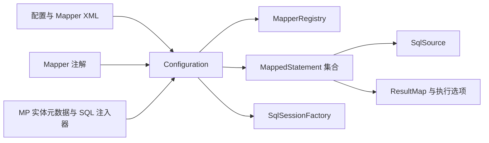
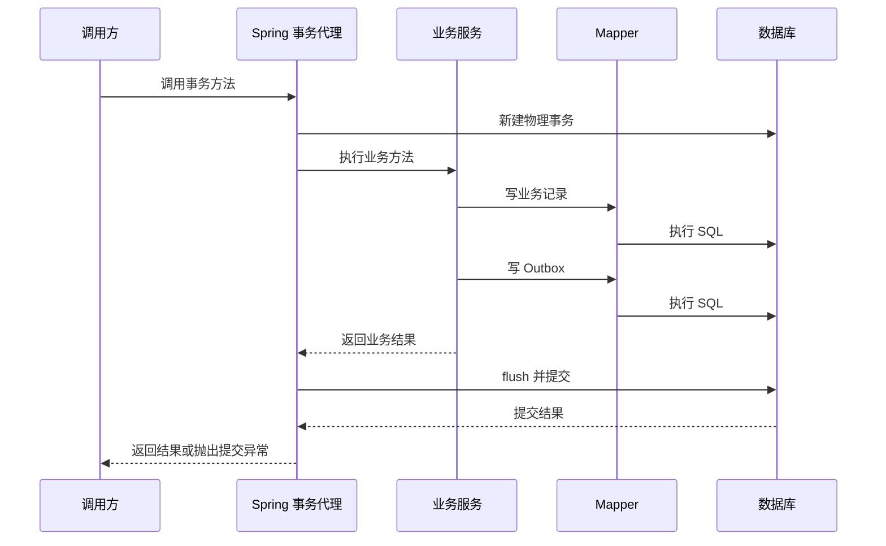

# MyBatis 与 MyBatis-Plus：执行原理、机制边界与项目实践

> 阅读目标：能沿着源码解释一条 SQL 如何生成、执行、映射和提交；能判断 MyBatis-Plus 替你做了什么；能为缓存、并发更新、租户隔离和批处理故障建立可复现证据。
>
> 版本范围：以 MyBatis 3.5.x、MyBatis-Spring、MyBatis-Plus 3.5.x 的常用机制为主，示例环境采用 Java 17、Spring Boot 3、MySQL 8/InnoDB。版本相关行为在对应章节注明。官方资料核对日期：2026-10-27；在线源码会变化，实际排障应切换到项目依赖对应的 tag。
>
> 项目背景来自本库的医生助手、用户画像和 Outbox 方案。本文的 `patient_profile`、`agent_task`、`task_outbox` 表及 Java 示例是统一设计的教学模型，不表示这些表和实现已经在现有项目中落地。代码分为可独立理解的核心片段与明确标注的伪代码，不是一套可直接启动的完整工程。

## 目录

- [[#1. 建立边界：谁负责什么]]
- [[#2. 启动期：接口与 XML 如何变成可执行定义]]
- [[#3. 运行期：跟踪一次 Mapper 调用]]
- [[#4. SQL 生成与参数绑定：从语法到业务语义]]
- [[#5. 结果映射：对象身份、关联与类型转换]]
- [[#6. 缓存：命中条件、对象污染与一致性边界]]
- [[#7. Spring 事务：会话、连接、传播与路由]]
- [[#8. 执行器与批处理：排队、执行和提交是三个阶段]]
- [[#9. 插件：代理顺序、SQL 改写与缓存键]]
- [[#10. MyBatis-Plus：通用 CRUD 是如何产生的]]
- [[#11. Wrapper、更新策略与自动填充]]
- [[#12. 乐观锁、逻辑删除与租户隔离]]
- [[#13. 分页、计数和大结果集]]
- [[#14. 项目实战一：患者画像的并发更新]]
- [[#15. 项目实战二：医生确认任务与 Outbox]]
- [[#16. 项目实战三：患者列表与关联数据]]
- [[#17. 排障、回归实验与源码阅读路线]]
- [[#18. 资料与关联笔记]]

# 1. 建立边界：谁负责什么

## 1.1 MyBatis 的核心不是对象自动持久化

MyBatis 把“Java 方法、SQL 模板、参数和结果映射”组织成执行流水线。它保留 SQL 的控制权，省去重复的 JDBC 资源处理和对象转换代码。

读取一个对象后调用 setter，不会自动产生 UPDATE。MyBatis 没有 JPA 风格的脏检查和统一的持久化上下文管理。一级缓存可能让下一次查询返回同一对象，但“对象被改了”和“数据库被更新了”仍是两件事。

MyBatis-Plus（下文简称 MP）在这条流水线上添加通用语句注册、实体元数据、条件构造器以及拦截器。继承 `BaseMapper` 并没有绕过 MyBatis；最后仍然要经过 `MappedStatement`、执行器和 JDBC。

## 1.2 五层责任表

| 层 | 负责的事情 | 无法独立保证的事情 |
| --- | --- | --- |
| 业务服务 | 授权、状态转换、幂等、事务范围、重试决策 | JDBC 驱动如何发送批次 |
| MyBatis / MP | SQL 生成、参数绑定、结果映射、框架缓存、扩展点 | 数据库索引有效、消息与数据库原子提交 |
| MyBatis-Spring / Spring | 把会话和连接接入事务、资源同步、异常转换 | 自动继承到异步线程的事务 |
| JDBC / 连接池 | 连接、Statement、批次、结果传输、驱动类型转换 | 业务状态机、跨库原子性 |
| 数据库 | SQL 语义、约束、锁、隔离、执行计划、事务持久化 | 应用缓存失效、重复消息的业务幂等 |

判断问题时先找责任层。例如 `@Version` 负责形成带版本条件的更新；真正使两个并发写请求不能同时修改同一旧版本的是数据库的条件更新。驱动连接断开后是否已经提交，也不能靠 Mapper 抛异常来推断。

## 1.3 统一案例的业务约束

医生助手需要读取患者画像、展示关联标签、确认待执行任务，并通过 Outbox 触发后续处理。本文围绕以下不变量展开：

1. 医院 A 的请求不能读取或更新医院 B 的记录。
2. 同一患者画像的并发修改不能静默覆盖。
3. 同一待确认任务只能被成功确认一次。
4. 任务状态变更和 Outbox 事件要么一起提交，要么一起回滚。
5. 分页单位是患者，不能因为一个患者有多个标签就占掉多个名额。
6. 重试、重复投递和服务重启后，系统仍能恢复到可解释的状态。

这些不变量决定 SQL 的 WHERE 条件、唯一约束和事务范围。框架使用方式必须服务于这些约束。

# 2. 启动期：接口与 XML 如何变成可执行定义

## 2.1 先编译描述，调用时再执行

原生 MyBatis 通过 `SqlSessionFactoryBuilder` 构建工厂；Spring 集成通常由 `SqlSessionFactoryBean` 装配配置和资源。XML、注解和扩展注入的语句最终汇入 `Configuration`。



这解释了两个常见现象：Mapper Bean 能注入，不代表它所有方法都已经有 SQL；SQL 的 XML 文件打包丢失，也不必然让接口代理创建失败，可能直到方法第一次执行才暴露。

## 2.2 四个对象必须分清

| 对象 | 典型生命周期 | 内部信息 | 排障用途 |
| --- | --- | --- | --- |
| `Configuration` | 工厂级 | 注册表、环境、类型处理器、插件、语句定义 | 查目标语句到底注册在哪个工厂 |
| `MappedStatement` | 注册后复用 | ID、命令类型、SqlSource、ResultMap、缓存和超时选项 | 查执行的是哪个定义 |
| `SqlSource` | 通常随语句定义复用 | 生成 SQL 的规则 | 查动态条件在哪一步展开 |
| `BoundSql` | 一次 SQL 求值产生 | SQL 文本、参数映射、参数对象、附加参数 | 查本次真正要绑定什么 |

`MappedStatement` 不是 `PreparedStatement`，前者是框架定义，后者是 JDBC 资源。注册一个语句不会提前为它永久占用数据库连接。

`BoundSql` 也不一定是“最后发给数据库的 SQL”：后续插件仍可能改写。排障日志必须标注采样阶段，不能把改写前的 SQL 当最终证据。

## 2.3 statementId 不含 Java 参数类型

```text
com.example.persistence.PatientProfileMapper.selectVisibleById
```

普通 Mapper 方法通过接口及方法名解析语句；父接口查找存在继承处理，但不会把 Java 重载签名变成 SQL ID。于是下面两个方法不能靠两份同名 XML 可靠区分：

```java
PatientProfile selectByKey(Long id);
PatientProfile selectByKey(String patientCode);
```

应改为 `selectById` 和 `selectByPatientCode`。XML 文件名通常按接口名命名，真正决定绑定的是 namespace、id 和加载路径，不是文件名本身。

## 2.4 Spring 扫描的是代理工厂

`@MapperScan` 最终注册的 Bean 定义会通过 `MapperFactoryBean` 取得 Mapper 代理，并把它连接到指定 `SqlSessionTemplate` 或 `SqlSessionFactory`。它不是给每个接口生成一个业务实现类文件。

多工厂项目必须成组检查：

```text
Mapper 扫描包
    → SqlSessionTemplate
    → SqlSessionFactory
    → Configuration 中的 XML / 注入语句
    → DataSource
    → 配套事务管理器
```

“Mapper 找到了，但 SQL 找不到”时，先输出目标工厂的 `hasStatement(statementId)`，再检查构建产物中的 XML。不要先排数据库网络。

## 2.5 启动期的隐藏问题

- 同一个完整 ID 被重复定义时，通常会触发重复注册错误；不要依赖资源扫描顺序决定使用哪条 SQL。
- MP 的通用方法和自定义同名语句可能存在注入跳过等处理，不能把它当作普通重载机制；升级后应检查实际注册的语句。
- `databaseIdProvider` 可以选择数据库对应语句，但数据库产品识别、驱动元数据以及通用语句回退要一起验证。
- 手动配置工厂容易绕过 Starter 的部分自动装配。必须验证插件、TypeHandler、XML 和 MP 扩展是否都进入了这个工厂。
- `Configuration` 持有共享元数据，运行时为了一个请求修改全局 `MappedStatement` 或结果映射会影响其他线程。

机制参考：[MyBatis 配置](https://mybatis.org/mybatis-3/configuration.html)、[Mapper XML](https://mybatis.org/mybatis-3/sqlmap-xml.html)。

# 3. 运行期：跟踪一次 Mapper 调用

## 3.1 完整路径与短路点

假设调用：

```java
mapper.selectVisibleById(hospitalId, profileId);
```

正常查询大致经过以下路径；命中缓存时不再走下面的 JDBC 分支。

```text
MapperProxy.invoke
  → MapperMethod.execute
  → ParamNameResolver：把方法参数转成 SQL 参数对象
  → SqlSessionTemplate：取得当前事务关联的真实会话
  → DefaultSqlSession.selectOne / selectList
  → Executor.query
      → SqlSource.getBoundSql：求出本次 SQL 和参数映射
      → 创建 CacheKey
      → CachingExecutor：可选的二级缓存
      → BaseExecutor：一级缓存
      → SimpleExecutor / ReuseExecutor / BatchExecutor
          → 创建 StatementHandler
          → 获取 Connection
          → prepare：创建 Statement、设置超时和 fetchSize
          → parameterize：ParameterHandler 调用 TypeHandler
          → query：执行 JDBC 查询
          → ResultSetHandler：读取并组装结果
  → MapperMethod：适配方法返回类型
```

实际插件可能在这些节点外包代理，MP 也会扩展 Mapper 调用与执行器路径。这张图用于定位阶段，不应当成所有版本的逐行调用栈。

## 3.2 四大扩展对象的职责

| 对象 | 必须理解的动作 | 典型故障 |
| --- | --- | --- |
| `Executor` | 查缓存、选择执行策略、flush、事务协调 | 旧结果、批次未执行、缓存键错误 |
| `StatementHandler` | 按 statementType 创建并执行 JDBC Statement | 方言错误、超时、改写后的 SQL 不合法 |
| `ParameterHandler` | 根据 ParameterMapping 顺序取值和绑定 | 参数名不匹配、占位符数量错误 |
| `ResultSetHandler` | 列读取、类型转换、对象创建、嵌套组装 | 字段为空、重复父对象、内存膨胀 |

`RoutingStatementHandler` 按 `statementType` 选择 `STATEMENT`、`PREPARED` 或 `CALLABLE` 对应实现。不是见到 `${}` 就切到 JDBC `Statement`；`${}` 可能已经被拼进一个仍然使用 `PreparedStatement` 的 SQL 文本。

## 3.3 返回类型也是执行契约

`selectOne` 的典型实现先取得结果列表，再根据数量判断：零个返回 null，一个返回对象，多于一个抛 `TooManyResultsException`。它不是自动为 SQL 添加 `LIMIT 1`。

这对画像查询很重要：如果业务规定 `(hospital_id, patient_id)` 唯一，应由数据库唯一约束保证。靠 `LIMIT 1` 消除异常只是隐藏重复数据。

其他边界：

- 单对象查不到时，如果方法返回基本类型而不是包装类型，会遇到无法返回 null 的绑定问题。
- `@MapKey` 返回 Map 时，重复键可能发生覆盖，不能拿它替代 SQL 唯一性。
- `ResultHandler` 改变结果消费方式，也会影响缓存使用；不要套用普通 List 查询的全部缓存结论。
- UPDATE 返回的行数受数据库和驱动“匹配行/实际改变行”语义影响。核心 CAS 更新递增版本，并断言恰好一行，语义更明确。

## 3.4 线程安全来自资源分离

`SqlSessionFactory` 通常可共享；`SqlSessionTemplate` 被设计为线程安全；普通 `DefaultSqlSession` 不能跨线程共享。

Spring 注入的 Mapper 代理通常可以作为单例成员使用，因为调用时通过 Template 取得本线程的会话。异步线程使用这个代理，通常会获得自己的会话，而不是继续使用已经关闭的父线程连接。真正危险的是把原生 `SqlSession`、`Connection`、`Cursor` 或可变 Wrapper 直接传给其他线程。

参考：[MyBatis Java API](https://mybatis.org/mybatis-3/java-api.html)、[MyBatis-Spring 的 SqlSession](https://mybatis.org/spring/sqlsession.html)。

# 4. SQL 生成与参数绑定：从语法到业务语义

## 4.1 静态与动态 SQL 的区别在求值时机

XML 脚本会形成 SqlNode 结构。带 `<if>`、`<foreach>` 或动态文本的 SQL，需要在调用时根据参数执行节点树；常规不含动态内容的 SQL，可在构建时完成更多解析。

```text
XML 节点
  → SqlNode 树
  → 本次参数驱动节点求值
  → SQL 文本与运行时绑定
  → #{...} 对应的占位符及 ParameterMapping
  → BoundSql
```

具体到常见实现，`RawSqlSource` 会在构建阶段处理静态脚本的占位符和参数映射，内部使用 `StaticSqlSource`；只有 `#{}` 并不必然使一条 SQL 变成动态 SQL。`DynamicSqlSource` 则在调用时执行 SqlNode 树，得到与本次参数匹配的 SQL。`<if>`、`<choose>`、`<foreach>` 等标签，以及需要运行时求值的 `${}`，会让这一过程具有动态性。`<include>` 的片段展开主要发生在 Mapper 构建阶段，不能把它当成每次调用才做的字符串宏替换。

同一个方法可以产生许多 SQL 形态。假如十个筛选条件全部独立可选，理论上存在大量组合；数据库看到的模板、索引选择和批处理分组也会随之改变。性能测试只覆盖“所有参数都有值”无法代表真实流量。

## 4.2 `#{}` 与 `${}`：绑定值和构造结构

```xml
where patient_id = #{patientId}
order by ${sortColumn}
```

第一行通常形成 `patient_id = ?`，通过 TypeHandler 调用 JDBC setter。第二行先把文本嵌入 SQL，其内容可以改变 SQL 结构。

两个容易误讲的细节：

1. JDBC 使用 `PreparedStatement` 不等于数据库必然使用服务端预编译。客户端模拟、服务端准备、语句缓存取决于驱动配置和版本。
2. 参数绑定保证该占位符处的输入作为值处理；如果同一条 SQL 的其他部分仍在拼接不可信文本，整条语句仍可能被注入。

列名、表名和 ASC/DESC 不能靠 `?` 绑定成标识符。固定排序优先写 `<choose>`，动态排序把外部枚举映射为服务端常量片段，而不是验证后仍允许任意字符串。

```xml
<choose>
  <when test='sort == "UPDATED_DESC"'>order by updated_at desc, id desc</when>
  <otherwise>order by id desc</otherwise>
</choose>
```

`LIKE` 还有独立语义：绑定参数可以防注入，但 `%`、`_` 仍是通配符。若产品要求字面搜索，应明确转义字符和数据库 `ESCAPE` 规则，并测试反斜杠及 SQL mode。

## 4.3 参数名由两层机制共同决定

`ParamNameResolver` 先决定传给执行器的对象形态；ParameterHandler 再从该对象、附加参数或已解析的映射值中取参数。

| 方法形态 | 常见参数对象 | XML 写法 |
| --- | --- | --- |
| 单个 POJO，无 `@Param` | POJO 本身 | `#{patientId}` |
| 单个 POJO，`@Param("q")` | ParamMap | `#{q.patientId}` |
| 多参数，显式 `@Param` | 命名 ParamMap | `#{hospitalId}`、`#{id}` |
| 单个集合，无 `@Param` | 集合包装 Map | 常见 `collection`、List 的 `list`、数组的 `array` |
| 单个简单类型，无 `@Param` | 原始值本身 | 通常直接按该值绑定 |

单个 Long/String 如果有对应 TypeHandler，ParameterHandler 可直接使用整个参数对象。因此 `selectById(Long id)` 中的 `#{id}` 能工作，通常不能归因于编译保留了 `id` 这个参数名。动态 OGNL 路径、集合包装和多参数场景有不同规则，不要把这个便利行为扩展到所有场景。

多参数常有 `param1` 等通用别名；实际名称依赖 `useActualParamName` 与编译信息。工程中对多参数和集合显式使用 `@Param`，比依赖这些隐含命名更稳定。源码入口：[ParamNameResolver](https://mybatis.org/mybatis-3/xref/org/apache/ibatis/reflection/ParamNameResolver.html)。

## 4.4 `foreach` 的参数不能只从原始 Map 里找

循环内每个 `#{item.id}` 都需要绑定不同元素。运行时会保存循环展开所需的绑定；具体版本可能通过附加参数及 ParameterMapping 中已解析的值保存这些信息。

因此自制 SQL 日志工具不能只执行 `parameterObject.get(property)`。插件复制 `BoundSql` 时也不能只复制 SQL 字符串：丢失附加参数会让 `foreach`、`bind` 等场景失败，即使普通单参数查询正常。

调试时依次检查：SQL 占位符顺序 → ParameterMapping → additionalParameters → 原始参数对象 → 实际 TypeHandler。

## 4.5 空集合：必须定义“没有”是什么意思

三种业务语义要分开：

| 输入 | 可能的业务含义 | 推荐处理 |
| --- | --- | --- |
| 用户没选可选筛选项 | 不限制这个字段 | 允许不加条件 |
| 授权患者集合为空 | 没有权限访问任何患者 | 直接空结果或 `1 = 0` |
| 批量删除 ID 集合为空 | 没有要删除的记录或请求无效 | 提前返回或拒绝 |

危险写法是把授权集合当普通筛选：`ids` 为空就去掉整个 IN 条件，查询范围反而扩大。

```xml
<choose>
  <when test="allowedIds != null and !allowedIds.isEmpty()">
    and p.id in
    <foreach collection="allowedIds" item="id" open="(" close=")" separator=",">
      #{id}
    </foreach>
  </when>
  <otherwise>and 1 = 0</otherwise>
</choose>
```

空 `foreach` 不一定输出 `IN ()`。常见实现直接不输出 open/close 和内容，外部留下 `id in`；如果整个条件都放在循环里面，则可能全部消失。`nullable` 解决允许 null 集合的求值问题，不替业务决定是否允许全表访问。

## 4.6 `<where>` 和 `<set>` 只整理文本

`<where>` 在没有任何内容时不输出 WHERE。因此它可以把一个“语法错误”变成“合法但范围无限制”的查询。医院和授权条件不能写成可选 `<if>`。

`<set>` 在没有字段可更新时也不会凭空产生有效业务更新。用 `updated_at = now()` 兜住 SQL 语法，仍然没有解决“用户到底修改了什么”的问题。

画像 PATCH 必须区分三态：

```text
字段缺失       → 不修改
字段出现且为 null → 明确清空
字段出现且有值   → 替换
```

只用 `if value != null`，无法表达清空。可采用独立 `present` 标志、专用命令类型或显式清空接口。

OGNL 也要按字段类型写判断：数值 0、布尔 false、空字符串不能混在同一套 `!= ''` 判断里；单字符字符串建议用明确的字符串表达式，避免 Character 与 String 的比较差异。复杂判断应在 Java 中先归一化。

动态 SQL 机制参考：[官方动态 SQL 文档](https://mybatis.org/mybatis-3/dynamic-sql.html)。

# 5. 结果映射：对象身份、关联与类型转换

## 5.1 自动映射不是领域模型推断

自动映射按列标签、Java 属性及类型处理器工作。`mapUnderscoreToCamelCase` 能协助 `patient_id → patientId`，不会理解“两个 id 分别属于患者和标签”，也不会根据外键自动建关联。

复杂 JOIN 使用明确别名和显式 `resultMap`。对于关键查询，可以关闭该 resultMap 的自动映射，避免新增列以后被意外填进同名属性。

```xml
<resultMap id="profileWithTags" type="com.example.persistence.ProfileWithTags"
           autoMapping="false">
  <id column="p_id" property="id"/>
  <result column="p_patient_id" property="patientId"/>
  <collection property="tags" ofType="com.example.persistence.TagView"
              notNullColumn="tag_id">
    <id column="tag_id" property="id"/>
    <result column="tag_name" property="name"/>
  </collection>
</resultMap>
```

## 5.2 `<id>` 定义组装时的对象身份

JOIN 产生的是平面行，MyBatis 需要识别哪些行属于同一个父对象、哪些子对象已经装入集合。嵌套结果映射会构建行键，`<id>` 映射为这个过程提供明确的身份字段。

如果完全不配置 `<id>`，框架存在基于其他结果映射的回退路径，并非必然不能去重；但身份可能受非主键字段变化影响，计算也更重。复合身份必须包含全部必要字段。例如 ID 只在医院内唯一时，父对象身份应同时包含医院和本地 ID。

`notNullColumn` 用于 LEFT JOIN 无子行时判断是否构造子对象。否则部分默认值、表达式列或错误别名可能产生“内容都为空的假子对象”。

`columnPrefix` 能复用同一个子 resultMap，但要确保 SQL 别名与前缀一致。`resultOrdered=true` 是对结果已经按父对象连续排列的承诺，有助于释放已处理组；没有相应 ORDER BY 就启用，可能破坏组装。

## 5.3 嵌套查询与嵌套结果是不同成本模型

- 嵌套查询：先得到父记录，再按父键执行子查询；可能出现 N+1，一级缓存有时减少相同键的重复查询，但不能消除所有不同键的查询。
- 嵌套结果：一次 JOIN 返回所有平面行，在应用组装；减少往返，但传输重复父列，并可能形成笛卡尔膨胀。

例如一个患者有 10 个标签、20 条随访，如果同时 JOIN 两个一对多集合，可能得到 200 行。最终 Java 集合去重后只剩 30 个子对象，也没有撤销数据库、网络和映射已经付出的成本。

列表优先使用主表分页加批量关联查询；详情页在基数可控时使用 JOIN。

## 5.4 懒加载不是可靠的事务延长方式

懒加载代理把关联查询推迟到访问属性时。getter、JSON 序列化、`toString`、调试器展开，都可能触发额外 SQL，具体受代理与触发方法配置影响。

一个容易误判的行为：原执行器关闭或线程改变时，`ResultLoader` 在具备环境和数据源配置的情况下可能创建新的执行器，而不是必然抛“会话已关闭”。关联数据于是可能来自另一个连接和时间点。参考：[ResultLoader 源码](https://mybatis.org/mybatis-3/xref/org/apache/ibatis/executor/loader/ResultLoader.html)。

因此对外返回明确构造的 DTO，不把是否查询数据库隐藏在序列化阶段。父对象和关联对象若必须属于同一一致性视图，应在明确的事务和隔离级别下完成查询。

## 5.5 TypeHandler 是双向的类型协议

写入时：Java 值 → JDBC setter；读取时：JDBC 列值 → Java 类型。处理器选择受 Java 类型、JDBC 类型、注册信息和局部配置影响。

画像状态可以存稳定业务 code；不要使用 enum ordinal 表示长期持久化协议。新增状态、删除状态或历史脏数据时，必须决定未知 code 是报错、映射 UNKNOWN，还是进入隔离处理流程。

自定义处理器的数值读取必须处理 SQL NULL：

```java
import java.sql.ResultSet;
import java.sql.SQLException;

// 自定义 TypeHandler 中的读取辅助方法；其他读取重载应遵循同样规则。
private Integer readNullableCode(ResultSet rs, String column) throws SQLException {
    int value = rs.getInt(column);
    return rs.wasNull() ? null : value;
}
```

`getInt()` 对 SQL NULL 可能返回 0，没有 `wasNull()` 就会把“未知”误当“状态 0”。`BaseTypeHandler` 从 3.5.0 起不替子类执行这一判定。

JSON 映射还要约定：SQL NULL、JSON null、空对象、空数组、非法 JSON 分别代表什么；未知字段如何兼容；带泛型的 `List<Tag>` 是否保留目标元素类型；日期和时区使用哪套序列化配置。

MP 实体上的 `@TableField(typeHandler = JacksonTypeHandler.class)` 配合自动生成结果映射时，通常还需要 `@TableName(autoResultMap = true)`。自定义 XML 的 VO 查询必须配置自己的 resultMap，不能假定实体注解自动传播到所有返回类型。参考：[MP 字段类型处理器](https://baomidou.com/guides/type-handler/)。

TypeHandler 通常被共享，不能在成员变量存当前租户、患者或请求对象。将所有 String 全局注册成加密 Handler，也会误伤普通文本列。字段加密还涉及查询、索引和密钥版本，不能只靠一个 setter/getter 转换解决。

# 6. 缓存：命中条件、对象污染与一致性边界

## 6.1 先看二级，再看一级

常规查询路径中，如果存在 `CachingExecutor` 且语句具备有效二级缓存，先检查二级缓存；未命中再委托底层执行器，由 `BaseExecutor` 检查本地缓存。

```text
外层插件 → CachingExecutor（二级）→ BaseExecutor（一级）→ 数据库
```

二级缓存按 namespace 配置或通过 cache-ref 共享；一级缓存属于执行器/会话。`cacheEnabled=true` 只是允许二级缓存机制，不是给所有 Mapper 自动添加缓存。

## 6.2 CacheKey 包含什么，不包含什么

典型键包括语句 ID、RowBounds 的 offset/limit、生成键时的 SQL、各输入参数值以及环境 ID。源码入口：[BaseExecutor.createCacheKey](https://mybatis.org/mybatis-3/xref/org/apache/ibatis/executor/BaseExecutor.html)。

它不会自动知道 ThreadLocal 中的医院、用户权限、动态数据源路由和主从角色。如果这些因素改变了查询语义，却没有进入当时的 SQL、参数或缓存隔离维度，就有串数据风险。

尤其危险的是在 `StatementHandler.prepare` 才添加 `hospital_id`：CacheKey 已经生成，甚至请求可能已经命中缓存，根本不会执行到 prepare。隔离条件需要在缓存查找之前落实。

## 6.3 一级缓存可能返回同一个可变对象

同会话中查询同一个键，常规 List 查询可能复用已有对象引用：

```text
第一次查画像 → 对象 A，name = 张某
业务为了展示执行 A.setName(匿名)
第二次查相同条件 → 仍是 A，name = 匿名
数据库里仍然是 张某
```

这不是数据库脏读，是应用修改了缓存中的对象。对外脱敏应映射为 DTO，避免在持久化对象上原地修改后又继续执行业务判断。

`SESSION` 允许跨语句复用。`STATEMENT` 在最外层查询结束时清理本地缓存，内部仍可能用于嵌套查询、循环引用和延迟装配，并不等于删除整个本地缓存机制。

更新会清本地缓存；提交、回滚和关闭也参与清理。但通过另一个会话、JdbcTemplate、存储过程或其他服务修改的数据，不会自动通知当前会话清缓存。

## 6.4 `useCache=false` 不关闭一级缓存

`useCache` 主要控制二级查询缓存使用。想验证一级缓存，保持同一事务并显式清理，或使用 `localCacheScope=STATEMENT` 做对照。清完缓存仍读到旧值，可能是数据库的可重复读快照。

锁定查询需要特殊谨慎：重复 `SELECT ... FOR UPDATE` 若被缓存命中，第二次调用并未重新执行锁定 SQL。关键锁定语句可明确设置 `useCache="false"`、`flushCache="true"`，并在短事务中调用；同时验证实际 JDBC 执行次数。

## 6.5 二级缓存不是数据库事务隔离

二级缓存通过事务缓存缓冲待写入和清理动作，在提交等会话生命周期节点合并到底层缓存。`readOnly=false` 的默认实现通过序列化提供副本语义；`readOnly=true` 可以直接共享对象，应确保返回对象不可变。自定义 Cache 实现可能有不同存储与复制行为。

namespace 是失效边界，不是表依赖分析：

```text
ProfileMapper 查询 profile JOIN hospital
HospitalMapper 更新 hospital
→ ProfileMapper 的结果不一定失效
```

即使共享缓存，也可能出现并发旧值回填：事务 A 读到 v1，事务 B 更新 v2 并清缓存，A 随后提交把早先读到的 v1 放回缓存。事务缓存协议没有把数据库提交顺序和读版本变成线性一致的缓存协议。

`flushInterval` 也不应理解成严格的后台定时失效保证，默认实现会在缓存操作时检查时限。`size` 通常按条目数计数，一条缓存项可能是整个大列表，不能等同于缓存最多多少行。

对于高频变更的画像和任务状态，本文示例不启用二级缓存。这个选择来自失效边界和一致性成本，不是“二级缓存一律不能用”。

## 6.6 四种“旧数据”的证据不同

| 现象 | 要控制的变量 | 可能原因 |
| --- | --- | --- |
| 没有发生 JDBC execute | 日志采样完整，确认不是漏采 | 应用缓存或 MyBatis 缓存 |
| 同一主库、确实重新执行，仍返回旧版本 | 清一级缓存，禁二级缓存 | RR 快照、尚未提交的写入 |
| 新事务主库新、从库旧 | 相同查询与授权条件 | 复制延迟 |
| Mapper 返回新，响应却旧 | 对比组装前后版本与对象标识 | DTO 组装或共享对象覆盖 |

“没有看到 SQL 日志”不是充分证据；先确认日志位置和采样策略。缓存内容与执行计数都应由可控实验验证。

# 7. Spring 事务：会话、连接、传播与路由

## 7.1 连接和会话是两种绑定资源

Spring JDBC 事务管理器通常以 DataSource 为键绑定 ConnectionHolder；MyBatis-Spring 以 SqlSessionFactory 为键绑定 SqlSessionHolder。两者经事务同步机制协作。

同一线程、同一事务、同一工厂的多次 Mapper 调用，通常复用同一会话；不同工厂即使接入同一个事务，也有各自的会话和一级缓存。这是“同一个事务等于同一个 SqlSession”必须补充的前提。

没有 Spring 事务时，Template 仍会管理每次调用的会话与提交/关闭。多次 Mapper 写调用不会自动组成一个业务原子单元。官方说明：[MyBatis-Spring 事务](https://mybatis.org/spring/transactions.html)。

## 7.2 SpringManagedTransaction 不等于原生 MANAGED

标准 MyBatis-Spring 整合使用 `SpringManagedTransaction` 配合 Spring 获取连接并识别是否由 Spring 管理。不要把它笼统说成原生 `ManagedTransaction`。

对 Spring 管理的 `SqlSessionTemplate` 调用 `commit/rollback/close` 会被拒绝，而不只是“可能提前提交”。另一方面，业务直接操纵 Connection 或另开原生 SqlSession，又可能绕开集成层的保护。

## 7.3 方法返回与物理提交的边界

下图只描述当前代理范围新建本地 JDBC 事务、业务正常返回的路径，例如无外层事务时的 `REQUIRED`，或独立开启的 `REQUIRES_NEW`。业务方法返回给代理后，由代理完成事务，再向调用方返回结果；不能把这个顺序套到参与已有事务的内层方法。



如果内层 `REQUIRED` 加入外层事务，内层返回时不会独立物理提交：外层调用 → 内层写入并返回 → 外层继续执行 → 外层事务最终提交或回滚。即使内层返回成功，外层之后抛出异常仍可回滚这些写入，调用方不能据内层返回就发送不可撤回的外部通知。可靠事件应与业务数据写入同一事务的 Outbox，再由提交后的投递流程处理。

该边界与 [[02-Spring与微服务/Spring/Spring核心原理|Spring 核心原理]] 中“新建本地 JDBC 事务”的完成顺序一致。依据：[Spring 6.2 事务传播](https://docs.spring.io/spring-framework/reference/6.2/data-access/transaction/declarative/tx-propagation.html)。验证时应覆盖“内层正常返回、外层随后回滚，记录不落库”的路径；本轮仅核对文档和图示，未执行框架集成实验。

业务方法最后一行日志写“完成”，不代表提交已经成功。提交阶段可能才触发批处理执行、约束错误或连接异常。

Spring 默认声明式回滚规则通常覆盖 RuntimeException 和 Error；检查型异常是否回滚取决于配置。内部参与事务的方法把事务标成 rollback-only 后，即使外层捕获异常继续返回，也可能在最后得到 `UnexpectedRollbackException`。

## 7.4 常见传播陷阱

- 同类 `this.method()` 在常见代理模式下绕过事务拦截；注解不会自动生效。
- `REQUIRES_NEW` 挂起外层资源，新开独立事务。内层成功不随外层失败回滚，可能违背“任务与事件一起成功”的不变量。
- 外层占着连接再等内层新连接，会放大连接池压力；池容量不足时会出现资源等待。
- `NESTED` 常基于 JDBC 保存点，数据库回滚到保存点不等于 MyBatis 缓存、已修改 Java 对象和外部副作用也回滚到同一点。使用时要专门验证框架缓存与保存点的协作。
- CompletableFuture 不继承父线程 JDBC 事务。在线程中重新进入事务服务，只会开启或参与那个线程自己的事务。

任务执行可以异步，任务确认和 Outbox 写入应先在一个明确的同步数据库事务里完成。

## 7.5 路由必须早于物理连接获取

`AbstractRoutingDataSource` 的路由键影响取连接的目标。连接绑定到事务后，方法中途改 ThreadLocal 通常不会切换现有物理连接。若用了懒连接代理，物理获取时机会推迟，所以应按实际代理结构验证。

不能只说“在第一条 SQL 前设路由”：普通事务管理器可能在进入业务方法前已经取连接。路由切面与事务切面的顺序必须明确；事务内允许写的流程应从一开始就选主库。

`readOnly=true` 不自动等于读从库，也不统一保证所有数据库都拒绝写入。它首先是事务属性，路由与数据库执行限制需要单独配置。

短期粘主降低写后读到旧副本的概率，但固定三秒并不是复制已追平的证明。必须保证读己之写的接口，应明确主库读取或可验证的复制位点等待方案。

## 7.6 事务完成后仍可能发生一致性故障

提交后删除 Redis 缓存比提交前删更符合顺序，但进程可能在提交后、删缓存前崩溃；另一个早先读到旧值的请求也可能在删除之后重新回填旧值。

所以 `afterCommit` 回调适合作为快速通知路径，不能独自承担可靠投递。需要可靠恢复时，把失效事件写入同事务 Outbox，并考虑版本化回填、过期和对账。不要把“回调调用成功”写成“数据库和 Redis 强一致”。

# 8. 执行器与批处理：排队、执行和提交是三个阶段

## 8.1 三种 Executor 的复用粒度

| 类型 | Statement 行为 | 适合验证的问题 |
| --- | --- | --- |
| SIMPLE | 常规执行时创建并关闭 Statement | 默认链路、单条 SQL 性能 |
| REUSE | 在执行器生命周期内按 SQL 复用 Statement | 模板是否稳定、资源何时清理 |
| BATCH | 把更新加入 JDBC batch，随后集中执行 | flush、异常定位、事务大小 |

REUSE 不等于 JDBC 驱动的 PreparedStatement 缓存，更不等于数据库执行计划缓存；这三层生命周期不同。

## 8.2 BATCH 只合并相邻的相同语句

`BatchExecutor` 以当前 SQL 和当前 MappedStatement 判断能否继续复用最后一个 Statement。因此：

```text
A、A、A → 有机会归为同一批
A、B、A → 第三个 A 不会自动回到第一组
```

动态更新的列不同，也会改变 SQL 模板。若每次先写画像再写审计，再写下一条画像，就可能拆成很多小组。调整顺序可能改善吞吐，但必须先确认外键、锁顺序和业务顺序允许调整。

BATCH 的单次更新返回占位值，不能累加当作实际影响行数。实际结果在 `flushStatements()` 返回的 BatchResult 中；JDBC 还可能返回 `SUCCESS_NO_INFO`，不能把所有负数都当作失败。参考：[BatchExecutor 源码](https://mybatis.org/mybatis-3/xref/org/apache/ibatis/executor/BatchExecutor.html)。

## 8.3 flush 不等于 commit

```text
mapper.insert → addBatch：语句进入队列
flushStatements → executeBatch：数据库执行，可能已持有锁
事务 commit → 对外提交
事务 rollback → 撤销同连接事务中已执行、未提交的写入
```

定期 flush 可以降低框架和驱动的排队内存，但不释放该事务已经持有的锁，不结束数据库 undo 历史，也不释放事务连接。

把“每 500 条 flush”说成“每 500 条提交”，会直接误判故障恢复语义：前者仍可能是一个几十万行的事务，后者才是多个独立提交单元。

查询走到 `BatchExecutor.doQuery` / `doQueryCursor` 时会触发 flush。更上层若命中缓存，未必进入该方法。因此有明确执行时点要求时应主动 flush，不要把随手 SELECT 当控制协议。

## 8.4 Spring 中使用 BATCH 的边界

可以配置专用 `SqlSessionTemplate(factory, ExecutorType.BATCH)`。同一工厂在一个已绑定会话的事务里，不能随意从 SIMPLE 切换为 BATCH；MyBatis-Spring 会检查执行器类型。

设计批处理入口时选一种明确语义：

- 全量原子：一个事务，分段 flush；失败全部回滚，但评估锁和回滚成本。
- 分段可恢复：每段独立事务，提交后记录断点；失败只重试未确认段，但不能承诺全量原子。

不应仅为了避开执行器类型报错，就随意加 `REQUIRES_NEW`；那会改变业务原子性。

## 8.5 回滚不会倒退 Java 对象

自增主键、MP 分配的 ID、自动填充时间、乐观锁新版本，都可能在数据库提交之前已经写进实体对象。随后事务回滚，Java 对象不会自动恢复。

重试时直接复用对象可能出现：旧自增 ID 被再次提交、错误的新版本进入 WHERE、填充策略发现非 null 而跳过时间更新。重试应从原始业务命令和重新读取的状态构造新参数。

BATCH 下重复修改同一个实体再多次入队还会带来参数对象引用问题：JDBC 可能已保存绑定值，但框架保留的对象引用、生成键回填和日志对象仍可能指向同一个实例。每条记录使用独立参数对象。

## 8.6 `foreach` 多值 INSERT 与 JDBC batch

| 方案 | 数据库看到的工作 | 主要边界 |
| --- | --- | --- |
| `INSERT ... VALUES (...), (...)` | 一条大 SQL | 占位符数、报文大小、单语句失败粒度 |
| JDBC batch | 多次参数执行，由驱动组织发送 | 驱动是否重写、批次计数和生成键 |
| 循环 SIMPLE | 多次普通执行 | 网络往返较多，但行为直接 |

MP 的 `saveBatch` 名称不保证最终是一条多值 INSERT。驱动的 `rewriteBatchedStatements` 也不是 MyBatis 通用参数。应记录实际驱动版本、SQL 形态、往返次数、生成键行为和失败结果后再决定。

## 8.7 主键生成与重试

`useGeneratedKeys` 利用 JDBC 返回生成键；`selectKey` 在配置的 BEFORE/AFTER 阶段执行取键语句。使用 `@Param("entity")` 包装对象时，`keyProperty` 也应与参数路径匹配，例如 `entity.id`。

批次生成键依赖驱动支持与返回顺序，不能从“第一个 ID + 连续递增”推算整批 ID。自增值有空洞不代表丢数据，回滚、并发和驱动行为都可能产生空洞。

业务幂等键与数据库技术主键应分开。Outbox 用预先确定的 `event_id` 便于重放；但 ID 唯一并不保证同一业务动作只创建一个事件，还需业务唯一约束。

# 9. 插件：代理顺序、SQL 改写与缓存键

## 9.1 原生插件是嵌套代理

MyBatis 对 Executor、StatementHandler、ParameterHandler、ResultSetHandler 应用 `InterceptorChain.pluginAll`。常规 `Plugin.wrap` 根据 `@Intercepts/@Signature` 为匹配接口建立 JDK 代理。

若按 A、B、C 顺序注册，且三者都包装同一目标，调用通常是：

```text
C.before → B.before → A.before → target → A.after → B.after → C.after
```

但插件只匹配某个接口或方法时，各阶段的实际链并不相同。Executor 四参数 query 与六参数 query 是不同签名；对象内部的自调用也不自动重新穿过外层代理。不能说“拦了 Executor.query 就覆盖所有查询路径”。

## 9.2 记录耗时也有边界

下面是一个最小诊断拦截器，记录普通 Executor 更新和四参数查询的总耗时；它不是精确数据库耗时探针，也不覆盖全部六参数或 Cursor 路径。

```java
import java.util.concurrent.TimeUnit;
import org.apache.ibatis.executor.Executor;
import org.apache.ibatis.mapping.MappedStatement;
import org.apache.ibatis.plugin.Interceptor;
import org.apache.ibatis.plugin.Intercepts;
import org.apache.ibatis.plugin.Invocation;
import org.apache.ibatis.plugin.Signature;
import org.apache.ibatis.session.ResultHandler;
import org.apache.ibatis.session.RowBounds;
import org.slf4j.Logger;
import org.slf4j.LoggerFactory;

@Intercepts({
    @Signature(type = Executor.class, method = "query",
        args = {MappedStatement.class, Object.class, RowBounds.class, ResultHandler.class}),
    @Signature(type = Executor.class, method = "update",
        args = {MappedStatement.class, Object.class})
})
public final class MapperTimingInterceptor implements Interceptor {
    private static final Logger LOG = LoggerFactory.getLogger(MapperTimingInterceptor.class);

    @Override
    public Object intercept(Invocation invocation) throws Throwable {
        MappedStatement statement = (MappedStatement) invocation.getArgs()[0];
        long start = System.nanoTime();
        boolean succeeded = false;
        try {
            Object result = invocation.proceed();
            succeeded = true;
            return result;
        } finally {
            long elapsed = TimeUnit.NANOSECONDS.toMillis(System.nanoTime() - start);
            LOG.debug("Mapper 调用：id={}，耗时毫秒={}，成功={}",
                statement.getId(), elapsed, succeeded);
        }
    }
}
```

这个计时可能包含缓存、取连接、执行与映射。BATCH 的 update 耗时可能只是排队时间。`StatementHandler.prepare(Connection, ...)` 被调用时，连接已经取得，不能靠该方法的耗时测连接池等待。

高频路径要控制日志量；诊断插件应确保自身日志或指标故障不掩盖原始业务异常。

## 9.3 安全改写要同时保持五项一致

1. SQL 文本中的占位符。
2. ParameterMapping 的数量与顺序。
3. 参数对象及动态附加绑定。
4. CacheKey 所表达的查询语义。
5. count SQL 与数据 SQL 的过滤语义。

例如新增 `hospital_id = ?`，但没有追加参数映射，数据库可能收到未绑定参数；只改 SQL 不重建 CacheKey，则可能读错缓存；只改数据 SQL 不改 count，则可能泄露其他医院的总数。

不要用 `replace("where", ...)` 完成权限改写：大小写、注释、CTE、子查询、UNION 和字符串字面量都可能破坏它。使用具备方言支持的解析器也必须测试不支持的语法，不能解析失败后默默放行权限条件。

## 9.4 MP 内部拦截器是另一套顺序

`MybatisPlusInterceptor` 是 MyBatis 外层插件之一，它内部遍历 `InnerInterceptor`。这个列表不能机械套用“后注册先执行”的 JDK 嵌套代理结论。

通常应先完成租户、权限、动态表名等查询语义改写，再执行分页计数与分页改写；校验类插件在哪个阶段运行，要看它检查的是改写前还是改写后 SQL。

官方分页文档建议分页放最后；插件主体文档同时给出 SQL 改写优先、校验类靠后的分类建议。工程中应把“分页基于完整过滤条件、校验能看到要保护的 SQL”作为不变量，并对自己的组合验证，不能背一个顺序解决所有扩展。参考：[MP 插件主体](https://baomidou.com/plugins/)。

`willDoQuery` 返回 false 可能终止后续查询。在这里自己执行 SQL 再阻断链，会改变分页、结果和缓存行为。自制插件应先限定影响的 statementId，避免一开始就覆盖全部业务。

# 10. MyBatis-Plus：通用 CRUD 是如何产生的

## 10.1 BaseMapper 方法没有 XML，为什么能执行

MP 解析实体泛型和字段注解，建立 `TableInfo` 等元数据；SQL 注入器为支持的通用方法生成并注册 MappedStatement。运行时 Wrapper 提供条件与参数，仍然落到 MyBatis 的 SqlSource 和执行链。

```text
BaseMapper<PatientProfile>
  → 实体元数据：表、主键、列、版本、逻辑删除、填充规则
  → SQL 注入器：注册 insert / updateById / selectById 等定义
  → 运行时：entity + Wrapper
  → BoundSql
  → 插件 + MyBatis + JDBC
```

这里的“SQL 注入器”是框架扩展接口，不是 SQL 注入漏洞。自定义注入器适合增加有明确规则的通用持久化方法；它不应该承担任务审批状态机或跨表业务编排。参考：[MP SQL 注入器](https://baomidou.com/guides/sql-injector/)。

## 10.2 实体注解影响的是生成规则

| 注解/设置 | 作用 | 需要另行保证 |
| --- | --- | --- |
| `@TableName` | 指定表及结果映射策略 | 表实际存在、路由正确 |
| `@TableId` | 主键列及生成方式 | 全局唯一、业务幂等 |
| `@TableField(exist=false)` | 不参与持久化字段 | 不等于响应脱敏 |
| `@TableField(select=false)` | 从相关默认生成查询中排除列 | 自定义 SQL 和显式选列仍需审核 |
| `@Version` | 为乐观锁识别版本字段 | 插件注册、支持的调用形态、检查更新数 |
| `@TableLogic` | 相关生成语句加入逻辑删除语义 | 自定义 SQL、归档与唯一约束 |
| `FieldFill` | 标记插入/更新填充意图 | MetaObjectHandler 及参数形态 |

`select=false` 不是数据库列权限；`exist=false` 也不意味着字段不会被 JSON 序列化。参考：[MP 注解配置](https://baomidou.com/reference/annotation/)。

一个与第 14 章表结构一致的实体示例（使用 Lombok 生成访问器）：

```java
import java.time.LocalDateTime;
import com.baomidou.mybatisplus.annotation.IdType;
import com.baomidou.mybatisplus.annotation.TableId;
import com.baomidou.mybatisplus.annotation.TableLogic;
import com.baomidou.mybatisplus.annotation.TableName;
import com.baomidou.mybatisplus.annotation.Version;
import lombok.Data;

@Data
@TableName("patient_profile")
public class PatientProfile {
    @TableId(type = IdType.ASSIGN_ID)
    private Long id;
    private Long hospitalId;
    private Long patientId;
    private String remark;
    @Version
    private Long version;
    @TableLogic(value = "0", delval = "1")
    private Integer deleted;
    private LocalDateTime createdAt;
    private LocalDateTime updatedAt;
}
```

这里显式选择应用分配 ID。生产仍需验证 ID 生成器的节点配置与重复风险；实体有 ID 不代表插入已经提交。version、deleted 的初值可以由应用显式初始化，或在确认生成 SQL 会省略未赋值列时使用数据库默认值。时间字段由 SQL/数据库策略负责，本例没有配置自动填充。

## 10.3 自定义 SQL 的责任不能遗漏

自定义 Mapper 方法没有被注入器支持，就仍需 XML、注解或 Provider。实体上的逻辑删除和列策略并不会把任意手写 SQL 自动改写成符合业务规则的 SQL。

对每个自定义方法要检查：医院条件、逻辑删除条件、权限条件、版本条件、审计字段、返回映射、分页和缓存。

复杂状态转换使用命名明确的 SQL，往往比复用一个无所不包的 `updateById` 更容易审查。通用 CRUD 的便利不应该掩盖“这次更新允许从哪个状态变到哪个状态”。

## 10.4 依赖与配置失配

MP 项目应采用与 Spring Boot 主版本匹配的 Starter。不要随意叠加原生 MyBatis Starter 和 MP Starter，或强行覆盖一套未经验证的 MyBatis、MyBatis-Spring、MP、JSQLParser 版本。

手动装配工厂时，要使用 MP 配套工厂及配置，确认注入语句存在。常见症状是自定义 XML 能执行，而 `BaseMapper` 方法找不到 statement。

原生 Starter 常见配置前缀是 `mybatis`，MP 使用 `mybatis-plus`。配置写错前缀时，文件可以正常解析，但你以为生效的缓存、驼峰和 mapper-locations 可能并未进入目标工厂。

```yaml
# MP 示例；值是本文教学场景的选择，不是通用生产模板。
mybatis-plus:
  mapper-locations: classpath*:/mapper/**/*.xml
  configuration:
    map-underscore-to-camel-case: true
    cache-enabled: false
    local-cache-scope: STATEMENT
```

这里关闭二级缓存并减少跨语句对象复用，是为了让任务状态与画像示例更容易验证；实际项目应测量额外查询成本后决定。

# 11. Wrapper、更新策略与自动填充

## 11.1 Wrapper 保存的是可变 SQL 构造状态

Wrapper 内部维护表达式片段、参数编号和参数值映射；Lambda Wrapper 解析方法引用并结合实体元数据找到列名。它减少字符串列名错误，但不会分析业务授权是否完整。

Wrapper 应每次调用新建，不能作为单例 Service 的成员字段跨请求复用，也不适合作为 RPC 或前端入参直接传输。复用会叠加历史条件与参数；并发使用会产生竞态。官方边界见：[条件构造器](https://baomidou.com/guides/wrapper/)。

## 11.2 AND/OR 的括号就是权限边界

目标逻辑：本医院，并且“备注匹配或患者 ID 匹配”。错误平铺可能变成：

```sql
hospital_id = ? and remark = ? or patient_id = ?
```

SQL 的 AND 优先于 OR，患者 ID 分支可能绕过医院限制。正确结构：

```java
import com.baomidou.mybatisplus.core.conditions.query.LambdaQueryWrapper;
import com.baomidou.mybatisplus.core.toolkit.Wrappers;

LambdaQueryWrapper<PatientProfile> query = Wrappers.<PatientProfile>lambdaQuery()
    .eq(PatientProfile::getHospitalId, hospitalId)
    .and(group -> group
        .eq(PatientProfile::getRemark, keyword)
        .or()
        .eq(PatientProfile::getPatientId, patientId));
```

写完必须检查最终括号，而不是只看链式调用排版。关键权限条件不使用 `.eq(hospitalId != null, ...)` 这样的可选形式，应在服务边界要求医院上下文非空。

## 11.3 Lambda 不会消除文本注入入口

`last`、`apply`、`inSql`、`exists`、`setSql`、动态排序列等接口可以接受 SQL 片段。即便同一个 Wrapper 其他部分都使用 Lambda，危险片段仍是危险片段。

固定 SQL 表达式里的值应使用 API 支持的绑定方式；SQL 结构只来自服务端受控常量。不能把客户端传来的整段条件或模型生成 SQL 直接塞入 Wrapper。

对于 `in` 空集合，不同 API、条件开关与版本可能产生空 IN 或跳过条件。业务应在构造 Wrapper 前定义空集合语义，不能依赖框架偶然行为保障授权。

## 11.4 更新字段策略与 PATCH 不是同一件事

MP 的 `insertStrategy`、`updateStrategy`、`whereStrategy` 分别影响生成 SQL 中不同位置的字段。常见非 null 更新策略意味着 null 字段不进入 SET，这与“把值清空”相反。

反过来，全局把 updateStrategy 改成 ALWAYS，会让一个只有 id 和 name 的稀疏实体把其他字段也写成 null。局部需求不应该通过修改全局策略解决。

显式清空可以使用专用 XML，或者明确的 Wrapper set：

```java
import com.baomidou.mybatisplus.core.conditions.update.LambdaUpdateWrapper;
import com.baomidou.mybatisplus.core.toolkit.Wrappers;

LambdaUpdateWrapper<PatientProfile> change = Wrappers.<PatientProfile>lambdaUpdate()
    .eq(PatientProfile::getHospitalId, hospitalId)
    .eq(PatientProfile::getId, profileId)
    .eq(PatientProfile::getVersion, expectedVersion)
    .set(PatientProfile::getRemark, null)
    .setSql("version = version + 1");
```

本例手写版本条件，`setSql` 是服务端固定常量；不是依赖乐观锁插件自动补齐。还应按实体设计添加逻辑删除与审计字段，并检查影响行数。完整、可审查的 PATCH 示例见第 14 章。

更新时同时提供 entity 和 updateWrapper，要分别检查 entity 生成的 SET、Wrapper 的 SET 与 WHERE，避免重复赋值或误以为 entity 的所有值都是过滤条件。

## 11.5 自动填充先修改实体，再参与 SQL 绑定

`MetaObjectHandler` 是应用层填充，不是数据库触发器。默认 strict 填充策略通常不覆盖已有非 null 值，因此“读取实体 → 修改业务字段 → updateById”可能保留旧 updatedAt，除非处理器专门实现覆盖策略。

还要检查：

- 字段名称、Java 类型和 `FieldFill` 是否匹配。
- Handler 是否注册到当前 MP 配置。
- 是否真的提供了可识别实体。`update(null, wrapper)` 或只用 Wrapper 的更新通常不能依赖实体自动填充。
- 自定义 SQL 的参数名和结构是否满足识别约定。
- SQL 是否包含对应列。只修改 Java 属性，无法让一条没有 updated_at 的手写 UPDATE 自动出现该列。

官方规则见：[自动填充字段](https://baomidou.com/guides/auto-fill-field/)。任务确认、租约更新这类关键 SQL 可以直接写明审计时间，减少依赖隐含参数识别。

# 12. 乐观锁、逻辑删除与租户隔离

## 12.1 乐观锁的有效性最终体现在 WHERE

```sql
update patient_profile
set remark = ?, version = version + 1
where hospital_id = ? and id = ? and version = ? and deleted = 0;
```

两个请求都持有版本 7：第一个成功把版本改为 8；第二个再用 7 更新，影响零行。这个零行是正常的竞争结果，框架不一定抛异常。

MP 的 `OptimisticLockerInnerInterceptor` 在受支持的参数结构下提取旧版本、计算新版本并参与更新条件构造。整数版本通常加一，新版本也会回写实体；自定义方法即便参数被识别，SQL 本身仍要正确实现条件。`update(entity, wrapper)` 场景不要复用 Wrapper。参考：[乐观锁插件](https://baomidou.com/plugins/optimistic-locker/)。

## 12.2 乐观锁不能替你决定冲突怎么处理

| 业务操作 | 冲突后的合理方向 |
| --- | --- |
| 用户编辑一段备注 | 返回冲突，展示新版本，让用户合并 |
| 可交换的计数加一 | 考虑数据库原子增量，不先读后写 |
| 医生确认任务 | 状态机判定已确认、已取消或版本变化 |
| 扣减额度 | 带余额约束的条件更新，结合幂等键 |

自动“重查后覆盖”可能把用户刚看到的状态假设丢掉。更新零行也不必然是版本冲突，还可能是 ID 不存在、医院不匹配或已删除；错误分类要避免泄露其他医院记录是否存在。

只给实体加 `@Version`，但更新时没有携带旧版本、没有注册插件，或者 SQL 不含版本判断，都不形成可靠 CAS。

## 12.3 逻辑删除改变 SQL，但保留了物理约束

MP 相关生成语句会把删除转换成标记更新，并在查询/更新中加入未删除条件。手写 XML 仍需显式验证这些条件。参考：[逻辑删除支持](https://baomidou.com/guides/logic-delete/)。

隐藏问题出在数据库唯一约束：

```text
UNIQUE(hospital_id, patient_id, deleted)
```

若 deleted 只取 0/1，第一次删除留下一条 deleted=1 的历史记录；重建同患者的 active 记录后再次删除，就可能与旧 deleted=1 记录冲突。

可选设计取决于业务：

- 患者身份永久保留：保留 `(hospital_id, patient_id)` 唯一，恢复原记录，不重新创建身份。
- 需要多条删除历史：使用归档表、独立历史模型，或设计能区分删除代次的唯一键。
- 只约束活动行：针对数据库能力设计部分唯一索引或生成列方案，明确 NULL 的唯一性语义并测试。

不能把“加 deleted 到唯一键”当所有业务的通解。逻辑删除也不自动级联子表、清 Redis 或移除搜索索引。

## 12.4 多租户过滤与业务授权是两层条件

`TenantLineInnerInterceptor` 可以解析 SQL 并注入租户条件，但“同医院”不等于“该医生有权访问该患者”。医生归属、科室范围、任务负责人仍需要业务权限规则。

医院 ID 应从认证后的服务端上下文获取，不能直接信任请求参数。后台任务没有登录态时，应显式遍历授权的医院并建立作用域；ThreadLocal 必须在 finally 中清理，防止线程池复用污染下个任务。

对插件要覆盖 JOIN、子查询、UNION、插入、更新、删除和 count，而不只测试单表 SELECT。表别名、忽略表、`@InterceptorIgnore`、动态表名和自定义 SQL 都是边界。插入 SQL 若已经包含租户列，也应验证传入值，不能认为插件一定会覆盖恶意租户值。

参考：[多租户插件](https://baomidou.com/plugins/tenant/)。本文项目 SQL 为便于审查而显式包含 hospital_id；如果项目同时启用租户插件，要检查二者的最终组合。

## 12.5 防全表更新不等于更新范围正确

BlockAttack 类插件能够拦截某些危险 UPDATE/DELETE，但无法知道“有 hospital_id 条件、却漏了 patient_id”仍可能更新整个医院。

高风险写入需要同时具备：明确业务键、医院/权限条件、状态或版本前置条件、符合预期的影响行数。影响行数异常时应抛出异常让事务回滚；不要记录一行告警后继续提交。

# 13. 分页、计数和大结果集

## 13.1 RowBounds 不天然等于数据库 LIMIT

原生 RowBounds 描述结果偏移和数量，默认实现可在结果处理阶段跳过前面的行，并不保证 SQL 已有物理分页。驱动可能已获取大量数据，再在应用侧跳过。

必须查看实际 JDBC SQL。想让数据库只处理指定范围，应使用明确的分页 SQL 或已验证的分页插件，而不是看到返回 List 只有 20 条就认定查询只取了 20 行。

## 13.2 MP 分页是 count 与数据查询两个工作

`PaginationInnerInterceptor` 识别 IPage 参数，按配置生成或选择 count，然后改写分页 SQL。自定义 Mapper 返回 IPage 时，入参页对象不能是 null；返回 List 时，records 的装配契约不同。

从 MP 3.5.9 起分页相关解析依赖拆分，使用时需要按安装说明选择兼容的 JSQLParser 模块。单一数据库可以明确 DbType；多方言数据源不能全都写死 MYSQL。参考：[分页插件](https://baomidou.com/plugins/pagination/)。

常见失败链：

```text
负数 size → 进入不分页语义 → 意外全量查询
XML 已有 LIMIT + 插件再分页 → SQL 重复或分页语义异常
count 为 0 → 数据查询可能直接跳过 → 误以为 Mapper 没执行
复杂 JOIN 自动裁剪 → total 与结果行定义不同
```

服务端应验证 current、size、最大页大小与允许的排序列；不能把整个 Page 对象无约束地绑定客户端参数。

## 13.3 COUNT 必须先明确数什么

患者 1 有 3 个标签，患者 2 没标签：LEFT JOIN 的结果可能有 4 行，但患者只有 2 个。`count(*)`、`count(distinct p.id)`、`exists` 不是可以随意互换的优化技巧。

- 数全部患者：从患者表 count。
- 数有某标签的患者：从患者表按 EXISTS 筛选后 count。
- 数 JOIN 展开后的每条记录：保留 JOIN 行语义。
- 数 GROUP BY 后的组：保留分组及 HAVING，用外层 count。

把 LEFT JOIN 改成 EXISTS 会排除无子记录的父行；只有业务本来要求“存在子记录”时才等价。去掉关联表也必须证明不会改变基数或过滤条件。

自动 count 优化不知道你的 API 单位是患者还是标签行。复杂场景可通过 countId 显式指定计数语句；关闭优化只是保留原查询结构，不会自动修正原查询的业务语义。

count 和 list 是两条 SQL。READ COMMITTED 下并发写入可能让总数与列表不属于同一快照，即使条件完全一样。产品应决定容忍这种变化，还是为一致视图付出事务与快照成本。

## 13.4 稳定排序不等于冻结数据集

```sql
select id, patient_id, created_at
from patient_profile
where hospital_id = ? and deleted = 0
  and (created_at < ? or (created_at = ? and id < ?))
order by created_at desc, id desc
limit ?;
```

这是降序 keyset 查询，游标必须同时携带 created_at 和 id。候选索引为 `(hospital_id, deleted, created_at, id)`，应以目标数据库执行计划和数据分布验证。

优势是避免扫描并丢弃巨大 offset；代价是不能随意跳到某页。排序字段若会被更新，记录仍可能跨越游标产生遗漏或重复。只增加唯一 ID 作为次序，不会冻结排序字段。

固定最大 ID 或开始时间只能限制一部分新增记录，无法阻止更新、删除，也不能完全处理晚提交记录。严格历史导出需要明确定义快照、版本或离线任务语义。

## 13.5 Cursor 控制对象消费，不保证驱动流式传输

```java
import java.io.IOException;
import org.apache.ibatis.cursor.Cursor;
import org.springframework.transaction.annotation.Transactional;

// 业务服务方法片段；mapper、sink 由工程提供，方法从 Spring 代理外部调用。
@Transactional(readOnly = true)
public void exportProfiles(long hospitalId) throws IOException {
    try (Cursor<ProfileExportRow> rows = mapper.scanForExport(hospitalId)) {
        for (ProfileExportRow row : rows) {
            sink.write(row);
        }
    }
}
```

Cursor 必须在会话和连接有效期间消费。若方法把 Cursor 返回给 Controller，事务代理可能先结束资源，再轮到调用方迭代。

驱动是否缓冲结果取决于结果集类型、fetchSize 与驱动配置。MySQL Connector/J 的流式/游标模式有专门要求，不能仅设置 `fetchSize=1000` 就宣称内存恒定。参考：[Connector/J JDBC 实现说明](https://dev.mysql.com/doc/connector-j/en/connector-j-reference-implementation-notes.html)。

流式期间的慢文件写入、网络阻塞仍会占住连接。大规模导出可以改用任务化分段读取，把数据库读取与慢外部写出解耦；需要严格快照时再评估长事务或离线快照的成本。

# 14. 项目实战一：患者画像的并发更新

## 14.1 业务目标和最小表模型

背景：AI 会归纳画像，医生也会手工修改备注。如果双方读取同一旧对象后直接 `updateById`，后提交的一方可能覆盖另一方结果。

本例只实现“带预期版本的备注修改”，不扩展为任意字段更新器。医院来自认证上下文；患者授权在调用服务前或服务内完成；本例 SQL 再限定医院、主键、版本和未删除状态。

```sql
create table patient_profile (
    id bigint not null,
    hospital_id bigint not null,
    patient_id bigint not null,
    remark varchar(1000) null,
    version bigint not null default 0,
    deleted tinyint not null default 0,
    created_at datetime(6) not null default current_timestamp(6),
    updated_at datetime(6) not null default current_timestamp(6),
    primary key (id),
    unique key uk_profile_patient (hospital_id, patient_id),
    key idx_profile_page (hospital_id, deleted, created_at, id)
) engine = InnoDB;
```

本模型选择同医院同患者身份永久唯一，删除后恢复原记录，不重新创建身份。这样不会把 deleted 混入唯一键，产生多次删除冲突。

数据库不会因字段名叫 updated_at 就自动更新它；本例每条 UPDATE 显式赋值。所有时间按团队约定的同一时间基准写入和展示，`DATETIME` 本身不保存时区。

## 14.2 明确命令语义

```java
package com.example.persistence;

public final class ProfilePatch {
    private final Long hospitalId;
    private final Long id;
    private final Long expectedVersion;
    private final boolean remarkPresent;
    private final String remark;

    public ProfilePatch(Long hospitalId, Long id, Long expectedVersion,
                        boolean remarkPresent, String remark) {
        if (hospitalId == null || id == null || expectedVersion == null) {
            throw new IllegalArgumentException("医院、画像 ID 和预期版本不能为空");
        }
        if (expectedVersion < 0 || expectedVersion == Long.MAX_VALUE) {
            throw new IllegalArgumentException("预期版本超出允许范围");
        }
        if (!remarkPresent) {
            throw new IllegalArgumentException("必须明确提供备注字段，允许为 null");
        }
        if (remark != null && remark.length() > 1000) {
            throw new IllegalArgumentException("备注不能超过 1000 个字符");
        }
        this.hospitalId = hospitalId;
        this.id = id;
        this.expectedVersion = expectedVersion;
        this.remarkPresent = remarkPresent;
        this.remark = remark;
    }

    public Long getHospitalId() { return hospitalId; }
    public Long getId() { return id; }
    public Long getExpectedVersion() { return expectedVersion; }
    public boolean isRemarkPresent() { return remarkPresent; }
    public String getRemark() { return remark; }
}
```

Java String.length 按 UTF-16 代码单元计数；若产品按用户感知字符限制长度，应另做归一化和长度规则。本例是保守的服务端长度限制。

HTTP DTO 与该持久化命令分开：不要允许客户端直接提交 hospitalId、deleted、updatedAt 等受保护字段。服务层从认证上下文构造 hospitalId，并在 Mapper 调用前完成具体患者授权。

## 14.3 Mapper 与 XML：让不变量可见

```java
package com.example.persistence;

import org.apache.ibatis.annotations.Param;

public interface PatientProfileMapper {
    int patchRemark(@Param("cmd") ProfilePatch cmd);
}
```

```xml
<?xml version="1.0" encoding="UTF-8" ?>
<!DOCTYPE mapper PUBLIC "-//mybatis.org//DTD Mapper 3.0//EN"
    "https://mybatis.org/dtd/mybatis-3-mapper.dtd">
<mapper namespace="com.example.persistence.PatientProfileMapper">
  <update id="patchRemark">
    update patient_profile
    set remark = #{cmd.remark,jdbcType=VARCHAR},
        version = version + 1,
        updated_at = current_timestamp(6)
    where hospital_id = #{cmd.hospitalId}
      and id = #{cmd.id}
      and version = #{cmd.expectedVersion}
      and deleted = 0
  </update>
</mapper>
```

本方法没有把 `@Version` 插件作为前提，CAS 完整体现在 SQL 中。remark 为 null 会明确绑定 SQL NULL，而不是被动态 `<if>` 跳过。

服务端执行后要求影响行数恰好为 1。零行按“记录不可修改或版本已变化”处理；是否进一步细分“不存在/已删除/版本冲突”，应在同样授权边界内查询，避免给越权用户提供存在性线索。

## 14.4 并发时序证明

```text
初始：remark=旧值，version=7
医生 A 读取：version=7
AI 任务 B 读取：version=7
A 更新：WHERE version=7 → 影响 1 行，数据库 version=8
B 更新：WHERE version=7 → 影响 0 行
B 不覆盖 A，返回冲突或重新发起需要确认的业务流程
```

如果 B 只是另一个字段的独立更新，是否允许按字段合并是业务决策。整行版本锁偏保守，可能产生“不同字段也冲突”；字段版本、拆表或命令合并可以改善并发，但需要额外定义冲突规则。

## 14.5 与 Redis 画像缓存如何协作

本库画像方案以 MySQL 为持久层、Redis 为缓存。这里需要补足两个时序问题：

**提交前删除导致回填旧值：** A 尚未提交先删缓存，B 从数据库读旧值并回填，A 随后提交。缓存留下旧值。

**提交后删除仍有竞态：** B 先读数据库旧值，A 提交并删缓存，B 最后回填旧值。简单换成 afterCommit 仍未消除竞态。

如果允许短暂陈旧，可使用提交后失效、有限 TTL、可靠重试及监控。若对版本有要求，则让缓存携带 version，并采用能拒绝旧版本回填的协议；删除后还需保留必要的版本信息或其他协调机制，否则空键无法判断迟到回填是否过期。

可靠失效事件可进入 Outbox，避免进程提交后崩溃造成永久漏删。这个过程与 MyBatis 一级缓存是两个独立层，不能用 Redis 失效证明本事务本地缓存也已刷新。

## 14.6 回归断言

- 同版本的两个独立事务竞争，影响行数合计恰好为 1。
- 第二个请求失败后，remark 保留第一次成功值，version 只增加一次。
- remarkPresent=true 且 remark=null 时，数据库确实存 SQL NULL。
- 错医院、已删除、旧版本均不能改变记录。
- 更新成功后制造异常回滚，用新连接检查 version 与 remark 都恢复原值。
- 若改用 MP `@Version`，额外断言回滚后的 Java 实体版本不能直接当数据库版本继续重试。

# 15. 项目实战二：医生确认任务与 Outbox

## 15.1 先定义状态机和幂等范围

医生确认一个待执行任务，需要把任务从 PENDING 改为 APPROVED，并生成一个待投递事件。重复点击、网关重试和并发确认都可能发生。

本例规定任务只允许一次 PENDING → APPROVED；该状态迁移产生一个 `TASK_APPROVED` 事件。如果以后允许撤销后重新确认，事件唯一键必须加入迁移序号或版本，不能继续沿用“一生一次”的约束。

```sql
create table agent_task (
    id bigint not null,
    hospital_id bigint not null,
    assignee_id bigint not null,
    patient_id bigint not null,
    status varchar(16) not null,
    version bigint not null default 0,
    approved_by bigint null,
    approved_at datetime(6) null,
    primary key (id),
    key idx_task_inbox (hospital_id, assignee_id, status, id)
) engine = InnoDB;

create table task_outbox (
    event_id varchar(64) not null,
    hospital_id bigint not null,
    task_id bigint not null,
    event_type varchar(64) not null,
    payload json not null,
    status varchar(16) not null default 'NEW',
    attempt_count int not null default 0,
    next_attempt_at datetime(6) not null default current_timestamp(6),
    lease_token varchar(64) null,
    lease_until datetime(6) null,
    created_at datetime(6) not null default current_timestamp(6),
    sent_at datetime(6) null,
    primary key (event_id),
    unique key uk_task_event (hospital_id, task_id, event_type),
    key idx_outbox_due (hospital_id, status, next_attempt_at, event_id),
    key idx_outbox_lease (hospital_id, status, lease_until, event_id)
) engine = InnoDB;
```

本例 task_id 是全局技术 ID，但 SQL 仍显式校验医院。实际数据库外键或跨表一致性约束是否启用，应由项目设计决定；省略外键不意味着可以省略业务引用校验。

## 15.2 用单条条件更新完成“判断并修改”

以下 XML 片段放入 TaskMapper，方法参数通过同名 `@Param` 暴露；调用采用 SIMPLE 执行器，以便当场获得更新数。

```xml
<update id="approve">
  update agent_task
  set status = 'APPROVED',
      approved_by = #{doctorId},
      approved_at = current_timestamp(6),
      version = version + 1
  where hospital_id = #{hospitalId}
    and id = #{taskId}
    and assignee_id = #{doctorId}
    and status = 'PENDING'
    and version = #{expectedVersion}
</update>
```

“先 SELECT 发现 PENDING，再无条件 UPDATE”在并发下存在检查与执行之间的窗口。状态和版本一起放进 WHERE，数据库才能把竞争落到一个原子修改中。

任务授权可能比 assignee_id 更复杂，例如代理医生、科室协作和确认资格。本例只采用“本人待办”模型，不宣称一个负责人字段覆盖所有医疗业务授权。

## 15.3 业务状态和事件必须在同一事务写入

下面是流程伪代码；auth、eventFactory、Mapper 和异常类型由工程提供。

```text
外部通过 Spring 代理调用 approveTask(request)：
    读取可信医院、医生上下文
    校验任务确认权限
    开启同一主库本地事务
    affected = taskMapper.approve(医院, 任务, 医生, 预期版本)
    如果 affected != 1：抛出状态冲突异常
    event = 构造稳定事件内容和唯一 event_id
    outboxMapper.insert(event)
    提交事务
    返回“确认已提交，后续执行待处理”
```

Outbox INSERT 失败时必须让异常传播到事务边界，回滚前面的任务更新。不能在 catch 里仅记日志，然后返回任务确认成功。

事件 payload 使用受控序列化生成，并只放消费所需字段；不要把整个患者画像或临时内存对象随意序列化进去。事件类型和 payload schema 应支持演进。

## 15.4 幂等不是只看唯一键异常

重复确认时可能影响零行。此时不一定失败，也不一定成功，可能是：

- 相同业务请求已经成功，调用方没收到响应。
- 任务被另一医生或另一操作改变。
- 预期版本失效。
- 任务根本不在该医院授权范围。

如果要对重复请求返回同一个结果，应保存请求标识与结果，或在授权范围内校验任务与对应事件状态。`DuplicateKeyException` 也可能来自其他唯一约束，不能一律解释成“已处理”。

业务唯一键保证同一任务的同一迁移事件不重复创建；请求幂等还需要确认参数一致，例如相同 requestId 不得携带不同 taskId 或不同操作内容。

## 15.5 多发布者抢占：状态加租约

简单实现可以先按医院扫描到期候选 event_id，再通过条件 UPDATE 竞争。候选扫描允许多个发布者看到同一条记录，真正所有权由影响行数决定。

```xml
<update id="claimNewEvent">
  update task_outbox
  set status = 'SENDING',
      lease_token = #{leaseToken},
      lease_until = timestampadd(SECOND, #{leaseSeconds}, current_timestamp(6)),
      attempt_count = attempt_count + 1
  where hospital_id = #{hospitalId}
    and event_id = #{eventId}
    and status = 'NEW'
    and next_attempt_at &lt;= current_timestamp(6)
</update>
```

服务端验证 leaseSeconds 的正值和上限。抢占是短事务：影响 1 行且提交成功后，才在事务外发送。不能带着数据库行锁等待 MQ 确认。

发送确认后，同样凭本次 token 标记完成：

```xml
<update id="markSent">
  update task_outbox
  set status = 'SENT',
      sent_at = current_timestamp(6),
      lease_token = null,
      lease_until = null
  where hospital_id = #{hospitalId}
    and event_id = #{eventId}
    and status = 'SENDING'
    and lease_token = #{leaseToken}
</update>
```

失败处理及租约回收也必须带状态与所有权条件。回收过期 SENDING 记录时，根据 lease_until 判断，清理 token 并重新安排 next_attempt_at；旧发布者随后迟到的完成回调不能覆盖新发布者的 token。

租约过期不意味着旧进程已经停止发送；它可能只是暂停很久后恢复。因此 token 可以保护数据库状态，不能阻止旧发送者对 MQ 的迟到发送。

## 15.6 发送确认与数据库提交之间没有原子边界

| 崩溃位置 | 已知状态 | 恢复后的行为 |
| --- | --- | --- |
| 任务事务提交前 | 任务和事件都应回滚 | 业务请求可按幂等规则重试 |
| 任务事务提交后、发布前 | 事件还在表中 | 扫描继续投递 |
| 抢占提交后、发送前 | SENDING 有租约 | 到期回收 |
| MQ 接收后、标记 SENT 前 | MQ 可能已有事件，DB 仍待确认 | 恢复后可能重复投递 |
| SENT 提交结果不明 | 客户端无法仅凭异常确定结果 | 按 event_id 查询及幂等恢复 |

Outbox 解决的是“提交业务状态后还能可靠找到待发送事件”，通常仍是至少一次投递。消费者要用 event_id 或业务幂等键，在本地事务中记录消费去重与数据库副作用。发送短信等外部副作用还需下游幂等接口或独立可靠工作流。

不能因为使用了 MyBatis 事务、MP 乐观锁和 MQ 确认，就宣称全链路 exactly-once。

## 15.7 项目回归矩阵

1. 两个线程用同版本确认同任务：仅一个状态更新成功，仅一个逻辑事件存在。
2. Outbox 插入注入失败：新连接查询任务仍为 PENDING、原版本不变。
3. 确认响应丢失后重试：不会新增第二个同迁移事件，且返回结果符合幂等接口定义。
4. 两个发布者扫描同一事件：同一轮 token 仅一个抢占成功。
5. 租约回收后旧发布者 markSent：影响零行，不覆盖新 token。
6. MQ 已接收但 SENT 未落库：允许重新投递，消费者业务副作用只发生一次。
7. 线程池切换医院后再次运行：请求、缓存和 SQL 均不沿用上个任务的医院上下文。

# 16. 项目实战三：患者列表与关联数据

## 16.1 分页单位是患者

目标：每页最多 20 位患者，附带标签。一个患者可以有很多标签；某些查询需要按标签筛选。单条 SQL 把患者和标签 JOIN 后再 LIMIT 20，限制的是平面行，可能只有 3 位患者，甚至最后一位患者的标签不完整。

采用两阶段：先选患者页，再批量读取这页患者的全部标签。若需要按标签筛选，第一阶段用 EXISTS，但第二阶段是否只展示命中标签，要单独按产品语义决定。

补充教学表：

```sql
create table patient_tag (
    id bigint not null,
    hospital_id bigint not null,
    profile_id bigint not null,
    tag_code varchar(64) not null,
    tag_name varchar(128) not null,
    primary key (id),
    unique key uk_profile_tag (hospital_id, profile_id, tag_code),
    key idx_tag_filter (hospital_id, tag_code, profile_id)
) engine = InnoDB;
```

## 16.2 第一阶段：列表与 count 共享过滤语义

以下为 Mapper XML 片段。`q` 通过 `@Param("q")` 绑定，属性包含 hospitalId、tagCode、offset、size；hospitalId 必填，offset 非负且有上限，size 在服务端限制。本例手写物理分页，不额外传入 IPage 让插件再次分页。

```xml
<sql id="visibleProfileFilter">
  where p.hospital_id = #{q.hospitalId}
    and p.deleted = 0
  <if test="q.tagCode != null">
    and exists (
      select 1
      from patient_tag t
      where t.hospital_id = p.hospital_id
        and t.profile_id = p.id
        and t.tag_code = #{q.tagCode}
    )
  </if>
</sql>

<select id="selectProfilePage" resultType="com.example.persistence.ProfileSummary">
  select p.id, p.patient_id as patientId, p.created_at as createdAt
  from patient_profile p
  <include refid="visibleProfileFilter"/>
  order by p.created_at desc, p.id desc
  limit #{q.size} offset #{q.offset}
</select>

<select id="countVisibleProfiles" resultType="long">
  select count(*)
  from patient_profile p
  <include refid="visibleProfileFilter"/>
</select>
```

标签条件需要校验并归一化，空白 tagCode 不应由数据库替产品决定含义。共享 SQL 片段只能减少条件抄漏，不能解决两条语句在并发下的快照差异。

## 16.3 第二阶段：批量加载并保持父表顺序

```xml
<select id="selectTagsForProfiles" resultType="com.example.persistence.ProfileTagRow">
  select profile_id as profileId, id, tag_code as tagCode, tag_name as tagName
  from patient_tag
  where hospital_id = #{hospitalId}
  <choose>
    <when test="profileIds != null and !profileIds.isEmpty()">
      and profile_id in
      <foreach collection="profileIds" item="id" open="(" separator="," close=")">
        #{id}
      </foreach>
    </when>
    <otherwise>and 1 = 0</otherwise>
  </choose>
  order by profile_id, id
</select>
```

服务层先判空页，再查标签；按 profileId 分组，沿第一阶段返回的患者顺序组装 DTO。`IN` 不保证按输入 ID 顺序返回；不能把第二阶段结果顺序当父表排序依据。

如果每页 20 位患者，每人有 5 个标签：数据库往返通常是患者页、标签批查，以及可选 count，共 2 或 3 条。验证重点是 JDBC 执行次数，而不是 Mapper 调用次数：插件可能额外生成 count，懒加载可能额外触发查询。

## 16.4 两段查询的一致性选择

两次读取之间标签可以变化。允许近实时列表时，可接受这种组合；如果必须是同一时点视图，需要在同一数据源、适当隔离级别和事务中完成读取。仅写 `@Transactional(readOnly=true)` 不等于建立了固定快照。

还需决定父记录在两阶段之间删除时如何展示。缓存与副本路由会进一步扩大差异，所以对照实验固定主库，并明确是否使用 MyBatis 缓存。

## 16.5 性能验证要使用倾斜数据

测试不能只有“每个患者两个标签”的均匀数据。至少准备：无标签患者、标签极多患者、多个患者同 created_at、热门标签命中多数患者、冷门标签命中极少患者、医院间数据量差异。

检查第一阶段分页与 count 的计划，以及标签查询的访问路径；不要只判断 EXPLAIN 出现 Using filesort 就认定查询错误。少量结果排序可能合理，真正要看扫描量、返回量、实际耗时和索引维护成本。

# 17. 排障、回归实验与源码阅读路线

## 17.1 先建立可观测证据

记录一条数据库操作至少需要：traceId、statementId、数据源身份、事务状态、SQL 形态、参数类型/数量摘要、耗时、错误链和结果规模。敏感患者信息不应进入原始 SQL 参数日志。

不同观测层的时间不能直接相加：

| 指标 | 包含内容 | 容易误判的地方 |
| --- | --- | --- |
| 连接池 acquire | 等待/获取连接 | 不等于 SQL 执行时间 |
| Executor 调用 | 缓存、部分取连接、执行、映射等 | 命中缓存也有耗时，BATCH 可能只排队 |
| JDBC execute | 驱动执行请求 | 结果获取可能在 execute 或后续 next 中发生 |
| 结果迭代与映射 | 拉取结果、类型转换、对象装配 | 不全是 Java 反射耗时 |
| 事务总时长 | 多次 SQL、业务计算、等待、提交 | 与上面时间重叠，不能重复计入 |

接口慢而数据库慢日志不多，仍可能是大量短 SQL、连接等待、结果传输、JSON 解析或事务内远程调用。

连接池容量可以用平均到达率与平均连接持有时间估计占用规模，但最终受数据库容量、峰值、并发分布和副本数约束。增大池只让更多工作并发进入数据库，不会自动缩短每条 SQL。

## 17.2 超时必须按阶段解释

- 连接池 connectionTimeout：等一个可用连接的时限。
- MyBatis statement timeout / JDBC query timeout：语句执行限制，具体落实取决于驱动。
- 驱动 socket/read timeout：网络读取等待限制，未必代表服务端已经取消操作。
- Spring 事务 timeout：事务边界约束及向资源传播的剩余时限，不保证像闹钟一样立即中断所有业务代码。
- 网关超时：调用方不再等待，不代表数据库事务已回滚。

写操作超时或连接断开，特别是发生在提交阶段时，结果可能未知。优先使用业务幂等键查询状态，再决定重试。不能把任何异常都转换成“刚才肯定没写成功”。

## 17.3 按异常阶段排查

| 症状 | 最小证据 | 首先核查 |
| --- | --- | --- |
| `Invalid bound statement` | 完整 statementId、目标工厂 | XML 是否打包、namespace/id、MP 注入、工厂绑定 |
| `Parameter ... not found` | Available parameters、实际参数类型 | `@Param`、对象嵌套路径、foreach 绑定 |
| `TypeException` | 最内层异常、JDBC 类型 | null 的 jdbcType、TypeHandler、驱动类型兼容 |
| `ReflectionException` | 目标类型、属性/构造器 | resultMap、别名、访问器、不可变对象构造映射 |
| `TooManyResultsException` | SQL、实际结果数量 | 唯一约束、JOIN 基数、错误单对象契约 |
| 更新影响零行 | 全部条件与当前受权状态 | 版本冲突、租户、状态、逻辑删除 |
| count 不为零但页面异常 | count 和数据 SQL | 改写顺序、页码溢出、并发变更、JOIN 分页 |
| BATCH 调用成功但无数据 | flush/commit 日志 | 是否仅排队、是否回滚、异常是否被吞 |
| 连接池超时 | active/idle/pending/acquire/usage | 长事务、慢调用、连接泄漏、总连接预算 |
| `Connection is closed` | 失败栈所在阶段 | Cursor 越界、原生资源误共享、连接失效 |
| 通信中断 | execute/fetch/commit 阶段与基础设施事件 | 网络、服务切换、读超时、结果是否未知 |

不要只记录最外层 `MyBatisSystemException`；保留异常链才能区别 SQL、参数、映射和事务提交失败。

## 17.4 实验一：区分一级缓存和 MVCC

使用两个独立连接 A/B，固定同一主库，关闭二级缓存，A 显式使用 SESSION 一级缓存。通过同步屏障控制顺序，不用 sleep 猜测提交时点。

```text
A：开启 READ COMMITTED 事务，读取画像 version=1
B：更新 version=2 并提交
A：相同查询 → 若命中一级缓存，仍可能是 1；JDBC 次数未增加
A：clearCache 后再查 → 应为 2；JDBC 次数增加
```

再将 A 改为 REPEATABLE READ，重置数据并重复：清缓存后的普通一致性读仍可能是旧快照 1。这个实验分别固定缓存、隔离级别和数据库目标，才能证明是哪一层的复用。

测试结束再用新连接检查最终数据，避免测试框架的外围事务干扰。

## 17.5 实验二：批处理执行与提交分离

测试条件：事务型表、autoCommit=false、独立原生 BATCH 会话、无二级缓存和查询插件干扰。

```text
用例 A：入队三条 → 回滚 → 新连接计数为 0
用例 B：入队三条 → flush → 回滚 → 新连接计数为 0
用例 C：入队三条 → flush → 提交 → 新连接计数为 3
用例 D：前两条合法、第三条违反唯一键 → flush 失败 → 回滚 → 新连接计数为 0
```

同时记录 BatchResult 与 JDBC updateCounts。不要把“循环执行了三次 Mapper”断言为“写入三条”。把 flush 大小从 2 改成 3，不应改变同一个事务的原子性。

## 17.6 实验三：乐观锁竞争

准备一个 version=0 的画像。两个线程各自开启独立事务，用 CountDownLatch 或屏障确保两者读取同一旧版本，再分别提交不同备注。

断言：恰好一个更新成功；另一个得到零行或业务冲突；新连接读到 version=1；成功方备注被保存；失败方不会写入成功事件。

若使用 MP，再检查失败实体的内存 version、Wrapper 复用以及插件是否确实进入链。这个测试比 mock Mapper 返回 1 更能验证并发机制。

## 17.7 实验四：租户和插件组合

准备医院 A/B，各有一条满足相同业务筛选条件的记录，分别测试：

- 普通列表、按 ID 查、复杂 JOIN、count、分页和更新。
- 在同一测试流程切换租户上下文，观察缓存是否串结果。
- 空授权集合必须返回空，不是去掉过滤。
- OR 分支不得绕过医院过滤。
- 定时任务线程复用后，缺失医院上下文必须拒绝执行。
- 改写顺序调整前后，count 与数据 SQL 的医院条件一致。

不能只检查最终列表无越权数据；返回的 total、聚合指标与错误信息也可能泄露其他医院的信息。

## 17.8 实验五：分页的基数和稳定性

构造患者 A 有 30 个标签、B 无标签、C 有 1 个标签，三人的 created_at 相同。

请求每页两位患者，应验证：第一阶段最多两位且顺序由 created_at + id 确定；标签完整；count 按患者语义计算；第二页没有因相同时间戳而产生不确定顺序。

再单独加入并发更新和删除测试，记录系统允许的分页变化。不要把静态数据下的无重复测试当成动态数据的快照保证。

## 17.9 测试层次与适用范围

| 层次 | 能证明什么 | 不能证明什么 |
| --- | --- | --- |
| BoundSql 定向测试 | 动态分支、占位符、权限条件 | 数据库真实语义、锁和驱动行为 |
| Mapper 集成测试 | SQL 可执行、字段映射、null、唯一约束 | 多事务竞争与故障恢复 |
| 并发事务测试 | CAS、隔离、锁、状态转换 | 进程崩溃和 MQ 重投完整链路 |
| 故障注入测试 | 提交前后、租约回收、重复投递 | 生产所有网络组合 |
| 压测与执行计划 | 数据分布下的吞吐、尾延迟、扫描量 | 业务正确性本身 |

数据库相关验证尽量使用与生产同主版本的 MySQL。H2 的语法、JSON、锁、事务和驱动行为与 MySQL 不同，不能作为批处理、方言改写和并发一致性的唯一依据。

本文是知识文档，没有内置 Java 构建工程和测试数据库；上述为可移植到项目的回归方案，不代表已经在业务项目执行通过。

## 17.10 源码阅读顺序

不要从所有类的继承图开始背。每次带一个可运行断点问题，沿最短路径验证：

| 顺序 | 入口 | 应回答的问题 |
| --- | --- | --- |
| 1 | `MapperProxy`、`MapperMethod` | 接口调用怎样选 statement 与返回类型 |
| 2 | `ParamNameResolver` | 方法参数最终变成什么对象 |
| 3 | `XMLMapperBuilder`、`XMLStatementBuilder` | XML 怎样注册进 Configuration |
| 4 | `XMLScriptBuilder`、`DynamicSqlSource`、`RawSqlSource` | 哪些解析发生在启动，哪些发生在调用时 |
| 5 | `DefaultParameterHandler`、`TypeHandlerRegistry` | 值从哪里取、用哪个 JDBC setter |
| 6 | `CachingExecutor`、`BaseExecutor` | 缓存顺序、CacheKey 和清理时机 |
| 7 | `SimpleExecutor`、`BatchExecutor` | Statement 创建、复用和 flush |
| 8 | `DefaultResultSetHandler` | 列映射、行键和嵌套对象组装 |
| 9 | `SqlSessionTemplate`、`SqlSessionUtils`、`SpringManagedTransaction` | 会话如何参与 Spring 事务 |
| 10 | `TableInfoHelper`、`AbstractSqlInjector`、`DefaultSqlInjector` | MP 如何发现实体并注册通用方法 |
| 11 | `AbstractWrapper`、`AbstractLambdaWrapper` | 条件、参数序列和列名如何形成 |
| 12 | `MybatisPlusInterceptor` 及具体 InnerInterceptor | SQL 在哪个阶段改写、如何影响缓存和 count |

断点时同时观察 statementId、SqlSource 类型、BoundSql、参数对象、CacheKey、Executor 类型、连接身份和事务状态。它们共同构成一条能够解释真实行为的证据链。

# 18. 资料与关联笔记

## 18.1 官方资料

文中相关章节已在机制附近链接对应依据。以下作为后续按项目版本核对的入口：

- [MyBatis 官方文档与配置](https://mybatis.org/mybatis-3/configuration.html)：缓存、类型处理器、映射及插件设置。
- [MyBatis Mapper XML](https://mybatis.org/mybatis-3/sqlmap-xml.html)：结果映射、缓存声明、语句属性。
- [MyBatis Java API](https://mybatis.org/mybatis-3/java-api.html)：会话、执行器、游标与事务操作。
- [MyBatis-Spring 会话管理](https://mybatis.org/spring/sqlsession.html)：Template 与执行器类型边界。
- [MyBatis-Spring 事务管理](https://mybatis.org/spring/transactions.html)：DataSource 匹配与事务参与。
- [MyBatis-Plus 官方文档](https://baomidou.com/)：按项目版本核对 Wrapper、插件、注入器及注解。
- [MyBatis 源码仓库](https://github.com/mybatis/mybatis-3)：阅读时切换到项目使用的发布 tag。
- [MyBatis-Spring 源码仓库](https://github.com/mybatis/spring)：检查事务同步与资源释放路径。
- [MyBatis-Plus 源码仓库](https://github.com/baomidou/mybatis-plus)：检查通用语句模板和插件参数识别。

## 18.2 本库项目与基础知识

- [[07-项目复盘与方案/智能体重管理/医生助手Agent/医生助手Agent开发方案|医生助手 Agent 开发方案]]：任务确认、患者访问与异步执行背景。
- [[07-项目复盘与方案/智能体重管理/AI对话系统/用户画像存储设计方案|画像存储设计方案]]：MySQL 持久层与 Redis 缓存背景。
- [[07-项目复盘与方案/通用系统方案/RabbitMQ与Outbox可靠消息方案|RabbitMQ 与 Outbox 实现方案]]：可靠事件与重投背景。
- [[03-数据存储与缓存/数据库/MySQL|MySQL]]：索引、执行计划、锁与 MVCC 的数据库层知识。
- [[02-Spring与微服务/Spring/Spring核心原理|Spring 核心原理]]：代理、事务传播和资源管理。

关联方案提供项目语境，其性能数字、配置和实现仍需独立验证。本文不把方案目标或示例配置当作实测结果。
