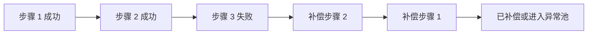

# Seata Saga 模式

> 主文：[[Seata]]。Saga 适用于可补偿的长流程；它不提供 AT/TCC 那样的资源隔离，设计重点是中间状态、补偿和对账。

## 1. 模型

Saga 由一系列本地事务组成：每个正向步骤成功后立即提交；后续步骤失败时，按逆序调用已完成步骤的补偿动作。补偿不是数据库回滚，必须按业务语义实现，并具备幂等性。

## 2. 适用与不适用

| 适合 | 不适合 |
|------|--------|
| 长链路、跨团队、可接受中间状态 | 必须冻结稀缺资源或要求强隔离的场景 |
| 可明确设计补偿/冲正动作 | 外部副作用不可撤销且没有对账兜底的场景 |
| 需要编排、条件分支和异步恢复 | 单库短事务或可用普通本地事务解决的场景 |

## 3. 必备设计

- 每一步有稳定业务唯一键，正向与补偿均幂等。
- 定义可见的中间状态，并限制后续业务基于它继续计算。
- 补偿失败进入重试、异常池、对账和人工处置，不无限重试。
- 对支付、库存等资源明确采用冲正/释放/对账，不能假设“补偿一定成功”。

## 4. 最小状态图

## 5. 验证清单

- [ ] 每个正向动作都有可执行、可审计的补偿动作。
- [ ] 重复执行、乱序补偿和部分成功已测试。
- [ ] 中间状态不触发不可逆下游动作，或有明确冲正方案。
- [ ] 补偿失败可被监控、对账并由人工后台处理。

## 6. 与主文的关系

主文 [[Seata#15. SAGA 模式]] 仅保留模式选择入口；与 TCC 的取舍见 [[Seata#8. 事务模式选择：最终一致与强协调]]。
