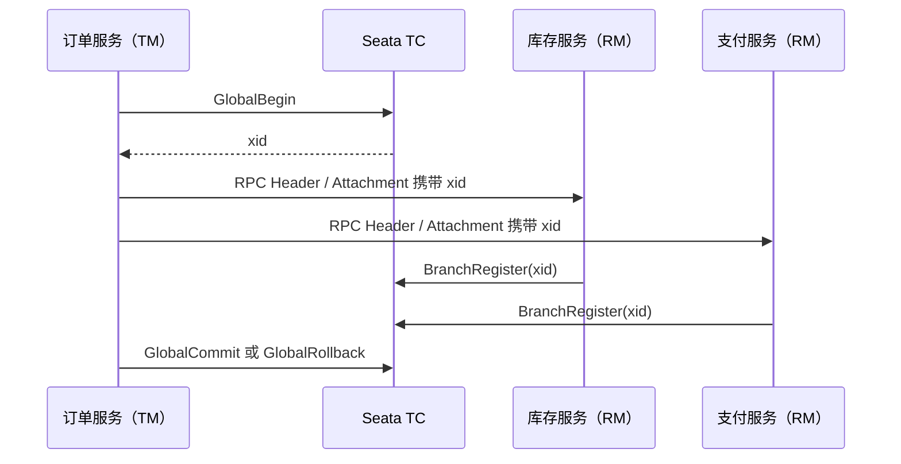

# Seata Spring Cloud 集成

> 主文：[[Seata]]。本文只保留集成机制与验证清单；具体 Starter、Spring Cloud、Feign、Dubbo 版本组合应以项目依赖树和对应版本官方文档为准。

## 1. 三条核心结论

1. `@GlobalTransactional` 在 TM 端开启全局事务并绑定 xid；跨服务调用必须正确传播 xid。
2. AT 依赖 `DataSourceProxy` 接管受控数据源；绕过代理的写路径不受 AT 镜像与全局锁保护。
3. 远程调用完成后必须解绑 xid，线程池、异步任务和消息消费尤其要避免上下文泄漏或错误继承。

## 2. 传播链路

## 3. 集成检查

- [ ] 全局事务入口、HTTP/Feign/Dubbo 拦截器和异步执行器均可追踪 xid。
- [ ] 远程服务入口绑定 xid，退出时在 `finally` 中解绑。
- [ ] 业务数据源由 Seata 代理，且没有直连原始数据源的写路径。
- [ ] 本地 `@Transactional` 与全局事务的传播顺序在集成测试中验证。
- [ ] 覆盖正常提交、下游异常、RPC 超时、重复请求和线程池复用场景。

## 4. 常见误区

| 现象 | 常见原因 | 处理 |
|------|----------|------|
| 下游未注册分支 | xid 未传播或被提前解绑 | 记录 Header/Attachment 与 `RootContext` |
| 分支不受 AT 管理 | 数据源未代理、绕过代理或 SQL 不受支持 | 检查数据源与 AT 支持范围 |
| 无关请求串入 xid | 线程池复用未解绑 | 在任务边界显式 bind/unbind |
| 本地提交成功但全局异常 | 误解 AT 一阶段已提交的语义 | 检查二阶段回滚、`undo_log` 与全局锁状态 |

## 5. 与主文的关系

主文 [[Seata#18. Spring Cloud 集成]] 仅保留入口；AT、TCC、隔离和二阶段语义仍以 [[Seata]] 的相应章节为准。
