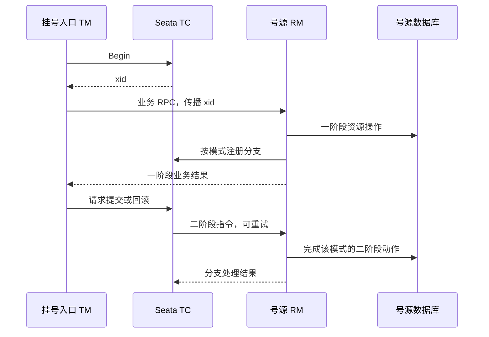
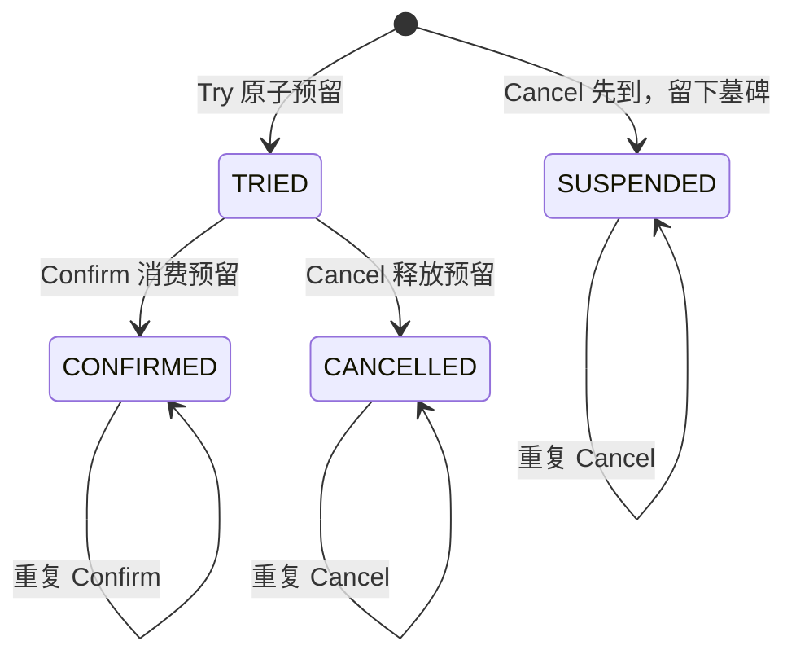

# Seata：从事务边界、两阶段机制到隔离与恢复

> 本文以 **Apache Seata 2.6.0、Java/JDBC、受控关系型数据库**为机制核查基线，核查日期为 2026-10-28。源码链接固定到 `v2.6.0`；官方文档当前展示 v2.6，后续可能滚动更新。Spring Boot、Spring Cloud、数据库与驱动仍须按项目实际组合验证。
>
> 文中的挂号、库存和账户案例用于推导设计，不表示某个现有项目已经采用或验证了这些方案。具体集成与业务模型见 [[Seata项目实践]]，运行与恢复见 [[Seata运维与故障恢复]]。

Seata 解决的是：多个资源已经各自开始执行后，如何记录全局决议，并推动各个分支收敛到对应结果。它不能使网络调用变成一个数据库连接，也不能撤销已经发送的短信、已经完成的第三方扣款或已经被其他系统消费的业务事实。

理解 Seata，要持续区分三件事：**本地数据库是否提交、全局事务是否已经决议、业务结果是否可以对外使用。**它们并不总在同一时刻成立。

## 1. 从两个数据库的失败窗口理解分布式事务

假设挂号服务写挂号库，号源服务写号源库：

```text
挂号库：插入挂号记录 → 提交成功
号源库：扣减剩余号源 → 网络超时
```

超时不能告诉挂号服务号源是否已经扣减。直接重试可能重复扣号，直接删挂号可能留下孤立占用，返回失败也不会自动改变任何已经提交的数据。

单库事务可以依靠同一资源管理器完成原子提交；拆成两个库后，系统需要增加稳定身份、持久状态、协调决议和恢复动作。Seata 提供协调框架，不替代业务唯一键与业务状态机。

### 1.1 原子性、隔离性与可用性不能混为一谈

- 原子性关注参与资源最终是否遵从同一提交或回滚决定。
- 隔离性关注决议期间，其他请求能看见和修改什么。
- 可用性关注协调器或资源异常时，哪些操作还能继续。
- 业务一致性还包括号源不超卖、支付不重复、账务可追溯等领域约束。

自动补偿并不意味着任意读请求都看不到中间状态；有全局锁也不意味着所有数据库连接都会遵守它。能重试不意味着无限时间后一定成功：日志丢失、业务数据被外部改写或补偿接口永久不可用，都可能使自动恢复失去前提。

### 1.2 先判断是否真的需要全局事务

号源表和挂号表在同一库、能由一个本地事务提交时，优先使用本地事务。服务类拆成两个 Java 类，并不构成分布式事务需求。

跨库短链路、资源都受控时再评估 AT/XA；需要显式资源预留时评估 TCC；跨机构且等待时间较长时，通常需要业务流程、可靠消息、状态查询与补偿。不要为了统一技术名词，把用户支付等待、医保调用和票据开具装进同一个长时间全局事务。

## 2. TM、TC、RM：三个角色如何共同完成一笔事务

| 角色 | 负责的事实 | 不负责的事情 |
| --- | --- | --- |
| TM | 定义全局边界，发起 Begin，按执行结果请求提交或回滚 | 不直接控制所有远程数据库连接 |
| TC | 保存全局与分支状态，处理协调请求，驱动二阶段恢复 | 不知道“这笔退款是否符合业务规则” |
| RM | 注册受控资源分支，执行相应模式的一阶段与二阶段动作 | 不替业务判断重复订单或外部支付结果 |

一个服务可以既是 TM 又是 RM：入口方法开启全局事务，同时访问自己的数据库。反过来，服务收到携带 XID 的 HTTP 请求，也不等于它一定注册了分支；还要有受控资源操作或 TCC 等参与者实际加入。

### 2.1 三种身份不能相互替代

| 身份 | 生命周期与用途 |
| --- | --- |
| `requestId` | 一次调用的追踪标识；重试可能产生新值 |
| 业务操作键 | 同一业务意图的稳定身份，如挂号申请号、支付单号 |
| `xid` / `branchId` | 一次全局事务及其中一个分支的协调身份 |

同一支付单重试产生两个 XID，两笔全局事务可以各自“正确完成”，业务却被扣了两次。分支幂等与业务幂等必须分别设计。

### 2.2 调用链与协调链是两条链



图中分支注册与业务操作的精确先后取决于模式，不能把 AT 的注册时点套到 TCC。业务 HTTP/Feign/Dubbo 调用负责传播事务身份；TM/RM 与 TC 的协调通信负责注册、决议和恢复，两者的超时与错误含义不同。

Java 客户端通过 Netty 协调通信建立连接、注册资源和处理二阶段请求。心跳只能发现通信活性，不能证明数据库可用、Try 已结束或所有事务已恢复。固定心跳间隔、线程数和重连时间应查目标版本配置，不应作为架构定律记忆。

### 2.3 决议与执行进度不同

```text
全局尚未决议
    ├─ 提交决定成立 → 分支提交执行中 → 提交完成
    └─ 回滚决定成立 → 分支回滚执行中 → 回滚完成
```

这是语义图，不是全部框架枚举。恢复任务是在推进已确定的方向。部分 Confirm 成功、另一部分暂时失败时，不能因为调用方等不及就把已提交的全局事务改成回滚。

“接口超时”“客户端收到异常”“TC 已决议”“所有分支二阶段完成”也不是同一事件。对调用方返回结果未知并提供按业务单查询，比把所有异常都翻译成“交易失败，请重新支付”更准确。

## 3. AT 一阶段：业务已提交，为什么仍然能回滚

AT 使用 JDBC 数据源代理识别受支持的 DML，采集变更前后的行数据，并把补偿所需信息写入业务库 `undo_log`。它依赖数据库本地事务能力，但二阶段回滚是一个新的本地补偿事务。

### 3.1 以扣减号源为例展开执行路径

```sql
UPDATE schedule_slot
SET available = available - 1
WHERE id = ? AND available >= 1;
```

假设原值为 10，影响一行。典型 UPDATE 路径是：

1. 代理解析 SQL，识别表、条件和主键，读取变更前镜像。
2. 执行业务 DML，数据库本地锁保护这一阶段的并发修改。
3. 读取变更后镜像，形成该连接事务内的回滚信息与锁键。
4. 本地提交前向 TC 注册分支并申请相应全局锁。
5. 注册成功后，将 `undo_log` 写入同一个本地事务。
6. 提交业务数据与 `undo_log`，释放本地事务持有的数据库锁。

Seata 2.6.0 的 `ConnectionProxy.processGlobalTransactionCommit()` 中，可以看到 `register()`、`flushUndoLogs()`、底层连接 `commit()` 的顺序。前后镜像通常先构建在连接上下文中，不能把“采集镜像”与“日志记录已经提交”混为一谈。

一条本地事务可以包含多条 DML；不能按“一次 Mapper 调用一个分支”统计事务数量。没有显式本地边界时还要考虑代理对自动提交连接的处理，因此项目应明确需要原子提交的本地操作范围。

### 3.2 全局锁失败时为什么不能继续本地提交

全局锁表明另一个未完成全局事务可能仍需要恢复这行。当前分支即使已执行 DML，只要本地尚未提交，仍可回滚并释放数据库锁。

如果跳过全局锁失败继续提交，前一笔事务的后镜像就可能失效。框架的重试、回滚与锁冲突策略，是保护恢复条件的组成部分；把异常吞掉继续返回成功会破坏这层约束。

### 3.3 “框架先查后改”不要求应用先查再改

条件扣减 SQL 同时表达“资源足够”和“扣减资源”，在数据库中原子执行。应用必须检查影响行数；0 行代表条件不满足或目标不存在，不能继续按扣减成功处理。

应用先普通 SELECT，随后按读取值 UPDATE，反而可能产生检查与修改之间的并发窗口。是否使用版本号、行锁或条件更新，应由业务并发约束决定，不是 AT 强制要求。

`available = available - 1` 不是 AT 天生无法处理的危险语法。真正的问题是：SQL 是否受支持、是否有业务去重、是否存在热点，以及其他写入是否遵守同一个协调域。改成 `available = 9` 也不会自动获得幂等性，反而可能覆盖后来合法变更。

## 4. AT 二阶段：提交清理与回滚补偿是两条不同路径

### 4.1 全局提交不需要再提交一次业务 DML

AT 一阶段的业务修改已在数据库成立。全局提交后，RM 对 `undo_log` 做异步、批量清理；TC 按事务推进管理全局锁与会话状态。

因此，看到业务值已变化不能证明全局提交；看到 `undo_log` 暂时还在也不能直接断言全局未提交。业务提交、协调终态、异步清理需要分别观测。

不能机械回答“一个 AT 分支固定两次 JDBC 事务”：一阶段有业务本地事务，回滚有补偿事务，提交清理可能合批；TC 若使用 DB 存储，还会有独立存储事务。

### 4.2 回滚需要后镜像校验，不是直接覆盖旧值

设一阶段产生：`before=10，after=9`。回滚时读取当前数据：

| 当前镜像 | 可作出的判断 |
| --- | --- |
| 与后镜像一致 | 在校验范围内未发现额外变更，可以继续执行补偿 |
| 与前镜像一致 | 已达到原状态，可以避免再次恢复 |
| 与前后镜像均不一致 | 存在脏数据风险，不能盲目覆盖 |

2.6.0 的 `AbstractUndoExecutor.dataValidationAndGoOn()` 会进行镜像比较；当修改前后本来相等时，也可跳过无意义补偿。这里的相等基于框架记录和比较的字段，不是对整个数据库的全局证明。

```text
T1：10 → 9，一阶段提交
外部脚本：9 → 20，绕过全局锁
T1：收到回滚指令
当前 20 不等于后镜像 9，也不等于前镜像 10
结果：报告脏数据，保留人工核对条件
```

不要把原理示意 `UPDATE ... WHERE value = afterValue` 当成所有数据库上真实生成的 SQL。实现会查询、校验，再由方言执行器生成补偿语句；主键、数据类型与字段配置都参与处理。

关闭数据校验以“让回滚成功”，可能只是把别人的有效更新覆盖掉。恢复工作的目标是业务事实正确，不是把异常计数清零。

### 4.3 回滚先到，日志还没出现怎么办

一个隐蔽窗口是：分支已经注册，但一阶段本地事务尚未提交，TC 因超时发来回滚。简单地“查不到 undo_log 就返回成功”，可能放过随后才提交的一阶段。

`AbstractUndoLogManager` 在相应路径下写入 `GlobalFinished` 防御记录；它与正常 undo 记录使用同一分支唯一约束，让迟到的一阶段日志写入发生冲突，从而阻止业务与正常日志继续提交。并发插入冲突还需要重试重新判断，而不是按缺失永久成功。

这个机制依赖正确的官方 DDL、本地原子性与唯一约束。删掉防御记录、复制残缺的旧版 undo 表结构，都会改变恢复协议。

### 4.4 undo_log 的镜像不是数据库物理快照

`rollback_info` 保存序列化的补偿信息，可能压缩，不能一律当作可直接查询的 JSON。行镜像与数据库自身的 undo、redo、binlog 是不同层次的日志。

日志字段集合还受 SQL 类型、数据库适配及如 `client.undo.onlyCareUpdateColumns` 等配置影响，不能宣称永远保存所有列。AT 回滚也不会恢复自增序列、外部 HTTP 调用或任意触发器副作用。

## 5. 两层锁与全局可见性

### 5.1 数据库锁和全局锁保护的时间不同

| 维度 | 数据库本地锁 | AT 全局锁 |
| --- | --- | --- |
| 管理者 | 数据库 | TC |
| 典型身份 | 行、索引记录、间隙等 | 资源、表、主键形成的锁键 |
| 保护范围 | 本地事务并发 | 遵守该协调域的全局写入与锁检查 |
| 释放时机 | 本地提交或回滚 | 随全局事务处理按协议释放 |
| 普通数据库连接是否遵守 | 是 | 不会自动遵守 |

全局锁不是数据库范围锁。范围查询涉及的间隙、尚不存在的行，不能简单映射成一组当前已有主键的全局锁。

同一物理库被两套独立 TC 状态域管理，也可能形成相互不可见的全局锁。事务分组名称不同本身不构成隔离保证；必须检查实际协调域和资源标识。

### 5.2 为什么全局锁和本地锁可能互相等待

```text
A：一阶段完成，保留全局锁，释放本地锁
B：拿到同一行本地锁，等待 A 的全局锁
A：全局回滚，需要重新取得本地锁，却被 B 阻挡
```

等待不应无限延长。框架的冲突回滚策略、本地锁等待超时和重试机制帮助打破僵局，但若上层立即大量重试，仍会形成持续拥塞。单纯增大重试次数可能让本地锁占用更久。

### 5.3 AT 默认允许读到全局未决数据

一阶段提交后，普通 SELECT 可以读到新值；全局事务仍可能随后回滚。这是“全局层面的读未提交”，不是数据库被改成了 READ UNCOMMITTED。

将 MySQL 从 RC 改为 RR，不能让它知道 TC 是否已决议。RR 的一致性快照也不是跨多个业务数据库的统一全局快照。

`@GlobalTransactional` 同样不会把所有普通 SELECT 自动变成强隔离读。某笔查询是否受保护，取决于 SQL、连接代理、事务上下文与锁检查路径。

### 5.4 @GlobalLock 的实际作用与边界

对于不新建全局事务、但需要参与全局锁检查的本地操作，可以使用 `@GlobalLock`。典型关键读取组合是：**受代理的数据源 + 本地事务 + SELECT FOR UPDATE + 全局锁检查**。

它不等于长期占有一把新的全局锁，也不会让普通 SELECT 自动检查每行全局状态。校验失败必须使整个本地操作失败或重试，不能拿着之前读出的值继续调用支付、发消息。

锁读得到某行可用，不表示后续跨多个数据库的普通读是统一快照。锁读还会增加本地锁竞争；展示页面通常应读取明确的业务处理状态，而不是对所有查询无差别加锁。

## 6. AT 隐藏边界：代理能看到什么，才能补偿什么

### 6.1 SQL 与数据库适配不是装上 Starter 就成立

需逐项验证数据库与驱动、主键、批量语句、特殊类型、多表 DML、SQL 方言与动态数据源。MyBatis/MyBatis-Plus 负责生成 SQL，最终是否受 AT 管理取决于它实际使用的连接。

触发器跨表插入、存储过程内部修改不一定经过 JDBC 代理逐条采集。即使主表镜像完整，触发器写入的其他表也不自动拥有对应 undo。补偿 SQL 再次触发触发器时，还可能产生新的副作用。

默认值、自动更新时间、生成列应在目标数据库上验证正常写入与回滚，不用“同一数据库事务里发生”推导“AT 全都能恢复”。

### 6.2 表结构变更会影响未完成事务

一阶段保存旧结构镜像，回滚时表却已删列、改类型或改主键，会增加解析和恢复失败风险。数据发布不能只看新应用是否能启动，还要兼容仍在恢复的旧事务与日志。

大批量更新会扩大镜像体积、锁键集合、网络包与补偿成本。拆分能降低峰值，但也把一次整体原子操作改成多次独立操作，必须得到业务语义允许。

### 6.3 本地提交回调不能证明全局成功

Spring 本地事务的 `afterCommit` 发生时，AT 全局事务可能尚未决议。此时发送“挂号完成”消息，下游可能叫号，随后全局回滚却无法撤回叫号。

同理，普通 Outbox relay 能读到一阶段提交的待发记录，不意味着该事件已经具备对外发布资格。缓存刷新、CDC 订阅和异步索引也存在这个窗口。具体发布栅栏见 [[Seata项目实践]]。

## 7. XA：把未决状态留在数据库资源中

XA 模式由支持 XA 的数据库资源保存 prepared 分支。资源承诺后续可根据协调决定提交或回滚，期间通常继续保留必要锁与恢复状态。

```text
XA START → 执行业务 SQL → XA END → XA PREPARE
                                      ├─ XA COMMIT
                                      └─ XA ROLLBACK
```

XA 的 `END` 不是提交；`PREPARE` 也不是已完成业务事务。Seata XA 不依赖 AT 的 `undo_log`，其恢复依据在资源自身的 XA 能力和 TC 协调状态中。

### 7.1 与 AT 的关键差异

AT 通过先本地提交、再补偿缩短本地锁持有；XA 将资源保持在未决事务状态等待二阶段。XA 避免 AT 一阶段提交导致的那类可见性窗口，但不能据此推导任意跨库查询都具有全局串行化快照。

XA 的成本主要包括 prepared 状态下的锁与资源占用、故障后的疑难事务恢复、数据库和驱动实现差异。它不必然在所有负载下慢于 AT；AT 的镜像、热点全局锁和补偿开销也可能很高。

### 7.2 XA 未决不是重启应用就会消失

协调请求丢失时，数据库可能继续保存 prepared 分支。故障处理需关联 Seata 分支与数据库 XA 身份，确认持久决议，再按数据库和框架恢复流程完成操作。

不能仅凭“存在很久”就手工 XA ROLLBACK；其他资源可能已按提交决定完成。错误的人工决议会把可恢复的不确定状态变成真实不一致。

## 8. TCC：把恢复能力设计为业务资源状态

TCC 的 Try 负责检查与预留，Confirm 消费预留，Cancel 释放预留。它通常由三个各自独立的本地事务实现，而不是一个数据库事务从 Try 一直开到 Confirm。

以 10 个号源为例：

| 阶段 | available | frozen | used |
| --- | ---: | ---: | ---: |
| 初始 | 10 | 0 | 0 |
| Try 预留 1 个 | 9 | 1 | 0 |
| Confirm | 9 | 0 | 1 |
| 或 Cancel | 10 | 0 | 0 |

资源守恒：`available + frozen + used = total`。预留占用业务资源，不需要跨整个全局生命周期持有同一数据库行锁；各阶段修改本地数据时仍然需要数据库并发控制。

### 8.1 Try 成功是一份可兑现的承诺

Try 只查“余量大于 0”而不预留，两笔事务都可能认为自己有最后一个号源。把全部校验推到 Confirm，等于把业务失败留到全局提交决定之后。

合理的 Confirm 使用 Try 已确定的资源和参数，尽量不引入库存不足、价格变更等新的业务拒绝条件。数据库故障等技术异常仍然可能发生，因此 Confirm 必须可重试、可恢复。

对冻结余额，Confirm 是消耗冻结并形成对应账务事实；Cancel 是释放冻结。外部渠道已经完成扣款后发起退款，是新的业务操作，不能简单冒充同一 TCC Cancel。

### 8.2 幂等、空回滚、防悬挂是一套状态协议



SUSPENDED 表示“未发生预留，但该分支已取消”，后续 Try 必须拒绝。查不到记录直接返回成功，没有留下墓碑，就没有解决迟到 Try。

CONFIRMED 后收到 Cancel，不能再执行释放；CANCELLED 后收到 Confirm，不能再扣资源。冲突指令应报告状态异常并核对决议，不能用“全部返回 true”掩盖错误。

记录状态、修改资源、写必要流水必须在同一个本地事务中。否则可能出现“状态显示已确认，资源仍冻结”，重试又被幂等逻辑直接挡住。

### 8.3 Fence 解决协调重复，不替代业务唯一键

2.6.0 的 `@TwoPhaseBusinessAction` 提供 `useTCCFence`，默认未开启。Spring Fence 实现使用本地事务模板，把 Fence 状态和业务回调放在对应事务中；空回滚写入防悬挂状态，二阶段用状态条件控制执行。

本版本应查看公共 `SpringFenceHandler`、`CommonFenceStore` 和对应 DDL，不能只按旧文章寻找 `TCCFenceHandler` 或手抄简化的旧 `tcc_fence_log` 表。框架预留接口、Spring 自动配置和实际选中的数据源都要核实。

Fence 与业务数据若分属两个独立数据源，本地事务原子性不会凭空成立。业务回调另起独立事务、异步写库、发外部请求，也可能逃出 Fence 的原子范围。

Fence 的 Try 冲突处理不等同于“重复请求返回上次成功结果”；Try 返回 `false` 也不自动代表本地事务回滚。实际集成需分别处理本地回滚、全局失败传播和业务去重，具体差异见 [[Seata项目实践]]。

即使 Fence 完全正确，同一支付单新建两个分支仍需要业务去重。业务唯一约束必须在本地事务内参与资源预留，不能靠先查询“没处理过”再插入来防并发重复。

### 8.4 超时不能取消正在运行的旧线程

TC 开始回滚，并不表示旧 Try 已从线程池、网络队列或数据库中被移除。墓碑、唯一约束和本地事务用于处理迟到与并发执行；线程中断不是持久状态协议的替代品。

冻结时间到期也不能让定时任务盲目释放资源：全局事务可能已决定提交，只是 Confirm 尚未完成。按协议查询和核对决议，才能决定推进确认还是取消。

## 9. Saga：用业务补偿恢复长流程

Saga 将流程拆成可持久追踪的本地步骤。以“提交申请、预约检查、创建外部服务单”为例，后续失败时执行撤销预约、取消服务单等补偿。补偿是新的业务动作，通常保留原始流水，不是删除历史。

Seata 提供状态机编排能力；2.6.0 源码也包含 Saga 注解参与者相关 API。本文讨论状态机流程模型，不把 TCC 的 Fence 或 AT 数据源代理当成 Saga 自动拥有的能力。

### 9.1 持久化执行进度是恢复的基础

需要记录流程实例、业务唯一键、步骤输入、执行结果、补偿状态和版本。进程崩溃后恢复依据是持久记录，而不是内存中执行到了哪一行。

正向调用已成功但响应丢失时，执行器可能只知道 UNKNOWN。此时跳过该节点补偿，会漏掉真实效果；直接重复调用，又可能重复预约。步骤接口需要稳定操作键、查询结果能力，以及可重试或可安全处理空补偿的协议。

### 9.2 补偿不提供天然隔离

预约成功到补偿之间，其他流程可能已经使用预约结果。若它触发不可逆动作，补偿原节点也不能撤回所有派生影响。

业务可用 PENDING 状态、语义预留、版本校验限制中间状态的使用；这些是应用额外设计。补偿顺序还要遵守依赖关系，不能把任意并行流程机械地当成简单逆序列表。

### 9.3 失败恢复有两条方向

业务拒绝通常引导补偿；短暂技术故障可能通过重试继续向前。不可逆节点之后，可能只能补齐剩余步骤或建立冲正流程。

退款不是扣款的数学负号：它有自己的业务单号、渠道状态和失败窗口。补偿失败必须暴露为待恢复状态，配合退避、对账和人工处理；“进入异常池”是需要建设的业务能力，不是写上 Saga 就自动拥有。

## 10. 如何按约束选择模式

| 约束 | 优先评估 | 必须付出的成本 |
| --- | --- | --- |
| 同一库内原子写入 | 本地事务 | 本地锁、幂等与约束 |
| 多个受控数据库、短链路、支持的 DML | AT | 镜像、全局锁、未决可见性、写路径治理 |
| 资源具备 XA，要求资源层保留未决状态 | XA | prepared 资源占用、恢复与数据库兼容性 |
| 号源、余额、额度可以显式预留 | TCC | 业务侵入、状态机、冻结治理与幂等 |
| 长流程、参与方独立、能定义业务补偿 | Saga 或业务流程编排 | 中间状态、结果未知、补偿与运营能力 |
| 本地事实成立后异步通知其他域 | 本地事务 + Outbox | 重复投递、消费幂等、积压与对账 |

不以“金融必须 TCC”“AT 不能高并发”“TCC 一定最快”作结论。先写出不变量、参与方能力、可见性要求和故障恢复目标，再用真实负载验证。

跨模式组合也不是把注解叠加起来：同一资源不能一边由 TCC 释放冻结，一边又被 AT 镜像覆盖。谁拥有资源状态、谁负责补偿、如何确定发布资格，必须有唯一清晰的责任边界。

## 11. 机制核查依据

- [AT 官方机制](https://seata.apache.org/docs/dev/mode/at-mode/)与[事务隔离说明](https://seata.apache.org/docs/user/appendix/isolation/)：一阶段提交与全局锁边界。
- [2.6.0 ConnectionProxy](https://github.com/apache/incubator-seata/blob/v2.6.0/rm-datasource/src/main/java/org/apache/seata/rm/datasource/ConnectionProxy.java)：注册、日志落库、本地提交顺序。
- [2.6.0 AbstractUndoExecutor](https://github.com/apache/incubator-seata/blob/v2.6.0/rm-datasource/src/main/java/org/apache/seata/rm/datasource/undo/AbstractUndoExecutor.java)与[AbstractUndoLogManager](https://github.com/apache/incubator-seata/blob/v2.6.0/rm-datasource/src/main/java/org/apache/seata/rm/datasource/undo/AbstractUndoLogManager.java)：镜像校验、防御记录与补偿。
- [2.6.0 TwoPhaseBusinessAction](https://github.com/apache/incubator-seata/blob/v2.6.0/tcc/src/main/java/org/apache/seata/rm/tcc/api/TwoPhaseBusinessAction.java)与[SpringFenceHandler](https://github.com/apache/incubator-seata/blob/v2.6.0/spring/src/main/java/org/apache/seata/rm/fence/SpringFenceHandler.java)：Fence 开关及本地事务处理。
- [XA 官方说明](https://seata.apache.org/docs/user/mode/xa/)与[Saga 官方说明](https://seata.apache.org/docs/user/mode/saga/)：模式能力与恢复模型。

本文核对了文档与固定版本源码，没有将源码阅读表述为完整集群故障实测。
