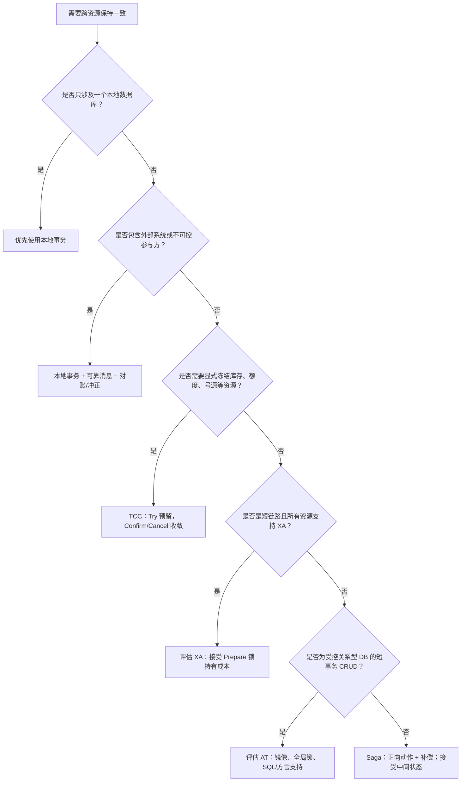
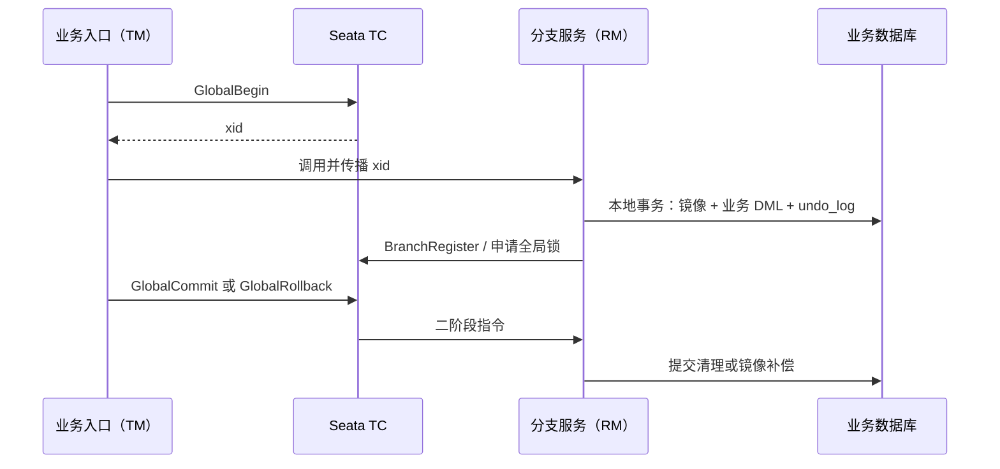

# Seata

[TOC]
- [1. Seata基础](#1-seata基础)
- [2. XA事务模式](#2-xa事务模式)
- [3. AT模式](#3-at模式)
- [4. TCC模式](#4-tcc模式)
- [5. AT 核心机制与边界](#5-at-核心机制与边界)
- [6. AT 性能、稳定性与降级](#6-at-性能稳定性与降级)
- [7. TCC 核心机制与可靠性](#7-tcc-核心机制与可靠性)
- [8. 事务模式选择：最终一致与强协调](#8-事务模式选择最终一致与强协调)
- [9. 综合场景：医疗挂号、支付与医保](#9-综合场景医疗挂号支付与医保)
- [10. 调用链路：从业务请求到二阶段](#10-调用链路从业务请求到二阶段)
- [11. Seata的3个核心表](#11-seata的3个核心表)
- [12. Seata架构与通信机制](#12-seata架构与通信机制)
- [13. 事务隔离与读一致性](#13-事务隔离与读一致性)
- [14. 异常场景处理（空回滚/幂等/悬挂）](#14-异常场景处理空回滚幂等悬挂)
- [Seata Saga 模式](Seata-SAGA.md)
- [15. SAGA 模式](#15-saga-模式)
- [Seata 性能优化运行手册](Seata-性能优化.md)
- [Seata 高可用部署运行手册](Seata-高可用部署.md)
- [Seata 监控与故障排查运行手册](Seata-监控与故障排查.md)
- [16. 性能优化](#16-性能优化)
- [17. 高可用部署](#17-高可用部署)
- [Seata Spring Cloud 集成](Seata-Spring%20Cloud%20集成.md)
- [18. Spring Cloud 集成](#18-spring-cloud-集成)
- [19. 监控与故障排查](#19-监控与故障排查)
- [Seata 自测题](Seata-自测题.md)
- [20. 自测与复习](#20-自测与复习)

> **阅读路径与版本边界**
>
> - 初学：按 `1 → 2/3/4 → 11 → 13 → 14 → 15` 阅读；需要 Saga、Spring Cloud 集成、压测、部署和值班时转入对应专题文档。第 5～9 章用于把核心机制落到场景，第 20 章仅作为自测入口，避免与正文重复。
> - 本文同时包含多个 Seata 版本的配置与源码片段。`store.mode`、客户端配置键、存储实现和 SQL 支持范围均可能随版本变化；落地时应以项目实际依赖版本的官方文档、默认配置和集成测试为准。
> - 文中的 Java、YAML 和 SQL 如未明确标注版本或可运行项目，均应视为**机制示意**，不可直接复制到生产环境。

# 1. Seata基础

## 1.1 Seata 的三个核心角色
Seata 采用 **TC（事务协调者）、TM（事务管理者）、RM（资源管理者）** 进行事务管理。

| **角色**                                  | **简称** | **作用**                                                 |
| ----------------------------------------- | -------- | -------------------------------------------------------- |
| **事务协调者（Transaction Coordinator）** | **TC**   | 维护全局事务的状态，协调全局事务的提交或回滚             |
| **事务管理者（Transaction Manager）**     | **TM**   | 负责定义全局事务的范围，向 TC 发起全局事务               |
| **资源管理者（Resource Manager）**        | **RM**   | 管理分支事务（如本地数据库事务），并向 TC 申请提交或回滚 |

## 1.2 Seata 事务流程流程

假设 **订单服务（order-service）** 需要调用 **库存服务（stock-service）** 和 **支付服务（pay-service）**，并保证事务一致性，Seata 事务的执行流程如下：
1. **TM 向 TC 申请开启全局事务**：
    - `order-service` 作为事务发起者（TM），向 Seata Server（TC）注册一个全局事务，TC 生成全局事务 ID。
2. **RM 向 TC 注册分支事务**：
    - 参与全局事务且实际执行了受 Seata 管理的资源操作的服务，会在相应分支执行时向 TC 注册分支事务；并非所有被调用服务都会无条件注册分支。
3. **业务执行**：
    - `order-service` 调用 `stock-service` 扣减库存。
    - `order-service` 调用 `pay-service` 进行支付。
4. **提交或回滚**：
    - **业务成功**：TM 通知 TC 提交全局事务，TC 协调各 RM 完成相应模式的二阶段动作。AT 的本地事务已在一阶段提交，二阶段提交主要是确认并异步清理 `undo_log`；XA 才是在二阶段提交数据库事务。
    - **业务失败**：TM 通知 TC **回滚事务**，TC 按事务模式协调 RM 执行二阶段动作：AT 对已提交的一阶段数据做镜像补偿，XA 回滚 prepared 分支，TCC 则执行 Cancel。

## 1.3 Seata 架构示意图
```text
+----------------------+        +----------------------+        +----------------------+
|     订单服务 (TM)    |        |     库存服务 (RM)    |        |     支付服务 (RM)    |
|  startGlobalTx()    |        |  branchRegister()    |        |  branchRegister()    |
+----------------------+        +----------------------+        +----------------------+
               \                        |                           /
                \                       |                          /
                 \                      |                         /
                  +--------------------------------------------------+
                  |                   Seata Server (TC)            |
                  | 1. 开启事务         2. 注册分支事务               |
                  | 3. 事务提交/回滚                                    |
                  +--------------------------------------------------+
```

## 1.4 Seata 三个角色的详细职责

### 1.4.1 事务管理者（TM）
- **作用**：定义全局事务的范围，负责发起和控制事务。
- **主要 API**：
    - `beginGlobalTransaction()`: 开启全局事务
    - `commitGlobalTransaction()`: 提交事务
    - `rollbackGlobalTransaction()`: 回滚事务
- **示例代码**：
    ```java
    @GlobalTransactional
    public void createOrder() {
        // 扣减库存
        stockService.reduceStock();
        // 进行支付
        paymentService.pay();
    }
    ```

### 1.4.2 资源管理者（RM）
- **作用**：管理本地事务，向 TC **注册分支事务** 并执行提交/回滚。
- **主要 API**：
    - `branchRegister()`: 注册分支事务
    - `branchCommit()`: 提交本地事务
    - `branchRollback()`: 回滚本地事务
- **示例代码**（库存服务 `StockService`）：
    ```java
    @Transactional
    public void reduceStock(String productId, int count) {
        stockDao.decreaseStock(productId, count);
        if (count > 10) {
            throw new RuntimeException("库存不足，事务回滚");
        }
    }
    ```

### 1.4.3 事务协调者（TC）
- **作用**：管理全局事务状态，协调 **事务提交或回滚**。
- **主要功能**：
    - 维护 **全局事务表**
    - 维护 **分支事务表**
    - 处理事务超时、回滚、恢复机制
- **存储方式**：
    - `store.mode` 的默认值与可选项取决于 Seata 版本；常见模式包括 `file`、`db`、`redis` 与较新版本的 `raft`。
    - `file` 适合单机开发或演示，不能据此推导为高可用部署；生产部署需要根据目标版本评估 DB、Redis 或 Raft 的一致性、恢复与运维边界。

## 1.5 Seata 事务模式

| **模式**                      | **适用场景**                  | **特点**           |
| ----------------------------- | ----------------------------- | ------------------ |
| **AT（自动事务）**            | 受支持的关系型数据库、短事务 | 数据源代理生成镜像并自动补偿 |
| **TCC（Try-Confirm-Cancel）** | 资源预留、需要业务语义控制的流程 | 业务定义冻结、确认与取消 |
| **Saga（长事务）**            | 可补偿的长流程、跨服务编排 | 正向动作与补偿动作，通常不提供隔离 |
| **XA（强一致性）**            | 支持 XA 的资源、可接受锁持有成本 | 基于 XA/2PC，由资源管理器 prepare/commit |

### 1.5.1 模式选型决策树



> 决策树用于缩小方案范围，不替代风险评估：资金账本、外部支付、税票等不可逆副作用仍应以可追溯流水、对账和冲正为准。

### 1.5.2 AT 模式（自动事务）
- 适用于当前 Seata 版本支持的关系型数据库与 JDBC 数据源；MySQL/InnoDB 是常见组合，但不是唯一前提。
- **回滚方式**：在 `undo_log` 表中存储事务数据，事务失败时进行回滚。

### 1.5.3 TCC 模式（Try-Confirm-Cancel）
- 适用于 **金融支付**、**订单系统**，业务需要实现 `Try()`、`Confirm()`、`Cancel()` 方法。
- **示例**
    ```java
    public class PaymentTCC implements TccAction {
        public boolean tryPayment(...) { /* 校验并冻结资源，在本地事务中提交预留状态 */ }
        public boolean confirmPayment(...) { /* 提交扣款 */ }
        public boolean cancelPayment(...) { /* 退款 */ }
    }
    ```

## 1.6 Seata 部署架构

### 1.6.1 Seata Server（TC） 部署
- 可以使用 **Docker 部署** Seata Server，示例如下：
    ```sh
    docker run -d --name seata-server \
        -p 8091:8091 \
        -e SEATA_IP=192.168.1.100 \
        -e STORE_MODE=db \
        seataio/seata-server
    ```

### 1.6.2 数据库初始化（AT 模式）

AT 分支的业务库需要 `undo_log`。标准示例 DDL 与订单/库存表统一维护在 [3.4.1 数据库表](#341-数据库表)；实际建表脚本必须与项目使用的 Seata 版本和数据库类型匹配。

## 1.7 总结

| **角色**             | **作用**                         | **示例                 |
| -------------------- | -------------------------------- | ---------------------- |
| **事务管理者（TM）** | 负责 **开启/提交/回滚** 全局事务 | `@GlobalTransactional` |
| **资源管理者（RM）** | 管理 **本地数据库事务**          | `branchRegister()`     |
| **事务协调者（TC）** | 维护事务状态，协调提交/回滚      | `Seata Server`         |

# 2. XA事务模式
## 2.1 什么是 XA 事务？
XA 是 **X/Open 组织** 提出的 **分布式事务协议**，其核心思想是：
    - **通过事务协调者（Transaction Manager, TM）管理多个数据库（Resource Manager, RM）**，确保事务的 **原子性（Atomicity）** 和 **一致性（Consistency）**。
    - XA 事务包含 **两阶段提交（2PC）**，分为 **Prepare** 和 **Commit / Rollback** 阶段。

## 2.2 XA 事务的两阶段提交

| **阶段**                          | **操作**                        | **说明**                                 |
| --------------------------------- | ------------------------------- | ---------------------------------------- |
| **第一阶段（Prepare, 预提交）**   | **TM 询问所有 RM 是否可以提交** | RM 执行业务 SQL，并通过 XA `PREPARE` 将分支置为可提交/可回滚的 prepared 状态；**不使用 Seata AT 的 `undo_log`** |
| **第二阶段（Commit / Rollback）** | **TM 发送提交或回滚命令**       | RM 统一提交或回滚事务                    |

## 2.3 XA 事务执行流程
1. TM 向 RM 发送 `XA START`，开始事务
2. RM 执行 SQL 操作，但不提交
3. TM 发送 `XA PREPARE`，请求预提交
4. 如果所有 RM 反馈 "yes"，TM 发送 `XA COMMIT`
5. 如果有 RM 失败，TM 发送 `XA ROLLBACK`

## 2.4 XA SQL 事务示例
1. XA START 'xid-1001';  -- 事务开始
2. UPDATE account SET balance = balance - 100 WHERE id = 1;
3. XA END 'xid-1001';    -- 事务结束
4. XA PREPARE 'xid-1001'; -- 预提交
5. XA COMMIT 'xid-1001';  -- 提交事务

## 2.5 Seata XA 事务模式
### 2.5.1 引入 Seata 依赖

```java
    <dependency>
        <groupId>io.seata</groupId>
        <artifactId>seata-all</artifactId>
        <version>1.5.2</version>
    </dependency>
```

### 2.5.2 配置 Seata XA 模式
```yaml
    seata:
    tx-service-group: my_xa_tx_group
    service:
        vgroup-mapping:
        my_xa_tx_group: default
    store:
        mode: db  # 使用数据库存储事务日志
```

### 2.5.3 开启全局 XA 事务
```java
    @GlobalTransactional
    public void createOrder(Long userId, BigDecimal amount) {
        orderMapper.createOrder(userId, amount);
        stockService.reduceStock(1, 1); // 扣减库存
    }
```

## 2.6 Seata XA 事务完整示例

### 2.6.1 数据库表

本示例复用 [3.4.1 数据库表](#341-数据库表) 的 `t_order` 与 `t_stock`；XA 是否可用取决于实际数据库、驱动和资源配置，不能仅凭表结构判断。

### 2.6.2 订单服务

```java
    @Service
    public class OrderService {
        @Autowired
        private OrderMapper orderMapper;
        @Autowired
        private StockService stockService;
        @GlobalTransactional
        public void createOrder(Long userId, BigDecimal amount) {
            orderMapper.createOrder(userId, amount);
            stockService.reduceStock(1, 1); // 扣减库存
        }
    }
```

### 2.6.3 库存服务
```java
    @Service
    public class StockService {
        @Autowired
        private StockMapper stockMapper;
        @Transactional
        public void reduceStock(Long productId, int count) {
            int affected = stockMapper.updateStock(productId, count);
            if (affected != 1) {
                throw new RuntimeException("库存不足，回滚事务");
            }
        }
    }
```

## 2.7 Seata XA 事务 vs TCC 事务
| **对比项**   | **XA 事务（两阶段提交）**  | **TCC 事务（Try-Confirm-Cancel）** |
| ------------ | -------------------------- | ---------------------------------- |
| **一致性模型** | 数据库 XA 两阶段提交；资源和协调器可用时提供原子提交/回滚 | 业务资源预留 + Confirm/Cancel，靠幂等、重试与补偿收敛 |
| **事务管理** | **数据库级别事务**         | **业务代码控制**                   |
| **资源占用** | Prepare 后通常持有数据库资源，长事务成本高 | 由业务决定冻结粒度与持有时间，仍需治理热点与超时 |
| **适用场景** | 参与资源支持 XA、链路短且可接受锁持有成本 | 库存、额度、号源等可显式预留和补偿的业务资源 |

## 2.8 Seata XA 事务部署
### 2.8.1 启动 Seata Server
```sh
    docker run -d --name seata-server \
        -p 8091:8091 \
        -e SEATA_IP=192.168.1.100 \
        seataio/seata-server
```
### 2.8.2 部署要点

- Seata Server 的会话/锁存储应按所用版本初始化对应的 Server 端表或 Raft/Redis 等存储，而不是在业务库创建 AT 的 `undo_log`。
- XA 分支要求参与资源、JDBC 驱动和数据库配置实际支持 XA；应通过目标数据库的 XA 配置、故障恢复演练与锁等待监控验证。
- `undo_log` 是 AT 分支的回滚日志；只有同一业务库同时参与 AT 分支时才需要按 AT 的 DDL 创建它，不能把它当作 XA 的部署前置条件。

# 3. AT模式
## 3.1 AT模式概述
- 在当前版本支持的关系型数据库和 JDBC 数据源上自动管理分支事务；MySQL/InnoDB 是常见组合，但不是唯一组合。
- 一阶段通过前后镜像和全局锁实现可补偿更新；受支持的 DML 通常需要可识别的主键/唯一行定位，不能把 AT 理解为无约束的透明回滚。
- 框架可解析受支持的 SQL 并生成镜像，但数据源代理、SQL 方言、表结构和写入路径都必须纳入适配与测试范围。

## 3.2 AT 模式的两阶段提交
AT 模式采用 “两阶段提交（2PC）” 进行事务管理：
| **阶段**                           | **操作**                                       | **数据库变化**                               |
| ---------------------------------- | ---------------------------------------------- | -------------------------------------------- |
| **第一阶段（业务提交）**            | 执行业务 SQL，生成前后镜像并写入 `undo_log`    | **业务数据与 `undo_log` 在同一当地事务中提交** |
| **第二阶段（Commit / Rollback）**  | TC 驱动全局提交或回滚                           | **提交：异步清理 `undo_log`；回滚：按镜像补偿业务数据** |

## 3.3 Seata AT 模式的工作流程
    ```text
    1. TM 开启全局事务（@GlobalTransactional）
    2. RM 在数据库中执行 SQL，并生成 Undo Log
    3. RM 将事务信息注册到 Seata Server
    4. 如果事务成功，Seata Server 发送 “Commit” 指令，删除 Undo Log
    5. 如果事务失败，Seata Server 发送 “Rollback” 指令，回滚 Undo Log
    ```

## 3.4 Seata AT 事务完整示例

### 3.4.1 数据库表
#### 3.4.1.1 订单表
```sql
    CREATE TABLE `t_order` (
    `id` bigint(20) NOT NULL AUTO_INCREMENT,
    `user_id` bigint(20) NOT NULL,
    `amount` decimal(10,2) NOT NULL,
    PRIMARY KEY (`id`)
    );
```

#### 3.4.1.2 库存表
```sql
    CREATE TABLE `t_stock` (
    `id` bigint(20) NOT NULL AUTO_INCREMENT,
    `product_id` bigint(20) NOT NULL,
    `count` int(11) NOT NULL,
    PRIMARY KEY (`id`)
    );
```

#### 3.4.1.3    Seata Undo Log 表
```sql
    CREATE TABLE `undo_log` (
    `id` bigint(20) NOT NULL AUTO_INCREMENT,
    `branch_id` bigint(20) NOT NULL,
    `xid` varchar(100) NOT NULL,
    `rollback_info` longblob NOT NULL,
    `log_created` datetime NOT NULL,
    `log_modified` datetime NOT NULL,
    PRIMARY KEY (`id`),
    UNIQUE KEY `ux_undo_log` (`xid`,`branch_id`)
    );
```

### 3.4.2 引入 Seata 依赖

```xml
    <dependency>
        <groupId>io.seata</groupId>
        <artifactId>seata-all</artifactId>
        <version>1.5.2</version>
    </dependency>
```

### 3.4.3 配置 Seata AT 模式
```yaml
    seata:
        tx-service-group: my_at_tx_group
        service:
            vgroup-mapping:
                my_at_tx_group: default
        store:
            mode: db  # AT 模式基于数据库存储事务日志
```

### 3.4.4 订单服务
```java
    @Service
    public class OrderService {

        @Autowired
        private OrderMapper orderMapper;

        @Autowired
        private StockService stockService;

        @GlobalTransactional  // AT 模式事务
        public void createOrder(Long userId, BigDecimal amount) {
            orderMapper.createOrder(userId, amount);
            stockService.reduceStock(1, 1); // 调用库存服务
        }
    }
```

### 3.4.5 库存服务
```java
    @Service
    public class StockService {
        @Autowired
        private StockMapper stockMapper;
        @Transactional
        public void reduceStock(Long productId, int count) {
            stockMapper.updateStock(productId, count);
            if (count > 10) {
                throw new RuntimeException("库存不足，回滚事务");
            }
        }
    }
```

## 3.5 AT 模式 vs 其他模式

| **对比项**   | **AT 事务（自动事务）**   | **XA 事务（两阶段提交）** | **TCC 事务（Try-Confirm-Cancel）** |
| ------------ | ------------------------- | ------------------------- | ---------------------------------- |
| **一致性**   | **强一致性**（自动回滚）  | **强一致性**              | **最终一致性**                     |
| **事务管理** | **Seata 自动回滚**        | **数据库层 XA 事务**      | **业务代码控制**                   |
| **性能**     | **较高（基于 Undo Log）** | **较低（锁定资源）**      | **较高（无数据库锁）**             |
| **适用场景** | **金融支付、订单管理**    | **银行、转账**            | **库存扣减、秒杀**                 |

## 3.6 Seata AT 事务部署

### 3.6.1 启动 Seata Server
```sh
    docker run -d --name seata-server \
        -p 8091:8091 \
        -e SEATA_IP=192.168.1.100 \
        seataio/seata-server
```

### 3.6.2 数据库模式

业务库的 `undo_log` 使用 [3.4.1.3 Seata Undo Log 表](#3413-seata-undo-log-表) 的标准示例；TC 的会话/锁存储则按当前版本的 Server 端 DDL 与存储模式初始化，二者不要混淆。

## 3.7 AT 事务的优缺点
| **优点**                     | **缺点**                       |
| ---------------------------- | ------------------------------ |
| **自动管理事务回滚**         | **仅支持 MySQL/InnoDB**        |
| **性能高于 XA 事务**         | **不支持 NoSQL（如 Redis）**   |
| **适用于金融、支付、订单等** | **无法应用于高并发（如秒杀）** |

## 3.8 总结
- AT 事务适用于强一致性业务，如金融支付、订单管理。
- Seata AT 模式自动管理 Undo Log，支持事务回滚。
- 相比 XA，AT 性能更高，但不适用于高并发场景（推荐 TCC）。
- 如果你的数据库是 MySQL/InnoDB，AT 事务是最简单的 Seata 事务模式。

# 4. TCC模式

## 4.1 TCC 的本质一句话定性
TCC 是“业务级两阶段提交”，不是数据库级事务。
- AT：依赖数据库 undo_log 自动回滚
- XA：数据库层 2PC
- TCC：你自己写 Try / Confirm / Cancel 三段业务补偿逻辑

## 4.2 Seata TCC 整体架构角色
TCC 里仍然是 Seata 的三大组件：
- TC（Transaction Coordinator）全局事务协调者，负责全局事务状态、分支事务提交 / 回滚调度
- TM（Transaction Manager）发起全局事务的入口（@GlobalTransactional），控制事务的开始、提交、回滚
- RM（Resource Manager）实现 Try / Confirm / Cancel 的微服务，接收 TC 的二阶段指令

TCC 和 AT 最大区别：
- AT：框架 + undo_log 自动做
- TCC：你在业务代码里亲手做

## 4.3 TCC 的完整执行流程（带分支事务）
以医疗挂号支付为例：
- 订单服务：创建订单
- 库存服务：冻结号源
- 支付服务：冻结金额

### 4.3.1 一阶段：Try（尝试执行）
```java
    //TM 开启全局事务：
    @GlobalTransactional
    public void createOrder() {
        orderService.create();          // 本地事务
        stockService.tryFreeze();       // TCC Try
        paymentService.tryFreeze();     // TCC Try
    }
```
- **预留资源**
    - 不做最终提交
    - 库存：冻结号源（扣 frozen_count，不扣 real_count）
    - 支付：冻结余额（扣 frozen_amount，不扣 real_amount）

- **Try 成功后：**
    - TC 注册分支事务
    - 状态：全局事务进入“准备提交”

### 4.3.2 二阶段-成功：Confirm（正式提交）
```java
    //如果 Try 全部成功：
    stockService.confirm();
    paymentService.confirm();
```

- **最终数据**
    - 库存：frozen → real 扣减
    - 支付：冻结金额 → 实际扣款

### 4.3.3 二阶段-失败：Cancel（业务回滚）
```java
    //如果任意一个 Try 失败：
    stockService.cancel();
    paymentService.cancel();
```

- **业务回滚：**
    - 库存：frozen → real 解冻
    - 支付：冻结金额 → 实际解冻

## 4.4 TCC的三大工程级难题

### 4.4.1 幂等问题（Confirm/Cancel 可能被多次调用）

1. 由于网络异常：
    - Confirm 可能被调用 2 次
    - Cancel 也可能被调用 2 次

2. 解决方案核心：幂等控制表
```sql
    CREATE TABLE tcc_fence_log (
        xid VARCHAR(128),
        branch_id BIGINT,
        action_name VARCHAR(64),
        status TINYINT,
        PRIMARY KEY (xid, branch_id)
    );
```
- Confirm 先查是否已 Confirm
- Cancel 先查是否已 Cancel
- 已执行过 → 直接返回成功

### 4.4.2 空回滚问题（Cancel 先于 Try 执行）

1. 异常场景：
    - Try 请求发送超时 → TC 认为失败 → 直接发 Cancel → 但实际上 Try 还没真正执行

2. 结果：Cancel 找不到冻结数据 → 误回滚

3. 解决方案：
    - Cancel 里必须先判断 Try 是否执行过
    - Try 执行成功 → 插入一条冻结日志
    - Cancel 执行前 → 先查冻结日志是否存在
    - 不存在 → 直接返回成功（空回滚）

### 4.4.3 资源悬挂问题（Try 执行比 Cancel 晚到）
1. 异常场景：
    - Cancel 执行完毕 ✅
    - Try 请求才姗姗来迟 ❌

2. 结果：Try 又把资源冻结了 → 但事务已经是回滚态了 → 形成“悬挂资源”

3. 解决方案：
    - Try 里必须判断该 xid 是否已经被标记为 Cancel 过
    - 已 Cancel → 直接拒绝 Try

## 4.5 Seata 中 TCC 的代码形态（真实工程长这样）

### 4.5.1 定义 TCC 接口
```java
@TwoPhaseBusinessAction(name = "stockFreezeTcc", commitMethod = "confirm", rollbackMethod = "cancel")
public interface StockTccAction {

    boolean tryFreeze(BusinessActionContext context, Long productId, Integer count);

    boolean confirm(BusinessActionContext context);

    boolean cancel(BusinessActionContext context);
}
```
- @TwoPhaseBusinessAction
- Try / Confirm / Cancel 方法必须齐全
- 参数通过 BusinessActionContext 传递

### 4.5.2 Try 阶段实现（冻结）
```java
@Transactional
public boolean tryFreeze(BusinessActionContext ctx, Long productId, Integer count) {
    // 1. 防悬挂校验
    // 2. 扣 frozen 库存
    // 3. 记录 fence 日志
    return true;
}
```

### 4.5.3 Confirm 阶段实现（正式扣减）
```java
@Transactional
public boolean confirm(BusinessActionContext ctx) {
    // 判断是否已 confirm
    // frozen → real
    return true;
}
```

### 4.5.4 Cancel 阶段实现（解冻）
```java
@Transactional
public boolean cancel(BusinessActionContext ctx) {
    // 判断是否空回滚
    // frozen → revert
    return true;
}
```

## 4.6 TCC 的优缺点（必须说全）

### 4.6.1 优点
1. 不依赖数据库 undo_log
2. 支持跨库 / 跨中间件事务
3. 性能优于 XA
4. 补偿逻辑可完全定制
5. 适合支付、库存、号源、账户类强一致场景

### 4.6.2 缺点（真实痛点）
1. 侵入性极强
2. 所有服务都要
    - 设计冻结字段
    - 设计补偿逻辑
3. 业务复杂度指数级上升
4. 极高的
    - 代码规范要求
    - 幂等 / 防悬挂能力要求

## 4.7 TCC 在医疗 + 支付场景的标准用法

### 4.7.1 典型组合：
| 模块 | TCC 作用     |
| ---- | ------------ |
| 挂号 | 冻结号源     |
| 支付 | 冻结金额     |
| 医保 | 冻结结算额度 |
| 库存 | 冻结药品     |

### 4.7.2 流程就是：
#### 4.7.2.1 Try：
- 冻号源
- 冻金额
- 冻医保额度

#### 4.7.2.2 Confirm：
- 正式扣号源
- 正式扣金额
- 正式扣医保

#### 4.7.2.3 Cancel：
- 解冻号源
- 解冻金额
- 解冻医保

这是目前医疗信息系统最主流的强一致事务模型。

## 4.8 总结
Seata 的 TCC 模式是业务级的两阶段提交方案，一阶段 Try 负责资源预留，二阶段 Confirm 负责最终提交，Cancel 负责反向补偿。与 AT 不同，TCC 不依赖数据库 undo_log，而是完全由业务代码保证一致性。
在工程上 TCC 最大的难点是三类问题：幂等、空回滚和资源悬挂，通常需要配合冻结日志或 Fence 表来解决。这使得 TCC 侵入性很强、开发成本高，但换来的是高性能、高可控性和对跨中间件事务的强支持，因此在支付、库存、医保结算、挂号这种“资金级/资源级强一致场景”中被广泛使用。

# 5. AT 核心机制与边界

## 5.1 Seata AT 模式一次完整的全局事务，从 @GlobalTransactional 到最终提交，一共发生了几次 JDBC 本地事务？每一次分别由谁开启

> 不要把 AT 简化成固定的“每个分支恰好两次 JDBC 事务”。稳定的结论是：**一阶段每个 AT 分支会有一次业务本地事务；全局回滚时该分支必然还会有一次补偿本地事务；全局提交的 `undo_log` 清理由 RM 异步执行，其批次和事务边界属于实现细节。**此外，TC 使用 DB 存储时维护全局/分支/全局锁记录，也会产生自己的存储事务。

### 5.1.1 第一次本地事务：业务阶段（Phase 1）
1. 参与角色：RM + 本地事务管理器（例如 Spring + DataSourceProxy）
2. 触发时机：你在某个微服务里写了：
```java
    @GlobalTransactional
    public void placeOrder() {
        orderService.createOrder();   // @Transactional
        stockService.deduct();        // 远程调用 + 另一个服务那边的 @Transactional
        ...
    }
```
3. 在某个具体服务（比如库存服务）内部：
```java
    @Transactional
    public void deduct() {
        // 这里的连接已被 Seata 的 DataSourceProxy 接管
        // 1. 根据业务 SQL 做 before image 查询
        // 2. 执行业务 update / insert / delete
        // 3. 根据影响行做 after image
        // 4. 写 undo_log
        // 5. 在提交本地事务前向 TC 申请全局锁；成功后才提交
    }
```
4. `undo_log` 与业务数据在**同一个业务库、本地事务**中提交；`lock_table`（DB 存储模式下）由 TC 的存储维护，不属于 RM 的业务库事务。
5. 一阶段本地事务提交后，本地行锁会释放；全局锁会持续到全局事务进入最终状态。

### 5.1.2 第二次本地事务：全局提交后的清理（Phase 2 Commit）

1. 参与角色：RM 内部的异步任务线程 + JDBC 连接
2. 触发时机：当 TM 告诉 TC：这个全局事务可以 commit 了
3. TC会给每个分支RM发BranchCommit请求。RM收到之后不会再改业务表，只会做“扫尾工作”：
    - 将对应的 `undo_log` 放入异步清理队列并批量删除
    - TC 在推进全局事务状态时释放其维护的全局锁

4. 这些操作也要保证原子性，所以会再开一个很短的本地事务：
```sql
-- RM 侧：实现通常会异步、批量删除 undo_log
DELETE FROM undo_log WHERE xid = ? AND branch_id = ?;

-- TC 侧：由 TC 的存储事务更新全局状态并释放全局锁
```
### 5.1.3 谁开启？
1. RM 的异步任务负责清理 `undo_log`；TC 负责全局事务状态与全局锁。二者可能都使用 JDBC，但分别属于资源管理端和协调端，不能合并成“RM 删除 undo 与 lock_table 的同一事务”。

### 5.1.4 全局事务“总共几次本地事务”？
严格一点讲，不能用一个与部署无关的固定次数回答。对每个 AT 分支：一阶段有一次业务本地事务（业务数据与 `undo_log` 同提交）；成功提交后 `undo_log` 会被异步清理；全局回滚时则会启动补偿本地事务。若 TC 使用 DB/Raft 等持久化存储，协调端还会持久化全局、分支和锁状态。

如果是回滚（Global Rollback），第二阶段不是删 undo_log，而是：
1. 再开一次本地事务
2. 利用 undo_log 的 before image 做反向更新
3. 回滚业务表，再删 undo_log、释放锁

也就是说：提交路径：业务事务 + 清理事务。回滚路径：业务事务 + 回滚补偿事务（也带清理）。

### 5.1.5 总结
在 Seata AT 里，一个全局事务由多个一阶段本地事务与 TC 的协调状态组成。回答时应区分：业务库的一阶段提交、RM 的异步 `undo_log` 清理、回滚时的补偿事务，以及 TC 的全局状态/全局锁持久化；不要把它们混成每个 RM 固定的“两次 JDBC 事务”。

## 5.2 AT 为什么必须“先查后改”

### 5.2.1 AT 为什么“必须先查后改”？
1. 一层是 Seata 内部机制层面：它自己会“先查后改”
2. 另一层是 业务写 SQL 的姿势：你要配合这种机制，别写成“鬼畜 SQL”

### 5.2.2 Seata 内部到底做了什么？
假设你写了业务 SQL：`update stock set count = count - 1 where id = 100;`
在 AT 模式下，真正执行时大致是这样一套流程（在一个本地事务里）：
1. before image：Seata 解析受支持的 DML，并按其主键与条件查询受影响行来构建前镜像；对 UPDATE 场景可近似理解为先锁定并读取目标行，但不要把所有 SQL 都机械等同为 `SELECT * ... FOR UPDATE`。
2. 执行你的业务 SQL：`update stock set count = count - 1 where id = 100;`
3. after image：再查一次更新后的数据：`SELECT * FROM stock WHERE id = 100;`
4. 把 before image 和 after image 写进 undo_log
5. 在提交该本地事务**之前**，RM 向 TC 注册分支并申请受影响主键的全局锁；只有成功拿到全局锁才提交本地事务。

业务数据、前后镜像和 `undo_log` 在同一个本地事务内；全局锁由 TC 维护，不是业务库中与 `undo_log` 一起写入的 `lock_table`。

### 5.2.3 为什么必须先查？
因为 AT 模式的回滚不是靠“反向业务逻辑”，而是靠 “数据前镜像 + 后镜像”：
1. 回滚的时候，用 before image 生成反向 SQL，例如：
`UPDATE stock
SET count = 10
WHERE id = 100 AND count = 9;`
2. 这里 count = 9 就来自 after image，用来防止脏回滚。

### 5.2.4 如果不先查，就没有 before image，也就：
1. 不知道原值是多少
2. 不知道该怎么回滚
3. 无法做安全校验（WHERE … AND count = 9）
那 AT 这套“透明增强”的魔法就没法玩了。

所以：“先取前镜像、再执行 DML、再取后镜像”是 AT 自动补偿的前提。它还隐含了重要限制：目标表通常需要可识别的主键，SQL 与数据库类型必须在当前 Seata 版本的 AT 支持范围内。

### 5.2.5 为什么 `update stock set count = count - 1` 在 AT 下被认为是“危险 SQL”？
注意，这条 SQL 的危险点 不是 Seata 无法拦截它（Seata 是能拦截并生成镜像的），而是它在 分布式 + 重试 + 高并发 语境下，会放大一堆问题。

#### 5.2.5.1 非幂等操作，遇上RPC/重试就是灾难

这条 SQL 的特征是：基于当前值做运算的“相对更新”：`count = count - 1`

它本质上是 非幂等的：执行 1 次：10 → 9，执行 2 次：10 → 8，执行 3 次：10 → 7
在 AT 下，如果链路中出现：
- RPC 超时 + 调用方重试
- 业务方自己写了“兜底重试”逻辑
- 代码 Bug 导致相同请求被提交多次

数据库看到的，只是一条条同样的：`update stock set count = count - 1 where id = 100;`
结果就是同一业务扣一次库存的意图，最后可能变成扣三次。

AT能保证的是：每次本地事务要么成功、要么按镜像完整回滚,但挡不住你业务自己“多扣几次”。

#### 5.2.5.2 与外部事务/人工修改叠加时，回滚风险更高

再看一个稍微 hardcore 一点的场景：
1. 初始：count = 10
2. 全局事务 T1（一阶段）：
	• before image：count = 10
	• 执行 SQL：count = 9
	• after image：count = 9
	• 事务提交，undo_log 里记着 10 → 9
3. 后面有人（非 Seata 管控的本地事务 / DBA 脚本 / 人工修复）：
	update stock set count = 20 where id = 100;
现在：count = 20
4. 此时 TC 告诉分支：刚才那个全局事务要回滚

RM 尝试回滚，会发出类似 SQL：
`UPDATE stock SET count = 10 WHERE id = 100 AND count = 9;`

但现在 count 已经是 20，所以这条 SQL 影响行数 = 0，回滚失败。

Seata 会把这笔事务标记成需要人工干预 / 脏数据。这就回到一个核心点：
AT 负责的是“技术层的局部一致”，但你用相对更新，放大了“业务层的不确定性”。

#### 5.2.5.3 和全局锁 + 高并发结合时，放大冲突 & 阻塞

AT 的行冲突控制是靠：数据库行锁（SELECT ... FOR UPDATE 拿的），再加一层 Seata 的 lock_table 逻辑锁

当你所有扣库存操作都是这种：`update stock set count = count - 1 where id = 100;`
等价于：
- 所有请求都在抢同一行，同一把逻辑锁。
- 结果就是：高并发下，全局锁冲突一堆，一部分事务在 TC 上排队，一部分事务在 DB 行锁上排队，undo_log 堆积，lock_table 一堆未释放

而如果你业务上有“重复调用” + “相对更新”，很多本来该被“幂等短路”的请求，全部乖乖走数据库，AT 完全看不懂你是重复请求，只能继续串行排队扣。


### 5.2.6 总结

1. AT 模式之所以必须“先查后改”，是因为它的事务回滚完全依赖 before image / after image 做物理补偿：
	- 一阶段会先 SELECT ... FOR UPDATE 拿到前镜像，再执行 UPDATE，最后再查一次生成后镜像并写入 undo_log。
	- 回滚时用 before image 生成反向 SQL，用 after image 做并发校验。

2. 而像 `update stock set count = count - 1 where id = 100` 这种相对更新 SQL，在 AT + 分布式场景下是危险的：
	- 它是非幂等操作，遇到 RPC 重试 / 业务重复调用会多扣库存，Seata 无法自动识别。
	- 与外部修改叠加时，基于镜像的回滚更容易失败，只能靠人工对账兜底。
	- 在高并发下所有请求都抢同一行 + 同一把全局锁，冲突和阻塞会被放大。

3. 所以更推荐“先查 + 业务校验 + 带版本号的确定性更新”，把幂等和并发控制在业务层和 SQL 语义里搞清楚，AT 只是帮我们解决跨库回滚问题，而不是帮我们兜所有业务逻辑的锅。

## 5.3 AT模式的“全局锁”究竟锁在了哪里？它和 MySQL 的 行锁、间隙锁、next-key lock 是否存在“锁语义叠加”或“锁失效”场景？

### 5.3.1 全局锁到底锁在哪里？

只看 AT，涉及两类存储：
- 业务库（你的订单库 / 库存库）
    - Seata 只要求建：undo_log 表
    - 真正的数据行锁是 InnoDB 自己的（行锁 / 间隙锁 / next-key）
- Seata TC 所在的“事务库”（或 file 模式的内存文件）
    - 官方推荐 store.mode=db，这时会有三张核心表：
        - global_table：全局事务状态
        - branch_table：分支事务信息
        - lock_table：全局锁就在这儿
    - 这个 lock_table 是 TC 自己用的逻辑锁表，不在业务库

所以：“全局锁”本质是：TC 维护的一条条 (resource_id, table_name, pk) 维度的分布式逻辑锁记录。它只决定：某个全局事务分支能不能“占用这行”参与本次分布式事务。

### 5.3.2 与MySQL行锁/间隙锁/next-key锁的叠加关系

1. 可以把它想成两层锁栈：
- 底层：MySQL 自己的物理锁（行锁 / 间隙锁 / next-key）
- 上层：Seata TC 的逻辑全局锁（只在 Seata 管控的事务之间起作用）

2. AT一阶段大致顺序是：
    - DataSourceProxy 拦截 DML，解析出要更新的行
    - 在本地事务里执行 SELECT ... FOR UPDATE 拿 before image
    - 执行 UPDATE / INSERT / DELETE
    - 查 after image，写 undo_log
    - 提交阶段前，RM 向 TC branchRegister：
        - 申请全局锁（lock_table 插入记录）
        - 成功 → 提交本地事务
        - 失败 → 回滚本地事务（释放刚才加的 MySQL 行锁）
3. 所以通常的“叠加”状态是：在拿到全局锁之前，本地已经持有 MySQL 行锁。如果全局锁冲突，本地事务会回滚，MySQL 锁也一起释放。

4. 举几个典型情况：
    - 情况 A：两条都是 Seata 全局事务，操作同一行
        - T1：先到，拿到 MySQL 行锁 + TC 全局锁
        - T2：随后到
        - 在一阶段注册时，TC 发现 T1 在 lock_table 中持有同一 row_key
        - branchRegister 失败，T2 本地事务整体回滚
        -  这里 MySQL 行锁 + TC 全局锁 是叠加保护，同一个 Seata 集群内，锁不会“失效”。

    - 情况 B：全局锁不冲突，但 MySQL gap/next-key 锁冲突
        - RR 隔离级别下：
        - T1：SELECT * FROM stock WHERE id BETWEEN 100 AND 200 FOR UPDATE;
        - MySQL 加了一串 next-key 锁 / 间隙锁
        - Seata 全局锁记录的是这个范围内已有行的 PK row_key
        - T2：试图 INSERT INTO stock(id, ...) VALUES(150, ...)
        - 全局锁视角：150 这行还不存在 → lock_table 不冲突
        - MySQL 视角：被 T1 的 next-key 锁范围覆盖 → 阻塞或死锁

### 5.3.3 锁失效：全局锁根本管不到的场景

1. 场景 1：绕过 DataSourceProxy 的本地事务 / 脚本
    - 某段代码没用 Seata 的 DataSourceProxy，直接用原生 DataSource 连库更新
    - 或 DBA 直接执行 update stock set count = count - 10 where id = 100;
    - 或离线 ETL / 定时任务直接改业务表

这种操作只会：
    - 在 MySQL 层产生行锁 / gap 锁
    - 完全不会在 TC 的 lock_table 里登记

后果包括但不限于：
    - 之后某个 AT 事务一阶段写入的 undo_log 中的镜像已经过时
    - 回滚时发现：WHERE ... AND after_image_condition 匹配不上任何行
    - 回滚失败，记录脏数据，需要人工处理

2. 场景 2：同一个业务库，被两套 Seata 集群管
    - A 集群的 TC-A 用一个 seata_server 库
    - B 集群的 TC-B 用另一个 seata_server_b 库
    - 两套系统都连同一套业务库

那它们各自的 lock_table 是完全独立的：
    - A 获得的全局锁，对 B 来说是不可见的
    - 结果：分布式写入在两个集群间根本没全局协调

3. 场景 3：你手贱清理了 TC 的 lock_table / undo_log
    - 误删 / 清理了 seata_server.lock_table 中还没释放的锁
    - 或乱删业务库里的 undo_log 老数据，删多了
表现为：
    - 某些全局事务仍在 running / rollbacking，TC 认为锁应该被持有
    - 但实际锁记录被你删了 → 新事务“理直气壮”拿到了同一行的全局锁
    - 一旦旧事务后续需要回滚，undo 数据对不上，回滚失败

### 5.3.4 总结
1. AT 的全局锁是 TC 维护的一把“逻辑锁”，真正落在 Seata Server 端的 lock_table 或内存里，不在业务库里。
2. 一阶段时，本地事务会先通过 SELECT ... FOR UPDATE 拿到 MySQL 的行锁 / next-key 锁，再在提交前向 TC 注册分支去申请这把全局锁。
3. 所以它和 MySQL 的行锁、间隙锁是两层语义：
    - 全局锁 保证跨库 / 跨服务的同一行在同一时刻只被一个全局事务占用；
    - MySQL 锁 保证单库内部的物理并发隔离。
4. 两者会叠加，也会各自成为瓶颈，但全局锁并不能“接管”所有修改：
    - 绕过 DataSourceProxy 的本地事务 / 运维脚本 / 其他 Seata 集群，根本不会登记 lock_table，这是全局锁真正意义上的“失效场景”；
    - 同时在 RR 下的 gap / next-key 锁，还会出现“全局锁不冲突但物理锁被卡死”的性能问题。
5. 所以工程上要保证：所有写路径都走 Seata 代理 + 单一 Seata 集群 + 不乱动 lock_table / undo_log，否则全局锁在概念上还在，实际已经被业务/运维绕过去了。

## 5.4 undo_log 记录的是逻辑回滚还是物理快照？当字段被触发器、默认值、DB自动填充修改时，回滚还能绝对安全吗？

### 5.4.1 undo_log 记录的是啥：物理快照为主，逻辑补偿为用

1. AT 模式的 undo_log 存的是“行级物理快照”（before image / after image），回滚时再根据这些快照动态生成“逻辑补偿 SQL”。

2. 也就是说：
    - 存的是“物理快照”
    - 每条 DML 对应一条 SQLUndoLog
    - 里面有：
        - 表名
        - 主键列
        - 所有列的 before image
        - 所有列的 after image
        - 用的是“逻辑回滚”
        - 回滚时 Seata 不会执行什么“反向业务操作”
        - 而是把 before/after image 拼成一条 SQL，比如：
```sql
-- 原来执行的是：
UPDATE stock SET count = count - 1 WHERE id = 100;

-- 回滚时生成类似：
UPDATE stock
SET count = 10, update_time = '2024-01-01 10:00:00', ...
WHERE id = 100
  AND count = 9
  AND update_time = '2024-01-01 10:00:01'
  ...;
```
3. SET 部分来自 before image（要恢复的老值）
4. WHERE 部分来自 after image（保护条件，防止当前行已经被其他事务改过）

### 5.4.2 遇到触发器 / 默认值 / DB 自动填充，还安全吗？

> **结论先行：不能把 AT 的镜像回滚理解成“对所有数据库副作用都绝对安全”。**能否正确补偿取决于当前 Seata 版本对该 DML、数据库方言与表结构的支持，以及回滚时当前数据能否通过脏数据校验。对触发器、存储过程、跨表副作用和人工直改，应优先用集成测试验证；资金与审计流水更应采用显式冲正和对账。

#### 5.4.2.1 同一条 DML 内部的自动修改：基本是安全的

例子：
```sql
CREATE TABLE stock (
  id BIGINT PRIMARY KEY,
  count INT,
  update_time TIMESTAMP DEFAULT CURRENT_TIMESTAMP ON UPDATE CURRENT_TIMESTAMP
);
-- 在 AT 一阶段里：
UPDATE stock SET count = count - 1 WHERE id = 100;
```

- 这条 UPDATE 在数据库里实际发生的是：
    - count 从 10 → 9
    - update_time 自动从 2024-01-01 10:00:00 → 2024-01-01 10:05:00（on update 触发）

- Seata 的流程是：
	1.	before image：
        ```text
        id = 100, count = 10, update_time = '2024-01-01 10:00:00', ...
        ```
	2.	执行 UPDATE（包括自动更新的 update_time）
	3.	after image：
        ```text
        id = 100, count = 9,  update_time = '2024-01-01 10:05:00', ...
        ```
	4.	把这两张行快照都写进 undo_log
- 回滚时：
    - 根据 before image 生成 SET count=10, update_time='2024-01-01 10:00:00', ...
    - 根据 after image 生成 WHERE id=100 AND count=9 AND update_time='2024-01-01 10:05:00', ...

若自动填充字段被纳入前后镜像、且该行在此期间未被其他事务改动，回滚通常可以恢复该行的旧值；这只是受支持场景下的结果，不是对任意触发器行为的承诺。

`DEFAULT`、`ON UPDATE` 自动时间戳、触发器写同一行等行为都应视为**需要验证的兼容性边界**。不要据此推导出“同一事务内的任意数据库副作用都可被 undo_log 回滚”。

#### 5.4.2.2 真正有坑的地方：跨表副作用 & 事务外修改
1. 场景 A：触发器更新了其他表
比如你在 stock 表上定义了一个触发器：
```sql
CREATE TRIGGER trg_stock_log
AFTER UPDATE ON stock
FOR EACH ROW
BEGIN
  INSERT INTO stock_log(stock_id, before_count, after_count, op_time)
  VALUES(NEW.id, OLD.count, NEW.count, NOW());
END;
```
- 当 AT 事务更新 stock 时：
    - Seata 的 undo_log 只记录了 stock 表这一行的前后快照
    - 触发器插入的 stock_log 表记录，Seata 完全不知道，也不会记录镜像

2. 场景 B：事务提交后，被其他事务 / 人工脚本改了
- 时间线类似这样：
    - T1（AT 全局事务的一阶段）：
        - 更新了 stock
        - 生成 undo_log（记着 old/new）
        - 提交本地事务，记录落库
    - 之后 T2（可能不是 Seata 管控的）：
    ```sql
        UPDATE stock SET count = 0, update_time = NOW() WHERE id = 100;
    ```
3. 某种原因，TC 决定让 T1 回滚（全局事务 rollback）
4. RM 基于 undo_log 生成回滚 SQL：
    ```sql
    UPDATE stock
    SET count = 10, update_time = '2024-01-01 10:00:00', ...
    WHERE id = 100 AND count = 9 AND update_time = '2024-01-01 10:05:00' ...;
    ```

5. 当前行已经是 count = 0，update_time 也变了，这条 UPDATE 影响行数 = 0，Seata 会认为：
    - 当前记录已经被外部修改，无法安全回滚，
    - 将该全局事务标记为回滚失败，需要人工介入。
    - 这就说明了一个现实：undo_log 能保证的是“在数据没被乱改的前提下，我能把这条事务自己的影响恢复回去”，但 不能抵抗“提交之后的外部写入”。
    - 所以从工程角度，才会建议：被 Seata 管控的表，所有写入路径都要走 Seata 的 DataSourceProxy，禁止 DBA 对这些表直接“手活改数据”，至少要非常慎重

# 6. AT 性能、稳定性与降级
## 6.1 一个 AT 全局事务里包含 20 个微服务更新节点，其中 2 个服务 RT 炸到了 3 秒，此时系统的性能瓶颈到底在：TC、RM 还是数据库？

1. 在你描述这个场景里，瓶颈几乎肯定不在 TC，而是在那两个慢服务的“RM + 数据库”侧，本质是数据库 / 业务 RT 撑到了 3 秒，拖长了整条全局事务的生命周期。

2. 一个 AT 全局事务走 20 个微服务，大致是这样：
	1. TM（发起方）：
        - Begin：向 TC 注册一个全局事务 xid
	2.	每个微服务（RM）：
        - 本地事务执行：
            - SELECT ... FOR UPDATE（before image）
            - 执行业务 SQL
            - SELECT ...（after image）
            - 写 undo_log
        - 提交前向 TC branchRegister（申请全局锁）
        - 提交后向 TC branchReport
	3.	全部一阶段成功后，TM 决定 Commit：
        - TC 标记全局事务状态为 Committing
        - 异步通知各个 RM 做二阶段清理（删 undo_log、释放锁）

3. 全局事务的整体 RT 取决于编排方式：串行调用更接近各分支耗时之和，存在并行分支时更接近关键路径耗时，再叠加 TC、网络与重试开销。

4. 所以你说“其中 2 个服务 RT 炸到 3 秒”，其实就是：
    - 这两个服务的“一阶段本地事务”各自耗时 ~3s
    - 整个全局事务的生命周期会被慢分支显著拉长
    - 已完成一阶段且仍未全局终态的分支，其全局锁会延后释放；数据库行锁则以各自本地事务提交/回滚为准，不能笼统认为都持有 3 秒

### 6.1.1 TC、RM、DB 分别在干嘛？谁最可能顶不住？
1. TC：事务协调器
    - 工作内容基本是：
        - 维护几张表（global_table / branch_table / lock_table）或内存结构
        - 处理：
            - GlobalBegin / Commit / Rollback
            - BranchRegister / BranchReport
            - 管一堆锁的状态
    - 所以在你说的这个“2 个服务 RT=3s”的场景里：
    - 不能仅凭“两个服务 RT=3 秒”排除 TC：应先看 `GlobalBegin`/`BranchRegister` 的耗时、TC CPU/GC、会话存储延迟与锁冲突率；若这些指标正常，再优先排查慢服务自身及其数据库。

2. TC 的问题表现通常是：
    - 某些分支 branchRegister 很慢或超时
    - 大量全局事务卡在 Begin / Committing 状态
    - lock_table 竞争剧烈

而你说的是“两个服务 RT 炸到 3 秒”，更像是某个业务资源本身慢了。

### 6.1.2 RM：每个微服务里的 Seata 客户端 + 本地事务
1. RM 内部的“额外开销”主要是：
    - 拦截 SQL、解析 SQL AST
    - 生成 before/after image 的 SELECT
    - 写 undo_log
    - 向 TC 注册分支、上报状态

2. 这些开销的具体量级取决于 SQL、镜像行宽、TC 往返、锁冲突和存储状态，不能预设为毫秒级。如果调用链显示 Seata 拦截链耗时 3 秒，应拆分 JDBC、镜像构建、`branchRegister`、锁等待和下游调用的耗时，常见原因包括：
    - 慢 SQL（全表扫描 / 坏索引）
    - 锁等待（行锁 / 间隙锁 / 死锁重试）
    - 调用别的下游（另一个 RPC 慢）
    - IO 卡死（磁盘抖动、网络问题）

3. 所以从工程视角说：“瓶颈在 RM” 本质上等价于：“瓶颈在这个微服务的业务 / 数据库 / 下游依赖上”，Seata 自己那点处理只是陪跑。

### 6.1.3 真正的王者：数据库

1. 在 AT 模式下，一阶段每个分支都会：
    - 开启本地事务
    - SELECT ... FOR UPDATE → 加行锁 / next-key 锁
    - 执行业务 SQL（可能本身就是慢 SQL）
    - 再查一次 after image
    - 写 undo_log（附带索引 / IO 开销）
    - 提交事务

2. 当你说“2 个服务 RT=3s”的时候，从 DB 视角很可能是：
    - 某个 SQL 单次执行本身就 2.x 秒以上（比如扫大表 / 没索引）
    - 或者一直在等待行锁释放：
    - 比如多个全局事务在同一行上冲突 → 其中一个拿行锁，另一个在 InnoDB 那边排队
    - 又因为 AT 要先拿行锁、再申请全局锁，锁持有时间被放大

3. 这两种情况，表现出来就是：
    - 业务服务 RT 拉长到秒级
    - 全局事务数上升
    - undo_log 堆积
    - lock_table 里的锁长期不释放，其他分支注册失败频率上升

4. 所以从“谁是最终瓶颈”这个角度：
    - DB 是高概率热点，但不能预设为唯一根因；TC、注册中心/网络、RM 线程池或下游依赖都可能成为瓶颈。
    - 应以分段指标确认瓶颈，而不是仅按组件职责归因。

### 6.1.4 总结
1. 在 AT 全局事务里，总体 RT 基本由最慢的分支服务决定。
2. 对两个 RT 达到 3 秒的分支，应并行排查：
    - TC：`GlobalBegin`/`BranchRegister` 时延、全局锁冲突、会话存储与线程池；
    - RM：SQL 解析、镜像构建、JDBC 连接池、回滚/提交线程池；
    - DB 与下游：慢 SQL、锁等待、IO、RPC 依赖。
3. AT 会延长全局事务未决窗口；已提交一阶段分支的全局锁持续到二阶段终态，热点行的冲突可能随之放大。数据库行锁的持有时间仍由各分支本地事务边界决定。
4. 工程上排查时，我会优先看这两个服务的：
    - 数据库慢查询日志 / InnoDB 锁等待
    - 线程栈是否阻塞在 JDBC 调用上
    - Seata 的 branchRegister 是否很快通过

## 6.2 AT 模式 + 高并发写入下，如果 lock_table 频繁发生冲突，你会如何设计“限流 + 降级 + 逃生通道”？

### 6.2.1 限流：先把“冲突频率”压下去
#### 6.2.1.1 快速失败，而不是在锁上死耗
1. AT 下 lock_table 冲突最典型的表现是：
    - branchRegister 一直返回锁冲突 / 超时
    - 客户端不停按默认策略重试，锁持有时间越来越长

2. 第一步是调 Seata 的全局锁重试策略：
    - 把 lockRetryInterval、lockRetryTimes 调小，
    - 思路：拿不到就快失败，不在锁上耗 1s+
    - 业务上收到的是“当前过于拥挤，请稍后重试”，
3. 这样压力能退回到网关 / 调用方，而不是堆在 DB + TC 身上。
4. 这一步的本质是：
    - “宁可多一点业务失败，也不要让锁等待把系统拖死。”

#### 6.2.1.2 网关 / TM 维度的 QPS / 并发限流
1. 对所有“会进入 AT 的写请求”，在入口统一做限流：
    - 按接口 + 资源 ID（例如商品 ID、科室 ID、号源 ID）维度做限流：
    - 例如：某个 resource_id 下，只允许同时 N 个 AT 事务在一阶段
    - 可以用 Sentinel / 网关插件做：
    - 总体 QPS 限流（保护 DB + TC）
    - 热点参数限流（保护热点 key，不让一堆 AT 打在同一行）

2. 实现方式可以是：
    - 全局并发数限流：
    - 比如“正在进行的一阶段 AT 事务数超过 10k，就拒绝新的全局事务 begin”
    - 热点 key 限流：
    - 某个 product_id=123 在 1 秒内只允许 N 次下单请求进入 AT，其余走排队或直接提示繁忙

#### 6.2.1.3 局部串行化：把热点打散 / 单线程化
1. 对于那种“必然热点”的场景（例如某个明星商品，某个热门挂号号源）：
    - 在业务维度对那条热点记录做 本地队列串行化：
    - 维护 ConcurrentHashMap<resourceId, BlockingQueue<Request>>
    - 同一个 resourceId 的请求由一个单线程消费，按顺序进入 AT 事务
    - 其他冷门记录照常并发跑

### 6.2.2 降级：哪些写压根不该用 AT？

#### 6.2.2.1 把非核心写从 AT 拆出去
1. 典型可以拆出去的写：
    - 日志类：操作日志、审计记录、埋点统计
    - 辅助状态：某些冗余 status 字段、统计累加字段
    - 营销/埋点：积分、推荐权重、曝光计数等

2. 做法：
    - 主业务链（核心余额 / 库存 / 订单状态）仍然用 AT 或 TCC
    - 这些“非关键字段”的更新改为：
    - 本地事务写一个 outbox 表
    - 由异步任务 / 消费者刷到真正的“日志 / 累加”表
    - 失败可重试、可丢失的走 MQ；不可丢失的走本地消息表+对账

#### 6.2.2.2 对允许“最终一致”的链路，降级为本地事务 + 消息
1. 例如：
    - “下单 → 发券”
    - “支付成功 → 发通知 / 写统计表”

2. 这些都可以改为：
    - 核心链路：订单 / 支付本地事务完成即可（不进 AT）
    - 事务内写一条 待发消息记录（本地消息表）
    - 后台可靠消息投递 / 对账确保最终送达

3. 一旦监控发现 AT 锁冲突 / 全局事务耗时超阈值：
    - 热点链路直接切到「本地事务 + 消息」模式，
    - 让 Seata 从这条链上“退休”。

#### 6.2.2.3 业务层的“软降级”

1. 比如库存类场景：
    - 正常模式：每次扣库存走 AT，严格保证“库存不超卖”
    - 降级模式：
        - 使用缓存中的 预估库存 / 限流 + 异步校准：
        - 做个“预扣减”到缓存 / Redis，
        - 实际 DB 库存更新可以允许略有延迟、不走 AT

### 6.2.3 逃生通道：Seata / lock_table 被打挂了怎么办？

1. 再怎么限流+降级，总会有“今天真出事了”的那天。
2. 逃生通道的目标是：
    - 当 TC 或 lock_table 已经成为单点炸弹时，
    - 新的请求还能“有地方可去”，不是跟着一起陪葬。

#### 6.2.3.1 TC 熔断 + 自动切换到“降级事务模式”

1. 在 TM / RM 侧对 TC 调用做熔断：
    - 当 branchRegister / globalBegin 连续超时/失败超过一定次数：
    - 触发 熔断：认为目前“Seata 不可用”
    - 未来一段时间内，不再尝试走 AT，全局事务直接拒绝

2. 此时有两个选择：
	1.	直接失败：
        - 对用户说“系统繁忙，请稍后再试”
        - 最简单，但体验差
	2.	走备用事务通路：
        - 对“强一致业务”：拒绝（例如余额扣减）
        - 对“可最终一致业务”：
        - 改走“本地事务 + 消息 + 对账”的预案链路
        - 写一张 degraded_tx_log，记录这些降级模式下的事务，事后对账补偿

#### 6.2.3.2 全站级别的“事务模式开关”
1. 在配置中心预埋一个开关，比如：
    - transaction.mode = AT
    - transaction.mode = LOCAL_WITH_MSG
    - transaction.mode = READ_ONLY

2. 运营 / 值班同学有权限改这个开关：
    - AT 模式：正常使用 Seata
    - LOCAL_WITH_MSG：新流量不再发起全局事务，业务代码走本地事务 + 消息模式
    - READ_ONLY：关键写接口直接关掉，只保留查询和少量运维写

#### 6.2.3.3 对 lock_table / global_table 的运维预案

1. 当 lock_table 真正炸到不行的时候（比如：
    - 累积了大量残留锁记录
    - 清理失败
    - 事务长期处于 Begin/Commiting/Rollbacking 状态

2. 要有一套 人工运维+脚本：
    1. 先停掉新流量的 AT 事务（切配置）
    2. TC 先停止接全局事务请求，仅做“扫尾回滚/提交”
    3. 对 global_table 里“超时的全局事务”批量做：
        - 强制 rollback / 标记失败
    4. 对 lock_table 里残留锁做清理：
        - 至少保证“没有长时间持有的锁”
        - 清理前后要有快照备份，避免误删

3. 这类“手术级操作”必须建立在：
    - 业务方已知风险
    - 有补偿计划（例如对账、手工核对）

4. 逃生通道的关键点在于：
    - 不要等到锁表已经让所有业务都 5xx 再想办法，
    - 提前把“如何停 Seata / 如何停写 / 如何批量处理垃圾事务”流程写好。

### 6.2.4 总结
1. 限流：
    - 调低 Seata 全局锁重试参数，拿不到锁就快失败，避免在锁上耗死；
    - 在网关 / TM 层对进入 AT 的写请求做 QPS 和并发限流，尤其对热点 key 做参数级限流；
    - 对特别热点的数据做业务层“单线程化”，用本地队列串行处理，换取锁冲突减少。

2. 降级：
    - 把日志、统计、冗余字段这类非核心写从 AT 链上拆出去，改为本地事务 + 消息；
    - 对可以接受最终一致的链路（发券、通知、埋点等）统一改成本地消息表 + 异步补偿；
    - 对库存/号源类场景，在高压时切到“少量超卖 + 事后对账”的模式，弱化强一致。

3. 逃生通道：
    - 在 TM/RM 对 TC 调用加熔断，一旦 lock_table 冲突 / 超时过多，自动切换到“降级事务模式”，新请求不再走 AT；
    - 在配置中心预埋事务模式开关（AT / LOCAL_WITH_MSG / READ_ONLY），出现大面积锁风暴时可以快速切到只读或本地事务；
    - 为 global_table / lock_table 设计运维脚本和流程，能批量处理超时事务、清理残留锁，在停新流量的前提下让系统平稳“出血止损”。

# 7. TCC 核心机制与可靠性
## 7.1 TCC 的 Try 阶段究竟是“业务校验”还是“资源预留”？如果 Try 只是简单校验，不冻结资源，会发生什么级别的事故？
### 7.1.1 Try 到底应该干什么？
1. TCC 三个阶段：
    - Try：检查 & 预留
    - Confirm：真正生效
    - Cancel：释放预留 / 反向补偿

2. Try 的职责 = 两件事
    1. 业务校验：
        - 余额是否足够
        - 库存是否 >= 1
        - 账户状态是否正常
        - 风控是否通过……
    2. 资源预留（冻结）
        - 余额：可用余额减掉，冻结余额加上
        - 库存：可销售库存减掉，冻结库存加上
        - 额度：可用额度减掉，冻结额度加上

3. Try 之后，资源就不再“对外可用”，但还没最终消耗掉。Confirm 再把“冻结 → 正式消耗”；Cancel 则“冻结 → 退回”。
    - 这就是为什么很多落地实现里字段都是：
        - available_amount
        - frozen_amount
        - total_amount

4. Try 调整的是 available 和 frozen，Confirm 才真正写账。

### 7.1.2 只做“校验不预留”的 Try，会发生什么？

#### 7.1.2.1 库存扣减
1. 场景设定：
    - 商品 A 当前库存 = 1
    - 两个用户同时下单，各自走一条 TCC 全局事务：
    - 订单服务：Try 创建订单（PENDING）
    - 库存服务：Try 扣减库存
    - 支付服务：Try 预授权 / 冻结金额
    - ……

2. 我们只看库存这条分支：
    ``` text
    Try(stock):

    1. SELECT stock FROM t_stock WHERE product_id = A;
    2. if stock >= 1:
        return OK   // 只是告诉 TM：我这边没问题
    else:
        return FAIL
    ```
    -  此时 DB 里库存仍然 = 1，没有任何冻结标记。

3. 并发时间线长这样：
    - T1（事务 1）调用库存 Try：
    - 查到 stock = 1 → 返回 OK（但没改数据）
    - T2（事务 2）几乎同时调用库存 Try：
    - 也查到 stock = 1 → 也返回 OK
    - 此时两个全局事务都觉得：
        - “库存没问题，我可以继续 Confirm。”

4. 到了 Confirm 阶段你可能这样干：
    ``` text
Confirm(stock):
    UPDATE t_stock
    SET stock = stock - 1
    WHERE product_id = A;
    ```

5. 执行结果：
    - T1 Confirm：stock 从 1 → 0（成功）
    - T2 Confirm：stock 从 0 → -1（也成功，只要你没加 check）

6. 结果：库存超卖，出现负数。

7. 这就是“Try 只校验不预留”的直接后果：
    - 把所有并发校验都建立在“过时快照”上。

#### 7.1.2.2 更糟的情况：配合重试 & 网络抖动，事故升级

1. TCC 在分布式环境下还有几种常见情况：
    - TM 超时重试 Try
    - Confirm 超时 / 重试
    - 某个分支 Try 成功、Confirm 超时，TM 以为失败又重试
    - 网络分区导致“局部成功，全局未知”

2. 如果 Try 没有冻结资源，你会看到这种故事线：

3. 例子：支付扣款
    - 账号余额 = 100，订单金额 = 100。
    - 你把账户 TCC 设计成：
        - Try：只校验余额是否 >= 金额，不动数据
        - Confirm：真正把余额 -100
        - Cancel：啥也不做（反正 Try 没扣，也没冻结）

4. 结果：用户只发起了一笔业务操作，系统实际扣了两次。属于资金错账级别事故，必须人工对账+补偿。
    - 正常的做法是：
        - Try 阶段就把 100 元从 available_balance 挪到 frozen_balance
        - 重试 Try 时要做到幂等，看见已经冻结就直返回 OK
        - Confirm 再把 frozen → consumed，Cancel 把 frozen → available

1. 这样不管 TM 怎么抖、怎么重试，冻结额度那笔只会生成一次。

### 7.1.3 总结
1. 在 TCC 模式下，Try 阶段应该是“业务校验 + 资源预留”两个动作的组合：
    - 业务校验保证：请求本身是合法的；
    - 资源预留保证：这部分库存 / 余额 / 额度在后续 Confirm/Cancel 之前不再对外可用。
2. 如果 Try 只做简单校验，不做冻结或预留，那在高并发和重试场景下，相当于让多个全局事务都基于同一份旧数据做决策：大家都觉得“资源足够”，最后在 Confirm 阶段争抢同一份资源，就会出现超卖、负库存、重复扣款这类严重数据一致性问题。
3. 所以工程实践里，TCC 的 Try 一定要做幂等的资源冻结操作，并通过冻结字段（余额/库存/额度分 available 和 frozen）来实现真正的“占位”，否则 TCC 形同虚设，只剩一个失败率更高的 2PC。

## 7.2 TCC 的 Confirm 和 Cancel 必须具备哪 3 个“工程级特性”？如果缺一个，会导致什么级别的生产事故？
### 7.2.1 幂等：可以被重复“捶”，结果不变
1️⃣ 幂等：可以被重复“捶”，结果不变
1. Confirm 和 Cancel 都必须幂等：
    - 同一个 xid + branchId，Confirm 可以被调用 N 次，效果跟调 1 次一样
    - 同一个 xid + branchId，Cancel 可以被调用 N 次，效果也一样
2. 一般要在业务表 / TCC 分支表里记录一次性状态，比如：
    - TRYING / CONFIRMED / CANCELLED
    - 或者一个幂等表：(xid, branch_id, status, ...)
3. 根据状态短路：
    - 如果已经 CONFIRMED，再 Confirm 就直接返回成功，不再重复扣款/减库存
    - 如果已经 CANCELLED，再 Cancel 就当 no-op
4. 为什么必须有？
    - 分布式环境里，重试是常态，不是异常：
        - TM 超时，以为分支没收到 Confirm / Cancel，又发一遍
        - 网络闪断，返回丢了，重试
        - 服务端处理时抛错，但事务实际已经执行成功
5. 如果没有幂等：
    - Confirm 重试 → 重复扣款 / 重复减库存
    - Cancel 重试 → 重复回滚，导致数据反向漂移
6. 缺了会怎样？
    - 事故级别：资金 / 库存错账。
        - 支付场景：一个 TCC 事务，Confirm 被重试两次，实际扣了两次钱
        - 库存场景：确认发货被重试多次，库存一次减了 N 份
7. 简化一句：
    - 没有幂等 = 一旦有重试 = 用户余额少一倍 / 库存掉到地下。
    - 这不是“逻辑错误”，是财务事故。
### 7.2.2 空回滚：Cancel 可以在 Try 没成功的情况下安全执行
1. Cancel 必须支持“空回滚”（Empty Rollback）：
    - 有些情况下，TM 会调到 Cancel，但分支的 Try 实际从未成功执行 / 中途失败
    - Cancel 收到请求后要能识别出：
        - “我这个 xid/branchId 其实 Try 没成功 / 没落库”
        - 然后 什么都不做，直接返回成功
2. 实现方式通常是：
    - Try 阶段必须落一条记录到分支幂等表 / 业务表，标记这个 TCC 开始了
    - Cancel 查不到记录 → 判定为“空回滚” → no-op
3. 为什么会出现这种情况？
典型乱七八糟的网络现实：
    - TM 调用 Try，网络抖动，Try 请求压根没到达分支
    - 或 Try 执行过程中挂了，没来得及写幂等状态
    - TM 那边只看到“Try 超时/失败”，于是很老实地发起全局 Cancel
4. 此时分支可能是：
    - 根本没 Try
    - Try 只做到一半
    - Try 完全成功但状态没刷出来（这属于另一个坑，下面防悬挂会说）
5. 没有“空回滚”会怎样？
    - 如果 Cancel 默认假设“Try 一定成功过”，上来就做反向操作，比如：
        - 余额：available_balance += amount
        - 库存：stock += 1
    - 当 Try 其实没扣成时：
        - Cancel 一运行 → 帐上凭空多了一笔钱 / 多了一份库存
        - 连“原始事务”都没有，直接多出一堆幽灵资源
    - 事故表现：
        - 余额 > 实际充值金额（用户白嫖）
        - 库存 > 实际进货量（仓库找不到货）

### 7.2.3 防悬挂：防止 Try/Cancel/Confirm 乱序导致状态“吊在空中”
1. “悬挂”是个啥？
    - 标准 TCC 时序正常是：
        - Try  →  Confirm (成功)
        - Try  →  Cancel  (回滚)

2. 悬挂 指的是“Cancel 先跑了，然后 Try 才跑到了”，比如这样：
    - TM 发 Try 请求 → 网络超时 / 路由问题，Try 未达 / 慢到你怀疑人生
    - TM 认为 Try 失败了，于是发起全局 Cancel
    - Cancel 到达分支，执行完成（比如把某账号状态标记为 CANCELLED）
    - 过了一会儿，那个 Try 请求才姗姗来迟，到达分支
    - 如果你的 Try 不做防悬挂检查，它还会很开心地去扣钱 / 冻结库存
    - 最后状态是：
        - TCC 全局事务早就认为“已经 Cancel 完成”
        - 分支实际却完成了 Try 的资源预留（甚至后续 Confirm）
        - 这就属于：状态已经被“挂”在一个不受控制的地方

3. 防悬挂要做什么？
    - 核心：Try、Confirm、Cancel 都要关注当前分支状态，不该执行时必须拒绝执行。
    - 比如典型的状态机：
        - Try 只有在状态为 INIT 时才能做预留
        - 如果状态已经是 CANCELLED，Try 必须直接返回失败/幂等
        - Confirm 只能在 TRY_SUCCESS / CONFIRMED 上执行
        - 如果已经 CANCELLED 或压根没 Try 成功，Confirm 必须直接 no-op / 报错
        - Cancel 只能在 TRY_SUCCESS 或 INIT 上执行
        - 对于真正没 Try 成功的情况，走空回滚逻辑

4. 没有防悬挂会怎样？
    1. 结合上面的时间线：
        - Cancel 先执行，标记为 CANCELLED，资源没预留
        - Try 后执行，仍然执行“预留资源”逻辑：
            - 冻结余额
            - 冻结库存
            - 锁额度
    2. 因为全局已经是 Cancel 状态：
        - TM 不会再调用 Confirm
        - Cancel 也认为已经执行过了，不会再来释放这次“晚到的预留”
    3. 结果：
        - 资源被永远锁死：
            - 冻结余额一直在那儿没人解，冻结库存永久占着。
        - 这是典型的资源泄露 / 冻结黑洞问题：
            - 用户余额少了一块钱，但怎么也消费不到
            - 库存系统显示有 frozen_stock，但是业务系统永远不会释放它
            - 久而久之，系统有效资源越来越少，最终影响吞吐和可用额度
        - 在银行/支付系统里，这是会被审计盯上的问题。

### 7.2.4 总结
1. 幂等性：
    - 同一个事务分支的 Confirm/Cancel 可能因为网络重试被调用多次；
    - 没有幂等会导致重复扣款 / 多次扣减库存这种资金和库存错账，是直接上事故群的。

2. 空回滚（Empty Rollback）：
    - Cancel 可能在 Try 没成功、甚至没到达分支的情况下被调用；
    - Cancel 必须能识别出“没 Try 过”的场景并做 no-op，否则会凭空造余额、造库存，是财务和库存安全级别的事故。

3. 防悬挂（Anti-Suspension）：
    - 要防止 Cancel 先执行，Try 后到的乱序情况，Try 在看到分支已经标记为取消时必须拒绝执行，Confirm 也只能在 Try 成功后执行；
    - 否则就会出现全局事务已经取消，但分支仍然预留了资源且永远得不到释放，形成冻结余额/冻结库存黑洞，属于长期累积型隐性事故。

4. 三个特性缺一不可：一个对应“重复执行的安全”、一个对应“失败路径的安全”、一个对应“乱序场景的安全”。少任何一个，在高并发 + 超时 + 网络抖动这些现实条件下，迟早会演化成生产事故，而且基本都是资金/库存这种红线指标。

## 7.3 TCC 的幂等是靠“状态机”还是“业务唯一键”？如果两个都没有，你敢上线吗？

TCC 幂等最好是“状态机 + 业务唯一键”双保险。只靠一个能勉强活，两个都没有 = 纯送人头，我肯定不敢让它上生产。

### 7.3.1 状态机：保证「同一笔分支」被反复捶也不出事
1. 这里说的“状态机”，一般是指在分支资源表 / TCC 分支记录表里维护一个状态字段，比如：
    - INIT / TRYING / TRY_SUCCESS / CONFIRMED / CANCELLED

2. 然后 Try / Confirm / Cancel 每次进来都要看状态再决定要不要干活：
    - Try 幂等：
        - INIT → 做校验 + 冻结资源，改成 TRY_SUCCESS
        - TRY_SUCCESS → 说明之前已经 Try 成功了，本次直接返回成功（幂等）
        - CONFIRMED / CANCELLED → 看具体策略，要么拒绝，要么直接 no-op（防悬挂）
    - Confirm 幂等：
        - 只有在 TRY_SUCCESS 时真正扣款 / 扣库存，然后改成 CONFIRMED
        - 如果已经是 CONFIRMED → 直接返回成功，不再扣第二次
    - Cancel 幂等 / 空回滚：
        - TRY_SUCCESS → 真正把冻结释放掉，状态设为 CANCELLED
        - CANCELLED → 再来的 Cancel 直接 no-op
        - 查不到记录 / 还是 INIT → 按“空回滚”处理，不做任何资源修改
3. 这一整套，其实解决的是**“同一个分支被重复调、乱序调”**的问题：
    - TM 重试 Confirm / Cancel
    - 网络抖动，回包丢了，调用方又重发
    - 某些“补偿任务”会扫日志对某个 xid 再调用一次 Confirm/Cancel
4. 这里的幂等粒度是：xid + branchId 级别。只保证“这笔分支事务被捶多少次结果一样”。
5. 如果你只用状态机，不考虑业务唯一键，能保证：
    - 不会「重复扣同一笔」
    - 但挡不住「同一业务操作被创建多笔 TCC 事务」

### 7.3.2 业务唯一键：保证「同一个业务请求」只生出一笔 TCC
1. 业务唯一键一般是：
    - orderNo
    - requestId（比如前端生成 / 网关生成 / 雪花算法）
    - 某个业务维度唯一约束（同一用户 + 同一时间窗 + 同一资源）

2. 套路是：
    1. 调用 TCC 之前 / Try 里面，先依据这个 key 落一条记录：
        - 比如 t_payment(id, order_no UNIQUE, status, ...)
    2. 如果再次收到同一个 orderNo 的请求：
        - 直接查到之前的记录
        - 根据当前状态返回“已经支付成功 / 正在处理中 / 已失败，请勿重复提交”

3. 本质是：从“业务语义”层面做幂等：同一个业务动作（一次下单点击、一次支付确认）只能对应一笔 TCC 流程。

4. 这个用来防什么？
    - 用户猛点支付按钮
    - 网关超时重试
    - 调用方因为没拿到响应，又发起了同一订单的一次调用
    - 下游服务幂等做得不行，上游就必须用业务 key 来止血

5. 如果你只有状态机、没有业务唯一键，会出现这样的情况：
    - 用户点击一次支付
    - 因为前链路重试或者 Bug，你实际上给他发起了 两笔不同的 TCC 全局事务：
    - xid1：Try/Confirm 全走一遍
    - xid2：也 Try/Confirm 全走一遍
    - 每个分支内部因为有状态机，对自己的 xid 都幂等
    - 但业务上看：这次支付被处理了两次，钱扣了两笔
    - 状态机只知道“我这笔 xid 不能重复扣”，它不知道“这两笔 xid 对应的是同一个业务操作”。

### 7.3.3 如果两者都没有，会挂成什么样？

#### 7.3.3.1 没状态机：Confirm / Cancel 重试直接变“连环扣”
1. 表现为：
    - TM 调了两次 Confirm：
    - 两次都把余额扣了一遍
    - 两次都把库存减了一遍
    - Cancel 重试：
    - 多次回滚，可能把本来就没扣成功的东西回滚成“负数”
    - 或者把库存回滚到比原来还多

2. 现实里：
    - 网络重试是常态，不做幂等 = 高并发下一定重复执行
    - 特别是在支付/库存这种链路里，就是“扣炸、增炸”的节奏

#### 7.3.3.2 没业务唯一键：同一业务动作轻松搞出 N 笔 TCC
1. 表现为：
    - 用户后端 Bug / 超时重试，发送了多次“下单/支付”请求
    - 每一次都走一套新的 xid + TCC 流程
    - 每个分支内部因为有状态机，对自己的 xid 都幂等
    - 但业务上看：这次支付被处理了两次，钱扣了两笔
    - 状态机只知道“我这笔 xid 不能重复扣”，它不知道“这两笔 xid 对应的是同一个业务操作”。

2. 现实里：
    - 网络重试是常态，不做幂等 = 高并发下一定重复执行
    - 特别是在支付/库存这种链路里，就是“扣炸、增炸”的节奏

3. 这是对外体验 + 资金/库存逻辑层面的大坑，而且日志很难一眼看出：
    - 你会看到很多「看起来合法的 TCC 流程」，只是业务没控制住重入。

#### 7.3.3.3 两个都没有：欢迎来到「幽灵交易」乐园
1. 再极端点，如果：
    - 分支没状态机
    - 也没用业务唯一键去兜一下业务级幂等
2. 你会看到这种怪物级问题：
    - Try 执行了两次：冻结了两次余额 / 两次库存
    - Confirm 执行了三次：每次都扣一遍，最后冻结还可能没释放干净
    - Cancel 来了两次：把冻结再加回几次，结果帐目「来回乱跳」

### 7.3.4 总结
1. TCC 的幂等实际上分成两层：
    1. 第一层是“分支级别”的幂等，通常靠状态机来做：
        - 对同一个 xid + branchId，Try/Confirm/Cancel 都会先查当前状态，只在允许的状态下执行一次真实的资源修改；
        - 重试 / 超时 / 网络抖动导致的重复调用，都被状态机吞掉，保证不会重复扣款、重复扣库存。
    2. 第二层是“业务级别”的幂等，通常靠业务唯一键：
        - 同一个 orderNo / requestId 只能发起一次 TCC 流程，重复请求直接返回之前的处理结果或当前状态；
        - 防止调用方因为超时重试、用户重复点击，导致“从业务角度看是一笔操作，在系统内变成多笔 TCC 事务”。

# 8. 事务模式选择：最终一致与强协调
## 8.1 为什么核心资金链路通常不优先选择 AT，而更偏向本地事务、消息、对账与冲正？

公开资料不足以断言某个具体支付机构“几乎不用”某项技术；这里讨论的是**资金域常见的架构约束**。AT 可以用于受控范围内的内部业务数据，但不宜把它当作跨支付渠道、清算、医保或票据平台的统一事务方案。

### 8.1.1 资金系统的世界观：不是“撤销历史”，而是“追加事实”
1. AT 的本质是：一阶段提交业务数据与 `undo_log`，全局回滚时依据行镜像做补偿。它适合受控的关系型数据库资源，但不等于能撤销已经暴露给外部世界的业务事实。
2. 而支付系统（尤其是受金融监管的那种）普遍采用的是 账本模型 / 会计模型：
    - 一次扣款 = 记一条借贷流水（甚至多条分录）
    - 发现错了 = 再记一条反向流水（冲正），但原来的那条记录永远存在，不能“抹去历史”。
    - 原因很现实：
        - 审计 / 风控 / 法务都要求：资金流每一笔有迹可循，不能“凭空消失”。
        - 对已入账、已对外发送或需要审计的资金事实，通常以冲正/补记保留完整轨迹；数据库回滚不能替代领域账务的冲正语义。
    - 所以对于“钱”来说：
        - 因此跨系统资金处理通常采用“本地账务事务 + 可靠事件 + 对账 + 冲正”；AT 与账本模型并非天然冲突，但其边界必须严格限制在尚未产生外部副作用的受控资源内。

### 8.1.2 支付链路跨了多少系统？AT 根本管不过来
1. AT 的前提是：你能在一个 Seata 生态 内管控这些“资源”：某几张 MySQL 表、少数几个支持 DataSourceProxy 的服务
2. 但一个真实的支付链路大概长这样（简化版）：用户 → 支付前置 → 支付中台 → 账务系统 → 清结算 →银行 / 三方通道 / 清算机构（银联 / 网联 / Visa / Master …） → 商户侧系统
3. 中间一堆特点：大量是 外部机构：银行、清算、境外卡组织你根本没法把人家 DB 纳入你的 AT 事务里跨机房、跨地域、跨组织，通信链路复杂到要命通知是异步的（支付结果通知、异步清算、T+1 结算）
4. Seata AT 只能管你自己那几张表，根本管不到外面那片森林。
5. 所以大家都统一采用一个 “跨系统可落地”的一致性套路：每个系统内部：本地事务保证强一致系统之间：靠消息 + 幂等 + 对账 + 补偿
6. 这套模式：不要求所有参与方都支持 AT不要求大家都在一个 TC 下只要求大家都遵守：幂等、可重试、有可对账的日志
7. 非常符合金融这种“参与者多、边界复杂”的世界。

### 8.1.3 性能 & 可用性：AT 的“全局锁 + 长事务”在支付场景里太贵
1. 支付场景几个特点你肯定熟：
    - 高频：双十一 / 春节红包 / 抢购秒杀
    - 热点：同一商户、同一优惠活动、同一红包池，都是热点账号
    - SLA：延迟几十毫秒、几百毫秒，用户就开始怀疑人生

2. 再看看 AT 模式带来的开销：
    - 每个分支：
        - SELECT ... FOR UPDATE 拿行锁
        - 写 undo_log
        - 申请全局锁（TC 的 lock_table）
    - 全局事务没结束前：
        - 这些业务行 + 全局锁都被长时间占用
    - 高并发下：
        - 热点账号 / 热点商品 = 大量事务在同一行 / 同一 global lock 上排队

3. 放到“支付账户”这种全场焦点资源上，就是：
    - 高峰期一来，行锁 + 全局锁排队严重
    - QPS 上不去，延迟上来了，用户支付体验直接爆炸。

4. 而 本地事务 + 消息 的方案是这样：
    - 每个系统内部只做自己的本地事务（记一条账、落一条流水）
    - 提交后往外扔一条消息 / 记录一条待处理任务
    - 其他系统慢点没关系，只要：
        - 最终能处理
        - 中间能幂等、能重试

5. 把“强一致范围”控制在单库 / 单系统，把跨系统的部分降级为最终一致。这是在高并发支付场景里一个非常重要的 trade-off。

### 8.1.4 故障 & 恢复模型：AT 适合“小范围事务”，支付要的是“可重放的事实”
1. AT 的恢复依赖：
    - undo_log 没丢、没乱改
    - 参与 DB 状态可回滚
    - 没有太多“外部副作用”

2. 但支付系统的现实是：
    - 很多动作是 不可逆的外部副作用：
    - 银行已经扣钱
    - 清算机构那边已经记账
    - 商户那边已经发货 / 消费了

3. 你本地 AT 回滚得再优雅，也没法让银行“把这条扣款记录从历史里抹掉”。所以支付系统更偏向这种恢复模型：
    - 所有关键操作都记成可重放的流水（本地事务落库）
    - 有一条或多条“对账通路”：
        - 跟银行对账（文件 / API）
        - 跟第三方支付对账
        - 跟商户订单对账
    - 一旦发现不一致：
        - 补记一条冲正流水 / 补记一条补差流水
        - 再通过消息通知上下游修正状态

4. 核心思想：用“追加事实 + 对账 +补偿”来修错，而不是“回滚历史”。这与 AT 那种“从逻辑上‘没发生过’”的回滚理念完全不同。

### 8.1.5 架构演进 & 异构生态：AT 太依赖“统一技术栈”
1. Seata AT 的几个现实限制：
    - 强绑定于 关系型数据库 + JDBC + 能被解析的 SQL
    - 要求：
        - Java 生态
        - 用 DataSourceProxy 接管数据源
        - SQL 不能太花（某些复杂语法 / 存储过程 / 特殊函数不好解析）

2. 而大厂支付系统的实际情况：
    - 语言多样：Java / Go / C++ / Rust / 甚至一些自研 DSL
    - 存储多样：
        - 交易库：MySQL / PolarDB / OceanBase / 自研分布式数据库
        - 账本库：高度定制化，可能有内存账本、日志型存储
        - 报表：OLAP / 列存 / Kafka / ClickHouse
        - 缓存：Redis / 自研 KV / MQ
    - 你很难指望：
        - 全组所有服务、所有库都统一到一个 Seata AT 的事务域里。
3.  相比之下：
    - 本地事务 + 消息表 只要求：
        - 本地库支持事务（大部分都支持）
        - 能写一条本地消息
    - 对账 + 补偿 只要求：
        - 各系统能导出日志 / 流水
        - 能支持幂等操作

### 8.1.6 他们常用的那套：本地事务 + 消息表 + 对账，大概怎么长？

1. 场景：用户用余额支付商户订单

2. 交易系统（Trade）
    - 本地事务：
        - 插入订单表 t_trade_order（待支付）
        - 写一条 t_outbox_msg（要通知账务系统扣款）
        - 提交事务后：
        - 异步任务 / 消费者发送消息到 MQ：PAY_REQUEST(orderNo, userId, amount, ...)

3. 账务系统（Accounting）
    - 消费 MQ：
        - 本地事务内：
        - 查账户余额
        - 写两条资金流水（用户账户 -100，平台 / 商户 +100）
        - 更新余额
        - 写一条“支付结果” outbox 消息
        - 提交后：
        - 发 PAY_RESULT(orderNo, SUCCESS/FAIL, reason...) 到 MQ

4. 交易系统再次消费结果
    - 收到 PAY_RESULT：
    - 本地事务内更新订单状态 PAID / FAILED

4. 对账 / 补偿
    - 定时任务对账：
        - Trade 订单表 vs Accounting 资金流水 vs 外部通道（比如银行）
    - 发现不一致时：
        - 记冲正 / 补记流水
        - 再通过消息驱动业务状态修正

5. 整条链路里：
    - 每个系统内部用 本地事务 保证自己的强一致
    - 系统之间靠 消息 + 幂等 + 对账 + 补偿 连起来
    - 全程没有“跨系统的全局 AT”，但整体上 最终一致，且符合资金监管要求

### 8.1.7 用一句面试风格的话总结

1. 支付宝、微信支付这类支付系统的核心资金链路很少会用 AT 模式，主要有几个原因：
    - 资金系统遵从账本模型，对于“钱”的处理是追加流水、冲正补记，而不是数据库级的回滚；AT 的 undo 回滚会抹掉历史，不符合金融监管和审计要求。
    - 支付链路跨了太多系统和外部机构（银行、清算、商户），不可能通过一个 TC 把所有参与方纳入同一个 AT 全局事务，只能用“各系统本地事务 + 跨系统消息 + 对账”这套更通用的模式。
    - AT 自带全局锁、undo_log 和长事务，在高并发热点账户场景下会严重影响吞吐和可用性，而支付系统需要在峰值流量下保持低延迟和高可用，所以会把强一致范围收缩到单系统内部，跨系统部分则做最终一致。
    - 故障恢复上，支付更依赖“可重放的流水 + 对账 + 补偿”，而不是通过回滚把状态改回去；对于已经产生的外部副作用（银行扣款、第三方记录），AT 也无能为力。
    - 整个支付体系是多语言、多存储、跨组织的异构环境，Seata AT 对技术栈和存储类型要求太高，不适合作为统一的事务基础设施。

2. 所以它们选择“本地事务 + 消息表 + 对账系统 + 延迟补偿”这套组合拳：在单系统内部保持强一致，在系统间通过幂等、重试和对账来保证最终一致，这更符合支付领域的约束和复杂度。

# 9. 综合场景：医疗挂号、支付与医保
## 9.1 如果让你为一个“医疗挂号 + 支付 + 医保结算 + 电子票据”系统设计分布式事务方案，你会如何混合使用：AT、TCC、本地事务消息表、最终对账，并说明：哪一段必须强一致，哪一段必须允许不一致？

### 9.1.1 先划清几条“红线”
1. 在“医疗挂号 + 支付 + 医保结算 + 电子票据”里，有 4 类数据：
    - 号源 / 床位这类“物理资源”
    - 典型需求：不能超卖 / 重复占用
    - 资金账务（患者自费、预交金、院内虚拟账户）
    - 要求：账务强一致（本系统内部），对外可冲正、可对账
    - 医保结算记录（和医保局/统筹系统交互）
    - 外部系统，不在你控制域内，只能最终一致
    - 电子票据 / 发票（税局 / 票据平台）
    - 强监管，但多为**“支付成功之后的衍生动作”**，可以异步补开 / 红冲

2. 关键判断：
    - 强一致的范围：
        - 院内号源占用
    - 院内账本内部借贷逻辑（比如“患者院内账户扣钱 → 医院收入科目+”）
    - 允许不一致（但可补）的范围：
        - 与第三方支付 / 医保 / 发票平台之间
        - 各类通知、统计、BI

### 9.1.2 挂号 & 号源锁定：优先用 TCC（资源预留型）
1. 角色
    - 号源服务：管理 t_schedule_slot（某科室某医生某时段剩余号数）
    - 挂号服务：写 t_registration（挂号记录）
    - 队列 / 分诊服务：写 t_visit_queue

2. 模式选择：TCC（强一致）这里是典型的“资源预留”模型，比 AT 更适合：
    - Try(锁号 + 预挂号)
    - 检查号源是否有余量
    - t_schedule_slot.available_count - 1，frozen_count + 1
    - 创建一条 registration 记录，状态 PENDING（待支付）
    - 若号源表与挂号表在同一数据库，可在一个本地事务中完成；若属于两个独立服务/数据库，则应分别实现各自的 TCC Try 分支，各自冻结本地资源，不能把跨库写误称为“一个本地事务”。
    - Confirm(确认挂号)
    - frozen_count - 1，used_count + 1
    - registration.status = CONFIRMED
    - Cancel(取消挂号)
    - frozen_count - 1，available_count + 1
    - registration.status = CANCELLED

3. 一致性要求
    - 号源与挂号的对应关系需要强一致：
    - 一个 slot 不允许被多个挂号占用
    - 这里就不建议用 AT 去搞分库写，TCC + 冻结字段更贴合业务语义
    - 可以接受的“不一致”：
    - 短时间内挂号状态和排队系统同步有一些延迟（异步消息，最终一致）

### 9.1.3 支付：本地事务 + 消息表 + 对外支付 / 自费账户
1. 支付这块要拆成两部分看：
    - “院内账本”
    - “对外支付渠道 / 资金流转”

2. 院内支付订单服务（强一致，本地事务）
    - t_pay_order + 院内虚拟账户账本，比如：
        - t_account_balance（患者预交金 / 就诊卡余额）
        - t_account_ledger（借贷流水）
    - 这里用：本地事务，不用 AT

3. 场景 A：用第三方支付（微信/支付宝）
	1.	创建支付单（本地事务）：
        - t_pay_order(order_no, reg_id, amount, pay_channel=WX, status=INIT)
        - 同事务写一条 t_outbox_msg，准备发“等待支付结果”的消息（给监听器系统）
    2. 向微信/支付宝发起支付请求（不在事务内）
    3. 等待渠道异步通知（后面说）

4. 场景 B：用院内预存金 / 充值卡
    1. 这里你完全可以在院内用本地事务 + TCC 思想：
        - Try：冻结余额（available - amount, frozen + amount），绑定 pay_order
        - Confirm：frozen - amount, total_spent + amount
        - Cancel：frozen - amount, available + amount
    2. 注意：这块是你完全可控的系统，所以不需要 AT，普通本地事务即可搞定。

5. 第三方支付结果回写：本地事务 + 消息 + 最终对账
    - 微信/支付宝回调 → 你的回调服务：
        - 校验签名 / 幂等（基于 order_no）
        - 本地事务内：
            - 更新 t_pay_order.status = SUCCESS
            - 写一条 t_account_ledger（如果是“代收 → 院内收入”，可以只是逻辑记录）
            - 写出一条 outbox 消息：PAY_SUCCESS(order_no, amount, channel, trade_no)
        - 事务提交后，由异步消息把 “支付成功” 传给：
            - 挂号服务（把挂号状态改成已支付）
            - 医保结算服务（触发可能的医保流程）
            - 电子票据服务（触发开票）
1. 这一段：
    - 院内回写支付结果 = 强一致（本地事务保证）
    - 与渠道实际扣款 = 最终一致 + 对账保障：
        - 每日/每小时支付对账：微信账单 vs t_pay_order + t_account_ledger
        - 差异用冲正交易处理
2. 所以不需要 AT 去搞“支付+挂号+医保+票据”的大事务，支付核心那块只要“本地强一致 + 对外对账”就够。

### 9.1.4 总结
1. 这个系统我会按“院内强一致域”和“跨系统最终一致域”来拆：
2. 挂号 & 号源锁定：
    - 号源和挂号之间采用 TCC：Try 冻结号源并生成挂号记录，Confirm 占用号源，Cancel 释放；
    - 这是典型的资源预留场景，需要强一致，不能靠消息最终一致来避免超号。
3. 支付核心（院内账本）：
    - 支付订单、院内虚拟账户、资金流水等在单库内用本地事务保证强一致；
    - 不使用 AT 包跨服务，跨系统的部分用消息 + 幂等 + 对账来保证最终一致。
4. 第三方支付 / 医保 / 票据：
    - 这些都是外部系统，不可能纳入同一分布式事务域；
    - 各自服务内部用本地事务 + outbox 消息模式，并通过定时对账、冲正交易、异常池的方式来兜底；
    - 这部分允许短暂不一致，但必须可追溯、可对账、可补偿。
5. AT 的使用边界：
    - 同一数据库内多表原子写入应优先使用普通本地事务，通常不需要 AT；AT 仅在多个受控数据库资源确有原子回滚诉求、SQL 与数据源受支持且事务边界足够短时审慎使用。
    - 不用 AT 去覆盖大粒度的支付/医保/开票全链路，以免长事务、全局锁与外部副作用放大故障。


# 10. 调用链路：从业务请求到二阶段



排查时始终使用“业务单号 → xid → branchId → TC 状态 → RM 日志 → 业务库”的关联链。角色定义见 [Seata基础](#1-seata基础)，通信细节见 [Seata架构与通信机制](#12-seata架构与通信机制)，生产排障见 [[Seata-监控与故障排查]]。

# 11. Seata的3个核心表

Seata 的 3 个核心表位于 TC（Transaction Coordinator）侧，用于管理全局事务和分支事务的协调。

## 11.1 global_table（全局事务表）

**作用：** 存储全局事务的元数据，记录全局事务的生命周期。

**关键字段：**
- `xid` - 全局事务唯一标识
- `status` - 事务状态（Begin/Committing/Committed/Rollbacking/Rollbacked/TimeoutRollbacking/TimeoutRollbacked）
- `application_id` - 应用 ID
- `transaction_service_group` - 事务分组
- `transaction_name` - 事务名称
- `begin_time` - 事务开始时间
- `timeout` - 超时时间（毫秒）

**生命周期：**
1. TM 调用 `GlobalTransaction.begin()` 时，TC 在此表创建记录，状态为 Begin
2. TM 调用 `commit()` 时，状态变更为 Committing，所有分支提交后变为 Committed
3. TM 调用 `rollback()` 或超时时，状态变更为 Rollbacking，所有分支回滚后变为 Rollbacked
4. 事务完成后，记录会被异步清理（可配置保留时间）

## 11.2 branch_table（分支事务表）

**作用：** 存储分支事务的详细信息，每个参与全局事务的 RM 操作对应一条记录。

**关键字段：**
- `branch_id` - 分支事务 ID（全局唯一）
- `xid` - 所属全局事务 ID
- `resource_id` - 资源 ID（数据库连接标识，如 jdbc:mysql://localhost:3306/db）
- `branch_type` - 分支类型（AT/TCC/SAGA/XA）
- `status` - 分支状态（Registered/PhaseOne_Done/PhaseOne_Failed/PhaseTwo_Committed/PhaseTwo_Rollbacked）
- `application_data` - 业务数据（TCC 模式存储上下文参数）
- `gmt_create` / `gmt_modified` - 创建和修改时间

**生命周期：**
1. RM 执行业务 SQL 后，向 TC 注册分支事务，创建记录
2. 一阶段完成后，状态更新为 PhaseOne_Done
3. 二阶段提交或回滚后，记录被删除

**关联关系：** 通过 `xid` 与 global_table 关联，一个全局事务可以有多个分支事务。

## 11.3 lock_table（全局锁表）

**作用：** 存储 AT 模式的全局锁信息，防止脏写问题。

**关键字段：**
- `row_key` - 行锁标识（格式：`resource_id^^^table_name^^^pk_value`）
- `xid` - 持有锁的全局事务 ID
- `transaction_id` - 全局事务的内部 ID
- `branch_id` - 持有锁的分支事务 ID
- `resource_id` - 资源 ID
- `table_name` - 表名
- `pk` - 主键值

**工作机制：**
1. **一阶段：** RM 本地事务提交前，向 TC 注册分支并申请全局锁
   - 如果锁未被占用，注册成功，本地事务提交
   - 如果锁被其他全局事务持有，则重试或失败
2. **二阶段：** 全局事务提交或回滚完成后，TC 释放该事务持有的所有全局锁

**防脏写示例：**
```
事务A（xid=1）更新 order 表 id=100 的记录
  → 本地事务提交前，向 TC 申请全局锁
  → lock_table 插入记录：row_key="jdbc:mysql://db^^^order^^^100", xid=1

事务B（xid=2）也要更新 order 表 id=100 的记录
  → 本地事务提交前，向 TC 申请全局锁
  → 发现 row_key 已被 xid=1 占用，申请失败
  → 事务B 重试或回滚，避免脏写
```

## 11.4 undo_log（回滚日志表）- RM 侧

**注意：** 此表不在 TC 侧，而是在**业务数据库**中（RM 侧），AT 模式专用。

**作用：** 存储数据修改前后的镜像（before image 和 after image），用于自动生成回滚 SQL。

**关键字段：**
- `branch_id` - 分支事务 ID
- `xid` - 全局事务 ID
- `context` - 上下文信息
- `rollback_info` - 回滚数据（JSON 格式，包含 before/after image）
- `log_status` - 日志状态（0-正常，1-防御性检测中）
- `log_created` / `log_modified` - 创建和修改时间

**工作流程：**
1. **一阶段：** RM 执行业务 SQL 前，查询当前数据（before image），执行后查询新数据（after image），生成 undo_log 记录
2. **二阶段提交：** 异步删除 undo_log 记录
3. **二阶段回滚：** 根据 undo_log 的 before image 生成反向 SQL 并执行，恢复数据

**示例：**
```sql
-- 业务 SQL
UPDATE order SET status = 'PAID' WHERE id = 100;

-- undo_log 存储的 rollback_info（简化）
{
  "beforeImage": {
    "tableName": "order",
    "rows": [{"id": 100, "status": "PENDING"}]
  },
  "afterImage": {
    "tableName": "order",
    "rows": [{"id": 100, "status": "PAID"}]
  }
}

-- 回滚时生成的反向 SQL
UPDATE order SET status = 'PENDING' WHERE id = 100;
```

## 11.5 总结

| 表名 | 位置 | 作用 | 关键场景 |
|------|------|------|----------|
| global_table | TC | 全局事务元数据 | 事务状态管理、超时检测 |
| branch_table | TC | 分支事务信息 | 二阶段提交/回滚协调 |
| lock_table | TC | 全局锁 | AT 模式防脏写 |
| undo_log | RM（业务库） | 回滚日志 | AT 模式自动回滚 |

**关系图：**
```
TM 开启全局事务
  ↓
TC 创建 global_table 记录（xid=1, status=Begin）
  ↓
RM1 执行业务 SQL
  ↓
RM1 生成 undo_log（业务库）
  ↓
RM1 向 TC 注册分支，TC 创建 branch_table 记录（branch_id=1001, xid=1）
  ↓
RM1 向 TC 申请全局锁，TC 创建 lock_table 记录（row_key=xxx, xid=1）
  ↓
RM1 本地事务提交
  ↓
RM2 执行业务 SQL（同样流程）
  ↓
TM 提交全局事务
  ↓
TC 更新 global_table（status=Committing）
  ↓
TC 通知 RM1/RM2 提交，删除 branch_table 和 lock_table 记录
  ↓
RM1/RM2 异步删除 undo_log
  ↓
TC 更新 global_table（status=Committed）
```

# 12. Seata架构与通信机制

## 12.1 三大角色

### TC (Transaction Coordinator) - 事务协调者
**职责：**
- 维护全局事务和分支事务的状态
- 驱动全局事务的提交或回滚
- 管理全局锁（AT 模式）
- 处理事务超时

**部署方式：**
- 独立部署的 Seata Server
- 支持集群部署（DB/Redis/File 存储模式）
- 默认端口：8091

### TM (Transaction Manager) - 事务管理器
**职责：**
- 定义全局事务的边界（开始、提交、回滚）
- 向 TC 注册全局事务
- 驱动全局事务的决议

**实现方式：**
- 通常是业务服务中标注 `@GlobalTransactional` 的方法
- 一个全局事务只有一个 TM

### RM (Resource Manager) - 资源管理器
**职责：**
- 管理分支事务的资源（数据库连接）
- 向 TC 注册分支事务
- 执行分支事务的提交或回滚
- 上报分支事务状态

**实现方式：**
- 业务服务中被代理的数据源
- 一个全局事务可以有多个 RM

## 12.2 通信模型

### Netty 长连接
Seata 使用 Netty 实现 TC 与 TM/RM 之间的通信：

```
TM/RM                          TC (Seata Server)
  |                                  |
  |--- 建立 Netty 长连接 ----------->|
  |<-- 连接成功 ---------------------|
  |                                  |
  |--- 注册 TM/RM 信息 ------------->|
  |<-- 注册成功 ---------------------|
  |                                  |
  |--- 心跳包 (30s) ---------------->|
  |<-- 心跳响应 ---------------------|
  |                                  |
  |--- 业务请求 (begin/commit) ----->|
  |<-- 业务响应 ---------------------|
  |                                  |
  |<-- 异步通知 (branch commit) -----|
  |--- 响应结果 -------------------->|
```

**关键特性：**
1. **长连接复用**：避免频繁建立连接的开销
2. **双向通信**：TC 可以主动推送消息给 TM/RM
3. **心跳保活**：默认 30 秒发送一次心跳，检测连接状态
4. **断线重连**：连接断开后自动重连，重连间隔递增（1s → 2s → 4s → 最大 30s）

### 消息协议
Seata 定义了自己的 RPC 协议：

```
+-------+-------+-------+-------+-------+-------+-------+-------+
| Magic | Ver   | Type  | Codec | Compress| MsgId | BodyLen |
+-------+-------+-------+-------+-------+-------+-------+-------+
|                    Message Body                             |
+-------------------------------------------------------------+
```

**消息类型：**
- `TYPE_SEATA_MERGE`：批量消息
- `TYPE_SEATA_MERGE_RESULT`：批量响应
- `TYPE_REG_CLT`：客户端注册
- `TYPE_REG_RM`：RM 注册
- `TYPE_REG_TM`：TM 注册
- `TYPE_BRANCH_REGISTER`：分支注册
- `TYPE_BRANCH_STATUS_REPORT`：分支状态上报
- `TYPE_GLOBAL_BEGIN`：全局事务开始
- `TYPE_GLOBAL_COMMIT`：全局事务提交
- `TYPE_GLOBAL_ROLLBACK`：全局事务回滚

## 12.3 注册中心与配置中心

### 注册中心
**作用：** TC 集群的服务发现，TM/RM 通过注册中心获取可用的 TC 地址。

**支持的注册中心：**
- Nacos（推荐）
- Eureka
- Consul
- Zookeeper
- Redis
- File（单机测试）

**配置示例（Nacos）：**
```yaml
seata:
  registry:
    type: nacos
    nacos:
      application: seata-server
      server-addr: 127.0.0.1:8848
      namespace: public
      group: SEATA_GROUP
```

### 配置中心
**作用：** 统一管理 Seata 的配置，支持动态刷新。

**支持的配置中心：**
- Nacos（推荐）
- Apollo
- Consul
- Zookeeper
- File

**配置示例（Nacos）：**
```yaml
seata:
  config:
    type: nacos
    nacos:
      server-addr: 127.0.0.1:8848
      namespace: public
      group: SEATA_GROUP
      data-id: seataServer.properties
```

**常见配置项：**
```properties
# 事务分组配置
service.vgroupMapping.my_test_tx_group=default
# 存储模式
store.mode=db
# 数据库配置
store.db.datasource=druid
store.db.db-type=mysql
store.db.driver-class-name=com.mysql.cj.jdbc.Driver
store.db.url=jdbc:mysql://127.0.0.1:3306/seata?useSSL=false
store.db.user=root
store.db.password=root
```

## 12.4 事务分组

### 什么是事务分组？
事务分组（Transaction Service Group）是 Seata 资源逻辑隔离的单位。

**设计意图：**
1. **逻辑隔离**：不同业务使用不同的事务分组，避免相互影响
2. **灵活路由**：同一个事务分组可以映射到不同的 TC 集群
3. **容灾切换**：主 TC 集群故障时，可以快速切换到备用集群

### 配置方式

**客户端配置：**
```yaml
seata:
  tx-service-group: my_test_tx_group  # 事务分组名称
```

**映射配置（配置中心）：**
```properties
# 事务分组映射到 TC 集群名称
service.vgroupMapping.my_test_tx_group=default

# TC 集群地址（如果不使用注册中心）
service.default.grouplist=127.0.0.1:8091
```

**工作流程：**
```
1. 客户端配置 tx-service-group = "my_test_tx_group"
2. 从配置中心读取 service.vgroupMapping.my_test_tx_group = "default"
3. 从注册中心查询 cluster = "default" 的 TC 实例列表
4. 选择一个 TC 实例建立连接
```

### 多集群部署示例

```properties
# 订单服务使用 order 集群
service.vgroupMapping.order_tx_group=order-cluster

# 库存服务使用 stock 集群
service.vgroupMapping.stock_tx_group=stock-cluster

# 支付服务使用 payment 集群
service.vgroupMapping.payment_tx_group=payment-cluster
```

## 12.5 完整交互流程

### AT 模式完整流程

```
┌─────────┐         ┌─────────┐         ┌─────────┐         ┌─────────┐
│   TM    │         │  RM1    │         │  RM2    │         │   TC    │
└────┬────┘         └────┬────┘         └────┬────┘         └────┬────┘
     │                   │                   │                   │
     │ 1. begin()        │                   │                   │
     ├──────────────────────────────────────────────────────────>│
     │                   │                   │  2. xid=1         │
     │<──────────────────────────────────────────────────────────┤
     │                   │                   │                   │
     │ 3. 调用 RM1       │                   │                   │
     ├──────────────────>│                   │                   │
     │                   │ 4. 执行业务 SQL   │                   │
     │                   │ 5. 生成 undo_log  │                   │
     │                   │ 6. 注册分支       │                   │
     │                   ├──────────────────────────────────────>│
     │                   │                   │  7. branch_id=1001│
     │                   │<──────────────────────────────────────┤
     │                   │ 8. 申请全局锁     │                   │
     │                   ├──────────────────────────────────────>│
     │                   │                   │  9. 锁申请成功    │
     │                   │<──────────────────────────────────────┤
     │                   │ 10. 提交本地事务  │                   │
     │ 11. 返回结果      │                   │                   │
     │<──────────────────┤                   │                   │
     │                   │                   │                   │
     │ 12. 调用 RM2（同样流程）              │                   │
     ├──────────────────────────────────────>│                   │
     │<──────────────────────────────────────┤                   │
     │                   │                   │                   │
     │ 13. commit()      │                   │                   │
     ├──────────────────────────────────────────────────────────>│
     │                   │                   │ 14. 更新状态      │
     │                   │                   │ Committing        │
     │                   │ 15. 异步通知提交  │                   │
     │                   │<──────────────────────────────────────┤
     │                   │ 16. 删除 undo_log │                   │
     │                   │ 17. 响应成功      │                   │
     │                   ├──────────────────────────────────────>│
     │                   │                   │ 18. 异步通知提交  │
     │                   │                   │<──────────────────┤
     │                   │                   │ 19. 删除 undo_log │
     │                   │                   │ 20. 响应成功      │
     │                   │                   ├──────────────────>│
     │                   │                   │ 21. 释放全局锁    │
     │                   │                   │ 22. 更新状态      │
     │                   │                   │ Committed         │
     │ 23. 返回成功      │                   │                   │
     │<──────────────────────────────────────────────────────────┤
```

### 关键时序点

1. **TM 开启全局事务**：获取全局唯一的 xid
2. **RM 注册分支**：在本地事务提交前向 TC 注册
3. **RM 申请全局锁**：AT 模式防脏写的关键
4. **RM 提交本地事务**：一阶段完成
5. **TM 提交全局事务**：触发二阶段
6. **TC 异步通知 RM**：二阶段提交/回滚
7. **RM 删除 undo_log**：清理回滚日志
8. **TC 释放全局锁**：允许其他事务访问

## 12.6 性能关键点

### 1. 连接池管理
- TM/RM 与 TC 之间维护连接池
- 默认最小连接数：1，最大连接数：CPU 核数 * 2
- 连接空闲超时：10 分钟

### 2. 批量处理
- 分支提交/回滚支持批量操作
- 减少网络 IO 次数
- 配置项：`client.rm.report.success.enable=false`（不上报成功结果）

### 3. 异步处理
- 二阶段提交异步化（AT 模式）
- undo_log 异步删除
- 全局锁异步释放

### 4. 本地缓存
- TC 地址本地缓存
- 配置信息本地缓存
- 减少对注册中心/配置中心的依赖

# 13. 事务隔离与读一致性

## 13.1 分布式事务的隔离级别

### 本地事务隔离级别回顾
MySQL InnoDB 的四种隔离级别：
- **READ UNCOMMITTED**：读未提交（脏读）
- **READ COMMITTED**：读已提交（不可重复读）
- **REPEATABLE READ**：可重复读（幻读，MySQL 通过 MVCC 解决）
- **SERIALIZABLE**：串行化

### Seata 的全局可见性语义

Seata AT 默认可理解为**全局读未提交语义**：其他业务可能读到“本地一阶段已提交、但全局事务尚未决议”的中间状态。这里的“读未提交”是 Seata 对**全局事务状态**的描述，**不是**数据库隔离级别降为 `READ UNCOMMITTED`，也不是读取到数据库未提交的行。

**为什么会出现全局未决状态可见？**
```
事务A（全局事务）：
  1. 开启全局事务（xid=1）
  2. 更新订单状态为 PAID
  3. 本地事务提交（一阶段完成）
  4. 等待全局事务决议...

事务B（普通查询）：
  1. 查询订单状态
  2. 读到 PAID（事务A的一阶段已提交）
  3. 但事务A可能还会回滚！
```

**问题：** 事务 B 读到了事务 A 一阶段提交的数据，但事务 A 的全局事务可能还会回滚，导致读取到**全局未决的中间状态**。下文沿用 Seata 文档常用的“全局脏读”称呼，但要与数据库层面的脏读区分。

## 13.2 脏读问题

### 场景示例

```java
// 订单服务
@GlobalTransactional
public void createOrder() {
    // 1. 创建订单（状态=PENDING）
    orderDao.insert(order);

    // 2. 调用库存服务扣减库存
    stockService.deduct(productId, count);

    // 3. 调用支付服务
    paymentService.pay(orderId, amount);

    // 4. 更新订单状态为 PAID
    orderDao.updateStatus(orderId, "PAID");

    // 此时一阶段已提交，订单状态在数据库中是 PAID
    // 但全局事务还未决议

    // 5. 如果支付服务抛异常，全局事务回滚
    // 订单状态会被回滚为 PENDING
}

// 查询服务（另一个线程）
public Order queryOrder(Long orderId) {
    // 可能读到 PAID 状态
    // 但随后全局事务回滚，状态变回 PENDING
    // 造成脏读
    return orderDao.selectById(orderId);
}
```

### 脏读的影响
1. **数据不一致**：查询结果与最终状态不符
2. **业务逻辑错误**：基于脏数据做决策
3. **用户体验差**：订单状态反复变化

## 13.3 解决方案：@GlobalLock + SELECT FOR UPDATE

### @GlobalLock 注解
Seata 提供 `@GlobalLock` 注解，用于在**非全局事务**中实现读隔离。

**原理：** 查询时检查全局锁，如果数据被全局事务锁定，则等待或重试。

### 使用方式

#### 方式一：@GlobalLock + @Transactional
```java
@GlobalLock
@Transactional
public Order queryOrder(Long orderId) {
    // SELECT * FROM order WHERE id = ? FOR UPDATE
    return orderDao.selectByIdForUpdate(orderId);
}
```

**工作流程：**
```
1. 开启本地事务
2. 执行 SELECT FOR UPDATE（加本地锁）
3. RM 在本地事务提交前向 TC 申请/校验对应的全局锁
4. 如果有全局锁：
   - 本地锁等待由数据库处理；全局锁冲突通常以失败返回或抛出异常，由调用方按策略重试
5. 如果无全局锁：
   - 返回查询结果
6. 提交本地事务（释放本地锁）
```

#### 方式二：@GlobalLock + 手动加锁
```java
@GlobalLock
@Transactional
public Order queryOrderSafe(Long orderId) {
    // Mapper 中使用 FOR UPDATE
    return orderMapper.selectByIdForUpdate(orderId);
}
```

**Mapper 定义：**
```xml
<select id="selectByIdForUpdate" resultType="Order">
    SELECT * FROM `order` WHERE id = #{id} FOR UPDATE
</select>
```

### 关键点

1. **必须加 @Transactional**：`@GlobalLock` 需要在事务上下文中工作
2. **必须使用 FOR UPDATE**：触发全局锁检查
3. **不注册分支事务**：`@GlobalLock` 不会向 TC 注册分支，只是检查锁
4. **性能影响**：每次查询都要与 TC 通信，增加延迟

## 13.4 读隔离的三种模式

### 模式对比

| 模式 | 实现方式 | 全局可见性语义 | 性能 | 适用场景 |
|------|----------|----------|------|----------|
| **默认模式** | 普通查询 | 可能读到全局未决的中间状态 | 高 | 对最终结果短暂波动可接受的查询 |
| **@GlobalLock** | `@GlobalLock` + `FOR UPDATE` | 检查全局锁，避免读取/写入被全局锁保护的记录 | 中 | 查询结果会影响关键后续操作 |
| **@GlobalTransactional** | 加入全局事务 | 参与全局事务的写隔离；读语义仍依赖本地数据库与锁策略 | 低 | 读后写的全局事务链路 |

### 模式一：默认模式（允许读取全局未决状态）
```java
public Order queryOrder(Long orderId) {
    return orderDao.selectById(orderId);
}
```
- **优点**：性能最高，无额外开销
- **缺点**：可能脏读
- **适用**：统计报表、日志查询等对实时性要求不高的场景

### 模式二：@GlobalLock（检查全局锁）
```java
@GlobalLock
@Transactional
public Order queryOrder(Long orderId) {
    return orderDao.selectByIdForUpdate(orderId);
}
```
- **优点**：避免脏读，不注册分支事务
- **缺点**：需要与 TC 通信，性能下降
- **适用**：需要读取最新已提交数据，但不参与全局事务

### 模式三：@GlobalTransactional（全局事务中的读后写）
```java
@GlobalTransactional
public void processOrder(Long orderId) {
    // 查询订单
    Order order = orderDao.selectByIdForUpdate(orderId);

    // 基于查询结果做业务逻辑
    if (order.getStatus().equals("PENDING")) {
        // 更新订单
        orderDao.updateStatus(orderId, "PROCESSING");
    }
}
```
- **优点**：读写都在全局事务中，完全隔离
- **缺点**：注册分支事务，性能最低
- **适用**：查询结果直接影响后续写操作

## 13.5 全局锁的工作机制

### 全局锁的生命周期

```
时间线：
T1: 事务A开启全局事务（xid=1）
T2: 事务A更新订单 id=100，申请全局锁
    → lock_table 插入：row_key="order^^^100", xid=1
T3: 事务A本地事务提交（一阶段完成）
T4: 事务B查询订单 id=100（@GlobalLock + FOR UPDATE）
    → 在本地事务提交前由 RM 向 TC 校验 row_key="order^^^100" 的全局锁
    → 发现被 xid=1 占用，当前操作失败或由调用方按策略重试
T5: 事务A全局事务提交
    → TC 释放全局锁，删除 lock_table 记录
T6: 事务B重试成功，读取数据
```

### 全局锁冲突处理

**配置项：**
```yaml
seata:
  client:
    rm:
      lock:
        retry-interval: 10  # 重试间隔（毫秒）
        retry-times: 30     # 重试次数
```

**冲突策略：**
1. **快速失败**：`retry-times=0`，立即抛出 `LockConflictException`
2. **重试等待**：默认重试 30 次，每次间隔 10ms
3. **超时失败**：超过重试次数后抛出异常

## 13.6 实战建议

### 1. 根据业务场景选择隔离模式

```java
// 场景1：后台统计报表（允许脏读）
public List<Order> queryOrderList() {
    return orderDao.selectList();  // 默认模式
}

// 场景2：用户查询订单详情（避免脏读）
@GlobalLock
@Transactional
public Order queryOrderDetail(Long orderId) {
    return orderDao.selectByIdForUpdate(orderId);  // @GlobalLock
}

// 场景3：订单状态机流转（读写一致）
@GlobalTransactional
public void processOrder(Long orderId) {
    Order order = orderDao.selectByIdForUpdate(orderId);
    if (order.getStatus().equals("PENDING")) {
        orderDao.updateStatus(orderId, "PROCESSING");
    }
}
```

### 2. 避免过度使用 @GlobalLock

**反例：**
```java
// 所有查询都加 @GlobalLock，性能极差
@GlobalLock
@Transactional
public List<Order> queryAllOrders() {
    return orderDao.selectAll();  // 每条记录都检查全局锁
}
```

**正例：**
```java
// 只对关键查询加 @GlobalLock
public List<Order> queryAllOrders() {
    return orderDao.selectAll();  // 默认模式
}

@GlobalLock
@Transactional
public Order queryOrderForPayment(Long orderId) {
    return orderDao.selectByIdForUpdate(orderId);  // 支付前查询
}
```

### 3. 处理锁冲突异常

```java
@GlobalLock
@Transactional
public Order queryOrderWithRetry(Long orderId) {
    try {
        return orderDao.selectByIdForUpdate(orderId);
    } catch (LockConflictException e) {
        // 全局锁冲突，稍后重试或返回友好提示
        log.warn("订单 {} 正在处理中，请稍后查询", orderId);
        throw new BizException("订单处理中，请稍后再试");
    }
}
```

### 4. 优化全局锁粒度

```java
// 反例：锁整个订单表
@GlobalTransactional
public void batchUpdateOrders(List<Long> orderIds) {
    for (Long orderId : orderIds) {
        orderDao.updateStatus(orderId, "COMPLETED");
    }
    // 持有大量全局锁，阻塞其他事务
}

// 正例：拆分为多个小事务
public void batchUpdateOrders(List<Long> orderIds) {
    for (Long orderId : orderIds) {
        updateOrderInTransaction(orderId);
    }
}

@GlobalTransactional
public void updateOrderInTransaction(Long orderId) {
    orderDao.updateStatus(orderId, "COMPLETED");
    // 每个订单独立事务，减少锁持有时间
}
```

## 13.7 与数据库隔离级别的关系

### Seata 隔离级别 vs 数据库隔离级别

```
┌─────────────────────────────────────────────────────────┐
│                    Seata 全局事务                        │
│  ┌─────────────┐  ┌─────────────┐  ┌─────────────┐    │
│  │  分支事务1   │  │  分支事务2   │  │  分支事务3   │    │
│  │ (本地事务)   │  │ (本地事务)   │  │ (本地事务)   │    │
│  │ 隔离级别:RC  │  │ 隔离级别:RC  │  │ 隔离级别:RC  │    │
│  └─────────────┘  └─────────────┘  └─────────────┘    │
│                                                         │
│  全局可见性：默认可见中间状态；关键路径通过全局锁加强 │
└─────────────────────────────────────────────────────────┘
```

**关键点：**
1. **本地事务隔离级别**：由数据库控制（通常是 READ COMMITTED 或 REPEATABLE READ）
2. **全局可见性与写隔离**：由 Seata 的全局锁、分支注册和使用方式共同决定；`@GlobalLock` 是检查锁的轻量手段，不等同于切换数据库隔离级别。
3. **两者独立**：Seata 不改变数据库的隔离级别，只在全局事务层面提供额外协调。

### 最佳实践

```yaml
# 数据库配置（MySQL）
spring:
  datasource:
    hikari:
      connection-init-sql: SET SESSION TRANSACTION ISOLATION LEVEL READ COMMITTED
```

**推荐组合：**
- **数据库隔离级别**：READ COMMITTED（性能与一致性平衡）
- **Seata 全局隔离**：默认 + 关键查询使用 @GlobalLock

# 14. 异常场景处理（空回滚/幂等/悬挂）

TCC 模式由于需要手动实现 Try、Confirm、Cancel 三个阶段，在网络异常、超时、重试等场景下会遇到三大经典问题：**空回滚**、**幂等性**、**悬挂**。

## 14.1 空回滚（Empty Rollback）

### 什么是空回滚？

**定义：** Cancel 方法被调用时，Try 方法还未执行或执行失败，导致没有资源可以回滚。

### 发生场景

```
时间线：
T1: TM 开启全局事务（xid=1）
T2: TM 调用服务A的 Try 方法
    → 网络超时，Try 方法未执行或执行失败
    → TM 未收到响应
T3: TM 超时后决定回滚全局事务
T4: TC 通知服务A执行 Cancel 方法
    → 但 Try 方法根本没执行成功
    → Cancel 方法找不到要回滚的资源
```

**示例代码：**
```java
@TwoPhaseBusinessAction(name = "deductStock", commitMethod = "confirm", rollbackMethod = "cancel")
public boolean try(BusinessActionContext context, Long productId, Integer count) {
    // 网络超时，方法未执行
    return false;
}

public boolean cancel(BusinessActionContext context) {
    Long productId = context.getActionContext("productId");

    // 问题：Try 未执行，没有冻结库存
    // 如果直接回滚，可能导致库存增加（错误）
    stockDao.unfreeze(productId);  // 空回滚！
    return true;
}
```

### 解决方案：事务控制表

**核心思路：** 记录 Try 方法的执行状态，Cancel 方法根据状态判断是否需要回滚。

**表结构：** 统一使用 [14.4 完整的 TCC 实现模板](#144-完整的-tcc-实现模板) 中的事务控制表；关键约束是 `(xid, branch_id)` 唯一以及可按状态/创建时间检索，字段可按业务审计要求扩展。

**实现代码：**
```java
@TwoPhaseBusinessAction(name = "deductStock", commitMethod = "confirm", rollbackMethod = "cancel")
public boolean try(BusinessActionContext context, Long productId, Integer count) {
    String xid = context.getXid();
    Long branchId = context.getBranchId();

    // 1. 检查是否已经执行过（防止重复执行）
    if (controlDao.exists(xid, branchId)) {
        return true;
    }

    // 2. 冻结库存
    int rows = stockDao.freeze(productId, count);
    if (rows == 0) {
        throw new BizException("库存不足");
    }

    // 3. 记录 Try 成功
    controlDao.insert(xid, branchId, "deductStock", TRY_SUCCESS);

    // 4. 保存业务参数到上下文（供 Confirm/Cancel 使用）
    context.setActionContext("productId", productId);
    context.setActionContext("count", count);

    return true;
}

public boolean cancel(BusinessActionContext context) {
    String xid = context.getXid();
    Long branchId = context.getBranchId();

    // 1. 检查 Try 是否执行成功
    TccControl control = controlDao.selectByXidAndBranchId(xid, branchId);

    if (control == null) {
        // Try 未执行，空回滚
        log.warn("空回滚，xid={}, branchId={}", xid, branchId);
        // 插入 Cancel 记录，防止后续 Try 执行（防悬挂）
        controlDao.insert(xid, branchId, "deductStock", CANCEL_SUCCESS);
        return true;
    }

    if (control.getStatus() == CANCEL_SUCCESS) {
        // 已经回滚过，幂等返回
        log.info("重复回滚，xid={}, branchId={}", xid, branchId);
        return true;
    }

    // 2. 执行回滚逻辑
    Long productId = context.getActionContext("productId");
    Integer count = context.getActionContext("count");
    stockDao.unfreeze(productId, count);

    // 3. 更新状态为 Cancel 成功
    controlDao.updateStatus(xid, branchId, CANCEL_SUCCESS);

    return true;
}
```

## 14.2 幂等性（Idempotence）

### 什么是幂等性？

**定义：** 同一个操作执行多次，结果与执行一次相同。

### 为什么需要幂等？

TCC 的 Confirm 和 Cancel 方法可能被重复调用：
1. **网络重试**：TC 发送消息后未收到响应，重试
2. **TC 故障恢复**：TC 重启后重新发送未完成的二阶段请求
3. **消息重复**：网络抖动导致消息重复投递

### 非幂等的后果

```java
// 错误示例：非幂等的 Confirm
public boolean confirm(BusinessActionContext context) {
    Long productId = context.getActionContext("productId");
    Integer count = context.getActionContext("count");

    // 问题：每次调用都扣减库存
    stockDao.deduct(productId, count);

    // 如果被调用 3 次，库存会被扣减 3 次！
    return true;
}
```

### 解决方案

#### 方案一：基于事务控制表（推荐）

```java
public boolean confirm(BusinessActionContext context) {
    String xid = context.getXid();
    Long branchId = context.getBranchId();

    // 1. 检查是否已经 Confirm
    TccControl control = controlDao.selectByXidAndBranchId(xid, branchId);

    if (control == null) {
        // Try 未执行，异常情况
        log.error("Confirm 时找不到 Try 记录，xid={}, branchId={}", xid, branchId);
        return false;
    }

    if (control.getStatus() == CONFIRM_SUCCESS) {
        // 已经 Confirm 过，幂等返回
        log.info("重复 Confirm，xid={}, branchId={}", xid, branchId);
        return true;
    }

    // 2. 执行 Confirm 逻辑
    Long productId = context.getActionContext("productId");
    Integer count = context.getActionContext("count");
    stockDao.deduct(productId, count);  // 扣减冻结库存

    // 3. 更新状态为 Confirm 成功
    controlDao.updateStatus(xid, branchId, CONFIRM_SUCCESS);

    return true;
}
```

#### 方案二：基于业务表状态

```java
// 业务表增加状态字段
CREATE TABLE `stock_freeze` (
  `id` BIGINT PRIMARY KEY AUTO_INCREMENT,
  `xid` VARCHAR(128) NOT NULL,
  `product_id` BIGINT NOT NULL,
  `freeze_count` INT NOT NULL,
  `status` TINYINT NOT NULL COMMENT '0-冻结中，1-已提交，2-已回滚',
  UNIQUE KEY `uk_xid_product` (`xid`, `product_id`)
);

public boolean confirm(BusinessActionContext context) {
    String xid = context.getXid();
    Long productId = context.getActionContext("productId");

    // 1. 查询冻结记录
    StockFreeze freeze = freezeDao.selectByXidAndProduct(xid, productId);

    if (freeze.getStatus() == CONFIRMED) {
        // 已经 Confirm 过
        return true;
    }

    // 2. 扣减库存 + 更新状态（原子操作）
    int rows = freezeDao.confirmAndDeduct(xid, productId);

    return rows > 0;
}
```

**SQL 实现：**
```sql
-- 原子操作：只有状态为 FROZEN 时才更新
UPDATE stock_freeze
SET status = 1  -- CONFIRMED
WHERE xid = ? AND product_id = ? AND status = 0;  -- FROZEN

-- 同时扣减库存
UPDATE stock
SET available = available - ?,
    frozen = frozen - ?
WHERE product_id = ?;
```

## 14.3 悬挂（Suspension）

### 什么是悬挂？

**定义：** Cancel 方法先于 Try 方法执行，导致 Try 方法执行后无法回滚。

### 发生场景

```
时间线：
T1: TM 开启全局事务（xid=1）
T2: TM 调用服务A的 Try 方法
    → 网络拥堵，请求阻塞
T3: TM 超时，决定回滚全局事务
T4: TC 通知服务A执行 Cancel 方法
    → Cancel 执行成功（空回滚）
T5: Try 方法的请求终于到达
    → Try 执行成功，冻结了资源
    → 但全局事务已经回滚，资源永远无法释放！
```

**后果：** 资源泄漏，冻结的库存永远无法恢复。

### 解决方案：Cancel 时插入标记，Try 时检查

```java
@TwoPhaseBusinessAction(name = "deductStock", commitMethod = "confirm", rollbackMethod = "cancel")
public boolean try(BusinessActionContext context, Long productId, Integer count) {
    String xid = context.getXid();
    Long branchId = context.getBranchId();

    // 1. 检查是否已经 Cancel（防悬挂）
    TccControl control = controlDao.selectByXidAndBranchId(xid, branchId);

    if (control != null && control.getStatus() == CANCEL_SUCCESS) {
        // Cancel 已经执行，拒绝 Try
        log.warn("悬挂检测，拒绝 Try 执行，xid={}, branchId={}", xid, branchId);
        return false;
    }

    if (control != null && control.getStatus() == TRY_SUCCESS) {
        // 已经执行过 Try，幂等返回
        return true;
    }

    // 2. 冻结库存
    int rows = stockDao.freeze(productId, count);
    if (rows == 0) {
        throw new BizException("库存不足");
    }

    // 3. 记录 Try 成功
    controlDao.insert(xid, branchId, "deductStock", TRY_SUCCESS);

    context.setActionContext("productId", productId);
    context.setActionContext("count", count);

    return true;
}

public boolean cancel(BusinessActionContext context) {
    String xid = context.getXid();
    Long branchId = context.getBranchId();

    // 1. 检查 Try 是否执行
    TccControl control = controlDao.selectByXidAndBranchId(xid, branchId);

    if (control == null) {
        // 空回滚，插入 Cancel 记录（防止后续 Try 执行）
        log.warn("空回滚，xid={}, branchId={}", xid, branchId);
        controlDao.insert(xid, branchId, "deductStock", CANCEL_SUCCESS);
        return true;
    }

    if (control.getStatus() == CANCEL_SUCCESS) {
        // 幂等返回
        return true;
    }

    // 2. 执行回滚
    Long productId = context.getActionContext("productId");
    Integer count = context.getActionContext("count");
    stockDao.unfreeze(productId, count);

    // 3. 更新状态
    controlDao.updateStatus(xid, branchId, CANCEL_SUCCESS);

    return true;
}
```

## 14.4 完整的 TCC 实现模板

### 事务控制表

```sql
CREATE TABLE `tcc_transaction_control` (
  `id` BIGINT PRIMARY KEY AUTO_INCREMENT,
  `xid` VARCHAR(128) NOT NULL COMMENT '全局事务ID',
  `branch_id` BIGINT NOT NULL COMMENT '分支事务ID',
  `action_name` VARCHAR(64) NOT NULL COMMENT '操作名称',
  `status` TINYINT NOT NULL COMMENT '1-Try成功，2-Confirm成功，3-Cancel成功',
  `gmt_create` DATETIME NOT NULL,
  `gmt_modified` DATETIME NOT NULL,
  UNIQUE KEY `uk_xid_branch` (`xid`, `branch_id`),
  KEY `idx_xid` (`xid`),
  KEY `idx_gmt_create` (`gmt_create`)
) ENGINE=InnoDB DEFAULT CHARSET=utf8mb4;
```

### 完整代码

```java
@Service
public class StockTccService {

    @Autowired
    private StockDao stockDao;

    @Autowired
    private TccControlDao controlDao;

    /**
     * Try 阶段：冻结库存
     */
    @TwoPhaseBusinessAction(
        name = "deductStock",
        commitMethod = "confirm",
        rollbackMethod = "cancel"
    )
    public boolean try(BusinessActionContext context,
                       @BusinessActionContextParameter(paramName = "productId") Long productId,
                       @BusinessActionContextParameter(paramName = "count") Integer count) {

        String xid = context.getXid();
        Long branchId = context.getBranchId();

        log.info("Try 开始，xid={}, branchId={}, productId={}, count={}",
                 xid, branchId, productId, count);

        // 1. 防悬挂：检查是否已经 Cancel
        TccControl control = controlDao.selectByXidAndBranchId(xid, branchId);
        if (control != null && control.getStatus() == TccStatus.CANCEL_SUCCESS) {
            log.warn("悬挂检测，拒绝 Try，xid={}, branchId={}", xid, branchId);
            throw new TccException("事务已回滚，拒绝执行");
        }

        // 2. 幂等：检查是否已经 Try 成功
        if (control != null && control.getStatus() == TccStatus.TRY_SUCCESS) {
            log.info("Try 幂等返回，xid={}, branchId={}", xid, branchId);
            return true;
        }

        // 3. 冻结库存
        int rows = stockDao.freeze(productId, count);
        if (rows == 0) {
            throw new BizException("库存不足");
        }

        // 4. 记录 Try 成功
        controlDao.insert(xid, branchId, "deductStock", TccStatus.TRY_SUCCESS);

        log.info("Try 成功，xid={}, branchId={}", xid, branchId);
        return true;
    }

    /**
     * Confirm 阶段：扣减库存
     */
    public boolean confirm(BusinessActionContext context) {
        String xid = context.getXid();
        Long branchId = context.getBranchId();
        Long productId = context.getActionContext("productId", Long.class);
        Integer count = context.getActionContext("count", Integer.class);

        log.info("Confirm 开始，xid={}, branchId={}, productId={}, count={}",
                 xid, branchId, productId, count);

        // 1. 检查 Try 是否执行
        TccControl control = controlDao.selectByXidAndBranchId(xid, branchId);
        if (control == null) {
            log.error("Confirm 时找不到 Try 记录，xid={}, branchId={}", xid, branchId);
            return false;
        }

        // 2. 幂等：检查是否已经 Confirm
        if (control.getStatus() == TccStatus.CONFIRM_SUCCESS) {
            log.info("Confirm 幂等返回，xid={}, branchId={}", xid, branchId);
            return true;
        }

        // 3. 扣减库存
        stockDao.deduct(productId, count);

        // 4. 更新状态
        controlDao.updateStatus(xid, branchId, TccStatus.CONFIRM_SUCCESS);

        log.info("Confirm 成功，xid={}, branchId={}", xid, branchId);
        return true;
    }

    /**
     * Cancel 阶段：释放库存
     */
    public boolean cancel(BusinessActionContext context) {
        String xid = context.getXid();
        Long branchId = context.getBranchId();
        Long productId = context.getActionContext("productId", Long.class);
        Integer count = context.getActionContext("count", Integer.class);

        log.info("Cancel 开始，xid={}, branchId={}, productId={}, count={}",
                 xid, branchId, productId, count);

        // 1. 检查 Try 是否执行
        TccControl control = controlDao.selectByXidAndBranchId(xid, branchId);

        if (control == null) {
            // 空回滚：Try 未执行，插入 Cancel 记录防止后续 Try 执行
            log.warn("空回滚，xid={}, branchId={}", xid, branchId);
            controlDao.insert(xid, branchId, "deductStock", TccStatus.CANCEL_SUCCESS);
            return true;
        }

        // 2. 幂等：检查是否已经 Cancel
        if (control.getStatus() == TccStatus.CANCEL_SUCCESS) {
            log.info("Cancel 幂等返回，xid={}, branchId={}", xid, branchId);
            return true;
        }

        // 3. 释放库存
        stockDao.unfreeze(productId, count);

        // 4. 更新状态
        controlDao.updateStatus(xid, branchId, TccStatus.CANCEL_SUCCESS);

        log.info("Cancel 成功，xid={}, branchId={}", xid, branchId);
        return true;
    }
}
```

### 状态枚举

```java
public enum TccStatus {
    TRY_SUCCESS(1, "Try成功"),
    CONFIRM_SUCCESS(2, "Confirm成功"),
    CANCEL_SUCCESS(3, "Cancel成功");

    private final int code;
    private final String desc;

    TccStatus(int code, String desc) {
        this.code = code;
        this.desc = desc;
    }

    public int getCode() {
        return code;
    }
}
```

## 14.5 异常场景总结

### 三大问题对比

| 问题 | 定义 | 发生原因 | 后果 | 解决方案 |
|------|------|----------|------|----------|
| **空回滚** | Cancel 时 Try 未执行 | Try 超时/失败 | Cancel 找不到资源 | Cancel 时检查 Try 是否执行 |
| **幂等性** | 重复调用 Confirm/Cancel | 网络重试/TC 重启 | 资源重复操作 | 记录执行状态，重复调用直接返回 |
| **悬挂** | Cancel 先于 Try 执行 | Try 阻塞 + 超时回滚 | 资源泄漏 | Try 时检查是否已 Cancel |

### 状态机

```
                    ┌─────────────┐
                    │   初始状态   │
                    └──────┬──────┘
                           │
                    Try 执行成功
                           │
                    ┌──────▼──────┐
              ┌────►│ TRY_SUCCESS │◄────┐
              │     └──────┬──────┘     │
              │            │            │
        Try 幂等      Confirm/Cancel    │
              │            │            │
              │     ┌──────▼──────┐    │
              │     │  执行二阶段  │    │
              │     └──────┬──────┘    │
              │            │            │
              │      ┌─────┴─────┐     │
              │      │           │     │
              │  Confirm      Cancel   │
              │      │           │     │
              │ ┌────▼────┐ ┌───▼────┐│
              └─┤CONFIRM  │ │CANCEL  ├┘
                │SUCCESS  │ │SUCCESS │
                └─────────┘ └────────┘
                     │           │
                  幂等返回     幂等返回

特殊情况：
1. 空回滚：初始状态 → 直接插入 CANCEL_SUCCESS
2. 悬挂：Try 检测到 CANCEL_SUCCESS → 拒绝执行
```

## 14.6 实战建议

### 1. 事务控制表的清理策略

```java
// 定时任务：仅清理已终态、已对账且超过保留期的记录
@Scheduled(cron = "0 0 2 * * ?")  // 每天凌晨 2 点
public void cleanExpiredRecords() {
    Date expireTime = DateUtils.addDays(new Date(), -7);
    int rows = controlDao.deleteVerifiedTerminalBefore(expireTime);
    log.info("清理已核验的终态 TCC 控制记录，删除 {} 条", rows);
}
```

清理条件不能只按创建时间判断：记录必须是 `CONFIRM_SUCCESS` 或 `CANCEL_SUCCESS` 等终态，并已确认不再参与重试、对账或人工处置；生产清理还应采用小批次、限速和可回滚备份。

### 2. 监控告警

```java
// 监控空回滚和悬挂的发生频率
@Aspect
@Component
public class TccMonitorAspect {

    @Autowired
    private MetricRegistry metricRegistry;

    @Around("@annotation(io.seata.rm.tcc.api.TwoPhaseBusinessAction)")
    public Object monitor(ProceedingJoinPoint pjp) throws Throwable {
        String methodName = pjp.getSignature().getName();

        try {
            return pjp.proceed();
        } catch (TccException e) {
            if (e.getMessage().contains("悬挂")) {
                metricRegistry.counter("tcc.suspension").inc();
            } else if (e.getMessage().contains("空回滚")) {
                metricRegistry.counter("tcc.empty_rollback").inc();
            }
            throw e;
        }
    }
}
```

### 3. 异常日志记录

```java
// 记录异常场景的详细日志，便于排查
if (control == null) {
    log.warn("空回滚检测，xid={}, branchId={}, actionName={}, context={}",
             xid, branchId, context.getActionName(),
             JSON.toJSONString(context.getActionContext()));
    // 可选：发送告警
    alertService.send("TCC 空回滚", "xid=" + xid);
}
```

# 15. SAGA 模式

Saga 适合可补偿的长流程；它通过正向步骤和逆序补偿收敛状态，但不提供资源隔离。需要显式定义中间状态、补偿、重试、对账和人工处置。

详见 [[Seata-SAGA]]。

# 16. 性能优化

性能优化从“测量—定位—验证”开始：先确认全局事务范围、TC/RM/数据库的分段时延和锁冲突，再通过压测验证调整结果。

详见 [[Seata-性能优化]]。

# 17. 高可用部署

高可用的关键不是固定节点数，而是先定义业务 SLA、RTO、RPO 与降级策略，并用 TC、存储和注册中心的故障演练验证恢复能力。

详见 [[Seata-高可用部署]]。

# 18. Spring Cloud 集成

集成的核心是 xid 正确传播、受控数据源被代理，以及在线程/异步边界正确绑定和解绑上下文。示例必须与项目依赖版本一起验证。

详见 [[Seata-Spring Cloud 集成]]。

# 19. 监控与故障排查

排障以“业务单号 → xid → branchId → TC 状态 → RM 日志 → 业务库”关联链为主线；先止血，再恢复与对账。

详见 [[Seata-监控与故障排查]]。

# 20. 自测与复习

本章不重复正文答案和代码。完成主文阅读后，用 [[Seata-自测题]] 进行自测，并按每道题后的链接回到对应机制章节查漏补缺。
