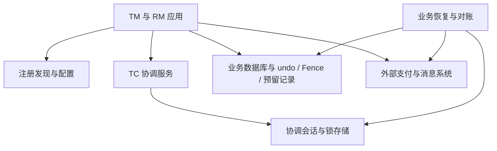

# Seata 运维与故障恢复：从协调状态到业务对账

> 基线为 Apache Seata 2.6.0，核查日期为 2026-10-28。本篇合并性能、部署、监控与故障处理内容。机制见 [[Seata]]，业务状态机与集成边界见 [[Seata项目实践]]。
>
> 参数名称以固定版本配置和源码为依据；本文不提供未经当前集群验证的万能阈值、固定 TPS 或强制清理脚本。示例查询均为只读观察用途。

处理 Seata 故障的目标是让参与资源按可信决议收敛，并核对业务结果。锁记录消失、告警恢复、HTTP 请求不再超时，只是运行信号，不足以证明交易已经正确完成。

## 1. 高可用要覆盖哪些状态



TC 多实例只覆盖协调进程的一部分故障。协调状态丢失、业务库恢复到另一个时间点、RM 旧资源实现消失，都可能让存活的 TC 无法正确完成事务。

### 1.1 每一层都有独立的恢复目标

| 层级 | 需定义的目标 | 典型风险 |
| --- | --- | --- |
| TC 进程 | 故障转移时间、连接重建、恢复吞吐 | 实例可达但没有正确接管状态 |
| TC 存储 | 持久性、备份、切换与恢复点 | 丢失决议后仍推进业务 |
| 注册/配置中心 | 地址发现、映射一致性、配置回滚 | 客户端连错环境或新实例无法发现 |
| RM 与业务库 | 未决分支恢复、undo/Fence 保留 | 业务已提交但恢复证据丢失 |
| 业务恢复 | 结果未知查询、对账时限、人工责任 | 长期冻结和外部错账无人处理 |

RTO 表达恢复能力需要多久，RPO 表达允许丢失多少状态。两者要针对业务结果定义；“TC 两分钟恢复”不等于“所有未决支付两分钟内收敛”。

### 1.2 存储模式决定协调状态放在哪里

| 模式 | 运维关注点 |
| --- | --- |
| file | 本机状态与磁盘，不能通过多起几个独立实例推导出共享状态高可用 |
| db | 数据库事务、主从切换、持久性、连接容量、协调表索引 |
| redis | 持久化与复制语义、故障切换可能丢失的状态、内存与驱逐策略 |
| raft | 共识成员、选主、多数派、日志与快照恢复、网络分区 |

2.6 配置中存在会话与锁存储相关选项，不表示可以任意搭配后获得相同保证。应按目标版本受支持的组合部署并演练，不能把数据库异步复制的 RPO 自动视为零。

丢失少量普通缓存可以重建，丢失协调决议却可能使某些分支已经提交、另一些仍然未决。协调存储必须按事务事实管理，不能沿用可随意淘汰的缓存策略。

## 2. 事务分组、注册中心与配置中心

### 2.1 分组是路由映射，不是完整隔离墙

典型发现路径：

```text
客户端 tx-service-group
    → service.vgroupMapping.<事务分组>
    → TC 集群名称
    → 注册中心的实例地址
    → 建立协调连接并注册 TM/RM
```

配置中心提供参数，注册中心提供服务发现；两者可使用相同产品，但不是同一职责。namespace、group、application、cluster、网络地址或认证配置不一致，都可能导致“配置存在，但找不到正确 TC”。

本地静态发现与 Spring Boot 属性、配置中心 `properties` 键名属于不同配置入口。不要把旧 `file.conf`、`registry.conf` 和新 YAML 的拼写混成一份文件。

### 2.2 改映射不会迁移旧事务

将事务分组改到一套空的 TC 存储，只能改变后续发现路径，不能把旧 XID 的决议、分支与全局锁搬过去。旧事务恢复需要保留原协调状态与可到达的 RM 资源。

同一业务库的新旧写流量若落入互不共享锁状态的两套协调域，可能破坏全局写隔离。切换要明确新事务去向、旧事务排空或恢复路径，以及资源写入是否暂时隔离。

### 2.3 客户端缓存不能替代发现可用性

注册中心短暂不可用时，既有连接可能仍工作；重启后的客户端、新 TC 实例和需要重连的 RM 却可能无法恢复。不能仅用一条存活连接证明注册中心故障无影响。

应分别演练“既有连接保持”“客户端重启”“TC 地址变化”“网络恢复后重连”，记录每种情况下新事务与旧二阶段的表现。

## 3. 各类持久记录分别证明什么

以下 TC 表名适用于 DB 存储，不能套用于所有存储实现；字段与建表脚本按 v2.6.0 官方版本初始化。

| 位置 | 记录 | 主要用途 | 不能据此推导 |
| --- | --- | --- | --- |
| TC | `global_table` | 全局身份、状态、超时等会话信息 | 查不到就一定已提交 |
| TC | `branch_table` | 分支身份、资源、类型、处理状态 | 一个服务只对应一个分支 |
| TC | `lock_table` | AT 全局锁键与持有关系 | 数据库中不存在其他行锁 |
| RM 业务库 | `undo_log` | AT 镜像补偿与防御记录 | 有记录就一定没提交 |
| RM 业务库 | Fence 记录 | 分支重复、空回滚与迟到防护 | 同一业务单不会创建另一个分支 |
| 业务库 | 预留、账务、支付、Outbox | 业务事实与可恢复任务 | 所有外部系统已同步完成 |

这里列出的是排查时关注的事务记录，不是完整建库清单。[2.6.0 Server MySQL 脚本](https://github.com/apache/incubator-seata/blob/v2.6.0/script/server/db/mysql.sql)还包含 `distributed_lock`、`vgroup_table` 及后台任务锁的初始化数据。部署时应使用完整匹配脚本，不能只创建 `global_table`、`branch_table`、`lock_table` 三张表；辅助任务锁也不是 AT 业务行的全局锁。

TC 记录有生命周期，不是永久交易审计账本。业务必须保存可关联的操作身份与处理结果；不能把清理后的 TC 会话作为唯一查询来源。

### 3.1 只读排查示意

使用参数绑定，不把用户输入直接拼成 SQL；先查单个 XID，避免故障期间全表扫描大日志字段。

```sql
-- 在 TC 数据库执行，字段以实际官方 DDL 为准。
SELECT xid, status, application_id, transaction_service_group, begin_time, timeout
FROM global_table WHERE xid = :xid;

SELECT xid, branch_id, resource_id, branch_type, status
FROM branch_table WHERE xid = :xid;

SELECT xid, branch_id, resource_id, table_name, pk
FROM lock_table WHERE xid = :xid;

-- 在对应 RM 业务库执行，不是 TC 库。
SELECT xid, branch_id, log_status, log_created, log_modified
FROM undo_log WHERE xid = :xid;
```

状态数值必须对照运行版本枚举，别凭记忆写“status=9 一定代表某种结果”。解析 `rollback_info` 时使用匹配的序列化与压缩方式，避免把二进制内容当文本误判为日志损坏。

## 4. 监控要看到恢复进度，而不只是请求吞吐

### 4.1 最小观测维度

| 维度 | 建议观察 | 如何使用 |
| --- | --- | --- |
| 业务入口 | 受理数、业务成功率、结果未知数、P95/P99 | 区分业务拒绝和协调失败 |
| TC 请求 | Begin/Register/Commit/Rollback 延迟与错误 | 定位协调路径瓶颈 |
| 全局事务 | 活跃量、各状态数量、最老未决年龄 | 识别无法收敛的事务 |
| AT | 全局锁冲突、热点资源、undo 增量与清理速率 | 区分热点与清理积压 |
| RM/DB | 连接等待、行锁等待、镜像查询与业务 SQL 耗时 | 判断实际阻塞阶段 |
| TCC | 最老冻结年龄、Confirm/Cancel 失败与状态冲突 | 识别冻结泄漏和错误决议 |
| 业务恢复 | 待对账金额、待退款年龄、Outbox 发布滞后 | 衡量真实业务损失窗口 |

这些是监控设计维度，不保证每项都有现成的 Seata 指标名。缺失指标需要从应用埋点、日志或受控查询补齐。

### 4.2 不把 XID 放进 Prometheus 高基数标签

XID、branchId 和业务单号适合日志与链路检索；每笔交易生成独立时间序列会增加监控存储和查询压力。指标按应用、事务名、资源类型、结果分类聚合，必要时通过 trace/exemplar 关联具体样本。

告警应包含业务影响、持续时间、趋势、关联证据入口和处置责任。单个空回滚可能是协议正常防护，持续增长的冻结年龄才可能表示恢复失效。

### 4.3 已核对的配置键

下面是 **配置中心 properties 风格**键名，不是完整 Spring YAML：

| 配置键 | 作用 | 调整风险 |
| --- | --- | --- |
| `client.rm.asyncCommitBufferLimit` | RM 异步提交清理缓冲上限 | 增大只会增加缓冲，不会创造数据库清理能力 |
| `client.rm.lock.retryInterval` | 全局锁冲突重试间隔 | 过密放大请求，过疏增加时延 |
| `client.rm.lock.retryTimes` | 锁冲突重试次数 | 过多延长资源占用与失败反馈 |
| `client.tm.defaultGlobalTransactionTimeout` | TM 默认全局事务超时 | 延长会增加未决窗口，不能解决外部长流程 |
| `client.undo.dataValidation` | AT 回滚数据校验 | 关闭可能覆盖其他修改 |
| `client.undo.onlyCareUpdateColumns` | 更新镜像字段范围相关配置 | 影响镜像与校验语义，不应只看日志大小 |
| `metrics.enabled` / `metrics.exporterList` | TC 指标开启与导出器 | 仍需配置采集、访问范围与容量 |
| `metrics.exporterPrometheusPort` | Prometheus 导出端口 | 不等于业务通信端口 |

键名核对自 [2.6.0 config.txt](https://github.com/apache/incubator-seata/blob/v2.6.0/script/config-center/config.txt)。文件中的样例值不是生产建议；配置能动态加载，也不代表适合在有未决事务时随意切换语义。

## 5. 性能分析：先拆分时间，再判断瓶颈

### 5.1 全局延迟不是永远由最慢一个分支决定

串行编排大致累加各分支耗时；并行编排取决于关键路径，还要加 Begin、注册、决议与重试时间。

```text
全局响应时间 ≈ Begin + 业务执行关键路径 + 决议交互 + 重试等待
AT 分支一阶段 ≈ 连接等待 + 镜像读取 + DML + 注册锁申请 + undo 写入 + 本地提交
```

异步提交清理可能不在用户响应关键路径，却会影响后续积压与恢复能力。只优化 API P99 而不看二阶段最老年龄，可能把成本藏到后台。

### 5.2 热点与全局未决时间形成反馈

在到达率稳定且系统可持续的近似条件下，可以用 `在途量 ≈ 到达率 × 平均停留时间` 理解积压。下游变慢会增加未决事务量，热点锁竞争又会进一步延长停留时间。

若所有事务竞争同一行，增加 TC 实例无法让这行同时属于多个互斥事务。应按业务资源限制并发、缩短全局范围，或调整预留粒度；不能仅扩大连接池。

进程内队列只能串行当前实例的请求。多个服务实例、定时任务和补偿任务仍可能同时写同一资源，不能把本地 `BlockingQueue` 当成集群级排他保证。

### 5.3 优化的顺序与代价

1. 去除全局事务内无需同步协调的远程查询与衍生写入，同时保证事件发布栅栏。
2. 用执行计划与锁等待证据优化 DML、镜像查询索引与本地事务范围。
3. 控制批量行数、镜像行宽、单事务分支数量与请求包大小。
4. 对热点资源限流或有界排队，设置整体重试预算，避免网关、RPC、应用与 Seata 重试相乘。
5. 最后评估模式调整，并重新验证资源守恒、可见性和恢复。

把 1000 行操作拆成 1000 个事务会改变原子边界；把 TCC 替换为异步消息会改变中间状态语义。性能优化必须同时说明业务影响。

### 5.4 压测要包含恢复流量

保持数据模型和业务负载可比，分别测本地事务基线与目标分布式模式。改变分支数、热点比例、镜像大小、网络延迟及故障占比，记录吞吐、拒绝率、P99、连接等待、锁冲突和二阶段年龄。

故障恢复时，历史二阶段任务与新业务争抢数据库连接、线程和存储 IO。正常峰值能跑通，不表示恢复时还有余量；需要在积压存在时逐步放量，观察恢复净速率是否为正。

## 6. 排障先确认事务所处阶段

```text
业务单号 / 操作键
  → requestId 与 trace
  → xid
  → branchId、类型、resourceId
  → TC 决议与恢复进度
  → RM 日志与业务库状态
  → 外部支付、事件和账务对账
```

同一业务有多个 XID 时，先辨别重试与新尝试，不要只挑一笔显示成功的记录下结论。

| 当前证据 | 优先定位 | 不能贸然执行的动作 |
| --- | --- | --- |
| Begin 或 Register 慢 | TC、网络、协调存储、全局锁 | 直接认定业务 SQL 慢 |
| 一阶段本地事务未结束 | 数据库锁、连接、下游调用 | 将业务行“已修改”当成已提交 |
| 全局已决定提交，二阶段积压 | RM 可达性、资源注册、清理/Confirm 错误 | 改为全局回滚 |
| 全局回滚中 | undo 校验、本地锁、Cancel 状态 | 盲目删除恢复日志 |
| TC 查不到事务 | 保留策略、查询环境、业务持久记录 | 推断提交成功 |
| 事务结束但业务仍处理中 | finalize、消息、对账任务 | 重新执行扣款 |

## 7. 四类事故如何恢复

### 7.1 全局锁冲突持续上升

先按 resourceId、表、主键定位热点，再检查持锁事务为什么未结束。可能是慢下游、回滚被本地锁阻挡、TC 存储延迟，也可能是大量相同业务请求重复进入。

先限制新增热点事务，让已有提交或回滚有资源完成。若已确认是请求重复，修复业务幂等；若是长链路，缩小事务范围；若是数据库锁互等，结合数据库阻塞链与 Seata 状态共同分析。

手工删除 `lock_table` 会允许新事务修改旧事务仍需恢复的数据。暂时看到冲突下降不等于修复，可能把可恢复积压变成脏回滚。

### 7.2 undo_log 持续增长

区分正常业务增长、全局未决、提交清理积压、回滚失败和防御记录。记录数量、字节大小与最老年龄一起看；不能只按日期判断“旧数据没用了”。

提交清理积压主要检查 RM 清理线程、队列、数据库连接与删除效率；回滚积压则检查当前镜像和失败原因。两者需要不同处理，不能一律扩容清理线程。

人工清理前必须证明相关事务与分支不再需要日志，完成业务核验并保留审计证据。框架自身清理策略与人工按日期 DELETE 不是同一件事；更不能只因超过全局超时时间就删日志。

### 7.3 AT 脏回滚

保留目标行当前值、前后镜像、关联业务流水、写入时间和可用的数据库审计证据。暂停冲突资源的新写入，查明额外变更来自原始连接、脚本、另一个协调域还是不受代理捕捉的副作用。

例如镜像为 10→9，当前是 20：20 可能是有效补货，也可能是错误人工修复。直接恢复成 10 会吞掉补货，直接把后镜像改成 20 又会伪造历史。需要按业务事件重建应有值，再制定受审计的修复与协调恢复步骤。

任何需要操作协调元数据的处置，都应依据运行版本支持的控制接口、持久决议和已确认的业务修复方案执行。备份不能替代正确决议，停流也不能使任意删表变安全。

### 7.4 TCC 长期冻结或二阶段失败

先看 TC 已决定 Confirm 还是 Cancel，再查分支 Fence、业务预留及资源计数。Confirm 持续失败时，不因“冻结超过十五分钟”擅自释放；其他分支可能已完成确认。

若显示 CONFIRMED 但资源仍冻结，重点查本地事务是否断裂、是否使用不同数据源、回调是否吞掉异常。若 Cancel 早到而随后仍出现预留，检查墓碑、唯一约束、迟到请求身份和记录清理策略。

恢复原实现或修复事务边界后，优先按原决议重试。需要业务补偿时使用独立、有身份的操作，避免把已经确认的旧分支改写为“从未发生”。

## 8. TC 不可用时，降级必须保留一致性边界

最直接的策略是拒绝或暂停新增关键全局写入，同时保留已有事务恢复所需的 RM 服务、资源注册和数据库访问。不要停掉所有业务实例之后才发现 TC 无法调用二阶段。

可切换到本地事务加消息的链路，必须事先具备独立状态机、幂等和对账能力。切换仅作用于定义清楚的新业务流量；旧 XID 继续按照原协调协议恢复。

```text
新增关键交易：拒绝 / 有界排队
已有未决交易：保留恢复能力，显示处理中
已准备好的异步业务：按独立协议受理
恢复后：先消化积压，再逐步提高新交易流量
```

关闭数据源代理、移除 XID 或启用自动降级，不会把跨库写入变成原子的本地事务。对于号源和余额，也不能临时将“绝不超卖”改成“超卖后对账”。这属于业务契约变更，需要预先设计，不能由故障开关隐式决定。

## 9. 发布、备份与清理的隐藏风险

### 9.1 新版本能启动，旧分支未必能恢复

滚动发布期间应保持旧 action 名称、回调方法、上下文反序列化和表结构兼容。TCC/Saga 二阶段可能落到升级后的实例；参数字段删改可能让旧分支无法重放。

AT DDL 变更应考虑尚存镜像；XA 要保留恢复所需资源配置；Fence 升级应按官方迁移策略处理表与配置，不能将新类名直接对应到旧表结构。

### 9.2 各库分别有备份，不代表组合后可恢复

TC 恢复到提交决定之前，业务库却保留决定之后的数据；或者 TC 已决定提交，某个业务库恢复到 Try 之前，都会造成恢复证据不一致。

应明确协调存储与业务数据的恢复点关系、日志保留、跨库对账步骤，以及不同 RPO 下的补偿责任。灾难恢复演练需要验证业务守恒与外部流水，不仅验证所有数据库可以连接。

### 9.3 幂等与墓碑保留期是一条协议边界

删除 CANCELLED/SUSPENDED 记录后，旧 Try 再到可能重新获得资源；删除已确认业务唯一键后，旧请求可能再次入账。保留策略需覆盖请求重放、消息重投、TC 恢复和人工重放窗口。

若系统没有办法约束迟到请求的最大时间，仅设“保留七天”不构成永久幂等。可通过业务终态档案、过期身份拒绝或稳定业务唯一约束继续挡住旧操作，而不是让控制表永远无界增长。

## 10. 恢复演练的验收依据

以下是运维演练方案，不代表本轮已执行。

| 故障 | 必须记录的事实 |
| --- | --- |
| TC 单实例退出 | 新事务受理变化、客户端重连时间、旧分支是否继续恢复 |
| TC 存储切换 | 已持久决议是否保留、是否出现状态倒退或丢失 |
| RM 在一阶段提交后退出 | 恢复后能否收到并完成二阶段 |
| Confirm 成功后回复丢失 | 重试不重复扣款、预留与流水守恒 |
| DB 锁等待或慢查询 | 新流量是否有界、恢复线程是否被耗尽 |
| 注册中心不可达 | 存量连接与新启动实例的差异 |
| 存在未决事务时滚动升级 | 旧镜像、旧 action、旧上下文可处理 |
| 备份恢复 | 协调与业务事实能否对齐，外部支付差异可追踪 |

恢复放量的依据应包括：最老未决年龄下降、二阶段净积压下降、关键资产对账无新增差异、资源容量有余量。仅以进程健康或端口可达恢复全部流量，容易再次压垮系统。

事故结案保留业务影响、决议证据、修复操作、剩余差异、补偿身份和后续负责人。暂时没有报错，不等于所有结果未知交易已经结案。

## 11. 官方依据与验证边界

- [2.6.0 Server 配置样例](https://github.com/apache/incubator-seata/blob/v2.6.0/server/src/main/resources/application.example.yml)和[config.txt](https://github.com/apache/incubator-seata/blob/v2.6.0/script/config-center/config.txt)：存储、客户端与指标键名。
- [官方参数说明](https://seata.apache.org/docs/user/configurations/)：参数归属和版本差异；不作为脱离运行环境的调优结论。
- [2.6.0 官方脚本目录](https://github.com/apache/incubator-seata/tree/v2.6.0/script)：选择匹配数据库的 Server、undo 与 Fence 等脚本，升级前核对迁移要求。
- AT 和 Fence 的恢复机制源码依据见 [[Seata]]。本篇没有执行真实集群故障注入或破坏性运维命令；部署拓扑、RTO/RPO 与恢复吞吐仍需项目实测。
