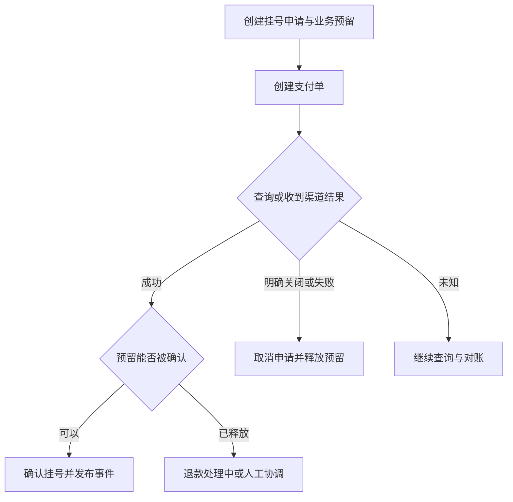

# Seata 项目实践：挂号、号源预留与支付结果如何安全收敛

> 基线为 Apache Seata 2.6.0，机制见 [[Seata]]。本篇是教学设计，不是现有医院系统的生产实现报告。SQL 以 MySQL 8.0/InnoDB 为例；框架片段用于说明集成位置，不构成可以直接启动的完整项目。
>
> 设计重点是把正常路径、结果未知、重复请求和故障恢复放进同一套模型。容量、发布和恢复操作见 [[Seata运维与故障恢复]]。

## 1. 先定义业务不变量，再划事务边界

假设系统有挂号服务、号源服务、院内账户服务，并需要接入外部支付、医保和票据平台。首先固定几个约束：

1. 号源不能超卖，预留、已使用与可用数量必须可核对。
2. 同一挂号申请不能因为用户重试创建多笔有效占用。
3. 同一笔支付只能入账一次，重试必须能查询既有结果。
4. 用户等待支付可能持续数分钟，不能靠一个同样长的全局事务占住资源。
5. 外部支付成功后，即使挂号最终失败，也必须保留支付事实并完成退款或人工处理。

这些要求并不共同导出“整条链路使用 Seata”。单个数据库内的账户余额与账务流水可由本地事务保护；第三方 HTTP 接口不是数据库分支；叫号与票据通常有独立业务状态。

### 1.1 两条路径需要分开设计

| 路径 | 建议事务边界 | 说明 |
| --- | --- | --- |
| 院内余额即时挂号 | 短 TCC：号源预留、余额冻结、挂号预记录 | 三个参与方均可控，Try 后可兑现 Confirm |
| 用户扫码支付 | 持久业务预留 + 支付单 + 异步结果流程 | 不把等待用户支付的分钟级流程当作 TCC Try/Confirm 间隔 |
| 受控的内部跨库资料更新 | 小范围 AT，逐条验证 SQL | 不包含已对外发布的业务事实 |
| 医保与票据 | 独立状态机、幂等请求、查询与补偿 | 由真实接口能力决定是否可撤销 |

余额支付与外部支付的退款策略也不同。前者在 Confirm 前可以释放冻结，后者渠道已扣款后需要新的退款业务单，不能简单将本地状态改回未支付。

## 2. Spring 集成：必须打通的四个边界

### 2.1 版本与依赖边界

固定客户端与 Server 版本，同时记录 Spring Boot、Spring Cloud/Alibaba、Feign/Dubbo、JDBC 驱动和连接池版本。不要同时引入多个 Starter，再由依赖仲裁意外选择一个旧客户端。

2.6.0 主代码使用 `org.apache.seata` 包名，仓库也有兼容模块。旧示例的 `io.seata` import 不应直接与新主包混写。升级须核对依赖树和官方迁移说明，不仅替换 Maven 版本数字。

### 2.2 全局边界与本地边界

全局入口由代理拦截，TM 申请 XID；各个服务仍需把自己的多条写入放入正确的本地事务。全局注解不能替代本地原子性。

```java
// 方法片段：三个应用侧适配接口均约定返回 boolean，省略类定义与依赖注入。
// 它们封装 RPC / TCC 调用，不是下文 SlotAction 的原始方法签名。
// 放在经 Spring 代理调用的公开入口，不能靠同类 this 调用触发代理。
@GlobalTransactional(name = "registration-balance", rollbackFor = Exception.class)
public void registerWithBalance(RegistrationCommand command) {
    if (!registrationAction.tryCreate(command)) {
        throw new IllegalStateException("挂号预记录失败");
    }
    if (!slotAction.tryReserve(command)) {
        throw new IllegalStateException("号源预留失败");
    }
    if (!balanceAction.tryFreeze(command)) {
        throw new IllegalStateException("余额冻结失败");
    }
}
```

Try 返回 `false` 或远程响应为业务失败，不等于 TM 必然收到异常。上层必须按接口契约将未成功的 Try 转成全局回滚条件；不可捕获异常后返回一个正常结果，让入口误走提交。

本地事务传播同样要明确。`REQUIRES_NEW` 表示新建本地事务，不自动意味着退出 XID；线程中仍绑定 XID 时，受代理资源可能继续注册全局分支。也不能用 `NOT_SUPPORTED` 名称推断所有 Seata 上下文已经被移除。

### 2.3 XID 传播边界

从入口 `RootContext`、RPC Header/Attachment、下游入口上下文到实际资源注册逐段验证。仅在日志里看见 XID，还不足以证明数据库分支已经加入。

优先使用与框架版本匹配的官方集成。自行编写拦截器时，需要在 `finally` 恢复进入前的上下文；线程池复用下，遗漏解绑会把下一笔无关请求串入旧事务。存在嵌套上下文时，一律清空也可能破坏调用方原状态。

```text
进入请求：保存原上下文 → 校验并绑定当前请求上下文
执行业务：实际资源注册必须关联当前 xid
退出请求：移除本次绑定 → 恢复原上下文
```

不要无条件信任公网请求携带的事务头。事务身份由内部可信边界传播；外部请求的业务幂等键与内部 XID 不是同一个字段。

`@Async`、线程池和消息消费不会自动延长全局事务。即使手工复制 XID，异步任务也可能在 TM 决议后才执行。需要并发分支时，必须在全局边界内等待所有任务结束并正确传递异常；跨消息的长流程应使用独立业务协议。

### 2.4 数据源与代理边界

AT/XA 应检查 Mapper、JdbcTemplate、本地事务管理器最终使用的 DataSource。动态路由、读写分离、多租户和手工取原始连接，都可能绕开预期代理。

自动代理和手工包装二选一，避免重复代理。TCC 业务资源则按其显式预留模型管理，不要未经设计又让同一份冻结数据参与 AT 镜像补偿。

下面只展示 **Spring Boot 客户端**关键项，不包含注册中心和认证等完整启动配置：

```yaml
seata:
  application-id: registration-service
  tx-service-group: hospital_tx_group
  enable-auto-data-source-proxy: true
  data-source-proxy-mode: AT
```

XA 数据源的模式应按官方集成设置为 `XA` 并验证实际代理类型。TC 的 `store.mode=db` 选择协调状态存储，**不负责把客户端切换成 XA，也不是 AT 的开关**。纯 TCC 应按数据源用途明确排除不需要的 AT 自动代理。

## 3. 一个可靠的 AT 跨库操作应该长什么样

假设内部申请服务与配额服务使用两个受控数据库。每个服务各自使用本地事务：

```text
申请服务本地事务：业务申请 + 业务唯一键记录
配额服务本地事务：扣减记录 + 条件扣减配额
TM：所有步骤返回成功后请求全局提交
```

扣减示意：

```sql
-- 必须与本次业务去重记录位于同一本地事务。
UPDATE quota
SET available = available - :amount
WHERE id = :quota_id AND available >= :amount;
```

参数 `amount` 必须大于 0；影响行数必须为 1。否则抛出业务异常并回滚本地事务，不能继续插入“扣减成功”状态。

唯一业务键应包括操作语义，例如 `(application_no, operation_type)`。相同键携带不同金额、资源或申请人时应报参数冲突，不能直接返回“处理成功”。去重记录随 AT 回滚被撤销时，后续重试可以重新执行；但前提是该次全局结果已经被确认，不能仅凭入口超时就并行发起新事务。

AT 验证至少需要检查：两个分支是否真的出现、下游抛异常时两库是否恢复、原始连接直写是否造成脏镜像、普通查询是否看见中间态。只验证“正常调用不报错”无法证明跨库事务成立。

## 4. TCC 号源模型：先把资源数量写清楚

下面采用**自有状态机方案**说明原子性，不与框架 Fence 重复维护同一份协议状态。若项目选用框架 Fence，应复用它管理分支协议，并保留业务预留单与业务唯一约束。

### 4.1 资源表与预留表

```sql
CREATE TABLE slot_capacity (
    slot_id BIGINT NOT NULL PRIMARY KEY,
    total INT NOT NULL,
    available INT NOT NULL,
    frozen INT NOT NULL,
    used INT NOT NULL,
    CONSTRAINT ck_slot_nonnegative CHECK (
        total >= 0 AND available >= 0 AND frozen >= 0 AND used >= 0
    ),
    CONSTRAINT ck_slot_total CHECK (available + frozen + used = total)
) ENGINE=InnoDB;

CREATE TABLE slot_reservation (
    xid VARCHAR(128) CHARACTER SET ascii COLLATE ascii_bin NOT NULL,
    branch_id BIGINT NOT NULL,
    operation_key VARCHAR(128) CHARACTER SET ascii COLLATE ascii_bin NULL,
    slot_id BIGINT NULL,
    quantity INT NULL,
    state VARCHAR(16) NOT NULL,
    created_at DATETIME(6) NOT NULL,
    updated_at DATETIME(6) NOT NULL,
    PRIMARY KEY (xid, branch_id),
    UNIQUE KEY uk_reservation_operation (operation_key),
    KEY idx_reservation_state_time (state, updated_at),
    CONSTRAINT ck_reservation_state CHECK (
        state IN ('TRIED', 'CONFIRMED', 'CANCELLED', 'SUSPENDED')
    ),
    CONSTRAINT ck_reservation_payload CHECK (
        state = 'SUSPENDED' OR
        (operation_key IS NOT NULL AND slot_id IS NOT NULL
         AND quantity IS NOT NULL AND quantity > 0)
    )
) ENGINE=InnoDB;
```

MySQL 的 CHECK 约束实际执行要求适用版本，示例基线应至少为 8.0.16；业务仍需参数校验。[MySQL 官方说明](https://dev.mysql.com/doc/refman/8.0/en/create-table-check-constraints.html)。`SUSPENDED` 允许缺少业务参数，因为空回滚可能只能确定 XID 与分支身份。MySQL 唯一索引允许多条 NULL，因此多个不同分支墓碑不争抢同一个空业务键。

这里 `operation_key` 表示一次固定业务尝试。真正允许用户在已取消后重新申请时，应由业务创建新尝试号，并保留挂号申请与尝试的关联；不能删除原记录复用旧身份。

### 4.2 Try：唯一约束、资源预留和状态同事务提交

```text
开始本地事务
  尝试 INSERT 分支记录，state=TRIED
  若唯一冲突：结束当前事务，重新读取既有记录并分类
    同分支 + 相同参数 + TRIED/CONFIRMED：返回既有结果，不再预留
    同分支已取消或存在 SUSPENDED：拒绝迟到 Try
    相同操作键但不同分支：返回业务重复，不把新分支伪装为成功
    相同身份但参数不同：参数冲突
  若新插入成功：条件更新可用资源到冻结资源
  更新影响行数必须为 1，否则抛错使记录与资源一起回滚
提交本地事务
```

```sql
UPDATE slot_capacity
SET available = available - :quantity,
    frozen = frozen + :quantity
WHERE slot_id = :slot_id AND available >= :quantity;
```

关键顺序是**先用唯一约束占住分支身份，再修改资源，并在同一事务提交**。不是在事务外先查一次，没有记录就放心扣号。

唯一冲突和死锁应在完整本地事务外分类重试。不要在一个已标记 rollback-only 的 Spring 事务里捕获异常后继续操作；也不要在 RR 的旧快照中反复读不到刚提交的冲突记录。

### 4.3 Confirm：只消耗已经预留的数量

```text
开始本地事务
  按 (xid, branch_id) SELECT ... FOR UPDATE
  CONFIRMED：幂等成功
  缺失、SUSPENDED 或 CANCELLED：状态异常，不能虚报成功
  TRIED：使用持久记录中的 slot_id 与 quantity
    frozen -= quantity，used += quantity
    更新影响行数必须为 1
    state 改为 CONFIRMED
提交本地事务
```

```sql
UPDATE slot_capacity
SET frozen = frozen - :quantity,
    used = used + :quantity
WHERE slot_id = :slot_id AND frozen >= :quantity;
```

Confirm 不能再次扣 `available`，因为 Try 已经扣过。必须从该分支持久预留记录取数量，不能仅凭调用方重新传来的金额或资源 ID。

如果先将状态改成 CONFIRMED，随后资源更新失败，两者必须一起回滚。这里更新顺序可以设计，但原子提交和状态条件不可省略。

### 4.4 Cancel：空回滚要留下墓碑

```text
开始本地事务
  按分支身份读取并锁定记录
  无记录：尝试 INSERT SUSPENDED，提交墓碑
    若与并发 Try 插入冲突或发生死锁：回滚本次事务，重新读取分类
  CANCELLED/SUSPENDED：幂等成功
  CONFIRMED：状态冲突，交由决议核对
  TRIED：frozen -= quantity，available += quantity
    资源更新必须成功，再置 CANCELLED，同事务提交
```

```sql
UPDATE slot_capacity
SET frozen = frozen - :quantity,
    available = available + :quantity
WHERE slot_id = :slot_id AND frozen >= :quantity;
```

两个并发次序都要成立：

- Cancel 先插入墓碑并提交，Try 插入遇唯一冲突，不能预留。
- Try 先插入并预留，Cancel 的插入或锁等待结束后重新读取 TRIED，再释放预留。

“SELECT FOR UPDATE 查不到记录”本身不能跨所有隔离级别阻止另一个事务插入。最终裁决依靠唯一约束、冲突重试与本地事务，不靠一次空查询。

### 4.5 为什么三阶段都需要本地事务

Try 的预留与记录、Confirm 的消耗与状态、Cancel 的释放与状态分别必须原子。Try 本地提交并不使 TCC 失效；它正是通过持久预留让稍后的 Confirm/Cancel 有据可依。

删除 Try 的 `@Transactional`，期待全局超时把所有 SQL 自动回滚，是错误方向。自有状态机需要显式本地事务；框架 Fence 可能通过事务模板建立边界，但仍须证明业务操作参与了同一个本地事务，不能据此说“不需要本地事务”。

## 5. 使用框架 Fence 时，如何避免“打开开关就完事”

2.6.0 的接口形态如下，省略实现类与 Spring 配置：

```java
import org.apache.seata.rm.tcc.api.BusinessActionContext;
import org.apache.seata.rm.tcc.api.BusinessActionContextParameter;
import org.apache.seata.rm.tcc.api.LocalTCC;
import org.apache.seata.rm.tcc.api.TwoPhaseBusinessAction;

@LocalTCC
public interface SlotAction {
    @TwoPhaseBusinessAction(
        name = "slotReserveAction",
        commitMethod = "confirm",
        rollbackMethod = "cancel",
        useTCCFence = true
    )
    boolean tryReserve(
        BusinessActionContext context,
        @BusinessActionContextParameter(paramName = "operationKey") String operationKey,
        @BusinessActionContextParameter(paramName = "slotId") long slotId,
        @BusinessActionContextParameter(paramName = "quantity") int quantity
    );

    boolean confirm(BusinessActionContext context);

    boolean cancel(BusinessActionContext context);
}
```

注解位于 Try 方法，不是把 `@TwoPhaseBusinessAction` 放在整个接口上。action name 要稳定且避免冲突；重命名方法或删除旧实现前，要考虑旧未决分支恢复仍需找到对应资源。

需要保存的业务参数显式加入上下文；二阶段在另一个线程甚至重启后的进程执行，不能依赖 Try 的局部变量或 ThreadLocal。上下文应只存必要参数，不存患者敏感明文或大对象；持久预留记录是核对业务数量的主要依据。

Fence 表按 **v2.6.0 官方 SQL 与自动配置**初始化。[本版本 MySQL 脚本](https://github.com/apache/incubator-seata/blob/v2.6.0/script/client/tcc/db/mysql.sql)仍创建 `tcc_fence_log`，包含毫秒时间字段、状态索引和 `(xid, branch_id)` 主键；公共处理器类名变化不等于表名也要更改。实际表名还应与配置一致，不能手抄仅含几个字段的简化建表语句。框架负责分支重复和空回滚，并不自动保证相同业务单的新 XID 不再预留，也不能覆盖外部 HTTP 副作用。

还要区分 Try 的返回值与本地事务结果：2.6.0 的 `prepareFence()` 直接返回业务回调结果，并不因为返回 `false` 就自动设置本地事务回滚。Try 内部预留失败时，应抛出能使本地事务回滚的异常；上层对 `false` 的检查只是全局失败传播的最后防线。Confirm/Cancel 的 Fence 包装会对失败返回值做相应回滚处理，不能把二阶段规则套到 Try。

本版本 Fence 通过插入分支记录执行 Try；同一 `(xid, branchId)` 重复插入会进入冲突异常路径，并非自动返回第一次 Try 的成功结果。上节自有状态机和后面的 Java 模型允许重复 Try 返回既有结果，这是示例设计，不是框架 Fence 的全部实现行为。RPC 重试还可能注册新的 branchId，业务去重仍须独立存在。

框架 Fence 与上节自有控制表是两种实现路径。若保留业务预留表，它表达业务凭证；不要让两套相互独立的协议状态成为两个最终裁决者。

## 6. 业务结果发布：AT 和 Outbox 的组合需要额外一步

### 6.1 本地事务 Outbox 的保证不能原样搬到 AT

```text
订单分支：写订单 + READY Outbox，AT 一阶段本地提交
relay：读到 READY，发布挂号成功事件
叫号服务：消费事件，生成队列
另一个分支失败：全局 AT 回滚订单和 Outbox
结果：数据库已恢复，叫号事件却无法撤回
```

原因不是 Outbox 写错事务，而是“本地已提交”不足以代表“全局事实已经成立”。CDC 同样能捕捉一阶段变更，不能自动知道它是否将被补偿。

### 6.2 发布栅栏必须可恢复，不能只依赖内存回调

一种设计是将全局事务内产生的事件标为 `WAIT_GLOBAL`，普通 relay 不发送。独立业务协调记录保存稳定业务键、XID、待确认状态和事件身份；恢复任务依据**可持久核验的决议证据及必要的业务完成条件**，在本地事务中将业务置为可发布终态并生成或解锁 Outbox。

```text
全局事务进行中：业务处理中，事件 WAIT_GLOBAL
确认全局提交及所需业务效果：本地 finalize → 业务 SUCCESS + READY Outbox
确认回滚完成：业务 CANCELLED，不发布成功事件
结果未知：保持处理中，继续核对，不猜测成功或失败
```

这是一项需要实现的业务协议，不是 Seata 自带的 Outbox 开关。必须预先确定从哪里获取、保存并重放终态证据，以及它的保留期限。TC 活跃记录被清理后“查不到 XID”不代表提交成功。

全局完成回调可以触发 finalize，但还需持久待处理记录与扫描恢复，覆盖“全局已经成功、进程在回调前崩溃”。若团队无法可靠提供终态证据，应调整边界，采用独立业务状态机，避免承诺一个没有恢复依据的发布栅栏。

### 6.3 TCC Confirm 发事件也要说清语义

某个分支 Confirm 已完成，不表示其他所有 Confirm 都完成。它可以发布“该资源已确认”的局部事实；若事件声称“挂号全流程已完成”，应由业务聚合条件满足后发布。

Confirm 中调用 MQ，再更新数据库，仍有跨资源双写窗口。应在该 Confirm 的本地事务内写可表达其语义的 Outbox，由 relay 投递。消费端仍要幂等，不把二阶段重试当作“绝不会重复发事件”的依据。

## 7. 外部支付：处理“已经付款，号源却过期”

扫码路径使用持久预留单，记录 `expires_at`、预留身份、支付单号和状态；这份分钟级业务预留不应靠延长 Seata 全局超时实现。



### 7.1 付款成功与过期释放同时发生

确认任务和过期任务必须竞争同一预留状态：例如 `RESERVED → CONFIRMED` 与 `RESERVED → EXPIRED` 的条件更新，或在同一本地事务内锁定预留记录。两者不能都修改资源成功。

过期任务获胜后，迟到支付成功不能直接把已释放的号源重新标成占用，可能已经卖给别人。应保留已支付事实，进入退款或明确的替代服务流程。

支付成功处理获胜后，过期任务看到 CONFIRMED 必须停止释放。时间达到 `expires_at` 只是触发竞争的条件，状态提交结果才是事实。

### 7.2 支付回调和主动查询共享同一个幂等入口

校验渠道签名、商户身份、支付单、币种和金额，然后在本地事务内依据渠道流水与业务单唯一约束更新支付事实、写账务记录及 Outbox。重复回调与主动查询结果同时到达，也只能产生一次有效入账。

调用渠道超时应记为 UNKNOWN/PENDING_QUERY。关闭支付单、发起退款或重新扣款之前，先按渠道契约查询；不能把超时直接视为“没有扣款”。

医保撤销、退费和票据红冲均应使用独立操作键与状态。它们是业务补偿，不要求抹除原始成功记录；具体先后顺序以真实机构接口和业务规则为准，不能由通用架构文章代定。

## 8. 一个可执行的状态机模型

下面用 JDK 17 单进程模型验证分支状态与资源守恒。`synchronized` 只模拟原子区；它不模拟 MySQL 隔离、跨进程唯一约束、Spring 代理或 TC 恢复。生产实现仍使用前述数据库事务协议。

```java
import java.util.HashMap;
import java.util.Map;
import java.util.Objects;

public final class ReservationModel {
    enum State { TRIED, CONFIRMED, CANCELLED, SUSPENDED }
    record Branch(String xid, long id) {}
    record Entry(String operation, int quantity, State state) {}

    private final Map<Branch, Entry> entries = new HashMap<>();
    private final Map<String, Branch> owners = new HashMap<>();
    private int available = 10;
    private int frozen;
    private int used;

    public synchronized boolean reserve(Branch branch, String operation, int quantity) {
        Objects.requireNonNull(branch);
        Objects.requireNonNull(operation);
        if (operation.isBlank() || quantity <= 0) throw new IllegalArgumentException();
        Entry old = entries.get(branch);
        if (old != null) {
            if (old.state == State.SUSPENDED) return false;
            if (!operation.equals(old.operation) || quantity != old.quantity) {
                throw new IllegalArgumentException("同一分支的参数不一致");
            }
            return old.state == State.TRIED || old.state == State.CONFIRMED;
        }
        if (owners.containsKey(operation) || available < quantity) return false;
        available -= quantity;
        frozen += quantity;
        entries.put(branch, new Entry(operation, quantity, State.TRIED));
        owners.put(operation, branch);
        return true;
    }

    public synchronized boolean confirm(Branch branch) {
        Entry old = entries.get(branch);
        if (old == null) return false;
        if (old.state == State.CONFIRMED) return true;
        if (old.state != State.TRIED) return false;
        frozen -= old.quantity;
        used += old.quantity;
        entries.put(branch, new Entry(old.operation, old.quantity, State.CONFIRMED));
        return true;
    }

    public synchronized boolean cancel(Branch branch) {
        Objects.requireNonNull(branch);
        Entry old = entries.get(branch);
        if (old == null) {
            entries.put(branch, new Entry(null, 0, State.SUSPENDED));
            return true;
        }
        if (old.state == State.CANCELLED || old.state == State.SUSPENDED) return true;
        if (old.state == State.CONFIRMED) return false;
        frozen -= old.quantity;
        available += old.quantity;
        entries.put(branch, new Entry(old.operation, old.quantity, State.CANCELLED));
        return true;
    }

    private synchronized void verify(int expectedAvailable, int expectedFrozen, int expectedUsed) {
        if (available != expectedAvailable || frozen != expectedFrozen || used != expectedUsed
                || available < 0 || frozen < 0 || used < 0 || available + frozen + used != 10) {
            throw new AssertionError("数量或守恒约束错误");
        }
    }

    private static void check(boolean ok) {
        if (!ok) throw new AssertionError("状态迁移错误");
    }

    public static void main(String[] args) {
        ReservationModel model = new ReservationModel();
        Branch first = new Branch("x1", 1);
        check(model.reserve(first, "registration-1", 2));
        check(model.reserve(first, "registration-1", 2));
        model.verify(8, 2, 0);
        check(!model.reserve(new Branch("x2", 2), "registration-1", 2));
        try {
            model.reserve(first, "registration-1", 3);
            throw new AssertionError("参数冲突没有被拒绝");
        } catch (IllegalArgumentException expected) {
            model.verify(8, 2, 0);
        }
        check(model.confirm(first));
        check(model.confirm(first));
        check(!model.cancel(first));
        model.verify(8, 0, 2);

        Branch late = new Branch("x3", 3);
        check(model.cancel(late));
        check(model.cancel(late));
        check(!model.reserve(late, "registration-3", 1));
        check(!model.confirm(late));
        model.verify(8, 0, 2);

        Branch cancelled = new Branch("x4", 4);
        check(model.reserve(cancelled, "registration-4", 3));
        check(model.cancel(cancelled));
        check(model.cancel(cancelled));
        check(!model.confirm(cancelled));
        check(!model.reserve(cancelled, "registration-4", 3));
        check(!model.reserve(new Branch("x5", 5), "registration-5", 9));
        check(!model.confirm(new Branch("missing", 6)));
        model.verify(8, 0, 2);
        System.out.println("状态迁移与资源守恒验证通过");
    }
}
```

此模型还刻意保留了取消操作的业务键：取消后发起新业务尝试应使用新操作身份。不能删除墓碑后让迟到的旧请求重新生效。

## 9. 集成验证应观察业务事实

下表是实施时的故障验证方案，尚需在目标集群执行。

| 注入点 | 需要观察的结果 |
| --- | --- |
| Try 本地提交后丢失响应 | 全局结果未知期间不重复创建业务；Cancel/Confirm 仍可处理持久预留 |
| Cancel 先到，Try 延迟到达 | 墓碑阻止预留，数量不增加也不减少 |
| Confirm 提交后丢失响应 | 二阶段重试不重复消耗资源、不重复生成账务事实 |
| 两个 XID 同时处理同一操作键 | 唯一约束阻止双重预留，新分支不能冒充既有成功 |
| AT 一阶段提交后暂停全局决议 | 普通 SELECT/relay 可见性符合预期，WAIT_GLOBAL 不发布 |
| 本地 finalize 前进程退出 | 持久恢复任务能重做 finalize，不依赖内存回调 |
| 付款成功与预留过期并发 | 仅一个资源状态迁移获胜；迟到付款有明确退款路径 |
| 线程池连续处理两笔不同请求 | 后一请求没有继承前一笔 XID |
| 表结构或 action 实现滚动升级 | 旧未决分支仍可完成回滚或确认 |

每次记录业务键、XID、分支 ID、注入时点、前后资源数量、各阶段持久状态和对账结果。只验证 HTTP 返回码或 TC 无报错，不能证明资源守恒与对外事件正确。

## 10. 依据与验证范围

集成配置属性参考 [2.6.0 SeataProperties](https://github.com/apache/incubator-seata/blob/v2.6.0/seata-spring-autoconfigure/seata-spring-autoconfigure-client/src/main/java/org/apache/seata/spring/boot/autoconfigure/properties/SeataProperties.java)；TCC 注解与 Fence 原子边界参考 [TwoPhaseBusinessAction](https://github.com/apache/incubator-seata/blob/v2.6.0/tcc/src/main/java/org/apache/seata/rm/tcc/api/TwoPhaseBusinessAction.java)和[SpringFenceHandler](https://github.com/apache/incubator-seata/blob/v2.6.0/spring/src/main/java/org/apache/seata/rm/fence/SpringFenceHandler.java)。数据库锁与本地事务参见 [[03-数据存储与缓存/数据库/MySQL|MySQL]]；事件投递与消费幂等参见 [[04-消息与分布式/RabbitMQ/RabbitMQ场景题|RabbitMQ 项目实践]]。

验证记录：状态机 Java 模型已用 JDK 17 编译并执行通过，覆盖重复 Try/Confirm/Cancel、跨分支业务去重、参数冲突、空回滚、迟到 Try、非法状态转换、资源不足及数量守恒；入口编排片段另用桩接口验证正常路径和三个 Try 返回失败的路径，均按预期停止后续调用并传播异常。该验证不覆盖 Spring AOP 或真实全局回滚；SQL、Spring 接口与全链路故障方案未在本轮连接真实 MySQL/Seata 集群运行，不构成生产可用性证明。
