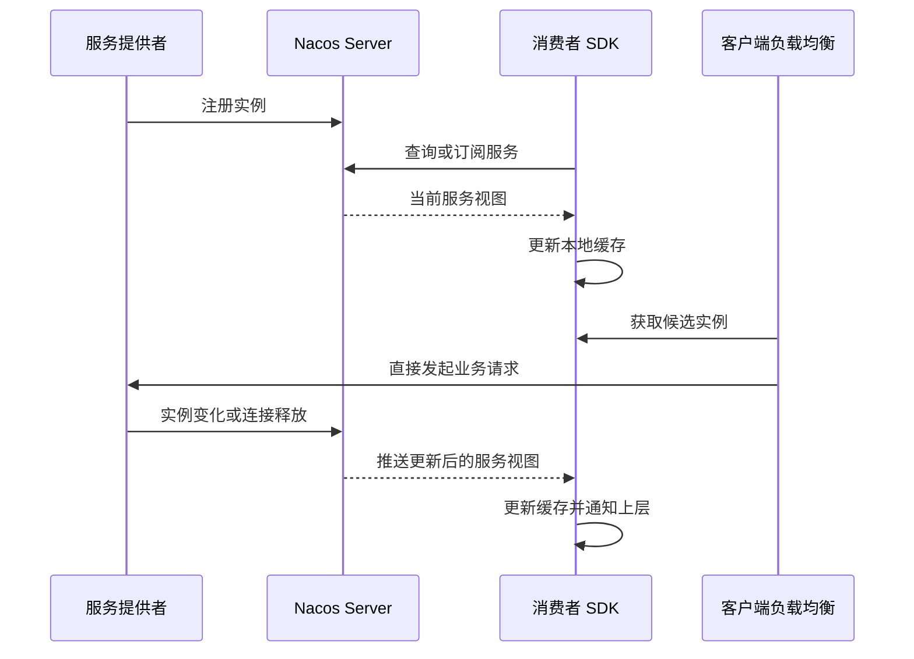
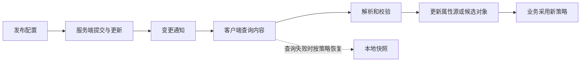

# Nacos：从注册发现与配置传播到一致性和故障边界

> 本文以 **Nacos 2.x 官方 Java SDK 的 gRPC 路径**为主要机制，使用 2.4/2.5 文档核对运维边界；1.x HTTP/UDP 仅用于理解旧系统。3.x 的控制台、API 和客户端兼容性需按目标版本核对，不能直接套用旧版接口。核查日期：2026-10-28。
>
> Spring 接入与故障恢复见 [[nacos场景题|Nacos 项目实践与故障恢复]]；完整业务调用链见 [[02-Spring与微服务/Spring/SpringCloud|Spring Cloud]]。

Nacos 维护两种不同的信息：**服务发现告诉调用方有哪些地址，配置管理告诉应用应使用什么参数。** 两者共享部分网络、鉴权和运维设施，却有不同的数据模型、生命周期和传播方式。

把它们都概括成“注册以后定时心跳，变化时长轮询”，会在排障时查错协议和线程；把 Nacos 整体贴上 AP 或 CP 标签，则会忽略各类状态真正的存储与故障边界。

## 1. 先区分资源坐标与系统边界

### 1.1 服务与配置不是同一种资源

| 资源 | 定位坐标 | 主要内容 |
| --- | --- | --- |
| 服务 | namespace + group + serviceName | 实例集合、服务级属性 |
| 服务实例 | 服务坐标 + 实例身份 | IP、端口、cluster、weight、metadata、健康与启用状态 |
| 配置 | namespace + group + dataId | 一份配置文本及其管理信息 |

`dataId=appointment.yaml` 不会自动创建名为 `appointment-service` 的服务。配置订阅与服务订阅分别建立，Discovery 和 Config 的 namespace、group 也可能分别配置；只写对其中一个，另一个仍会连到错误空间。

namespace 通常传入 **ID**，不是控制台显示名称。默认空间的表示方式以及 OpenAPI 参数名需按版本确认，不能把屏幕上显示的 `public` 随意代替空 namespace 或真实 ID。

### 1.2 逻辑隔离与安全隔离是两回事

namespace 和 group 用于组织、定位资源，能减少同名碰撞，却不能替代鉴权、网络隔离和资源配额。错误的凭据仍可能访问多个空间，共用 Server 和数据库也仍共享容量与故障域。

`clusterName` 描述同一个服务的实例所属区域或逻辑分区，并不等于一组独立 Nacos Server。只有负载均衡策略使用它，才会产生同区域优先；它不能代替租户权限或数据隔离。

## 2. 服务注册：把进程暴露为可发现的实例

### 2.1 注册成功确认了什么

应用启动后，Nacos Client 提交服务坐标、实例 IP/端口及元数据。Server 建立实例与客户端的关联，更新服务索引，触发同步和订阅视图变化。

注册成功只说明登记被接受，不说明消费者一定能连到该地址。多网卡、容器地址、NAT 和端口映射都可能导致“控制台有实例，消费者连不上”。必须从真实消费者网络验证注册地址，而不是只在提供者本机访问。

注册也不等于业务就绪。Web 端口开始监听时，缓存预热、数据库迁移或关键依赖初始化可能还没完成；应用需要明确何时允许进入流量池。

### 2.2 临时实例依赖运行时存活

临时实例适合随进程伸缩的服务。2.x gRPC SDK 下，实例与客户端连接生命周期关联；服务端检测连接关闭或释放后，清理相关临时状态并传播变化。客户端重新连接后，通过 redo 恢复仍需要的注册和订阅。

断开网线不一定立即产生连接关闭事件。TCP、gRPC 的探测、服务端负载和线程调度都会影响检测时间；因此不能承诺“临时实例断连就瞬间消失”。[Nacos 长连接设计](https://www.nacos.io/docs/ebook/sufa23/)

HTTP 兼容客户端的临时实例则常按周期心跳续约，服务端依据最后续约时间判定不健康和清理。旧资料中的 `5s / 15s / 30s` 不能用于解释所有 gRPC 实例，更不能直接作为生产故障检测 SLA。

### 2.3 持久实例是显式维护的登记

持久实例不会只因客户端连接消失就自动删除登记。其健康状态通常由服务端按 cluster 健康检查配置探测，配合显式启用、禁用和注销管理；具体检查协议、周期与权限按目标版本设置。

它适合由平台维护的固定地址等场景，但“持久”不等于健康、无限可达或无需生命周期治理。地址已失效而登记长期保留，会持续给消费者制造错误候选。

在 2.x 服务模型下，同一服务的临时/持久类型要保持一致。切换 `ephemeral` 应当作为资源迁移设计，先核对服务端已有类型，不能在滚动发布中假设两种类型可以随意混注册。

### 2.4 三种健康信号不能混为一谈

| 信号 | 可以说明什么 | 不能说明什么 |
| --- | --- | --- |
| SDK 连接存活 | 控制面连接仍被认为有效 | 业务线程没有堵塞 |
| HTTP/TCP 探测成功 | 探测目标在该时刻可响应 | 每个业务接口都能正确完成 |
| 业务就绪检查通过 | 约定的依赖与初始化条件满足 | 下一次请求一定成功 |

例如 Nacos 连接线程还在工作，数据库连接池却已耗尽，实例仍可能出现在健康集合中。不要仅靠调心跳阈值治理业务慢调用；调用侧还需超时、并发隔离和业务观测。

## 3. 服务发现：更新视图，随后在本地选实例

### 3.1 首次查询、订阅和后续推送

Naming 的 gRPC 推送可以携带更新后的 `ServiceInfo` 视图。不要套用配置中心的“只通知变化，再查询正文”来解释所有服务发现推送。查询、重连恢复与补偿更新共同帮助客户端修正视图。[服务订阅与推送说明](https://nacos.io/en/docs/latest/manual/user/naming/subscription-and-ops/)

### 3.2 旧版 Naming 和 Config 的协议不同

| 路径 | 典型机制 | 排障重点 |
| --- | --- | --- |
| 1.x Naming Java SDK | HTTP 查询、UDP 推送与补偿查询 | UDP 可达性、轮询更新、心跳 |
| 1.x Config Java SDK | HTTP 长轮询监听，再查询配置 | 挂起请求、摘要比较、查询与回调 |
| 2.x Naming gRPC SDK | 连接、注册订阅、服务视图推送 | 连接状态、redo、视图与同步 |
| 2.x Config gRPC SDK | 监听、变化通知、配置查询 | 订阅恢复、内容读取、监听回调 |

这是旧文最容易混淆的地方：**旧版服务发现不能笼统地写成配置长轮询。** 官方长连接设计明确区分了两条旧协议。[通信通道对比](https://www.nacos.io/docs/ebook/sufa23/)

HTTP OpenAPI 的单次查询也不等于 SDK 的完整订阅、缓存与恢复能力。直接用 HTTP 查询自行实现客户端时，必须明确刷新、失败和缓存策略。

### 3.3 缓存提高可用性，也保留过时地址

消费者通常基于内存视图继续调用；磁盘发现缓存是否参与启动，还受 SDK 版本及 `namingLoadCacheAtStart` 等设置影响。文件存在并不保证一个新进程能离线启动。[Nacos 客户端参数](https://nacos.io/en/docs/system-configurations/)

必须区分三种情况：查询失败、正常返回空集合、过滤后空集合。查询失败可以按策略保留旧数据；正常清空服务时如果仍强行保留所有旧地址，就会阻碍下线。推空保护是明确的可用性取舍，不是永远正确的开关。

上层 LoadBalancer 还可能有独立缓存。消费者何时停止选中旧实例，需要从最终调用目标验证，不能只比较 Nacos 控制台。

### 3.4 权重、enabled 与保护视图

权重的效果取决于消费者算法。普通轮询不一定读取 Nacos 权重，设为零也不能代替摘流。禁用或注销表达了停止提供服务的意图，但仍需等待传播、缓存更新和在途请求排空。

健康比例过低时，服务保护阈值可能影响服务端返回的健康视图，使原本不健康的实例也进入候选。它试图避免仅存少量实例被压垮，但也可能扩大真实失败。具体触发条件和 SDK 过滤需实测，不能写成“客户端永远只会拿到健康实例”。

## 4. 集群一致性：按状态类型分析

### 4.1 Distro 让临时状态最终收敛

临时注册状态使用 Distro 体系进行同步。理解时可以关注三件事：哪个节点负责源状态、变更如何同步、同步遗漏如何校验和修复。2.x 连接型客户端的状态与承载连接的节点紧密相关，不能原样套用旧版按实例地址散列的所有细节。

同步有延迟，故障时可能重连、重注册并重新传播。不同节点与消费者可以短暂持有不同视图。校验、重试和恢复有助于收敛，不意味着网络分区时任意节点上的任意操作都必然成功。[Distro 同步与校验参数](https://nacos-group.github.io/en/docs/v2.5/manual/admin/system-configurations/)

### 4.2 持久状态与 Raft 的多数派约束

持久 Naming 数据使用强一致协议维护，Nacos 相关实现采用 JRaft。需要多数派提交的写入，在失去多数派时不能像正常状态一样继续承诺成功；三节点并不意味着可以同时失去任意两个节点而保持写能力。[Nacos 2.0 兼容性与 JRaft 说明](https://nacos.io/en/docs/upgrading/2.0.0-compatibility/)

即使服务端提交具有一致性约束，消费者本地视图仍可能滞后。服务端共识与调用方读取最新实例是两层不同问题。

### 4.3 配置存储不能统一说成 Raft 提交

配置中心可能使用外部数据库，也有嵌入式存储等部署方式。外部数据库的提交、主备切换、Server 缓存更新、通知和客户端刷新共同决定故障表现。不能写成“配置只要发布成功，就已经在所有 Nacos 节点通过 Raft 持久化”。[2.4 服务端存储与协议参数](https://www.nacos.io/docs/v2.4/manual/admin/system-configurations/)

运维分析时分别列出注册数据、配置数据、认证信息和审计历史的存储位置与恢复方式。备份配置数据库不等于备份所有运行中的临时实例；SDK 重连恢复注册也不能替代配置备份。

## 5. 配置传播：发布成功只是第一阶段

### 5.1 从提交到业务读取的路径

配置订阅方关心当前状态，不应把每次回调当成可靠业务事件日志。快速连续发布多个版本时，应用可能直接读到较新的版本；需要完整处理每个业务事件，应使用具有对应投递与恢复语义的事件系统。

### 5.2 HTTP 长轮询中的摘要比较

旧版客户端携带配置坐标和内容 MD5 发起监听。摘要相同，服务端暂时挂起请求；配置变化或请求超时后返回，客户端再查询正文并继续下一轮监听。

30 秒这类值描述请求等待时间，不是“配置至少等 30 秒才更新”，也不是所有故障下的传播上界。网络中断、重连退避、服务端负载和业务回调阻塞都可能让端到端延迟更长。MD5 在此用于变化检测，不是签名、发布顺序或权限验证。

### 5.3 gRPC 复用连接，但不会让配置同步生效

2.x Config 通过长连接进行监听和变化通知，客户端再请求配置内容。连接丢失需要重建并恢复监听；通知成功也不意味着解析、Spring 属性源更新或业务对象切换成功。

不要假设 Naming 与 Config 必然只占一条物理连接。客户端实例数量、模块与版本都会影响连接和线程资源；重复创建 SDK 对象会增加连接、监听器和恢复任务。

### 5.4 三个版本观测点

| 观测点 | 含义 | 常见故障 |
| --- | --- | --- |
| 服务端发布版本 | 平台接受了哪一份配置 | 发布坐标错、存储异常 |
| 客户端已读取版本 | SDK 获取到了哪一份文本 | 断连、快照或 failover 覆盖 |
| 业务已采用版本 | 当前请求实际使用哪组策略 | 类型绑定失败、对象未刷新、校验拒绝 |

发布平台可把 `releaseId` 写入同一份配置，业务在完整策略被采用后报告它。不能先更新版本指标，再异步修改其他字段，否则监控会误报“已经生效”。

## 6. Spring 刷新：属性源变化不等于任意对象热更新

### 6.1 Config Data 和 bootstrap 要分清

通过 `spring.config.import` 加载 Nacos 配置时，地址、鉴权、namespace 和导入坐标必须在连接远端前可获得。不能把找到配置中心所需的全部参数只放在该配置中心里。

SCA 2023.x 的不同补丁版本存在配置模块演进；旧文档中的按应用名自动加载、shared/extension 配置，不应无条件带入后续版本。示例显式写出导入目标和刷新选项，迁移以目标 tag 的实现与说明为准。[SCA 官方示例中的配置加载迁移说明](https://github.com/alibaba/spring-cloud-alibaba/blob/2025.1.x/spring-cloud-alibaba-examples/nacos-example/readme.md)

### 6.2 RefreshScope 的代理与重建

`@RefreshScope` 通过作用域代理访问目标 Bean。刷新时失效已缓存目标，后续访问再创建目标对象，从新的环境中读取配置；不是用反射保证所有普通对象的字段即时变化。[Spring Cloud Context](https://docs.spring.io/spring-cloud-commons/reference/4.1/spring-cloud-commons/application-context-services.html)

普通 `@Value` 字段、静态变量、构造后复制出去的值和自建客户端可能继续持有旧状态。配置属性重新绑定也不能替代连接池、线程池等资源的生命周期协议。

仅给 `@Configuration` 类加 `@RefreshScope`，也不能据此推断其所有 `@Bean` 都具有相同刷新行为。真正需要验证的是业务访问路径是否经过刷新代理，以及重建失败时会怎样。

Cloud Context 4.1 还明确限制了部分刷新场景：默认的 `HikariDataSource` 不能按通用刷新方式处理，`@ConfigurationProperties` Java record 也不能直接期待动态重绑定。删除远端配置键不一定清掉对象原值；需要用显式状态值表达关闭，并验证删除与默认值恢复行为。[刷新限制](https://docs.spring.io/spring-cloud-commons/reference/4.1/spring-cloud-commons/application-context-services.html#refresh-scope)

### 6.3 多字段策略需要原子采用

超时、重试次数和最大并发通常共同定义一个预算。若逐字段更新，正在执行的请求可能读到新超时配旧重试次数的混合状态。

更稳妥的应用层设计是：完整解析候选配置，校验单项范围和字段间约束，构造不可变策略，再一次性替换引用；请求开始时取一个策略快照使用到结束。该保证属于应用实现，并非 Nacos 或 `@RefreshScope` 自动提供。

跨多份 dataId 或跨进程的同步切换仍然不原子。需要关联变更时，可以将强关联参数放在一份配置中，或设计带版本、兼容期和确认流程的发布协议。

## 7. 容灾：旧值是否还能安全使用

### 7.1 snapshot、failover 与业务有效策略

配置 snapshot 是 SDK 保留的历史查询结果；本地 failover 文件是人工维护的覆盖来源，可能优先于远端查询。两者的具体位置和读取顺序随版本而异。

尤其要区分“可解析的配置文本”与“业务验证通过的策略”。SDK 可能保存了业务层随后拒绝的配置；因此 snapshot 不能被一概称为最后有效配置。应用保留的 last-known-good 策略需要单独定义。

容器重建可能丢失本地文件。持久化缓存时也要隔离应用、环境和权限，避免多个进程覆盖同一文件或把测试快照带进生产。

### 7.2 热运行与冷启动不是同一个容灾问题

| 状态 | 可利用的信息 | 主要风险 |
| --- | --- | --- |
| 已运行且仍持有内存策略 | 当前策略与实例视图 | 内容变旧、地址失效 |
| 重启且历史文件可用 | 满足版本和加载条件的缓存 | 过期、损坏、未通过业务校验 |
| 新实例首次启动 | 本地受信配置与独立密钥来源 | 关键配置缺失、发现无结果 |

广告开关、展示参数可以允许带时限的旧值；权限撤销、凭据轮换或已下线渠道配置可能必须拒绝继续使用。是否允许离线启动应逐类配置决定，不能统一“本地兜底越多越好”。

## 8. 灰度与回滚：先限定范围，再确认结果

配置灰度和流量灰度是两件事。独立 stable/canary dataId 可以控制哪些实例读取新配置；流量路由则控制哪些请求进入这些实例。实例 metadata 不会自动成为配置订阅标签。

单 dataId 中放 stable/canary 两套参数，再由应用按可信部署标识选择，也是一种方案，但解析错误可能影响全部订阅者；不能因逻辑上只选择一部分就认为配置传播范围也被隔离。

Nacos 内置 beta/tag 等能力受服务端与客户端版本约束。没有完成匹配、扩容、重连和回滚验证前，不应把它写成通用的标签订阅 API。

回滚是再次发布已验证内容，并验证业务采用情况；停止推送只能停止扩散，不能撤销已执行的业务。新版本写出的数据库数据、已发送消息和外部支付副作用，仍需业务兼容与恢复设计。

## 9. 从网络到容量的运维边界

### 9.1 控制台能打开，不代表 SDK 链路正常

2.x 默认主端口为 8848，客户端 gRPC 端口由主端口加 1000 推导为 9848；9849 用于服务端 gRPC 通信，7848 用于 JRaft。代理和端口映射要保持客户端预期的偏移与连通性，节点间端口只开放到所需内网。[2.x 部署说明](https://nacos.io/en/docs/v2.5/manual/admin/deployment/deployment-overview/)

只转发 8848 的 HTTP 控制台，Java SDK 仍可能停在连接建立阶段。要从客户端所在网络检查 DNS、主端口、派生 gRPC 端口、鉴权与 Server 日志；不能仅用浏览器页面健康判断。

3.x 将控制台独立部署/端口化，控制台、API 与 Server 健康更应分别观察，迁移时核对目标版本部署说明。[3.x 部署变化](https://www.nacos.io/en/docs/next/manual/admin/deployment/deployment-overview/)

### 9.2 容量要计算连接、订阅与变更扇出

旧 HTTP 心跳负载可近似为 `实例数 / 心跳间隔`；gRPC 场景不能继续只按这个公式估算。还要统计客户端连接数、订阅关系数、变更频率、推送视图大小和重连任务。

同一个热门服务有大量订阅者时，一次变更会产生较大的通知扇出。批量滚动发布可能同时触发注册、同步、推送和重连，平时 CPU 不高不代表能承受此时的峰值。

### 9.3 故障恢复的终点是重新收敛

Server 恢复运行后，还需确认客户端完成重连、注册与订阅恢复，消费者视图反映新实例，配置的业务采用版本收敛，并退出临时 failover。

保留原有日志、缓存摘要和故障时间线，再做最小范围操作。盲目清空缓存或重启所有应用，可能把“已有进程可继续运行”的故障变成“所有进程都要重新发现与加载配置”的冷启动故障。

部署、灰度、摘流与坏配置的可执行验收方法，在 [[nacos场景题|Nacos 项目实践与故障恢复]] 中串成完整流程。
