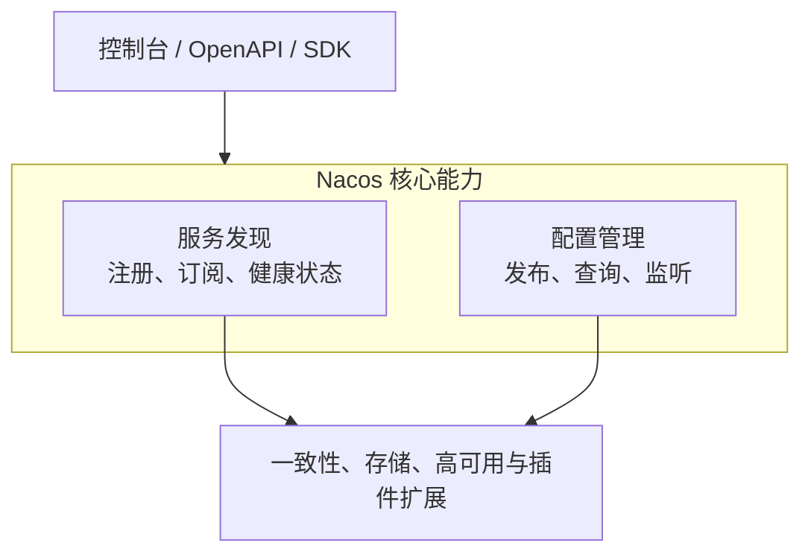
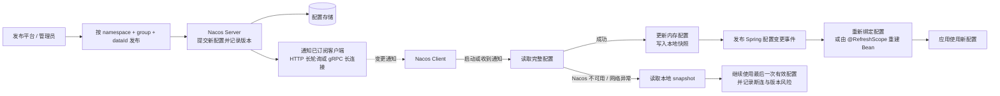
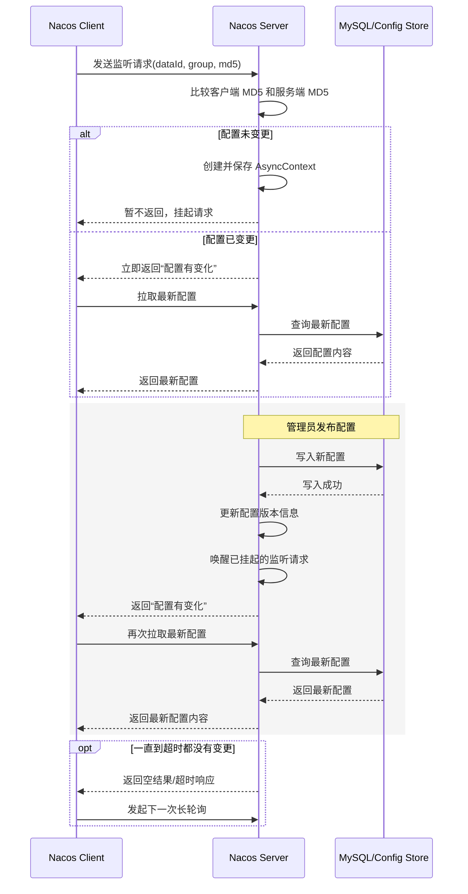

# Nacos

Nacos 同时提供服务发现和配置管理。本笔记先解释两个能力各自的运行链路，再说明它们共享的隔离、可用性与一致性边界。

> [!important] 版本边界
> 本文的长轮询、HTTP API 与 `5s / 15s / 30s` 等内容主要对应 Nacos 1.x 或 HTTP 兼容客户端的常见实现。Nacos 2.x 起官方 SDK 引入 gRPC 长连接；当前 3.x HTTP Client OpenAPI 不提供配置长轮询监听，应优先使用 SDK 的长连接监听。收到通知后，客户端仍须查询或刷新完整数据。排障、配置项和 API 必须以实际 Server、Client 与 Spring Cloud Alibaba 版本的官方文档为准。

整体架构可从“使用入口、两类核心能力、支撑能力”三个层次理解：

[TOC]
- [1. 配置管理](#1-配置管理)
- [2. 长轮询机制](#2-长轮询机制)
- [3. 灰度发布](#3-灰度发布)
- [4. 心跳检测及下线通知](#4-心跳检测及下线通知)
- [5. Nacos 的服务发现](#5-nacos-的服务发现)

## 1. 配置管理
Nacos 配置中心是一个支持动态配置管理的工具，主要用于集中式管理和分发配置，帮助分布式系统实现统一的配置管理。以下是 Nacos 配置中心的详细原理：

### 1.1 核心概念
配置资源由 `namespace + group + dataId` 唯一定位：

| 字段 | 作用 | 常见用法 |
| --- | --- | --- |
| `namespace` | 环境或租户的逻辑隔离 | `dev`、`test`、`prod` |
| `group` | 同一命名空间内的逻辑分组 | 业务线或团队 |
| `dataId` | 一份具体配置的标识 | `payment-service.yaml` |

本文用 `namespace`、`group`、`dataId` 表示概念坐标；在 OpenAPI 或 SDK 参数中，常见字段名分别为 `namespaceId`、`groupName`、`dataId`。阅读代码或排障日志时应区分概念名与接口字段名。

### 1.2 配置中心工作机制

理解配置中心时，按“发布、启动读取、变更监听、动态刷新、本地快照”这条链路展开即可。

#### 配置发布到应用生效总览

> [!note] 图中最容易混淆的边界
> 服务端提交成功只表示新配置已被服务端接受；客户端收到通知、重新读取成功、Spring 刷新成功，才构成某个实例“已生效”。本地 `snapshot` 是异常时的可用性兜底，不保证配置是最新版本；人工维护的本地 `failover` 文件则可能具有更高本地优先级，排障时必须一并检查。

#### 1.2.1 核心思想

Nacos 配置中心的本质是：
- 服务端统一存储配置
- 客户端启动时先拉取配置
- 客户端订阅配置变更（旧版常为长轮询，官方新版 SDK 常为长连接通知）
- 服务端在配置变更后通知客户端
- 客户端重新拉取最新配置并刷新本地配置

它不是简单的“把配置文件放到远程”，而是通过 `集中存储 + 变更感知 + 动态刷新 + 本地快照兜底` 实现分布式系统的统一配置管理。

#### 1.2.2 配置发布原理

配置管理员通过控制台、OpenAPI 或 SDK 发布配置时，Nacos Server 会做几件事：

1. 根据 `namespace`、`group`、`dataId` 确定唯一配置
2. 将最新配置内容写入持久化存储
3. 更新服务端内存中的配置版本信息，例如 `MD5`
4. 标记该配置已经发生变更
5. 唤醒正在监听这份配置的客户端请求

因此，配置发布不是只写数据库，还会触发一条“通知客户端感知配置变化”的链路。

#### 1.2.3 客户端启动拉取原理

业务应用启动时，集成在应用内的 Nacos Client 会主动向 Nacos Server 拉取配置。

这个阶段的目标是让应用在启动前或启动过程中拿到配置内容，并加载到运行环境中。典型流程如下：

1. 客户端根据 `namespace`、`group`、`dataId` 发起查询请求
2. 服务端返回当前最新配置
3. 客户端将配置加载到本地内存
4. 同时把配置保存到本地快照文件，作为容灾兜底

如果此时 Nacos Server 不可用，客户端可能会读取本地快照继续启动，因此本地缓存机制提升了系统可用性。

#### 1.2.4 配置监听原理

客户端拿到配置后，不会一直频繁轮询完整配置内容，而是先进入监听状态。

监听时客户端会：
- 保存当前配置内容的 `MD5`
- 在旧版 HTTP 兼容路径中，向服务端发起携带版本信息的长轮询请求
- 告诉服务端“我当前持有的是哪个版本”

服务端收到请求后会比较客户端 MD5 和服务端 MD5：
- 如果不一致，说明配置变了，立刻返回变更结果
- 如果一致，说明没变，先把请求挂起
- 等待配置变更或超时后再返回

这是**旧版 HTTP 长轮询**的关键：客户端拿着版本号询问服务端是否变化；使用新版 SDK 时，应将其理解为“长连接变更通知 + 客户端重新查询”。

#### 1.2.5 动态刷新原理

客户端发现配置发生变化后，会重新查询最新配置，并触发监听器回调。

在 Spring Cloud Alibaba 场景中，常见链路是：

1. Nacos Client 感知到配置变化
2. 拉取最新配置内容
3. 更新本地配置缓存
4. 发布配置变更事件
5. 被 `@RefreshScope` 管理的 Bean 重新装配或重新获取属性值

因此，配置“动态生效”的前提并不是 Nacos 自动修改所有对象，而是框架配合刷新机制完成运行时更新。

#### 1.2.6 `@RefreshScope` 的刷新机制

`@RefreshScope` 的作用是让指定 Bean 在下一次访问时按新配置重建，而不是原地修改字段：

1. Spring 用作用域代理持有真实 Bean；
2. 配置刷新事件到来后，`RefreshScope` 清除该 Bean 的缓存；
3. 后续访问经过代理时，Spring 重新创建 Bean，并重新绑定 `@Value` 或 `@ConfigurationProperties`。

它只作用于被该 Scope 管理的 Bean。Nacos 负责感知配置变化，Spring 刷新机制负责决定业务对象是否真正使用新值。

不同 Spring Cloud / Spring Cloud Alibaba 组合对配置导入、事件与绑定细节存在差异。不要把 `@RefreshScope` 当作所有 `@Value` 或任意第三方 Bean 都必然刷新的保证；应在目标版本中验证绑定方式、刷新事件和异常处理。

#### 1.2.7 本地快照与启动容灾

本地 `snapshot` 保存客户端最后一次成功读取的配置，用于网络异常时兜底；它不是权威来源。Nacos 还支持由用户维护的本地 `failover` 覆盖文件，后者用于紧急兜底，可能优先于服务端配置，且不会回写服务端。Nacos 不可用时：

- 有历史快照时，应用通常可用旧配置继续启动或运行；
- 第一次启动且关键配置完全依赖 Nacos 时，应用可能启动失败；
- 关键启动参数应有本地配置、环境变量或 K8s Secret 等独立兜底。

容器重建可能丢失临时文件系统中的 snapshot；排障还应检查是否遗留 failover 覆盖文件。因此应结合持久卷、版本观测与断连告警设计容灾，而不是把本地旧数据当作长期正确配置。

#### 1.2.8 一致性、可用性与发布边界

**前提**：配置错误可能直接影响数据库连接、限流或功能开关，因此配置中心更强调正确性。

**机制**：服务端提交、客户端变更通知、客户端重新读取、框架刷新是连续但不同的阶段。

**边界**：服务端提交成功不等于所有实例已生效；应按实际部署验证存储与一致性路径，并通过版本号、刷新日志和监控确认覆盖率。

## 2. 长轮询机制

### 2.1 HTTP 长轮询时序图（旧版或兼容客户端）

## 3. 灰度发布

> 以下旧内容中的“配置标签自动匹配实例 metadata、客户端 `addListener` 携带 labels”不是 Nacos 配置订阅的通用协议，容易造成错误实现。灰度能力与 API 受版本和客户端支持情况影响，应以目标版本官方文档为准。

### 3.1 前提：区分环境隔离与配置灰度

- **环境隔离**：使用不同 `namespace`（以及必要时不同集群）隔离 dev、test、prod；这不是灰度，生产配置不能因为测试验证通过而直接覆盖。
- **配置灰度**：同一生产环境中，让少量实例先使用新值，再逐步放量。不同版本的 Nacos 控制台可能提供 beta、tag 等发布功能；不要假设普通订阅会按实例 metadata 自动筛选。

### 3.2 机制：通过配置坐标与发布编排控制范围

1. 为稳定组与灰度组使用不同的 `dataId` 或 `group`，例如 `payment-prod.yaml` 与 `payment-prod-canary.yaml`。
2. 仅让灰度实例的启动配置指向 canary 配置；实例选择应由发布平台、Kubernetes 标签或部署编排完成。
3. 先发布可回滚的低风险开关，观察错误率、RT、资源和业务指标；确认后再发布稳定组。
4. 回滚应发布已验证的旧值或切回稳定 `dataId`，并记录变更人、版本、影响范围和生效确认。

### 3.3 边界：配置灰度不等于流量灰度

- Nacos 配置监听的基本键是 `namespace + group + dataId`；服务实例 metadata 用于服务发现或应用自定义路由，不等于配置订阅过滤条件。
- 若采用目标版本自带的 beta/tag 发布能力，应验证客户端兼容性、升级、回滚和本地快照行为。
- 灰度的是**配置值**，不是流量；请求导向新版本实例仍要由网关、负载均衡或发布系统完成。

---

## 4. 心跳检测及下线通知
Nacos 的心跳检测与客户端变更通知共同维护服务发现视图，使实例上下线与健康状态能被消费者及时感知。

### 4.1 心跳检测方式

- HTTP 或兼容客户端的心跳：
    - 临时实例定期向 Nacos 续约
    - 服务端据此维护健康状态与清理阈值
- gRPC SDK 的连接生命周期：
    - 临时实例随客户端连接存活，连接关闭或释放后由服务端清理运行时状态
- 服务端主动探测：
    - 服务端主动检查持久实例是否健康；检查类型由 Cluster 元数据决定

### 4.2 实例状态变化

对 HTTP 或兼容客户端，心跳超时后服务端通常会按这个过程推进实例状态：
1. 一段时间没收到心跳，先标记为 `unhealthy`
2. 更长时间仍没恢复，再从服务列表中剔除
3. 如果实例恢复心跳或重新注册，会重新回到服务列表

### 4.3 心跳间隔与时间差

对 HTTP 或兼容客户端，可通过实例元数据 `preserved.heart.beat.interval`、`preserved.heart.beat.timeout`、`preserved.ip.delete.timeout` 调整心跳间隔、判定不健康和删除的阈值。`5s / 15s / 30s` 是常被引用的一组旧版常见值，不应脱离实际版本、网络抖动和 GC 停顿直接照搬。

对 gRPC SDK 客户端，临时实例的存活更多由连接生命周期维护：连接关闭或释放后服务端会清理运行时状态，客户端重连后会重新注册和恢复订阅。因此不要在新版 SDK 场景机械地把所有实例状态变化都解释为 HTTP 心跳超时。

服务端主动探测没有一个必须死记的统一默认口径，更重要的是理解它通常是“按健康检查策略周期执行”的，常见会配置成几秒到几十秒，通常不会比客户端心跳更激进。

无论是 HTTP 心跳、gRPC 连接状态还是服务端主动探测，健康状态都不是业务进程的实时真相，都会存在感知窗口。

例如某个实例刚刚故障：
- 可能客户端上一次心跳刚发完，服务端暂时还认为它健康
- 也可能服务端探测还没轮到它
- 所以短时间内注册表里可能还是旧状态

这属于健康状态感知中的正常窗口期，Nacos 的处理思路不是追求绝对实时，而是通过：
- 周期性检查
- 超时阈值
- 先标记不健康，再最终剔除

来平衡实时性和误判风险。调用侧通常还会配合超时、重试、熔断一起兜底。

### 4.4 小结

- 临时实例依赖客户端存活：HTTP 客户端以心跳续约，gRPC SDK 以连接生命周期为主
- 服务端结合心跳、连接事件或主动探测维护健康状态
- 实例状态变化后，Nacos 会通知订阅该服务的客户端刷新本地服务列表

## 5. Nacos 的服务发现

### 5.1 注册中心工作机制

理解注册中心时，按“服务注册、服务发现、实例存活、健康检查、变更通知、本地缓存、AP/CP”这条链路展开即可。

#### 5.1.1 核心思想

Nacos 注册中心的本质是：
- 服务提供者启动后把自己的实例信息注册到 Nacos
- Nacos 维护一份服务注册表
- 服务消费者按服务名订阅或查询实例列表
- 服务实例通过心跳维持在线状态
- Nacos 根据健康状态动态更新实例列表
- 实例列表变化后通知订阅者刷新本地缓存

所以它解决的核心问题是：让微服务实例能够动态上线、下线、被发现，并且尽量只把健康实例返回给消费者。

#### 5.1.2 服务注册原理

服务提供者启动后，会通过 Nacos Client 向 Nacos Server 注册自己的实例信息，通常包括：
- 服务名 `serviceName`
- IP 和端口
- 集群 `cluster`
- 权重 `weight`
- 元数据 `metadata`
- 是否临时实例 `ephemeral`

服务端收到注册请求后会：

1. 根据 `namespace + group + serviceName` 定位服务；在新版模型中，`ephemeral` 是服务级语义，同一个服务标识不能混用临时和持久实例
2. 如果服务不存在，就先创建服务对象
3. 将当前实例写入服务注册表
4. 根据实例类型决定后续健康检查方式
5. 将实例变更同步给订阅该服务的客户端

注册中心里的关键数据不是配置文件，而是“某个服务当前有哪些可用实例”。

#### 5.1.3 服务发现原理

服务消费者并不是把目标服务地址写死在配置里，而是通过服务名向 Nacos 查询实例列表。

基本流程如下：

1. 消费者发起服务订阅或查询
2. Nacos 根据服务名返回实例列表
3. 客户端将实例列表缓存到本地
4. 上层负载均衡组件从实例列表中选择目标实例发起调用

在 Spring Cloud Alibaba 场景里，通常是 `Feign`、`RestTemplate`、`LoadBalancer` 这一层消费 Nacos 返回的实例列表。

#### 5.1.4 临时实例存活与健康检查

注册完成后，实例不是永久有效的，需要持续证明“自己还活着”。

对临时实例来说，存活机制取决于客户端协议：
- HTTP 或兼容客户端定期发送心跳；服务端根据最后心跳时间标记不健康或删除实例
- gRPC SDK 主要由连接生命周期维护；断连后服务端清理运行时状态，重连后客户端通过 redo 恢复注册

对持久化实例来说，通常更依赖服务端主动探测，例如 HTTP 或 TCP 健康检查。

因此，实例注册不是“一次登记永久有效”；客户端存活状态和服务端健康检查共同让注册表尽量接近真实运行状态。

#### 5.1.5 服务变更通知

当实例上线、下线、心跳超时、恢复健康时，Nacos 会更新服务注册表，并把变更通知给订阅了该服务的客户端。

客户端收到变更事件后，会：

1. 拉取或接收最新实例列表
2. 更新本地缓存
3. 让上层负载均衡组件使用新列表进行路由

所以消费者并不是每次调用都去远程查注册中心，而是通常基于本地缓存后的服务列表进行调用。

#### 5.1.6 本地缓存机制

Nacos Client 会把服务实例列表缓存到本地内存，必要时也会使用本地文件快照做兜底。

它的价值主要有两个：
- 降低注册中心压力，避免每次调用都访问 Nacos
- 在 Nacos 短暂不可用时，消费者仍然可以基于旧实例列表继续工作

这解释了注册中心短时故障后服务调用不一定立即全部失败：客户端本地缓存仍可提供上一份服务视图。

#### 5.1.7 临时实例和持久实例

两类实例的关键区别在于运行时状态如何维护：

- `临时实例 ephemeral=true`
  - 依赖客户端存活状态；HTTP 客户端通常通过心跳续约，gRPC SDK 主要依赖连接生命周期
  - 更常用于普通微服务实例
  - 更强调可用性

- `持久化实例 ephemeral=false`
  - 实例不会因为心跳停止立刻自动删除
  - 更依赖服务端主动健康检查
  - 更适合相对稳定的基础服务

它们的设计目标不同：一个偏“动态、轻量”，一个偏“稳定、可控”。

#### 5.1.8 注册中心的可用性侧重点

注册中心通常更强调可用性，因为在分布式调用里，短时间拿到“可能略旧但还能用”的实例列表，往往比“必须绝对一致但暂时不可用”更重要。

例如：
- 某个实例刚下线，但客户端短时间内还看到旧列表，问题通常可以通过超时重试、负载均衡、熔断来兜底
- 但如果注册中心因为强一致而整体不可用，整个服务发现链路就会受影响

所以注册中心天然更偏 `AP`。  
不过 Nacos 不是简单固定成 AP，它会根据实例类型和场景，在服务发现领域兼顾 `AP/CP`。

#### 5.1.9 AP 与 CP 的体现

- `临时实例` 通常偏 `AP`
  - 优先保证注册和发现可用
  - 允许短时间的数据不一致
  - 依赖心跳和最终一致性收敛

- `持久化实例` 通常偏 `CP`
  - 更强调实例数据的一致性
  - 由服务端按一致性协议维护状态

所以更准确的说法不是“`Nacos 注册中心就是 AP`”，而是“`Nacos 注册中心支持 AP 和 CP，不同实例类型和场景下侧重点不同`”。
