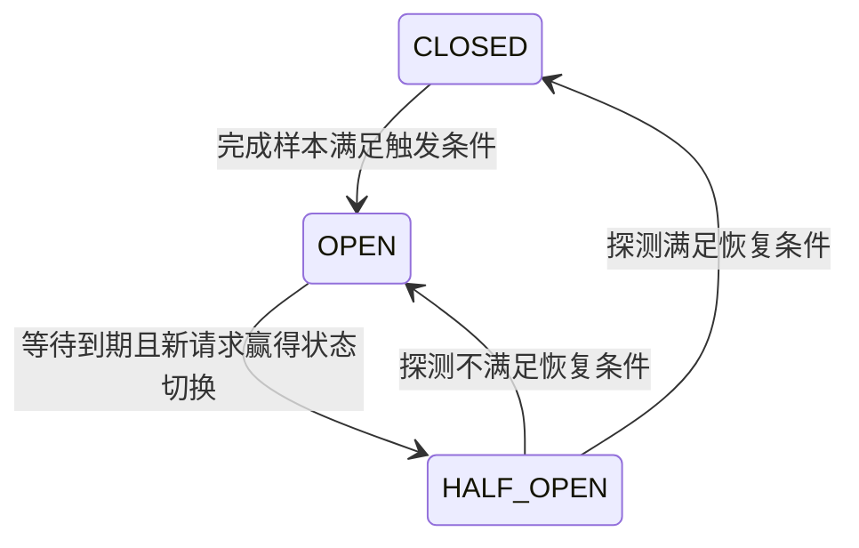

# Sentinel

Sentinel 在代码真正进入某个资源前判断是否放行，并在调用结束后记录耗时和异常，用这些反馈限制后续流量。它解决的是过载传播：一个下游变慢，可能占满上游连接与线程；一类热点请求，也可能挤掉同进程中的核心业务。

限流只决定是否进入受保护代码。库存扣减是否原子、支付是否重复、消息是否可靠，仍由事务、幂等、持久化与业务状态机保证。这里讨论阿里巴巴 Sentinel，与 Redis Sentinel 的故障切换机制无关。

> [!info] 版本边界
> 源码与本地语义实验固定到 **Sentinel Java 1.8.6、JDK 17**，用于核对现有材料，不表示推荐新项目使用此版本。Spring Cloud Alibaba、Spring Boot、Gateway、Nacos 客户端需另按项目 BOM 验证。本文把框架机制、该版本实现及设计建议分开；本轮还复现了 1.8.6 的系统阻断异常路径，见下文。

## 1. 从过载过程理解保护目标

### 1.1 流量相同，资源占用也可能相差百倍

在稳态且统计口径一致时，Little 定律给出平均在途量约为“到达率 × 平均停留时间”。200 次/秒的调用，平均耗时 10ms 时约有 2 个在途请求；耗时变为 2 秒，平均在途量约为 400。

因此，只限制 QPS 无法完整保护慢依赖。超时限制单次占用时间，并发规则限制当前在途量，熔断依据已完成调用的质量阻止后续请求。连接池、线程池、队列也必须有边界，否则拒绝发生前就可能在别处积压。

### 1.2 四类信号分别回答什么

| 能力 | 主要问题 | 不能替代的机制 |
| --- | --- | --- |
| 普通流控 | 当前资源进入得是否过快、在途是否过多 | 数据库锁、库存约束 |
| 热点参数流控 | 同一资源中的某个值是否占用过多预算 | 身份认证、精确长期计费 |
| 熔断 | 最近完成的依赖调用是否过慢或经常失败 | 网络超时、正在执行任务的取消 |
| 系统保护 | 实例入口整体是否超过承受能力 | 每个业务的优先级和独立容量隔离 |

降级是业务响应，例如返回带时间戳的缓存排班、暂停报表或告知暂不可受理；它既可以由 Sentinel 阻断触发，也可以由依赖异常或业务开关触发。

## 2. 资源、上下文与规则如何关联

### 2.1 资源名是治理边界

资源可以是 HTTP 路由、方法、RPC 调用或一段代码。`appointment:create`、`insurance:settle` 能表达稳定业务动作；`appointment:123456` 把订单号拼进名字，会不断增加资源链与节点数量。

资源粒度应与瓶颈一致。把查询、支付提交、回调都叫 `payment`，统计混在一起，轮询洪峰可能阻断回调；把每个内部小方法都单独埋点，又增加统计和解释成本。跨服务复用一个名字不会自动共享统计，同进程中多个埋点使用相同资源则可能共同受规则约束。

资源链数量有实现上限。1.8.6 的 `CtSph` 在无法再创建链时可能返回不带规则链的 Entry，所以高基数不只是内存问题，还可能使预期保护失效。不要通过运行时修改内部常量或定时删除内部 Map 来“修复”资源设计。

### 2.2 Context、DefaultNode 与 ClusterNode

`Context` 表达当前入口和调用来源。`DefaultNode` 关联某上下文下的资源节点；`ClusterNode` 聚合本 JVM 中资源的统计，名字中的 Cluster **不表示跨机器共享**。来源节点进一步区分 origin。

直接规则可看资源总量，关联规则看另一个资源，链路规则看指定入口下的节点。`limitApp` 依赖可信的 origin 识别，并不会自动把 HTTP Header 当成已验证的调用方身份。

```text
入口 context：挂号提交
    └─ appointment:create
         └─ patient:query
入口 context：患者资料页
    └─ patient:query

patient:query 的资源聚合统计与两个入口下的链路统计用途不同。
```

同步嵌套 Entry 应按后进先出退出。异步切线程后，ThreadLocal 上下文不会自动跟随业务；应使用对应异步 API 或框架适配器，并在实际完成时退出，不能只统计“任务提交耗时”。

## 3. 一次请求如何经过 SlotChain

### 3.1 链条顺序不等于统计发生顺序

1.8.6 默认核心链按 SPI 顺序组织，加入热点参数模块后，主要顺序如下：

```text
NodeSelector → ClusterBuilder → Log → Statistic
    → Authority → System → ParamFlow → Flow → Degrade
    → 返回业务代码
```

自定义 SPI 可以改变链条，不能将此顺序当成所有版本的协议承诺。尤其要注意 `StatisticSlot`：它先调用后续槽位，后续检查通过返回后，才增加 pass 和在途数；被阻断则记录 block，并把异常继续抛出。

业务退出时，统计完成时间、RT 和异常，减少在途数，并通知熔断器评估状态。某次调用开始时熔断器仍关闭，完成时才使它打开，是正常时序；打开也不会撤销之前已获准执行的请求。

### 3.2 指标名称容易误导

| 指标 | 1.8.6 中应如何理解 |
| --- | --- |
| pass | 已通过规则检查的进入量，业务结果尚未确定 |
| block | 被规则阻断的尝试，可能在嵌套层重复体现 |
| success | 完成调用计数；该版本即使记录了业务异常，也会累加完成计数 |
| exception | Entry 上记录的非 BlockException 错误，不是所有 HTTP 非 2xx |
| RT | Entry 所覆盖范围的完成耗时，不等于纯网络时间 |
| thread | 已通过且尚未退出的资源调用量，不等于 JVM 线程总数 |

不能把 `successQps` 直接当作支付成功率，也不能把所有嵌套资源的 pass 相加当作用户请求数。业务成功率需要订单、支付或挂号结果的独立指标。

源码依据：[StatisticSlot](https://github.com/alibaba/Sentinel/blob/1.8.6/sentinel-core/src/main/java/com/alibaba/csp/sentinel/slots/statistic/StatisticSlot.java)、[CtSph](https://github.com/alibaba/Sentinel/blob/1.8.6/sentinel-core/src/main/java/com/alibaba/csp/sentinel/CtSph.java)。

## 4. 滑动窗口的实现与精度边界

### 4.1 数组位置循环，时间标识不能循环

`LeapArray` 将一个统计区间分成若干桶。设总区间 1000ms、2 个桶，每桶 500ms：

```text
index       = floor(timeMillis / 500) % 2
windowStart = timeMillis - timeMillis % 500

t=1000..1499 → index=0，起点1000
 t=1500..1999 → index=1，起点1500
 t=2000..2499 → index=0，起点2000，复用旧位置
```

索引相同不代表同一个时间桶，必须比较 `windowStart`。1.8.6 的空槽创建使用 CAS；有效桶直接复用；旧桶重置使用 `ReentrantLock.tryLock()`；竞争失败让出执行机会后重试。不能把它写成“全部用 CAS”或“拿不到锁就直接向旧桶累计”。

桶内指标主要使用 `LongAdder` 等结构，聚合时读取有效桶求和。它适合高吞吐统计，但读取聚合值、规则判定、通过后的累计不是一个全局互斥事务。普通 QPS/并发规则不能当作精确财务配额或严格信号量。

### 4.2 有限桶近似不等于任意时刻向前一秒

在 t=1999ms，两个桶覆盖从 1000ms 开始的统计；到 t=2000ms，位置 0 被重置，1000..1499ms 的数据整桶退出。即使其中 1499ms 的请求距离现在只过了 501ms，它也不会按逐请求时间戳保留。

桶越细，边界粒度越小，但聚合、内存和切换成本会变化。普通资源统计、熔断统计和热点参数控制并不使用同一套参数：1.8.6 的熔断器内部采用 1 个统计桶，不能把普通资源“1 秒 2 桶”的说明套给所有功能。

### 4.3 时钟回拨的真实分支

当计算出的起点早于同一数组位置的现存桶时，1.8.6 返回一个新的临时 `WindowWrap`，并不将其写回数组，也不是继续使用未来桶。临时桶中的更新不等于已经纳入正常聚合；不能由“没有越界”推断统计仍然准确。

本轮用指定时间参数复现了同桶复用、跨周期清零和回拨临时桶。生产应保持可靠校时；检测到时间跳变时同时检查指标和限流偏差，不靠修改宿主机时间做线上实验。

源码依据：[LeapArray](https://github.com/alibaba/Sentinel/blob/1.8.6/sentinel-core/src/main/java/com/alibaba/csp/sentinel/slots/statistic/base/LeapArray.java)。

## 5. 普通流控：选择统计对象，再选择控制效果

### 5.1 QPS 与并发量

QPS 控制进入速度；并发规则检查正在执行的调用数量。请求变慢时，即使 QPS 不变，并发也会上升。并发规则不创建独立线程池，不把任务迁移到专用执行器，也不会强制终止慢任务。

硬性隔离需要有界执行器、连接池、信号量等真实资源边界。不要把 Sentinel 的并发检查描述为完整线程池舱壁，更不能假设每次检查与计数都具有严格原子性。

### 5.2 直接、关联与链路

| 模式 | 在哪里配规则 | 用什么判断 | 例子 |
| --- | --- | --- | --- |
| 直接 | 当前资源 A | A 的统计 | 挂号提交过多就限制挂号提交 |
| 关联 | 被限制的 A | 关联资源 B 的统计 | 写订单繁忙时限制查询订单 |
| 链路 | 共享资源 C | 指定入口上下文中的 C | 限制资料页入口对患者查询的调用 |

关联规则的方向不能写反。链路规则中的入口需要匹配真实 context 名；它不是任意调用栈匹配，也不是分布式追踪系统的 traceId。Web 适配器可能统一入口上下文，启用链路规则前要核对具体适配器的 context 配置。

### 5.3 快速失败、Warm Up 与匀速排队

快速失败适合不值得等待的在线请求。Warm Up 让冷态下的允许速率逐步提升，帮助缓存、连接等逐步承压；它不替代健康检查、缓存预加载或就绪控制。

匀速排队依据预约通过时间平滑请求。例如 10 次/秒对应约 100ms 间隔；如果下一可用时刻已超过最大允许等待，就拒绝。核心 `RateLimiterController` 的等待会占用调用线程，不是将任务放入可靠消息队列，也不应直接用在 Reactor 事件循环上。

等待预算还要加上网络、业务、客户端已有重试耗时。允许等待 500ms，但调用方 300ms 就超时，容易出现调用方已重试而原请求后来仍执行的情况。

同一资源可以有多条规则，任何一条命中都能阻断；不是“后配置的覆盖前配置的”。规则全集替换与单条规则的叠加语义要分开。参见 [流量控制](https://sentinelguard.io/zh-cn/docs/flow-control.html)。

## 6. 热点参数：每个值的预算与有界状态

### 6.1 参数下标决定读什么

热点规则指定资源和 `paramIdx`，参数必须实际传给 Entry。例如 `hospitalId` 作为第 0 个参数，可以让医院 A 和 B 各自使用预算；规则不会自动解析 DTO 中任意字段，也不会因为 URL 中出现 ID 就自动拿到业务参数。

1.8.6 在参数数组缺少对应位置或值为 null 时跳过该条规则。入口必须先做必要参数校验；否则“配置了医院维度规则”不代表缺失医院身份的请求也会被限制。

参数例外项按类型和值匹配。字符串 `"123"` 与 Long `123L` 不能凭显示文本相同就视为同一项。多租户身份应在认证后提取，不能直接相信调用者填写的医院或用户 ID。

### 6.2 默认 QPS 控制是简化令牌桶

1.8.6 `ParamFlowChecker.passDefaultLocalCheck` 为规则和参数值维护令牌数、上次补充时间。首次访问初始化可用令牌并扣减；后续通过 CAS 消费；经过 `durationInSec` 对应时长后再按经过时间计算补充量，上限受 `count + burstCount` 约束。

因此，`count=10`、`durationInSec=2` 表达约每两秒 10 个令牌的预算，不能不看周期就称为 10 QPS；允许突发也不等于请求会被均匀放行。它不是“每个参数值一个普通 LeapArray，再读取滑窗 QPS”的实现。

热点排队是另一个时间调度分支；热点并发规则又使用在途计数。讨论算法时应明确规则类型和控制效果，不能仅用“热点限流”四个字概括全部实现。

### 6.3 淘汰换来有界内存，也失去长期记忆

参数状态放在有界缓存中。1.8.6 的 QPS 规则缓存容量与 `durationInSec` 有关，并有总上限；这不是一个可以随意填写的通用 `maxParamCount` 规则字段。淘汰后再次访问可能重新初始化状态，不能据此实现不可绕过的每用户月度额度。

资源总规则和参数规则需要配合：一万个不同值各访问一次，单值都不热，但资源总量仍可能压垮服务；高基数还会增加分配、淘汰和 GC。数组或集合参数可能依次检查多个元素，前面元素已消费预算、后面元素阻断时，不应假定前面的预算自动回滚。

源码依据：[ParamFlowChecker](https://github.com/alibaba/Sentinel/blob/1.8.6/sentinel-extension/sentinel-parameter-flow-control/src/main/java/com/alibaba/csp/sentinel/slots/block/flow/param/ParamFlowChecker.java)、[ParameterMetric](https://github.com/alibaba/Sentinel/blob/1.8.6/sentinel-extension/sentinel-parameter-flow-control/src/main/java/com/alibaba/csp/sentinel/slots/block/flow/param/ParameterMetric.java)。

## 7. 熔断：完成反馈驱动的状态机

### 7.1 三种策略的阈值单位不同

| 策略 | `count` | 其他关键条件 |
| --- | --- | --- |
| 慢调用比例 | 慢调用 RT 阈值，毫秒 | `slowRatioThreshold`、最小完成量 |
| 异常比例 | 0 到 1 的异常比例 | 最小完成量、异常是否被记录 |
| 异常数 | 统计区间内的异常数量 | 同样检查 `minRequestAmount` |

`statIntervalMs` 是统计区间，单位毫秒；`timeWindow` 是打开后的等待时长，单位秒。慢调用不等于超时，可能只是一次成功但耗时过长的调用；HTTP 返回错误也不一定自动成为 Entry 的 error。

在 1.8.6 中，普通比例和异常数触发使用严格大于；慢调用比例配置为 1.0 时有全部慢调用的等值处理。以异常数阈值 1、最小请求数 1 为例，第 1 个已记录错误不会打开，第 2 个才会。不能统一写成“达到阈值立即熔断”。

### 7.2 到期只是允许尝试，不会主动发请求



1.8.6 由新请求调用 `tryPass` 检查时间，并通过 CAS 竞争进入 HALF_OPEN；没有请求时不会靠定时器自动探测下游。半开时只有赢得切换的请求获得探测机会，其他请求拒绝。

异常熔断器看探测 Entry 是否记录错误；慢调用熔断器主要看 RT。快速失败的调用可能满足慢调用熔断器的恢复条件，因此只配慢调用规则不代表覆盖异常失败。多条熔断规则共同存在时，要确认探测没有被其他规则挡住。

### 7.3 已经卡住的请求不会立即变成慢调用样本

RT 在结束后完整统计。如果下游连接始终不返回，最需要保护的时刻可能还没有足够完成样本。必须先有连接超时、读取超时、端到端 deadline 和并发边界，再用熔断减少后续冲击。

恢复后要观察补偿积压和同步重试。每个实例有自己的熔断状态；多实例半开可能同时给下游发送探测，不能把单实例“一次探测”理解为全服务只有一个探测。

源码依据：[AbstractCircuitBreaker](https://github.com/alibaba/Sentinel/blob/1.8.6/sentinel-core/src/main/java/com/alibaba/csp/sentinel/slots/block/degrade/circuitbreaker/AbstractCircuitBreaker.java)、[ExceptionCircuitBreaker](https://github.com/alibaba/Sentinel/blob/1.8.6/sentinel-core/src/main/java/com/alibaba/csp/sentinel/slots/block/degrade/circuitbreaker/ExceptionCircuitBreaker.java)、[ResponseTimeCircuitBreaker](https://github.com/alibaba/Sentinel/blob/1.8.6/sentinel-core/src/main/java/com/alibaba/csp/sentinel/slots/block/degrade/circuitbreaker/ResponseTimeCircuitBreaker.java)。

## 8. 注解、编程埋点与异常处理

### 8.1 注解定义资源，不会自动创建阈值

`@SentinelResource` 需要相应切面和代理生效。Spring 代理内的同类自调用可能绕过切面；只引入 core 或只写注解都不能证明已埋点。热点规则的参数下标在规则中定义，不是给注解增加一个 `paramIdx` 属性。

配置 `blockHandler` 时，规则阻断优先进入它。1.8.6 若未找到 blockHandler，会继续尝试 fallback/defaultFallback，因此“fallback 永远只接业务异常”不准确。fallback 收到异常不能直接记录为“支付已调用但失败”，必须区分是否为 BlockException。

业务异常先检查 `exceptionsToIgnore`，命中后直接抛出，不走该切面的异常记录与 fallback；`exceptionsToTrace` 决定其余哪些异常被追踪。方法内已经 catch 并转为普通返回值的错误，也需要在业务与统计层做明确处理。

### 8.2 处理器契约和层级

blockHandler 返回类型与原方法匹配，参数为原参数加末尾 BlockException；fallback 可使用原参数，或在末尾增加 Throwable；defaultFallback 不携带原业务参数，可接 Throwable。指定外部 handler 类时按切面要求提供静态方法。

Servlet、Gateway、Feign 和方法注解的阻断入口不同。方法处理器不能兜住尚未进入该方法就发生的网关拒绝；一个通用 ControllerAdvice 也不能保证拦截所有适配器已处理的异常。

返回替代结果的代码本身要短、可控。它再次同步调用同一个故障依赖，或者没有超时地查询数据库，会把故障从主逻辑搬到 fallback。切面 finally 才退出 Entry，处理器耗时也可能落入资源统计；需要按埋点边界解释 RT。

源码依据：[SentinelResourceAspect](https://github.com/alibaba/Sentinel/blob/1.8.6/sentinel-extension/sentinel-annotation-aspectj/src/main/java/com/alibaba/csp/sentinel/annotation/aspectj/SentinelResourceAspect.java)、[处理器选择](https://github.com/alibaba/Sentinel/blob/1.8.6/sentinel-extension/sentinel-annotation-aspectj/src/main/java/com/alibaba/csp/sentinel/annotation/aspectj/AbstractSentinelAspectSupport.java)。

## 9. 系统保护与来源访问控制

系统规则针对 `EntryType.IN` 入口聚合。核心编程 API 的默认 OUT 资源不能直接用来证明系统规则有效；也不应将每个嵌套方法都标成 IN，否则入口总量和在途数被重复计入。

CPU、平均 RT、入口 QPS、并发量等条件各有含义。Load 自适应分支还结合在途量与估计处理能力，不能简化成“Load 大于阈值就拒绝全部”。容器 CPU limit、JDK 对宿主机指标的识别、线程等待和数据库慢调用都会影响解释，应结合真实指标校准。

AuthorityRule 按来源做黑白名单判断。来源解析本身仍须可信；它不能取代用户认证、对象权限或网关身份验证。系统保护也没有天然的“支付回调优先”语义，需要业务隔离和容量预留。

> [!warning] 本轮复现的 1.8.6 系统阻断异常路径
> 在 Maven Central 的原版 1.8.6 core 上，将 SystemRule 的 QPS 设为 0：直接执行系统检查会抛 SystemBlockException，但通过完整 `SphU.entry(..., IN)` 链调用时，LogSlot 对空 `getRule()` 调用 `getId()`，产生 NullPointerException；CtSph 记录内部异常后返回 Entry，调用方可能继续执行业务。此项是**缺陷复现通过，不是保护生效通过**。应在实际依赖版本回归“业务是否真的没有执行”，不能只验证规则管理器已有规则或 block 指标增加。本轮未验证其他版本是否修复。

相关源码：[系统检查](https://github.com/alibaba/Sentinel/blob/1.8.6/sentinel-core/src/main/java/com/alibaba/csp/sentinel/slots/system/SystemRuleManager.java)、[LogSlot](https://github.com/alibaba/Sentinel/blob/1.8.6/sentinel-core/src/main/java/com/alibaba/csp/sentinel/slots/logger/LogSlot.java)。

## 10. 集群限流的配额边界

### 10.1 单机规则相同，也不是共享配额

N 个实例各配置 q，表达的是各自的本地预算。流量不均主要导致部分实例拒绝、其他实例仍有闲置预算；不能仅由“不均衡”推导实际总量一定超过 N×q。窗口误差、并发判定、实例扩容和配置不一致是另外的影响因素。

需要统一判定时，Token Client 向 Token Server 申请。Server 参与请求路径，网络、排队、处理延迟都应纳入预算；Dashboard 和 Nacos 则不参与每次本地令牌判定。

### 10.2 规则与拓扑必须一起解释

集群规则开启 `clusterMode`，通过 `ClusterFlowConfig.flowId` 识别规则，Client 与 Server 配置要一致。GLOBAL 的 count 表达全局阈值；AVG_LOCAL 按平均单机阈值及 Server 侧识别的客户端数量推算总阈值，不是把同一全局 count 再简单除一次实例数。

嵌入部署让 Token Server 与某业务进程同生命周期；独立部署隔离两者生命周期。多个 Server 不会自动复制配额状态，也没有“部署三台便得到严格共享额度”的保证。分片可以分担资源，但同一预算由多个独立 Server 各算一份，会放大总额度。

### 10.3 关闭回退不是失败即拒绝

1.8.6 `FlowRuleChecker.fallbackToLocalOrPass` 的实现是：开启回退则检查本地，关闭则返回 true。集群服务缺失、请求异常及部分失败状态都会进入此分支；Server 正常返回 BLOCKED 则拒绝。

本地回退使用该 FlowRule 的本地检查路径。`ClusterFlowConfig` 没有旧文示例里的 `setFallbackThreshold`，不能凭空配置一个独立回退阈值。如果全局 count 很大，回退后各实例按同一 count 检查，会明显扩大总预算。

需要故障时保守拒绝，应在实际请求路径中实现并验证额外的失败关闭策略，或选择具有相应一致性、故障语义的配额服务。即便单 Server 正常，也要考虑统计精度、重启清空、令牌已给出而业务未执行等窗口；请求速率治理不能替代库存和持久化额度账本。

源码依据：[FlowRuleChecker](https://github.com/alibaba/Sentinel/blob/1.8.6/sentinel-core/src/main/java/com/alibaba/csp/sentinel/slots/block/flow/FlowRuleChecker.java)、[ClusterFlowConfig](https://github.com/alibaba/Sentinel/blob/1.8.6/sentinel-core/src/main/java/com/alibaba/csp/sentinel/slots/block/flow/ClusterFlowConfig.java)。

## 11. 从机制回到工程边界

Sentinel 最有价值的地方，是让资源进入条件、质量反馈和业务响应形成可观测闭环。资源名、阈值、参数和异常记录只要有一个与运行时不一致，控制台看似配置完备也可能没有实际保护。

[[Sentinel项目实践]] 将这些机制落实到挂号、医保、支付回调和多租户；[[Sentinel规则与运维]] 说明规则发布、监控与故障恢复。通用算法比较仍见 [[常见分布式限流算法]]，其中的教学实现不应当作 Sentinel 源码。

2026-10-28 在 JDK 17、Sentinel 1.8.6 上完成 8 组本地语义验证：资源匹配、整组替换、集群服务缺失时回退、热点缺参与分值预算、系统 IN 边界及上述缺陷复现、Entry 并发生命周期、异常数与半开恢复、窗口回拨。未进行真实 Token Server 多进程、Spring AOP、Gateway、Nacos 集成或性能测试；源码核对与实验结果不等于这些组合已经验收。
