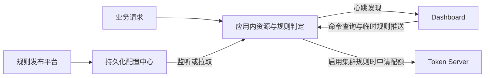

# Sentinel 规则与运维

规则持久化解决“规则从哪里恢复”，发布治理解决“哪些实例已经收到哪份规则”，监控解决“它是否保护了正确的业务”。三者缺一不可：配置中心保存成功，不代表客户端已经加载；block 增加，也不代表业务真的被挡住或系统更健康。

机制基线见 [[Sentinel]]，容量与业务降级见 [[Sentinel项目实践]]。本文的配置形状用于解释接入约定；Spring Cloud Alibaba 与 Nacos 配套版本需以项目 BOM 为准，本轮没有启动配置中心或 Dashboard。

## 1. 分清四条通信路径



Dashboard 用客户端心跳发现实例，客户端命令端口用于反向查询与临时推送。心跳不是每次请求的授权，也不表示完整流量指标都随心跳持续推送。

在常用 Simple HTTP transport 下，客户端能访问 Dashboard，并不代表 Dashboard 能访问客户端声明的 IP 和命令端口。容器 NAT、错误的 client IP、端口占用和网络策略都可能导致“机器在线但查不到指标、规则推送失败”。默认起始端口常见为 8719，应核实实际绑定值。

Dashboard 不可用时，已有本地规则仍可判定；独立配置中心监听也可能继续工作。应用重启后是否仍有规则，则取决于启动加载、缓存及失败策略，不能沿用“老进程本地规则还在”的结论。

## 2. 规则事实来源应当唯一

### 2.1 内存推送与持久化发布

默认 Dashboard 编辑通常直接影响客户端内存。接入 Nacos 读取后，Dashboard 不会因此自动具备写回 Nacos 的能力。两边分别修改，会出现页面、配置中心和实例内存三份内容不同。

生产可以让发布系统直接写配置中心，也可以改造 Dashboard 的发布链，但必须明确唯一事实来源。改造应同时覆盖读取、校验、发布失败、并发变更、删除和回滚，不能只在 Controller 末尾加一次 `publishConfig`，捕获失败后仍返回成功。

如果运行侧订阅的是规则数组，给 JSON 外层增加 `version`、`rules` 包装对象会改变协议，需同步更改转换器。更简单的做法是把版本、内容哈希和审批信息放在发布记录，规则正文保持预期结构。

### 2.2 不同数据源的代价

| 来源 | 如何变化 | 恢复与运维边界 |
| --- | --- | --- |
| 代码加载 | 应用主动调用 loadRules | 适合独立实验或经过设计的初始规则 |
| 可读文件 | 实现可定期轮询文件 | 本地路径、挂载更新与写入原子性需验证 |
| Nacos/Apollo/ZooKeeper | 对应客户端监听或推送 | 权限、命名空间、客户端缓存和重连各不同 |
| 自建数据库/平台 | 自定义 ReadableDataSource 或轮询 | 版本、并发发布、失败保留、生命周期由项目实现 |

文件数据源并非天然只能重启更新：可轮询文件实现支持刷新；但打包在不可变 JAR 中的资源与外部挂载文件是不同条件。Nacos、Apollo、ZooKeeper 也不能仅凭“支持动态配置”就互换 YAML。

扩展数据源应保持稳定的 SentinelProperty，先解析、校验完整新版本，再发布更新；关闭时释放监听与线程。每次 `getProperty()` 新建对象、同时用多个任务直接 loadRules，都会让规则生命周期难以解释。[动态规则扩展](https://sentinelguard.io/zh-cn/docs/dynamic-rule-configuration.html)

## 3. Nacos 配置：从名字到运行时类型

### 3.1 明确应用、环境、规则类型

下面是 Spring Cloud Alibaba 的 Nacos Sentinel 数据源配置形状。需要兼容的 Starter、`sentinel-datasource-nacos` 及其依赖；凭据由项目配置体系注入。`namespace` 使用实际 ID，不把界面显示名称当作 ID。

```yaml
spring:
  application:
    name: appointment-service
  cloud:
    sentinel:
      datasource:
        appointment-flow:
          nacos:
            server-addr: ${NACOS_SERVER_ADDR}
            namespace: ${NACOS_NAMESPACE_ID}
            group-id: SENTINEL_GROUP
            data-id: appointment-service-flow-prod
            data-type: json
            rule-type: flow
```

`appointment-flow` 是数据源配置名，不是资源名。data ID 对应的内容仍需写真实的 `appointment:create` 等资源。环境隔离至少让 namespace/group/data ID 和客户端订阅一致；一份生产 JSON 被测试环境误订阅也属于发布事故。

| 规则 | 常见数据源类型 | 运行侧对象 |
| --- | --- | --- |
| 普通流控 | `flow` | FlowRule |
| 熔断 | `degrade` | DegradeRule |
| 热点参数 | `param-flow` | ParamFlowRule |
| 系统保护 | `system` | SystemRule |
| 来源访问控制 | `authority` | AuthorityRule |
| 网关流控 | `gw-flow` | GatewayFlowRule |
| 网关 API 分组 | `gw-api-group` | ApiDefinition |

这里的类型名称属于适配层约定，必须核对项目版本。把网关规则标为普通 flow，不会自动得到正确的路由与参数语义。

### 3.2 规则样本和字段单位

普通流控示例对应 1.8.6 的枚举值，限制本地资源：

```json
[
  {
    "resource": "appointment:create",
    "limitApp": "default",
    "grade": 1,
    "count": 200,
    "strategy": 0,
    "controlBehavior": 0,
    "clusterMode": false
  }
]
```

慢调用规则应写入单独的 degrade 数据源：

```json
[
  {
    "resource": "insurance:settle",
    "grade": 0,
    "count": 800,
    "slowRatioThreshold": 0.5,
    "minRequestAmount": 20,
    "statIntervalMs": 10000,
    "timeWindow": 10
  }
]
```

这里 800 是毫秒，10000 是毫秒，10 是秒；20 是完成样本门槛，不是线程数。阈值只是示例，不是医保服务默认配置。规则没有配套超时、异常记录和正确 Entry 生命周期，字段写对也不能证明熔断有效。

热点规则的例外项要保留类型：

```json
[
  {
    "resource": "schedule:query",
    "grade": 1,
    "paramIdx": 0,
    "count": 20,
    "durationInSec": 1,
    "burstCount": 0,
    "paramFlowItemList": [
      {"object": "hospital-A", "classType": "java.lang.String", "count": 80}
    ]
  }
]
```

这表示每个值的默认预算，hospital-A 另设预算；不表达所有其他医院共享 20。参数缺失、空值和类型变化必须在请求侧检查。

## 4. 动态加载的隐藏风险

### 4.1 loadRules 是整组替换

`FlowRuleManager.loadRules` 更新当前普通流控规则集，不是追加一条。将“应急调高某资源”写成只含一条规则的列表，可能把其他普通流控规则全部移除。

发布应先读取当前完整版本，在受控流程中生成完整目标版本，再做并发版本检查和发布。不能在每个业务请求里 getRules、加一条、再 loadRules，这会竞争覆盖并使配置中心无法保持权威。

同一类型配置来自多个数据源时，也不能默认它们自动合并。应明确适配器注册及属性替换行为；确需多个来源，由一个经过验证的聚合层生成最终规则集。

### 4.2 空配置、非法配置、无规则是三种状态

合法空数组通常意味着清空该类规则。格式错误、字段错误、非法阈值或类型不匹配的结果，取决于转换器与管理器：可能保留旧值、过滤部分条目，也可能产生空集合。不能给出“错误 JSON 一定保留上一份”这样的跨适配器保证。

发布前校验结构和业务约束；发布后读取客户端实际生效规则与哈希。如果系统要求失败保留最后有效版本，应在真实加载链中实现并验证，而不是仅在运维文档中写一句要求。

### 4.3 本地替换不等于分布式原子变更

不同实例收到规则的时间不同，flow、degrade、param-flow 也可能分批更新。需要配套变更时，设计可兼容的过渡顺序，并在观察窗口接受旧新版本并存。

已进入的调用不会因为规则更新自动撤销。更新熔断规则还可能影响熔断器对象和统计状态的复用，应检查目标版本，不能保证修改后仍保留原来的 OPEN 状态。

## 5. 启动、扩容与配置故障

| 情况 | 已有进程 | 新启动进程 | 需要证明的行为 |
| --- | --- | --- | --- |
| Dashboard 不可达 | 本地规则通常继续工作 | 看实际初始化与规则源 | 控制台故障不等于本地限流消失 |
| 配置中心不可达 | 可能继续使用最后规则 | 可能读取缓存，也可能无规则 | 是否允许带空规则接流 |
| 新版本解析失败 | 结果依适配器实现 | 初始规则可能缺失 | 本地有效规则是否符合要求 |
| Token Server 不可达 | 进入集群失败分支 | 同时受客户端初始化影响 | 回退还是放行，是否有额外拒绝策略 |

对关键写业务，可以在应用就绪前检查必需规则已加载，并提供经过验证的启动兜底。它属于项目的就绪设计，Sentinel 不会因为业务觉得规则重要，就自动阻止实例接流。

配置中心客户端磁盘缓存不是所有数据源的统一承诺。验证要区分“旧进程断网”“保留缓存重启”“空缓存新实例”，尤其不能只做第一种实验就宣布扩容安全。

## 6. 发布与回滚形成可追溯闭环

一次规则发布至少绑定：保护目标、资源与类型、旧新完整内容、版本哈希、阈值依据、灰度订阅范围、观测指标、回滚条件。

```text
资源：appointment:create
目标：降低连接池等待，保护挂号提交尾延迟
变更：同一完整规则集中 count 从 200 调整为 160
灰度：订阅专用 data ID 的实例组
确认：实例有效规则哈希、真实请求阻断、核心业务完成率
回滚：恢复上一份完整规则集，并重新确认实例收敛
```

只在发布脚本里挑选实例名字，不会改变它们的订阅。灰度组必须实际订阅独立 data ID，或使用项目配置平台已验证的灰度机制。观察长度应覆盖代表性流量及依赖波动，不机械采用固定 30 分钟。

回滚也不是瞬时跨实例事务。回滚完成要确认配置存储、客户端生效和业务指标三层一致。紧急本地修改若确有必要，应记录有效期及归并方式，避免随后配置中心推送把应急规则意外覆盖。

## 7. 监控：先明确指标类型和分母

### 7.1 四层观测

| 层次 | 指标与证据 | 主要判断 |
| --- | --- | --- |
| 业务 | 挂号完成、支付终态、待处理数量、回调延迟 | 核心业务是否真正恢复 |
| 资源 | pass、block、完成量、异常、RT、在途 | 哪个保护点正在起作用 |
| 依赖 | 连接等待、超时、线程队列、CPU、GC | 拒绝后瓶颈是否缓解 |
| 配置与集群 | 生效哈希、加载失败、Token 延迟、回退次数 | 规则与故障语义是否漂移 |

只安装 Actuator 和 Prometheus registry，不代表自动暴露全部 Sentinel 指标。使用经过验证的 exporter、统计回调或自建采集器，先确定名字、类型、单位和标签，再写告警。

### 7.2 QPS Gauge 不能再次取 rate

累计 Counter 可用 `rate(counter[5m])` 得到速率；某一窗口的 passQps/blockQps 已经是速率 Gauge，再取 rate 得到的是速率变化，通常不符合“拒绝率”的意图。

假设项目确实以统计回调维护以下累计 Counter，可以这样计算按资源的拒绝尝试比例：

```promql
sum by (resource) (rate(app_sentinel_block_total[5m]))
/
clamp_min(
  sum by (resource) (rate(app_sentinel_pass_total[5m]))
  + sum by (resource) (rate(app_sentinel_block_total[5m])),
  0.000001
)
```

上述名称是项目自定义示例，不是 Sentinel 默认指标。实际还应保留应用、环境等必要维度，并过滤低流量，避免极少请求的比例告警误导。

Gauge 应注册稳定状态对象并更新值，或绑定实时读取函数；每隔几秒拿一个装箱数字重复注册相同名称，不等于持续更新原 Gauge。Counter 也不能周期性把窗口累计重复加一遍。

### 7.3 平均 RT、完成数与业务成功率

P99 需要直方图或其他合适的数据采集，不能从 Sentinel 平均 RT 计算出来。跨实例平均 RT 应按完成量加权，不能对各实例均值再直接取均值。

1.8.6 的 success 统计含完成且带错误的调用；HTTP fallback 返回 200，也可能意味着业务暂不可用。面板应将保护通过率、接口状态和业务结果并列展示。

资源名、实例、规则类别可做受控标签；完整订单号、患者标识和任意租户值不宜全部进入时序标签。热点维度可以用有限等级、采样日志及离线聚合定位，避免监控本身因基数失控。

## 8. 排障按证据推进

### 8.1 规则没有挡住请求

先确认测试请求的实际资源名、入口类型、参数和代理路径，再查看客户端生效规则。接着检查来源、关联资源或链路 context，以及数据源类型、group、namespace 和 data ID。

如果规则确实在内存中，继续验证受保护函数是否执行、异常处理是否改变响应，以及是否有内部错误被框架吞掉。主文所述 1.8.6 LogSlot 缺陷就是“检查器决定阻断，但完整调用继续”的例子；只有看 Dashboard 配置无法发现。

### 8.2 熔断迟迟没有打开

检查 minRequestAmount、统计区间与实际完成量；长时间悬挂调用尚未进入完整 RT 样本。再检查错误是否被业务 catch、Feign fallback 或外层适配器转换，编程埋点是否在 exit 前追踪异常。

慢调用阈值、客户端超时和总 deadline 是不同数字。只调整熔断阈值不能解除已经占住的连接；先查连接超时与在途量。

### 8.3 block 上升但资源压力没有下降

排查客户端重试、fallback 回源、未受保护的其他入口，以及热点规则是否选错维度。也可能限制的是低成本查询，而真正昂贵的导出仍在继续。

比较核心完成率、CPU、连接等待与被拒绝请求人群。block 本身不应作为事故级别的唯一依据；预期削峰可以有较高 block，同时核心业务更稳定。

### 8.4 控制台与集群故障

| 现象 | 优先收集的证据 |
| --- | --- |
| 无机器信息 | 首次资源访问/初始化、应用名、心跳日志、客户端到 Dashboard 网络 |
| 在线但不可查询 | Dashboard 到客户端公布 IP/端口的反向连通性 |
| 只有部分实例规则异常 | 各实例订阅位置、有效哈希和加载日志 |
| 集群通过量异常偏高 | 是否本地回退、失败直接放行、多个独立 Server 重复预算 |
| Token 延迟升高 | Server CPU/GC/队列、客户端网络、超时和分配变化 |

诊断优先使用已授权环境中的只读查询。命令端口路径和日志文件名按实际版本确认；不要复制一个未经核实的命令就认为已经修改规则。线程栈、堆转储和动态诊断也有运行开销，应针对明确实例与问题执行。

## 9. 性能调优应先找成本来源

对比无埋点、已埋点无规则、本地规则、热点规则、集群规则，固定请求模型、JDK、数据、机器和预热条件。记录成功处理吞吐与 P99，而不是把快速拒绝的 QPS 当成业务容量。

规则通常先按资源选择，再检查该资源的规则；并非每个请求遍历全应用所有规则。把 500 个资源合并成一个不能据此宣称性能提升 50 倍，还可能混淆配额与优先级。

优先处理动态资源名、过多 context、高基数参数和日志放大。窗口参数、缓存容量与内部线程不能用不存在的 setter 或任意改常量调整。用包住完整业务的 AOP 计时，也不能把其全部时间归为 Sentinel 开销。

批量预领令牌、本地缓存配额、跨 Server 复制是独立设计，会改变故障与公平语义，不是天然可用的“性能开关”。调优必须重新验证配额偏差和故障行为。

## 10. 应急与恢复

### 10.1 先判断保护过度还是系统真正过载

规则发布后突然拒绝，先核对变更与命中维度；依赖变慢时，先限制非核心流量、保留回调与查询通道，并控制补偿并发。CPU 还不高不代表有余量，瓶颈可能是锁、连接或外部配额。

需要放宽规则时，在安全容量内小步调整；不能直接用一个只有 resource/count 的数组覆盖整个规则集，也不能因 Dashboard 不可达就删除所有保护。

### 10.2 恢复不是一键全量放开

依赖健康、规则收敛和积压消化分别观察。按阶段恢复入口、补偿与后台任务，限制同时恢复的负载，防止多个重试层同步释放积压。自动化调整还需要上下限、冷却时间和回滚条件，不能仅按“过去一小时最大流量乘 1.2”无限放大阈值。

复盘应记录错误假设、实际生效配置、流量与业务结果、处置前后资源变化、恢复期间的二次冲击。使用设计推演的数据时明确标注，不能将示例性能数字写成个人项目实绩。

## 11. 管理面的访问与可恢复性

规则修改能够直接改变业务可用性。Dashboard、配置中心写接口和客户端命令端口都应限制在受控网络，并通过实际部署的认证、授权、TLS 和审计保护；不要把不存在的 IP 白名单属性当作原生能力。

Dashboard 多副本不自动共享全部内存发现与指标状态；Token Server 多副本也不自动复制配额。分别为控制台、规则中心和配额服务定义恢复目标，并验证故障时仍能执行必要的只读诊断与受控发布。

发布记录保留完整规则、内容哈希、操作者、时间、影响范围和回滚版本；日志避免患者、手机号和支付敏感数据明文。值班人员应能从一个资源定位到规则来源、容量依据和恢复动作，而不依赖某位维护者的记忆。

本轮对三篇文档的 JSON、链接和 Markdown 结构做静态校验，并执行主文所述本地实验。配置中心解析失败策略、缓存恢复、Gateway 响应、集群网络故障及长期监控采集仍需在具体项目版本中完成集成验证。
