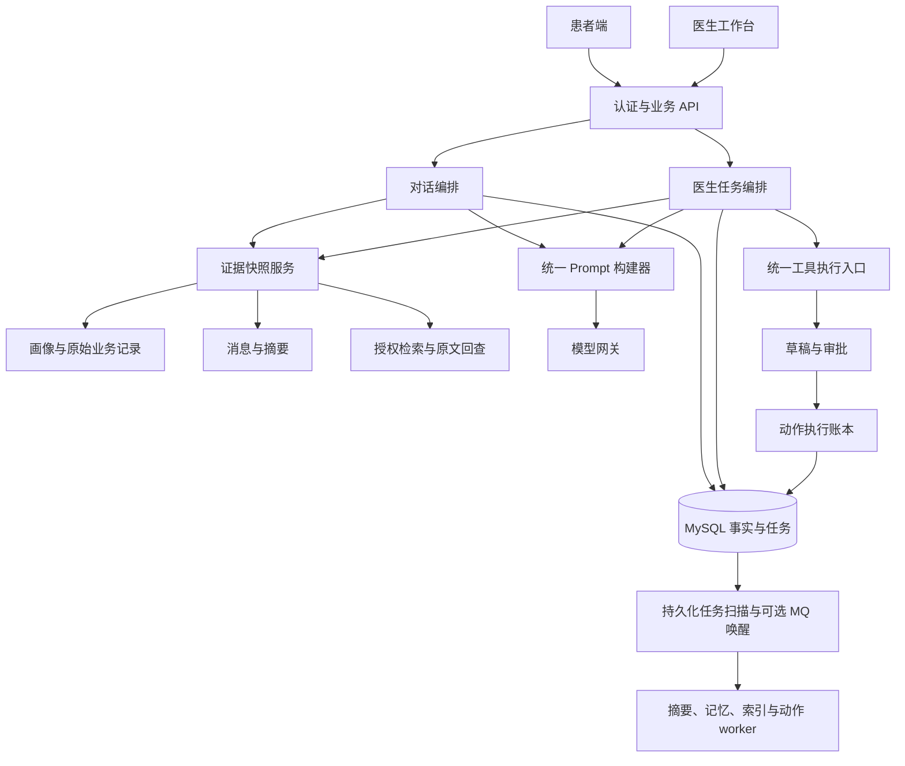

# AI 对话与医生助手统一系统方案

> **状态与范围（2026-10-29）**：本文是统一设计基线，不是已上线系统。当前仓库中的相关材料是笔记与教学实验，未发现对应可构建的业务 Java 应用。业务实现、数据库迁移、供应商联调与真实部署均待完成；证据见 [[医生助手Agent开发方案-总览#能力状态与证据边界]]。

## 一、目标、边界与首期验收

系统提供两个入口：患者端持续对话，医生端围绕同一患者资料完成分析与草稿审核。它们共用身份授权、资料读取、Prompt 构建、模型适配和持久化任务基础设施，但不共享所有对话内容或工具权限。

首期解决“资料是否齐全、结论依据在哪里、医生是否能核对草稿”三个问题。患者端可整理自身记录、回答授权知识范围内的问题；医生端可查询获授权患者的资料、生成证据报告与回复草稿。事实不足时标记未知或转人工，不能把模型生成内容写成患者事实。

**首期非目标**：自动诊断、正式处方生效、自动调整用药、跨患者病例搜索、无审批对外发送、任意代码执行。旧方案的 13 个工具保留为能力路线图，不要求一次实现。后续启用有副作用的工具，必须另过审批、资源端幂等和故障恢复门槛。

首期验收以这些可观察结果为准：同一请求重试只创建一个业务任务；同一授权范围内的消息只进入输入一次；摘要滞后时原文补齐；不可用不冒充无记录；医生报告引用可回查；过期草稿不能获批；重启后已提交任务有恢复入口。质量评测集与门槛见 [[医生助手Agent开发方案-测试部署监控]]。

## 二、总体结构与模块职责

采用模块化应用作为起点，按负载将在线 API 和后台 worker 分开部署，不以微服务数量作为完善程度。MySQL 保存事实与任务，Redis 是可重建缓存；Milvus 是检索投影；RabbitMQ 可作为唤醒通道，任务表扫描承担恢复兜底。



| 模块 | 权威职责 | 明确不承担的职责 |
| --- | --- | --- |
| AccessPolicy | 从认证主体解析租户、角色、患者关系、用途与允许操作 | 不相信请求中的 doctorId 或模型生成的患者 ID |
| ChatOrchestrator | 轮次去重、消息排序、流式完成与落库 | 不持有工具业务实现 |
| AgentOrchestrator | 工作流状态、有限工具循环、预算、恢复 | 不直接调用工具适配器绕过执行入口 |
| EvidenceService | 组合已授权来源，冻结版本清单与完整性 | 不声称跨 MySQL、Redis、外部接口有全局事务快照 |
| PromptBuilder | 按模式组织可信规则和不可信资料、去重与预算 | 不查库、不发布消息、不扩大权限 |
| ModelGateway | 角色及工具协议适配、usage、截止时间、错误分类 | 不把模型的成功声明当作业务成功 |
| ToolGateway | Schema、授权、目标绑定、调用账本和结果验证 | 不根据 LOW/MEDIUM 标签省略资源校验 |
| Draft/ApprovalService | 不可变草稿版本、审核绑定、失效判定 | 批准不等于发送或正式处方生效 |
| JobService | 持久化领取、租约、重试、人工处理 | 不将队列 ACK 当作任务完成 |

固定工作流与 Agent 循环组合使用：接收、授权、冻结证据、生成、校验、落库是固定边界；“还需要查哪些已授权资料”允许模型在白名单和预算内选择。患者端默认没有医生工具；模式由入口和服务端策略决定，用户输入不能切换为医生权限。

## 三、统一身份、来源与数据契约

### 3.1 身份不能互相替代

| 字段 | 唯一用途 |
| --- | --- |
| tenantId、actorId、actorRole | 认证主体与隔离边界，由服务端解析 |
| customerId | 当前任务唯一目标患者，创建时鉴权后固定 |
| groupId | 业务对话容器；医生私有讨论与患者对话分开 |
| turnId | 一轮输入及其回复的稳定身份 |
| runId | 一次医生任务，旧 agent_session.id 映射到此字段 |
| callId | 一次逻辑工具请求，重试不换 ID |
| actionId | 一次业务副作用意图；不同 callId 引用同一批准动作时仍沿用 |
| jobId、attemptToken | 持久化任务及本次领取，后者用于拒绝旧 worker 提交 |
| requestKey、payloadHash | 接口幂等身份与规范化参数摘要；同键不同参数返回冲突 |
| traceId | 一次追踪链路，不能代替任何幂等身份 |

`requestKey` 的唯一范围为 `(tenantId, actorId, operation, requestKey)`；同键同参数返回已有资源，仍重新校验读取权限。正文哈希按版本化规范化 JSON 计算，保留否定、标点和单位；普通文本不做可能改变语义的“去标点等价化”。

### 3.2 证据快照是可追踪清单

统一输入对象至少包含：

```text
EvidenceSnapshot {
  snapshotId, tenantId, customerId, audience, purpose,
  policyVersion, capturedAt,
  profileVersion, groupId?, sessionEpoch?, contextVersion?, readThroughSeq?,
  sources: [{sourceType, sourceId, sourceVersion, sourceRole, observedAt,
             confirmationStatus, visibility, contentRef}],
  retrieval: {status: FOUND|EMPTY|UNAVAILABLE, complete, reason},
  missingSources, conflictingSources
}
```

`audience` 区分 PATIENT 与 CLINICIAN，`visibility` 决定当前主体是否可见；医生内部意见不回流患者摘要或患者长期记忆。病历、用户自述、模型归纳、已审核知识分别保留来源角色。临床判断不由技术方案定义，规则集须有业务审核、版本及适用范围。

同一 Prompt 的资料在装配后冻结；这只说明使用了哪些版本，不证明不同数据源在同一物理时刻读取。关键动作在真正执行前，必须再读权威版本并验证授权。需要跨源严格一致但上游没有版本接口时，阻止该类动作自动执行。

### 3.3 表与约束归属

以下是逻辑模型，不是可直接执行的完整 DDL。所有业务表带 tenant_id，跨表关联需验证同租户、同目标；外部 ID 使用明确区分大小写的规范化或排序规则。迁移必须建立唯一约束及查询索引，不能只在 Java 中先查后插。

| 表 | 关键字段和约束 |
| --- | --- |
| conversation | group_id、customer_id、audience、epoch、next_seq、active_turn_id；按会话行锁排序 |
| chat_turn | turn_id、group_id、epoch、request_key、payload_hash、submitted_content_ref、status、reply_to、read_through_seq、deadline；接口幂等唯一键 |
| chat_message | message_id、turn_id、group_id、epoch、seq、role、status、visibility、content_ref；`(tenant_id, group_id, epoch, seq)` 唯一 |
| user_profile / context_snapshot / memory | 分别维护 profile_version、覆盖水位、记忆版本和来源；详见对话专题 |
| evidence_snapshot | snapshot_id、用途、授权范围及来源版本清单；正文保留按访问和保留策略控制 |
| agent_run | run_id、actor_id、customer_id、goal、goal_revision、evidence_revision、snapshot_id、state_version、status、step_count、预算和截止时间 |
| tool_call | call_id、run_id、decision_no、调用序号、工具版本、参数摘要、目标/证据版本、状态、result_hash；`(tenant_id, run_id, decision_no, ordinal)` 唯一 |
| draft | draft_id、draft_version、run_id、goal_revision、evidence_revision、正文及引用；每一版本不可变 |
| approval | approval_id、draft_id/version 或 action_id、参数摘要、证据清单摘要、审核人、过期时间、decision；审批对象不得就地改写 |
| action_execution | action_id、业务效果键、tool_version、input_hash、approval_id、状态、external_receipt；业务效果键唯一 |
| async_job | job_id、job_type、business_key、payload_version/hash、status、attempt_token、lease_until、next_attempt_at；`(tenant_id, job_type, business_key)` 唯一 |
| run_event / audit_event | 资源 ID、event_seq、actor、事件类型、版本、结果码；任务事件序号唯一，审计按授权保留 |

原 agent_pending_task 混合了审批和执行两类状态，迁移时拆成 approval 与 action_execution；旧 APPROVED 只能证明已批准，不能推断已执行。旧记录没有参数/证据版本时须重新核对，不能批量自动恢复。

## 四、患者对话的完整时序

1. 验证主体、患者和会话归属，按 requestKey 查重。短事务内创建 QUEUED turn 并保存输入内容；排队内容尚不进入 chat_message。取得运行资格时锁定 conversation，为当前用户消息分配连续 seq 并插入消息，分配和插入同事务。
2. 首期每个会话只运行一个生成轮次，其余轮次持久化排队；可显式取消前轮后运行后轮。轮次开始时冻结 readThroughSeq，不读取更晚的排队请求，回复通过 reply_to 绑定原请求；该轮重试复用已有用户消息，不重复分配 seq。
3. 读取画像、已提交摘要、覆盖水位之后到 readThroughSeq 的原文；去除重复当前消息。摘要范围按实际提交消息序列解释，消息角色不能按奇偶猜测。
4. 需要历史检索时生成 query 向量、过滤并回查原文；知识库与个人记忆使用不同 corpus 与授权策略。必需来源不可用则暂停或请求补充，可选来源不可用则显式标为降级。
5. PromptBuilder 按 PATIENT 模式装配；模型流式片段为暂存输出，前端不把片段视为已完成回复。
6. 模型完成后在短事务内复核 turn 状态、epoch、attemptToken 及当前发布权限；保存完整回复、reply_to、轮次终态和后处理任务。只有该事务提交后发送 completed 事件。重复回调不能重复建任务。
7. 摘要与记忆任务读取持久化来源，记忆提取失败不阻塞摘要；索引同步是记忆已落库后的独立任务。完整生成失败仍保留用户消息供后续连续摘要读取，不能因助手未回复而丢掉用户事实。

第2轮可先提交排队内容，但只有第1轮回复完成或明确失败后才进入消息日志。因此正常日志为U1、A1、U2、A2；失败时可能只有U1、U2、A2，角色仍必须按记录而非奇偶识别。readThroughSeq在运行时确定，第2轮能看到已提交的A1；终态失败或取消的队头被显式跳过，不让队列永久阻塞。

清空会话的事务推进 epoch、取消旧轮次并作废旧摘要和相关待处理任务。旧回调可留审计，但不能发布到新会话。清空聊天与删除跨会话记忆是两种用户动作，接口必须明确范围；删除来源还要使依赖摘要、记忆、报告失效，不能只清 Redis。

## 五、医生任务、草稿与审批

### 5.1 生命周期与版本

```text
QUEUED → RUNNING → COMPLETED
            ├→ WAITING_REVIEW → QUEUED（审核通过后的继续处理）
            ├→ WAITING_INPUT → QUEUED（补充资料后新版本）
            ├→ FAILED / EXPIRED / CANCELLED
            └→ RECONCILING（外部动作结果不明）→ QUEUED 或 MANUAL
```

WAITING_REVIEW 不占用模型线程。拒绝审批后首期将任务置 CANCELLED，原因 REVIEW_REJECTED；过期置 EXPIRED。已确认的草稿可作为审核结果交付；发送动作使用独立 approval，不继承草稿审核授权。

目标变化推进 goalRevision，采用新证据快照推进 evidenceRevision，普通状态变化推进 stateVersion。它们分别防止旧目标、旧资料与并发状态覆盖。数据库资料更新还可能尚未进入 evidenceRevision，故提交草稿和动作前都要核对来源的当前版本，不能只比较 run 内两个数字。

单次模型响应消耗一个 decisionNo；工具调用、重试与日志事件分别计数。到达 step、token、金额或活动执行时间预算时停止新调用。审批等待单独计时；恢复可重设一次活动截止时间，但累计预算不清零，审批到期时间也不顺延。

### 5.2 受控的工具循环

流程为读取任务 → 冻结证据与可用工具 → 模型提出结构化调用 → 应用验证 → 调用账本落库 → 执行 → 持久化真实结果 → 下一步。模型只能请求工具和参数，不能提交审批、任意指定患者或生成可信 Observation。

ToolGateway 在首次执行、恢复、并行和重试中是唯一入口。患者/租户由执行上下文绑定，模型参数中禁止覆盖身份。只读调用也要按用途和患者关系授权；目录过滤只是减少误用，执行时仍要再校验。文本中出现 `Final Answer:` 不再改变解析状态；模型网关接收结构化协议，未知工具、非法 JSON、额外身份字段和不配对结果均失败关闭。

### 5.3 工具能力路线图

| 工具 | 首期状态与边界 |
| --- | --- |
| get_patient_profile、get_weight_history、get_chat_history | 实现授权只读查询，返回来源版本、完整性和错误状态 |
| get_prescription_history | 只读；只有对应数据权限时开放，缺失不推断“未用药” |
| analyze_weight_trend | 确定性计算，明确单位、时间窗、缺失和算法版本；不自动推断临床原因 |
| analyze_sentiment、calculate_risk_score | 延后；须有已审核定义、数据质量要求与误判评测，先输出待核对线索 |
| search_similar_cases | 默认禁用；患者记忆检索不等于获准查询其他患者病例 |
| send_reminder、create_followup_task、flag_high_risk_patient | 后续动作阶段；即使原标为 MEDIUM 也需明确授权、审批策略与幂等 |
| draft_prescription、suggest_diagnosis | 默认禁用；首期用 generate_reply_draft 生成可核对的回复草稿，正式医疗流程另行设计 |

`generate_reply_draft` 产生不可变候选并关联证据，不发送、不更新权威患者资料。首期审批只将某一版本标为 REVIEWED；医生编辑产生新 draftVersion 并重新提交审核。

### 5.4 动作审批不能只更新一个状态

审批绑定 `(tenantId, customerId, runId, goalRevision, evidenceRevision, draftVersion/actionId, inputHash, toolVersion, sourceManifestHash, expiresAt)`。批准事务先锁 run，再锁审批和动作记录；与取消、改目标、改证据采用相同锁顺序。校验当前权限、版本、过期时间及 PENDING 状态，保存决策并创建动作任务或继续任务，原子提交。

副作用执行账本状态：`READY → EXECUTING → SUCCEEDED / RETRY_WAIT / UNKNOWN / FAILED`。只有已知尚未产生效果且可重试的故障进入 RETRY_WAIT。网络超时或执行后崩溃进入 UNKNOWN，查询资源端 receipt 或按相同幂等键恢复；无法查证时转 MANUAL，不能换 actionId 重发。

同一数据库内的业务效果与账本终态可同事务提交；外部发送需要资源端支持业务键去重或查证。本地唯一键不能保证外部“恰好一次”。授权撤销或取消发生在外部请求已提交之后，不能承诺回滚；系统显示已发送、结果未知或取消未生效，并停止后续动作。需要更强约束时，资源端也必须参与版本/授权条件验证。

## 六、共享基础服务的衔接

| 专题 | 统一系统采用的契约 |
| --- | --- |
| [[用户画像存储设计方案]] | MySQL 事实、Redis 缓存，模型候选不覆盖权威画像；关键审核要求 minProfileVersion 或回源 |
| [[会话上下文设计方案]] | epoch、水位和版本条件提交；医生任务状态独立保存，不塞进患者摘要 |
| [[动态Prompt构建方案]] | 一个构建入口，按 audience、purpose、templateVersion 选择模板，返回来源清单与省略原因 |
| [[千问Embedding+Milvus向量搜索集成文档]] | 私人记忆和审核知识不同 corpus，来源回查和版本校验；不启用跨患者病例检索 |
| [[AI消息后处理异步方案]] | 共用 job 调度机制，后处理和真实动作使用不同失败/重试策略 |
| [[AI消息数据流性能分析]] | 分别统计首字、完整回复、后台追平、Agent 活动耗时与审批等待 |

缓存命中仍需权限检查。首期不缓存医生最终草稿或动作结果来跳过审批；只缓存允许陈旧的读取数据和符合向量空间契约的 Embedding。共享基础设施不等于共享全部内容、缓存或授权。

## 七、API 与前端交互

以下是新设计接口，未声明兼容旧客户端。成功包体统一 `code: 0`，HTTP 状态表达传输/请求结果；错误体包含稳定 errorCode、traceId，不暴露原始异常和患者正文。

| 接口 | 请求关键字段 | 返回及约束 |
| --- | --- | --- |
| POST /api/ai/conversations/{groupId}/turns | requestKey、message、expectedEpoch | 202，turnId、QUEUED；重复请求返回原 turnId |
| GET /api/ai/turns/{turnId} | 认证主体 | 当前状态、已提交回复和降级原因 |
| POST /api/ai/runs | requestKey、customerId、goal、mode | 202，runId、QUEUED；服务端校验 mode，doctorId 不入请求 |
| GET /api/ai/runs/{runId} | 认证主体 | 状态、版本、引用、草稿与允许的下一步 |
| GET /api/ai/runs/{runId}/events | afterEventSeq | 授权后的增量事件，重连可补读；不能依赖内存 WebSocket 恢复 |
| POST /api/ai/runs/{runId}/revisions | requestKey、expectedStateVersion、goal 或补充资料引用 | 冲突 409；推进对应版本，旧调用结果不再接纳 |
| POST /api/ai/approvals/{approvalId}/decisions | requestKey、decision、expectedVersion、inputHash、comment | 记录批准或拒绝；202 只表示后续任务已接收，不能返回“已发送” |
| POST /api/ai/runs/{runId}/cancel | requestKey、expectedStateVersion | 停止新动作；在途外部动作进入查证，不承诺撤回 |

审批列表从认证主体权限推导，不允许任意 doctorId 查询。不存在和无权限资源按统一防枚举策略返回；过期审批 410、版本/同键异参冲突 409、非法参数 400、容量拒绝 429。前端显示 QUEUED、RUNNING、WAITING_REVIEW、RECONCILING 等真实状态；审批按钮展示确切草稿版本、动作目标与证据时间。

首期以任务查询作为恢复通道，SSE/WebSocket 只是实时提示。流式 provisional 片段可以不持久化，但 completed、审批与动作结果事件必须与状态同事务保存；客户端按 eventSeq 去重，重连后以数据库状态收口。

## 八、预算、故障与交付顺序

原“50 QPS、P95 < 15 秒、7 周完成”缺少模型配额、样本和资源依据，不作为承诺。先记录请求分布与真实 usage，再确定各入口 SLO；外部模型失败计入端到端失败率。单步 P95 不能相加得到总 P95，线程池大小也不能证明吞吐量。

日常容量要区分患者生成、医生任务、摘要、记忆提取与向量调用，并分配各自并发和重试预算。队列满时 API 在接收前拒绝；已持久化任务留在 QUEUED，worker 不使用 CallerRunsPolicy 把长模型任务推回 HTTP 线程。全局配额不足时优先延后后台提炼，前台通过原文补齐保证约定语义。

费用按各类调用的实际输入、输出、缓存用量和重试次数分开计账；供应商单价作为带生效日期的配置。原 100 医生 × 10 次 × 30 天 = 30,000 次/月仍可作业务量假设，但不能由此直接估计所有后处理与循环费用。

| 阶段 | 可交付结果 | 进入下一阶段的门槛 |
| --- | --- | --- |
| A：契约与基线 | 锁定 Java/Spring/数据库/模型适配版本，建立构建和契约测试；合成数据集 | 身份、状态、表约束、错误码一致 |
| B：患者链路 | 消息持久化、串行轮次、证据快照、生成、可恢复后处理 | 重试、断流、清空、摘要滞后及索引故障用例通过 |
| C：医生只读与草稿 | 复用资料服务，有限工具循环，报告引用，草稿审核 | 无越权、无过期草稿批准，任务能重启恢复 |
| D：业务副作用 | 单个授权动作、审批、账本、资源端幂等和查证 | 重复审批/发送、结果不明、撤权和人工恢复演练通过 |
| E：优化 | 按实测决定缓存、并行、索引、模型路由与灰度 | 固定评测集不回退，延迟/费用收益有对照数据 |

产品负责用途和验收样本；后端负责状态与业务约束；前端负责版本展示和断线恢复；测试负责故障与质量评测；运维负责任务恢复、容量及告警接手。尚未确定的临床规则、数据保留期、供应商地域、业务动作接口能力与 SLO 必须在对应阶段门槛前由责任方确定，未确定能力保持关闭。

## 九、审查结论与迁移依据

| 原材料问题 | 实际后果 | 本轮设计决策 |
| --- | --- | --- |
| Agent 单独读取患者服务，模型提供 customerId | 绕过对话层已定义的租户/来源约束 | 统一 EvidenceService 与服务端目标绑定 |
| 只按风险等级直接执行；审批后裸调执行器 | 重复执行、越权、旧资料动作 | ToolGateway、不可变审批、动作账本与结果查证 |
| history.size 当步数，恢复循环省略 | 恢复丢失目标或错误触发上限 | 独立 run 状态、decisionNo、持久化事件和预算 |
| 提醒返回占位成功、草稿返回 null | 将未执行包装为完成 | 未接入工具不注册；业务成功必须有结果凭据 |
| 多套 Prompt、缓存、错误状态与 ID 命名 | 相同资料在两端产生不一致解释 | 模式化统一契约与作用域隔离 |
| 测试只看文本/非空，部署配置未对齐 | 无法证明关键业务不变量 | 场景故障断言、运行门槛与模型实验分层 |

本轮取代旧示例中的裸执行、无条件审批及硬编码部署承诺；原文件名保留以维持链接。实现契约见 [[医生助手Agent开发方案-代码实现]]，验收与运行见 [[医生助手Agent开发方案-测试部署监控]]。

## 十、可选演进方向与验收条件

结构化工具协议、授权、版本、恢复是当前基线；动态工具发现、Skill、程序化工具调用、并行工具、沙箱、托管 Runtime 是后续选择。只有工具定义体积、长任务或执行环境需求提供依据时引入，并分别验收目录权限、结果配对、预算限制、迟到回调和运行环境隔离。已有 [[Agent（智能体）]] 中的内存实验不等于本系统联调通过。

技术选型保留 Java 17 / Spring Boot 3.x、MySQL 8.0、Redis、可选 RabbitMQ 与 Milvus 的方向，具体补丁和 SDK 在阶段 A 锁定。模型通过配置与适配器选择，不能把历史示例的模型名称、价格或 API 支持当成部署事实。

## 十一、复杂场景与技术决策依据

本节把前文设计变成能解释取舍、能构造实验的案例。所有场景仍是设计与实验边界，不能表述为已处理过生产事故。首期保持只读分析与回复草稿，涉及外部动作的场景用于后续阶段门槛，不提前开放工具。

### 11.1 为什么采用固定工作流包围有限Agent循环

比较同一个任务：“整理最近记录，给出带来源的随访回复草稿”。

| 方案 | 收益 | 代价与适用条件 |
| --- | --- | --- |
| 固定查询所有来源，再生成一次 | 路径可预测，调用预算好估算 | 无关数据增加输入；部分来源不可用时需定义分支 |
| 完全由模型选择工具和结束 | 可根据观察决定后续查询 | 多次模型调用、错误选工具、重复查询及结束判定成本 |
| 固定授权/证据/提交边界，内部有限查询循环 | 保障业务边界，同时保留按需查证 | 需要任务状态、预算与结果配对，工程复杂度高于一次生成 |

当前选第三种作为医生开放式分析设计，但不是所有入口都用Agent。确定性体重统计直接用查询/计算工作流；患者普通记录整理可以一次生成。模型只有在需要根据中间结果选择下一份资料时才进入循环。

验证不能只比较“回答更长”。用相同脱敏/合成任务集、资料、模型和输出预算，对比资料覆盖、引用错误、任务完成率、工具调用数、完整响应时延与实际usage。再做去掉检索、去掉循环或固定查询顺序的对照，确定质量收益来自哪里。没有明显收益就保留较简单工作流，不先升级模型或引入多Agent。

### 11.2 医生审核时资料变化：双版本还不够

失败时序：run使用资料v7生成草稿d1 → 患者更正资料为v8 → 失效通知尚未到达 → 医生批准d1。此时goalRevision和evidenceRevision在run内可能都没变化，只校验这两个字段仍会接受陈旧草稿。

因此既校验run修订号，也查草稿来源清单对应的权威sourceVersion。若来源已变，草稿标STALE，重新获取资料生成d2，医生审核d2；不能自动把对d1的批准迁到d2。d1作为历史审核对象保留，不能就地改正文而保留原审批。

| 策略 | 适用判断 |
| --- | --- |
| 只依靠失效消息 | 适合提示刷新，不能作为关键批准的唯一正确性依据 |
| 审批前回查来源版本 | 首期草稿基线；能发现已提交变更，但外部来源仍有检查与使用竞态 |
| 本地同事务锁定/校验来源与提交 | 同库关键写入可选，需所有更新路径协作 |
| 外部资源端接收expectedVersion | 严格外部动作需要上游支持；不支持时保留人工核对边界 |

最小实验控制三个屏障：草稿生成完成、来源更新提交、审批条件提交；断言不是“弹了错误提示”，而是旧草稿未获批、无动作任务、重算后的版本和引用正确。更换目标、编辑正文和权限撤销分别注入，不能用一个总版本掩盖原因。

### 11.3 已审核任务遇到撤权：授权不随消息永久冻结

候选整合：医生发起run后被移出患者管理范围，审批或执行任务仍在队列中。按当前权限策略，工具执行、报告读取、审批决定和动作派发分别检查相关主体权限。缓存水位更新慢时，关键操作查权威依据；Outbox只能帮助通知最终到达。

[[动态权限原理与项目核实#9.2 调岗撤权：把“实时”改成可以证明的顺序]]给出同库管理写入的共同锁协议，不能直接宣称已适用于患者业务。接入时重新定义患者关系、用途和锁定依赖。原用户/科室管理权限不能作为访问患者全部病历的证据。

外部请求已被接受后才撤权，停止后续动作并查证现有动作，不能把“取消成功”显示成“从未发送”。安全与可用性的取舍是：资料不足/权限不可确定时暂停关键动作，而不是使用旧授权自动继续；由业务决定是否需要显式、可到期的任务委托授权。

### 11.4 短信超时与旧worker：区分投递幂等和动作幂等

同一actionId被MQ唤醒两次，入口去重不够；第一次可能已经向资源端发送，随后本地提交失败。新的worker只看到未完成任务，若重新发送就产生第二次效果。

选择资源端幂等键与receipt查证；没有这两种能力时，保留UNKNOWN并人工处理。调度领取的attemptToken防旧worker提交本地终态，actionId防同一业务动作重做，eventId防相同事件被某消费者重复接收，三者不能混用。

[[RabbitMQ与Outbox可靠消息方案#5.3 外部短信与本地数据库不能靠注解原子提交]]说明本地inbox与外部任务的交接。测试分别断言发布次数、消费次数和实际发送次数：允许前两者大于1，不能把它们误当成多个独立业务动作。

### 11.5 证据过多或来源故障：回答完整性与延迟怎样取舍

资料读取统一分成required与optional，按任务类型和业务规则配置，不能由模型为了更快完成临时把required改为optional。必需来源不可用时WAITING_INPUT或失败，明确原因；可选来源故障可生成标注缺失的草稿。返回EMPTY不是来源不可用，必须与UNAVAILABLE分开。

预算不足时优先保留当前问题、纠正/否定、关键数值单位和必要证据，再减少非关键重复材料；仍放不下则拆任务或请求缩小范围。对精确数字回查原文，不把有损摘要当作原始事实。全量塞入上下文、固定截前N字和每轮重新摘要各有成本，不能把模型窗口更大当作治理完成。

建立同一任务的三组输入：完整资料、可选来源不可用、必需来源不可用；分别检查结果状态、引用集合、缺失提示与调用成本。再加入患者文本中的伪造工具指令，检查ToolGateway无越权调用，而不仅是模型文字拒绝。

### 11.6 配额争用：后台追平不能拖垮前台

患者生成、医生分析、摘要提炼和Embedding争用上游配额时，单一线程池无法表达业务优先级。候选基线为独立有界队列与并发预算、全局配额协调、按用途记录调用；后台延迟由原文补齐缓冲，但补齐窗口超过输入预算时应主动降级或限流。

严格前台优先会让后台饥饿，因此为后台保留最低服务份额并监测最老任务年龄；份额由压测与新鲜度目标确定。医生等待审批不占模型槽位；恢复后累计token/金额预算不重置。不同模型的降级路由要通过同一任务集质量门槛，不能只按“查看”关键词切便宜模型。

对照实验固定前台输入速率，逐步增加后台任务，并注入上游429；记录前台TTFT、完整延迟、后台最老年龄、429/重试放大与每任务费用。只有质量和恢复时限都满足，才认定调度优化有效。

### 11.7 从方案到可讲述的证据

每个案例保留一条故障时间线、两到三个候选方案、选择条件、实验输入和实际观察值。已有23项Agent内存状态测试验证修订/审批/队列规则；新增 [可靠执行边界实验](../../通用系统方案/实验/可靠执行边界实验.py)补充本地事务、重复消费和授权排序，不替代医生业务集成。

优先实施顺序是：固定只读工作流基线与质量集 → 加入有限循环作对照 → 数据库草稿/审核竞态 → 同库权限协议 → 单个外部动作查证。对应运行要求继续使用 [[医生助手Agent开发方案-测试部署监控]]；本节补充的对照与故障场景都是后续验收输入，未执行的用例不填写成绩。
