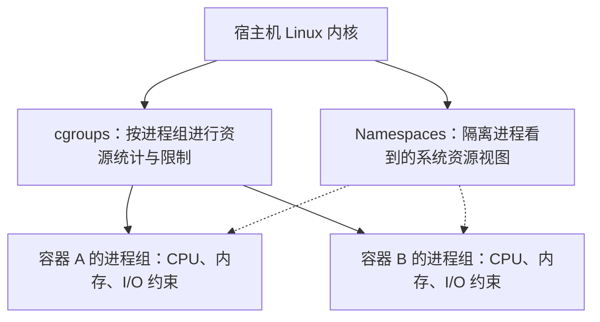

# 1. 容器

1. Paas（platform as a service）：平台即服务。
    1. 使用 PaaS 环境的优势包括转移部分职责，如维护服务器、更新基础架构软件以及设置用于构建应用的自定义平台。PaaS 提供商可托管平台，并为正在运行的应用提供环境。
2. 软件团队可专注于开发和部署应用，不必担心底层基础架构的维护和更新。这样就为进一步的开发和创新减少了干扰，同时也缩减了基础架构设置和写代码的工作量。由于 PaaS 位于云端，因此也便于进行扩展和[迁移](https://www.redhat.com/zh/topics/automation/what-is-it-migration)。
3. 选择 PaaS 环境进行应用开发的企业可享受诸多好处。
    - 使用现有技能和投资。开发人员可访问操作系统、中间件、框架及其他开发工具，并使用熟悉的编程语言快速进行编码。
    - 降低成本。PaaS 定价意味着按实际用量付费，不必投资购置大量本地计算基础架构，免得大多数时候闲置不用。
    - 缩短应用开发周期。PaaS 可帮助开发团队加速应用开发，并减少部署新软件所需的时间。
    - 实现高效的开发运维。[开发运维](https://www.redhat.com/zh/topics/devops)策略将开发人员和 IT 运维相结合，因此您可以通过持续交付来快速开发和部署应用。
    - 维护安全措施。与 PaaS 提供商合作有助于确保以统一的方式管理与安全实践相关的决策。基于云的服务将受益于专门研究安全问题的训练有素的团队。
    - 提高工作效率。开发人员可通过自助服务功能，快速获得所需工具与资源。开发环境自动置备，因此团队可专注于能够增值的工作，而不是常规的基础架构管理。
    - 实际上，大多数 Docker 镜像是直接由一个完整操作系统的所有文件和目录构成的，所以这个压缩包里的内容跟你本地开发和测试环境用的操作系统是完全一样的。因此Docker解决了传统pass的痛点：发布时确保发布环境与本地环境配置一致。
4. 容器的本质是进程，K8s类似于操作系统。
5. Docker项目启动其实是在宿主机上设置了多个namespace将宿主机进程和容器进程进行隔离。
    1. 系统可以为进程分配不同的namespace。
    2. 保证不同的namespace之间资源独立分配，进程彼此隔离。
    3. docker默认会为容器启用以下NameSpace：Pid,NetWork,Mount,IPC,UTS。
    4. Lsns 命令查看当前系统下的namespace。
    5. ls -la /proc/{pid}/ns 查看特定pid进程的namespace。
6. docker inspect查看镜像的完整信息，docker inspect {container} |grep -i pid，查看当前container的跟pid模糊匹配的属性。
7. Nsenter -t  -n ip addr：进入pid进程所在的namespace查看这个namespace得网络配置。
8. Mount namespace跟其他namespace的使用略有不同的地方：它对容器进程视图的改变一定是伴随着挂载操作才能生效。
9. Namespace隔离的不彻底的问题：
    1. 容器只是运行在宿主机上的一种特殊进程，多个容器之间使用的还是同一个宿主机的操作系统内核。
    2. 在linux内核中，有很多资源和对象是不能被Namespace化的，最经典的例子就是时间。
10. Docker项目通过使用Cgroups来限制当前进程的资源。
    1. linux服务器Cgroup配置文件路径为/sys/fs/cgroup

以下为根据正文重绘的示意图，非原截图。



10. 使用容器后，正常的top命令和/proc是针对于整个宿主机的系统状态监控，不能做到监控当前容器。解决方案：
    1. top 是从 /prof/stats 目录下获取数据，所以道理上来讲，容器不挂载宿主机的该目录就可以了。lxcfs就是来实现这个功能的，做法是把宿主机的 /var/lib/lxcfs/proc/memoinfo 文件挂载到Docker容器的/proc/meminfo位置后。容器中进程读取相应文件内容时，LXCFS的FUSE实现会从容器对应的Cgroup中读取正确的内存限制。从而使得应用获得正确的资源约束设定。kubernetes环境下，也能用，以ds 方式运行 lxcfs ，自动给容器注入争取的 proc 信息。
11. DockerFile：用一些标准的原语描述我们所要构建的Docker镜像，每个原语执行后，都会生成一个对应的镜像层。
12. docker commit，实际上就是在容器运行起来后，把最上层的“可读写层”，加上原先容器镜像的只读层，打包组成了一个新的镜像。当然，下面这些只读层在宿主机上是共享的，不会占用额外的空间。

# 2. k8s

## 1. K8s的全局架构


1. k8s架构由Master（控制节点）和Node（计算机节点）两种节点组成。
2. Master节点由负责API服务的kube-apiserver、负责调度的kube-Scheduler、负责容器编排的Controller-manager组成，整个集群的持久化数据则由kube-apiserver处理后保存在Etcd中。
3. Kubelet主要负责同容器运行时（Container Runtime）打交道，依赖CRI（Container Runtime Interface）的远程调用接口，这个接口定义了容器运行时的各项核心操作，比如启动一个容器需要的所有参数。通过grpc协议同Device Plugin的插件进行交互，用来管理GPU等宿主机物理设备的主要组件。调用网络插件和存储插件为容器配置网络和持久化存储。这两个插件与kubelet交互的接口分别是CNI（Container Networkiing Interface）和CSI（Container Storage Interface）。
4. K8s项目最主要的设计思想是：从更宏观的角度，以统一的方式来定义任务之间的各种关系，并且为将来支持各种种类的关系留有余地。
    1. 我们从容器这个最基础的概念出发，首先遇到了容器间“紧密协作”关系的难题，于是就扩展到了 Pod；有了 Pod 之后，我们希望能一次启动多个应用的实例，这样就需要 Deployment 这个 Pod 的多实例管理器；而有了这样一组相同的 Pod 后，我们又需要通过一个固定的 IP 地址和端口以负载均衡的方式访问它，于是就有了 Service。
    2. 除了应用与应用之间的关系外，应用运行的形态是影响“如何容器化这个应用”的第二个重要因素。为此，Kubernetes 定义了新的、基于 Pod 改进后的对象。比如 Job，用来描述一次性运行的 Pod（比如，大数据任务）；再比如 DaemonSet，用来描述每个宿主机上必须且只能运行一个副本的守护进程服务；又比如 CronJob，则用于描述定时任务等等
    3. 首先，通过一个“编排对象”，比如 Pod、Job、CronJob 等，来描述你试图管理的应用；然后，再为它定义一些“服务对象”，比如 Service、Secret、Horizontal Pod Autoscaler（自动水平扩展器）等。这些对象，会负责具体的平台级功能。这种使用方法，就是所谓的“声明式 API”。这种 API 对应的“编排对象”和“服务对象”，都是 Kubernetes 项目中的 API 对象（API Object）。
    4. Kubernetes 把集群里的一切资源都定义为 API 对象，通过 RESTful 接口来管理。描述 API 对象需要使用 YAML 语言，必须的字段是 apiVersion、kind、metadata。

## 2.Kubeadm
​		把 kubelet 直接运行在宿主机上，然后使用容器部署其他的 Kubernetes 组件。
1. 你使用 kubeadm 的第一步，是在机器上手动安装 kubeadm、kubelet 和 kubectl 这三个二进制文件。通过命令（apt-get install kubeadm）。
2. kubeadm init的工作流程：
    1. 执行Prefight Checks: 检查确定当前机器可以用来部署kubernetes。
    2. 在通过Prefight Checks后，kubeadm回生成kubernetes对外提供服务所需的各种证书和对应的目录。kubeadm 为 Kubernetes 项目生成的证书文件都放在 Master 节点的 /etc/kubernetes/pki 目录下。在这个目录下，最主要的证书文件是 ca.crt 和对应的私钥 ca.key。
    3. 证书生成后，kubeadm 接下来会为其他组件生成访问 kube-apiserver 所需的配置文件。
    4. kubeadm 会为 Master 组件生成 Pod 配置文件。我已经在上一篇文章中和你介绍过 Kubernetes 有三个 Master 组件 kube-apiserver、kube-controller-manager、kube-scheduler，而它们都会被使用 Pod 的方式部署起来。在 Kubernetes 中，有一种特殊的容器启动方法叫做“Static Pod”。它允许你把要部署的 Pod 的 YAML 文件放在一个指定的目录里。这样，当这台机器上的 kubelet 启动时，它会自动检查这个目录，加载所有的 Pod YAML 文件，然后在这台机器上启动它们。在 kubeadm 中，Master 组件的 YAML 文件会被生成在 /etc/kubernetes/manifests 路径下。
    5. 然后，kubeadm 就会为集群生成一个 bootstrap token。在后面，只要持有这个 token，任何一个安装了 kubelet 和 kubadm 的节点，都可以通过 kubeadm join 加入到这个集群当中。在 token 生成之后，kubeadm 会将 ca.crt 等 Master 节点的重要信息，通过 ConfigMap 的方式保存在 Etcd 当中，供后续部署 Node 节点使用。
    6. 安装默认插件。
3. kubeadm join <Master节点的ip和端口>
4. 推荐使用replica=1的deployment而不使用单独pod的主要原因是pod所在的节点出故障的时候 pod可以调度到健康的节点上，单独的pod只能在节点健康的情况下由kubelet保证pod的健康状况。

## 3.pod
1. Pods：这些具有“超亲密关系”容器的典型特征包括但不限于：互相之间会发生直接的文件交换、使用 localhost 或者 Socket 文件进行本地通信、会发生非常频繁的远程调用、需要共享某些 Linux Namespace（比如，一个容器要加入另一个容器的 Network Namespace）等等。将超亲密关系容器放在同一个pod中。
2. 可以把 Pod 看作是介于容器之上的一层抽象，之所以需要这一层抽象是因为容器与容器之间有着不确定的关系，有的容器需要与彼此隔离，而有的容器却需要彼此交互。当容器规模增大，容器之间的作用关系就会变得极其复杂，难于管理。Pod 的出现就是为了解决容器管理的问题，让大规模应用下的容器编排变得更加清晰有序，易于维护
3. 容器设计模式：
    1. Pod 里的所有容器，共享的是同一个 Network Namespace，并且可以声明共享同一个 Volume。
    2. Pod的实现依赖于Infra容器：
4. 依赖于Infra容器的容器A和容器B：
    1. 它们可以直接使用 localhost 进行通信；
    2. 它们看到的网络设备跟 Infra 容器看到的完全一样；
    3. 一个 Pod 只有一个 IP 地址，也就是这个 Pod 的 Network Namespace 对应的 IP 地址；
    4. 当然，其他的所有网络资源，都是一个 Pod 一份，并且被该 Pod 中的所有容器共享；
    5. Pod 的生命周期只跟 Infra 容器一致，而与容器 A 和 B 无关。
    6. 将来如果你要为 Kubernetes 开发一个网络插件时，应该重点考虑的是如何配置这个 Pod 的 Network Namespace，而不是每一个用户容器如何使用你的网络配置，这是没有意义的。
    7. 有了这个设计之后，共享 Volume 就简单多了：Kubernetes 项目只要把所有 Volume 的定义都设计在 Pod 层级即可。这样，一个 Volume 对应的宿主机目录对于 Pod 来说就只有一个，Pod 里的容器只要声明挂载这个 Volume，就一定可以共享这个 Volume 对应的宿主机目录。
5. 把pod看成传统环境里的”机器“、把容器看作是运行在这个”机器“里的“用户程序”
6. Pod.yaml配置文件中的labels可以为Pod附上一些标签
7. Pod.yaml配置文件中spec.container相关属性的含义：
    1. ImagePullPolicy：定义了镜像拉取的策略，Always：每次创建Pod都会重新拉取一次镜像，IfNotPresent：Pod永远不会主动拉取这个镜像，或者只有在宿主机上不存在时才会拉取这个镜像。在生产环境中部署容器时，你应该避免使用 `:latest` 标签，因为这使得正在运行的镜像的版本难以追踪，并且难以正确地回滚。
    2. Lifecycle字段：
8. `spec:`  containers:  - name: lifecycle-demo-container    image: nginx    lifecycle:        //在容器启动后，立刻执行的一个操作      postStart:        exec:          command: ["/bin/sh", "-c", "echo Hello from the postStart handler > /usr/share/message"]      //在容器杀死之前，立刻执行的一个操作          preStop:        exec:          command: ["/usr/sbin/nginx","-s","quit"]
    - 涉及到Pod生命周期的属性：status
        1. pod.status.phase:
            1. Pending：yaml文件已经提交给Kubernetes，Api对象已经创建在etcd，但是这个容器因为某种原因不能顺利启动
            2. Running：这个状态下，Pod 已经调度成功，跟一个具体的节点绑定。它包含的容器都已经创建成功，并且至少有一个正在运行中。
            3. Succeeded：Pod 里的所有容器都正常运行完毕，并且已经退出了。这种情况在运行一次性任务时最为常见。
            4. Failed：这个状态下，Pod 里至少有一个容器以不正常的状态（非 0 的返回码）退出。这个状态的出现，意味着你得想办法 Debug 这个容器的应用，比如查看 Pod 的 Events 和日志。
            5. Unknown。这是一个异常状态，意味着 Pod 的状态不能持续地被 kubelet 汇报给 kube-apiserver，这很有可能是主从节点（Master 和 Kubelet）间的通信出现了问题。
    - restartPolicy改变pod的恢复策略：

-     - Always: 在任何情况下，只要容器不在运行状态就自动重启容器
    - OnFailure: 只在容器异常时才自动重启容器
    - Never: 从来不重启容器，如果你要关心这个容器退出后的上下文环境，比如容器退出后的日志、文件和目录，就需要将 restartPolicy 设置为 Never。因为一旦容器被自动重新创建，这些内容就有可能丢失掉了（被垃圾回收了）。
    - 只要 Pod 的 restartPolicy 指定的策略允许重启异常的容器（比如：Always），那么这个 Pod 就会保持 Running 状态，并进行容器重启。否则，Pod 就会进入 Failed 状态 。
    - 对于包含多个容器的 Pod，只有它里面所有的容器都进入异常状态后，Pod 才会进入 Failed 状态。在此之前，Pod 都是 Running 状态。此时，Pod 的 READY 字段会显示正常容器的个数，比如：
- Projected Volumn：它们存在的意义不是为了存放容器里的数据，也不是用来进行容器和宿主机之间的数据交换。这些特殊 Volume 的作用，是为容器提供预先定义好的数据。所以，从容器的角度来看，这些 Volume 里的信息就是仿佛是被 Kubernetes“投射”（Project）进入容器当中的。

# 3. deployment中的访问
在 Kubernetes (K8s) 中，多个 `Deployment` 之间的互相访问通常通过 **Service** 实现。`Service` 为一组 `Pod` 提供了一个稳定的网络标识（虚拟 IP 和 DNS 名称），使 `Deployment` 之间的通信更加可靠和便捷。以下是详细说明：

---

## **1. Deployment 的基本结构**

- **Deployment** 定义了 `Pod` 的模板，用于管理一组副本的生命周期。
- 每个 `Pod` 会被分配一个动态的 IP 地址（`ClusterIP`），但该 IP 地址可能会因为重启或扩容而变化。

---

## **2. Service 提供稳定访问入口**

为了让不同 `Deployment` 的 `Pod` 能稳定地互相访问，K8s 提供了 **Service**，它的作用包括：

1. **提供稳定的访问入口**：
    
    - 通过 `ClusterIP` 为一组 `Pod` 提供一个固定的虚拟 IP。
    - 使用 DNS 名称（由 K8s 内部的 DNS 服务生成）访问服务。
2. **负载均衡**：
    
    - Service 会根据定义的选择器（`selector`）匹配到目标的 `Pod`，并通过负载均衡将流量分发到所有匹配的 `Pod` 上。

---

## **3. Deployment 间的访问流程**

### **3.1 定义 Deployment 和 Service**

1. **创建 Deployment A**
    
    ```yaml
    apiVersion: apps/v1
    kind: Deployment
    metadata:
      name: deployment-a
    spec:
      replicas: 2
      selector:
        matchLabels:
          app: app-a
      template:
        metadata:
          labels:
            app: app-a
        spec:
          containers:
          - name: app-a
            image: nginx
            ports:
            - containerPort: 80
    ```
    
2. **为 Deployment A 创建 Service**
    
    ```yaml
    apiVersion: v1
    kind: Service
    metadata:
      name: service-a
    spec:
      selector:
        app: app-a
      ports:
      - protocol: TCP
        port: 80
        targetPort: 80
      type: ClusterIP
    ```
    
3. **创建 Deployment B**
    
    ```yaml
    apiVersion: apps/v1
    kind: Deployment
    metadata:
      name: deployment-b
    spec:
      replicas: 2
      selector:
        matchLabels:
          app: app-b
      template:
        metadata:
          labels:
            app: app-b
        spec:
          containers:
          - name: app-b
            image: busybox
            command:
            - sleep
            - "3600"
    ```
    

---

### **3.2 Deployment B 访问 Deployment A**

1. **通过 Service 名称访问**：
    
    - 在 K8s 内部，Service 会通过 DNS 创建一个域名。
    - Service 的 DNS 名称格式为：`<service-name>.<namespace>.svc.cluster.local`。
    - 在相同命名空间内，直接使用 `service-a` 即可访问。
2. **示例：在 Pod 中访问 Deployment A**
    
    - 进入 Deployment B 的某个 Pod：
        
        ```bash
        kubectl exec -it <pod-name> -- sh
        ```
        
    - 使用 `curl` 访问 Service A：
        
        ```bash
        curl service-a
        ```
        
    - 如果服务监听了不同的端口，可以指定端口：
        
        ```bash
        curl service-a:80
        ```
        

---

## **4. 不同命名空间之间的访问**

如果两个 Deployment 分别在不同的命名空间中，可以通过完整的 DNS 名称访问。

1. 假设：
    
    - Deployment A 和 Service A 在命名空间 `namespace-a`。
    - Deployment B 在命名空间 `namespace-b`。
2. **完整的 DNS 名称格式**：
    
    ```
    <service-name>.<namespace>.svc.cluster.local
    ```
    
3. **跨命名空间访问示例**： 在 `namespace-b` 的 Pod 中访问：
    
    ```bash
    curl service-a.namespace-a.svc.cluster.local
    ```
    

---

## **5. Service 类型选择**

在 K8s 中，Service 有多种类型，具体选择取决于访问场景：

1. **ClusterIP（默认）**：
    
    - 提供集群内部访问。
    - 适用于 Deployment 间的通信。
2. **NodePort**：
    
    - 暴露固定端口到每个节点上，允许外部访问。
3. **LoadBalancer**：
    
    - 提供云服务商的负载均衡器，允许外部流量访问服务。
4. **Headless Service**：
    
    - 不分配 `ClusterIP`，直接返回 Pod 的 IP 地址，适用于需要完全控制流量分发的场景（如数据库集群）。

---

## **6. 负载均衡与健康检查**

1. **负载均衡**：
    
    - Service 会轮询将流量分发到匹配的 Pod 上。
    - 使用 kube-proxy 维护负载均衡规则。
2. **健康检查**：
    
    - 如果某个 Pod 不健康，Service 会自动将其移出流量分发范围。
    - 健康检查由 `livenessProbe` 和 `readinessProbe` 实现。

---

## **7. 总结**

- Deployment 间的通信依赖于 Service 提供的稳定访问入口。
- Service 提供了 DNS 名称和虚拟 IP，支持负载均衡和动态实例感知。
- 跨命名空间时，需要使用完整的 DNS 名称访问。
- 通过配置不同类型的 Service，可以实现内部通信、外部暴露等多种访问场景。