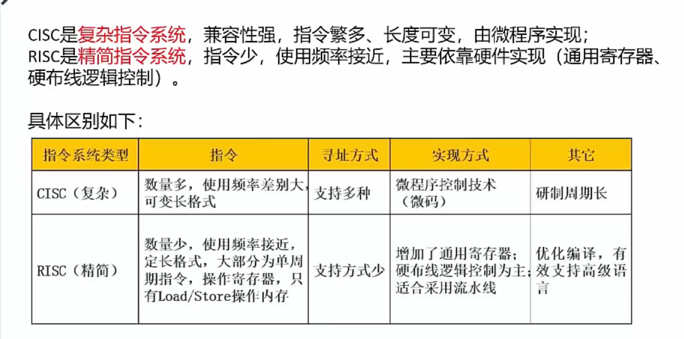

## 1. 计算机硬件组成

1. 主机（运算器、控制器、内部存储器）
    1. CPU：
        1. 运算器：
            1. 累加寄存器AC（运算结果或源操作数的存放区）
            2. 算术逻辑单元ALU（数据的算术和逻辑运算）
            3. 状态寄存器PSW（保存指令运行结果的条件码内容，如溢出标志等）
            4. 数据缓冲寄存器DR（暂时存放内存的指令或数据）
        2. 控制器：
            1. 指令寄存器IR（即将执行的指令）
            2. 指令译码（分析指令操作码）
            3. 程序计数器PC（存放下一条即将执行的指令的地址的部件）
            4. 地址寄存器AR（存放当前CPU所访问的内存地址）
            5. CU控制单元
            6. 时序部件
        3. 功能：程序控制、操作控制、时间控制、数据处理
    2. 主存储器（内部存储器、内存）
        1. 地址寄存器MAR(AR)，集成到CPU中
        2. 数据缓冲寄存器MDR(DR)，集成到CPU中
        3. 存储体
    3. 
2. 存储器（外部存储器、硬盘）
3. I/O设备

## 2.指令系统

1. 指令的功能：操作码字段OP，决定要完成的操作
2. 指令的操作对象：操作数地址码字段Addr，参加运算的数据及其所在的单元地址
3. 计算机指令执行过程：取指令 -> 分析指令-> 执行指令
4. 指令寻址方式：
    1. 顺序寻址
    2. 跳跃寻址：下一条指令的地址码不是由程序计数器给出，而是由本条指令直接给出
5. 指令操作数的寻址方式：
    1. 立即寻址：操作数直接在指令中给出
    2. 直接寻址：直接指出操作数在主存中的地址
    3. 间接寻址：指令中给出的是操作数地址的地址，需要两次访存
    4. 寄存器寻址：指令中的地址码是寄存器的编号，操作数在寄存器中
6. 复杂指令系统（CISC）：
    1. 指令数量众多
    2. 指令使用频率相差悬殊，二八原则
       
    3. flynn分类法根据计算机在执行程序的过程中指令流和数据流的不同组合，将计算机氛围四类
        1. SISD：单指令流单数据流
        2. SIMD：单指令流多数据流
        3. MISD：多指令流单数据流
        4. MIMD：多指令流多数据流
        5. 当前主流多核计算机属于MIMD
7. 指令流水线原理：将指令分为不同段，每段由不同的部分去处理，产生叠加的效果。
8. 流水线时间计算：
   1. 流水线周期：指令分为不同执行段，其中执行时间最长的段为流水线周期
   2. 流水线执行时间：1条指令总执行时间+（总指令条数-1）*流水线周期
   3. 流水线吞吐率计算：单位时间内执行的指令条数  指令条数/流水线执行时间
   4. 流水线加速比：不使用流水线执行时间/使用流水线执行时间

## 3.存储系统

## 4.校验码

1. 码距：两个编码中，从A码到B码转换所需改变的位数成为码距
2. 奇偶校验码：在编码中增加1位校验位来使编码中1的个数为奇数（偶数），从而使码距变成2
    1. 奇校验： 101110 -》 1011101，如果接收方收到的编码为奇数则无误，是偶数则有误
    2. 偶校验:  101110 -》 1011100，如果接收方收到的编码为偶数则无误，是奇数则有误
    3. 奇偶校验只能检一位错，并且无法纠错（2个1变成0还是偶数）
3. CRC（循环冗余校验码）
    1. 异或：同0非1
    2. 计算步骤（假设为10110，多项式为x^4+x+1(10011)）
        1. 在原始信息位后面添加0，假设生成多项式的阶为r，则在原始信息位后添加r个0，本例为101100000
        2. 由多项式得到除数，多项式x的幂指数存在的位置为1，不存在的位置为0，本例中为10011
        3. 生成CRC校验码，将前两部得到的被除数和除数进行模2除法运算：
           
        4. 得到余数1111，如果余数不足多项式的阶r，则在余数前面补0
        5. 将余数添加到原始信息后，生成最终发送信息串，本例为101101111
        6. 接收方进行校验，接收方接受了最终信息串后，用多项式来除

## 5. 总线结构

## 6. 输入/输出技术