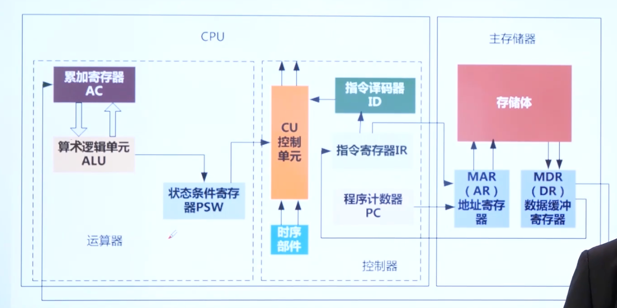
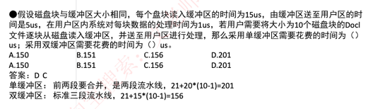
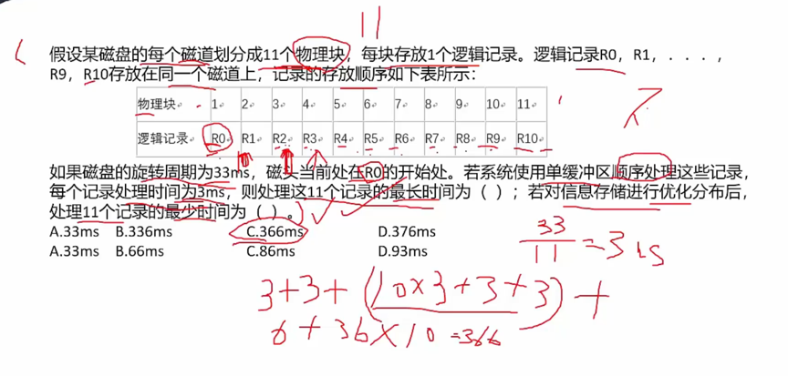
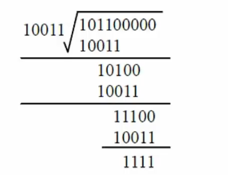

## 1. 计算机硬件组成

1. 主机（运算器、控制器、内部存储器）
    1. CPU：
        1. 运算器：
            1. 累加寄存器AC（运算结果或源操作数的存放区）
            2. 算术逻辑单元ALU（数据的算术和逻辑运算）
            3. 状态寄存器PSW（保存指令运行结果的条件码内容，如溢出标志等）
            4. 数据缓冲寄存器DR（暂时存放内存的指令或数据）
        2. 控制器：
            1. 指令寄存器IR（即将执行的指令）
            2. 指令译码（分析指令操作码）
            3. 程序计数器PC（存放下一条即将执行的指令的地址的部件）
            4. 地址寄存器AR（存放当前CPU所访问的内存地址）
            5. CU控制单元
            6. 时序部件
        3. 功能：程序控制、操作控制、时间控制、数据处理
    2. 主存储器（内部存储器、内存）
        1. 地址寄存器MAR(AR)，集成到CPU中
        2. 数据缓冲寄存器MDR(DR)，集成到CPU中
        3. 存储体
    3. 
2. 存储器（外部存储器、硬盘）
3. I/O设备

## 2.指令系统

1. 指令的功能：操作码字段OP，决定要完成的操作
2. 指令的操作对象：操作数地址码字段Addr，参加运算的数据及其所在的单元地址
3. 计算机指令执行过程：取指令 -> 分析指令-> 执行指令
4. 指令寻址方式：
    1. 顺序寻址
    2. 跳跃寻址：下一条指令的地址码不是由程序计数器给出，而是由本条指令直接给出
5. 指令操作数的寻址方式：
    1. 立即寻址：操作数直接在指令中给出
    2. 直接寻址：直接指出操作数在主存中的地址
    3. 间接寻址：指令中给出的是操作数地址的地址，需要两次访存
    4. 寄存器寻址：指令中的地址码是寄存器的编号，操作数在寄存器中
6. 复杂指令系统（CISC）：
    1. 指令数量众多
    2. 指令使用频率相差悬殊，二八原则
       
    3. flynn分类法根据计算机在执行程序的过程中指令流和数据流的不同组合，将计算机氛围四类
        1. SISD：单指令流单数据流
        2. SIMD：单指令流多数据流
        3. MISD：多指令流单数据流
        4. MIMD：多指令流多数据流
        5. 当前主流多核计算机属于MIMD
7. 指令流水线原理：将指令分为不同段，每段由不同的部分去处理，产生叠加的效果。
8. 流水线时间计算：
    1. 流水线周期：指令分为不同执行段，其中执行时间最长的段为流水线周期
    2. 流水线执行时间：1条指令总执行时间+（总指令条数-1）*流水线周期
    3. 流水线吞吐率计算：单位时间内执行的指令条数 指令条数/流水线执行时间
    4. 流水线加速比：不使用流水线执行时间/使用流水线执行时间
    5. 例题：
       

## 3.存储系统

1. 两级存储：Cache-主存、主存-辅存（虚拟存储体系）
2. 局部性原理
    1. 时间局部性原理：如果程序中的某条指令一旦执行，不久以后该指令可能再次执行
    2. 空间局部性原理：一旦程序访问了某个存储单元，在不久以后，可能会再次访问附近的存储单元
    3. 局部性原理的实现：Cache
3. Cache
    1. 用来存储当前最活跃的程序和数据，直接和CPU交互，位于CPU和主存之间
    2. 由控制部分和存储器组成，存储器存储数据，控制部分判断CPU要访问的数据是否在Cache中
    3. **CPU送出的事主存单元的地址，需要将主存地址转换为Cache地址，由硬件自动完成映射，这个过程称为地址映射**
        1. 直接映射：主存块号的低几位作为Cache块号,只要块号相同
        2. 全相联映射：主存块号的低几位作为Cache块号，Cache中的每个块都可以存放主存中的任何块
        3. 组相联映射：将cache存储器先分块再分组，主存也同样先分块再分组，组件采用直接映像，即主存中组号和cache中组号相同的组才能命中，但是组内采用全相联映像，即组号相同的两个组内的所有块可以任意调换
    4. 替换算法：
        1. 随机替换算法
        2. 先进先出算法
        3. 近期最少使用算法
        4. 优化替换算法：这种方法必须先执行一次程序，统计cache的替换情况，有了这样的先验信息，在第二次执行该程序时便可以用最有效的方式来替换
    5. 命中率和平均时间
        1. 命中率：命中次数/总访问次数
        2. 平均访问时间：**命中时间✖️命中率+未命中时间✖️未命中率**
4. 磁盘
    1. 磁盘有正反两面，每面有若干个磁道（同心圆），每个磁道有若干个扇区
    2. 磁头首先要寻找到对应的磁道，然后等待扇区旋转到磁头下方，然后读取数据，因此磁盘的访问时间由寻道时间和等待时间组成
    3. 寻道时间是指磁头移动到磁道所需的时间，等待时间为等待读写的扇区转到磁头下方所用的时间。
    4. 寻道时间的调度算法：
        1. 先来先服务FCFS
        2. 最短寻道时间优先SSTF,会产生饥饿现象
        3. 扫描算法SCAN：又称电梯算法，磁头在磁道上双向移动，会选择离磁头当前所在磁道最近的请求访问的磁道，并且与磁头方向移植，磁头永远从里向外或者从外向里一直移动完才调头，与电梯类似
        4. 单向扫描调度算法CSCAN：磁头在磁道上单向移动，但是当磁头到达磁道的最外侧或者最内侧时，立即返回到最内侧或者最外侧，再次从内向外或者从外向内移动
    5. 例题：
       
    6.

## 4.校验码

1. 码距：两个编码中，从A码到B码转换所需改变的位数成为码距
2. 奇偶校验码：在编码中增加1位校验位来使编码中1的个数为奇数（偶数），从而使码距变成2
    1. 奇校验： 101110 -》 1011101，如果接收方收到的编码为奇数则无误，是偶数则有误
    2. 偶校验:  101110 -》 1011100，如果接收方收到的编码为偶数则无误，是奇数则有误
    3. 奇偶校验只能检一位错，并且无法纠错（2个1变成0还是偶数）
3. CRC（循环冗余校验码）
    1. 异或：同0非1
    2. 计算步骤（假设为10110，多项式为x^4+x+1(10011)）
        1. 在原始信息位后面添加0，假设生成多项式的阶为r，则在原始信息位后添加r个0，本例为101100000
        2. 由多项式得到除数，多项式x的幂指数存在的位置为1，不存在的位置为0，本例中为10011
        3. 生成CRC校验码，将前两部得到的被除数和除数进行模2除法运算：
           
        4. 得到余数1111，如果余数不足多项式的阶r，则在余数前面补0
        5. 将余数添加到原始信息后，生成最终发送信息串，本例为101101111
        6. 接收方进行校验，接收方接受了最终信息串后，用多项式来除

## 5. 总线结构

1. 总线
    1. 计算机内部各部件之间传送信息的通道，由总线上的所有设备共享
    2. 总线的组成：内部总线（芯片与处理器之间通信的总线）、外部总线（计算机和外部设备的总线）、系统总线
    3. 系统总线（考试只要问到总线的分类回答采用这个答案）：地址总线（系统可管理的内存空间的大小）、数据总线（并行数据传输位数）、控制总线（传送控制命令）
    4. 半工总线：只能在一个方向上传输数据
    5. 全双工总线：可以在两个方向上传输数据
    6. 半双工总线： 可以在两个方向上传输数据，但是不能同时进行
    7. 串行总线：
        1. 全双工和半双工之分
        2. 串行总线的数据传输速度比并行总线慢，但是串行总线的线路简单，成本低，适合远距离传输
        3. 数据发送和接收有多种方式，程序查询方式和中断方式都可以。

## 6. 输入/输出技术

1. 内存与接口地址的编址方法
    1. 内存与接口地址独立编址
    2. 内存与接口地址统一编址
2. 计算机和外设间的数据交互方式
    1. 程序控制（查询）方式：CPU主动查询外设是否完成数据传输，效率极低
    2. 程序中断方式：外设向CPU发出中断请求，CPU暂停当前工作，转入中断服务程序，处理完中断后继续执行
    3. DMA方式（直接主存存取）：外设通过DMA控制器直接与主存交换数据，减少CPU的干预。CPU只需完成必要的初始化等操作
    4. 在一个总线周期结束后，CPU会响应DMA请求开始读取数据。
    5. CPU响应程序中断方式请求是在一条指令执行结束时