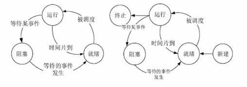
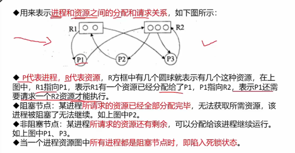
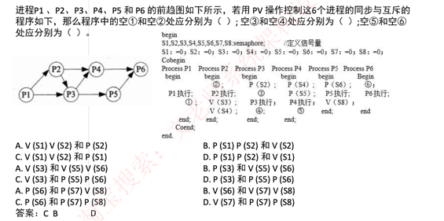
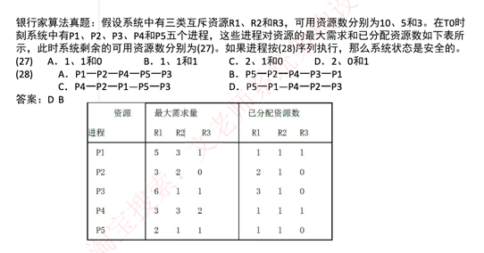
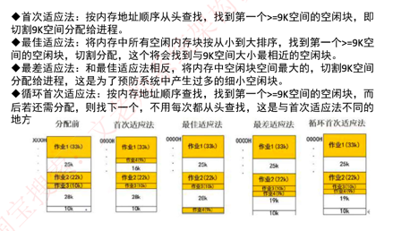
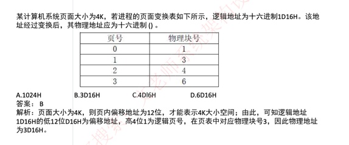
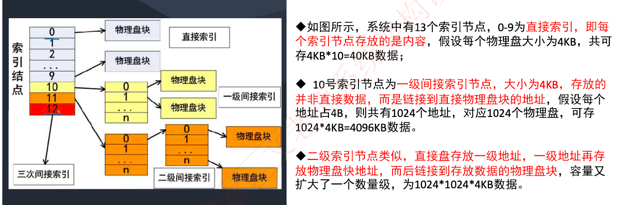

## 1. 操作系统概述

1. 操作系统的概述
    1. 操作系统的定义
        1. 有效地组织和管理系统中的各种软/硬件资源
        2. 为用户提供一个方便的、有效的、统一的接口
    2. 三个重要的作用：
        1. 管理计算机运行的程序和分配各种软硬件资源
        2. 为用户提供友善的人机界面
        3. 为应用程序开发和运行提供高效率平台
    3. 操作系统的特征：
        1. **并发性：
        2. 共享性
        3. 虚拟性
        4. 不确定性**
    4. 操作系统的功能：
        1. 进程管理
        2. 存储管理
        3. 设备管理
        4. 文件管理
        5. 作业管理
    5. 操作系统的分类：
        1. 批处理操作系统：单道批处理系统、多道批处理系统
        2. 分时操作系统：一个计算机系统与多个终端设备链接，将CPU的工作时间划分为许多很短的时间片，轮流为各个终端的用户服务，对交互要求高。
        3. 实时操作系统：计算机对于外来信息能够以足够快的速度进行处理，并在被控对象允许的时间内做出快速反应。对交互要求不高，但要求可靠性有保障
        4. 网络操作系统
        5. 分布式操作系统
        6. 微型计算机操作系统
    6. 嵌入式操作系统的主要特点：
        1. 微型化
        2. 可定制
        3. 实时性
        4. 可靠性
        5. 易移植性
    7. 嵌入式系统初始化过程：片级初始化->板级初始化->系统初始化

## 2. 进程管理

1. 进程的组成：进程控制块PCB（唯一标志）、程序（描述要做什么）、数据（存放进程执行时所需数据）
2. 进程的三态图（五态图）
    1. 
3. 进程的状态转换
    1. 创建状态：进程正在被创建
    2. 就绪状态：进程已经准备好，等待CPU调度
    3. 运行状态：进程获取到CPU资源，执行
    4. 阻塞状态：进程正在等待某个事件的发生，阻塞的进程在时间发生之后会进入就绪状态尝试获取CPU资源，而不是直接执行
    5. 终止状态：进程已经执行完毕
4. 前趋图：反映了任务间的并行，任务间的先后顺序。
5. 进程资源图：
   
6. 进程同步与互斥
    1. 临界资源：一次只允许一个进程访问的资源，以互斥访问
    2. 临界区：访问临界资源的代码段，本质是一段程序代码
    3. 互斥：一次只允许一个进程访问临界资源
    4. 同步：多个任务可以并发执行，只不过有速度上的差异，在一定情况下需要等待其他任务的结果
    5. 信号量：用于进程间的同步和互斥
        1. 互斥信号量：只能取0或1的信号量，用于互斥访问临界资源
        2. 同步信号量：对共享资源的访问控制，用于同步进程的执行，初值一般是共享资源的数量
    6. PV操作：
        1. P操作：申请资源，S=S-1,结果为S≥0，说明能获取到资源，进程继续执行，否则进程进入阻塞状态
        2. V操作：释放资源，S=S+1,结果为S<=0，说明有进程在等待资源，唤醒一个进程（因为缺少资源被阻塞的进程可以继续执行）,将其插入就绪队列，等待CPU调度
        3. 互斥信号量的PV操作总是成对出现的，同步信号量的PV操作不一定成对出现
    7. 考试真题
       
7. 进程调度
    1. 可剥夺式调度：当有更高优先级的进程到来时，当前进程会被剥夺CPU资源
    2. 不可剥夺式调度：当有更高优先级的进程到来时，当前进程不会被剥夺CPU资源
    3. 调度算法：
        1. 先来先服务：按照进程到达的先后顺序进行调度
        2. 短作业优先：按照进程的执行时间进行调度
        3. 高优先级优先：按照进程的优先级进行调度
        4. 时间片轮转：按照时间片进行调度
        5. 多级反馈队列：按照进程的优先级和时间片进行调度
8. 死锁
    1. 死锁产生的四个必要条件：资源互斥、每个进程占有资源并等待其他资源、系统不能剥夺进程资源、进程资源图是一个环路。
    2. 解决死锁的方法：预防死锁、避免死锁（银行家算法）、检测死锁、解除死锁
    3. 死锁资源计算：系统有n个进程，每个进程需要R个资源，那么发生死锁的最大资源为n*(R-1)，其不发生死锁的最小资源为n*(R-1)+1
9. 银行家算法习题，答案（B,D）：
   

## 3. 存储管理

1. 分区存储管理（**整存**）：将某进程运行所需的内存整体一起分配给它
    1. 固定分区存储管理：将内存分为若干个固定大小的分区，每个分区只能分配给一个进程，会产生内部碎片
    2. 动态分区存储管理：将内存分为若干个大小不等的分区，正好划分为作业需要的大小，不存在内部碎片
    3. 可重定位分区存储管理：将内存分为若干个大小不等的分区，每个分区可以分配给一个进程，但是分区的起始地址可以改变，不存在外部碎片
    4. 动态分区方法：
       

2. 分页存储管理：逻辑页分为页号和页内地址
    1. 页号：页号是一个逻辑地址的高位部分，用于标识一个页，如果进程需要4GB，一个页只能存4KB，那么页号就是2^20，页号的位数就是20
    2. 页内地址：页内地址是一个逻辑地址的低位部分，用于标识页内的地址，如果一个页有4KB，那么页内地址的位数就是12
    3. 页表：页表是一个页号到物理块号的映射表
    4. 页表的组织方式：
        1. 页表基址寄存器+页表长度寄存器
        2. 两级页表
        3. 多级页表
    5. 页面置换算法：
        1. 最佳置换算法：选择未来最长时间不被访问的页面进行置换，预测
        2. 先进先出算法：选择最早进入内存的页面进行置换，会产生抖动现象
        3. 最近最少使用算法：选择最近最少使用的页面进行置换
        4. 淘汰原则：**_优先淘汰最近未访问的，而后淘汰最近未被修改的页面_**
    6. 快表是将页表存于cache中，慢表是存于内存中，慢表需要访问两次内存才能取出页，而快表只需要访问一次（获取对应关系），访问内存是为了拿数据
    7. 

3. 分段存储管理：每段也有段号和段内地址，每段无力大小不同，分段是根据逻辑整体分段的
    1. 段表：段号到段内地址的映射表

## 4. 设备管理

1. I/O设备管理软件
    1. 用户进程：进行I/O调用，格式化I/O
    2. 设备无关软件：命名、保护、阻塞、缓冲、分配
    3. 设备驱动程序：置设备寄存器：检查状态
    4. 中断处理程序：当I/O结束时唤醒驱动程序
    5. 硬件：执行I/O操作
    6. 设备无关软件检查高速缓存中有无要读的数据块，如果有则直接返回，否则向设备驱动程序发出请求

## 5. 文件管理

1. 文件目录：
    1. 相对路径：从当前路径开始的路径
    2. 绝对路径：从根目录开始的路径
    3. 全文件名：绝对路径+文件名

2. 索引文件结构
   1.

3. 文件存储空间管理
   1. 空闲区表
   2. 位示图：每一位对应文件存储区上的一个物理块，取值0和1分别表示空闲和占用
   3. 某计算机的字长为32位，若磁盘的容量为300GB，物理块的大小为4MB，那么位示图的大小为300*1024/4/32 = 2400

## 6. 作业管理

