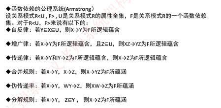

## 1. 数据库系统

1. 三级模式-两级映像
    1. 内模式：管理如何存储物理的数据，对应具体物理存储文件
    2. 概念模式：用户看到的数据模式，对应通常使用的基本表
    3. 外模式：对应数据库中的视图这个级别，将表进行一定处理后再提供给用户使用
    4. 外模式-模式映像：是表和视图之间的映射，如表中数据发生了修改，只需要修改此映射，无需修改应用程序
    5. 模式-内模式映像：是概念模式和内模式之间的映射，如表的字段发生了变化，只需要修改此映射，无需修改应用程序

## 2. 数据库设计

1. 需求分析：需求说明文档、数据字典、数据流图
2. 概念结构设计：ER图
    1. 属性冲突：属性冲突是指两个或多个实体类型具有相同的属性名，但是属性的含义不同
    2. 命名冲突：命名冲突是指两个或多个实体类型具有相同的名称，但是实体类型的含义不同
    3. 结构冲突：结构冲突是指两个或多个实体类型具有相同的结构，但是实体类型的含义不同
3. 逻辑结构设计：关系模式
4. 物理设计：数据的访问方式
5. 数据库实施阶段：具体的数据库
6. 数据库运行和维护阶段

## 3. 数据模型

1. 关系模型是二维表的形式表示的实体-联系模型，行表示元组，列表示属性
2. 概念模型是从用户的角度进行建模的，是用户对数据的观点
3. 网状模型表示实体类型及其实体之间的联系，一个事务和另外几个都有联系，形成一张网
4. 面向对象模型是采用面向对象的方法设计数据库
5. 数据模型三要素：数据结构、数据操作、数据约束
6. ER图：
    1. 实体（长方体）（强实体、弱实体）：一个实体是一个独立的对象，可以是一个人、一个地点、一个事件或者一个概念
    2. 属性（椭圆）：实体的特征、属性，如学生的学号、姓名、性别等
    3. 联系（菱形）（一对一，一对多，多对多）：实体之间的联系，如学生和课程之间的选课关系

## 4. 关系代数

1. 并：结果是两张表中所有记录数合并，相同记录只显示一次
2. 交：结果是两张表中相同的记录
3. 差：S1-S2，结果是S1中有而S2中没有的记录
4. 笛卡尔积: S1×S2，结果是S1和S2中所有记录的组合
5. 投影 (π)：结果是从关系中选取部分属性
6. 选择(σ)：结果是从关系中选取满足条件的记录
7. 自然连接 (⋈)：显示全部的属性列，但是相同属性列只显示一次，显示两个关系模式中属性相同且值相同的记录。
8. 等值链接：等值连接并不去掉重复的属性列

## 5. 函数依赖

1. 给定一个X，能唯一确定一个Y，就称X确定Y，或者说y依赖于x，例如Y=x*x函数
2. 函数依赖的两种规则：
    1. 部分函数依赖：在一个关系中，如果存在A->B，且B不完全依赖于A，则称B部分函数依赖于A
    2. 传递函数依赖：在一个关系中，如果存在A->B，B->C，且C不完全依赖于A，则称C传递函数依赖于A
3. 函数依赖的armstrong公理：
   
4. 